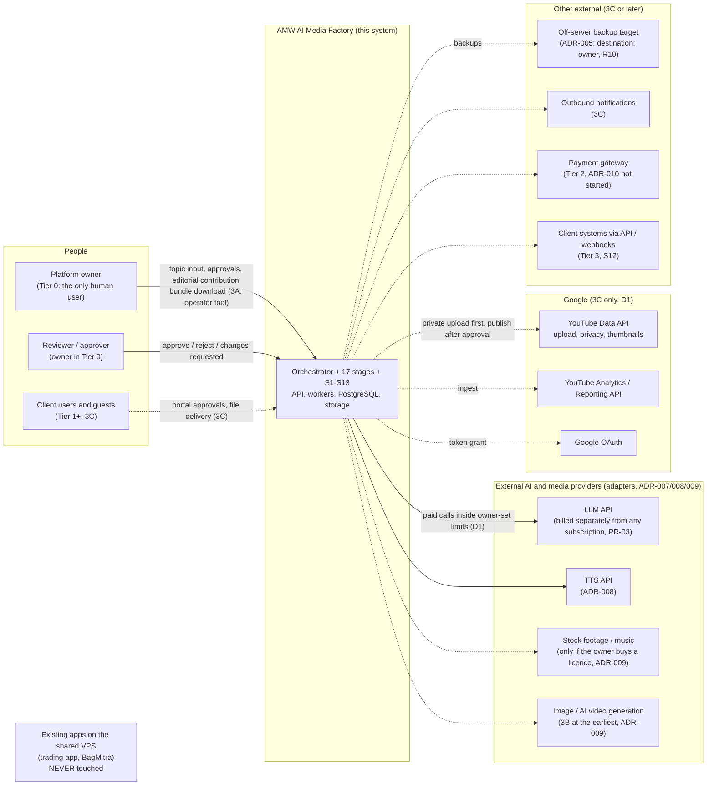
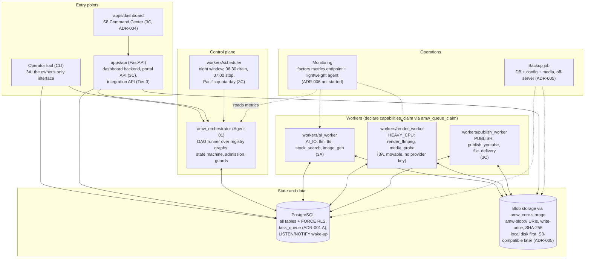
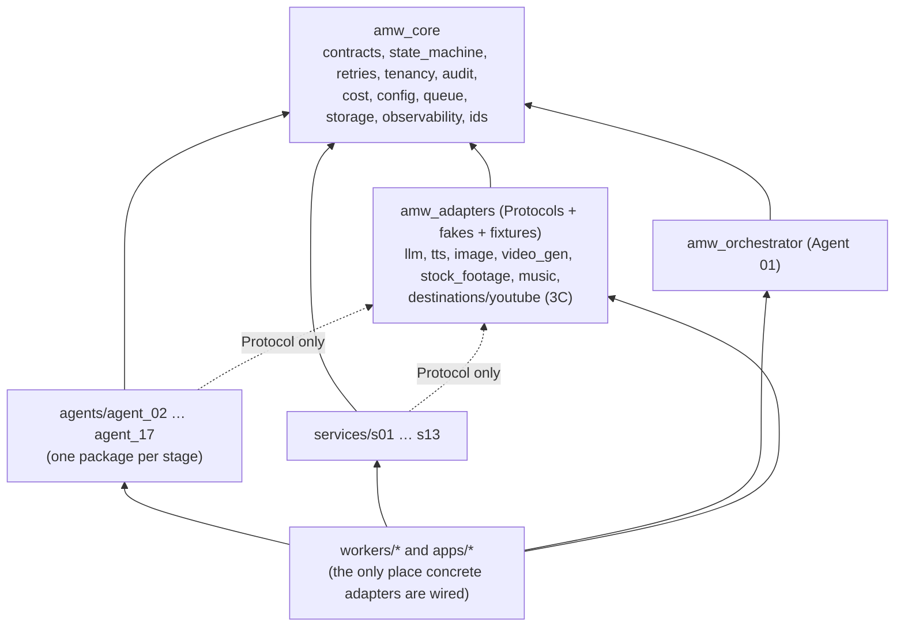
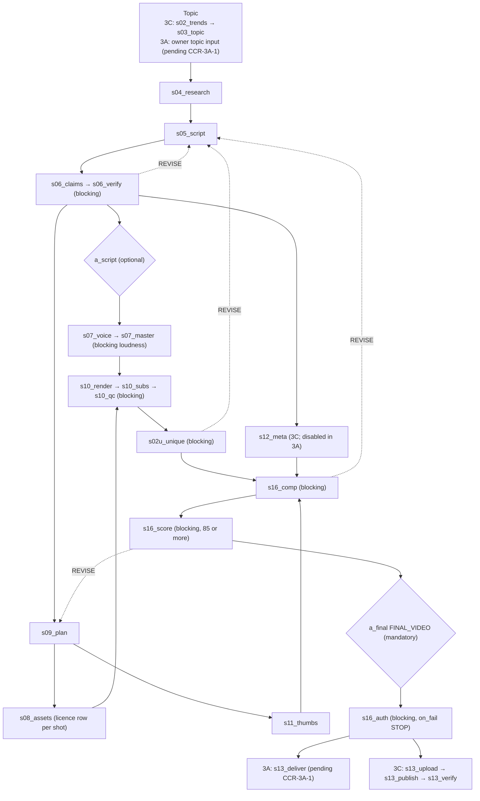
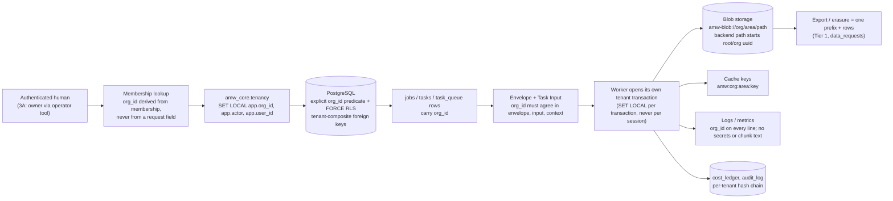
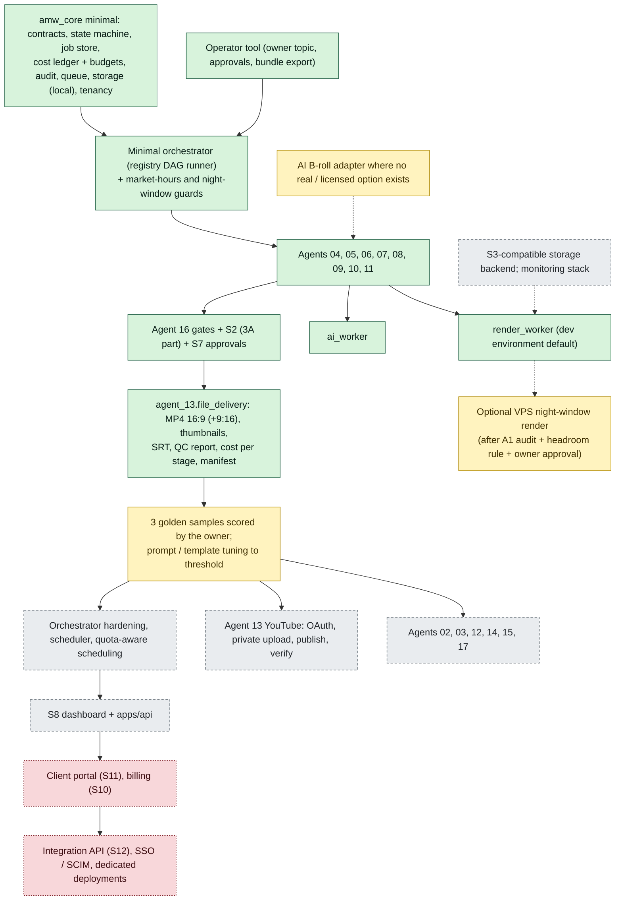
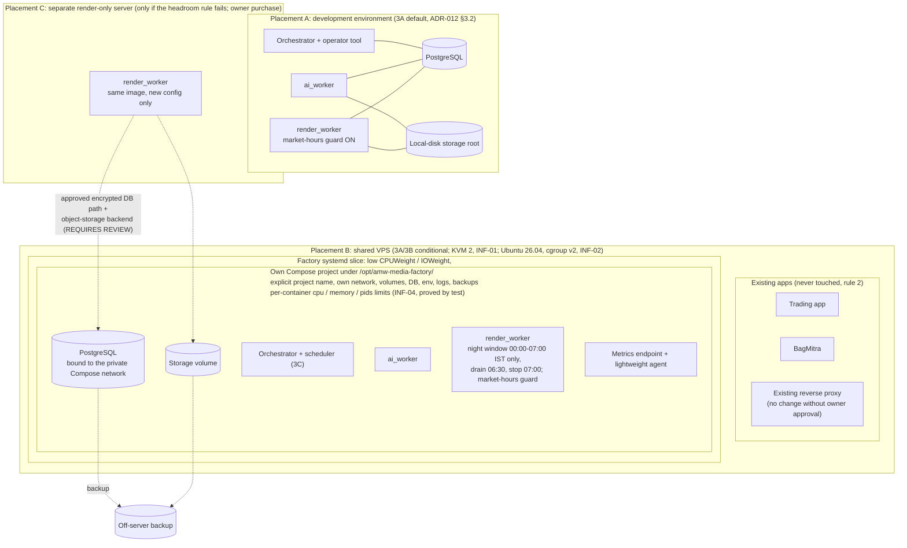
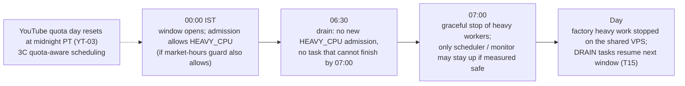

# 01 — Master Architecture

| Field | Value |
|---|---|
| Status | **Draft - documentation**. Software: **Planned** (GLOSSARY §6.11). |
| Owner agent / service | Agent **01** CEO & Master Orchestrator (workflow engine, admission, scheduling); S5 Infrastructure Intelligence → 01; S8 Executive Command Center → 01 (plan Q4) |
| Depends on | MASTER_DIRECTIVE.md §1, §2, §3 · GLOSSARY_AND_IDS.md · 03_COMMUNICATION_STANDARD.md (contracts, §8 storage URIs, §10 tenant context, §11 state machine) · 04_DATABASE_ARCHITECTURE.md (§3 tenancy, §4 table catalogue) · 07_FAILURE_MANAGEMENT.md · 24_PRODUCTION_TYPES.md (§3.2 task types, §7 registry graphs) · 27_ENGINEERING_STANDARDS.md (§9 walking skeleton) · SOURCE_LAYOUT.md · 3A_SLICE_SPEC.md · 08_SECURITY.md · 09_COST_AND_BUDGET.md · ADR-001, ADR-005, ADR-007, ADR-008, ADR-009, ADR-012, ADR-013 |
| Directive sections covered | **§2** (architecture principle), **§3** (3.1 registry, 3.2 shared services, 3.2a stack, 3.3 cross-cutting standards, 3.4 production types, 3.5 engineering standards — as architecture placement only); §1 deployment isolation, heavy work, production window (deployment view); §1C.14 infrastructure by tier (tier overlay) |
| Owner decisions applied | **D1** (3A / 3B / 3C build order; no upload and no Google OAuth in 3A; spend controls; secrets; render never in market hours), **D2** (fast track) |
| Scope / tier marking | Every section header carries **[3A / 3B / 3C · Tier n]** (tiers per GLOSSARY §6.47). |
| Research IDs used | INF-01, INF-02, INF-03, INF-04, INF-05, INF-06, INF-07, INF-08, INF-09, INF-11, YT-01, YT-03, YT-04, PR-02, PR-03 |
| Rule of this document | It **places** components and flows. It defines no contract, table, field, enum or task type; every such name is taken from the Wave A documents. Names that are not yet in a contract carry "(pending CCR)" and are the CCRs already listed in 3A_SLICE_SPEC.md §13. |

---

## 1. Purpose and reading guide [3A / 3B / 3C · Tier 0-3]

This document is the single picture of how the AMW AI Media Factory is put together: who talks to it, which processes it runs, how a job moves through the 17 stages, how tenant data is fenced, what is built in 3A versus later, and where each process runs.

| You need | Section |
|---|---|
| Who and what is outside the system | §3 System context |
| Processes, stores and who owns them | §4 Container / service view |
| The 17 agents and 13 shared services placed on the architecture | §5 |
| How a job runs through the stages | §6 Pipeline flow, §7 Task lifecycle |
| How `org_id` is enforced end to end | §8 Tenant data flow |
| What exists in 3A, 3B, 3C | §9 Scope overlay |
| Where it runs (development environment, shared VPS, movable render worker) | §10 Deployment view |
| How it grows from Tier 0 to Tier 3 | §11 |
| Open items | §13 |

Detailed rules stay in their owning document; this document cites them and does not restate them.

---

## 2. Architecture principles (directive §2, §3.3) [3A · Tier 0]

| # | Principle | Consequence in this design | Source |
|---|---|---|---|
| P1 | **Predefined workflow, not autonomous agents.** The 17 "agents" are pipeline stages owned by one code-controlled orchestrator. Control flow is a persisted state machine, never LLM-to-LLM calls. | `amw_orchestrator` executes registry graphs (24 §7) only. A stage's Task Output `next_action` is advisory; the orchestrator decides (03 §5.3). Agents never import each other (SOURCE_LAYOUT §2 rule 2). | §2; 03 §11 |
| P2 | **Each stage declares its deterministic rules and its LLM judgements, and why.** | Declared per stage in its agent blueprint (`agents/agent_NN_*.md`). Gates are deterministic-first; an LLM score is never the only gate (24 §3.3.4; §3.3 Quality). | §2; §3.3 |
| P3 | **No new autonomous agents beyond the 17.** Support and enhancement functions are shared services S1-S13 with a named owning agent. | §5 registry overlay. | §2; §3.2 |
| P4 | **One shared library** for contracts, state machine, retries, tenancy, audit, cost, config, queue, storage, observability. | `packages/amw_core` imports no internal package (SOURCE_LAYOUT §2 rule 1). | §3.3; §3.5.5 |
| P5 | **Tenant isolation is absolute.** `org_id` on every row, message, blob URI, cache key and log line; RLS is the second line of defence. | Five layers, §8 (08 §8). | rule 9; 04 §3 |
| P6 | **Workers declare capabilities; nothing assumes identical workers.** | Claim filters on `capability` and `resource_class` (GLOSSARY §6.20, §6.6; ADR-001). The render worker moves by configuration only (ADR-012 §3.1). | §3.3 Migration; §1 Heavy work |
| P7 | **Simplest stack that meets the requirement.** No extra resident services on the shared server. | PostgreSQL is database and queue (ADR-001 option A; INF-05, INF-06 alternatives); no Redis/Celery at Tier 0. | §3.2a; §1 Queue |
| P8 | **Never publish an unapproved video; no infinite retries; no silently dropped job.** | Mandatory `FINAL_VIDEO` approval + `agent_16.publication_authorisation`; hard caps (07 §9); DLQ (07 §5); publish guard trigger (04 §5.21). | rule 5 |
| P9 | **No hard-coded keys, models or providers.** | Provider adapters behind `Protocol`s, selection by config (ADR-007); keys only through the environment's secret mechanism (D1; 08 §3). | rule 5; §3.3 AI providers |
| P10 | **Existing apps on the shared server are never touched.** | Own Compose project, own network/volumes/DB, own systemd slice with low weights and hard caps (§10; INF-03, INF-04). | rule 2; §1 |

REQUIRES REVIEW (Phase 1): directive §2 names Anthropic, "Building effective agents" as the research basis for P1; no RESEARCH_LOG entry for it was found. A log entry with URL and date is needed (rule 3). The principle itself is binding through the directive.

---

## 3. System context [3A / 3C · Tier 0-3]



Solid edges exist in 3A; dotted edges are 3B / 3C / Tier 1+.

| External party | Interaction | Phase | Constraint (source) |
|---|---|---|---|
| Platform owner | Supplies the topic, approves script (optional) and final video, records the editorial contribution and human scores, downloads the bundle | 3A (operator command-line tool, 3A_SLICE_SPEC §2.1, R14) → 3C (S8 dashboard) | Human approval and editorial contribution on every video (§1; 24 §3.4) |
| LLM / TTS providers | Paid API calls through adapters | 3A | Only after the owner sets a spending limit at each provider; per-video and pilot budgets stop on breach (D1; 09) |
| Stock / music | Licensed sourcing | 3A only if bought; otherwise later | No purchase without the owner (rule 8; ADR-009) |
| YouTube Data API | Resumable upload, `privacyStatus=private` set explicitly, publish after authorisation | **3C** | Upload draws from its own bucket, default 100/day (YT-01); quota day is US Pacific (YT-03); privacy always explicit (YT-04) |
| Google OAuth | Channel connection | **3C** | Not in 3A (D1) |
| Off-server backup | DB + config + media backups | before the first run whose outputs must be kept (ADR-005) | Destination is an owner decision (3A_SLICE_SPEC R10) |
| Existing apps on the VPS | None. They share the machine only | always | Never modified, restarted or removed (rule 2; §1 Deployment isolation) |

---

## 4. Container / service view [3A / 3C · Tier 0]

### 4.1 Diagram



### 4.2 Container table

| Container (SOURCE_LAYOUT path) | Responsibility | Owner | `resource_class` / capabilities (GLOSSARY §6.6, §6.20) | DB role (04 §3.1) | Secrets it holds (08 §3.1 rule 4) | Phase · Tier |
|---|---|---|---|---|---|---|
| Operator tool | Create job from owner topic, list approvals, record approval / editorial contribution / human scores, verify and export the delivery bundle, export the audit + cost records | 01 / S7 | — | `amw_app` (tenant context set by `amw_core.tenancy`) | DB credentials only | **3A** · T0 (replaced by S8 in 3C; R14) |
| `apps/api` | HTTP backend for S8, client portal (S11), later integration API (S12) | 01 | — | `amw_app`; `amw_auth` for identity (ADR-003) | DB, auth | 3C · T0 (portal T1/T2, integration API T3) |
| `apps/dashboard` | S8 Command Center UI; platform-owner view and tenant view | S8 → 01 | — | via API only | none | 3C · T0 (stack: ADR-004, not started) |
| `amw_orchestrator` | Executes registry task graphs (24 §7); creates tasks; applies 03 §11 transitions; admission (T07 guards); revision routing (24 §3.3); L2 escalation (07 §7) | 01 | LIGHT | `amw_app` | DB | **3A minimal** DAG runner · T0; hardening 3C (D1) |
| `workers/scheduler` | Night window, 06:30 drain, 07:00 graceful stop, quota-aware scheduling on the Pacific day (YT-03), night report | 01 | LIGHT | `amw_app` | DB | **3C** · T0. In 3A only the ADR-012 market-hours and night-window guards exist, inside admission |
| `workers/ai_worker` | Runs AI_IO stage tasks through adapters (LLM, TTS, stock search) | stage agents | AI_IO; `llm`, `tts`, `stock_search` (+ `image_gen` when an adapter is live) | `amw_app` | provider keys of the adapters it runs, DB, storage | **3A** · T0 |
| `workers/render_worker` | FFmpeg render, audio master, subtitles, technical QC (all HEAVY_CPU, 24 §7.1) | 07 / 10 | HEAVY_CPU; `render_ffmpeg`, `media_probe` | `amw_app` | DB, storage only; **no provider key** (3A_SLICE_SPEC §6.4) | **3A** · T0; movable (ADR-012) |
| `workers/publish_worker` | YouTube upload / publish / verify; client file delivery at scale | 13 | PUBLISH; `publish_youtube`, `file_delivery` | `amw_publisher` (only role reading encrypted token columns, 04 §3.1) | OAuth data keys (08 §6), DB, storage | **3C** · T0 design / T1 |
| PostgreSQL | All tables (04 §4), `task_queue`, `state_transitions`, `audit_log`, `cost_ledger`; system functions (04 §3.6) | 01 (schema), S6 (roles) | — | roles of 04 §3.1 | — | **3A** · T0 |
| Blob storage | Tenant-prefixed, write-once blobs (03 §8); local-disk backend first | 01 / S6 | — | — | backend credentials via config | **3A** local disk · T0; S3-compatible backend 3C or on ADR-005 trigger |
| Monitoring | Factory metrics endpoint + lightweight host agent on the shared server; Prometheus/Grafana only on a dedicated server | S5 → 01 | — | `amw_readonly` | none | 3A: JSON logs + metrics endpoint (27 §7.3.6); stack 3C (ADR-006 not started) |
| Backup job | Off-server DB + config + media backup, restore tests | S6 / 01 | LIGHT | `amw_readonly` or backup role (12_DISASTER_RECOVERY.md) | backup target credentials | Before the first kept run (ADR-005 §3.4; R10) |

Notes:
1. **Which process registers `file_delivery` in 3A** is not named in 3A_SLICE_SPEC (the publish worker is 3C there). REQUIRES REVIEW (Phase 1): owner of the 3A delivery capability. Provisional default (owner rule A.9): `workers/ai_worker` also declares `file_delivery` in 3A through configuration; no contract change is needed because the capability value already exists (GLOSSARY §6.20).
2. **Monitoring footprint** has no official figure for either option (INF-07 Beszel: no RAM figure; INF-08 Grafana: 512 MB minimum for evaluation). The choice waits for measurement and ADR-006.
3. **No container holds a secret it does not use**, and no secret is in a variable shared by all containers (08 §3.1 rule 4).

### 4.3 Package dependency view (SOURCE_LAYOUT §2)



Agents and services never import each other; every hand-off is a contract message routed by the orchestrator (SOURCE_LAYOUT §2 rule 2; 03 §4).

---

## 5. Registry overlay: 17 agents and S1-S13 on the architecture (directive §3.1, §3.2) [3A / 3C · Tier 0-3]

### 5.1 Agents (the §3.1 registry is binding; names unchanged)

| ID | Agent | Architectural role | Runs as | Task types (24 §3.2) | Phase |
|---|---|---|---|---|---|
| 01 | CEO & Master Orchestrator | Control plane: workflow engine, admission, scheduling, resource monitor (S5), governance (S7), command center (S8), tenancy (S9), integration API (S12) | `amw_orchestrator`, `workers/scheduler`, `apps/api` | owns `svc_s07.request_approval` | **3A minimal**; hardening 3C |
| 02 | Market Intelligence | Strategy stage before production | ai_worker | `agent_02.trend_scan` | 3C |
| 03 | Content Strategy | Strategy stage: topic selection | ai_worker | `agent_03.topic_selection` | 3C (3A: owner topic replaces it, CCR-3A-1 pending) |
| 04 | Research & Knowledge | Production stage; knowledge library | ai_worker | `agent_04.research_pack`; `agent_04.knowledge_ingest` (pending CCR, ADR-013) | **3A** |
| 05 | Scriptwriter | Production stage; owns S3 | ai_worker | `agent_05.script_draft`, `agent_05.shorts_adaptation`, `svc_s03.*` (3C) | **3A** |
| 06 | Fact Checker | Blocking gate stage | ai_worker | `agent_06.claim_extraction`, `agent_06.claim_verification` | **3A** |
| 07 | Voice Production | Production stage (TTS = AI_IO, mastering = HEAVY_CPU) | ai_worker + render_worker | `agent_07.voice_synthesis`, `agent_07.audio_master` | **3A** |
| 08 | Visual Assets | Production stage; licence ledger rows | ai_worker | `agent_08.asset_sourcing` | **3A** |
| 09 | Video Director | Production stage: shot plan / timeline | ai_worker | `agent_09.shot_plan` | **3A** |
| 10 | Video Editor | Render, subtitles, technical QC (blocking) | render_worker | `agent_10.render`, `agent_10.subtitles`, `agent_10.technical_qc` | **3A** |
| 11 | Thumbnail Design | Production stage | ai_worker | `agent_11.thumbnail_variants` | **3A** |
| 12 | SEO & Metadata | Metadata stage | ai_worker | `agent_12.metadata` | 3C (disabled in 3A, R1) |
| 13 | Publishing & Delivery | Destination adapters; owns S11 | publish_worker (3A delivery: see §4.2 note 1) | `agent_13.file_delivery` (**3A**); `agent_13.upload_private`, `agent_13.publish`, `agent_13.verify_publication` (3C) | 3A delivery only; rest 3C |
| 14 | Analytics | Post-publish system jobs; owns S1, S13 | ai_worker / scheduled | `agent_14.analytics_ingest` | 3C |
| 15 | Growth & Revenue | Economics; owns S4, S10 | library + scheduled | (S4 budget guard is used in 3A through `amw_core.cost`) | S4 **3A**; rest 3C |
| 16 | Compliance & QA | Blocking gates; owns S2, S6 | ai_worker (LIGHT for authorisation) | `svc_s02.uniqueness_check`, `agent_16.compliance_gate`, `agent_16.quality_score`, `agent_16.publication_authorisation` | **3A** gates |
| 17 | Brief & Creative Strategy | Client / ad intake before production | ai_worker | `agent_17.*` | 3C · Tier 1+ |

### 5.2 Shared services (not LLM agents unless an ADR says so)

| Service | Owner | Lives in | Phase · Tier |
|---|---|---|---|
| S1 Audience Intelligence | 14 | `services/s01_*` | 3C · T0 |
| S2 Uniqueness Auditor | 16 | `services/s02_*` | **3A** part (b)(c); cross-video 3C (3A_SLICE_SPEC §2.4) |
| S3 Localisation, Translation & Dubbing | 05 | `services/s03_*` | 3C · T1 |
| S4 Financial Controller + Budget Guard | 15 | `amw_core.cost` + `services/s04_*` | **3A** · T0 (09) |
| S5 Infrastructure Intelligence + resource monitor | 01 | `services/s05_*` + monitoring | 3A logs/metrics; 3C full · T0 |
| S6 Security & Audit | 16 | `amw_core.audit` + `services/s06_*` | **3A** · T0 (08) |
| S7 Human Approval & Governance | 01 | `services/s07_*` | **3A** (`owner_one_tap`, `owner_sensitive`) · T0 |
| S8 Executive Command Center | 01 | `apps/dashboard` + `apps/api` | 3C · T0 |
| S9 Tenant, Identity & Access | 01 | `amw_core.tenancy` + `services/s09_*` | 3A tenancy core; identity UI 3C · T0 |
| S10 Billing, Metering & Plans | 15 | `services/s10_*` | 3C · T2 |
| S11 Client Portal, Brand Kits & White-label | 13 | `services/s11_*` + `apps/*` | 3A minimal brand kit; portal 3C · T1/T2 |
| S12 Integration API & Webhooks | 01 | `apps/api` + `services/s12_*` | 3C · T3 |
| S13 Community & Comments | 14 | `services/s13_*` | 3C · T0+ (never auto-post) |

---

## 6. Pipeline flow: the 17 stages under the orchestrator [3A / 3C · Tier 0]

### 6.1 Stage families

```mermaid
flowchart LR
  ORC{{"Agent 01 Orchestrator<br/>state machine (03 §11), admission,<br/>revision routing (24 §3.3), L2 escalation"}}

  subgraph STRAT["Strategy (3C)"]
    A02["02 Market Intelligence"]
    A03["03 Content Strategy"]
    A17["17 Brief & Creative<br/>(client / ad types, Tier 1+)"]
  end
  subgraph PROD["Production (3A)"]
    A04["04 Research"]
    A05["05 Script"]
    A07["07 Voice"]
    A09["09 Director"]
    A08["08 Visual assets"]
    A10["10 Editor: render, subs"]
    A11["11 Thumbnails"]
  end
  subgraph GATE["Gates (3A, blocking)"]
    A06["06 Fact check"]
    Q10["10 Technical QC"]
    G16["16 Uniqueness (S2), compliance,<br/>quality score, authorisation"]
    S7["S7 approvals<br/>SCRIPT (opt), FINAL_VIDEO"]
  end
  subgraph META["Metadata (3C)"]
    A12["12 SEO & Metadata"]
  end
  subgraph OUT["Delivery / publishing"]
    D13["13 file delivery (3A)"]
    P13["13 upload private, publish,<br/>verify (3C)"]
  end
  subgraph POST["Post-publish system jobs (3C)"]
    A14["14 Analytics"]
    A15["15 Growth & Revenue"]
  end

  ORC --> STRAT
  ORC --> PROD
  ORC --> GATE
  ORC --> META
  ORC --> OUT
  ORC --> POST
  STRAT --> PROD --> GATE --> OUT
  META --> GATE
  OUT --> POST
  POST -. "learning-loop proposals (15_LEARNING_LOOP.md),<br/>never automatic policy change" .-> STRAT
```



Every arrow between stages is **data through the orchestrator**: a stage writes its Task Output and blobs; the orchestrator validates, transitions state and creates the next tasks from the registry graph. No stage calls another stage.

### 6.2 Full graph of the first production type

The canonical stage graph of `CHANNEL_LONG_FORM` v1 is defined in 24 §7.1 (stage IDs `s02_trends` … `s13_verify`). The 3A variant (v2, pending CCR-3A-1: owner topic in place of `s03_topic`, `s12_meta` optional, `s13_deliver` to a `FILE_DELIVERY` destination) is drawn in 3A_SLICE_SPEC §3 and is not repeated here. The summary below shows how the families of §6.1 map onto those stage IDs, with the 3A / 3C split.



Rules carried from the contracts (not redefined):
1. REVISE routes are capped by `limits.max_revision_loops` (3 for `CHANNEL_LONG_FORM`); after the cap the job completes `BLOCKED_COMPLIANCE` and is never published or delivered (24 §3.3; 03 §11.5).
2. `NEEDS_HUMAN_REVIEW` inserts a `SENSITIVE_CLAIM` or `COPYRIGHT_DOUBT` approval (24 §3.3.2).
3. A `SHORTS` cut is a child job with `jobs.parent_job_id` and the inherited `correlation_id` (03 §10; 3A_SLICE_SPEC §3 rule 4).
4. Analytics (`agent_14.analytics_ingest`) and Agent 15 economics are separate scheduled system jobs with outcome `NO_DELIVERABLE` (24 §7.1; GLOSSARY §6.4).
5. Other production types (24 §7.2-7.6) reuse the same stages with a different enabled set; a new business line is a registry record plus templates, not a new pipeline (§3.4).

---

## 7. Task lifecycle across containers (03 §11) [3A · Tier 0]

```mermaid
sequenceDiagram
  autonumber
  participant O as Orchestrator (01)
  participant DB as PostgreSQL (RLS)
  participant S4 as S4 Budget guard (amw_core.cost)
  participant Q as task_queue
  participant W as Worker (ai / render)
  participant P as Provider adapter
  participant ST as Blob storage

  O->>DB: create task PENDING (deps from registry graph)
  O->>DB: VALIDATING: input contract, tenant, idempotency key
  O->>S4: reserve resource_budget.max_cost_micros on every applicable budget
  alt reservation refused
    S4-->>O: refused
    O->>DB: CHECKPOINTED / AWAITING_BUDGET (L3 to owner)
  else reserved
    O->>DB: QUEUED
    O->>Q: insert READY row (same transaction)
    Q-->>W: NOTIFY (identifiers only)
    W->>Q: amw_queue_claim (capability, resource_class, guards)
    W->>DB: SET LOCAL app.org_id; RUNNING under a lease, heartbeat
    W->>ST: read inputs (URI org check, SHA-256 verify)
    W->>P: paid call with idempotency key (breaker, timeout)
    P-->>W: result
    W->>DB: cost_ledger row (ESTIMATE, later VERIFIED)
    W->>ST: write outputs (temp, flush, atomic publish, write-once)
    W->>DB: Task Output; COMPLETED only if outputs exist and validate
    DB-->>O: transition audited (state_transitions, audit_log)
    O->>DB: next tasks per graph, or REVISE / STOP per gate verdict
  end
```

Failure paths (07): retryable error → `RETRY_WAIT` with backoff + jitter + max attempts; exhausted or permanent → `FAILED` → `DEAD_LETTER` with controlled manual replay; lease expiry → reaper (07 §6); drain or guard close → checkpoint, `CHECKPOINTED / DRAIN`, resume (T15). Escalation L1 → L2 (orchestrator, deterministic rules) → L3 (human) per 07 §7. Every transition is persisted and audited (03 §11.7); an invalid transition is rejected.

---

## 8. Tenant data flow [3A · Tier 0; client tenants Tier 1+]

### 8.1 Flow of one tenant's request and job



### 8.2 The five isolation layers (defined in 08 §8; placed here)

| Layer | Where it sits in the architecture | Failure code | Phase |
|---|---|---|---|
| 1 App filter | `amw_core.tenancy` in every process; API and operator tool derive `org_id` from membership | `PERMANENT.TENANT_MISMATCH` | 3A |
| 2 RLS | PostgreSQL: `ENABLE` + `FORCE ROW LEVEL SECURITY`; app roles `NOBYPASSRLS`; unset context matches no rows (INF-11; 04 §3.2) | CI gate 04 §3.7 | 3A |
| 3 Storage URIs | `amw_core.storage`: URI org compared with `app.org_id` before resolving (03 §8.3) | `PERMANENT.CROSS_TENANT_REF` | 3A |
| 4 Cache keys | `amw_core` cache wrapper; shared prompt-cache prefix holds no tenant data (PR-02 prompt caching) | cache test | 3A |
| 5 Logs and metrics | `amw_core.observability`: `org_id` on every line, redaction filter | log-leak test | 3A |

### 8.3 Cross-tenant operational access
The orchestrator, reaper and queue claim must see operational rows of every tenant. They do this only through the narrowly scoped `SECURITY DEFINER` system functions owned by `amw_sysfn` (04 §3.6), which return identifiers and envelopes, never content. A worker then opens a normal tenant transaction for the actual work (ADR-001 §3.1). The NOTIFY payload carries no tenant content.

### 8.4 Tenants in each phase

| Phase | Tenants | Note |
|---|---|---|
| 3A / 3B | The platform owner's org + one synthetic test org | The model is multi-tenant from the first migration; the cross-tenant suite is a blocking CI gate (3A_SLICE_SPEC §8; 27 §9 test 5) |
| 3C | Owner org; tenancy UI built | No client data on the shared server (§11) |
| Tier 1+ | Client orgs (managed service) | Fair-share caps per tenant (08 §8.1.2); client data on the platform's own server (§1C.14; ADR-012 §3.2) |

---

## 9. Scope overlay: 3A vs 3B vs 3C [3A / 3B / 3C · Tier 0-3]



Legend: green = **3A**, yellow = **3B**, grey dashed = **3C** (Tier 0), red dotted = **3C, Tier 1-3** (built only when a paying client needs it, §1C.15).

| Component | 3A | 3B | 3C | Tier |
|---|---|---|---|---|
| `amw_core` (all modules, thin then hardened) | yes | yes | yes (fair-share weights, tenant overrides UI) | T0 |
| Orchestrator | minimal DAG runner + guards | same | hardening, scheduler, quota-aware | T0 |
| Owner interface | operator tool | operator tool | S8 dashboard | T0 |
| Agents 04-11, 16 gates, S2 (part), S4, S6, S7 | yes | tuning | full (cross-video uniqueness, publish-time re-checks) | T0 |
| Agent 13 | `file_delivery` only | same | YouTube upload / publish / verify; OAuth | T0 design / T1 |
| Agents 02, 03, 12, 14, 15, 17; S1, S3, S13 | no | no | yes | T0 (17 and S3: T1+) |
| ai_worker / render_worker | yes | yes | yes | T0 |
| publish_worker / scheduler | no | no | yes | T0 |
| Storage backend | local disk | local disk | S3-compatible (or on ADR-005 trigger) | T0 |
| Monitoring | JSON logs + metrics endpoint | same | ADR-006 stack | T0 |
| Client portal, billing, integration API, SSO | no | no | when a paying client needs it | T1-T3 |

---

## 10. Deployment view [3A / 3B / 3C · Tier 0-1]

### 10.1 Placements



### 10.2 Placement rules

| Item | Rule | Source |
|---|---|---|
| 3A default | Everything, including render, in the development environment | ADR-012 §3.2; D1 |
| VPS night-window run | Allowed only when the A1 audit is received, the headroom rule passes on measured figures, the cgroup / slice test is green, and the owner approves the first VPS run | ADR-012 §1.1, §3.2 |
| Headroom rule | `available_for_factory = measured_total − peak(trading app + BagMitra + OS) − safety_margin`; all three inputs REQUIRES REVIEW (Phase 1) until measured | 00b §2.2; ADR-012 §1.1 |
| Market hours | No `HEAVY_CPU` task (render, audio master, subtitles, technical QC) starts in market hours on **any** placement; a running render checkpoints at its next safe point | D1; ADR-012 §3.3; 07 §8.1 |
| Night window | VPS only: claims inside 00:00-07:00 IST; 06:30 drain; 07:00 graceful stop, never killed mid-write | §1 Production window; 07 §8.2-8.3 |
| Isolation | Systemd slice **and** per-container limits; both proved by test at build (INF-04 is PARTIAL) | §1; INF-03; INF-04; 27 §9 |
| Network | Internal services bind to localhost or the private Compose network; ports discovered before any is chosen; reverse-proxy integration only after inspection and owner approval | §1 Deployment isolation |
| Moving the render worker | New configuration on the target machine, no code change. Needs an approved encrypted DB path and the object-storage backend (ADR-005 trigger 1) | ADR-012 §3.1, §4 |
| Secrets on the VPS | Delivered only through the environment's secret mechanism, scoped per service; the concrete VPS mechanism is REQUIRES REVIEW (Phase 1) in 08 §3.1 rule 1 | D1; 08 §3.1 |
| Host details | No host names, addresses or server paths beyond the directive's install root appear in any public document; workers register logical names only (`workers.logical_name`) | 08 §11; ADR-012 §3.1 |
| Sizing | Every limit is configuration set from measurement (05_RESOURCE_MANAGEMENT.md); no value is fixed here | §1; ADR-012 §3.4 |

### 10.3 Time view of the shared VPS (operational configuration only)



The window is an operational setting while the factory shares the server; on a dedicated platform server it becomes per-tenant configuration (§1 Production window). The market-hours calendar source is REQUIRES REVIEW (Phase 1) (3A_SLICE_SPEC R9; fail closed until the owner-supplied calendar is in configuration).

---

## 11. Enterprise tier evolution (§1C.14, §1C.15) [3C · Tier 0-3]

| Tier (GLOSSARY §6.47) | Architecture delta | Trigger |
|---|---|---|
| **Tier 0** | Everything in this document: multi-tenant schema, RLS, `org_id` everywhere, audit log, RBAC basics; owner tenant only; development environment or shared VPS | MVP |
| **Tier 1** | Platform on its own server, or at least render workers and client data off the shared server; OAuth verification and YouTube audit passed; client portal approvals (`client_two_step`); licence ledger for client work; `amw_publisher` role and per-tenant data keys live (08 §6) | First managed-service client (ADR-012 §3.2) |
| **Tier 2** | Self-serve onboarding, white-label (S11), billing and metering (S10; T2 tables of 04 §4), per-tenant quotas and fair-share | Self-serve clients |
| **Tier 3** | Integration API + webhooks (S12), SSO / SCIM, domain verification, IP allow-list (08 §7), dedicated deployment and dedicated workers (`workers.dedicated_org_id`, 04 §5.4), pen-test, formal SLA | Enterprise client |

Each tier is built only when a paying client needs it (§1C.15). Detailed design: 20_MULTI_TENANCY_AND_ENTERPRISE.md (not yet written).

---

## 12. Cross-cutting concerns: where each lives [3A · Tier 0]

| Concern (§3.3) | Architectural home | Owning document |
|---|---|---|
| Contracts and validation before processing | `amw_core.contracts` in every receiver | 03 §2-§7 |
| State machine, audit of every transition | `amw_core.state_machine`; `state_transitions`, `audit_log` | 03 §11 |
| Failure taxonomy, retries, breakers, DLQ, reaper, hard caps | `amw_core.retries`; `dead_letter`, `circuit_breakers`, `checkpoints` | 07 |
| Idempotency on every external side effect | adapters + `idempotency_keys` (03 §9.2 scopes) | 03 §9; 07 §11 |
| Cost tracking and budget guard | `amw_core.cost`; `cost_ledger`, `budgets`, `budget_reservations` | 09 |
| AI provider routing, cheapest passing tier, prompt caching, batch | `amw_adapters/llm` + config (batch is 3C, PR-02) | ADR-007 |
| Memory and knowledge isolation | `memory_items`, `knowledge_*` per tenant / channel | ADR-013; KNOWLEDGE_LIBRARY_PLAN.md |
| Quality gates (deterministic first) | Agent 10 technical QC, Agent 16 gates | 18; 13 |
| Observability (JSON logs, metrics, correlation IDs) | `amw_core.observability`; S5 | 27 §7.3.6; 11 / 16 |
| Security, secrets, audit chain | `amw_core.audit`, `amw_core.config`; S6 | 08 |
| Disaster recovery (backups, restore tests, RTO/RPO) | backup job + storage write-once rule | 12_DISASTER_RECOVERY.md (not yet written) |
| Migration (env-driven config, movable workers) | `amw_core.config`, worker capability registration | 10_DEPLOYMENT_AND_MIGRATION.md (not yet written); ADR-012 |
| Learning loop | Agent 14 / 15 data → proposals → controlled experiments; no automatic critical-policy change | 15_LEARNING_LOOP.md (not yet written) |
| Prompts and evals | `prompts/<agent>/<task>.v<N>.md`, `evals/<agent>/<task>/` | 27 |

---

## 13. Open items

| # | Item | Effect | Provisional default (owner rule A.9) |
|---|---|---|---|
| O-1 | REQUIRES REVIEW (Phase 1): RESEARCH_LOG entry for the agent-architecture research named in directive §2 | Citation only; principle P1 is binding through the directive | Keep P1 as written |
| O-2 | REQUIRES REVIEW (Phase 1): which 3A process declares the `file_delivery` capability (§4.2 note 1) | Worker configuration in ticket 3A-14 | `workers/ai_worker` declares it in 3A by configuration |
| O-3 | VPS measurements (A1 audit; headroom rule inputs) | Whether placement B is allowed | Development environment only (ADR-012) |
| O-4 | Secret delivery mechanism per deployment target (08 §3.1 rule 1) | VPS run only | Development environment only (3A_SLICE_SPEC R18) |
| O-5 | Market-hours calendar source (R9) | Render admission on every placement | Fail closed: no `HEAVY_CPU` admission until the owner calendar is in config |
| O-6 | Off-server backup destination (R10) | Before the first kept run | 3A runs are disposable; the downloaded bundle is the owner's copy |
| O-7 | Remote render placement: encrypted DB path and object-storage backend (ADR-012 §4) | Placement C | Not used until both are designed and approved |
| O-8 | Monitoring stack (ADR-006 not started; INF-07, INF-08 have no RAM figures) | 3C monitoring | JSON logs + factory metrics endpoint |
| O-9 | Dashboard stack (ADR-004) and identity (ADR-003) not started | S8 and `apps/api` (3C) | Operator tool in 3A (R14) |

Contract names used here that are pending: CCR-3A-1 (`CHANNEL_LONG_FORM` v2 / `SHORTS` v2, `s13_deliver`, owner-topic input), CCR-3A-2 (delivery report presets), CCR-3A-3 (delivery storage area), `agent_04.knowledge_ingest` (ADR-013). All are listed in 3A_SLICE_SPEC §13; this document adds none.

---

## 14. Cited research IDs
INF-01, INF-02, INF-03, INF-04, INF-05, INF-06, INF-07, INF-08, INF-09 (via ADR-012 / 18 technical QC), INF-11, YT-01, YT-03, YT-04, PR-02, PR-03.
