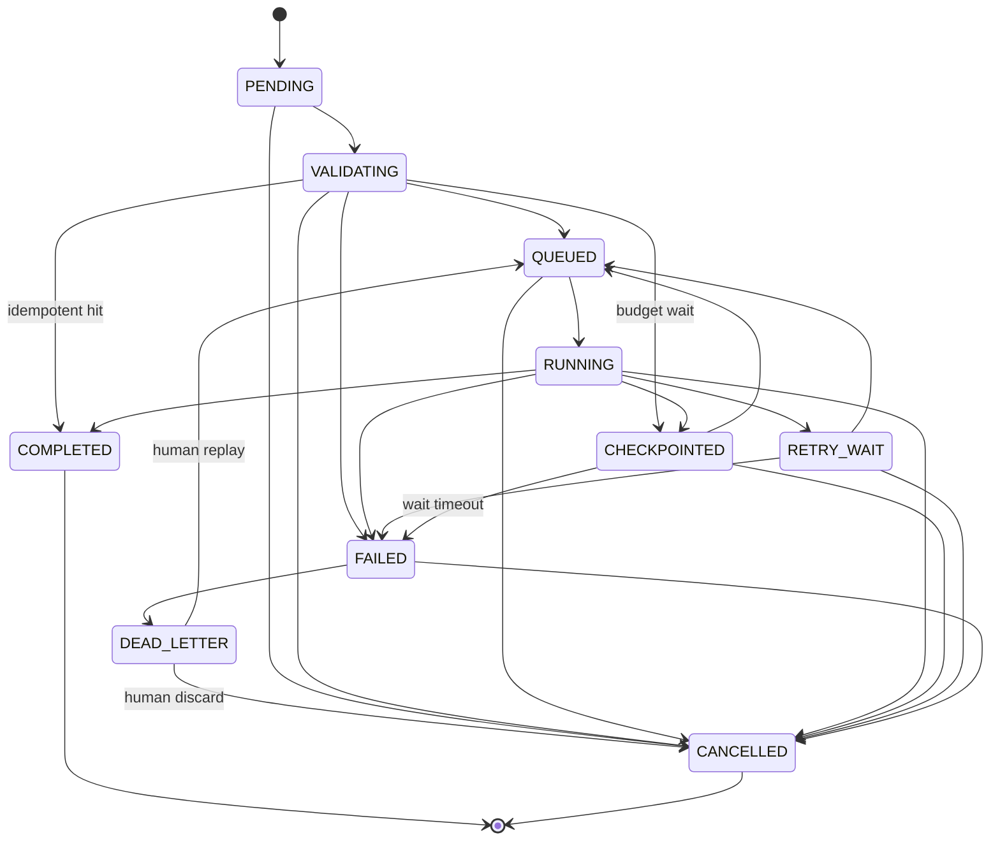

# 03 — Communication Standard and State Machine

| Field | Value |
|---|---|
| Status | Draft — documentation. Software: **Planned** |
| Owner | Shared library `amw_core.contracts` and `amw_core.state_machine`; runtime owner Agent 01 (orchestrator) |
| Depends on | GLOSSARY_AND_IDS.md (all IDs and enums), 04_DATABASE_ARCHITECTURE.md (tables), 07_FAILURE_MANAGEMENT.md (error codes, retry policy), RESEARCH_LOG.md INF-11 |
| Directive sections covered | §2 (control flow in code), §3.3 Contracts, State machine, Observability (correlation IDs), Recovery (idempotency); §1C.1 (org_id everywhere); rule 5 (no uncontrolled loops) |
| Tier | All of it is **MVP (Tier 0)**: the full contract set is used from the first build, even with one tenant. |

---

## 1. Scope and principles
1. Every hand-off between components uses exactly three contracts: **Task Input** (§3), **Task Output** (§5) and **Message Envelope** (§4), plus the **Error** object (§6) and the small **Control** payload (§4.3). All are JSON Schema 2020-12 documents shipped in `amw_core.contracts` and validated before any processing.
2. Agents never call each other. The orchestrator (Agent 01) creates every task, reads every output and decides the next task from code (§2 of the directive). An output's `downstream_agent` and `next_action` are **advisory** (§5.3).
3. Every contract carries `org_id`, either directly (Input, Envelope) or by being stored and transmitted only inside an envelope (Output). No component accepts a message whose tenant does not match its transaction's tenant context (§10.2).
4. Per-agent payload contents are defined by the agent blueprints as named payload schemas (`<task_type>.input` / `<task_type>.output`, GLOSSARY §2.4). They live inside the `payload` object (§3.2); they never change the envelope or the top-level fields.

## 2. Schema registry and versioning

### 2.1 Registry
- Location (build): `packages/amw_core/contracts/schemas/<schema name>/<semver>.json`. Each file's `$id` is `urn:amw:schema:<schema name>:<semver>`.
- Schemas are **immutable once released**. A change is a new version file.
- The validator resolves `$ref` only from this registry (no network fetch).
- Contract schemas: `amw.common`, `amw.task_input`, `amw.task_output`, `amw.envelope`, `amw.error`, `amw.control`. Registry record schema: `amw.production_type` (fields in 24 §2). Payload schemas: one input and one output per task type, owned by the agent blueprint.

### 2.2 Semantic versioning rules
| Change | Version bump | Examples |
|---|---|---|
| Breaking | **MAJOR** | remove/rename a field; make an optional field required; narrow a type, enum or range; change meaning or unit |
| Additive, backward compatible | **MINOR** | add an optional field; add an enum value **only** where every consumer declares tolerant handling of unknown values (listed per enum in the payload schema); widen a range |
| Clarification | **PATCH** | description or example text; no change to the set of valid documents |

### 2.3 Compatibility rules
1. A producer always emits the exact `schema_version` it was built with; the validator validates against that exact version file. Because the file is immutable and shipped to every component in `amw_core`, top-level `additionalProperties: false` is safe.
2. A consumer must accept every MINOR version of each MAJOR it supports. After validation it ignores fields it does not use.
3. During a MAJOR migration, consumers support **N and N−1**; the deprecation window is configuration `contracts.deprecation_window_ms` (default: two releases; the window is a project rule, not an external fact). Deprecated versions log a `contract.deprecated_version_used` warning metric per use.
4. A version outside the supported set is rejected with `PERMANENT.SCHEMA_VERSION_UNSUPPORTED`.
5. Changes to any Wave A contract go through `CONTRACT_CHANGE_REQUESTS.md`; Wave B documents must not create variants.
6. CI runs a compatibility check: every new MINOR/PATCH must validate every example of the previous version (27 §5).

## 3. Task Input contract (`amw.task_input` 1.0.0)

### 3.1 Fields (exactly §3.3)
| Field | Type | Null | Meaning |
|---|---|---|---|
| `org_id` | wire ID `org_…` | no | Tenant. Must equal envelope and DB context. |
| `job_id` | `job_…` | no | Owning job. |
| `task_id` | `tsk_…` | no | This task. |
| `project_id` | `prj_…` | yes | Null only for system jobs without a project (e.g. analytics ingestion). Production jobs always have one. |
| `channel_id` | `chn_…` | yes | Null for production types without a channel (client file delivery, some ads). |
| `agent_id` | `agent_NN` or `svc_sNN` | no | The stage/service that must execute the task. |
| `source_agent` | actor ref | no | Who requested the task (normally `agent_01`; a human for manual tasks). |
| `priority` | enum `priority` | no | Queue priority. |
| `deadline` | date-time UTC | yes | Hard deadline; past it the task fails `PERMANENT.DEADLINE_EXCEEDED`. |
| `context_refs` | array of ContextRef | no (may be empty) | Tenant-scoped references to knowledge, memory, prior outputs, brand kit, compliance profile, rule packs. |
| `resource_budget` | ResourceBudget | no | Hard caps for this task (cost, tokens, calls, wall time). |
| `payload` | PayloadObject | no | Task-type-specific data, typed by named payload schema. |
| `correlation_id` | `cor_…` | no | Correlation of the job (§11). |
| `idempotency_key` | `idk_…` | no | Task-level key (§7). |
| `retry_count` | integer ≥ 0 | no | Number of previous failed attempts of this task (attempt number − 1). |
| `schema_version` | semver `1.x.y` | no | Version of `amw.task_input` used. |

### 3.2 Common definitions (`amw.common` 1.0.0)
```json
{
  "$schema": "https://json-schema.org/draft/2020-12/schema",
  "$id": "urn:amw:schema:amw.common:1.0.0",
  "title": "AMW common definitions",
  "$defs": {
    "uuid7_body": { "type": "string", "pattern": "[0-9a-f]{8}-[0-9a-f]{4}-7[0-9a-f]{3}-[89ab][0-9a-f]{3}-[0-9a-f]{12}$" },
    "org_id":     { "type": "string", "pattern": "^org_[0-9a-f]{8}-[0-9a-f]{4}-7[0-9a-f]{3}-[89ab][0-9a-f]{3}-[0-9a-f]{12}$" },
    "job_id":     { "type": "string", "pattern": "^job_[0-9a-f]{8}-[0-9a-f]{4}-7[0-9a-f]{3}-[89ab][0-9a-f]{3}-[0-9a-f]{12}$" },
    "task_id":    { "type": "string", "pattern": "^tsk_[0-9a-f]{8}-[0-9a-f]{4}-7[0-9a-f]{3}-[89ab][0-9a-f]{3}-[0-9a-f]{12}$" },
    "project_id": { "type": "string", "pattern": "^prj_[0-9a-f]{8}-[0-9a-f]{4}-7[0-9a-f]{3}-[89ab][0-9a-f]{3}-[0-9a-f]{12}$" },
    "channel_id": { "type": "string", "pattern": "^chn_[0-9a-f]{8}-[0-9a-f]{4}-7[0-9a-f]{3}-[89ab][0-9a-f]{3}-[0-9a-f]{12}$" },
    "message_id": { "type": "string", "pattern": "^msg_[0-9a-f]{8}-[0-9a-f]{4}-7[0-9a-f]{3}-[89ab][0-9a-f]{3}-[0-9a-f]{12}$" },
    "correlation_id": { "type": "string", "pattern": "^cor_[0-9a-f]{8}-[0-9a-f]{4}-7[0-9a-f]{3}-[89ab][0-9a-f]{3}-[0-9a-f]{12}$" },
    "cost_entry_id":  { "type": "string", "pattern": "^cst_[0-9a-f]{8}-[0-9a-f]{4}-7[0-9a-f]{3}-[89ab][0-9a-f]{3}-[0-9a-f]{12}$" },
    "idempotency_key": { "type": "string", "pattern": "^idk_[0-9a-f]{64}$" },
    "executor_id": { "type": "string", "pattern": "^(agent_(0[1-9]|1[0-7])|svc_s(0[1-9]|1[0-3]))$" },
    "actor_ref": { "type": "string", "pattern": "^(agent_(0[1-9]|1[0-7])|svc_s(0[1-9]|1[0-3])|usr_[0-9a-f]{8}-[0-9a-f]{4}-7[0-9a-f]{3}-[89ab][0-9a-f]{3}-[0-9a-f]{12}|sys_[a-z_]{3,32})$" },
    "priority": { "enum": ["CRITICAL", "HIGH", "NORMAL", "LOW", "BACKGROUND"] },
    "semver":   { "type": "string", "pattern": "^(0|[1-9][0-9]*)\\.(0|[1-9][0-9]*)\\.(0|[1-9][0-9]*)$" },
    "utc_timestamp": { "type": "string", "format": "date-time", "pattern": "Z$" },
    "sha256_hex": { "type": "string", "pattern": "^[0-9a-f]{64}$" },
    "currency": { "type": "string", "pattern": "^[A-Z]{3}$" },
    "schema_name": { "type": "string", "pattern": "^[a-z0-9_]+(\\.[a-z0-9_]+)+$" },
    "storage_uri": {
      "type": "string",
      "maxLength": 1024,
      "pattern": "^(amw-blob://(org_[0-9a-f-]{36}|platform)/[A-Za-z0-9._/-]+|amw-entity://(org_[0-9a-f-]{36}|platform)/[a-z_]+/[a-z]{3}_[0-9a-f-]{36})$"
    },
    "context_ref": {
      "type": "object",
      "additionalProperties": false,
      "required": ["uri", "purpose"],
      "properties": {
        "uri": { "$ref": "#/$defs/storage_uri" },
        "purpose": { "enum": ["KNOWLEDGE", "MEMORY", "PRIOR_OUTPUT", "BRAND_KIT", "COMPLIANCE_PROFILE", "RULE_PACK", "ASSET", "APPROVAL", "TEMPLATE", "CLIENT_INPUT"] },
        "sha256": { "$ref": "#/$defs/sha256_hex" },
        "schema": { "$ref": "#/$defs/schema_name" },
        "schema_version": { "$ref": "#/$defs/semver" }
      }
    },
    "payload_object": {
      "type": "object",
      "additionalProperties": false,
      "required": ["payload_schema", "payload_schema_version"],
      "properties": {
        "payload_schema": { "$ref": "#/$defs/schema_name" },
        "payload_schema_version": { "$ref": "#/$defs/semver" },
        "data": { "type": "object" },
        "data_ref": { "$ref": "#/$defs/storage_uri" },
        "data_sha256": { "$ref": "#/$defs/sha256_hex" }
      },
      "oneOf": [
        { "required": ["data"], "not": { "required": ["data_ref"] } },
        { "required": ["data_ref", "data_sha256"], "not": { "required": ["data"] } }
      ]
    },
    "resource_budget": {
      "type": "object",
      "additionalProperties": false,
      "required": ["max_cost_micros", "currency", "max_wall_ms"],
      "properties": {
        "max_cost_micros": { "type": "integer", "minimum": 0 },
        "currency": { "$ref": "#/$defs/currency" },
        "max_wall_ms": { "type": "integer", "minimum": 1 },
        "max_tokens_in": { "type": "integer", "minimum": 0 },
        "max_tokens_out": { "type": "integer", "minimum": 0 },
        "max_llm_calls": { "type": "integer", "minimum": 0 },
        "max_render_ms": { "type": "integer", "minimum": 0 }
      }
    }
  }
}
```

### 3.3 Task Input schema
```json
{
  "$schema": "https://json-schema.org/draft/2020-12/schema",
  "$id": "urn:amw:schema:amw.task_input:1.0.0",
  "title": "AMW Task Input",
  "type": "object",
  "additionalProperties": false,
  "required": ["org_id", "job_id", "task_id", "project_id", "channel_id", "agent_id", "source_agent",
               "priority", "deadline", "context_refs", "resource_budget", "payload",
               "correlation_id", "idempotency_key", "retry_count", "schema_version"],
  "properties": {
    "org_id":        { "$ref": "urn:amw:schema:amw.common:1.0.0#/$defs/org_id" },
    "job_id":        { "$ref": "urn:amw:schema:amw.common:1.0.0#/$defs/job_id" },
    "task_id":       { "$ref": "urn:amw:schema:amw.common:1.0.0#/$defs/task_id" },
    "project_id":    { "oneOf": [ { "$ref": "urn:amw:schema:amw.common:1.0.0#/$defs/project_id" }, { "type": "null" } ] },
    "channel_id":    { "oneOf": [ { "$ref": "urn:amw:schema:amw.common:1.0.0#/$defs/channel_id" }, { "type": "null" } ] },
    "agent_id":      { "$ref": "urn:amw:schema:amw.common:1.0.0#/$defs/executor_id" },
    "source_agent":  { "$ref": "urn:amw:schema:amw.common:1.0.0#/$defs/actor_ref" },
    "priority":      { "$ref": "urn:amw:schema:amw.common:1.0.0#/$defs/priority" },
    "deadline":      { "oneOf": [ { "$ref": "urn:amw:schema:amw.common:1.0.0#/$defs/utc_timestamp" }, { "type": "null" } ] },
    "context_refs":  { "type": "array", "maxItems": 256, "items": { "$ref": "urn:amw:schema:amw.common:1.0.0#/$defs/context_ref" } },
    "resource_budget": { "$ref": "urn:amw:schema:amw.common:1.0.0#/$defs/resource_budget" },
    "payload":       { "$ref": "urn:amw:schema:amw.common:1.0.0#/$defs/payload_object" },
    "correlation_id": { "$ref": "urn:amw:schema:amw.common:1.0.0#/$defs/correlation_id" },
    "idempotency_key": { "$ref": "urn:amw:schema:amw.common:1.0.0#/$defs/idempotency_key" },
    "retry_count":   { "type": "integer", "minimum": 0, "maximum": 100 },
    "schema_version": { "type": "string", "pattern": "^1\\.(0|[1-9][0-9]*)\\.(0|[1-9][0-9]*)$" }
  }
}
```
Rules: `payload.data` serialized ≤ config `contracts.inline_payload_max_bytes` (default 262,144 bytes, design value); larger payloads use `data_ref` + `data_sha256`. Every `context_refs[].uri` and `payload.data_ref` must belong to `org_id` or to `platform` (§8).

## 4. Message Envelope (`amw.envelope` 1.0.0)

### 4.1 Fields (exactly §3.3)
| Field | Type | Null | Meaning |
|---|---|---|---|
| `org_id` | `org_…` | no | Tenant of the message. |
| `message_id` | `msg_…` | no | Unique per message; consumers deduplicate on it. |
| `sender` | actor ref | no | Emitting component. |
| `receiver` | actor ref | no | Target component (`agent_01` for results; the executor for dispatches). |
| `job_id` | `job_…` | yes | Null only for `amw.control` broadcasts not bound to a job. |
| `task_id` | `tsk_…` | yes | Same rule. |
| `payload_ref` | PayloadRef | no | Reference to the stored Task Input, Task Output or Control document. |
| `priority` | `priority` | no | Copied from the task. |
| `timestamp` | UTC date-time | no | Emission time. |
| `correlation_id` | `cor_…` | no | Job correlation. |
| `schema_version` | semver `1.x.y` | no | Version of `amw.envelope`. |

Message kinds are identified by `payload_ref.schema`: `amw.task_input` = dispatch, `amw.task_output` = result, `amw.control` = control command.

### 4.2 Envelope schema
```json
{
  "$schema": "https://json-schema.org/draft/2020-12/schema",
  "$id": "urn:amw:schema:amw.envelope:1.0.0",
  "title": "AMW Message Envelope",
  "type": "object",
  "additionalProperties": false,
  "required": ["org_id", "message_id", "sender", "receiver", "job_id", "task_id", "payload_ref",
               "priority", "timestamp", "correlation_id", "schema_version"],
  "properties": {
    "org_id":     { "$ref": "urn:amw:schema:amw.common:1.0.0#/$defs/org_id" },
    "message_id": { "$ref": "urn:amw:schema:amw.common:1.0.0#/$defs/message_id" },
    "sender":     { "$ref": "urn:amw:schema:amw.common:1.0.0#/$defs/actor_ref" },
    "receiver":   { "$ref": "urn:amw:schema:amw.common:1.0.0#/$defs/actor_ref" },
    "job_id":     { "oneOf": [ { "$ref": "urn:amw:schema:amw.common:1.0.0#/$defs/job_id" }, { "type": "null" } ] },
    "task_id":    { "oneOf": [ { "$ref": "urn:amw:schema:amw.common:1.0.0#/$defs/task_id" }, { "type": "null" } ] },
    "payload_ref": {
      "type": "object",
      "additionalProperties": false,
      "required": ["uri", "schema", "schema_version", "sha256", "size_bytes", "media_type"],
      "properties": {
        "uri": { "$ref": "urn:amw:schema:amw.common:1.0.0#/$defs/storage_uri" },
        "schema": { "enum": ["amw.task_input", "amw.task_output", "amw.control"] },
        "schema_version": { "$ref": "urn:amw:schema:amw.common:1.0.0#/$defs/semver" },
        "sha256": { "$ref": "urn:amw:schema:amw.common:1.0.0#/$defs/sha256_hex" },
        "size_bytes": { "type": "integer", "minimum": 2 },
        "media_type": { "const": "application/json" }
      }
    },
    "priority":   { "$ref": "urn:amw:schema:amw.common:1.0.0#/$defs/priority" },
    "timestamp":  { "$ref": "urn:amw:schema:amw.common:1.0.0#/$defs/utc_timestamp" },
    "correlation_id": { "$ref": "urn:amw:schema:amw.common:1.0.0#/$defs/correlation_id" },
    "schema_version": { "type": "string", "pattern": "^1\\.(0|[1-9][0-9]*)\\.(0|[1-9][0-9]*)$" }
  },
  "allOf": [
    { "if": { "properties": { "payload_ref": { "properties": { "schema": { "enum": ["amw.task_input", "amw.task_output"] } } } } },
      "then": { "properties": { "job_id": { "type": "string" }, "task_id": { "type": "string" } } } }
  ]
}
```
Transport: the envelope travels in the queue row (`task_queue.envelope`, 04 §5.4) and is appended to `message_log`. The referenced document is stored write-once (§8).

### 4.3 Control payload (`amw.control` 1.0.0)
Used by the orchestrator/scheduler to tell a running worker to drain, cancel or pause cooperatively (07 §8, 06).
```json
{
  "$schema": "https://json-schema.org/draft/2020-12/schema",
  "$id": "urn:amw:schema:amw.control:1.0.0",
  "title": "AMW Control Command",
  "type": "object",
  "additionalProperties": false,
  "required": ["command", "reason", "act_by", "schema_version"],
  "properties": {
    "command": { "enum": ["DRAIN", "CANCEL", "PAUSE", "RESUME"] },
    "reason": { "type": "string", "minLength": 1, "maxLength": 500 },
    "act_by": { "$ref": "urn:amw:schema:amw.common:1.0.0#/$defs/utc_timestamp" },
    "schema_version": { "type": "string", "pattern": "^1\\.(0|[1-9][0-9]*)\\.(0|[1-9][0-9]*)$" }
  }
}
```

## 5. Task Output contract (`amw.task_output` 1.0.0)

### 5.1 Fields (exactly §3.3)
| Field | Type | Null | Meaning |
|---|---|---|---|
| `status` | `output_status` | no | `SUCCEEDED`, `FAILED`, `SUSPENDED`, `REJECTED`. |
| `payload` | PayloadObject | yes | Required when `SUCCEEDED`; typed by the task type's output schema. |
| `output_refs` | array of OutputRef | no | Every persisted artefact (tenant-scoped URIs, SHA-256 mandatory). |
| `quality_score` | number 0–100 | yes | Only for steps that score (§1A.7). |
| `confidence` | number 0–1 | yes | Producer confidence; never a gate on its own. |
| `validation_results` | array of ValidationResult | no | Deterministic checks first, then judge/human (§3.3 Quality). |
| `duration` | integer, **ms** | no | Wall time of the attempt. |
| `resource_usage` | ResourceUsage | no | CPU, memory, tokens, calls, cost estimate, cost ledger IDs. |
| `error` | Error | yes | Required when `FAILED` or `REJECTED`; null when `SUCCEEDED`. |
| `next_action` | NextAction | no | Advisory hint (§5.3). |
| `downstream_agent` | executor ID | yes | Advisory hint (§5.3). |
| `timestamp` | UTC date-time | no | Output creation time. |

The output carries no IDs of its own: it is stored at `amw-blob://<org>/jobs/<job>/tasks/<task>/attempts/<att>/output.json` and transmitted only inside an envelope that carries `org_id`, `job_id`, `task_id`.

### 5.2 Task Output schema
```json
{
  "$schema": "https://json-schema.org/draft/2020-12/schema",
  "$id": "urn:amw:schema:amw.task_output:1.0.0",
  "title": "AMW Task Output",
  "type": "object",
  "additionalProperties": false,
  "required": ["status", "payload", "output_refs", "quality_score", "confidence", "validation_results",
               "duration", "resource_usage", "error", "next_action", "downstream_agent", "timestamp"],
  "properties": {
    "status": { "enum": ["SUCCEEDED", "FAILED", "SUSPENDED", "REJECTED"] },
    "payload": { "oneOf": [ { "$ref": "urn:amw:schema:amw.common:1.0.0#/$defs/payload_object" }, { "type": "null" } ] },
    "output_refs": {
      "type": "array", "maxItems": 512,
      "items": {
        "type": "object",
        "additionalProperties": false,
        "required": ["uri", "kind", "sha256", "size_bytes", "media_type"],
        "properties": {
          "uri": { "$ref": "urn:amw:schema:amw.common:1.0.0#/$defs/storage_uri" },
          "kind": { "enum": ["SCRIPT", "AUDIO", "VIDEO", "IMAGE", "SUBTITLE", "METADATA", "REPORT", "DATA", "CHECKPOINT_STATE"] },
          "sha256": { "$ref": "urn:amw:schema:amw.common:1.0.0#/$defs/sha256_hex" },
          "size_bytes": { "type": "integer", "minimum": 0 },
          "media_type": { "type": "string", "maxLength": 128 },
          "entity_ref": { "$ref": "urn:amw:schema:amw.common:1.0.0#/$defs/storage_uri" }
        }
      }
    },
    "quality_score": { "oneOf": [ { "type": "number", "minimum": 0, "maximum": 100 }, { "type": "null" } ] },
    "confidence":    { "oneOf": [ { "type": "number", "minimum": 0, "maximum": 1 }, { "type": "null" } ] },
    "validation_results": {
      "type": "array", "maxItems": 1024,
      "items": {
        "type": "object",
        "additionalProperties": false,
        "required": ["check_id", "kind", "verdict", "blocking", "message"],
        "properties": {
          "check_id": { "type": "string", "pattern": "^[a-z0-9_.-]{3,96}$" },
          "kind": { "enum": ["DETERMINISTIC", "LLM_JUDGE", "HUMAN"] },
          "verdict": { "enum": ["PASS", "FAIL", "WARN", "SKIPPED"] },
          "blocking": { "type": "boolean" },
          "rule_id": { "oneOf": [ { "type": "string", "pattern": "^[A-Z]{2,8}-R[0-9]{1,3}$" }, { "type": "null" } ] },
          "measured":  { "type": ["number", "string", "boolean", "null"] },
          "threshold": { "type": ["number", "string", "boolean", "null"] },
          "unit": { "oneOf": [ { "type": "string", "maxLength": 16 }, { "type": "null" } ] },
          "message": { "type": "string", "maxLength": 2000 },
          "evidence_ref": { "oneOf": [ { "$ref": "urn:amw:schema:amw.common:1.0.0#/$defs/storage_uri" }, { "type": "null" } ] }
        }
      }
    },
    "duration": { "type": "integer", "minimum": 0 },
    "resource_usage": {
      "type": "object",
      "additionalProperties": false,
      "required": ["cpu_ms", "peak_rss_bytes", "tokens_in", "tokens_out", "tokens_cached_in", "llm_calls",
                   "provider_calls", "cost_estimate_micros", "currency", "cost_entry_ids"],
      "properties": {
        "cpu_ms": { "type": "integer", "minimum": 0 },
        "peak_rss_bytes": { "type": "integer", "minimum": 0 },
        "tokens_in": { "type": "integer", "minimum": 0 },
        "tokens_out": { "type": "integer", "minimum": 0 },
        "tokens_cached_in": { "type": "integer", "minimum": 0 },
        "llm_calls": { "type": "integer", "minimum": 0 },
        "provider_calls": { "type": "integer", "minimum": 0 },
        "render_ms": { "type": "integer", "minimum": 0 },
        "cost_estimate_micros": { "type": "integer", "minimum": 0 },
        "currency": { "$ref": "urn:amw:schema:amw.common:1.0.0#/$defs/currency" },
        "cost_entry_ids": { "type": "array", "items": { "$ref": "urn:amw:schema:amw.common:1.0.0#/$defs/cost_entry_id" } }
      }
    },
    "error": { "oneOf": [ { "$ref": "urn:amw:schema:amw.error:1.0.0" }, { "type": "null" } ] },
    "next_action": {
      "type": "object",
      "additionalProperties": false,
      "required": ["type", "wait_reason", "escalation_level", "reason"],
      "properties": {
        "type": { "enum": ["CONTINUE", "WAIT", "RETRY", "ESCALATE", "STOP"] },
        "wait_reason": { "enum": ["DRAIN", "AWAITING_APPROVAL", "AWAITING_QUOTA", "AWAITING_BUDGET", "AWAITING_EXTERNAL", "OPERATOR_PAUSE", null] },
        "escalation_level": { "enum": ["L1", "L2", "L3", null] },
        "reason": { "type": "string", "maxLength": 1000 }
      }
    },
    "downstream_agent": { "oneOf": [ { "$ref": "urn:amw:schema:amw.common:1.0.0#/$defs/executor_id" }, { "type": "null" } ] },
    "timestamp": { "$ref": "urn:amw:schema:amw.common:1.0.0#/$defs/utc_timestamp" }
  },
  "allOf": [
    { "if": { "properties": { "status": { "const": "SUCCEEDED" } } },
      "then": { "properties": { "payload": { "type": "object" }, "error": { "type": "null" } } } },
    { "if": { "properties": { "status": { "enum": ["FAILED", "REJECTED"] } } },
      "then": { "properties": { "error": { "type": "object" } } } },
    { "if": { "properties": { "status": { "const": "SUSPENDED" } } },
      "then": { "properties": { "next_action": { "properties": { "type": { "const": "WAIT" }, "wait_reason": { "type": "string" } } } } } }
  ]
}
```

### 5.3 Advisory fields and the success rule
1. `next_action` and `downstream_agent` are hints. The orchestrator compares them with the production type's task graph (24 §3); a mismatch is ignored and logged as `orchestrator.advice_ignored`. They never create tasks.
2. **An incomplete output is never successful** (§3.3 Quality): `SUCCEEDED` requires (a) the payload validates against its named output schema, (b) every `blocking: true` validation result is `PASS`, (c) every `output_refs[]` object exists in storage with the stated SHA-256 and size. If any fails, the orchestrator records the attempt as `AGENT.INCOMPLETE_OUTPUT` (07 §2) regardless of the reported status.
3. A compliance verdict `BLOCKED` is **not** a failure: the task `SUCCEEDED` with the verdict in its payload, and the orchestrator routes the job (revision loop or `BLOCKED_COMPLIANCE` outcome, 24 §3.3).

## 6. Error object (`amw.error` 1.0.0)
```json
{
  "$schema": "https://json-schema.org/draft/2020-12/schema",
  "$id": "urn:amw:schema:amw.error:1.0.0",
  "title": "AMW Error",
  "type": "object",
  "additionalProperties": false,
  "required": ["code", "error_class", "message", "retryable", "retry_after_ms", "details", "actor",
               "provider", "upstream_status", "upstream_code", "attempt_no", "occurred_at", "correlation_id"],
  "properties": {
    "code": { "type": "string", "pattern": "^(TEMPORARY|PERMANENT|RESOURCE|AGENT|INFRASTRUCTURE|PUBLISHING)\\.[A-Z][A-Z0-9_]{2,63}$" },
    "error_class": { "enum": ["TEMPORARY", "PERMANENT", "RESOURCE", "AGENT", "INFRASTRUCTURE", "PUBLISHING"] },
    "message": { "type": "string", "minLength": 1, "maxLength": 2000 },
    "retryable": { "type": "boolean" },
    "retry_after_ms": { "oneOf": [ { "type": "integer", "minimum": 0 }, { "type": "null" } ] },
    "details": {
      "type": "object",
      "properties": {
        "violations": {
          "type": "array", "maxItems": 200,
          "items": {
            "type": "object",
            "additionalProperties": false,
            "required": ["path", "keyword", "message"],
            "properties": {
              "path": { "type": "string", "description": "JSON Pointer to the failing location" },
              "keyword": { "type": "string" },
              "message": { "type": "string", "maxLength": 500 }
            }
          }
        }
      }
    },
    "actor": { "$ref": "urn:amw:schema:amw.common:1.0.0#/$defs/actor_ref" },
    "provider": { "oneOf": [ { "type": "string", "pattern": "^[a-z0-9_]{2,32}$" }, { "type": "null" } ] },
    "upstream_status": { "oneOf": [ { "type": "integer", "minimum": 100, "maximum": 599 }, { "type": "null" } ] },
    "upstream_code": { "oneOf": [ { "type": "string", "maxLength": 128 }, { "type": "null" } ] },
    "attempt_no": { "type": "integer", "minimum": 0 },
    "occurred_at": { "$ref": "urn:amw:schema:amw.common:1.0.0#/$defs/utc_timestamp" },
    "correlation_id": { "$ref": "urn:amw:schema:amw.common:1.0.0#/$defs/correlation_id" }
  }
}
```
Rules:
1. `error_class` must equal the prefix of `code` (checked by `amw_core.contracts`, not expressible in the schema). Codes come only from the catalogue in 07 §2.
2. `retryable` is decided by the retry policy of 07 §3 for that code, not by the producer's opinion; the producer's value is overwritten by the policy engine before persistence.
3. `message` and `details` never contain secrets, tokens, raw provider keys, personal data beyond IDs, or another tenant's data. Tracebacks are stored separately (redacted) as `dead_letter.traceback_ref`.
4. `attempt_no` is 0 for rejections at validation (no attempt started).

## 7. Validation before processing and structured rejection

### 7.1 Order (every receiver, every message)
| Step | Check | Failure code |
|---|---|---|
| 1 | Envelope validates against `amw.envelope` of its `schema_version` | `PERMANENT.SCHEMA_INVALID` / `PERMANENT.SCHEMA_VERSION_UNSUPPORTED` |
| 2 | `message_id` not already processed (`message_receipts`, 04 §5.5) | duplicate → acknowledge, do nothing (not an error) |
| 3 | Open DB transaction, `SET LOCAL app.org_id = <envelope org>` (INF-11, 04 §3) | — |
| 4 | Fetch `payload_ref`; SHA-256 and size match; URI org = envelope org | `PERMANENT.CROSS_TENANT_REF` (security event, L3) / `AGENT.CORRUPTED_OUTPUT` |
| 5 | Document validates against `payload_ref.schema` + `schema_version` | `PERMANENT.SCHEMA_INVALID` |
| 6 | Task Input: `org_id`, `job_id`, `task_id` equal the envelope; `payload` validates against its named payload schema | `PERMANENT.TENANT_MISMATCH` / `PERMANENT.SCHEMA_INVALID` |
| 7 | Every `context_refs[]` URI belongs to this org or `platform`, and the referenced row is visible under RLS | `PERMANENT.CROSS_TENANT_REF` / `PERMANENT.MISSING_DEPENDENCY` |
| 8 | Task row exists, `agent_id` matches the receiver, state allows the step (`VALIDATING` for validation, `RUNNING` for execution) | `PERMANENT.INVALID_TRANSITION` |
| 9 | Idempotency check (§9.1 below) | `PERMANENT.IDEMPOTENCY_CONFLICT` |

### 7.2 Structured rejection
A rejected input produces a Task Output with `status = REJECTED`, `payload = null`, `error` filled (with `details.violations[]` for schema failures), `duration` = validation time and an empty `output_refs`. The task moves `VALIDATING → FAILED → DEAD_LETTER` (T04, T14), so nothing is silently dropped (rule 5). Rejections are never retried automatically (PERMANENT class).

## 8. Storage references (tenant-scoped URIs)
| Scheme | Form | Use |
|---|---|---|
| Blob | `amw-blob://<org wire id>/<area>/<path>` | Files and JSON documents. |
| Platform blob | `amw-blob://platform/<area>/<path>` | Platform-owned read-only material (templates, platform rule-pack text). Writable only by migrator/platform admin. |
| Entity | `amw-entity://<org wire id>/<table>/<entity wire id>` | Pointer to a DB row. |
| Platform entity | `amw-entity://platform/<table>/<entity wire id>` | Pointer to a platform-owned catalogue row (`org_id IS NULL`, 04 §3.5), e.g. a platform rule pack. Read-only. |

Areas: `jobs/<job>/tasks/<task>/attempts/<att>/{input.json,output.json}`, `jobs/<job>/renders/`, `jobs/<job>/checkpoints/`, `assets/<ast>/`, `knowledge/<chn>/<ksr>/`, `licences/<lic>/`, `consents/<vcn>/`, `exports/<dtr>/`, `evidence/<job>/`.

Rules:
1. `amw_core.storage` maps a URI to the backend (local disk first, S3-compatible later, §3.2a) as `<root>/<org uuid>/<area>/<path>`; the org segment is always first, so a tenant's data can be exported or erased as one prefix (§1C.10).
2. Blobs are **write-once**: a new version gets a new path; nothing is overwritten. Final media is always written to persistent storage, never only to temp (§3.3 Disaster recovery).
3. A reader resolves a URI only after checking the URI's org equals the transaction's `app.org_id` (or `platform` for read-only access). Mismatch = `PERMANENT.CROSS_TENANT_REF`, logged as a security event and escalated L3.
4. Every input consumed by a task carries a SHA-256; the reader verifies it.

## 9. Idempotency keys

### 9.1 Rules
1. Key = `idk_` + lowercase hex SHA-256 of the canonical key material `{"org_id": …, "scope": …, "natural_key": […]}`. Canonical form (project rule): UTF-8, object keys sorted, no insignificant whitespace, strings and integers only (no floats).
2. The key is computed from **what the effect is**, not from attempt data, so retries and DLQ replays produce the same key.
3. Before an external side effect, the executor inserts or reads `idempotency_keys` (04 §5.9) in the tenant transaction:
   - no row → insert `IN_PROGRESS` with `request_sha256`, perform the effect, then set `COMPLETED` with `result_ref`;
   - `COMPLETED` with the same `request_sha256` → return the stored result, perform nothing;
   - `COMPLETED` or `IN_PROGRESS` with a different `request_sha256` → `PERMANENT.IDEMPOTENCY_CONFLICT`;
   - `IN_PROGRESS` older than `locked_until` → the effect's **reconciliation procedure** runs first (e.g. look up whether the upload already exists, owned by Agent 13) before any new attempt.
4. Retention: keys of `publish.*` and `upload.*` scopes never expire; other scopes expire with the job's retention (04 §7).

### 9.2 Scopes (every external side effect)
| Scope | Natural key parts | Effect |
|---|---|---|
| `job.create` | `org_id`, requesting source (calendar entry, brief, API request ID or human request ID) | Job creation (`jobs.idempotency_key`) |
| `task.<task_type>` | `job_id`, `task_type`, `iteration` (revision loop number) | Task-level key (Task Input `idempotency_key`) |
| `llm.call` | `task_id`, `step_key`, `call_seq` | LLM call + its cost ledger row |
| `tts.synthesize` | `task_id`, `segment_id`, text SHA-256, voice ID | Paid TTS call |
| `media.generate` | `task_id`, `shot_id`, prompt SHA-256 | Image/video generation |
| `stock.license` | `org_id`, vendor item ID, licence ID | Stock purchase/licence registration |
| `render.master` | `job_id`, timeline SHA-256, preset key | Render |
| `db.output` | `task_id`, output kind | Persisting a stage output |
| `upload.youtube` | `channel_id`, render SHA-256 | `videos.insert` |
| `publish.youtube` | `publication_id`, target privacy | Privacy change to public / schedule |
| `thumbnail.set` | `publication_id`, thumbnail SHA-256 | `thumbnails.set` |
| `captions.insert` | `publication_id`, language, SRT SHA-256 | Caption track upload |
| `delivery.file` | `job_id`, deliverable preset, file SHA-256 | Client file delivery |
| `notify.send` | event ID, recipient ID, channel | Notification |
| `webhook.deliver` (T3) | event ID, webhook ID | Webhook POST |
| `billing.charge` (T2) | invoice ID | Payment gateway charge |

## 10. Correlation, tracing and tenant context
1. `correlation_id` is created with the job; child jobs (e.g. Shorts cut from a long-form job) inherit it and reference `jobs.parent_job_id`.
2. Every log line, metric and trace span carries `org_id`, `correlation_id`, and where applicable `job_id`, `task_id`, `attempt_id`, `actor`. Logs are structured JSON (§3.3 Observability; details in 11/16).
3. Tenant context: each DB transaction begins with `SET LOCAL app.org_id` (INF-11); `app.actor` is also set for audit. No connection-level (session-wide) tenant setting is used, so pooled connections never leak context.

---

## 11. STATE MACHINE

### 11.1 Decisions
| Decision | Choice | Justification |
|---|---|---|
| State set | Exactly the 10 states of §3.3 (GLOSSARY §6.1) | Directive-frozen; no extra states. |
| Approval waits | **Sub-status**: `CHECKPOINTED` + `wait_reason = AWAITING_APPROVAL` (not a new state) | (1) Keeps the frozen state set. (2) Every wait — approval, drain, quota, budget, external processing, operator pause — is the same thing mechanically: no worker is held, progress is durable, resume goes through `QUEUED`. One resume path means one set of tests. (3) The approval itself is a separate record (`approvals`) with its own `approval_state`, so the task state machine stays small while approvals can be multi-step. |
| Job vs task | Tasks have the full machine; job state is **derived** by the orchestrator from task states in the same transaction (§11.5). `RETRY_WAIT` is task-only. | Retries belong to units of work; a job is a container. Derivation in one transaction keeps job and tasks consistent. |
| `FAILED` | Non-terminal hand-off state: failure decided, DLQ record pending. Exits only to `DEAD_LETTER` (automatic) or `CANCELLED` (human). | Separates the failure decision from DLQ persistence; the reaper finishes any hand-off interrupted by a crash, so no failure is dropped (rule 5). |
| Terminal | `COMPLETED`, `CANCELLED` (final); `DEAD_LETTER` (no automatic exit; only a human replay or discard). | §3.3: controlled manual replay. |
| Enforcement | Code (`amw_core.state_machine`) **and** DB trigger against `state_transition_rules` (04 §5.6) | Defence in depth; a bug or manual SQL cannot write an invalid transition. |

### 11.2 Diagram


### 11.3 Task transition table (complete; anything not listed is invalid)
Actors: `ORCH` = orchestrator (`agent_01`), `WKR` = executing worker, `SCHED` = `sys_scheduler`, `REAP` = `sys_reaper`, `DLQH` = `sys_dlq_handler`, `HUMAN` = user with the named permission (08).

| ID | From | To | Trigger | Guard | Actor | Side effects | Audit event |
|---|---|---|---|---|---|---|---|
| T01 | ∅ | PENDING | Orchestrator materialises the job's task graph (24 §3) | job state ∈ {VALIDATING, RUNNING, CHECKPOINTED}; job task count < `limits.max_tasks_per_job`; graph is a DAG | ORCH | insert `tasks`, `task_dependencies`; compute task idempotency key | `task.created` |
| T02 | PENDING | VALIDATING | All dependencies `COMPLETED` (or none) | job not `CANCELLED`/terminal | ORCH | write Task Input document (write-once) | `task.validating` |
| T03 | VALIDATING | QUEUED | Validation §7.1 passed | idempotency key has no `COMPLETED` row; tenant `ACTIVE`; S4 budget pre-check reserves `resource_budget.max_cost_micros` (`budget_reservations` HELD) | ORCH | insert `task_queue` row `READY` with envelope; `scheduled_at` = now or next admissible time (quota/window); NOTIFY | `task.queued` |
| T04 | VALIDATING | COMPLETED | Idempotency key already `COMPLETED` with same request hash | stored result exists and its blobs verify | ORCH | link existing output; no execution | `task.completed_idempotent` |
| T05 | VALIDATING | CHECKPOINTED | S4 budget guard refuses (non-critical paid task over limit) | `wait_reason = AWAITING_BUDGET` | ORCH | notification to Finance/Org Admin | `task.suspended` |
| T06 | VALIDATING | FAILED | Validation failed (PERMANENT) | — | ORCH | Task Output `REJECTED` stored | `task.failed` |
| T07 | QUEUED | RUNNING | Worker claims row (`FOR UPDATE SKIP LOCKED`) | worker capabilities ⊇ task `required_capabilities`; admission allows (window, tenant concurrency, fair share, resource class); breaker for required provider not `OPEN`; deadline not passed | WKR | queue row `CLAIMED` + lease; insert `task_attempts` (`RUNNING`) | `task.started` |
| T08 | RUNNING | COMPLETED | Worker returns `SUCCEEDED` and §5.3 success rule holds | `state_version` matches; lease still held | WKR (committed by ORCH logic in the same transaction) | store output; `idempotency_keys` → COMPLETED; queue row `DONE`; reservation CONSUMED/RELEASED remainder; attempt `SUCCEEDED`; unblock dependants | `task.completed` |
| T09 | RUNNING | CHECKPOINTED | Worker returns `SUSPENDED`, or obeys a `DRAIN`/`PAUSE` control, or reaches an approval gate, or quota is exhausted mid-task | a checkpoint row was written in this attempt (or no progress to save); `wait_reason` set | WKR | checkpoint `is_latest`; queue row `DONE`; lease released; attempt `SUSPENDED`; approval request created if `AWAITING_APPROVAL` | `task.suspended` |
| T10 | RUNNING | RETRY_WAIT | Attempt failed and policy (07 §3) says retryable | `attempt_count < max_attempts`; next attempt time < deadline; hard caps not reached | WKR / REAP | attempt `FAILED_RETRYABLE` (or `LEASE_EXPIRED`); `next_attempt_at` from backoff formula; queue row `DONE` | `task.retry_scheduled` |
| T11 | RUNNING | FAILED | Attempt failed and policy says not retryable, or attempts/caps exhausted | — | WKR / REAP | attempt `FAILED_FINAL`; release reservation | `task.failed` |
| T12 | RETRY_WAIT | QUEUED | `now ≥ next_attempt_at` | provider breaker not `OPEN` (if `OPEN`: stay and set `next_attempt_at = open_until`, attempt not consumed); deadline not passed | SCHED | new queue row `READY` | `task.requeued` |
| T13 | RETRY_WAIT | FAILED | Deadline passed while waiting | — | SCHED | error `PERMANENT.DEADLINE_EXCEEDED` | `task.failed` |
| T14 | FAILED | DEAD_LETTER | DLQ hand-off | DLQ row written with payload ref, reason, retry history, traceback ref, last run, `recovery_status = NEW` | DLQH (or REAP if a hand-off was interrupted) | job derivation; escalation per 07 §7; notification | `task.dead_lettered` |
| T15 | CHECKPOINTED | QUEUED | Wait condition cleared: approval decided, window open, PT-day quota reset, budget released, external ready, human resume | resume checkpoint exists or task restarts cleanly; approval bound to the same subject SHA-256 | SCHED / ORCH / HUMAN (`ops.resume`) | new queue row `READY`, carrying `resume_checkpoint_id` | `task.resumed` |
| T16 | CHECKPOINTED | FAILED | Wait timeout for the reason (`wait.<reason>.timeout_ms`; `AWAITING_APPROVAL` defaults to **no timeout**, reminders only) | — | SCHED | error `PERMANENT.DEADLINE_EXCEEDED` or `PUBLISHING.PROCESSING_FAILED` per reason | `task.failed` |
| T17 | DEAD_LETTER | QUEUED | Controlled manual replay | permission `dlq.replay`; DLQ `recovery_status = REPLAY_APPROVED` (publishing/financial tasks need an `approvals` row of kind `DLQ_REPLAY`); `replay_count < limits.max_replays_per_item`; root-cause note present | HUMAN | `attempt_count` budget reset recorded in DLQ row; same idempotency key; reconciliation first for side-effect scopes; DLQ `REPLAYED` | `task.replayed` |
| T18 | DEAD_LETTER | CANCELLED | Human discard | permission `dlq.discard`; reason recorded | HUMAN | DLQ `DISCARDED` | `task.cancelled` |
| T19 | PENDING / VALIDATING / QUEUED / RETRY_WAIT / CHECKPOINTED / FAILED | CANCELLED | Job cancel, task cancel, superseded revision | reason recorded; for `FAILED`, permission `dlq.discard` (a human decision, never automatic) | ORCH / HUMAN (`job.cancel`) | queue row `CANCELLED`; reservation released | `task.cancelled` |
| T20 | RUNNING | CANCELLED | Cancel requested and worker acknowledged at a safe point, or lease expired after `cancel_requested_at` | never mid-write: worker finishes the current atomic write unit (07 §8) | WKR / REAP | attempt `CANCELLED`; queue row `DONE`; partial outputs kept for audit, marked unused | `task.cancelled` |

Not transitions (no state change, no transition row): heartbeats, progress checkpoints written while `RUNNING`, lease renewals, approval-step decisions while the approval is still `PENDING`.

Invalid transitions: any pair not in the table, or a valid pair whose guard fails, is rejected with `PERMANENT.INVALID_TRANSITION`; the attempt is logged with `state_machine.invalid_transition_rejected` (counter metric + audit event `task.transition_rejected`). The DB trigger raises an exception for unlisted pairs even if code is bypassed.

### 11.4 Persistence and optimistic locking
- Current state: `tasks.state`, `tasks.wait_reason`, `tasks.state_version` (integer, starts at 1), `tasks.state_changed_at`; same columns on `jobs` (no `wait_reason` on jobs; `jobs.outcome` set on `COMPLETED`).
- History: one `state_transitions` row per transition (04 §5.6) and one `audit_log` row (04 §5.13).
- One transaction per transition:
  1. `SET LOCAL app.org_id`, `SET LOCAL app.actor`.
  2. `UPDATE tasks SET state = :to, wait_reason = :wr, state_version = state_version + 1, state_changed_at = now() WHERE org_id = :org AND id = :id AND state = :from AND state_version = :expected`.
  3. 0 rows updated → re-read; if the task already moved, the caller treats it as `TEMPORARY.LOCK_CONFLICT` (07) and re-evaluates; it never blindly re-applies.
  4. Insert `state_transitions` and `audit_log` (hash chain), apply side effects listed in §11.3, derive the job state (§11.5), commit.
  5. After commit: NOTIFY the queue channel (wake-up only; correctness never depends on it).
- Side effects outside the DB (API calls, file writes) are never inside the transition transaction; they are protected by idempotency keys (§9) and recorded in a separate transaction.

### 11.5 Job-level state (derived)
| ID | From | To | Rule (evaluated after every task transition, same transaction) | Audit event |
|---|---|---|---|---|
| J01 | ∅ | PENDING | Job created (calendar, brief, API, human) with production type key + version | `job.created` |
| J02 | PENDING | VALIDATING | Orchestrator starts job validation: production type enabled for org; required inputs present (24); channel `CONNECTED` if a YouTube destination; compliance profile attached; budget exists | `job.validating` |
| J03 | VALIDATING | QUEUED | Job valid; task graph materialised (T01 for all tasks) | `job.queued` |
| J04 | VALIDATING | FAILED | Job validation failed (PERMANENT) | `job.failed` |
| J05 | QUEUED / CHECKPOINTED | RUNNING | From `QUEUED`: the first task enters `RUNNING`. From `CHECKPOINTED`: any task leaves `CHECKPOINTED` (T15) | `job.running` |
| J06 | QUEUED / RUNNING | CHECKPOINTED | No task in `VALIDATING`, `QUEUED`, `RUNNING`, `RETRY_WAIT`, and at least one task `CHECKPOINTED` | `job.suspended` |
| J07 | QUEUED / RUNNING | COMPLETED | Every required task `COMPLETED` (or cancelled as superseded); outcome determined (`PUBLISHED` needs publication `VERIFIED`; `DELIVERED` needs delivery `VERIFIED` or `DELIVERED` per type) | `job.completed` |
| J08 | QUEUED / RUNNING / CHECKPOINTED | FAILED | A required task enters `FAILED` | `job.failed` |
| J09 | FAILED | DEAD_LETTER | The failed required task enters `DEAD_LETTER` (job DLQ view points to the task's DLQ row) | `job.dead_lettered` |
| J10 | DEAD_LETTER | RUNNING | A task of this job is replayed (T17) | `job.replayed` |
| J11 | DEAD_LETTER | CANCELLED | Every dead-lettered task discarded (T18) and the human cancels the job | `job.cancelled` |
| J12 | PENDING / VALIDATING / QUEUED / RUNNING / CHECKPOINTED / FAILED | CANCELLED | Human or orchestrator cancels the job; cascades T19/T20 to every non-terminal task | `job.cancelled` |

Blocking outcomes: when a blocking gate (compliance, originality, QC) returns `BLOCKED`/`FAIL`, the orchestrator creates a revision task (new `iteration`) until `limits.max_revision_loops` (07 §9) is reached; then the job ends `COMPLETED` with `outcome = BLOCKED_COMPLIANCE` (or `REJECTED_BY_APPROVER` for a human rejection). It is never published.

### 11.6 Approval waits in detail
1. When the graph reaches an approval gate, the gate task (`svc_s07.request_approval`) creates an `approvals` row bound to the subject's SHA-256, then returns `SUSPENDED` with `wait_reason = AWAITING_APPROVAL` (T09).
2. Each `approval_steps` decision is recorded (approval stays `PENDING` until the last step).
3. When the approval reaches a final `approval_state`, `svc_s07` triggers T15; the gate task resumes, reads the decision and completes (T08) with the decision in its payload; the orchestrator routes (continue, revise, or stop).
4. If the subject changes (new SHA-256), the old approval is `WITHDRAWN` and a new one is requested; a publish guard (04 §5.21) rejects any publication whose render SHA-256 differs from the approved one.
5. Inside a client tenant, approvers are that tenant's users; the platform owner is an approver only when `approvals.managed_service = true` (rule 10).

### 11.7 Audit of every transition
Each transition writes `audit_log` with: `actor_kind`, `actor_ref`, `authority` (role or policy under which the actor acted), `action` (audit event name above), `target_kind = TASK|JOB`, `target_id`, `details = {from, to, transition_id, wait_reason, error_code, state_version}`, `correlation_id`. The hash chain makes the history tamper-evident (04 §5.13).
