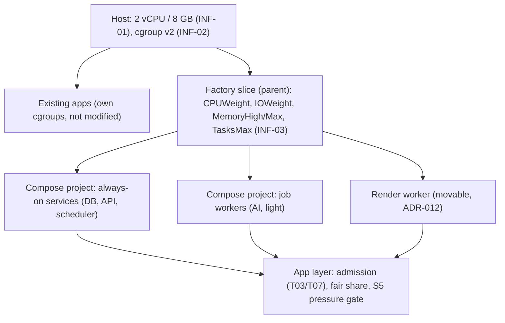

# 05 — Resource Management (slice and cgroup limits, admission control, fair sharing, headroom, S5 thresholds)

| Field | Value |
|---|---|
| Status | **Draft - documentation**. Software: **Planned** (nothing in this document is implemented or measured) |
| Owner agent / service | Agent 01 (orchestrator: admission and concurrency decisions) with S5 Infrastructure Intelligence + resource monitor (`s05_infrastructure_intelligence`, owner Agent 01; 02_AGENT_REGISTRY.md). Slice and container limits are deployment configuration owned by 10_DEPLOYMENT_AND_MIGRATION.md (planned) |
| Depends on | MASTER_DIRECTIVE.md §1 (Server, Deployment isolation, Isolation mechanism, Queue, Heavy work, Production window), §1C.2, §1C.14, §3.2 (S5), §3.2a; 00b_TECHNICAL_FEASIBILITY.md §2.1, §2.2; GLOSSARY_AND_IDS.md §4, §6.6, §6.20, §6.47, FIN-R1..R13 (not touched here); 03_COMMUNICATION_STANDARD.md §11 (T03, T07, T09, T15), `resource_budget`, `resource_usage`; 04_DATABASE_ARCHITECTURE.md §3.6 (`amw_queue_claim`), §5.3, §5.4 (`task_queue`, `workers`), §5.25 (`plans`); 07_FAILURE_MANAGEMENT.md §2 (`RESOURCE.*`), §6, §8, §9; 24_PRODUCTION_TYPES.md §3.1, §3.2, §7.1; 27_ENGINEERING_STANDARDS.md §9; ADR-001, ADR-012; 3A_SLICE_SPEC.md §7; 08_SECURITY.md (container hardening) |
| Directive sections covered | §1 (Server sizing from measurement; Deployment isolation: limits on every container; Isolation mechanism: slice with low CPUWeight/IOWeight, MemoryHigh/MemoryMax, TasksMax; Heavy work; Production window), §1C.2 (fair sharing, noisy-neighbour control), §1C.14 (infrastructure by tier), §3.2 S5, owner decision D1 (render never in market hours; owner-set limits) |
| Research IDs | INF-01, INF-02, INF-03, INF-04, INF-07, INF-08 (INF-09 and INF-05/06 by reference only) |
| MVP scope | **3A**: the limit layers as configuration, the INF-04 acceptance test, static admission (class, window, market-hours guard, `max_concurrency` = 1 for `HEAVY_CPU`), reduced-concurrency rule after `RESOURCE.OOM`. **3B**: the same on the pilot run, with measured figures replacing every "REQUIRES REVIEW (Phase 1): VPS measurement" value. **3C**: S5 monitor with thresholds, pressure-based admission, fair-share ordering exercised with more than one real tenant's data, scaling recommendations. |
| Enterprise tier | **Tier 0** shared VPS under slice caps. **Tier 1** own server (or render-only worker) before the first external client (§1C.14): headroom formula re-run on the new host. **Tier 2** per-tenant quotas enforced from `plans.limits`. **Tier 3** dedicated workers per tenant (`workers.dedicated_org_id`) |

> **Rule for every number in this document.** All limits, weights, thresholds and margins are **configuration** (`amw_core.config`, 27 §7.3.1), never code (directive §1). No VPS figure has been measured: the audit Part C is PENDING (00_REPO_AND_SERVER_AUDIT.md). Where a value is not sourced it reads **"REQUIRES REVIEW (Phase 1): VPS measurement"**. Values marked ESTIMATE are design defaults without a source; they are placeholders for measurement, not decisions. Owner rule A.2: nothing is assumed from the owner's live settings.

---

## 1. Purpose and boundary [3A / 3B / 3C · Tier 0]

The factory shares one server with the owner's existing applications (INF-01: KVM 2 plan, 2 vCPU / 8 GB / 100 GB NVMe, owner-reported and matching the published plan; Ubuntu 26.04, cgroup v2 only, INF-02). This document answers four questions, in this order of precedence:

1. **How is the factory kept from harming the existing apps?** Two kernel layers (systemd slice, container limits) plus two application layers (admission, fair sharing). §3-§5.
2. **When may a task start?** Admission control by `resource_class` (GLOSSARY §6.6). §6.
3. **How do tenants share what the factory has?** Fair sharing and noisy-neighbour control (§1C.2). §7.
4. **How do we know the plan fits, and when do we stop trusting it?** The headroom formula (00b §2.2) and S5 thresholds. §8-§9.

Not in this document: the night schedule and the market-hours calendar (06_NIGHT_SCHEDULING.md owns them; 07 §8 owns failure-safety of drain and stop), retry and breaker policies (07), the queue technology (ADR-001), the render placement decision (ADR-012; this document supplies its `safety_margin` and limits), spend budgets (09, S4), secrets and container hardening (08). This document never edits those; it consumes them.

## 2. Facts and what is not known [3A · Tier 0]

| Fact | Source | Status |
|---|---|---|
| KVM 2: 2 vCPU / 8 GB / 100 GB NVMe | INF-01 | VERIFIED as a published plan; the real machine is **not measured** |
| Ubuntu 26.04 LTS removed cgroup v1; cgroup v2 only | INF-02 | VERIFIED (release notes); to be confirmed on the real VPS by the audit script |
| `CPUWeight=` range 1-10000, default 100; `IOWeight=` default 100; `MemoryHigh=` throttles; `MemoryMax=` is a hard limit; `TasksMax=` uses the pids controller; `CPUQuota=` caps CPU; `Slice=` places a unit in a slice | INF-03 | VERIFIED |
| Compose documents `deploy.resources.limits` (cpus, memory, pids), `cgroup_parent`, `cpu_shares`, `mem_limit`, `pids_limit`. The docs **do not state** that deploy limits apply under plain `docker compose up`, nor that `cgroup_parent` can target a systemd slice. Compose version not obtained | INF-04 | **PARTIAL: unproven**, see §5 |
| Beszel RAM footprint: no official figure | INF-07 | NOT CONFIRMED; measure before ADR-006 |
| Prometheus + Grafana RAM: no official total; Grafana floor 512 MB for evaluation | INF-08 | UNVERIFIED; a full stack does not fit the shared 8 GB next to the existing apps, so stay lightweight at Tier 0 |

Not known and therefore **REQUIRES REVIEW (Phase 1): VPS measurement** (audit Part C, 24 h sampling including 00:00-07:00 IST; the audit script already records load, memory, swap and PSI per sample): measured total CPU/RAM/swap/disk; peak of the trading app, BagMitra and OS; existing per-container limits; which cgroup the existing apps run in; PSI and OOM history; per-component footprint of the factory (walking skeleton); render time per minute of output (`render_ms`, 24 §6, MEASURED in the pilot).

## 3. Layer model [3A / 3B / 3C · Tier 0]



| Layer | Mechanism | What it protects | Where it acts | Proof |
|---|---|---|---|---|
| L1 Kernel, slice | systemd slice with low weights + hard caps (INF-03) | existing apps from the whole factory | host | §5 acceptance test; contention test |
| L2 Kernel, container | per-container `cpus`/`mem_limit`/`pids_limit` (INF-04) | other factory services from one runaway container; the slice cap from being hit by one container | Compose | §5 acceptance test |
| L3 Application, admission | resource class, window, concurrency, pressure gate | the slice from being asked for more than it has | T03, T07, `amw_queue_claim` | §6 tests |
| L4 Application, fair share | per-tenant order and caps | tenants and the platform owner from each other (§1C.2) | `amw_queue_claim` ordering | §7 tests |

Principle: **L1 and L2 are the safety net; L3 and L4 are the normal control.** A kernel limit that fires (throttle, OOM kill) is an incident signal to S5 (§9), not a scheduling tool. The factory is the lowest-priority tenant of the host by design: under contention the kernel favours the existing apps (directive §1 Isolation mechanism), so factory throughput is not guaranteed, only bounded.

## 4. Systemd slice and cgroup v2 limits (INF-02, INF-03) [3A / 3B · Tier 0]

### 4.1 Slice structure (design proposal, names are deployment configuration)
| Slice | Holds | Why separate |
|---|---|---|
| `amw-factory.slice` (parent) | everything below | one hard envelope for the whole factory; `available_for_factory` (§8) maps to it |
| `amw-factory-core.slice` | PostgreSQL (factory's own), API + dashboard, scheduler/monitor | must stay responsive when the render slice is saturated; the daytime-stoppable group (Q7) |
| `amw-factory-jobs.slice` | AI and light workers | I/O-bound, light CPU (00b §2.1) |
| `amw-factory-render.slice` | render worker (FFmpeg: `agent_07.audio_master`, `agent_10.render`, `agent_10.subtitles`, `agent_10.technical_qc`) | the main risk on 2 vCPU (00b §2.1): its caps are tighter than the parent's so a render cannot starve core services of the factory itself |

3A may start with the parent plus the render slice only; the three-child split is the design target. If INF-04 fails (§5), the structure is revisited with the fallback options of §5.4.

### 4.2 Directives and how each is set
| Directive (INF-03) | Level | Rule | Value |
|---|---|---|---|
| `CPUWeight=` | parent | **low relative to the existing apps' weight**. INF-03 gives the default 100 and the log suggests a value such as 20 against 100 for existing apps | 20 is **ESTIMATE**; **REQUIRES REVIEW (Phase 1): VPS measurement** (which cgroup the existing apps sit in decides what "relative" means) |
| `CPUWeight=` | children | `core` > `jobs` > `render`, so the factory's own services win inside the factory | **REQUIRES REVIEW (Phase 1): VPS measurement** |
| `CPUQuota=` | render child (and parent if measured contention demands it) | hard CPU cap; used because weights act only as relative shares (the existing apps' idle time is not a guarantee of anything) | **REQUIRES REVIEW (Phase 1): VPS measurement**; derived from the CPU term of §8 |
| `IOWeight=` | parent and children | low, same ordering as CPU weight | **REQUIRES REVIEW (Phase 1): VPS measurement** |
| `MemoryHigh=` | parent and children | throttling threshold, **strictly below** `MemoryMax`; the early-warning level S5 reads (§9) | **REQUIRES REVIEW (Phase 1): VPS measurement** |
| `MemoryMax=` | parent | hard cap, **at most the memory term of `available_for_factory`** (§8) | **REQUIRES REVIEW (Phase 1): VPS measurement** |
| `MemoryMax=` | children | sum of the children's `MemoryMax` may exceed the parent's only for groups that never peak together (core + jobs vs render in the night window); the rule and the check are in §4.4 | **REQUIRES REVIEW (Phase 1): VPS measurement** |
| `TasksMax=` | parent and children | caps the number of processes/threads (pids controller); sized from the measured peak of the skeleton plus margin | **REQUIRES REVIEW (Phase 1): VPS measurement** |
| `Slice=` | each unit | places the unit in its slice. For containers see §5 (INF-04) | n/a |

### 4.3 Properties the design relies on, and what each one does not give
- `CPUWeight`/`IOWeight` only matter **under contention**; they do not reserve anything for the factory and do not limit it when the host is idle. The hard limits are `CPUQuota`, `MemoryMax`, `TasksMax` (INF-03).
- `MemoryHigh` throttles; it does not kill. A throttled task runs slower and may reach `resource_budget.max_wall_ms` (03) before it finishes. That is why `MemoryHigh` breaches are an S5 signal (§9), not a silent condition.
- Nothing in INF-03 limits **disk space** or **network**. Disk is controlled by thresholds and admission (§6.4, §9); network egress to providers is controlled by breakers and provider limits (07 §4, 09), not here.
- **Swap behaviour is not in the research log.** Whether swap exists and how it should be limited for the factory: **REQUIRES REVIEW (Phase 1): VPS measurement** (audit records swap) and an official-source entry in RESEARCH_LOG.md before any swap setting is chosen.

### 4.4 Consistency rules (checked by the §5 test and by the deployment review)
1. For every container: container memory limit ≤ its slice `MemoryMax` ≤ parent `MemoryMax`.
2. `MemoryHigh` < `MemoryMax` at every level.
3. Sum of container `pids_limit` per slice ≤ that slice's `TasksMax`.
4. The factory's parent `MemoryMax` ≤ memory term of `available_for_factory`; parent `CPUQuota` (if set) ≤ CPU term (§8).
5. The render container's limits are the tightest of the factory so that a render OOM kills the render container and nothing else (ties to `RESOURCE.OOM` handling, §6.6).
6. Limits are read from configuration at deploy time; changing a value is a configuration change with an audit entry, never a code change (directive §1).

## 5. Per-container limits and the unproven Compose-to-slice placement (INF-04) [3A · Tier 0]

### 5.1 Per-container limits (directive §1: "CPU and memory limits on every container")
Every factory container carries its own limits in the Compose configuration, in addition to the slice. The set of fields follows INF-04 (`cpus`, `mem_limit`, `pids_limit`; `deploy.resources.limits` equivalents) and the container hardening of 08 (non-root, read-only root filesystem where possible, no privileged mode).

| Container (planned) | Class served | `cpus` | `mem_limit` | `pids_limit` | Basis |
|---|---|---|---|---|---|
| PostgreSQL (factory's own) | `LIGHT` data plane | **REQUIRES REVIEW (Phase 1): VPS measurement** | same | same | 00b §2.1: memory-bound, small; shared-buffers and connection count to be set inside this limit (REQUIRES REVIEW (Phase 1): walking skeleton) |
| API + dashboard | `LIGHT` | same | same | same | 00b §2.1: light |
| Scheduler / monitor (S5 sampler, reaper, night scheduler) | `LIGHT` | same | same | same | 00b §2.1: very light; stoppable by configuration in daytime (Q7) |
| AI worker | `AI_IO` | same | same | same | I/O-bound, light CPU (00b §2.1) |
| Light worker (approvals, gates, deterministic checks) | `LIGHT` | same | same | same | may be merged with the AI worker in 3A (single process, two `resource_classes`, 04 §5.4); decided in ADR-001/SOURCE_LAYOUT |
| Render worker | `HEAVY_CPU` | same | same | same | the main risk on 2 vCPU (00b §2.1); movable (ADR-012) |
| Monitoring agent | none | same | same | same | footprint unknown (INF-07, INF-08); chosen in ADR-006 |

Defaults for an unmeasured container: **none**. A container without a measured or reviewed limit does not start on the VPS (fail closed); it may run in the development environment, where the limits are advisory. This is the single exception to "limits on every container" and it applies only off the shared host.

Per-container values are recorded in the walking-skeleton report as MEASURED peak (`resource_usage.peak_rss_bytes`, `cpu_ms`, `render_ms`; 03) and then set with a margin defined in §8.4.

### 5.2 What INF-04 does and does not give us
INF-04 is **PARTIAL**: the Compose fields exist in the docs; the docs do not say that `deploy` limits are honoured under plain `docker compose up`, and they do not say that `cgroup_parent` can point at a systemd slice. The log's recommendation, adopted here, is: design both layers, and prove them by a test at build, with the Docker systemd cgroup driver. **Until the test of §5.3 is green, the factory does not run on the shared VPS.** This is also a precondition of 3A_SLICE_SPEC §7 and ADR-012 §3.2.

### 5.3 Acceptance test RM-T1: "limits and placement are real" (27 §9 row "Isolation")
Runs on the VPS only, only in the night window, only after the owner approves the first VPS run (ADR-012 §3.2). It reads cgroup files; it creates no load on existing apps. Compose project name and `/opt/amw-media-factory/` are the factory's own (directive §1); no existing project, container, volume, network or proxy configuration is touched.

| Step | Action (read-only unless stated) | Pass criterion |
|---|---|---|
| 1 | Confirm the host uses cgroup v2 (INF-02) | the unified hierarchy is present; if not, stop: the design assumption is false |
| 2 | Confirm the Docker cgroup driver is systemd | driver reported as systemd; otherwise record and apply §5.4 |
| 3 | Bring up the skeleton under the explicit Compose project name with `cgroup_parent` set to the factory slice | all containers start |
| 4 | For every factory container, resolve its process's cgroup path | the path is **inside** the configured factory slice (child of `amw-factory.slice`). This is the proof of placement; if any container is elsewhere, the test fails |
| 5 | Read the slice's cgroup files: CPU weight, IO weight, memory high, memory max, pids max (names per the kernel's cgroup v2 interface) | each equals the configured value (INF-03 directives) |
| 6 | Read each container's cgroup files: memory max, pids max, CPU quota/weight | each equals the Compose value; a container with limit "max"/unset while a limit was configured fails |
| 7 | Evaluate the §4.4 rules against the values read | all six hold |
| 8 | Reboot-survival check at the next planned host restart: re-run steps 4-6 | unchanged after restart (host restart is `INFRASTRUCTURE.HOST_RESTART`, 07 §8.4) |
| 9 | Negative control in the **development environment** (and on the VPS only with explicit owner approval): a throw-away container of the factory's own project exceeds its memory limit | only that container is OOM-killed; no other factory container and no existing app is affected; S5/`memory.events` shows the event (§9) |
| 10 | Contention check, in the night window, only with the owner's approval of any load: run a bounded synthetic CPU load inside the render slice while sampling host PSI (`/proc/pressure`) and the existing apps' own health from the already-recorded read-only counters | measured effect on existing apps within the tolerance the owner sets (**REQUIRES REVIEW (Phase 1): owner sets the tolerance after the audit**). Result is recorded as MEASURED and feeds §8 |

The report of RM-T1 is part of the walking-skeleton evidence (owner rule A.12: before/after evidence) and is a blocking item of the 3A VPS run.

### 5.4 If the test fails (fallback options; none is chosen yet)
Any failure at steps 4-6 means the Compose layer does not give slice placement as hoped. The options below are **candidates to research from official documentation**, not decisions; each needs a RESEARCH_LOG.md entry before use. **REQUIRES REVIEW (Phase 1): official Docker/systemd source for each option.**
1. Apply per-service limits only (L2) and the slice limits to the **Docker-managed scope** through the mechanism the official docs describe for the systemd cgroup driver.
2. Run the factory's long-lived processes as systemd units with `Slice=` (INF-03) outside Compose (a change to the deployment design; needs an ADR and the owner's approval).
3. Move the render worker off the shared host (ADR-012 option C). Recommendation only; the owner decides and purchases (rule 8).
The decision is an ADR (new file, adr/README.md is not edited here), filed when the test result is known.

## 6. Admission control by `resource_class` [3A static · 3C dynamic · Tier 0]

### 6.1 Classes and queues
Resource classes are GLOSSARY §6.6 (`LIGHT`, `AI_IO`, `HEAVY_CPU`, `PUBLISH`). 04 §5.4 maps `queue_name` to them (`light`, `ai`, `render`, `publish`). Tasks carry `resource_class` from the production-type record (24 §3.1) into `tasks` and `task_queue`.

| Class | Queue | Capabilities typically required (GLOSSARY §6.20) | 3A tasks (24 §7.1, `CHANNEL_LONG_FORM` v1) | Resource nature | Time guard |
|---|---|---|---|---|---|
| `LIGHT` | `light` | none or `file_delivery` | `svc_s07.request_approval`, `agent_16.publication_authorisation`; in 3A also `s13_deliver` / `agent_13.file_delivery` (3A_SLICE_SPEC; 24 §7.1a) | DB/logic only | none beyond the global window rules of 06 |
| `AI_IO` | `ai` | `llm`, `tts`, `image_gen`, `video_gen`, `stock_search` | `agent_04.*`, `agent_05.script_draft`, `agent_06.*`, `agent_07.voice_synthesis`, `agent_08.asset_sourcing`, `agent_09.shot_plan`, `agent_11.thumbnail_variants`, `svc_s02.uniqueness_check`, `agent_16.compliance_gate`, `agent_16.quality_score` | waits on external APIs, low CPU; bounded by provider limits and budgets (09) | whether the 06:30 drain includes this class is decided in 06 (GLOSSARY §6.6) |
| `HEAVY_CPU` | `render` | `render_ffmpeg`, `media_probe` | `agent_07.audio_master`, `agent_10.render`, `agent_10.subtitles`, `agent_10.technical_qc` | CPU/RAM/IO heavy | market-hours guard on **every** placement; night-window guard on the VPS (ADR-012 §3.3) |
| `PUBLISH` | `publish` | `publish_youtube`, `file_delivery` | `agent_13.*` (3C for the YouTube path; no upload and no OAuth in 3A, D1) | quota- and side-effect-bearing | quota bucket and PT reset (YT-01, YT-03) are owned by 06/13 |

### 6.2 Admission points
Admission is **deterministic code, no model decides** (directive §2). It has three points, all already named in the contracts; this section adds the rules, not new states.

| Point | Contract | What admission contributes |
|---|---|---|
| Queue entry | T03 (03 §11): `scheduled_at` = now or the next admissible time | `scheduled_at` is moved to the next window opening for `HEAVY_CPU` (and to the quota reset for `PUBLISH`); a row not yet admissible is never claimable (04 §5.4) |
| Claim | T07 guard "admission allows (window, tenant concurrency, fair share, resource class)" and `amw_queue_claim(worker_id, capabilities[], resource_classes[], n)` (04 §3.6) | the ordered checks of §6.3 |
| Running | T09 (`wait_reason = DRAIN`) and T15 | drain at 06:30 and stop at 07:00 (07 §8); resume only when admission allows again |

### 6.3 Ordered admission checks at claim (a claim returns a row only if every check passes)
1. **Capability match:** worker capabilities ⊇ task `required_capabilities` (T07).
2. **Class match:** the task's `resource_class` ∈ the worker's `resource_classes` (04 §5.4).
3. **Time guards:** for `HEAVY_CPU`: market-hours guard (D1; calendar and key owned by 06, source REQUIRES REVIEW (Phase 1) per ADR-012 §3.3); on the VPS the night-window guard; from 06:30 no new `HEAVY_CPU` and no task whose estimated remaining time exceeds the time left to 07:00 (07 §8.2). Estimated remaining time uses the per-task-type expected duration from configuration (§6.5), initially unknown: **REQUIRES REVIEW (Phase 1): VPS measurement / pilot** (`render_ms`).
4. **Breaker:** breaker for a required provider not `OPEN` (T07, 07 §4).
5. **Concurrency:** (a) worker's `max_concurrency` (04 §5.4) not exceeded; (b) the class slot limit for the host (§6.5) not exceeded; (c) per-tenant concurrency from `plans.limits` and the tenant cap of §7 not exceeded.
6. **Pressure gate (S5, 3C):** the S5 pressure level for the target slice allows the class (§9.3). In 3A this check is absent (static admission only); the OOM rule of §6.6 is the only dynamic element.
7. **Order among admissible rows:** the fair-share rule of §7.2.

A claim that returns no rows is normal. It is not an error and creates no failure.

### 6.4 Disk admission [3A · Tier 0]
- Free-space check before any `HEAVY_CPU` claim: free bytes on the factory's storage volume ≥ `resource.disk.min_free_before_heavy_bytes` (configuration) **plus** the task type's expected output size. Values: **REQUIRES REVIEW (Phase 1): VPS measurement and pilot** (size per finished video is unknown, 00b §2.3).
- `RESOURCE.DISK_FULL` (07 §2) suspends with `OPERATOR_PAUSE` and pauses heavy admission; this document's disk check exists so that the code path is reached by admission before a write fails.
- Write-once storage and verified hashes are ADR-005's; cleanup of finished work is never automatic for deliverables (04 retention).

### 6.5 Concurrency configuration
| Key (configuration) | Meaning | Default |
|---|---|---|
| `workers.<logical_name>.max_concurrency` | per-worker concurrent tasks; mirrored into `workers.max_concurrency` (04 §5.4, ≥ 1) | `HEAVY_CPU` worker: **1** (design default, ESTIMATE, ADR-012 §3.1, until measured); others **REQUIRES REVIEW (Phase 1): VPS measurement** |
| `resource.class.<CLASS>.host_slots` | maximum simultaneous running tasks of a class across all workers on the host | `HEAVY_CPU`: 1 (ESTIMATE); others REQUIRES REVIEW (Phase 1): VPS measurement |
| `resource.profile.<task_type>.expected_wall_ms` | expected duration; used by the 06:30 "remaining time" rule | none until measured; a task type without a value is **not admitted after 06:30** (fail closed) |
| `resource.profile.<task_type>.expected_rss_bytes` | expected peak memory; used by the pressure gate (§9.3) | none until measured; filled from `resource_usage.peak_rss_bytes` of the skeleton and pilot (03) |
| `resource.profile.<task_type>.expected_output_bytes` | for §6.4 | none until measured |
These are configuration keys of this design; they are not contract fields. `resource_budget` (03) carries cost, tokens and `max_wall_ms` only; this document adds no memory field to the envelope.

### 6.6 Reduced concurrency after an OOM (07 §2 `RESOURCE.OOM`: "RETRY with reduced concurrency (05)")
Rule, deterministic, per worker type:
1. On `RESOURCE.OOM` or `RESOURCE.CPU_SATURATION` for a worker type, the effective concurrency of that worker type becomes `max(1, current − 1)` for the rest of the window, and the retry is admitted under the lower value (07 retry policy decides the retry itself).
2. If the effective concurrency is already 1 and the OOM repeats, the retry follows 07 (L1 → L2): admission for that task type is paused and the escalation of 07 §7 applies (L2: "reduce concurrency (05)", reschedule to the next window). No further automatic raising.
3. Concurrency is raised again only at the next window opening, back to the configured value (`resource.concurrency.restore = next_window`; configuration, ESTIMATE), and the change is logged with `error_code`, worker and values.
4. A task whose own measured memory exceeds its container limit is a sizing error, not a transient: after the second OOM of the same task attempt chain, the owner sees it in the night report (06) as "limit too low for this task type". The system never raises a limit by itself (limits are configuration changes under the owner's control).

### 6.7 Tier notes [Tier 0-3]
- **Tier 0:** one real tenant plus one synthetic test org (3A_SLICE_SPEC §8); per-tenant concurrency exists as a check but only the platform owner uses it.
- **Tier 1:** window becomes per-tenant configuration on a dedicated server (GLOSSARY §4; `organizations.production_window`, 04); slot counts re-derived by §8 on the new host.
- **Tier 2:** `plans.limits` (concurrency, daily videos, render minutes, spend caps; 04 §5.25) are enforced at check 5(c).
- **Tier 3:** `workers.dedicated_org_id` pins workers to a tenant; shared-pool workers never claim a dedicated tenant's rows and vice versa.

## 7. Fair sharing and noisy-neighbour control (§1C.2) [3A design · 3C exercise · Tier 0 → Tier 2]

Two different "neighbours" exist and are controlled by different layers.

| Neighbour | Control | Layer |
|---|---|---|
| **The existing apps** (trading app, BagMitra) vs the factory | the factory is the lower-priority party: low weights and hard caps; the factory runs heavy work only in the window; never in market hours | L1, L2, L3 |
| **One tenant** vs other tenants and the platform owner | per-tenant caps and weighted fair ordering | L3, L4 |
| **One factory service** vs the other factory services | container limits and the child-slice ordering | L1, L2 |

### 7.1 Per-tenant caps (all from `plans.limits`, 04 §5.25, and configuration)
| Cap | Source | Enforced at | Tier |
|---|---|---|---|
| Concurrent tasks per tenant, per class | `plans.limits` (concurrency); configuration for the platform owner's org | claim check 5(c) | enforced from Tier 1 for external tenants (08 §8 point 2); defined in 3A |
| Render-minute quota | `plans.limits` (render minutes) | admission of `HEAVY_CPU`; usage from `resource_usage.render_ms` (03) | Tier 2 |
| Daily video count | `plans.limits` | job creation (orchestrator) | Tier 2 |
| Spend cap | `plans.limits`; S4 reservation (T03) | S4, not this document | Tier 0 for the owner (09) |
| Max share of one class's slots held by one tenant | `fairshare.max_slot_fraction` | claim check 5(c) | Tier 1+ |
`fairshare.max_slot_fraction` applies only while another tenant has admissible work waiting (work-conserving: an idle host is never left idle for fairness). With one `HEAVY_CPU` slot the practical effect is: a tenant's next render waits behind a different tenant's waiting render, never preempting a running one.

### 7.2 Ordering rule used by `amw_queue_claim` (04 §3.6, §5.4 `fair_share_key`)
Among admissible rows (after §6.3 checks 1-6) rows are ordered by:
1. `priority` ascending (0 `CRITICAL` first, GLOSSARY §5; matches the index `(queue_name, priority, scheduled_at)`);
2. weighted virtual time of the row's `fair_share_key` ascending: `served(org) / weight(org)` over a rolling window `fairshare.window_ms`; `served` counts, per class, the running wall time (for `HEAVY_CPU`) or the number of claims (other classes);
3. `scheduled_at` ascending;
4. `task_id` ascending (stable tie-break).
- `weight(org)` = `fairshare.plan_weight.<plan_key>` from configuration (04 §5.4: "plan weight from config, 05"). Plan keys and prices come from 21_PRICING_AND_PACKAGING.md (PROPOSAL until owner approval). Values: **REQUIRES REVIEW (Phase 1): 21 and owner**.
- The **platform owner's own channels** are never starved (§1C.2): the platform-owner org has a reserved minimum weight `fairshare.owner_min_weight` (configuration) and is exempt from `max_slot_fraction` against external tenants. Value: **REQUIRES REVIEW (Phase 1): owner decision**.
- `priority` is set by the orchestrator's rule set (03/07), not by tenants. **REQUIRES REVIEW (Phase 1): confirm in 03 that no tenant-supplied field can raise `priority`**; if one can, ordering rule 1 needs a per-tenant ceiling.
- The fair-share function runs inside `amw_queue_claim` (a `SECURITY DEFINER` function, identifier-only results, ADR-001 §constraint 2). It reads only identifiers, weights and counters: no tenant data leaves the function (rule 9).
- If ADR-001 selects a library whose own claim query cannot apply this ordering, the factory keeps its claim function (ADR-001 constraint). As built (ADR-001 option A): own `task_queue` table claimed through `amw_queue_claim`.

### 7.3 Noisy-neighbour threat table
| Threat | First control | Second control | Signal (S5, §9) |
|---|---|---|---|
| Render uses all RAM | render container `mem_limit` | render slice `MemoryMax`, parent `MemoryMax` | `memory.events` `high`/`max`/`oom_kill` counters rise |
| Render uses all CPU | `cpus` per container, `CPUQuota` on the render slice | low `CPUWeight` (parent) | CPU PSI of the host; `cpu.stat` throttling counters of the factory slice |
| Disk I/O flood (large writes, backups, concatenation) | low `IOWeight` | admission: one `HEAVY_CPU` slot; backup scheduled in the window by 12/06 | I/O PSI; `io.stat` |
| Process/thread flood | `pids_limit` | `TasksMax` | `pids.current` / `pids.events` |
| Disk fills | §6.4 admission check | `RESOURCE.DISK_FULL` pause | free-space ratio |
| DB connection storm or hot polling | connection limit set in DB configuration and the DB container limit | LISTEN/NOTIFY wake-up instead of polling (directive §1, ADR-001) | DB connection count, claim latency (ADR-001 revisit trigger 2) |
| One tenant's burst | `max_slot_fraction`, per-tenant concurrency | fair ordering §7.2; spend/render-minute caps | queue wait per class (`queue.<class>.max_wait_ms`, 07 §6) |
| Provider rate limit or outage | breakers (07 §4), provider limits set by the owner (D1) | S4 budgets (09) | breaker state, provider latency |
| Existing apps spike | none by the factory (cannot control them); the factory yields by kernel weights | pressure gate pauses heavy admission (3C); drain at 06:30/07:00 | host PSI, load, memory available |

### 7.4 Non-goals
- No preemption of a running task for fairness (checkpoint-on-drain only, 07 §8).
- No automatic raising of any limit (rule 8 and §6.6.4).
- No guarantee of factory throughput under contention (§3).

## 8. Headroom formula and how limits are derived [3A / 3B · Tier 0, re-run at Tier 1]

### 8.1 Formula (00b §2.2, binding; reproduced, not redefined)
```
available_for_factory = measured_total − peak(trading app + BagMitra + OS) − safety_margin
```
evaluated **per resource dimension**, because a fit on one does not imply a fit on another:

| Dimension | `measured_total` from | `peak(...)` from | Unit |
|---|---|---|---|
| Memory | `free`/`MemTotal` in the audit | peak of used memory by the trading app, BagMitra and OS across the 24 h samples (incl. 00:00-07:00 IST) | bytes |
| CPU | `nproc` | peak CPU use of the same set | vCPU |
| Disk | `df` of the volume that holds `/opt/amw-media-factory/` | existing use | bytes |
| I/O | no measured total in the audit; PSI I/O is recorded | I/O pressure peak | PSI avg10 (a signal, not a budget) |

`measured_total` and `peak(...)` are **REQUIRES REVIEW (Phase 1): VPS measurement** (audit Part C pending; 00_REPO_AND_SERVER_AUDIT.md). Per 00b rule 1 the comparison is made **inside the night window** for `HEAVY_CPU`, and separately for the always-on core services if they stay up in daytime (Q7: default OFF in daytime until the pilot measures them).

### 8.2 `safety_margin` (proposed here, as 00b §2.2 and ADR-012 §1.1 require)
`safety_margin` is configuration, per dimension:
```
safety_margin(d) = max( resource.margin.<d>.floor , resource.margin.<d>.fraction × measured_total(d) )
```
| Key | Meaning | Default |
|---|---|---|
| `resource.margin.memory.fraction`, `resource.margin.cpu.fraction`, `resource.margin.disk.fraction` | share of the host kept for OS spikes, the existing apps' growth, the kernel page cache and measurement error | **0.20 (ESTIMATE, design default, no source)**; **REQUIRES REVIEW (Phase 1): VPS measurement and owner approval** (the variability of the peaks observed in the audit decides) |
| `resource.margin.<d>.floor` | absolute minimum margin per dimension | **REQUIRES REVIEW (Phase 1): VPS measurement** |
The margin is reviewed after the 24 h audit and again after the pilot; it is raised, never lowered, if S5 ever records contention with the existing apps (ADR-012 revisit trigger 2).

### 8.3 Decision (restated from ADR-012 §1.1, 00b §2.2)
1. Factory's measured peak need (walking skeleton, §8.4) ≤ `available_for_factory` in every dimension, inside the night window → run on the shared VPS under the slice caps.
2. Otherwise move **only the render worker** to a separate small server. Options on the owner's provider: KVM 1 or KVM 2 (INF-01; promotional prices, to be re-checked). **Recommendation only; the owner decides and purchases (rule 8).** Before the first external client a dedicated server is required regardless (§1C.14, Tier 1).
3. The result is written into 00b (the feasibility report) and recorded in ADR-012's status; it is not decided in this document.

### 8.4 From the formula to limits
| Step | Rule |
|---|---|
| 1 | Parent slice `MemoryMax` = memory term of `available_for_factory` (never above it). Parent `CPUQuota` (if used) = CPU term. |
| 2 | Measure each component's peak in the skeleton: `resource_usage.peak_rss_bytes`, `cpu_ms`, `render_ms` (03), recorded per task type. These are MEASURED values. |
| 3 | Container limit = measured peak × `resource.limit.headroom_factor` for that component, rounded up; factor is configuration, **REQUIRES REVIEW (Phase 1): VPS measurement** (no default fixed here: the spread of skeleton measurements decides). |
| 4 | Verify the six rules of §4.4. If they fail, the configuration is rejected at deploy time (fail closed). |
| 5 | Child-slice `MemoryHigh` from the measured sustained (not peak) use of that group; ratio is configuration, **REQUIRES REVIEW (Phase 1): VPS measurement**. |
| 6 | Host slots and `max_concurrency` (§6.5) from the measured CPU and RAM of one task of the class: the largest integer for which both the memory and CPU terms stay inside the slice, never below 1; if even 1 does not fit, §8.3 rule 2 applies. |
| 7 | Re-run the formula whenever the existing apps change materially, after a provider/model change that alters worker memory, and at Tier 1 on the new host. |

### 8.5 Worked structure (symbols only, no measurements)
`available_for_factory(memory) = MemTotal − max over samples( used by trading app + BagMitra + OS ) − safety_margin(memory)`. With the owner-reported total of INF-01 (8 GB) the left side cannot be evaluated: both terms to the right of the total are unmeasured. This is stated rather than estimated (owner rule A.3).

## 9. S5 monitoring thresholds [3C · Tier 0]

S5 (`s05_infrastructure_intelligence`, owner Agent 01) is a shared service, not an LLM agent (directive §3.2): deterministic sampling, threshold evaluation and **recommendations**; humans decide any purchase or migration. **3A has no S5**: only the ADR-012 render guards and RM-T1 (02 registry). The design is here so that 3A emits the signals S5 will later read.

### 9.1 Signals and sources (directive §3.2 list: RAM, CPU, load, disk, I/O, network, queue, API latency, worker health)
| Signal | Source (read-only, no effect on existing apps) | Level thresholds |
|---|---|---|
| Memory of the factory slice | cgroup memory current vs `MemoryHigh`/`MemoryMax`; `memory.events` counters (`high`, `max`, `oom`, `oom_kill`) | ratio thresholds below; any `oom_kill` is CRIT |
| CPU of the factory slice | cgroup `cpu.stat` (usage, throttling counters) | throttling ratio, §9.2 |
| Host pressure (contention with existing apps) | host PSI for CPU, memory, I/O (`/proc/pressure`; already sampled by the audit script) | §9.2 |
| Host memory available, swap use | `/proc/meminfo`-based available figure; swap used | §9.2 |
| Disk | free-space ratio of the storage volume; inode use | §9.2; `RESOURCE.DISK_FULL` |
| Processes | pids current vs `TasksMax` / `pids_limit` | §9.2 |
| Queue | per class: READY depth, oldest READY age vs `queue.<class>.max_wait_ms` (07 §6) | alert only (07) |
| Worker health | `workers.heartbeat_at` vs 3 × `heartbeat_ms` (07 §6), `status` LOST | CRIT for `HEAVY_CPU` worker |
| DB | connection count, claim latency, `amw_queue_claim` duration | ADR-001 revisit trigger 2 |
| API latency | per provider, from adapter metrics (labelled `org_id`, 07 §12) | breaker domain (07 §4); S5 reports, does not duplicate |
| Network | host transfer counters (bandwidth 8 TB/month, INF-01) | WARN only; no network cgroup limit exists in INF-03 |
| S5's own footprint | S5 and the monitoring agent's cgroup | must stay within its container limit; unknown until measured (INF-07, INF-08, Q7) |
Samples are labelled by tenant only where the signal is tenant-attributable (queue, usage); host signals carry no tenant data (rule 9).

### 9.2 Threshold scheme (values are configuration; none is measured)
| Level | Condition (generic form) | Config keys |
|---|---|---|
| **INFO** | within normal range | none |
| **WARN** | value ≥ `s5.<signal>.warn_ratio` of its limit for ≥ `s5.<signal>.sustain_ms`; or any increment of a `high` counter; or PSI avg10 ≥ `s5.psi.<res>.warn` | `s5.<signal>.warn_ratio`, `.sustain_ms`, `s5.psi.<res>.warn` |
| **CRIT** | value ≥ `s5.<signal>.crit_ratio` for ≥ `sustain_ms`; any `oom_kill` or `max` event in the factory slice; PSI avg10 ≥ `s5.psi.<res>.crit`; free disk below `resource.disk.min_free_before_heavy_bytes`; `HEAVY_CPU` worker `LOST` | `s5.<signal>.crit_ratio`, `s5.psi.<res>.crit` |
**All numeric thresholds: REQUIRES REVIEW (Phase 1): VPS measurement.** They are set from the audit's 24 h distribution (what normal looks like for the existing apps) and the pilot's distribution (what a render looks like), not from assumed numbers (directive §1). The structure above is the design; event-type conditions (`oom_kill`, `max`, worker LOST, disk below minimum) need no number.

Sampling interval `s5.sample_interval_ms` and retention `s5.sample_retention_ms`: **REQUIRES REVIEW (Phase 1): VPS measurement** (sampling must not itself become noticeable load; the audit script runs at lowest CPU and I/O priority and sets the precedent).

### 9.3 Actions by level
| Level | Action (deterministic) | Authority |
|---|---|---|
| WARN | log + notification to the owner's configured channel; recorded in the night report (06) | S5 |
| CRIT (factory slice) | **pressure gate closes** for the affected class: no new `HEAVY_CPU` claims (check 6, §6.3); effective concurrency steps down per §6.6; running tasks continue to the next safe point, are not killed by S5 | S5 signals; admission is applied by Agent 01 (07 §7 L2: "pause admission for the affected task type; reduce concurrency (05)") |
| CRIT (host pressure while the factory is calm) | treat as contention with existing apps: close the pressure gate for `HEAVY_CPU`, request drain of running heavy tasks at the next safe point (T09 `DRAIN`) | Agent 01 |
| Sustained CRIT or repeated WARN across windows | **recommendation record**: lower concurrency, raise margin, or move the render worker (ADR-012 option C). A recommendation only (rule 8) | owner decides |
| Recovery | gate reopens after the signal stays below WARN for `s5.recovery_ms` and, for `oom_kill`, not before the next window (consistent with §6.6.3) | Agent 01 |
The pressure gate never kills a process and never touches an existing app. It changes only what the factory chooses to start.

### 9.4 Persistence and execution of S5 samples
S5 sampling is a scheduled system job (02 registry open item 3). Its canonical task type and any table that stores samples do not exist in the Wave A contracts. Until a request is applied, S5 keeps samples only in its own metrics endpoint (ephemeral; allowed by 00b §2.1 "own metrics endpoint") and writes only **threshold events** to existing structures (`audit_log` and notifications as defined by 08/06). Contract requests are in §12 (pending CCR).

### 9.5 Monitoring tool
The tool (Beszel-class agent vs a heavier stack) is ADR-006, not started. This document is tool-neutral: the thresholds of §9.2 read cgroup files and `/proc/pressure` directly, which any tool can expose. Footprint is **REQUIRES REVIEW (Phase 1): VPS measurement** (INF-07: no official figure; INF-08: no official total). Tier 0 default: lightweight.

## 10. Interaction with failure management and the night window [3A · Tier 0]

| Event | Detected by | Result | Defined in |
|---|---|---|---|
| Container OOM-killed | `RESOURCE.OOM` | retry with reduced concurrency (§6.6); L1 → L2 | 07 §2 |
| Throttled by `MemoryHigh` or CPU quota, task runs slow | wall time vs `resource_budget.max_wall_ms` | worker self-aborts at next safe point; else reaper `AGENT.HANG` | 07 §6 |
| CPU saturation abort | `RESOURCE.CPU_SATURATION` | retry; concurrency step-down (§6.6) | 07 §2 |
| Disk full | `RESOURCE.DISK_FULL` | `OPERATOR_PAUSE`, heavy admission paused | 07 §2 |
| 06:30 | scheduler drain flag | no new `HEAVY_CPU`; `DRAIN` control; checkpoints | 07 §8.2 |
| 07:00 | service stop | graceful stop after the current atomic unit; stop timeout > `limits.max_atomic_write_ms` | 07 §8.3, 10 |
| Hard kill / host restart | lease expiry | resume from checkpoint next window | 07 §8.4 |
Limits and the stop timeout interact: a container `mem_limit` must leave room for the atomic write (temporary file plus flush) so that a limit kill does not coincide with the atomic unit; atomic-write sizing is a measurement of the render worker (**REQUIRES REVIEW (Phase 1): VPS measurement**).

## 11. Scope summary

| Section | 3A | 3B | 3C | Tier 0 | Tier 1 | Tier 2 | Tier 3 |
|---|---|---|---|---|---|---|---|
| §4 slice limits (config) | yes (VPS only) | yes (measured) | tune | yes | re-derive on own server | - | per dedicated stack |
| §5 container limits + RM-T1 | yes | yes | yes | yes | repeat on new host | - | repeat |
| §6.1-6.6 static admission, OOM rule | yes | yes | - | yes | per-tenant window | plan quotas | dedicated workers |
| §6.3 check 6 pressure gate | no | no | yes | yes | yes | yes | yes |
| §7 fair share (design; synthetic org test) | design only | - | exercise with data | single tenant | enforced | weights per plan | dedicated pools |
| §8 headroom formula | evaluate when A1 audit arrives | re-evaluate with pilot | continuous (S5) | yes | mandatory on new host | - | per stack |
| §9 S5 thresholds | no | no | yes | yes | yes | yes | yes |

## 12. Contract requests (pending CCR; not edited into Wave A here)
The requests are listed in `audit/b2_unfiled_ccr_requests_shared.md` for the integrator to file (not yet in CONTRACT_CHANGE_REQUESTS.md); this document is written against the proposed names where marked:
1. **S5 sampling job and its storage** (pending CCR): a canonical task type or an equivalent mechanism for scheduled system jobs (same gap as 02 registry item 3), and a table for resource samples/threshold events (proposed name `resource_samples`, `GLOBAL`, T3C, non-tenant). Until applied, §9.4 applies (ephemeral metrics + audit entries).
2. No new enum, error code, task type or envelope field is needed for 3A: `resource_class`, `queue_name`, `workers.max_concurrency`, `fair_share_key`, `plans.limits`, `RESOURCE.*`, `resource_usage.peak_rss_bytes` and `resource_usage.render_ms` already exist.

## 13. Acceptance and verification list

| ID | Test | Where | Scope |
|---|---|---|---|
| RM-T1 | limits and placement are real (§5.3) | VPS, night window, owner-approved | 3A |
| RM-T2 | headroom formula evaluated from the audit output; result written to 00b and ADR-012 | document review after audit | 3A/3B |
| RM-T3 | a claim outside the window or in market hours returns no rows; a render whose estimated remaining time exceeds 07:00 is not admitted after 06:30 (ADR-012 tests; 27 §9 test 6) | CI + VPS | 3A |
| RM-T4 | after an injected `RESOURCE.OOM`, the worker type's effective concurrency drops by one and is restored next window (§6.6) | failure-injection (07 §12) | 3A |
| RM-T5 | disk below the minimum blocks `HEAVY_CPU` claims but not `LIGHT` (§6.4) | CI | 3A |
| RM-T6 | two orgs with queued work: claim order follows §7.2; one org cannot hold all slots of a class while the other waits; the platform owner's org is never starved | CI with the synthetic test org (04 §3.7) | 3A (logic) / 3C (exercise) |
| RM-T7 | cross-tenant: the claim function returns identifiers only; tenant B sees none of tenant A's rows (27 §9 test 5) | CI | 3A |
| RM-T8 | S5 threshold events: an injected `memory.events` or PSI value above CRIT closes the pressure gate and opens it after `s5.recovery_ms` | CI + skeleton | 3C |
| RM-T9 | consistency check §4.4 rejects an inconsistent configuration at deploy time | CI | 3A |

## 14. Open items (all REQUIRES REVIEW (Phase 1))
| # | Item | Owner of the answer |
|---|---|---|
| 1 | VPS measurement: totals, peaks, PSI, existing cgroups and limits, swap, OOM history (audit Part C) | Owner runs the read-only script (A1) |
| 2 | Official source for any swap setting and for the INF-04 fallback options (§4.3, §5.4); RESEARCH_LOG entries | research step |
| 3 | Market-hours calendar source and config key | 06 (ADR-012 §3.3) |
| 4 | Whether 06:30 drain stops `AI_IO` as well (GLOSSARY §6.6) | 06 |
| 5 | Plan weights and `owner_min_weight` | 21 and owner |
| 6 | Whether any tenant-supplied field can raise `priority` (§7.2) | 03 / integrator |
| 7 | Per-tenant storage quota (not in `plans.limits` list of 04 §5.25) | owner decision; would need a CCR; not designed here (owner rule A.5) |
| 8 | Monitoring tool and its footprint | ADR-006 |
| 9 | Owner-set contention tolerance for RM-T1 step 10 | owner |
| 10 | Queue library and whether `amw_queue_claim` carries the §7.2 ordering | ADR-001 |

## 15. Revisit triggers
1. The A1 audit output arrives: run §8 with real figures; fill every "VPS measurement" value that the audit covers.
2. RM-T1 fails or passes: record the result; file the fallback ADR if it fails (§5.4).
3. Walking-skeleton or pilot measurements exceed `available_for_factory`, or S5 records contention with the existing apps (ADR-012 trigger 2).
4. A worker or provider change alters memory or CPU profile.
5. The first external client (Tier 1): re-run §8 on the new host and enable per-tenant enforcement (§7.1).

## 16. Cited research IDs
INF-01, INF-02, INF-03, INF-04, INF-07, INF-08 (and, by reference through other documents, INF-05, INF-06, INF-09, YT-01, YT-03).
