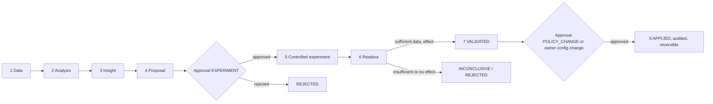

# 15_LEARNING_LOOP — Learning loop: data, insight, proposal, controlled experiment, approved update

| Field | Value |
|---|---|
| Status | Draft — documentation. Software: **Planned** |
| Owner agent / service | Agent 14 Analytics (ingestion, analysis, experiment bookkeeping; `agent_14.analytics_ingest` in 24 §3.2) with S1 Audience Intelligence (aggregate data only). Proposal approval: S7 → Agent 01. Cost data: S4 / Agent 15. Gates: Agent 16. |
| Depends on | MASTER_DIRECTIVE.md (§3.3 Learning loop), GLOSSARY_AND_IDS.md (§6.15 `approval_kind`, §6.35 `experiment_state`, §6.36 `experiment_decision` / `experiment_kind`, §6.37 FIN-R1..R13, `analytics_source`, `figure_label`), 03_COMMUNICATION_STANDARD.md (task envelope, state machine), 04_DATABASE_ARCHITECTURE.md (§5.22 `analytics_snapshots`, `experiments`; §5.16 `approvals`; `memory_items`; `audit_log`), 07_FAILURE_MANAGEMENT.md, 24_PRODUCTION_TYPES.md (§3.2, §3.4), 27_ENGINEERING_STANDARDS.md (§6 eval standard), 13_COMPLIANCE_YOUTUBE_POLICY.md, 09_COST_AND_BUDGET.md, 18_PRODUCTION_QUALITY_STANDARD.md, 3A_SLICE_SPEC.md, RESEARCH_LOG.md (YT-08, YT-14, YT-09, YT-10) |
| Directive sections covered | §3.3 (Learning loop; also Memory, Quality, Observability), §3.1 rows 14/15, §3.2 S1/S7, §1C.15 (tiers) |
| Binding decisions | D1 (no upload and no OAuth in 3A, so no loop in 3A), D2 |
| MVP scope | **3C** (Agent 14 is 3C, 02 §registry). 3A and 3B build none of it; only the unused tables exist (3A_SLICE_SPEC). Tier 0 first; Tier 1+ only when a paying client needs it (§1C.15). |

Nothing in this document is implemented. Every threshold named here is a configuration key whose value is **not** set in this phase.

---

## 1. Purpose and non-goals

The loop lets the factory improve its own prompts, templates, schedule and formats from measured channel data, in small, reversible, human-approved steps. It does not make strategic decisions, publish anything, or change a rule.

| Non-goal | Why |
|---|---|
| Automatic change of any critical policy (section 5) | §3.3 Learning loop; rule 5 |
| Significance claims without sufficient data | §3.3; `experiments.confidence` CHECK (section 7) |
| Automating the YouTube title/thumbnail test | YT-08: no public API found; human Studio step (section 8) |
| Claims about individual viewers | S1 is aggregate only (§3.2) |
| Any forward-looking statement on a named security derived from data | FIN-R13; FIN-R3 |
| Use of the learning loop on private method material | KNOWLEDGE_RELEASE rules (Q26); memory never carries critical policy |

## 2. Pipeline

| Stage | Who | What is produced | Where stored | Scope / tier |
|---|---|---|---|---|
| 1 Data | Agent 14 (code) | Aggregates from the YouTube Analytics API (retention) and the Reporting API reach reports (impressions, CTR) — two ingestion paths (YT-14); cost per video from the cost ledger | `analytics_snapshots` (append-only), `cost_ledger` (read), `quality_scores` (read) | 3C, Tier 0 |
| 2 Analysis | Agent 14 (deterministic arithmetic) | Descriptive statistics, segment comparisons, data-sufficiency checks | computed on read; run record in `audit_log` | 3C, Tier 0 |
| 3 Insight | Agent 14 (LLM narration allowed, numbers only from stage 2) | A statement with its evidence rows, labelled `MEASURED` (date range) or `ESTIMATE`; never a causal claim | `memory_items` scope `CHANNEL` with `provenance_ref` (04 §5.10 rule 3) | 3C, Tier 0 |
| 4 Proposal | Agent 14 proposes; Agent 01 / S7 route | One `experiments` row, `state = PROPOSED` | `experiments` | 3C, Tier 0 |
| 5 Experiment | per `kind` (section 6) | Variant runs under the frozen design | `experiments`, job rows | 3C, Tier 0 |
| 6 Readout | Agent 14 | `result` (measured values only), `confidence` only if sufficiency holds | `experiments` | 3C, Tier 0 |
| 7 Validation | Agent 14 computes; human decides | `decision` ADOPT / REJECT / EXTEND | `experiments` + `approvals` | 3C, Tier 0 |
| 8 Applied update | S7 + owner; Agent 01 applies through the normal config/prompt-release path | A versioned change (prompt, template, schedule value, format) | prompt/config release, `audit_log` | 3C, Tier 0 |

Agent 14 never writes to prompts, templates, configuration or rule packs. Stage 8 is a separate, human-approved change made through the usual versioned release path (27 §4–§6).

## 3. Data inputs and honesty rules

1. **Only values returned by the APIs** enter `analytics_snapshots.metrics`; nothing is fabricated or back-filled (04 §5.22; rule 4).
2. Impressions and CTR come from the Reporting API reach reports, retention from the Analytics API (YT-14). The report time zone and the reporting latency are **REQUIRES REVIEW (Phase 1): time zone of `metric_date` (GLOSSARY §4) and the data-latency of reach reports must be verified on the official pages before any experiment window is defined.**
3. Cost per video comes from the ledger. Figures keep their label (`ESTIMATE` until reconciled with provider usage, `VERIFIED` after; GLOSSARY `figure_label`).
4. Each insight and proposal states: data range, number of videos and impressions behind it, and what the data does **not** show.
5. Insights about audience are aggregate only (S1). No per-viewer or per-commenter inference.
6. Channel-level performance of a video also depends on topic, season and external events; the loop therefore never reports "caused by" without a controlled experiment (section 6) and always keeps "associated with" for observational insight.
7. Isolation: every read and write filters `org_id` and `channel_id`; a learned insight is never carried to another channel or tenant (04 §5.10 rule 1; rule 9).

## 4. Data sufficiency (what "enough data" means)

No numeric threshold is invented here. The design is:

| Item | Rule |
|---|---|
| Pre-registration | `sample_size_target`, `duration_target_ms`, `primary_metric` and the decision rule are fixed in the `experiments` row at `PROPOSED` and cannot be edited after `APPROVED_TO_RUN` (changing them requires a new experiment). |
| Minimum data gate | Config `learning.min_sample_size` (per kind) and `learning.min_duration_ms` (per kind). Both are **REQUIRES REVIEW (Phase 1): the minimum sample and statistical method for each `experiment_kind` must be chosen with a statistician-level source and the owner; no value is proposed here.** |
| Sufficiency check | Deterministic code, not an LLM: the experiment may leave `RUNNING` for a readout only when the actual sample >= `sample_size_target` and the elapsed time >= `duration_target_ms`, or when it is `ABORTED`. |
| Confidence | `experiments.confidence` is written only after the sufficiency check passes. The numerator method is a configuration choice (**REQUIRES REVIEW (Phase 1)**); the stored value and the method key are both kept in `result`. |
| Not enough data | State `INCONCLUSIVE`, `decision = NONE` or `EXTEND`. The system displays "not enough data" and never a winner. |
| Peeking | Intermediate readouts are shown as `MEASURED (partial)` without a confidence value and cannot trigger a decision. |
| Small channels | A channel below the minimum data gate gets observational insights only, labelled as such; no experiments are proposed (this is expected for the first months of a new channel). |
| Multiple comparisons | An experiment has one `primary_metric`. Other metrics are reported as secondary and can not decide the outcome. |

## 5. Critical policies: never changed by the loop

An item is **critical** when changing it can affect compliance, safety, money, tenant isolation or what is published. These can change only by a human through the owner's approval path (`POLICY_CHANGE`, or a versioned migration/config change under S7), never by an experiment result, a memory item or an agent.

| Critical (loop may not apply) | Source |
|---|---|
| Rule packs and rule text, including FIN-R1..R13, `rp.youtube_general`, severities | 13; GLOSSARY §6.37 |
| Uniqueness / inauthentic-content gate and its thresholds | 13, 18; YT-09 |
| Publish threshold `quality.publish_min_score` and any blocking QC threshold | 04 §5.17; 18 |
| Approval workflows, who approves, mandatory `FINAL_VIDEO` approval, editorial-contribution requirement | 24 §3.4 |
| Privacy default (`private` first), synthetic-media disclosure decision | YT-04, YT-06 |
| Budget limits, reservations, breach behaviour, provider limits | 09; D1 |
| Tenant isolation, RLS, retention, keys, roles | 08, 04 |
| Model routing tier changes, provider selection | ADR-007 (tier change passes the eval gate; S4 may only report and propose) |
| Market-hours render prohibition, night-window limits | D1; 06 |

| Adjustable by the loop (after approval, section 9) | Kind |
|---|---|
| Prompt wording of non-gate steps (hook options, outline style), within the 27 eval gate | `PROMPT_VARIANT` |
| Visual/layout templates, thumbnail layout style, caption style, within brand kit | `TEMPLATE_VARIANT` |
| Publish-time preference (a scheduling value; no market-hours or quota rule changes) | `SCHEDULE_VARIANT` |
| Video length/format mix (a content-format preference) | `FORMAT_VARIANT` |
| Title / thumbnail variant choice | `TITLE_THUMBNAIL_STUDIO_TEST` (human, section 8) |

If a proposal touches anything in the first table it is rejected at validation by a deterministic check (the proposal's target key must not match the critical-key list) and may instead be handed to the owner as a `POLICY_CHANGE` request that is **not** part of the loop.

## 6. Experiment definition

### 6.1 Record (table `experiments`, 04 §5.22; no new columns used)

| Required content | Column | Note |
|---|---|---|
| experiment_id | `id` (prefix `exp`, GLOSSARY) | UUIDv7 |
| Hypothesis | `hypothesis` | one falsifiable sentence naming the metric and the expected direction; no price/market claim |
| Baseline | `baseline` (jsonb) | the current prompt/template/value with version reference and its measured metric (`MEASURED`, date range) |
| Variant(s) | `variants` (jsonb) | each with version reference; changes only the factor under test |
| Sample size | `sample_size_target` | pre-registered |
| Duration | `duration_target_ms` | pre-registered |
| Primary metric | `primary_metric` | one |
| Result | `result` (jsonb) | measured values only |
| Confidence | `confidence` | only after sufficiency (section 4) |
| Decision | `decision` | `ADOPT` / `REJECT` / `EXTEND` / `NONE` |
| Approvals | `approval_id` → `approvals` kind `EXPERIMENT` | required for `APPROVED_TO_RUN` and `APPLIED` |
| Time | `started_at`, `ended_at` | |
| Actor | `created_by` | actor ref |

Fields that the loop needs but the contract does not have (insight link, applied-change reference, per-state transition table) are in section 14 as contract requests; until they are accepted the design stores them in `baseline` / `result` jsonb under documented keys only if the CCR is accepted that way.

### 6.2 Experiment kinds

| `experiment_kind` | Who runs it | Allocation | Notes | Scope |
|---|---|---|---|---|
| `TITLE_THUMBNAIL_STUDIO_TEST` | **Human in YouTube Studio** (section 8) | by YouTube | not automatable; YT-08 | 3C |
| `PROMPT_VARIANT` | factory, offline first | A/B on non-publishing outputs scored by the 27 eval harness and human review; production exposure only through approved jobs | no variant ships through the QC/compliance gates differently from the baseline | 3C |
| `TEMPLATE_VARIANT` | factory | alternate across videos in sequence, per channel | one factor at a time | 3C |
| `SCHEDULE_VARIANT` | factory (S7 schedules) | alternate across videos in sequence | never outside the night window for rendering; never changes quota rules (YT-01..03) | 3C |
| `FORMAT_VARIANT` | factory | alternate across videos | requires data on both formats | 3C |

Rules for all kinds: one factor per experiment; at most one running experiment touching the same factor on the same channel; every variant video passes the same blocking gates and the same owner approval as any other video (rule 5); the experiment never lowers a gate to run a variant; a variant that fails a compliance gate ends the experiment `ABORTED`.

### 6.3 Why the observational loop is not enough

Videos of a channel differ in topic and timing. Observational comparison (stage 2) produces hypotheses only. A claim "X improves Y" is made only from a controlled experiment that reached sufficiency.

## 7. State machine of an experiment (enum `experiment_state`, GLOSSARY §6.35)

States: `PROPOSED`, `APPROVED_TO_RUN`, `RUNNING`, `COMPLETED`, `INCONCLUSIVE`, `VALIDATED`, `REJECTED`, `APPLIED`, `ABORTED`.

| From | To | Condition / actor | Audit |
|---|---|---|---|
| (new) | `PROPOSED` | Agent 14 creates; target key not critical; design complete | yes |
| `PROPOSED` | `APPROVED_TO_RUN` | `approvals` kind `EXPERIMENT` is `APPROVED` (owner, role `REVIEWER_APPROVER`; finance channel: `owner_sensitive` workflow) and `approval_id` set | yes |
| `PROPOSED` | `REJECTED` | approval `REJECTED` or `WITHDRAWN` / `EXPIRED` | yes |
| `APPROVED_TO_RUN` | `RUNNING` | start at `started_at`; no conflicting experiment | yes |
| `RUNNING` | `COMPLETED` | sufficiency check passed (section 4) | yes |
| `RUNNING` | `INCONCLUSIVE` | duration elapsed without sufficiency, or data unusable | yes |
| `RUNNING` | `ABORTED` | compliance/QC failure of a variant, budget breach, owner stop, data-source failure that invalidates the design | yes |
| `COMPLETED` | `VALIDATED` | `decision = ADOPT`, the effect is on the pre-registered primary metric, no guard metric harmed, human confirms | yes |
| `COMPLETED` | `REJECTED` | `decision = REJECT` | yes |
| `INCONCLUSIVE` | `PROPOSED` | `decision = EXTEND`: a **new** experiment row is proposed (no editing of a finished design) | yes |
| `VALIDATED` | `APPLIED` | approved update performed and recorded (section 9) | yes |
| `VALIDATED` | `REJECTED` | owner declines the update | yes |

Terminal: `REJECTED`, `APPLIED`, `ABORTED`, `INCONCLUSIVE` (after EXTEND creates a new row). The transition table above is a **design proposal**: Wave A defines the enum but no transition table or trigger for it, so it is submitted as a contract request (section 14); until accepted, no implementation may rely on it. A guard-metric list (for example retention must not fall) is **REQUIRES REVIEW (Phase 1): owner to choose guard metrics per kind**.

## 8. Title and thumbnail tests: human Studio step (YT-08)

| Fact (YT-08, official Help 13861714) | Consequence |
|---|---|
| Feature "A/B test titles & thumbnails": up to 3 titles and/or thumbnails, judged on watch-time share, "should be completed within two weeks" | Agent 11 prepares up to 3 thumbnails (`thumbnail_set`, 24 §4); Agent 12 prepares up to 3 titles |
| Desktop only, needs Advanced features; not for Shorts, made-for-kids or private videos | The step cannot apply to Shorts or to a video that is still private; 18 notes the same for Shorts |
| Editing the title or thumbnail stops the test | S7 reminds the owner not to edit during the test; any edit is recorded as the test ending |
| No public API found | No automation is assumed. The owner starts the test in Studio by hand |

Flow (all human, 3C, Tier 0):
1. Agent 14 proposes `TITLE_THUMBNAIL_STUDIO_TEST` with the candidate variants (from the approved set) and the planned Studio duration. Approval `EXPERIMENT` is required; variants must already have passed their normal gates (thumbnails: 18/16 rules; titles: Agent 12 SEO validation and finance rule pack, no return claims, FIN-R6).
2. S7 creates a task for the owner: "start the test in Studio" with the exact variants and the date window. The owner confirms the start in the dashboard (this sets `RUNNING` and `started_at`).
3. When the owner confirms the end, or the window passes, the owner enters the result as shown in Studio (variant names, watch-time share per variant, the winner YouTube declares). The entry is a human actor in `result.source = "STUDIO_MANUAL"`; Agent 14 does not scrape Studio.
4. Agent 14 validates arithmetic and plausibility (shares sum, variant names match), writes `result`. `confidence` is **not** computed by the factory for this kind: YouTube's own conclusion is recorded as reported, labelled `MEASURED (source: Studio, manual entry)`, and the factory makes no additional significance claim.
5. The owner applies the winning title/thumbnail through Studio and records it; `APPLIED` is the owner's confirmation. Agent 13 / 14 reads back the live state for verification when that function exists.

Whether the factory may later read test results through any API is **REQUIRES REVIEW (Phase 1): not confirmed by YT-08**.

## 9. Applying a validated update

1. A `VALIDATED` experiment is only a recommendation. The update is applied by the normal release path: a new prompt version (27 §4), template version, config value or format default, each with its own review.
2. Prompt changes must pass the 27 §6 eval gate (golden dataset, answer-key cases at 100 %) and show no regression on the existing set before release; the experiment result does not replace this.
3. An `approvals` row of kind `EXPERIMENT` covers running the test; applying the change needs approval again (`approval_id` required for `APPLIED`). If the change touches anything critical (section 5) it is not applied by this path.
4. The change is recorded in `audit_log` with the experiment id; the previous version is kept so the change can be reverted by the owner in one step.
5. After applying, the metric is watched for a pre-defined period; a clear regression produces a proposal to revert (also human-approved), never an automatic one.
6. Applied learnings become `memory_items` (`CHANNEL` / `LONG_TERM`) only with provenance (the experiment id) and a `review_after` date, so they are re-examined; they never override gates or rule packs.

## 10. Roles and approvals

| Action | Actor |
|---|---|
| Ingest, analyse, narrate insights, propose | Agent 14 (agent actor, never approves) |
| Approve running an experiment (`EXPERIMENT`) | owner (`REVIEWER_APPROVER`; Tier 0), `owner_sensitive` second step on finance channels or financial claims |
| Start / stop / enter Studio results | owner (human) |
| Decide ADOPT / REJECT / EXTEND | human; Agent 14 may recommend |
| Approve applying a change | owner |
| Policy change | not part of the loop (`POLICY_CHANGE`, 13) |
| Tier 1+ client channels | client approver per `client_two_step` where the client contracted learning features; managed service only if contracted (rule 10) — **not designed in detail until a paying client needs it** (§1C.15) |

Agents never self-approve. The audit row records proposer, approver, and subject hash binding the approval to exact content (`approvals.subject_sha256`).

## 11. Cost, budget and failure behaviour

| Concern | Rule |
|---|---|
| LLM use | Insight narration and hypothesis drafting only; routed to the cheapest tier that passes its eval (ADR-007), non-urgent so eligible for overnight batch. Counted in the cost ledger per video/channel analysis job. |
| Budget | Analytics and loop jobs are non-critical paid jobs: a budget breach suspends them (09 §4, B4 permits non-paid deterministic computation). They never take budget away from production. |
| API quota | Analytics/Reporting API reads are scheduled system jobs (`NO_DELIVERABLE`, 24 §3.2 note) and respect the quota rules (YT-01..03) |
| Failures | Normal taxonomy and retry policy (07); a failed ingestion yields a visible data gap, never imputed values; an experiment whose data source is broken becomes `ABORTED` |
| Stuck / DLQ | Normal handling; replay requires `DLQ_REPLAY` approval (07) |
| Observability | Metrics per loop stage: snapshots ingested, proposals created, experiments by state, time in state; logs carry `experiment_id` |
| Night window | Batch analysis runs in the night window; no render (unaffected) |

## 12. Compliance, safety and finance guardrails

1. A variant is never exempt from the rule packs. FIN-R1..R13 apply to every title, thumbnail, script variant. Optimisation for click-through must not introduce return claims, urgency about a named security, or a forward view (FIN-R3, R6, R13); a variant that fails Agent 16 is dropped and logged.
2. No AI persona on a finance channel (FIN-R11, YT-09) and no optimisation toward interchangeable, mass-produced output: the loop must not reduce per-video originality. Uniqueness gate results are a guard metric.
3. Experiments that change disclosure or synthetic-media labelling are not permitted (section 5).
4. Insight text itself (published nowhere) is also internal; if the owner publishes anything derived from it, normal gates apply.
5. Public repo: this document carries no method, book or course content.

## 13. Tiers and scope summary

| Capability | 3A | 3B | 3C | Tier |
|---|---|---|---|---|
| Unused tables (`analytics_snapshots`, `experiments`) | exist, unused (3A_SLICE_SPEC) | unused | used | 0 |
| Data ingestion, descriptive analysis, insights | no | no | yes | 0 |
| 3B golden-sample scoring | not the loop: the owner's scores tune prompts by hand (D1) | owner scoring | — | 0 |
| Experiment records, approval, state machine | no | no | yes | 0 |
| Title/thumbnail Studio test | no (no upload in 3A) | no | yes, human | 0 |
| Prompt/template/schedule/format experiments | no | no | yes | 0 |
| Per-client learning dashboards, cross-client benchmarks | no | no | not before a paying client; cross-tenant data never mixed (rule 9) | 1–3 |
| Public API for experiments | no | no | no | 3 (only if needed) |

## 14. Contract requests raised by this document (pending CCR)

They are listed in `audit/b2_unfiled_ccr_requests_shared.md` for the integrator to file (not yet in CONTRACT_CHANGE_REQUESTS.md); none is assumed to exist.

1. Experiment state transition table and guard trigger for `experiment_state` (section 7).
2. Task types for 24 §3.2: `agent_14.insight_analysis`, `agent_14.experiment_proposal`, `agent_14.experiment_readout` (pending CCR). Today only `agent_14.analytics_ingest` exists.
3. Storage for insights and for the applied-change link: either a table `insights` (pending CCR) with `channel_id`, evidence refs, label, data range, and a column `experiments.applied_change_ref` (pending CCR) and `experiments.insight_id` (pending CCR), or an explicit decision to keep these in `memory_items` and `result` jsonb.
4. Config keys `learning.min_sample_size`, `learning.min_duration_ms`, `learning.guard_metrics` (config registry entries; values REQUIRES REVIEW).
5. Prompt/eval pack entries for the Agent 14 narration steps (27 §6, >= 20 golden cases each) when the blueprint is written.

## 15. Open items

| Item | Status |
|---|---|
| Statistical method and minimum sample per kind | REQUIRES REVIEW (Phase 1) |
| Time zone and latency of Analytics/Reporting data | REQUIRES REVIEW (Phase 1) |
| Guard metrics per kind | REQUIRES REVIEW (Phase 1), owner |
| Any API for reading Studio A/B results | REQUIRES REVIEW (Phase 1); YT-08 says none found |
| Blueprint `agents/agent_14_analytics.md` | planned (3C) |

## 16. Definition of done for this document's implementation (3C, per 27 §10)

Ingestion tests with recorded API fixtures; sufficiency gate unit tests (cannot decide below target); critical-key deny-list test; state transition tests (invalid transitions rejected, audited); isolation tests (no cross-tenant or cross-channel read); an end-to-end test of a `TITLE_THUMBNAIL_STUDIO_TEST` with manual result entry; an eval set for the narration step with a forbidden-claims assertion ("causes", "guaranteed", any FIN-R3/R6/R13 phrase).
