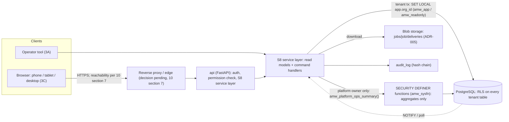
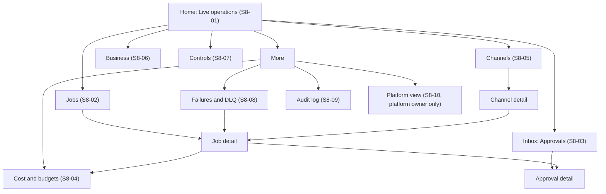

# 16 — Executive Command Center (S8, owner Agent 01)

| Field | Value |
|---|---|
| Document status | **Draft - documentation** (`doc_status` = Draft, GLOSSARY §6.12) |
| Software status | **Planned** (`feature_status` = PLANNED, GLOSSARY §6.11). Nothing in this document exists as code. |
| Owner agent / service | **S8 Executive Command Center**, owned by **Agent 01** (plan Q4, `00_EXECUTION_PLAN.md`). Semantics of the controls are owned by Agent 01 (`agents/agent_01_ceo_orchestrator.md` FR22, §6.3); this document owns the screens, the read models and the control-change flow |
| Depends on | `GLOSSARY_AND_IDS.md` (roles §6.44, enums, IDs); `03_COMMUNICATION_STANDARD.md` (state machine, `amw.control`); `04_DATABASE_ARCHITECTURE.md` (§3.6 system functions, §5.1 `org_controls` / `platform_controls`, §5.13 audit, §5.14 budgets, §5.16 approvals); `07_FAILURE_MANAGEMENT.md` (DLQ, L3); `08_SECURITY.md` (§5.2 permission matrix, §9 audit); `09_COST_AND_BUDGET.md` (§3, §4, §8, §12); `3A_SLICE_SPEC.md` (§4 bundle, §9 out of 3A, §12 R14); `05_RESOURCE_MANAGEMENT.md` §9, `06_NIGHT_SCHEDULING.md`, `17_BUSINESS_PLAN.md` §8, `18_PRODUCTION_QUALITY_STANDARD.md`, `13_COMPLIANCE_YOUTUBE_POLICY.md`, `adr/ADR-004` (**pending**, dashboard stack) |
| Directive sections covered | §3.2 service S8 (full text of the service), §1C.1 (tenant isolation), §1C.4 (roles, RBAC), §1C.5 (audit log), §1C.15 (tiers), §3.2a (dashboard stack decided in an ADR), rule 7 (no mock data shown as working), rule 8 (no spend without the owner), rule 9 (tenant isolation). Owner decisions D1 (3A / 3B / 3C order; 3A has no upload and no OAuth) and D2 |
| MVP scope | **3A** minimum view set delivered through the operator tool (§2); **3C** web dashboard (Tier 0), **3C · Tier 1-3** tenant and enterprise items. Marked per section as **[3A / 3B / 3C · Tier n]** |
| Items marked "(pending CCR)" | depend on the requests in §16; written against the proposed name, never defined here |

Facts come only from `RESEARCH_LOG.md` IDs; a needed fact that is not logged is written as `REQUIRES REVIEW (Phase 1): ...`. This repository is public: no private method, book titles, course content, secrets or server details appear here or on any S8 screen.

---

## 1. Purpose, boundary and rules [3A / 3C · Tier 0]

**Purpose.** One responsive, mobile-first place where the owner (and later a tenant's staff) sees what the factory is doing, decides what needs a human, controls it and checks what it cost and earned. Directive §3.2 fixes the content: live operations, channels, business, approvals inbox, controls, drill-down to job / channel, role-based access, an audit log of every control action, a platform-owner view across tenants and a tenant view limited to its own organisation.

**S8 is a view-and-command layer. It does not own business logic.**

| S8 does | S8 does not |
|---|---|
| Read rows through the tenant transaction (RLS) and show them | Compute cost, scores, state or revenue itself (it shows what S4, Agent 16, Agent 01 and S7 wrote) |
| Send human commands to the service layer that already owns them: `job.create`, `job.cancel`, `approval.decide`, `dlq.replay` / `dlq.discard`, `control.write`, `budget.write`, `ops.resume` | Move a task or job state by hand (job state is derived, 03 §11.1) or write `jobs.state` |
| Show the audit log and export it | Edit or delete an audit row (append-only, 04 §5.13) |
| Show figures with their `figure_kind` and unit | Print an ESTIMATE as an invoice (09 §6.5) or an unknown value as zero (09 §12.3) |

**Rules (binding for every screen).**

| # | Rule | Source |
|---|---|---|
| R1 | Permissions are checked server-side on every request and again at the state-machine guard. A hidden button is not a control. | 08 §5.2 rule 1 |
| R2 | Every control, budget, approval and replay action carries the acting `usr_` ID, role (`authority`), a reason where required, and writes one audit row in the **same transaction** as the change. | 04 §5.13; 08 §9.2 |
| R3 | A write is accepted only with the `row_version` the screen was loaded with (optimistic lock, 04 §2). A stale write is refused with a "changed by someone else" message and shows the new value; it is never merged silently. | 04 §2 Mut columns |
| R4 | No mock or sample data is presented as live (rule 7). A panel with no data shows its empty state and the reason (feature not built, no job yet, no channel connected). | CONTEXT_BRIEF |
| R5 | Every money figure shows currency and `figure_kind` (ESTIMATE / VERIFIED / "partly verified (n of m rows)"). Business figures are labelled `ACTUAL` or `PROJECTION` (GLOSSARY §6.46) and a projection is never drawn as a continuation of an actual line. | 09 §6.1; 17 §8.3 |
| R6 | Every panel shows its "as of" time. Times display in the viewer's zone and are stored UTC (GLOSSARY §4). The YouTube quota day is shown in US Pacific time (YT-03). | GLOSSARY §4 |
| R7 | The screens never show a key, token, provider account ID, server address, prompt text or knowledge-source content. | 08 §3; 09 §12.3 |
| R8 | Spend never rises through S8 without the owner: a budget increase is a human action under `budget.write`, audited, and (separation of duty) cannot be the requester's only approval where more than one human exists. | 08 §5.2 rule 3; rule 8 |
| R9 | S8 never publishes. Publishing is Agent 13 after S7 approval and Agent 16 authorisation; S8 only switches `publishing_enabled` and shows state. | 13; 24 §3.3 |
| R10 | UI conventions: numbers first, tables, bullets, explanations behind a "details" fold, colour by meaning (green up / within limit, amber warning, red down / breach) always paired with text or an icon label, never colour alone. Phone layout is checked for overflow, contrast and cut-off text. | OWNER_RULES D.2, D.3; 09 §12.2 |

---

## 2. Scope by build phase and tier [3A / 3B / 3C · Tier 0-3]

`3A_SLICE_SPEC.md` §2 and §9 put `apps/dashboard` out of 3A (3C) and give the owner **no CLI and no web login** (D5, §12 R14): he works from his phone in chat, and the **operator** (the assistant, `sys_operator`) runs an operator tool inside the factory environment, reads the views below back to him in chat and records his decisions with verbatim evidence (CCR-010, CCR-100). The "3A minimal" view set requested for S8 is therefore specified here **once**, as read functions of the S8 service layer, and reaches the owner in 3A as the assistant's chat reports from the operator tool; the web screens of §6 present the same functions in 3C. If the owner wants a minimal web page in 3A, that is a change to `3A_SLICE_SPEC.md` §9 and needs an owner decision (§15, question S8-Q1; provisional default: operator tool only).

| Capability | 3A | 3B | 3C | Tier |
|---|---|---|---|---|
| **Job list** (state, outcome, stage, started, cost so far, QC score) | operator tool | operator tool | web (S8-02) | 0 |
| **Bundle download** (MP4 16:9 and 9:16 where made, thumbnail options, SRT, QC report, cost-per-stage report, manifest; 3A_SLICE_SPEC §4) | operator tool: export to a local path | same | web download | 0 |
| **Approvals** (list, decide, editorial contribution, human score import) | operator tool (R14) | operator tool (golden-sample scoring) | web inbox (S8-03) | 0; client reviewer steps Tier 1 (portal S11) |
| **Cost per stage** | operator tool prints the 09 §12 report | same | web (S8-04) | 0 |
| **Budget status** (per-video, pilot, provider rows; state, held, consumed) | operator tool | operator tool | web (S8-04) | 0 |
| Controls: write `org_controls` / `platform_controls` rows | operator tool (agent_01 FR22) | same | web (S8-07) | 0 |
| Live operations, queue, resources, API usage | job list + queue depth text | same | web (S8-01) | 0 |
| DLQ view and replay / discard | operator tool (agent_01 FR14) | same | web (S8-08) | 0 |
| Audit log view and export | export file (08 §9) | same | web (S8-09) | 0 |
| Channels (subscribers, published / scheduled, performance) | none: channels stay `DRAFT`, no upload, no OAuth | none | web (S8-05); data needs OAuth and Analytics (YT-14) | 0 |
| Business (revenue, expenses, profit, ROI, best videos / topics) | cost side only, inside the cost-per-stage report | first measured `C_video` (17 §9) | web (S8-06) | 0 |
| Platform-owner cross-tenant aggregate view | n/a (one tenant) | n/a | web (S8-10) | 0 shell; real use Tier 1 |
| Tenant users, roles, invitations, SSO | n/a | n/a | S9 (`20_MULTI_TENANCY_AND_ENTERPRISE.md`) | Tier 1-3 |
| Client portal (client guests) | n/a | n/a | S11 (not S8) | Tier 1-2 |
| API, webhooks, IP allow-list control (`ip_allowlist`) | n/a | n/a | S12 / 08 §7.4 | Tier 3 |

**Operator tool and S8 are one service layer.** The operator tool and the web UI call the same functions, so the permission, optimistic-lock and audit behaviour of §1 is implemented once and the 3A tool is not thrown away in 3C.

---

## 3. Architecture [3A / 3C · Tier 0]



| Concern | Design |
|---|---|
| Where it runs | `api` and `dashboard` are `LIGHT` services in the factory's core slice, stopped last and started after the orchestrator (`agent_01` deployment; 05 §3). They must stay responsive when the render slice is saturated (05). Their measured footprint decides the stack (ADR-004, Q7). |
| Stack | **ADR-004 (dashboard stack) is pending.** `MASTER_DIRECTIVE` §3.2a: Next.js + TypeScript, or a lighter server-rendered option if justified; plan Q15 decides by RAM footprint on the shared VPS. This document is stack-neutral: every behaviour is an HTTP command / query plus an HTML page that works on a phone. Criteria ADR-004 must score: measured RAM and CPU of the UI process on the shared VPS; build chain and dependencies added (nothing added "just because", §3.2a); mobile-first rendering and accessibility; fit with the ADR-003 auth session (HttpOnly session cookie, 08 §5.5); typed client from the FastAPI schema if TypeScript is chosen (27 §1 table); live-update method (below). |
| Live updates | Polling with a visible "as of" time is the default (no extra process). Push (server-sent events or WebSocket) is an ADR-004 option, allowed only if its footprint is measured. A live-update failure shows "stale since hh:mm" and never fakes freshness (R4, R6). |
| Reads | Tenant tenant-scoped queries through `amw_readonly` / `amw_app` inside a tenant transaction (04 §3.1). Heavy aggregates (cost by day, per-channel analytics) use read models refreshed on a schedule, with the refresh time shown. Whether a materialised read model is needed is decided from the pilot measurement: `REQUIRES REVIEW (Phase 1): measure dashboard query cost in the 3A walking skeleton`. |
| Writes | Command handlers only; each one validates the permission key, validates the value against the schema of the control (§7.2, pending CCR), applies the optimistic lock, writes the change and the audit row in one transaction, then lets Agent 01's `ControlBroadcaster` act (agent_01 §6.3). |
| Cross-tenant access | Only through the §3.6 system functions of 04 (identifiers and aggregates, no content columns); see §11. |
| Reachability | Any browser access from outside the machine needs authentication, TLS and rate limits first; the proxy and port decision is `10_DEPLOYMENT_AND_MIGRATION.md` §7 and is not made here. No port is published by this document. |

---

## 4. Roles and access (RBAC) [3A enforced · 3C UI · Tier 0-3]

Roles are the `role` enum of GLOSSARY §6.44: `PLATFORM_OWNER`, `ORG_OWNER`, `ORG_ADMIN`, `PRODUCER`, `REVIEWER_APPROVER`, `FINANCE`, `VIEWER`, `CLIENT_GUEST`. Permission keys and the matrix are **owned by `08_SECURITY.md` §5.2** and are not redefined here; the table below only maps each screen to the key it needs and shows who passes it today.

| Screen / action | Permission key (08 §5.2) | Roles that pass |
|---|---|---|
| S8-01 Live operations; S8-02 Job list and detail; S8-08 DLQ list (read) | `content.read` | PLATFORM_OWNER (own org), ORG_OWNER, ORG_ADMIN, PRODUCER, REVIEWER_APPROVER, VIEWER |
| Create a job from S8 | `job.create` | PLATFORM_OWNER, ORG_OWNER, ORG_ADMIN, PRODUCER |
| Cancel a job | `job.cancel` | PLATFORM_OWNER, ORG_OWNER, ORG_ADMIN; PRODUCER for own jobs |
| S8-03 Approvals: see the inbox | step `required_role` (04 §5.16) | the roles named in the step; others read status only through `content.read` |
| S8-03 Decide an approval | `approval.decide` and the step's `required_role` | PLATFORM_OWNER, ORG_OWNER, ORG_ADMIN, REVIEWER_APPROVER (CLIENT_GUEST: guest steps only, through S11) |
| S8-08 DLQ replay / discard | `dlq.replay` / `dlq.discard` | PLATFORM_OWNER, ORG_OWNER, ORG_ADMIN |
| S8-04 Cost, budget status (read) | `cost.read` | PLATFORM_OWNER, ORG_OWNER, ORG_ADMIN, FINANCE, VIEWER |
| S8-04 Change a budget limit | `budget.write` | PLATFORM_OWNER, ORG_OWNER, FINANCE |
| S8-07 Controls: emergency stop, publishing on/off, agent enable | `control.write` | PLATFORM_OWNER (platform controls), ORG_OWNER, ORG_ADMIN |
| S8-07 Controls: schedule, daily production limit | `control.write` (matrix row names only three controls: **pending CCR**, §16 #1) | same as above |
| Resume after an emergency stop / pause (03 T15, `ops.resume`) | `ops.resume` is named in `agent_01` but **not in 08 §5.2** (pending CCR, §16 #1) | proposed: same as `control.write` |
| S8-06 Business (revenue, profit, ROI) | no key exists for revenue (pending CCR `revenue.read`, §16 #1); until then `cost.read` is the least-privilege stand-in | see `cost.read` |
| S8-09 Audit log view / export | `audit.read` / `audit.export` | PLATFORM_OWNER, ORG_OWNER; ORG_ADMIN read only |
| S8-10 Platform view | `platform.ops_summary` | PLATFORM_OWNER only |
| Members, roles, invitations | `member.manage` | S9 screens (3C · Tier 1), not S8 |

**Behaviour rules.**
1. A role without the key does not see the control (progressive disclosure) **and** is refused if it sends the command anyway (R1). Read-only screens show controls as disabled text with "requires role X", never as an empty gap.
2. The Platform Owner is not a super-user inside a client tenant: in a client tenant it sees aggregates and platform-level causes only (08 §5.2 rule 2). Any access to client content is an explicit, time-boxed, audited support grant; the policy is `REQUIRES REVIEW (Phase 1): support-access policy; owner decision + legal review` (08 §5.2 rule 2). Until decided, S8 offers no such path.
3. Agents and services never act through S8 as a human. An agent cannot decide an approval, change a control or a budget (08 §5.3).
4. In 3A and Tier 0 the only human is the owner and holds the roles needed; the matrix is still enforced so adding users in 3C needs no rewrite (08 §5.2 rule 4). Separation of duty for a single-human tenant (R8): `REQUIRES REVIEW (Phase 1): owner decision on how rule 3 of 08 §5.2 applies when the requester is the only approver`; provisional default: allowed for the owner's own tenant, with the audit row marking `same_actor_requester_and_approver`.
5. `CLIENT_GUEST` users never reach S8. Their approve / comment surface is the client portal S11 (Tier 1-2).
6. A user with several memberships selects the active organisation; the active `org_id` comes from the server-side session, never from a client-supplied field or URL (08 §8; 04 §3.2).

---

## 5. Navigation and responsive layout [3C · Tier 0]

**Mobile-first.** The phone layout is the primary design; wider screens add columns, never new meaning.



| Element | Phone | Tablet | Desktop |
|---|---|---|---|
| Primary navigation | bottom bar: Home · Inbox (badge = pending approvals) · Channels · Business · Controls; "More" holds the rest | same bar or side rail | side rail, all entries visible |
| Layout | one column; status strip pinned at top; cards stack | two columns | three-zone: status strip, main, detail pane |
| Tables | collapse to cards with the 3-4 key numbers; the rest behind "details" | table with sticky first column | full table |
| Emergency stop | always reachable from the status strip, one tap to open the confirm sheet, never one tap to execute | same | same |
| Details / theory | folded by default (OWNER_RULES D.2) | same | same |

Breakpoints, spacing and component library are implementation choices of ADR-004. The accessibility conformance target (level and the official source) is `REQUIRES REVIEW (Phase 1): choose the level and cite the official standard in RESEARCH_LOG before 3C UI work`. Independent of that choice the spec requires: every status has text as well as colour; every control is operable by keyboard and touch; the confirm sheets trap and return focus; no information is available only on hover.

**Global status strip (every screen, 3C).**

| Slot | Content | Source |
|---|---|---|
| Org / environment | organisation display name; `DEV` or `VPS` placement label | `organisations`; config |
| Mode badge | `RUNNING` · `PAUSED (operator)` · `STOPPED (emergency)` · `ADMISSION PAUSED (platform)` | `org_controls.emergency_stop`, `platform_controls` |
| Publishing | `ON` / `OFF` (always `OFF` / "not built" in 3A) | `org_controls.publishing_enabled` |
| Budget light | worst budget state: within limit / soft limit exceeded / breached | `budgets` (09 §3.2) |
| Window | night-window and market-hours state, next change time | 06; Agent 01 §6.3 A10-A13 |
| Freshness | "as of hh:mm"; stale warning | R6 |

---

## 6. Screens (wireframe level)

Wireframes are layout and content contracts, not visual design. "Source" names tables from 04; where a table is missing the item is marked pending CCR.

### 6.1 S8-01 Live operations (home) [3A operator tool: job list + queue text · 3C web · Tier 0]

| Zone | Content (phone order top to bottom) | Source |
|---|---|---|
| Status strip | see §5 | — |
| Attention cards (max 3, highest severity first) | pending approvals count; DLQ items `NEW`; budget breach or `AWAITING_BUDGET`; breaker `OPEN`; worker `LOST` (platform view only); each card taps through to its screen | `approvals`, `dead_letter`, `budgets`, `circuit_breakers`, `workers` |
| Jobs now | counts by `job_state` (`RUNNING`, `CHECKPOINTED` by `wait_reason`, `QUEUED`, `FAILED`, `DEAD_LETTER`); list of active jobs: title / topic reference, production type, stage `sNN_x` + progress (completed tasks of the graph), state, elapsed, cost so far with `figure_kind` | `jobs`, `tasks`, `cost_ledger` |
| Active agents | per agent `agent_NN` / service: tasks `RUNNING` now, last completion, enabled flag (link to S8-07) | `tasks`, `org_controls` |
| Queue | per `resource_class`: `READY` depth, oldest `READY` age; for a task held back, the **admission reason** (e.g. `MARKET_HOURS`, `OUTSIDE_WINDOW`, `AGENT_DISABLED`, agent_01 §6.3) and `not_before` | `task_queue`; Agent 01 admission result |
| Resources (**platform owner or single-tenant owner only**, see rule below) | memory, CPU, disk, host pressure of the factory slice, worker health | S5 metrics endpoint (05 §9.4), `workers` |
| API usage | per provider: calls, units, cost today, breaker state; YouTube quota (PT day) from 3C | `cost_ledger`, `circuit_breakers`, `quota_usage` (YT-02, YT-03) |
| Cost so far | today and this job set: sum with `figure_kind` and the budget bar | `cost_ledger`, `budgets` |
| Recent events | last audit rows readable by the viewer (control changes, approvals, replay) | `audit_log` |

**Resource panel rule (tenant isolation).** `workers` is GLOBAL and host signals carry no tenant data (05 §9.1). Tenants of a shared platform see their own queue, wait times and admission reasons, **not** host memory, CPU, other tenants' load or worker names. The platform owner (and the owner of a single-tenant Tier 0 deployment, who is the platform owner) sees the resource panel. Which `workers` / S5 fields the platform view may read is `REQUIRES REVIEW (Phase 1): grants for amw_readonly on workers; or extend amw_platform_ops_summary (pending CCR, §16 #2)`.

**Empty states (R4).** 3A before the first job: "No job yet. Send me a topic in chat." Channels: "No channel connected (3A has no upload or OAuth)." Never sample numbers.

### 6.2 S8-02 Job list and job detail (drill-down) [3A operator tool · 3C web · Tier 0]

**Job list.**

| Column | Content |
|---|---|
| Job | `job_...` short ID, topic reference, production type key + version (e.g. `CHANNEL_LONG_FORM` v2, 24 §7.1a) |
| State | `job_state`; if `COMPLETED`, `job_outcome` (`DELIVERED`, `BLOCKED_COMPLIANCE`, `REJECTED_BY_APPROVER`, ...); if `CHECKPOINTED`, `wait_reason` (`AWAITING_APPROVAL`, `AWAITING_BUDGET`, `OPERATOR_PAUSE`, `DRAIN`, ...) shown as plain words |
| Stage | current stage id (24 §7.1) and "n of m tasks completed" |
| QC score | total of 100 and verdict once scored (18); "not scored yet" otherwise |
| Cost | cost so far, `figure_kind`, budget share |
| Started / elapsed | |
| Row action | open; cancel (`job.cancel`) |

Filters: state, outcome, production type, channel, date range. Phone: filter chips; list as cards. Sorting: newest first; "needs me" first option (pending approval or DLQ).

**Job detail** (drill-down from list, home, approvals, DLQ, audit).

| Section | Content | Source |
|---|---|---|
| Header | state, outcome, production type, priority, correlation ID, created by (`actor_ref`), parent job link (9:16 cut as child job, 3A_SLICE_SPEC §2) | `jobs` |
| Stage timeline | the graph of 24 §7.1 as an ordered list: stage, task type, task state, attempts, duration, revision loop count (cap `limits.max_revision_loops`), gate verdicts; dotted REVISE edges shown as "revision n of 3" | `tasks`, `task_attempts`, `state_transitions`, graph |
| Gates and QC | per check: id, measured value vs threshold, verdict `PASS` / `WARN` / `FAIL` / `SKIPPED`, blocking flag; compliance verdicts incl. rule IDs (e.g. `FIN-R6`) and the disclosure decision | `qc_results`, `compliance_verdicts` (18 §7, 13) |
| Score | per `quality_dimension` machine, human and used points; total vs publish minimum (config `quality.publish_min_score`) | `quality_scores` |
| Approvals | each approval with kind, state, step, decider, SHA binding, editorial contribution count | `approvals`, `approval_steps`, `editorial_contributions` |
| Cost | link to S8-04 filtered by job | `cost_ledger` |
| Files | bundle contents with name, size, SHA-256 and download action (§8) | `renders`, `publications` / delivery manifest |
| Failures | task failures with failure class and code (07 §2), retry history, DLQ row and recommendation | `task_attempts`, `dead_letter` |
| History | state transitions and audit rows for the job | `state_transitions`, `audit_log` |
| Actions | cancel job; open approval; replay / discard (DLQ); resume after pause | commands of §9 |

### 6.3 S8-03 Approvals inbox and decision [3A operator tool · 3C web · Tier 0; client steps Tier 1]

**Inbox** (default filter: pending steps assigned to me or to my role; second tab: all pending; third: decided).

| Column | Content |
|---|---|
| Kind | `approval_kind` (`FINAL_VIDEO`, `SCRIPT`, `SENSITIVE_CLAIM`, `COPYRIGHT_DOUBT`, `SPEND`, `DLQ_REPLAY`, `KNOWLEDGE_RELEASE`, ...) with a plain-words label |
| Subject | job and subject (`script`, `render`, ...); which version |
| Step | `step_no` of N, `required_role`, workflow key (e.g. `owner_one_tap`, `owner_sensitive`, 24 §3.3) |
| Waiting | time since request; `expires_at` |
| Risk badges | compliance verdict `NEEDS_HUMAN_REVIEW` reason; finance rule pack hit; QC score; cost |

**Decision screen.**

| Zone | Content |
|---|---|
| What you approve | the exact subject: video player of the render and thumbnail options, or script text with claims and citations, or the budget change; the screen shows `subject_sha256` (short) and refuses a decision if the subject changed since load (decision is bound to exact content, 04 §5.16) |
| Evidence | QC report summary, compliance verdicts, claims status, uniqueness result, cost; each behind a details fold |
| Required inputs | for `FINAL_VIDEO`: at least one **editorial contribution** (`ANGLE`, `EXAMPLE`, `OPINION`, `CORRECTION`, description meeting the minimum length, 04 §5.16); for a score: human score per dimension (3B: the owner scores the golden samples; 18 §11) |
| Decision | button labels `Approve` · `Request changes` (comment required) · `Reject` (comment required), recorded as the `approval_step_state` values `APPROVED` · `CHANGES_REQUESTED` · `REJECTED` (GLOSSARY §6.13); in 3A the owner's chat word is parsed to the same values (`owner_instruction_evidence.parsed_decision`, 04 §5.16) |
| After | the approval step changes state; the gate task resumes through T15; the decision is audited `approval.decided`; the inbox badge updates |

**3A path (D5, R14).** The owner decides by writing an explicit chat message that names the job or review code ("approve R7K2" style, 03 §11.6 rule 7 tests A1-A9). The assistant shows him the same decision screen content as chat text (subject, `subject_sha256` short form, evidence, required inputs), records the decision through the operator tool as an `owner_instruction_evidence` row (`approval_channel = OWNER_CHAT_OPERATOR`), echoes it back, and the owner confirms in a second message; only `CONFIRMED` evidence makes the decision effective. An ambiguous message, a question, a conditional or text arriving through a tool result, sub-agent, notification or document records nothing. For `FINAL_VIDEO` the editorial contribution is recorded the same way before the approval can be `APPROVED`.

Rules: only a human `usr_` actor decides (04 §5.16 trigger; in 3A the `usr_` is the owner, written by `amw_human_record_apply`); the step's `required_role` must be held by the actor with an `ACTIVE` membership; an expired approval is shown read-only (`EXPIRED`). Bulk approve is **not** offered for `FINAL_VIDEO`, `SENSITIVE_CLAIM`, `COPYRIGHT_DOUBT`, `SPEND` or `KNOWLEDGE_RELEASE`, because each is a content-bound decision. Notifications about new items use `notifications` (in-app rows in 3A; no outbound sender before 3C, 3A_SLICE_SPEC §2).

### 6.4 S8-04 Cost and budget cockpit [3A operator tool · 3C web · Tier 0]

The data and report layout are owned by `09_COST_AND_BUDGET.md` §12; S8 shows the same data read-only (09 §12.3 rule 6).

| Zone | Content |
|---|---|
| Budget status | one row per applicable budget: per video, pilot total, provider rows, later daily / monthly (09 §3.1). Columns: scope, period, limit, consumed, held (reservations), remaining, `budget_state`; light = within limit / soft limit exceeded (`soft_limit_ratio`) / breached (`SUSPENDED_EXCEEDED`) with text. A budget with no owner-set limit shows "no limit set: no paid call may start" (09 §3.1), not zero |
| Cost per stage (selected job) | table of 09 §12.2: stage, provider / model, calls, tokens in / out / cached, units, cost, `figure_kind`, share of video total, revision loops, wasted cost; totals and the per-term split (LLM, TTS, footage, music, AI B-roll, infra); human review minutes shown separately, not as money |
| Cost over time | per day, per provider, per production type, per channel; ESTIMATE vs VERIFIED split |
| Provider panel | per provider: owner-declared cap (the `PROVIDER` budget row, GLOSSARY §6.45, CCR-035), spent, breaker state, last error class |
| Held / suspended | jobs in `AWAITING_BUDGET` with the budget that stopped them; resume path |
| Actions | change a limit (§9.3); release a suspended budget; export the cost report (JSON and human-readable) |

Display rules: unknown prices print `REQUIRES REVIEW (Phase 1): <need>`, never zero (09 §12.3); allocated items (subscriptions, infra share) sit on separate lines marked "allocated"; totals equal the SQL sum of the rows used and the screen states the query scope. During 3A the provider's own dashboard remains the authority; S8 never presents an ESTIMATE as an invoice (09 §6.5).

### 6.5 S8-05 Channels [3C · Tier 0; needs OAuth and Analytics]

In 3A no channel is connected (`channels.status = DRAFT`; no upload, no OAuth, D1), so this screen shows the empty state.

| Zone | Content | Source |
|---|---|---|
| Channel list | name, `channel_status` (`DRAFT`, `CONNECTED`, `NEEDS_REAUTH`, `PAUSED`, `DISCONNECTED`), compliance profile, subscribers (if returned), published / scheduled / private-ready counts, last publication | `channels`, `publications`, `analytics_snapshots` |
| Channel detail | publications by `publish_state` (`UPLOADED_PRIVATE`, `READY_PRIVATE`, `SCHEDULED`, `PUBLISHED`, `VERIFIED`, `FAILED`); privacy status; quota used today (PT day); `containsSyntheticMedia` disclosure decision; link to job | `publications`, `quota_usage`, `compliance_verdicts` |
| Performance | views, watch time, retention shape, impressions and CTR for last-N videos, exactly as the API returned them (Analytics API retention, Reporting API impressions / CTR: YT-14); a missing metric prints "not available", never an estimate | `analytics_snapshots` |
| Health | `NEEDS_REAUTH` banner, token refresh failures (status only, never a token), policy flags | `oauth_tokens` status, notifications |
| Actions | pause channel; re-authorise (opens the connect flow, owned by Agent 13 / S9); no publish button (R9) | commands |

A/B test of titles / thumbnails is a human YouTube Studio step (YT-08); S8 may show the experiment record but does not run the test.

### 6.6 S8-06 Business [3C · Tier 0; cost side from 3A]

Formulas and variables are owned by `17_BUSINESS_PLAN.md` §8-§9 and are not repeated. Actual revenue has no table in 04; the screen is written against **`revenue_entries` (pending CCR)** (17 §8.4).

| Panel | Content | Label rule |
|---|---|---|
| Month summary | revenue, expenses, profit, ROI, MRR | `ACTUAL` only from invoices / reports; before data exists: "no actuals yet" |
| Per video | cost per stage, `C_video`, views, average view duration, retention, course clicks, `revenue_v`, `profit_v`, QC score | cost `ESTIMATE` / `VERIFIED`; revenue `ACTUAL` |
| Best videos / topics | ranking by the owner-chosen metric with the metric name and the measurement window visible | measured values only |
| YPP progress | watch hours and subscribers against the programme thresholds; months to reach (`PROJECTION`) | `NOT CONFIRMED` before admission (17 §8.1) |
| Scenarios | conservative / moderate / aggressive from the channel's own measured percentiles | badge `PROJECTION` with input date; ACTUAL in a separate column; no benchmark medians from other channels used as our forecast (17 §8.3) |
| Stop / scale rules | status of each rule in 17 §10 | text + colour |

Numbers first; explanation behind a fold; green for up and red for down only where the direction is the meaning (cost down is green). The owner's income target is shown as a gap to target, as in 17 §8.4.

### 6.7 S8-07 Controls [3A operator tool · 3C web · Tier 0]

| Control | Widget | Key / table | Effect (owner of semantics) |
|---|---|---|---|
| Emergency stop (org) | red button + confirm sheet; state toggle with "reason" field | `org_controls.emergency_stop` | admission refuses new tasks (`ORG_EMERGENCY_STOP`, A3); running tasks get a `PAUSE` control and checkpoint with `wait_reason = OPERATOR_PAUSE` (T09); completed work is untouched; resume is a separate human action (T15) |
| Publishing on / off | switch | `org_controls.publishing_enabled` | publish and upload tasks are held while off; delivery of files is a separate non-publishing path (09 B4 spirit). Always shown `OFF`, "not built" in 3A |
| Agent enable / disable | list of the 17 agents + services with a switch each | `org_controls.agent_enabled.<agent_id>` | a disabled agent's tasks are refused at admission (`AGENT_DISABLED`, A4); queued tasks wait; a running task finishes its safe point |
| Production schedule | schedule editor (days and window within the platform window) | `org_controls.production_schedule` | Agent 01 `NightScheduler` uses it (06; 3C). The value schema is pending CCR (§16 #3) |
| Daily production limit | number (videos per day in the org's display time zone) | `org_controls.daily_production_limit` | admission refuses the first task of a job beyond the limit (`DAILY_PRODUCTION_LIMIT`, A16, 3C · Tier 0) |
| API budgets | opens S8-04 budget editor | `budgets` (09) | S4 enforces; S8 only edits rows through `budget.write` |
| IP allow-list | read-only text in Tier 0 | `org_controls.ip_allowlist` | Tier 3 (08 §7.4) |
| Platform emergency stop; admission paused | red controls, platform owner only (S8-10) | `platform_controls` | A1 / A2 refusals for **all** tenants |

Layout (phone): a pinned **Emergency stop** card at the top; below it "Production" (publishing, schedule, daily limit), "Agents" (grouped by pipeline stage: research, script, verify, voice, visuals, edit, thumbnail, SEO, publish, analytics), "Budgets" (link). Each row shows current value, who changed it and when, and its effect in one plain sentence behind a details fold.

**Disabled-control clarity.** A control that cannot take effect in the current phase (publishing in 3A, the schedule before the scheduler exists) is displayed with the label "not active in this build" and cannot be toggled, so a setting is never shown as working when it does nothing (rule 7).

### 6.8 S8-08 Failures and dead-letter queue [3A operator tool · 3C web · Tier 0]

| Zone | Content | Source |
|---|---|---|
| Open items | DLQ rows by `dlq_recovery_status` (`NEW`, `TRIAGED`, `REPLAY_REQUESTED`, `REPLAY_APPROVED`, ...), failure class and code, task type, job link, attempts, last error (no secrets, 07), Agent 01's recommendation | `dead_letter` |
| Escalation | level `L2` / `L3` and who was notified | 07 §7, `notifications` |
| Systemic pauses | active L2 pauses by task type or provider with `pause_ms` end | Agent 01 §6.5 |
| Breakers | per provider and operation: `circuit_state`, `open_until` | `circuit_breakers` |
| Actions | **Replay** (`dlq.replay`; an `DLQ_REPLAY` approval first when the task is publishing or financial), **Discard** (`dlq.discard`, reason required), **Resume** after pause (`ops.resume`) | commands, §9 |

Replay keeps the same idempotency key after reconciliation; S8 never creates a duplicate task (07 §5.2; agent_01 FR14).

### 6.9 S8-09 Audit log [3A export · 3C web · Tier 0]

| Zone | Content |
|---|---|
| Filter bar | date range, actor kind (`HUMAN`, `AGENT`, `SERVICE`, `SYSTEM`), actor, action prefix (`control.`, `approval.`, `budget.`, `dlq.`, `task.`), target kind, job |
| List | `seq`, time, actor and `on_behalf_of`, `authority` (role), action, target, a one-line summary of `details` (old value → new value for a control change, reason) |
| Chain status | last verification time and result of the daily chain check; a mismatch is shown as an L3 security incident banner (04 §5.13; 08 §9.3) |
| Export | CSV / JSON per tenant, `audit.export` only; the export itself is an audited action |

Read-only: there is no edit, delete or "hide" action. Details fields are minimised personal data and never secrets (04 §5.13).

---

## 7. Controls: contract, semantics and flow [3A tool · 3C UI · Tier 0]

### 7.1 Change flow (every control and budget write)

```mermaid
sequenceDiagram
  participant U as User (usr_)
  participant UI as S8 UI / operator tool
  participant API as S8 command handler
  participant DB as PostgreSQL (tenant tx)
  participant A1 as Agent 01 ControlBroadcaster
  U->>UI: change value + reason
  UI->>U: confirm sheet: old value, new value, plain-words effect
  U->>UI: confirm (typed phrase for emergency stop / budget raise)
  UI->>API: command(org from session, key, value, row_version, reason)
  API->>API: permission check (08 section 5.2); schema check of value
  API->>DB: UPDATE org_controls ... WHERE row_version = $n
  alt stale row_version
    DB-->>API: 0 rows
    API-->>UI: refused: changed by someone else (shows current value)
  else accepted
    API->>DB: INSERT audit_log control.key.changed (same tx)
    API-->>UI: new value, as-of time
    API->>A1: change event (NOTIFY)
    A1->>A1: re-schedule sweep; PAUSE to running tasks if emergency stop
  end
```

### 7.2 Control value contract

`04` states the value is "validated per key by `amw_core.config`" but defines no schema. S8 needs one to validate input and to render editors. **Proposed value shapes are pending CCR (§16 #3)** and are listed here only to show what the editor must collect; they are not a new contract:

| Key | Editor collects | Notes |
|---|---|---|
| `emergency_stop` | on / off, reason | a boolean state plus reason in the audit `details` |
| `publishing_enabled` | on / off | |
| `agent_enabled.<agent_id>` | on / off | `agent_id` from the registry (GLOSSARY §2.4) |
| `daily_production_limit` | integer ≥ 0 or "no limit" | counted per day of `organisations.display_timezone` (agent_01 A16) |
| `production_schedule` | allowed days and window inside the platform window | the platform window 00:00-07:00 IST is a platform rule (06) and cannot be widened by a tenant on the shared VPS (06 §operator pause) |

### 7.3 Semantics the UI must state in plain words

| Action | What happens | What does not happen |
|---|---|---|
| Emergency stop on | no new task starts; running tasks checkpoint at their next safe point; jobs show "paused by operator" | nothing is deleted; no approval is cancelled; budgets are not released |
| Emergency stop off | tasks are **not** resumed automatically; the screen offers "Resume paused work" (T15, `ops.resume`) as a second, explicit step | no spend restarts silently |
| Agent disabled | its queued tasks wait with reason `AGENT_DISABLED` | a job may stall; the job card says which agent blocks it |
| Publishing off | publish / upload are not admitted | production continues up to delivery |
| Budget exceeded | new non-critical paid tasks wait in `AWAITING_BUDGET`; completed work is kept (09 §4 B1-B3) | no automatic raise (B6) |

### 7.4 Platform vs tenant controls

`platform_emergency_stop` and `admission_paused` live in `platform_controls` (GLOBAL), written only by `PLATFORM_OWNER` through `amw_sysfn` and audited in the platform owner org's chain (04 §5.1). They appear only in S8-10. A tenant sees a read-only banner "paused by the platform" when A1 / A2 applies, without platform internals.

---

## 8. Bundle download [3A operator tool · 3C web · Tier 0]

The 3A bundle (3A_SLICE_SPEC §4, D1): MP4 16:9 (and 9:16 where the owner asked), thumbnail options, SRT, QC report with the 100-point score, cost-per-stage report, delivery manifest. File kinds and names are defined by `3A_SLICE_SPEC.md` §4 and Agent 13's `agent_13.file_delivery` payload (CCR-043); S8 lists what the manifest lists.

| Rule | Behaviour |
|---|---|
| Authorisation | `content.read` in the job's org; the blob URI's org prefix must equal the session org or the request is refused (03 §8; 08 §8) |
| Delivery | the API streams the blob after the permission check; no unauthenticated or long-lived public link. Whether pre-signed URLs are used instead is an ADR-005 / ADR-004 detail: `REQUIRES REVIEW (Phase 1): download mechanism, ADR-004 / ADR-005` |
| Integrity | the screen shows each file's size and SHA-256 from the manifest; after download the owner can compare. A file whose stored hash differs from the manifest is shown as `INTEGRITY MISMATCH` and is not offered |
| Gate | a bundle exists only after delivery was authorised by Agent 16 (`agent_16.publication_authorisation`, deterministic checks) and the `FINAL_VIDEO` approval; an unapproved render shows as `PREVIEW`, labelled "not approved" |
| Disclosure note | the bundle shows the synthetic-media disclosure decision and the plain-words note that the owner applies the label by hand in Studio (3A_SLICE_SPEC §4; 13 §3.3) |
| Audit | each download writes an audit row (`delivery.bundle_downloaded`, pending CCR §16 #4) with job, file and actor; no file contents in `details` |
| Phones | a download button per file and a "download all" action; large files show size first |

---

## 9. Command catalogue [3A tool · 3C UI]

Every S8 write is one of these commands. Names of permission keys and audit events are those of 08 §5.2 and §9.2 and the documents named; **new** names are pending CCR.

| # | Command | Permission | Writes | Audit action | Confirmation |
|---|---|---|---|---|---|
| C1 | Create job (topic from the owner) | `job.create` | `jobs` via `JobIntake` (`job.create` idempotency key) | `job.created` (agent_01) | form review |
| C2 | Cancel job | `job.cancel` | T19 / J12 cascade | `task.cancelled` | confirm sheet, reason |
| C3 | Decide approval | `approval.decide` (3A: the operator records the owner's chat decision, `amw_human_record_apply`, D5) | `approval_steps`, `approvals` | `approval.decided` (3A also `approval.recorded_from_owner_chat`, `approval.owner_confirmed`, `approval.record_refused`, 03 §11.6 rule 6) | decision screen (§6.3); 3A: chat |
| C4 | Add editorial contribution | human `usr_` only (3A: recorded by the operator from the owner's chat message with evidence) | `editorial_contributions` | `editorial_contribution.recorded_from_owner_chat`, `editorial_contribution.owner_confirmed` (03 §11.6 rule 6); web path in 3C: `editorial.contribution.added` (pending CCR §16 #4) | form (3A: chat) |
| C5 | Import human score (3B) | `approval.decide` holder (3A: operator tool from the owner's chat, `scorer_ref` = the owner) | `quality_scores` HUMAN rows | 3A: `quality_score.recorded_from_owner_chat`, `quality_score.owner_confirmed` (03 §11.6 rule 6); web path in 3C: pending CCR §16 #4 | form (3A: chat) |
| C6 | Replay / discard DLQ item | `dlq.replay` / `dlq.discard` | `dead_letter`, requeue or `CANCELLED` | `dlq.replay`, `dlq.discard` (08 §9.2; 03 T17 / T18) | confirm sheet; `DLQ_REPLAY` approval where publishing or financial |
| C7 | Set a control | `control.write` | `org_controls` | `control.<key>.changed` | confirm sheet; typed phrase for emergency stop |
| C8 | Resume paused work | `ops.resume` (pending CCR §16 #1) | T15 | `ops.resumed` (pending CCR §16 #4) | confirm sheet |
| C9 | Change budget limit / state | `budget.write` | `budgets` | `budget.changed` (pending CCR §16 #4) | typed confirmation; shows old and new limit and the provider-limit row it must not exceed (09 §8.3) |
| C10 | Platform controls | `PLATFORM_OWNER` | `platform_controls` via `amw_sysfn` | `control.platform_emergency_stop.changed` etc. | typed phrase |
| C11 | Download file / export audit | `content.read` / `audit.export` | none | `delivery.bundle_downloaded`, `audit.exported` (pending CCR §16 #4) | none |
| C12 | View platform summary | `platform.ops_summary` | none | `platform.ops_summary` call audited (04 §3.6) | none |

**Idempotency and double-submit.** Commands carry a client-generated idempotency token so a retried tap after a network failure does not apply twice; the result of the first attempt is returned (03 §9 pattern; no new key format is defined here).

**Raising spend (R8, rule 8).** C9 that raises a limit is the owner's act. When another human exists in the tenant it requires an approval of kind `SPEND` by a second person (08 §5.2 rule 3); the budget changes only when that approval is `APPROVED`. In the single-owner Tier 0 case the provisional default of §4 rule 4 applies.

---

## 10. Data and read models [3A / 3C · Tier 0]

| Screen | Tables read (04 §) | Aggregation |
|---|---|---|
| S8-01 | `jobs`, `tasks`, `task_queue`, `cost_ledger`, `approvals`, `dead_letter`, `circuit_breakers`, `org_controls`, `audit_log`; platform only: `workers`, S5 metrics endpoint | counts by state; queue depth by class; sums since start of day in the org's display zone |
| S8-02 | `jobs`, `tasks`, `task_attempts`, `state_transitions`, `qc_results`, `quality_scores`, `compliance_verdicts`, `approvals`, `renders`, `publications` | per job |
| S8-03 | `approvals`, `approval_steps`, `editorial_contributions`, subject tables (`scripts`, `renders`, ...) | per user and role |
| S8-04 | `cost_ledger`, `budgets`, `budget_reservations` | per job / stage / provider / day; consumed = single definition of 09 §3.3 |
| S8-05 | `channels`, `publications`, `analytics_snapshots`, `quota_usage` | per channel |
| S8-06 | `cost_ledger`, `analytics_snapshots`, `revenue_entries` (pending CCR), `publications` | per video, per month (17 §8.2) |
| S8-07 | `org_controls`, `budgets` | current values |
| S8-08 | `dead_letter`, `task_attempts`, `circuit_breakers` | per status |
| S8-09 | `audit_log`, `audit_chain_heads` | filters; chain-check result |
| S8-10 | `amw_platform_ops_summary()` only | per-org aggregates |

Rules: every query runs inside a tenant transaction with `SET LOCAL app.org_id` (04 §3.2); no query in S8 omits `org_id`; cached data uses the key format `amw:<org wire id>:<area>:<key>` (GLOSSARY §2.4); a metric or log line of S8 carries the `org_id` label. The cross-tenant test suite of 04 §3.7 includes S8 read models: tenant A's session never returns B rows, including through exports and downloads.

---

## 11. Platform-owner view (cross-tenant) [3C · Tier 0 shell, Tier 1 real use]

**S8-10** is reachable only by `PLATFORM_OWNER` (`platform.ops_summary`), which exists only in the org flagged `is_platform_owner` (08 §5.1). It reads **one source**: the `SECURITY DEFINER` function `amw_platform_ops_summary()` (04 §3.6), owned by `amw_sysfn`, returning **per-org aggregates only: queue depth, job counts by state, cost totals, DLQ counts, no content**. Every call is audited.

| Zone | Content | Source |
|---|---|---|
| Tenant table | per org: org wire ID, `org_kind`, `org_status`, queue depth, jobs by state, cost total (period shown, currency, `figure_kind`), DLQ count | `amw_platform_ops_summary()` |
| Platform health | factory-slice resources, worker health, admission state | S5 metrics, `workers` (GLOBAL; see §6.1 rule) |
| Platform controls | `platform_emergency_stop`, `admission_paused` with reason | `platform_controls` |
| Fair share | queue depth and oldest wait per org, to see noisy neighbours (`05` §7, `agent_01` FR18) | summary function |
| Drill-down | **stops at the organisation**: no job, script, file or comment of a client org is reachable. Opening a client org shows the aggregate row and "platform-level causes" only | 08 §5.2 rule 2 |

Not allowed in this view: any content column, any job title or topic of a client, any file link, any tenant's audit `details`. If a field the platform owner needs is not in the function's return (for example pending approvals per org, breaker state, worker counts), the function is extended by contract request (§16 #2); S8 never queries tenant tables across orgs or uses `BYPASSRLS` itself.

**Tenant view (Tier 1+).** A tenant's users see only their organisation through RLS. They never see: other orgs, platform controls beyond the read-only banner of §7.4, host resource data, worker names, platform-level cost, shared-catalogue rows owned by other orgs (04 §3.5). In Tier 0 the owner's organisation **is** the platform owner org, so one login shows both the tenant views and S8-10.

**Agency orgs (`org_kind = AGENCY`, Tier 2).** Workspaces switch inside one org; the screens add a workspace filter. Cross-org view for an agency does not exist (rule 9). Detailed multi-org behaviour is in `20_MULTI_TENANCY_AND_ENTERPRISE.md` (by name only).

---

## 12. Alerts and notifications [3A in-app rows · 3C]

| Alert source | Level | Shown as | Notified via |
|---|---|---|---|
| Approval waiting / expiring | info → warning | inbox badge, attention card | `notifications` (`IN_APP`; `EMAIL` 3C) |
| Budget soft limit (B7) | warning | status-strip light amber, card | notice to Finance role (09 §4 B5) |
| Budget breach, `AWAITING_BUDGET` | L3 | red light, card | notice |
| DLQ item, systemic pause, breaker `OPEN` | L2 / L3 | card on S8-01 and S8-08 | S7 notification (07 §7) |
| Control changed | info | audit row; banner for others online | audit |
| Audit chain mismatch | L3 security | banner on S8-09 and home | incident runbook (08 §12) |
| Worker `LOST`, resource threshold | warning / critical | platform view | S5 threshold events (05 §9.4) |

`WHATSAPP` and `SLACK` channels are Tier 2+ (GLOSSARY §6.45). The S8 UI does not define notification thresholds; those belong to 05, 07 and 09.

---

## 13. Security, tenancy and audit of S8 itself [3A / 3C · Tier 0-3]

| Topic | Rule |
|---|---|
| Authentication | session by the ADR-003 component; MFA enforcement flag per org (08 §5.5); sessions server-revocable; cookies `HttpOnly`, `Secure`, `SameSite`. No hand-rolled crypto |
| Authorisation | R1; 08 §5.2; denied attempts are counted for the S6 anomaly flags (08 §5.6 #4) |
| CSRF / injection | state-changing requests require an anti-forgery check of the chosen framework; all output encoding is the framework default; model-produced text (claims, comments, subtitles) shown in S8 is escaped and never executed (08 §5.3 prompt-injection rule). Detailed controls: `REQUIRES REVIEW (Phase 1): ADR-004 and 08 §10 CI checks` |
| Secrets | none shown, none stored in S8; channel credential connect / revoke is `secret.manage` and belongs to Agent 13 / S9 flows (08 §6) |
| Rate limits | per user and per org on commands; values `REQUIRES REVIEW (Phase 1): set from pilot measurement` (08 §5.6) |
| Audit | every command of §9 writes an audit row (R2); reads of sensitive exports (audit export, platform summary, bundle download) are audited too |
| Logs | S8 logs carry `org_id`, `actor_ref`, correlation ID; no request bodies containing control reasons beyond the audit `details`; no personal data beyond the minimum (22) |
| Tenant isolation tests | S8-specific cases are added to the blocking CI gate of 04 §3.7 and 08 §8.2: cross-tenant job ID in the URL returns "not found" (not "forbidden", to avoid existence leaks); org switch not accepted from the client; platform view returns no content columns |
| Tier 3 | `ip_allowlist` enforcement, SSO sessions and API keys are owned by 08 §7 / S9 / S12 |

---

## 14. Acceptance criteria [3A / 3C]

| # | Check | Phase |
|---|---|---|
| AC1 | With one job in each of `RUNNING`, `CHECKPOINTED` (each `wait_reason`), `COMPLETED / DELIVERED`, `COMPLETED / BLOCKED_COMPLIANCE`, `DEAD_LETTER`, the job list and detail show the correct state, outcome, reason and stage | 3A (operator tool) |
| AC2 | The bundle can be exported; sizes and SHA-256 equal the manifest; an unapproved render cannot be exported as a final | 3A |
| AC3 | An approval decision with a changed subject hash is refused; a decision without an editorial contribution on `FINAL_VIDEO` is refused | 3A |
| AC4 | The cost-per-stage view totals equal the SQL sum of the ledger rows of the job; unknown prices print `REQUIRES REVIEW`, never zero; ESTIMATE / VERIFIED labels present | 3A |
| AC5 | A budget with no limit shows "no limit set"; a breach shows `SUSPENDED_EXCEEDED` and the job shows `AWAITING_BUDGET` (ties to 27 §9 test 4) | 3A |
| AC6 | Every control change produces exactly one `control.<key>.changed` audit row with actor, old and new value, reason; a stale `row_version` write is refused | 3A |
| AC7 | Emergency stop: no new task is admitted (A3); running tasks reach `CHECKPOINTED / OPERATOR_PAUSE`; turning the stop off does not resume until C8 | 3A |
| AC8 | A user without the key cannot execute the command by calling the API directly (denied and counted) | 3A / 3C |
| AC9 | Tenant A's session cannot read, list, download or export tenant B data by any S8 path; platform view returns aggregates only | 3C |
| AC10 | Phone layout review (before / after screenshots): no horizontal page overflow, no cut-off text, status never colour-only (OWNER_RULES D.3, A.12) | 3C |
| AC11 | Empty-state check: with no data every panel shows its reason, never sample numbers (rule 7) | 3A / 3C |
| AC12 | Dashboard process memory and CPU measured on the shared VPS and recorded for ADR-004 | 3C |

---

## 15. Open items and owner questions (provisional defaults, nothing blocks)

| # | Item | Provisional default |
|---|---|---|
| S8-Q1 | Does the owner want a minimal read-only web page in 3A, or only the operator tool (3A_SLICE_SPEC §9, R14)? | operator tool only; web is 3C |
| S8-Q2 | ADR-004 dashboard stack | pending; plan Q15 expectation is the lighter server-rendered option, to be decided by measured footprint, not by this document |
| S8-Q3 | Separation of duty for a single-owner tenant (08 §5.2 rule 3) | owner may approve own spend change, flagged in audit |
| S8-Q4 | Support-access policy for the platform owner into a client tenant | none offered |
| S8-Q5 | Accessibility conformance level and official source | `REQUIRES REVIEW (Phase 1)`; add to RESEARCH_LOG first |
| S8-Q6 | Live-update method (polling vs push) | polling with "as of" |
| S8-Q7 | Download mechanism (API stream vs time-limited signed URL) | API stream |
| S8-Q8 | Which "best videos / topics" metric the owner wants as default | owner chooses; no default ranking shown until chosen |
| S8-Q9 | Retention and display depth of the audit log in the UI | export covers all; UI shows the latest partitions (`REQUIRES REVIEW (Phase 1)`: retention schedule, 04 §5.13) |
| S8-Q10 | Whether Business (S8-06) is visible to roles other than `ORG_OWNER` / `FINANCE` | those two plus platform owner until `revenue.read` exists |

---

## 16. Contract change requests (pending)

Written against the proposed names above; listed in `audit/b2_unfiled_ccr_requests_shared.md` for the integrator to file; not edited into Wave A here.

| # | Needed | Why | Proposed change | Target |
|---|---|---|---|---|
| 1 | Permission keys `ops.resume` and `revenue.read`; clarify that `control.write` covers `production_schedule` and `daily_production_limit` | `ops.resume` is used by agent_01 and 03 T15 but absent from the matrix; revenue has no read key; the `control.write` row lists only three controls | add rows: `ops.resume` (same roles as `control.write`), `revenue.read` (PLATFORM_OWNER, ORG_OWNER, FINANCE); extend the `control.write` row text | `08_SECURITY.md` §5.2 |
| 2 | Extend `amw_platform_ops_summary()` return | S8-10 needs pending approvals count, open breaker count, worker counts by `worker_status`, org display label and `org_status`, oldest queue age per org, without content | add these aggregate columns; keep "identifiers and aggregates only" | `04` §3.6 |
| 3 | Value schemas of `org_controls` keys | editors and validation need one definition; 04 says "validated per key" without a schema | add a table of value schemas for `agent_enabled.<agent_id>`, `production_schedule`, `daily_production_limit`, `publishing_enabled`, `emergency_stop` (with an optional `reason` carried in the audit, not the value) | `04` §5.1 (and `amw_core.config`) |
| 4 | Audit action names | S8 commands emit events not yet registered: `delivery.bundle_downloaded`, `audit.exported`, `budget.changed`, `ops.resumed` and, for the 3C web path only, `editorial.contribution.added` and the human-score import event (the 3A chat path uses the `*.recorded_from_owner_chat` / `*.owner_confirmed` verbs of 03 §11.6 rule 6; `dlq.replay` / `dlq.discard` already exist in 08 §9.2); agent_01 already lists the audit-name registry as pending | register the names, with `details` fields (no secrets) | `08_SECURITY.md` §9.2 / `03` §11.7 |

Requests this document relies on that are already applied, not repeated: `PILOT_TOTAL` period and `PROVIDER` scope (CCR-035); `qc_report`, `cost_per_stage_report`, `delivery_manifest` output kinds (CCR-043) and the delivery storage area (CCR-017); production type v2 for 3A (CCR-003). Still unfiled: `revenue_entries` (17 §8.4).

---

## 17. Scope summary

| § | Content | 3A | 3B | 3C | Tier |
|---|---|---|---|---|---|
| 1 | Boundary and rules | yes | yes | yes | 0 |
| 3 | Architecture, ADR-004 pending | service layer | — | web, API, dashboard | 0 |
| 4 | RBAC | enforced in the service layer | — | UI + S9 for users | 0 → 1-3 |
| 6.1, 6.2 | Live operations, job list | operator tool | operator tool | web | 0 |
| 6.3 | Approvals | operator tool | operator tool | web inbox | 0 (client steps 1) |
| 6.4 | Cost and budgets | operator tool | operator tool | web | 0 |
| 6.5, 6.6 | Channels, business | — | first `C_video` | web | 0 |
| 6.7, 7 | Controls | operator tool writes rows | same | web | 0 |
| 6.8, 6.9 | DLQ, audit | operator tool / export | same | web | 0 |
| 8 | Bundle download | export | export | web | 0 |
| 11 | Platform and tenant views | — | — | web | 0 shell; 1+ |
| 12 | Alerts | in-app rows | — | e-mail | 0; WhatsApp / Slack 2+ |
