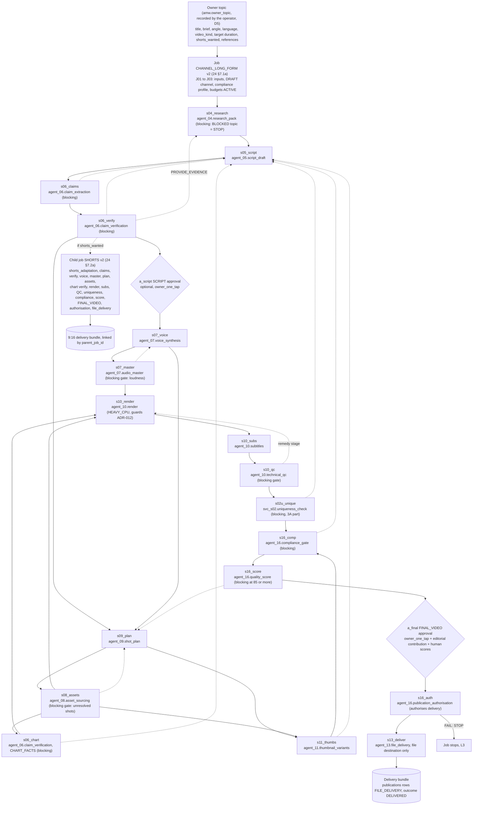

# 3A Slice Spec: the video production line (approval document before 3A code)

| Field | Value |
|---|---|
| Status | **Draft, for owner approval** (documentation). Software: **Planned**. No code starts before the owner approves this slice in writing (D2). |
| Owner decisions applied | D1 (3A / 3B / 3C build order, spend controls, secrets, render placement), D2 (fast track; only 3A-changing REQUIRES REVIEW items listed here, §12), D5 (approval channel, R14), D6 (licensed music before 3B), D8 (partial code start) |
| Binding contracts used | GLOSSARY_AND_IDS.md, 03_COMMUNICATION_STANDARD.md, 04_DATABASE_ARCHITECTURE.md, 07_FAILURE_MANAGEMENT.md, 24_PRODUCTION_TYPES.md, 27_ENGINEERING_STANDARDS.md (§9 walking skeleton) |
| Wave B docs used | 09_COST_AND_BUDGET.md, 13_COMPLIANCE_YOUTUBE_POLICY.md, 18_PRODUCTION_QUALITY_STANDARD.md, ADR-001, ADR-005, ADR-007, ADR-008, ADR-009, ADR-012, ADR-013 |
| Scope / tier marking | Each section header carries **[3A / 3B / 3C · Tier n]**. The whole slice is **Tier 0** (owner's own tenant, GLOSSARY §6.47). |
| "(pending CCR)" | Resolved by the integrator pass of 2026-11-18: every item of §13 is decided in `CONTRACT_CHANGE_REQUESTS.md` (CCR-001…) and applied to the Wave A documents; the references below name the CCR. |

---

## 1. Scope (owner decisions D1 and D2, intent kept) [3A · Tier 0]

**D1, 3A:** build the video production line first. Build only the minimum shared core it needs (contracts, state machine, job store, cost ledger, audit, adapters with fakes), then Agents **04, 05, 06, 07, 08, 09, 10, 11** and the **Agent 16 QC / compliance gates**.
- The owner gives the topic directly. Agents 02 and 03 come later.
- Each run produces downloadable files: the final MP4 (16:9, plus a 9:16 cut where applicable), thumbnail options, the SRT, the QC report with the 100-point score, and the cost per stage.
- **No YouTube upload and no Google OAuth in 3A.**
- **Spend:** paid API calls start only after the owner has set a spending limit at each provider. The cost ledger enforces a **per-video budget and a total pilot budget, and stops on a breach**.
- **Secrets:** keys come only through the environment's secret mechanism. They never go in git, logs or shared environment variables.
- **Render:** in the development environment, or in the VPS night window under the §1 limits. **Never during market hours.**

**D1, 3B:** three golden samples on trading-education topics the owner gives. The owner scores them, and prompts and templates are tuned until all three reach the threshold (§10).

**D1, 3C:** everything else (§9).

**D2:** the critical path is Wave A → blueprints for 04–11 and 16 → the minimal shared core (this document, 18, 13, 09, 08 and the ADRs 3A needs) → an independent slice check → **the owner approves this slice** → 3A code starts.

Quality is not lowered in 3A. Every blocking gate of 24 §7.1 that sits inside 3A stays blocking. The only stages left out are the ones D1 moves out (02, 03, 12, 13 upload / publish / verify).

## 2. Minimal shared core for 3A [3A · Tier 0]

### 2.1 `amw_core` modules (SOURCE_LAYOUT.md §1; 27 §7.1)
| Module | What 3A uses | Deferred (3C) |
|---|---|---|
| `contracts` | `amw.task_input`, `amw.envelope`, `amw.control`, `amw.task_output`, `amw.error`, `amw.common`, `amw.production_type` (03 §2–§6; 24 §2); payload models of the 3A task types | schemas of 3C task types |
| `state_machine` | every task transition of 03 §11.3, job derivation J01–J12 (03 §11.5), approval waits (03 §11.6), audit of every transition (03 §11.7) | — |
| `retries` | 07 §2 codes, §3 policies, §4 breakers, §5 DLQ and controlled replay, §6 reaper, §9 hard caps | fair-share weights by plan |
| `tenancy` | `SET LOCAL app.org_id`, RLS session, tenant storage paths, `cache_key()` (04 §3; 27 §7.3.3) | tenancy UI, client orgs |
| `audit` | append-only, hash-chained `audit_log` per tenant, chain verification, JSON export (27 §9 "Records") | — |
| `cost` | per-call ledger rows, reservations at T03, start gate, breach stop (09 §3–§8) | billing, metering (S10) |
| `config` | pydantic-settings; models, providers, limits, thresholds, windows only from config (27 §7.3.1) | per-tenant overrides UI |
| `queue` | own `task_queue` table, claim through `amw_queue_claim`, lease, heartbeat, LISTEN/NOTIFY (ADR-001 option A) | — |
| `storage` | interface + local-disk backend, write-once, SHA-256 verification, tenant check (ADR-005 §3.1–§3.3) | S3-compatible backend |
| `observability` | JSON logs with `org_id`, `correlation_id`, `job_id`, `task_id`, `attempt_id`, `actor`; no secrets (27 §7.3.6) | monitoring stack (ADR-006) |
| `ids` | UUIDv7, prefixed wire IDs (GLOSSARY §2) | — |

Other packages in 3A: `amw_orchestrator` (a **minimal** code-controlled DAG runner that executes only registry graphs; hardening is 3C per D1), `workers/ai_worker`, `workers/render_worker` (ADR-012), and the 3A agent packages (§2.4). The owner does no CLI work (decision D5): he decides in chat messages, and the **operator** (the assistant, acting as `sys_operator`) records topics, decisions, editorial contributions and scores on his behalf through an operator tool inside the factory environment, with the owner's words as evidence (§12, item R14; 03 §11.6 rule 6; 04 §5.16). No web login or public endpoint in 3A. `apps/dashboard`, `workers/publish_worker` and `workers/scheduler` are 3C. The only scheduling in 3A is the market-hours guard and the VPS night-window guard of ADR-012 §3.3.

### 2.2 Tables (04 §4)
04 §9 is binding: the first build creates **all `T0` tables with full RLS and the cross-tenant suite** (04 §3.7). `T0+` tables are created when their agent is built, and in 3A that means Agents 04, 06, 07 and 08. The table below lists what the 3A line **writes or reads**.

| Group (04 §) | Tables used by 3A |
|---|---|
| Tenancy, controls (5.1) | `organisations`, `workspaces`, `channels` (status `DRAFT`, never `CONNECTED` in 3A), `users`, `memberships`, `org_controls`, `platform_controls` |
| Registry, compliance (5.2) | `production_types`, `org_production_types`, `rule_packs`, `compliance_profiles`, `compliance_profile_rule_packs` |
| Work (5.3) | `projects`, `jobs`, `tasks`, `task_dependencies`, `task_attempts` |
| Queue, workers (5.4) | `task_queue`, `workers` |
| Messages (5.5) | `message_log`, `message_receipts` |
| State history (5.6) | `state_transitions`, `state_transition_rules` |
| Recovery (5.7) | `dead_letter`, `checkpoints` |
| Breakers, idempotency (5.8, 5.9) | `circuit_breakers`, `idempotency_keys` |
| Memory, knowledge (5.10) | `memory_items`, `knowledge_sources` (T0+), `knowledge_chunks` (T0+) |
| Scripts, claims (5.11) | `scripts`, `claims` (T0+), `citations` (T0+) |
| Brand, voices (5.12) | `brand_kits` (T0+, minimal kit per 24 §7.1), `voices`, `voice_consents` (T0+, only if a consented clone is chosen, ADR-008) |
| Audit (5.13) | `audit_log`, `audit_chain_heads` |
| Cost (5.14) | `cost_ledger`, `budgets`, `budget_reservations` |
| Licences, assets (5.15) | `licences`, `licence_ledger`, `assets`, `asset_fingerprints` (T0+) |
| Approvals (5.16) | `approvals`, `approval_steps`, `editorial_contributions` |
| Quality (5.17) | `quality_scores`, `qc_results`, `compliance_verdicts` |
| Renders (5.18) | `renders` |
| Deliveries (5.21) | `publications`, **only** with `destination_kind = FILE_DELIVERY` (one row per delivered file; see §4) |
| Notifications (5.23) | `notifications` (in-app rows read by the operator tool; no outbound sender in 3A) |

The following tables are created by 04 §9 but stay **unused in 3A**: `user_sessions`, `user_auth_refs` (ADR-003), `invitations`, `gcp_projects`, `oauth_tokens`, `tenant_data_keys`, `quota_usage`, `analytics_snapshots`, `experiments`, `community_comments`. T1–T3 tables are not created (04 §9).

### 2.3 Adapters (SOURCE_LAYOUT.md `amw_adapters`; 27 §7.1: each adapter ships with a fake and recorded fixtures)
| Adapter | Live in 3A | Basis | Fake |
|---|---|---|---|
| `llm` | yes: one provider, model tier from config | ADR-007 (PR-01, PR-02, PR-03: the API is billed separately from a subscription) | yes |
| `tts` | yes: one provider for Marathi, plus intake of a human narration file | ADR-008 (PR-04: Marathi on the v3/v4 class only) | yes |
| `stock_footage` | only if the owner buys a licence (ADR-009; PR-06). Otherwise none | ADR-009 | yes |
| `music` | **no live adapter in 3A**; fake only. A licensed music bed is a **precondition for 3B scoring** (D6, CCR-007): 3B is blocked until the owner chooses the licensed source. Then Agent 08 sources the bed (capability `music_search`, `MUSIC_BED` ledger rows), Agent 09 plans the cue, Agent 07 mixes it in `s07_master`. 3A technical runs use no bed (never unlicensed music) and `qc.audio.music_bed_offset` is `SKIPPED` | ADR-009, D6 | yes |
| `image` | **no live adapter**. Thumbnails and visuals are made by code and from owner material (hierarchy §1A.1, 18 §2.1) | 18 §2 | yes |
| `video_gen` | **no** (ADR-009: AI B-roll is 3B at the earliest and only where no real or licensed option exists) | ADR-009, PR-07 | Protocol only |
| `web_fetch` | yes: allow-listed HTTPS GET of owner-supplied references (Agent 04), size/time/redirect caps, private-address block; not a paid adapter (CCR-063, CCR-015) | SOURCE_LAYOUT; 03 §9.2 `fetch.reference` | yes |
| `destinations/youtube` | **no** (D1) | — | — |
| File delivery | yes: writes the bundle through `amw_core.storage` (§4) | 24 §3.2 `agent_13.file_delivery`, capability `file_delivery` (GLOSSARY §6.20) | yes |

FFmpeg / ffprobe are local tools of the render worker (INF-09), not paid adapters. The FFmpeg build is pinned per 18 §7.0.

### 2.4 Task types (24 §3.2, used unchanged)
| Agent | Task types in 3A |
|---|---|
| 04 | `agent_04.research_pack`; ingestion `agent_04.knowledge_ingest` (CCR-014, ADR-013; manual run in the development environment) |
| 05 | `agent_05.script_draft`, `agent_05.shorts_adaptation` (only for the 9:16 cut) |
| 06 | `agent_06.claim_extraction`, `agent_06.claim_verification` |
| 07 | `agent_07.voice_synthesis`, `agent_07.audio_master` |
| 08 | `agent_08.asset_sourcing` |
| 09 | `agent_09.shot_plan` |
| 10 | `agent_10.render`, `agent_10.subtitles`, `agent_10.technical_qc` |
| 11 | `agent_11.thumbnail_variants` |
| 16 (gates) | `svc_s02.uniqueness_check` (S2 → 16; 3A part only, see below), `agent_16.compliance_gate`, `agent_16.quality_score`, `agent_16.publication_authorisation` (here it authorises **delivery**, deterministic checks only, 27 §9) |
| S7 → 01 | `svc_s07.request_approval` (`SCRIPT` optional, `FINAL_VIDEO` mandatory, `SENSITIVE_CLAIM` / `COPYRIGHT_DOUBT` when inserted, 24 §3.3) |
| 13 | `agent_13.file_delivery`, **the only Agent 13 piece in 3A** |

Limits on the 16 gates in 3A, all taken from 13:
- `svc_s02.uniqueness_check` runs the deterministic part (c) and records its measures; YTG-R1 (b) "no recorded human contribution" is enforced at `s16_auth` by Agent 16's guard G3 (`a16.auth.g3.contribution`: a contribution bound to the approval) and again by the publish guard (04 §5.21) when a publication is written, not at `s02u_unique` (CCR-082; wording CCR-134). The cross-video part records `SKIPPED`, because there are no prior videos on the channel (13 §3.1, §13).
- `agent_16.publication_authorisation`: the re-run of date checks at the real publish time (FIN-R9) is 3C (13 §1.2).
- Task types **not** used in 3A: `agent_02.*`, `agent_03.*`, `agent_12.metadata`, `agent_13.upload_private`, `agent_13.publish`, `agent_13.verify_publication`, `agent_14.*`, `agent_17.*`, `svc_s03.*`.

### 2.5 Production types (24 §7)
| Type | 3A use | Note |
|---|---|---|
| `CHANNEL_LONG_FORM` | primary: 16:9 master, `qc.long_form`, `rp.youtube_general` + `rp.finance_sebi_in` | The v1 graph needs `s03_topic`, `s12_meta` and `s13_upload`/`publish`/`verify`, and allows only the `YOUTUBE` destination. 3A runs **v2 (24 §7.1a, CCR-003)**: owner topic (`amw.owner_topic`, 03 §3.4) in place of `s03_topic`, `s12_meta` optional, a `FILE_DELIVERY` destination with stage `s13_deliver`, `s09_plan` after `s07_voice`, `s06_chart` after `s08_assets` |
| `SHORTS` | the 9:16 cut, **where applicable** (the owner sets this per topic), as a child job (`parent_input = PARENT_JOB`, `jobs.parent_job_id`), `qc.shorts` | v2 (24 §7.2a, CCR-003) with the same changes plus `agent_06.claim_verification`; 18 §10: a re-edit, not a crop |

All other production types are 3C, Tier 1+.

## 3. 3A job flow [3A · Tier 0]

The stage IDs come from 24 §7.1. `s13_deliver` and the owner-topic input are part of CCR-3A-1. Dotted edges are the `on_fail` REVISE routes, capped at `limits.max_revision_loops` = 3. After that the job ends `COMPLETED / BLOCKED_COMPLIANCE` (24 §3.3; 03 §11.5).

Rules on the flow:
1. **Budget guard on every paid task.** At T03, S4 reserves `resource_budget.max_cost_micros` against every applicable budget. A refusal leads to T05 `CHECKPOINTED / AWAITING_BUDGET` (03 §11.3; 09 §3.4, §4).
2. **A `NEEDS_HUMAN_REVIEW` verdict** inserts a `SENSITIVE_CLAIM` or `COPYRIGHT_DOUBT` approval (`owner_sensitive`) before the job goes on (24 §3.3.2).
3. **`s12_meta` is disabled** in 3A (D1). The 3A scoring of the metadata share is item R1 in §12.
4. **The SHORTS child job** is created only when the owner's topic input says the 9:16 cut is wanted. It starts after the parent's `s06_verify` (and after `a_script` if that approval is enabled), because 24 §7.2 needs the parent's research pack and checked script. The cap `limits.max_child_jobs_per_job` applies (07 §9).
5. **Every stage task carries an idempotency key** (03 §9; natural key includes `stage_id`, CCR-005). Re-running a stage after a revision creates new tasks with new keys for the target stage and every stage that depends on it; the target is chosen by 24 §3.3 rule 1 (earliest named remedy stage).
6. **Gates** report a domain failure as a successful task with `gate: true` results (03 §5.3 rule 4, CCR-001); only process-integrity failures become `AGENT.INCOMPLETE_OUTPUT`.
7. **Charts** (CCR-004): a `REAL_HISTORICAL` chart request reaches `s06_claims` as a `CONSTRAINT` (`data_age_vs_lag = OLDER_THAN_LAG`, `data_age_basis = CONSTRAINT`); Agent 08 must meet it (else the shot is unresolved `DATA_WITHIN_LAG`); claims about what a chart shows are verified at `s06_chart` against chart facts computed by code from the chosen dataset; `qc.visual.chart_data_age` and `s16_comp` re-check the measured data end date. A DLQ replay of `s13_deliver` reuses `delivery.file` and creates no second bundle (27 §9, acceptance test 3).

## 4. Delivery bundle [3A · Tier 0]

`agent_13.file_delivery` puts the bundle together only after `s16_auth` returns a final `ALLOWED` for the same render SHA-256 that the owner approved.
- It writes **one `publications` row per delivered file**: `destination_kind = FILE_DELIVERY`, `render_id` / `render_sha256` = the approved master, `approval_id`, `authorisation_verdict_id`, and `idempotency_key` with scope `delivery.file` (03 §9.2; natural key: `job_id`, preset, file SHA-256).
- The 04 §5.21 publish guard trigger therefore applies to delivery in the same way it applies to upload.
- `publish_state` moves `DRAFT → UPLOADING → DELIVERED` (GLOSSARY §6.23). The job completes with `outcome = DELIVERED` (03 J07).

| # | File | Produced by | Preset / record | Spec source |
|---|---|---|---|---|
| 1 | Final MP4, 16:9 | `agent_10.render`, `qc_results` PASS | `yt_master_1080p` (1440p optional) | 24 §4; 18 §6; INF-12, INF-13 (YouTube's 1080p SDR figure, 8 Mbps at 24–30 fps, is the encoder target, not a floor; owner decision D10, ADR-014) |
| 2 | Final MP4, 9:16 (where applicable) | child `SHORTS` job | `shorts_9x16`; 1080×1920 is a PROPOSAL (18 §10) | official Shorts spec: R11 in §12 |
| 3 | Thumbnail options (3 variants) | `agent_11.thumbnail_variants` | `thumbnail_set` | YT-08 (up to 3 for the Studio A/B test), YT-05 (50 MB maximum); dimensions: R12 |
| 4 | SRT (one language in the MVP) | `agent_10.subtitles` | `srt_per_language` | 24 §4; 18 §7.6 |
| 5 | QC report with the 100-point score | `qc_results`, `quality_scores` (machine + HUMAN rows), `compliance_verdicts` | `qc_report` (24 §4, CCR-043) | 18 §7, §9. Shows every check (measured value vs threshold, PASS / WARN / FAIL / SKIPPED) and per dimension the machine, human and used points with evidence. Also shows the disclosure decision and the plain-words note that the owner applies the label by hand in Studio (13 §3.3) |
| 6 | Cost per stage | S4, from `cost_ledger` | `cost_per_stage_report` (24 §4, CCR-043) | 09 §12: header, per-stage table, budget status per limit, `ESTIMATE` / `VERIFIED` labels; unknown values print as REQUIRES REVIEW, never as zero |
| 7 | Manifest | `agent_13.file_delivery` | `delivery_manifest` (24 §4, CCR-043) | file list with SHA-256 and size, job ID, production type version, config version, metadata present (13 §9) |

Storage: the bundle is written once under the job's tenant prefix, in the area `jobs/<job>/deliveries/<publication>/` (03 §8, CCR-017).
- **Download:** the operator tool verifies each file's SHA-256 and then copies the bundle to a folder the owner chooses. There is no public link, and no server path appears in any document.
- The 27 §9 "Records" export (the `audit_log` chain and the `cost_ledger` rows as JSON) is available through the same tool.
- The bundle contains no keys, account IDs, server addresses or prompt text (09 §12.3.5).

## 5. Budget enforcement [3A · Tier 0]

| Control | 04 table / column | Rule |
|---|---|---|
| Per-video budget | `budgets`: `scope_kind = ORG` (or `PRODUCTION_TYPE` + `scope_key`), `period = PER_VIDEO`, `limit_minor`, `currency`, `state` | Cap on the summed ledger cost of one job (09 §3.1). |
| Total pilot budget | `budgets`: `scope_kind = ORG`, `period = PILOT_TOTAL` (CCR-035, applied) | Cumulative cap that never resets, across all 3A/3B runs, including eval and smoke-test runs unless the owner says otherwise (09 §8.7). |
| Provider limit (start gate) | `budgets`: `scope_kind = PROVIDER` (CCR-035, applied), `scope_key = <provider>` | The row must exist and be `ACTIVE`. Creating it is the owner's acknowledgement that the limit is set at the provider. Missing or `DISABLED` → every paid call is refused before any network request (09 §8.1–8.2). |
| Reservation | `budget_reservations`: `budget_id`, `task_id`, `amount_micros`, `status` (`HELD` / `CONSUMED` / `RELEASED`) | At T03, on every applicable budget in one transaction (03 §11.3; 09 §3.4). |
| Spend record | `cost_ledger`: `job_id`, `task_id`, `attempt_id`, `provider`, `model`, `operation`, tokens, `units`, `unit_kind`, `amount_micros`, `currency`, `figure_kind`, `price_ref`, `idempotency_key` | One row per paid call. `VERIFIED` rows point to their `ESTIMATE` through `estimate_entry_id`, and nothing is overwritten (04 §5.14). |
| Job roll-up | `jobs.cost_estimate_micros`, `jobs.cost_verified_micros` | Shown in the cost report. |
| Committed amount | — | `committed = Σ ledger (VERIFIED else ESTIMATE) + Σ HELD reservations` (09 §3.3). |
| Breach | `budgets.state = SUSPENDED_EXCEEDED`; task `CHECKPOINTED` + `wait_reason = AWAITING_BUDGET` | `RESOURCE.BUDGET_EXHAUSTED`: suspend, no retry, L3 to the owner (07 §2). No new paid call. A running call stops at its next safe point inside its own reservation. Completed work is kept. Resume only through T15 after an owner action; never an automatic increase (09 §4 B1–B6). |

In 3A every paid task counts as non-critical, so both limits are **hard stops** (09 §3.2). The system ships with **no non-zero default**: a budget with no owner-set limit means no paid call may start (09 §3.1). Acceptance test: 27 §9 test 4.

## 6. Secrets [3A · Tier 0]

1. Provider keys and the DB and storage credentials reach processes **only through the environment's secret mechanism** (D1). They are never in git, logs, ledger rows, reports, fixtures or shared environment variables (09 §8.4; 27 §8.2).
2. Only `amw_core.config` reads them. No package reads environment variables directly (27 §7.3.1). `deploy/env.example` holds names only (SOURCE_LAYOUT.md).
3. Logs carry no secrets, tokens, knowledge-chunk text or personal data (27 §7.3.6). The CI secret scanner is a blocking gate (27 §5).
4. The render worker needs **no provider key**: render and QC make no paid call. It needs only the DB and storage credentials (ADR-012 §3.1).
5. On the VPS, the secret mechanism is defined by 08_SECURITY.md: **REQUIRES REVIEW (Phase 1): 08 not yet written**. This blocks only a VPS run, not the development-environment default.
6. A Claude subscription is not API access (PR-03). The owner supplies a separately billed API account (input A7).

## 7. Render placement [3A / 3B · Tier 0]

Per ADR-012 (Proposed):
- **3A default:** the development environment.
- **The VPS night window** (00:00–07:00 IST, drain from 06:30, graceful stop at 07:00; 07 §8) is allowed only when all of these hold: the A1 audit output is received, the ADR-012 headroom rule passes on measured figures, the cgroup and slice test is green (INF-03, INF-04; 27 §9), and the owner approves the first VPS run.
- **The market-hours guard applies on every placement.** No `HEAVY_CPU` task (render, audio master, subtitles, technical QC) starts during market hours. A render that is running when a guard closes checkpoints at its next safe point and resumes later; it is never killed mid-write (07 §8.1; 27 §9 test 2).
- The market-hours calendar is operational configuration (GLOSSARY §4). Its source is item R9 in §12.

## 8. Tenancy in 3A [3A · Tier 0]

- One real tenant (the platform owner) plus one synthetic test org.
- The cross-tenant suite is a blocking CI gate (04 §3.7; 27 §9 acceptance test 5: tenant B sees none of tenant A's rows, blobs or logs).
- Every query filters `org_id` explicitly as well; RLS is the second line of defence (rule 9).

## 9. Explicitly OUT of 3A [3C unless stated]

| Item | Where |
|---|---|
| YouTube upload, publish, verification, thumbnails or captions set by API, `containsSyntheticMedia` field, quota buckets | Agent 13 (3C); first 3C ticket = private upload to a test channel (27 §9) |
| Google OAuth, `gcp_projects`, `oauth_tokens`, data keys for tokens | 3C |
| Agents 02 (trends), 03 (topic selection), 12 (metadata / SEO), 14 (analytics), 15 (growth / revenue), 17 (ads briefs) | 3C |
| Orchestrator hardening, scheduler, night-window production scheduling, quota-aware scheduling | 3C (3A has only the ADR-012 guards) |
| Command Center dashboard (S8), client portal (S11), billing (S10), integration API (S12), SSO (T3), tenancy UI | 3C, Tier 1–3 |
| Cross-video uniqueness against a back catalogue (YTG-R1 a) | 3C (13 §13) |
| Publish-time re-checks (FIN-R9 at publish, YTG-R8) | 3C (13 §13) |
| AI video B-roll adapter, music library, second LLM / TTS provider, batch for overnight work | 3B at the earliest / 3C (ADR-007, ADR-008, ADR-009) |
| Object-storage backend, separate render server | 3C or when ADR-005 / ADR-012 triggers fire |
| Localisation / dubbing, ads, corporate and e-commerce production types | 3C, Tier 1+ |
| Outbound notifications (email and others) | 3C |
| Any public video | never without the 3C publish path, approval and authorisation (rule 5) |
| **Separate verifier host (D11 item 2)** | **MANDATORY, blocking: before any YouTube publish and before the first client.** Until then the R14 residual limitation is accepted for 3A only (owner-evidence record is the operator's record, not production-verified) |

## 10. 3B golden-sample procedure [3B · Tier 0]

The binding procedure is 18 §11. This section only summarises it.
- **Entry:** provider limits and keys are in place; the per-video and pilot budgets are configured; the owner's narration choice is made, with pronunciation dictionary v1; the 18 §7.11 QC self-test passes on the pinned FFmpeg; the render placement follows §7.
- **Runs:** the 3A graph runs on three owner topics of different structure, with no manual repair of media between stages.
- **Scoring:** the owner scores each video per dimension (18 §9.2) at the `FINAL_VIDEO` approval and records at least one editorial contribution.
- **Calibration:** machine scores are compared with the owner's scores. Prompts, templates, detector parameters and tolerances are tuned (versioned, evals re-run, 27 §6). Affected stages re-run as new iterations. Topics 1 and 2 are re-run on the tuned configuration as a regression check. The calibrated configuration is then frozen.
- **Exit (all three videos):** human total ≥ 85 (`quality.publish_min_score`), no compliance `BLOCKED`, no blocking QC `FAIL`, every check that was WARN until calibrated is either calibrated or kept advisory by the owner, cost within the per-video budget, and the render and human-review figures are MEASURED.
- If the revision loops run out, the pilot stops and the cause is reported to the owner.
- **Pilot spend:** all 3B spend counts against the `PILOT_TOTAL` budget (CCR-035). A breach stops the pilot (§5).

## 11. Owner inputs needed before 3A code [3A · Tier 0]

| # | Input | Needed by | Ref |
|---|---|---|---|
| O1 | **Spending limit set at each paid provider** (LLM, TTS; stock only if bought), plus the **per-video** and **total pilot** budget amounts and the currency | ticket 3A-01 (its one real LLM call and one real TTS call) | D1, rule 8, A6 "budget ceiling", 09 §8 |
| O2 | **API keys**, entered only through the environment's secret mechanism (a separately billed API account, PR-03) | 3A-01 | D1, A7 |
| O3 | **Topic list**: one topic for the skeleton and three for 3B. For each topic the fields of `amw.owner_topic` (03 §3.4, CCR-006): title, optional brief and angle, language, `video_kind` (`GENERAL` or `METHOD_TOPIC`), target duration, whether a 9:16 cut is wanted, an optional course-chapter pointer (Q24) and optional references; the operator records them from the owner's chat message (D5) | 3A-01 / 3B | D1, 18 §11 |
| O4 | **Voice choice**: TTS voice, consented clone of the owner (needs a `VERIFIED` consent record) or the owner's own recording | 3A-07 (3A-01 can run on one TTS voice once O1 and O2 are in place) | A6 "narration choice", ADR-008 |
| O5 | **Book location (K1)**, plus K2–K6 for ingestion. Default meanwhile: course notes (Q24) and sources the owner attaches per topic | 3A-04 | KNOWLEDGE_LIBRARY_PLAN.md K1–K6, ADR-013 |
| O6 | **VPS read-only audit output (A1)**, only if rendering on the VPS | first VPS run | ADR-012 §3.2 |
| O7 | The session hours and holiday calendar meant by "market hours" (see R9) | first render (3A-01) | D1, ADR-012 §3.3 |
| O8 | Answers to the §12 items marked "owner" (R1, R4, R6, R10, R19, R21) and to the owner questions of `CONTRACT_CHANGE_REQUESTS.md` §6 | before the ticket that uses each one | D2 |

## 12. REQUIRES REVIEW items that change a 3A design decision

The repo-wide REQUIRES REVIEW scan covered `docs/v4/*.md` and `docs/v4/adr/*.md`. Items **not** listed here do not change a 3A design decision (D2). They include:
- detector tolerances, which are WARN until calibrated in 3B (18 §14.1);
- vendor prices, which make cost figures `ESTIMATE` only;
- retention schedules, YouTube and analytics items, and Tier 1–3 items.

Each provisional default below applies until it is answered (owner rule A.9).

| # | Item (file) | Why it changes a 3A decision | Provisional default |
|---|---|---|---|
| R1 | Metadata share of the 100-point rubric without Agent 12, marked **3A-BLOCKING** (18 §9.1.7) | Without Agent 12 the ≥ 85 threshold may be out of reach | **Owner.** Follow 18 §9.2 (arithmetic corrected, CCR-058): the THUMBNAIL_METADATA D criterion stays 4 points, earned in 3A from the thumbnail and working-title checks only; total stays 100; threshold stays 85. Owner question Q-O2 (CCR register §6), provisional defaults applied (CCR-085): no machine scaling (`quality.machine_scaling = NONE`); `s16_score` reports only (`quality.score_gate_mode = REPORT_ONLY`) until the 3B judge calibration; `BLOCKING` with `NONE` is refused at startup (machine rows total at most 79) |
| R2 | Self-grant licence rows for owner-made and code-made items (18 §2.2 a; **decided, CCR-031**; package templates and fonts are tenant `assets` rows) | Every shot needs a licence-ledger row; charts and motion graphics are the main 3A visuals | Tenant-held `licences` rows with `source_type` `OWNER_MADE` / `CODE_GENERATED`, `covers_monetized_youtube = true`, as 18 states |
| R3 | Licence check destination in 3A (18 §2.2 b) | Decides which licences pass when there is no upload | Check as if the destination were monetized YouTube (18) |
| R4 | Presenter-kind field "neutral narration vs persona" (13 §3.2; a CCR filed by 13) | FIN-R11 / YTG-R2 must be checkable in the 3A compliance gate | **Owner** confirms. The check reads the voice record (owner voice, owner clone or neutral TTS), the `is_realistic_synthetic` asset flags and first-person identity claims in the script. No synthetic presenter asset is allowed on the finance channel in 3A |
| R5 | FIN-R10 disclaimer wording, duration and placement (13 §5.6, lawyer item) | Without a text, every finance video fails the compliance gate | The owner supplies a draft text as a versioned template. The gate checks it is present and which version it is. The QC report marks it "DRAFT – not lawyer-approved" (the owner-set status string, single source `amw_runtime.disclaimer`, CCR-212). Lawyer-approved text is required before any publish (3C) |
| R6 | FIN-R9: 30 calendar days or trading days (13 §5.5, lawyer item) | Sets the newest chart data a 3A render may contain | **Owner / lawyer.** The 13 reading (calendar days). In 3A it is checked against render time and the data end date shown in the QC report; it is re-checked at publish in 3C |
| R7 | Uniqueness and near-copy thresholds (13 §3.1, §8) | `s02u_unique` is a blocking gate in the 3A graph | Deterministic checks run and record their measures. A hit goes to `NEEDS_HUMAN_REVIEW` (owner decides at the approval) until 3B sets the thresholds. Cross-video part `SKIPPED` (13 §3.1) |
| R8 | Book library (K1) and Devanagari text search (ADR-013; 04 §5.10) | Agent 04's source base in 3A | Course notes (Q24) and sources the owner attaches per topic. Full-text search with the `simple` configuration for Devanagari (ADR-013 fallback). Books are added when K1 is answered |
| R9 | Market-hours session and holiday source not in RESEARCH_LOG (ADR-012 §3.3) | Render admission in every placement | Guard on every placement. Fail closed: no `HEAVY_CPU` admission until the owner-supplied calendar (O7) is in config. A RESEARCH_LOG entry follows |
| R10 | Off-server backup destination and tool (ADR-005 §3.4) | ADR-005 makes it a prerequisite before the first run whose outputs must be kept | **Owner** (purchase, rule 8). 3A skeleton and development runs are disposable, and the downloaded bundle is the owner's copy. Backup is in place **before 3B** golden samples |
| R11 | Official Shorts spec (24 §4; 18 §10) | Format of the 9:16 cut | 1080×1920 PROPOSAL; duration-bound check `SKIPPED`; made only when the owner asks for it per topic; the report labels it "not validated for upload" |
| R12 | Thumbnail dimensions (24 §4; 18 §9.2) | Agent 11 output and THUMBNAIL_METADATA D points | Check the 50 MB maximum only (YT-05); dimension check `SKIPPED` until a research entry; 3 variants (YT-08) |
| R13 | Duration bounds (24 §7.1; 18 §7.7, needs 19) | Agent 03 is absent, so nothing sets the target | Target duration from the owner's topic input (O3). `qc.duration.vs_script` runs; `qc.duration.in_bounds` is `SKIPPED` (18) |
| R14 | Owner identity and approval channel (04 §5.1, REQUIRES REVIEW ADR-003; 18 §11, 3B scoring input) | Approvals, editorial contributions and human scores need an authenticated human actor, and there is no dashboard or auth component in 3A | **Decided by the owner (D5); contracts applied (CCR-010).** The owner works from his phone and does no CLI work. The operator (the assistant, `sys_operator`) records each decision, contribution and score **on his behalf** from an explicit owner chat message: channel `OWNER_CHAT_OPERATOR`, an `owner_instruction_evidence` row bound to the session's own event record (session and event IDs; code verifies role, human origin, verbatim quote, timestamp, the approval's review code and the decision word; the owner's confirmation is a second verified event; only `CONFIRMED` evidence makes a decision effective), the owner's `usr_` ID as the decision maker, an audit row and an echo to the owner. Text from tool results, sub-agent messages, notifications or documents is never accepted. No web login or public endpoint in 3A |
| R15 | Per-video and pilot amounts, plus the eval and live-smoke caps (09 §15; 27 §8.4; ADR-007) | Hard stops depend on them | No non-zero default: no paid call until set (09 §3.1). Eval and smoke runs are charged to the pilot budget (09 §8.7) |
| R16 | Narration choice and TTS emotion / pace control (ADR-008) | Agent 07 input path | ADR-008 primary candidate (v3/v4 class, PR-04) for the skeleton; human-narration intake always available; the owner decides in 3B |
| R17 | Stock and music sourcing terms (ADR-009; PR-06, PR-07) | Which visual tiers 3A can use | No purchase without the owner. Visuals are code-made motion graphics, charts and owner material; no music bed in 3A technical runs; **3B is blocked until the owner decides the licensed music source (D6, CCR-007)** |
| R19 | LLM / TTS provider data-retention and training terms for API inputs are not in RESEARCH_LOG (agent_04 §11, agent_06 §11; CCR-043) | Decides which material may be sent to a provider | **Owner** (⚖). Default: fixtures and owner-approved material only, until the terms are logged and the owner's decision is recorded (D5) |
| R20 | Market-data intake for charts (Q22; agent_08 FR-21; CCR-043) | Agent 08's real-historical charts need datasets | Datasets enter only through the operator tool on the owner's instruction (D5), only from the owner-approved course `data_pack` (Q22), read-only; the source path class is stored in `assets.attributes.source_path_class`; any other source is rejected; the factory never reads the Trade research folders and never writes to the source |
| R21 | Devanagari text shaping and a licensed font with Devanagari coverage (agent_11; CCR-043) | Thumbnails, captions and cards in Marathi | **Owner** for any purchase (rule 8). Default: an OFL-licensed font with Devanagari coverage, recorded as a `FONT` asset with its licence text; the composer must shape conjuncts correctly (tested); no purchase |
| R22 | Light media work in `AI_IO` tasks during market hours (ADR-012 §3.3, CCR-056) | Probes, stem resampling and chart/thumbnail rasterisation | Not rendering: any time in the development environment; on the VPS only in the night window. Every `HEAVY_CPU` task follows the market-hours guard and checkpoints before a market window starts |
| R18 | Secret mechanism and limits on the VPS (08 not written; 05 values) | Only a VPS run | Development environment only until 08 and the A1 audit exist (§6.5, §7) |

These items block the **start** of ticket 3A-01 without changing a design decision; each is recorded in RESEARCH_LOG.md before 3A-01:
- PostgreSQL major version (04 §1.9);
- Python minor version (27 §2);
- tool choices and versions, the migration tool and the UUIDv7 generator (27 §3; 04 §8; GLOSSARY §2.1).

The pinned FFmpeg version (18 §7.0) is recorded before 3A-10.

## 13. Contract change requests this slice depends on (decided 2026-11-18)

All decided in `CONTRACT_CHANGE_REQUESTS.md` and applied to the Wave A documents.

| ID (working) | Needed | Decision |
|---|---|---|
| CCR-3A-1 | `CHANNEL_LONG_FORM` v2 and `SHORTS` v2 | CCR-003, applied (24 §7.1a, §7.2a) |
| CCR-3A-2 | Export presets `qc_report`, `cost_per_stage_report`, `delivery_manifest` | CCR-043, applied (24 §4) |
| CCR-3A-3 | Storage area `jobs/<job>/deliveries/<publication>/` | CCR-017, applied (03 §8) |
| CCR-3A-4 | `budget_period` `PILOT_TOTAL` | CCR-035, applied |
| CCR-3A-5 | `budget_scope_kind` `PROVIDER` | CCR-035, applied |
| CCR-3A-6 | `job_outcome` `DELIVERED` description | CCR-043, applied (GLOSSARY §6.4) |
| — | `agent_04.knowledge_ingest`, `doc_extract`; self-grant licence rows; presenter kind; `YTG` rule IDs; config-key registration | CCR-014; CCR-031; CCR-027 (provisional, owner R4); CCR-040; CCR-019/020 |

## 14. 3A build tickets, in order [3A · Tier 0]

Every ticket meets the 27 §10 definition of done: tests, CI gates, RLS in migrations, a prompt and eval pack per LLM step, costs recorded, before / after evidence, and self-review.

| # | Ticket | Contents | Acceptance (minimum) |
|---|---|---|---|
| 3A-01 | **Walking skeleton** (27 §9, build ticket 1) | Repo skeleton (prompts / evals move to the root, SOURCE_LAYOUT §3); `amw_core` thin versions of all modules; all T0 tables + RLS; queue (ADR-001 A); minimal orchestrator. Path: owner topic → `agent_05.script_draft` (one real LLM call) → `agent_07.voice_synthesis` (one real TTS call) → `agent_10.render` (narration over a code-made title / chart card, `yt_master_1080p`) → `agent_10.technical_qc` (ffprobe + `ebur128`) → `svc_s07.request_approval` + editorial contribution + `agent_16.publication_authorisation` (deterministic) → `agent_13.file_delivery` → audit and cost export. Budgets per-video + pilot + provider gate | 27 §9 tests 1–6 |
| 3A-02 | Core hardening for 3A | Full 03 §11.3 transition table; 07 retry policies, breakers, DLQ and controlled replay, reaper, hard caps; all 3A idempotency scopes; audit-chain verification; ESTIMATE / VERIFIED ledger; 09 breach rules B1–B8 | failure-injection suite (07 §12); budget breach; replay creates no duplicate |
| 3A-03 | Registry and job intake | `CHANNEL_LONG_FORM` v2 and `SHORTS` v2 loaded and validated (24 §7.1a/§7.2a); `amw.owner_topic` input recorded by the operator (D5); `DRAFT` channel with compliance profile `rp.youtube_general` + `rp.finance_sebi_in`; operator tool: create job, list approvals, export bundle | graph DAG validation; J02 rejects missing inputs or budget |
| 3A-04 | Agent 04 | `agent_04.knowledge_ingest` (CCR-014) text-layer ingestion and full-text search (ADR-013); `agent_04.research_pack` with citations | blueprint section 21 tests; eval ≥ threshold |
| 3A-05 | Agent 05 | `agent_05.script_draft` complete (scene-level, ≥ 3 hooks, working title / description draft for R1) | eval pack (27 §6) |
| 3A-06 | Agent 06 | `agent_06.claim_extraction` (existing prompt v1 and evals) and `agent_06.claim_verification`; FIN rule flags | FIN-R1…R13 hard cases (13 §5.12, §5.13) |
| 3A-07 | Agent 07 | `agent_07.voice_synthesis` (chosen voice, pronunciation dictionary, human-narration intake, consent check) and `agent_07.audio_master` (−14 LUFS / −1 dBTP / 48 kHz, 18 §5) | loudness gate; revise loop to `s07_voice` |
| 3A-08 | Agent 09 | `agent_09.shot_plan` (timeline, pacing, vertical framing for the cut) | 18 §3 timeline checks |
| 3A-09 | Agent 08 | `agent_08.asset_sourcing` in hierarchy order; licence-ledger row per shot; code-made chart templates from historical data within FIN-R9 | licence completeness (18 §7.9) |
| 3A-10 | Agent 10 | Resumable `agent_10.render`, `agent_10.subtitles`, full `agent_10.technical_qc` (18 §7, self-test §7.11); ADR-012 guards | kill mid-render resumes; no render in market hours |
| 3A-11 | Agent 11 | `agent_11.thumbnail_variants` (3 variants, code and template made) | R12 checks |
| 3A-12 | Agent 16 gates | `svc_s02.uniqueness_check` (3A part), `agent_16.compliance_gate`, `agent_16.quality_score` (100 points, R1), `agent_16.publication_authorisation` for delivery | compliance `BLOCKED` stops delivery whatever the score |
| 3A-13 | Approvals (S7) | `owner_one_tap`, `owner_sensitive`, `SCRIPT` (optional) and `FINAL_VIDEO`; editorial contribution; human scores recorded by the operator with owner evidence (R14, D5) | publish guard refuses delivery without approval and contribution |
| 3A-14 | Full delivery bundle | `agent_13.file_delivery`: files 1–7 of §4, manifest SHA-256, QC report and cost-per-stage report (09 §12) | bundle complete and verified; no secrets in it |
| 3A-15 | 9:16 cut | `agent_05.shorts_adaptation`, vertical templates, `SHORTS` child job end to end | `qc.shorts`; linked bundle |
| 3A-16 | End-to-end acceptance | One owner topic through the full 3A graph in the development environment; optional first VPS night-window run after A1 and owner approval | 27 §9 tests re-run on the full graph; the owner reviews the evidence → 3B starts |
