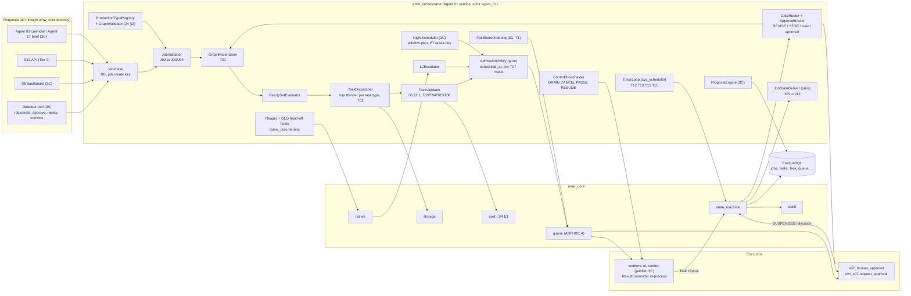

# Agent 01 — CEO & Master Orchestrator (blueprint)

| Field | Value |
|---|---|
| Status | Draft — documentation. Software: **Planned** (rule 6, rule 7) |
| Owner | Agent 01 CEO & Master Orchestrator. Also owns shared services S5 Infrastructure Intelligence, S7 Human Approval & Governance, S8 Executive Command Center (plan Q4), S9 Tenant, Identity & Access, S12 Integration API & Webhooks (directive §3.2) |
| Package | code package `amw_orchestrator` (27 §7.2); services `s05_infrastructure_intelligence`, `s07_human_approval`, `s08_command_center`, `s09_tenant_identity_access`, `s12_integration_api`; process entry points `workers/scheduler` (3C) and the orchestrator service (SOURCE_LAYOUT.md); evals `evals/agent_01_ceo_orchestrator/`; prompts: **none** (no LLM step, §5) |
| Directive sections covered | §3.1 row 01 (workflow engine, scheduling, priorities, dependencies, resource admission, night scheduler, morning shutdown, workflow optimisation proposals), §2 (control flow in code, no LLM-to-LLM), §3.3 (contracts, state machine, failure taxonomy, recovery, escalation L2, memory, quality, observability, learning loop, migration), §1 (production window, deployment isolation, isolation mechanism, YouTube quota day), §1C.1 / §1C.2 (tenant isolation, fair sharing), §3.2 ownership S5, S7, S8, S9, S12, §3.5 (code, prompt and eval standards), §4 (26 sections) |
| Owner decisions applied | D1 (3A production line; owner-given topic; files out; no upload, no OAuth; spend limits enforced with stop on breach; secrets only through the environment's secret mechanism; render never in market hours), D2 (fast-track; REQUIRES REVIEW does not block 3A unless it changes a 3A design decision) |
| Binding contracts | GLOSSARY_AND_IDS.md, 03_COMMUNICATION_STANDARD.md (§3–§11, the state machine is executed by this agent), 04_DATABASE_ARCHITECTURE.md (§3, §5.1–§5.9, §5.16, §5.23), 07_FAILURE_MANAGEMENT.md (§2–§11), 24_PRODUCTION_TYPES.md (§2, §3), 27_ENGINEERING_STANDARDS.md |
| Shared docs referenced by name/§ only | 3A_SLICE_SPEC.md, 08_SECURITY.md §3, §5, §8, §9, 09_COST_AND_BUDGET.md §2–§4, §8, 13_COMPLIANCE_YOUTUBE_POLICY.md, 18_PRODUCTION_QUALITY_STANDARD.md, ADR-001, ADR-005, ADR-007, ADR-012; not yet written: 05_RESOURCE_MANAGEMENT.md, 06_NIGHT_SCHEDULING.md, 10_DEPLOYMENT_AND_MIGRATION.md, 11_TESTING_STRATEGY.md, 16_COMMAND_CENTER.md, 20_MULTI_TENANCY_AND_ENTERPRISE.md |
| Facts cited | RESEARCH_LOG YT-03 (quota reset at midnight Pacific; 12:30 / 13:30 IST), YT-01/YT-02 (upload bucket), INF-01/INF-02 (VPS plan, cgroup v2), INF-03/INF-04 (systemd and Compose resource controls), INF-05/INF-06 (queue libraries, not adopted for 3A per ADR-001), INF-11 (RLS, `SET LOCAL`), PR-02 (batch, caching) |
| Marking | Every section opens with **MVP** (3A / 3B / 3C, GLOSSARY §6.47 tier 0–3). 3A, 3B, 3C are the owner's build stages of D1 |
| Conventions | `(pending CCR)` = a contract item that does not exist in Wave A and is listed in the structured return for the integrator. `CCR-3A-n` = working IDs of 3A_SLICE_SPEC §13. `REQUIRES REVIEW (Phase 1): <need>` = unknown value; none is invented. Clock times appear only as **operational settings** (owner rule C.4, GLOSSARY §4). No server detail, private method or book content appears in this document |

---

## 1 Identity and mission
**MVP: 3A (minimal job-flow runner) · 3C (hardening, night scheduler, fair sharing, optimisation proposals) · Tier 0; fair sharing enforced from Tier 1.**

### 1.1 Mission
Agent 01 is the **code-controlled workflow engine** of the factory. It turns a job request into the task graph of its production type (24 §3), moves every job and task through the 03 §11 state machine, decides when each task may run (dependencies, priorities, admission, budgets, windows), routes gate and approval outcomes (24 §3.3), escalates repeated failures at level L2 (07 §7), and protects the shared server (production window, drain, graceful stop, resource admission). It is the "CEO" only in the sense of control: it **produces no content and makes no content judgement**. Per directive §2 it is a deterministic state machine, not an LLM agent; no model is called anywhere in this agent (§5, §6, §11).

### 1.2 Where it sits
- Upstream: the owner's operator command-line tool (3A, 3A_SLICE_SPEC §12 R14), later Agent 03's calendar, Agent 17 briefs, the S8 dashboard and the S12 API (3C, Tier 3).
- It dispatches every canonical task type of 24 §3.2 to its executor through the queue (ADR-001 option A) and receives every Task Output.
- It executes one task type itself through S7: `svc_s07.request_approval` (S7 → 01).
- Downstream: every stage agent (02–17), S4 (budget reservation, 09 §2 E1), S2 (through `svc_s02.uniqueness_check`), Agent 16 (gates), Agent 13 (delivery; upload in 3C), the human approvers (S7) and the operator (S8 / operator tool).

### 1.3 Authority boundaries
| Agent 01 **decides** (deterministic code) | Agent 01 **does not decide** (owner of the decision) |
|---|---|
| which tasks exist for a job: exactly the registry graph of the job's production type and version, with only the optional stages the tenant/job enabled (24 §2, §3.1) | the graph itself, a new task type, a new stage order (registry record versions; CCR; owner) |
| when a task becomes ready (all `depends_on` completed) and its priority (copied from the job) | content, scripts, verdicts, scores, licences (Agents 04–16) |
| admission: whether a ready task may be queued now or later (window, market-hours guard, controls, breaker, deadline, tenant caps; §6.3) | budgets and spend limits (S4 decides at E1–E3; the owner sets limits; rule 8) |
| routing after a gate: continue, REVISE to the registry's `on_fail.target_stage_id` (bounded), STOP, or insert an S7 approval (24 §3.3) | whether a gate passes (the gate's owner: 06, 07, 10, S2/16, 16; Agent 16 has final authority, plan Q5) |
| job state and outcome, derived from task states (03 §11.5) | any approval decision (only humans; 08 §5.2 rule 3; 04 §5.16 trigger) |
| L2 actions of 07 §7 (pause admission for a task type or provider, reduce concurrency, switch to the configured fallback provider, reschedule, dead-letter with a recommendation) | config, prompts, policies, rule packs, budgets, controls (owner / tenant admins through S8; L3) |
| sending `DRAIN`, `CANCEL`, `PAUSE`, `RESUME` controls (03 §4.3) | publishing (Agent 13 after Agent 16's `is_final` authorisation and the publish guard, 04 §5.21; 3C) |
| optimisation **proposals** from measured data (3C, §6.6) | applying any proposal (owner approval; experiments per §3.3 learning loop) |
Hard limits: it never creates a task that is not in the registry graph (07 §9 structural guarantees); never follows a Task Output's `next_action` / `downstream_agent` advice when it differs from the graph (03 §5.3, logged `orchestrator.advice_ignored`); never retries a PERMANENT error (07 §3.4); never raises a budget; never approves; never calls an external content API; never uploads (D1).

### 1.4 Success criteria (measurable; targets are config, confirmed in 3B on measured runs)
| ID | Criterion | Measure | Phase |
|---|---|---|---|
| SC1 | Every job ends in a recorded terminal or human-owned state | 0 jobs/tasks lost: count(`FAILED` without DLQ row older than the 07 §6 threshold) = 0 | 3A |
| SC2 | Only valid transitions are written | `state_machine.invalid_transition_rejected` events may occur; committed invalid transitions = 0 (DB trigger + code, 03 §11.1) | 3A |
| SC3 | Every transition audited | rows in `state_transitions` = transition rows in `audit_log` per job; chain verifies (08 §9.3) | 3A |
| SC4 | No unapproved delivery or publication | 0 `publications` rows past `DRAFT` without approval + editorial contribution + authorisation verdict (04 §5.21) | 3A |
| SC5 | Render never in market hours | 0 `HEAVY_CPU` attempts started while the market-hours guard is closed (27 §9 test 6) | 3A |
| SC6 | No uncontrolled loop | 0 jobs beyond `limits.max_revision_loops`, `limits.max_tasks_per_job`, `limits.max_child_jobs_per_job` (07 §9) | 3A |
| SC7 | Replays never duplicate | 0 duplicate deliveries / renders after DLQ replay (27 §9 test 3) | 3A |
| SC8 | Window safety (VPS placement) | 100 % of running heavy tasks checkpointed and leases released before 07:00; 0 heavy admissions from 06:30 (MEASURED per night) | 3A conditional / 3C |
| SC9 | Fair sharing | no tenant's oldest `READY` task waits beyond `queue.<class>.max_wait_ms` while another tenant holds more than its weighted share (MEASURED) | 3C · Tier 1 |
| SC10 | Orchestration overhead | p95 time from dependency `COMPLETED` to dependant `QUEUED`; target **REQUIRES REVIEW (Phase 1): measure in the walking skeleton (27 §9), then set as config** | 3A measured, 3B target |

---

## 2 Functional requirements
**MVP: rows marked per requirement · Tier 0 unless stated.**

### 2.1 Task types
Agent 01 owns **no content task type**. It executes the 03 §11 state machine for all task types of 24 §3.2, and through S7 it is the executor of:

| Task type | Executor | Phase |
|---|---|---|
| `svc_s07.request_approval` (24 §3.2; payload schemas defined in §7.2 / §8.2 of this blueprint) | `s07_human_approval` step in the light worker pool | 3A |
| `agent_01.optimisation_review` (pending CCR; §6.6) | orchestrator service, scheduled system job | 3C |

### 2.2 Requirements
| ID | What | Why | When / trigger | Inputs | Outputs | Dependants | Phase |
|---|---|---|---|---|---|---|---|
| FR1 | **Job intake** (J01): create a job idempotently from a request | single entry point; `job.create` key prevents duplicates (03 §9.2) | operator tool command (3A); S8 / Agent 03 calendar / Agent 17 / S12 API (3C, T3) | `JobRequest` (§7.1) | `jobs` row `PENDING`; audit `job.created` | FR2 | 3A |
| FR2 | **Job validation** (J02 → J03 / J04) | 03 §11.5: production type enabled for org, required inputs present (24 §2), channel `CONNECTED` only when a `YOUTUBE` destination exists, compliance profile attached, budget exists | after J01 | job row, registry record, `org_production_types`, `channels`, `compliance_profiles`, `budgets` | `VALIDATING` → `QUEUED` or `FAILED` with 07 code | FR3 | 3A |
| FR3 | **Graph materialisation** (T01 for all tasks) | the job runs exactly the registry DAG (07 §9) | J03 | resolved graph (registry + enabled optional stages) | `tasks`, `task_dependencies` (all `PENDING`); task idempotency keys `task.<task_type>` | FR4 | 3A |
| FR4 | **Readiness and dispatch** (T02, T03 / T04 / T05 / T06) | dependencies first; validation before processing (03 §7.1); budget reservation (09 E1) | dependency `COMPLETED` (NOTIFY wake-up + periodic sweep) | task row, dependency outputs, job inputs, context rows | Task Input document (write-once), `task_queue` `READY` row with `scheduled_at` from admission (§6.3), or idempotent hit, or `AWAITING_BUDGET`, or rejection | executors | 3A |
| FR5 | **Result commit** (T08 / T09 / T10 / T11) | 03 §5.3 success rule; 07 dispositions | worker returns Task Output | `amw.task_output`, attempt row | task transition; dependants unblocked; job derivation | FR4, FR6 | 3A |
| FR6 | **Gate and approval routing** (24 §3.3) | blocking gates revise or stop; humans decide at approvals | gate task `COMPLETED` with verdict; approval task `COMPLETED` with decision | gate payload verdict, approval decision, `iteration` counters | continue, revision iteration (new tasks, new keys), inserted approval task, or job outcome `BLOCKED_COMPLIANCE` / `REJECTED_BY_APPROVER` | FR3 (revision subgraph), FR7 | 3A |
| FR7 | **Job state derivation** (J05–J12) | job state is derived, never set by hand (03 §11.1) | after every task transition, same transaction | task states, outcome inputs (`publications` state) | `jobs.state`, `jobs.outcome`, `jobs.failed_task_id` | S8, operator tool | 3A |
| FR8 | **Child jobs** (SHORTS cut) | 3A_SLICE_SPEC §3 rule 4; 24 §7.2 needs the parent's research pack and checked script | parent `s06_verify` completed (and `a_script` if enabled), owner input "9:16 cut = yes" | parent job, `owner_topic` input (pending CCR-3A-1) | child `jobs` row with `parent_job_id`, inherited `correlation_id` | FR1–FR7 on the child | 3A |
| FR9 | **Cancellation** (J12 → T19 / T20 cascade) | human or orchestrator cancel; never mid-write (07 §8.1) | `job.cancel` permission (08 §5.2) or superseded revision | job ID, reason, actor | `CANCEL` controls, task transitions, reservations released | — | 3A |
| FR10 | **Timers** (T12, T13, T15, T16) acting as `sys_scheduler` | retries, budget/approval/operator resumes and wait timeouts need a clock (03 §11.3 actor SCHED) | periodic; uses `amw_due_retries`, `amw_due_resumes` (04 §3.6) | due rows, breaker state, wait reasons | requeue, resume or fail with code | executors | 3A (minimal, inside the orchestrator service) |
| FR11 | **Admission control** (§6.3) | protect the shared server, honour D1 (no render in market hours) and controls | at T03 / T12 / T15 (`scheduled_at`) and again before T07 | task class, placement, clock, calendars, controls, breakers, tenant caps | admit now / not before *t* / refuse with reason | queue, workers | 3A guards (ADR-012 §3.3); 3C full |
| FR12 | **L2 escalation** (07 §7) | repeated or systemic failures need intervention without humans first | attempts exhausted; same `error_code` on ≥ `escalation.systemic_threshold` tasks within `escalation.systemic_window_ms`; breaker open > `open_ms_max`; stuck alerts | DLQ rows, attempts, breaker rows, reaper alerts | L2 actions (closed list §6.5), recommendation on the DLQ row, L3 notification | S7, S8 | 3A (pause + recommendation + L3 notice); 3C (fallback switch, concurrency, reschedule, branch re-plan) |
| FR13 | **Reaper and DLQ hand-off hosting** (07 §5–§6) | nothing is dropped; interrupted hand-offs finish | periodic (`reaper.interval_ms`) | `amw_expired_leases`, `amw_stuck_tasks` | T10 / T11 / T14 via `amw_core.retries` as `sys_reaper` / `sys_dlq_handler` | — | 3A |
| FR14 | **Controlled replay execution** (T17 / T18) | rule 5 + 07 §5.2 | human command with `dlq.replay` / `dlq.discard` (operator tool 3A; S8 3C) | DLQ row, approval `DLQ_REPLAY` when publishing/financial | requeue with the same idempotency key after reconciliation | executors | 3A |
| FR15 | **Night-window guard, drain and graceful stop** (07 §8, ADR-012 §3.3) | §1 production window on the shared VPS | 06:30 IST drain; 07:00 IST stop; 00:00 IST open (operational settings) | placement, clock, running heavy tasks | `DRAIN` controls (act_by = 07:00 − `drain.grace_ms`), `workers.drain_requested_at`, resume (T15) at window open | workers | 3A only if the VPS placement is approved (ADR-012 §3.2); otherwise 3C |
| FR16 | **Night scheduler** (production planning inside the window) | use the window for the highest-priority admissible work; quota by PT day for `PUBLISH` (YT-03) | window open; job arrivals | ready tasks, measured per-task-type durations (S5), capacity, deadlines, fair share | ordered admission plan (`scheduled_at`), night data for the 06 night report | 06 night report, S8 | 3C |
| FR17 | **Morning shutdown** | §1: after 07:00 only the scheduler/monitor may stay up, and only if its measured footprint is safe; plan Q7 default OFF in daytime | 07:00 IST | worker list, Q7 setting | heavy workers stopped gracefully; orchestrator and monitor stopped too while Q7 default is OFF | — | 3A conditional (VPS) / 3C |
| FR18 | **Fair sharing / noisy-neighbour control** (§1C.2) | one tenant's backlog can never starve another tenant or the platform owner's channels | every claim ordering; every admission | `fair_share_key`, plan weights (05), per-tenant concurrency, daily video and spend caps, render-minute quotas | claim order; `TENANT_CONCURRENCY` / `DAILY_PRODUCTION_LIMIT` deferrals | queue | 3C · Tier 1 (daily production limit from `org_controls` is 3C · Tier 0) |
| FR19 | **Workflow optimisation proposals** (§3.1 row 01, §3.3 learning loop) | measured bottlenecks, retry hotspots and cost levers become owner decisions, never automatic changes | scheduled `agent_01.optimisation_review` (pending CCR) | measured metrics per tenant (§6.6) | proposal report (REPORT ref), `experiments` rows `PROPOSED` where an experiment kind fits, notification | owner (S8), Agent 14/15 learning loop | 3C |
| FR20 | **S7 approvals** | every human gate is a recorded, SHA-bound decision (03 §11.6) | approval stage reached; `NEEDS_HUMAN_REVIEW` insert; DLQ replay of publishing/financial tasks; spend / policy / experiment requests | §7.2 payload | `approvals`, `approval_steps`, `notifications`; T09 / T15; decision payload §8.2 | FR6 | 3A (operator tool); 3C (S8 inbox, e-mail) |
| FR21 | **S5 worker registry and resource signals** | workers declare capabilities (§3.3 Migration); admission and drain need live worker state | worker start, heartbeat | `workers` rows | worker status, capacity inputs to admission | FR11, FR16 | 3A (registry + heartbeat); 3C (resource sampling, thresholds, scaling recommendations — 05) |
| FR22 | **S8 controls enforcement** | emergency stop, publishing on/off, agent enable, daily limit, schedule (04 §5.1 `org_controls`, `platform_controls`) | control change (audited `control.<key>.changed`) | control rows | admission behaviour (§6.3), `PAUSE` controls to running tasks | all | 3A (operator tool writes the rows); 3C (dashboard) |
| FR23 | **S9 tenant context** | rule 9 | every transaction | authenticated actor, membership | `SET LOCAL app.org_id / app.actor / app.user_id` (04 §3.2) via `amw_core.tenancy` | all | 3A (owner + synthetic test org); T1+ full identity (ADR-003, 20) |
| FR24 | **S12 integration API and webhooks** | §1C.12 | API request / job events | API keys, webhooks (04 §5.26) | `job.create` from API; webhook deliveries `webhook.deliver` | external systems | Tier 3 |

### 2.3 Out of scope (explicit)
- Any LLM call, content judgement, gate verdict or score (§6). Any YouTube call (Agent 13, 3C). Budget decisions (S4). Rule-pack content (Agent 16 / 13).
- The detailed design of S8 (16_COMMAND_CENTER.md), S9 / S12 (20_MULTI_TENANCY_AND_ENTERPRISE.md), resource limits and the fair-share formula (05_RESOURCE_MANAGEMENT.md), the night report format, market calendar key and window configuration (06_NIGHT_SCHEDULING.md), service start/stop mechanics (10_DEPLOYMENT_AND_MIGRATION.md). This blueprint states Agent 01's behaviour and interfaces; those documents own their details.

---

## 3 Non-functional requirements
**MVP: 3A unless stated · Tier 0.**

| ID | Requirement | Design response | Phase |
|---|---|---|---|
| NFR1 | **Stateless between transactions** | All state in PostgreSQL (jobs, tasks, queue, checkpoints); a restarted orchestrator resumes from the DB (07 §10.4). No in-memory queue, no local files. | 3A |
| NFR2 | **Determinism** | Every decision of §6 is a pure function of (DB snapshot, registry version, config version, clock) with unit tests (27 §7.3.7). The clock is injected (`Clock` Protocol) so tests are exact. | 3A |
| NFR3 | **Correctness under concurrency** | Optimistic locking on `state_version` (03 §11.4); `TEMPORARY.LOCK_CONFLICT` re-evaluates up to `caps.lock_conflict_reevaluations`; one live queue row per task (partial unique index, 04 §5.4). More than one orchestrator instance is safe; Tier 0 runs one. | 3A |
| NFR4 | **Auditability** | One `state_transitions` row and one hash-chained `audit_log` row per transition (03 §11.7); every L2 action and admission control change audited (pending CCR: audit event names, §18.3). | 3A |
| NFR5 | **Bounded work** | Every loop has a cap (07 §9); sweeps read in bounded pages (`limit` arguments of the 04 §3.6 functions). | 3A |
| NFR6 | **Footprint** | `LIGHT` process, no model, no media. Container CPU / memory / pids limits and slice placement per §1 and ADR-012 §3.4 (INF-03, INF-04); values from measurement (05). RAM and CPU figures: **REQUIRES REVIEW (Phase 1): measure in the walking skeleton**. | 3A |
| NFR7 | **Latency** | Wake-up by LISTEN/NOTIFY with a periodic sweep as safety net (ADR-001 §3). Targets per SC10, set after measurement. | 3A measured · 3B target |
| NFR8 | **Availability** | Single shared VPS: no HA promise (§1C.11). Recovery = restart; correctness never depends on uptime of the orchestrator (no lost state). | 3A |
| NFR9 | **Configurability** | Windows, guards, caps, weights, thresholds and fallbacks come only from `amw_core.config` (27 §7.3.1); no literals. | 3A |
| NFR10 | **Portability** | The orchestrator, workers and scheduler are independent processes that need only DB access, storage access and configuration (§3.3 Migration; ADR-012 §3.1). | 3A |
| NFR11 | **Security** | `amw_app` role, `NOBYPASSRLS` (04 §3.1); cross-tenant discovery only through identifier-only `amw_sysfn` functions (04 §3.6); §19. | 3A |
| NFR12 | **Scalability** | Fair-share ordering and per-tenant caps (§6.4) before more workers; workers scale horizontally by capability (§3.3 Migration). | 3C · Tier 1 |

---

## 4 Internal architecture
**MVP: 3A boxes solid; 3C boxes marked "(3C)" · Tier 0.**



Process model:
1. **Orchestrator service** (one process, `LIGHT`): intake processing, validation, materialisation, dispatch, routing, timers, reaper and DLQ hand-off hosting, controls, L2. It wakes on NOTIFY and sweeps on an interval (config `orchestrator.sweep_interval_ms`, pending CCR config-key registration).
2. **Result commit runs inside the worker's transaction** (03 §11.3 T08: "WKR, committed by ORCH logic in the same transaction"): workers call `amw_orchestrator.results.ResultCommitter`, which applies T08–T11, derives the job state and marks dependants as candidates, so completion never waits for the orchestrator process.
3. **Night scheduler** (`workers/scheduler`, actor `sys_scheduler`, 3C): window planning, drain, graceful stop and window open. In 3A the guards and the drain path run inside the orchestrator service when the VPS placement is approved (ADR-012 §3.2).

---

## 5 Full system prompt
**MVP: 3A–3C · Tier 0–3: not applicable — Agent 01 has no LLM step.**

Agent 01 has **no system prompt and no prompt file**. Reasons:
1. Directive §2 requires control flow in code (a state machine), not LLM-to-LLM calls. Every orchestration decision has a closed input set and an exact correct answer (§6), so a model can only add error, cost and an injection surface (08 §5.3).
2. Rule 5 forbids uncontrolled agent loops; a deterministic router over a validated DAG with bounded counters makes loops impossible by construction (07 §9).
3. Optimisation proposals (§6.6) are rule-based detectors over measured metrics with templated wording; rule 4 (no fabricated analytics or significance) is easier to guarantee without generated prose.

If a later version wants generated wording for proposals, it needs a CCR for the task-type step, a prompt file per `prompts/_TEMPLATE.v1.md` (27 §4) and an eval set (27 §6) before it is built; it would only rephrase the deterministic findings and never choose actions. Not planned in V4.0.

---

## 6 Decision engine
**MVP: 6.1–6.3, 6.5 = 3A; 6.4, 6.6 = 3C (6.4 enforced at Tier 1) · Tier 0.**

### 6.1 Decision table (all deterministic; LLM share = 0)
| # | Decision | Rule source | Deterministic / LLM | Why |
|---|---|---|---|---|
| D1 | Graph valid at load | 24 §2 validation list | deterministic | schema and DAG checks are exact |
| D2 | Job valid (J02) | 03 §11.5 J02; 24 `required_inputs` | deterministic | presence and state checks |
| D3 | Tasks to create (T01) | registry graph + enabled optional stages | deterministic | the graph is data (07 §9) |
| D4 | Task ready | all `depends_on` tasks `COMPLETED` in the current iteration (superseded tasks ignored) | deterministic | set logic |
| D5 | Task input | the consuming agent's `InputBinder` (§9.1), schema-validated | deterministic | mapping, no judgement |
| D6 | Queue now / later / refuse | §6.3 | deterministic | time windows and flags are exact |
| D7 | Retry / suspend / fail | 07 §2 disposition by error code, §3 policy | deterministic | 07 is the single rule set |
| D8 | Success of an output | 03 §5.3 rule (schema, blocking validations, blob SHA-256) | deterministic | exact checks |
| D9 | Gate routing | 24 §3.3 + §6.2 | deterministic | verdict enum + counters |
| D10 | Approval routing | §6.2 | deterministic | approval enum |
| D11 | Job state / outcome | 03 §11.5 | deterministic | derivation table |
| D12 | L2 action | §6.5 closed list, 07 §7 | deterministic | thresholds on counts |
| D13 | Claim order between tenants | §6.4 (05 formula) | deterministic | weighted ordering |
| D14 | Proposal raised | §6.6 detectors | deterministic | thresholds on measured metrics with minimum samples |

### 6.2 Routing rules (FR6)
Evaluated in this order after a task `COMPLETED`:
1. **Superseded?** A task of an older iteration whose job already started a newer iteration of that branch is ignored for routing (it was or will be cancelled as superseded, T19).
2. **Gate stage** (`gate` present): read the verdict from the payload (the gate owner's output schema; 03 §5.3.3: a `BLOCKED` verdict is a success, not a failure).
   - `PASS` / `ALLOWED` → continue.
   - `NEEDS_HUMAN_REVIEW` → insert an approval task `svc_s07.request_approval` of kind `SENSITIVE_CLAIM` (claims) or `COPYRIGHT_DOUBT` (licences / near-copy), workflow `owner_sensitive`, between the gate and its dependants; dependants now also depend on it (24 §3.3.2). The inserted task is part of the graph's declared approval set (24 `approvals`), so no new task type arises.
   - `FAIL` / `BLOCKED` with `on_fail.action = REVISE`: if `iteration(gate) < limits.max_revision_loops` (job-type `limits` may only lower it, 24 §2) → create iteration *n+1* of the subgraph from `target_stage_id` through the gate (new tasks, new idempotency keys `task.<type>` with the new `iteration`, 03 §9.2); cancel still-open tasks of the old iteration downstream of the target (T19 "superseded revision"). Else → job `COMPLETED`, `outcome = BLOCKED_COMPLIANCE` (03 §11.5), notification L3.
   - `FAIL` / `BLOCKED` with `on_fail.action = STOP` → job `COMPLETED`, `outcome = BLOCKED_COMPLIANCE`, L3 notification (3A_SLICE_SPEC §3: `s16_auth` FAIL stops the job). Nothing is delivered or published.
3. **Approval stage** (`svc_s07.request_approval` completed with a decision, §8.2):
   - `APPROVED` → continue.
   - `REJECTED` at a mandatory approval → job `COMPLETED`, `outcome = REJECTED_BY_APPROVER` (24 §3.3.3). At an optional approval (`a_script`) → same outcome; the owner chose to stop.
   - `CHANGES_REQUESTED` → revision iteration from the stage the approver selected, which must be one of the gate's allowed revision targets (pending CCR: approval target stages, §18.3 / contract request 2). Provisional default until the CCR is applied: `SCRIPT` → `s05_script`; `FINAL_VIDEO` → the approver picks one of `s05_script`, `s07_voice`, `s09_plan`, `s10_render` (the REVISE targets already present in the 24 §7.1 graph). Counts against `limits.max_revision_loops` of the approval stage.
   - `EXPIRED` / `WITHDRAWN` → a new approval task for the current subject is requested (03 §11.6.4); `EXPIRED` only happens if a tenant sets `wait.awaiting_approval.timeout_ms` (default none, 03 T16).
4. **Child job trigger** (FR8): when the trigger stage set of the parent completes and the owner's input asks for the 9:16 cut, create one `SHORTS` child job (v2, pending CCR-3A-1) if `limits.max_child_jobs_per_job` allows; else refuse creation and raise L2 (07 §9).
5. **Advice**: `next_action` / `downstream_agent` are compared with the graph; a difference is ignored and logged `orchestrator.advice_ignored` (03 §5.3.1).

### 6.3 Admission policy (FR11) — `AdmissionPolicy.evaluate` (pure)
Inputs: task (`task_type`, `agent_id`, `resource_class`, `required_capabilities`, `deadline`), placement (`DEV` / `VPS`, config), clock (UTC, converted to `Asia/Kolkata` for the window and to the market calendar's zone for the guard; GLOSSARY §4), market calendar (config, owned by 06), controls, breaker rows, tenant status and caps, estimated remaining run time. Checks in this order; the **first** refusal wins (fail closed):

| Order | Check | Refusal reason (payload-local value) | `not_before` | Phase |
|---|---|---|---|---|
| A1 | `platform_controls.platform_emergency_stop` | `PLATFORM_EMERGENCY_STOP` | human action | 3A |
| A2 | `platform_controls.admission_paused` | `ADMISSION_PAUSED` | human action | 3A |
| A3 | `org_controls.emergency_stop` of the task's org | `ORG_EMERGENCY_STOP` | human action | 3A |
| A4 | `org_controls.agent_enabled.<agent_id>` = false | `AGENT_DISABLED` | human action | 3A |
| A5 | `organisations.status` ≠ `ACTIVE` | `TENANT_INACTIVE` (→ `PERMANENT.TENANT_INACTIVE` at T03) | — | 3A |
| A6 | deadline passed | `DEADLINE_PASSED` (→ `PERMANENT.DEADLINE_EXCEEDED`) | — | 3A |
| A7 | active L2 pause on the task type or its provider (§6.5) | `L2_PAUSE` | pause end or human action | 3A |
| A8 | breaker for the required provider `OPEN` (or `HALF_OPEN` with no probe slot) | `CIRCUIT_OPEN` (`INFRASTRUCTURE.CIRCUIT_OPEN`, no attempt consumed) | `open_until` | 3A |
| A9 | `HEAVY_CPU` and market calendar not loaded | `MARKET_CALENDAR_MISSING` (3A_SLICE_SPEC R9: fail closed) | human action | 3A |
| A10 | `HEAVY_CPU` and market session open (any placement, ADR-012 §3.3.1 provisional default) | `MARKET_HOURS` | session end | 3A |
| A11 | placement `VPS` and local IST time outside [00:00, 07:00) | `OUTSIDE_WINDOW` | next 00:00 IST | 3A conditional |
| A12 | placement `VPS`, `HEAVY_CPU`, local IST time in [06:30, 07:00) | `DRAIN_PHASE` | next 00:00 IST | 3A conditional |
| A13 | placement `VPS` and estimated remaining time > time left to 07:00 minus `drain.grace_ms` | `REMAINING_TIME_EXCEEDS_WINDOW` | next 00:00 IST | 3A conditional |
| A14 | worker capabilities ⊉ `required_capabilities` (claim filter) | `CAPABILITY_MISMATCH` (row stays `READY`) | — | 3A |
| A15 | tenant running count for the class ≥ per-tenant concurrency (05) | `TENANT_CONCURRENCY` | next claim cycle | 3C · T1 |
| A16 | `org_controls.daily_production_limit` reached (counted per day of `organisations.display_timezone`; applies to the first task of a job) | `DAILY_PRODUCTION_LIMIT` | next day start in the org's display zone | 3C · T0 |
| A17 | `PUBLISH` and the YouTube bucket for the current PT day cannot cover the units (`amw_quota_reserve`, YT-01/YT-02/YT-03) | `QUOTA_EXHAUSTED_PT_DAY` (→ `PUBLISHING.QUOTA_EXHAUSTED` if hit mid-task) | next PT-day reset (midnight `America/Los_Angeles`) | 3C |

Notes:
- **Which classes the window covers on the VPS** is owned by 06 (GLOSSARY §6.6). Provisional default (owner rule A.9) from §1 ("only the scheduler/monitor may stay up" after 07:00): on the VPS every task class is admitted only inside the window (A11); the 06:30 stop applies to `HEAVY_CPU` (A12); every class must fit the remaining time (A13). In the development environment only A1–A10 and A14 apply.
- **Estimated remaining time** = p95 `duration_ms` of the task type from `task_attempts` (MEASURED, last `admission.estimate_window_runs` runs) minus checkpointed progress; with fewer than `admission.estimate_min_runs` runs the ESTIMATE config default `admission.estimate_default_ms.<task_type>` is used (pending CCR config-key registration). No value is invented: the defaults are set from the walking-skeleton measurement (REQUIRES REVIEW (Phase 1)).
- Each night window lies inside one PT quota day, because the reset is at 12:30 IST (PDT) or 13:30 IST (PST) (YT-03); the night scheduler therefore reserves upload units against a single PT day per window (3C).
- **Where enforced:** (1) `scheduled_at` of the queue row is set to the earliest admissible time at T03 / T12 / T15 (04 §5.4: not claimable before); (2) when a control or guard changes, a re-schedule sweep moves `scheduled_at` of affected `READY` rows; (3) the worker re-checks `AdmissionPolicy` inside its tenant transaction before T07 (03 T07 guard "admission allows"). If the re-check refuses, the claim is released without an attempt (pending CCR: queue claim release, contract request 3).
- **Running tasks when a guard closes** (drain path, 07 §8.2; ADR-012 §3.3): the orchestrator sends `DRAIN` with `act_by` = guard close − `drain.grace_ms` (window) or the market-session start − `drain.grace_ms` (market-hours guard); the worker checkpoints at its next safe point and transitions T09 with `wait_reason = DRAIN`; never killed mid-write. Emergency stop sends `PAUSE` → T09 with `OPERATOR_PAUSE`; resume only by a human (`ops.resume`, 03 T15).

### 6.4 Fair sharing (FR18) — 3C, enforced from Tier 1
1. Every queue row carries `fair_share_key = <org wire id>` (04 §5.4).
2. `amw_queue_claim` orders `READY` rows by (priority, weighted fair-share deficit of the org within the class, `scheduled_at`); the deficit formula and plan weights are owned by 05 (04 §3.6 "ordered by the fair-share rule of 05"). The platform owner's org has its own weight; with any positive weight a bounded number of claims separates two claims of a waiting org, so no backlog starves it (§1C.2).
3. Per-tenant caps checked at admission: concurrency per class (A15), daily video cap (A16), spend caps (S4 budgets, 09), render-minute quota (05; S10 metering at Tier 2).
4. Fair share is isolation too (08 §8.1.2). In 3A the only real tenant is the platform owner; the ordering code still runs with the synthetic test org in tests.

### 6.5 L2 actions (FR12; closed list, 07 §7)
| Trigger (07 §7) | Action | Undo |
|---|---|---|
| same `error_code` on ≥ `escalation.systemic_threshold` tasks within `escalation.systemic_window_ms` | pause admission for that task type (or provider when the code is provider-class) for `escalation.pause_ms` (pending CCR config key); L3 notice | automatic at pause end; human resume earlier |
| attempts exhausted on TEMPORARY / RESOURCE / AGENT / INFRASTRUCTURE codes | dead-letter (T14 by DLQH) with a recommendation text from a fixed template per code | human replay / discard |
| breaker `OPEN` beyond `open_ms_max` | switch the task type to the configured fallback provider **only if** config names one and its own budget row is `ACTIVE` (09 §8); else L3 | config revert |
| `RESOURCE.OOM` / `CPU_SATURATION` repeated | reduce the worker class concurrency to the configured lower step (05) | S5 restores after `admission.recovery_ms` without new events |
| window closing with work left | reschedule to the next window (no attempt consumed) | — |
| `PERMANENT.INSUFFICIENT_INPUT` from a stage | re-plan upstream only where the registry defines an alternative branch; none exists in the 3A graphs, so: DLQ with recommendation + L3 | — |
L2 never invents task types, loops, changes critical policies or approves (07 §7). Each action is audited.

### 6.6 Optimisation proposals (FR19) — 3C
Detectors run per tenant over a measurement window (`optim.window_ms`); each needs at least `optim.min_samples` MEASURED observations, otherwise it records `INSUFFICIENT_DATA` and raises nothing (§3.3: no significance claims without sufficient data; rule 4). ESTIMATE figures are never used as evidence.

| Rule | Detects | Proposed action (payload-local value) | Experiment kind if a trial fits (GLOSSARY §6.36) |
|---|---|---|---|
| P1 | one stage's share of job active time ≥ `optim.bottleneck_share_min` | `REVIEW_STAGE_PERFORMANCE` | — |
| P2 | retry rate of (task type, error code) ≥ `optim.retry_rate_min` | `INVESTIGATE_ERROR_CODE` | — |
| P3 | revision-loop rate of a gate ≥ `optim.revision_rate_min` | `REVIEW_UPSTREAM_PROMPT_OR_TEMPLATE` | `PROMPT_VARIANT` or `TEMPLATE_VARIANT` |
| P4 | a stage passes its gate with margin ≥ `optim.tier_margin_min` and its cost share ≥ `optim.cost_share_min` | `TRY_CHEAPER_MODEL_TIER` (§3.3 cost levers; must pass the eval gate, 27 §5) | `PROMPT_VARIANT` |
| P5 | cached-input ratio of a step with a shared system prompt < `optim.cache_ratio_min` | `ENABLE_PROMPT_CACHE` (PR-02) | — |
| P6 | an `AI_IO` step whose deadline slack is ≥ `optim.batch_slack_min_ms` and is not batch-eligible | `MARK_BATCH_ELIGIBLE` (PR-02; ADR-007) | — |
| P7 | heavy demand (render minutes) > measured window capacity on ≥ `optim.capacity_nights_min` nights | `RENDER_CAPACITY_REVIEW` (ADR-012 revisit; recommend only, rule 8) | — |
| P8 | queue wait p95 of a class > `queue.<class>.max_wait_ms` | `REVIEW_CONCURRENCY` (05) | — |
Guards: G1 minimum samples; G2 **excluded targets** — no proposal may lower, disable or bypass a blocking gate, rule pack, approval, editorial contribution, licence check, budget limit, provider limit or window guard (those are compliance / owner policy); G3 MEASURED only; G4 per-tenant data only — platform-level rules P7 / P8 use only `amw_platform_ops_summary` aggregates (04 §3.6, Tier 1); G5 no duplicate open proposal for the same (rule, target). Output: §8.3. Nothing is applied automatically; experiments need an `EXPERIMENT` approval for `APPROVED_TO_RUN` (04 §5.22).

---

## 7 Input schema
**MVP: 7.1, 7.2 = 3A; 7.3 = 3C · Tier 0.**

Agent 01 consumes the 03 contracts unchanged: `amw.envelope`, `amw.task_output`, `amw.error`, `amw.control` (it sends these), and registry records `amw.production_type` (24 §2). It defines:

### 7.1 `JobRequest` (package-local command model, not a wire contract)
The operator tool (3A) and later S8 / S12 call `JobIntake.create_job` with this Pydantic model. It becomes a public wire contract only with the S12 API (Tier 3), through a CCR at that time.

| Field | Type | Null | Rule |
|---|---|---|---|
| `org_id` | `org_…` | no | must equal the authenticated actor's active membership org (08 §8 layer 1); never taken from free input |
| `workspace_id` | `wsp_…`-style wire ID (GLOSSARY §2.2) | no | same org (TFK) |
| `project_id` | wire ID | yes | production jobs always have one (03 §3.1) |
| `channel_id` | wire ID | yes | required when the production type has `requires_channel = true` |
| `production_type_key` / `production_type_version` | `production_type_key` / int | no | 3A: `CHANNEL_LONG_FORM` v2 (pending CCR-3A-1) |
| `language` | BCP 47 | no | one of the type's languages |
| `priority` | `priority` | no | default `NORMAL` |
| `deadline` | UTC timestamp | yes | — |
| `request_source_id` | string 1–200 | no | natural key of `job.create` (03 §9.2): operator command ID, calendar entry ID, brief ID or API request ID |
| `inputs` | object `{<required_input key>: value or amw-blob URI}` | no | must cover every `required_inputs` entry; 3A key `owner_topic` (pending CCR-3A-1): topic, angle, target duration, 9:16 cut yes/no, sources (3A_SLICE_SPEC §3) |
| `optional_stages` | array of `stage_id` | no (may be empty) | only stages with `required = false` (24 §2) |
| `requested_by` | actor ref | no | `usr_…` for humans; `agent_03` / `agent_17` / `sys_api` later |
Rejections: `PERMANENT.INPUT_INVALID` (shape, IDs, unknown stage), `PERMANENT.TENANT_MISMATCH` (org mismatch), `PERMANENT.PERMISSION_DENIED` (`job.create`, 08 §5.2).

### 7.2 `svc_s07.request_approval.input` 1.0.0 (S7 → 01; this blueprint owns the payload, 24 §3.2)
```json
{
  "$schema": "https://json-schema.org/draft/2020-12/schema",
  "$id": "urn:amw:schema:svc_s07.request_approval.input:1.0.0",
  "type": "object",
  "additionalProperties": false,
  "required": ["approval_kind", "workflow_key", "mandatory", "subject_kind", "subject_ref", "subject_sha256",
               "gate_stage_id", "requires_editorial_contribution", "evidence_refs", "trigger_refs",
               "managed_service", "allowed_revision_stage_ids"],
  "properties": {
    "approval_kind": { "enum": ["TOPIC","BRIEF","CONCEPT","SCRIPT","STORYBOARD","VOICE_SAMPLE","ROUGH_CUT","FINAL_VIDEO","THUMBNAIL","METADATA","PUBLISH","SPEND","NEW_CHANNEL","NEW_CATEGORY","SENSITIVE_CLAIM","COPYRIGHT_DOUBT","UNUSUAL_PUBLISH","POLICY_CHANGE","DLQ_REPLAY","EXPERIMENT","COMMENT_REPLY","KNOWLEDGE_RELEASE","USAGE_RIGHTS"] },
    "workflow_key": { "enum": ["owner_one_tap", "client_two_step", "owner_sensitive"] },
    "mandatory": { "type": "boolean" },
    "subject_kind": { "type": "string", "minLength": 1, "maxLength": 64, "description": "approvals.subject_kind (04 §5.16)" },
    "subject_ref": { "type": "string", "pattern": "^amw-entity://org_[^/]+/[a-z_]+/[a-z]{2,5}_[0-9a-f-]{36}$" },
    "subject_sha256": { "type": "string", "pattern": "^[0-9a-f]{64}$" },
    "gate_stage_id": { "type": "string", "pattern": "^[a-z0-9_]{2,40}$" },
    "requires_editorial_contribution": { "type": "boolean", "description": "true for FINAL_VIDEO (24 §3.4)" },
    "evidence_refs": { "type": "array", "maxItems": 50, "items": { "type": "string", "pattern": "^amw-(blob|entity)://org_" }, "description": "what the approver sees: QC report, score, verdicts, render" },
    "trigger_refs": { "type": "array", "maxItems": 50, "items": { "type": "string", "pattern": "^amw-entity://org_" }, "description": "verdicts that inserted this approval (NEEDS_HUMAN_REVIEW), else empty" },
    "managed_service": { "type": "boolean", "description": "approvals.managed_service (rule 10)" },
    "allowed_revision_stage_ids": { "type": "array", "maxItems": 10, "items": { "type": "string", "pattern": "^[a-z0-9_]{2,40}$" }, "description": "targets a CHANGES_REQUESTED decision may name (pending CCR, §6.2)" }
  }
}
```
Validation beyond schema (code): every URI's org equals the task org (03 §7.1 step 7); `subject_sha256` equals the stored SHA-256 of the subject row's blob; `workflow_key` is the one the production type declares for this kind (24 §3.4); `FINAL_VIDEO` ⇒ `requires_editorial_contribution = true`.

### 7.3 `agent_01.optimisation_review.input` 1.0.0 (pending CCR task type; 3C)
Fields: `window_ms` (int > 0), `scope` (`TENANT` / `PLATFORM_AGGREGATE`; the latter only in the platform owner's org with `platform.ops_summary`, 08 §5.2), `rules_enabled` (array of `P1`…`P8`), `config_version` (string). No metric values are passed in the payload; the step reads them in its own tenant transaction (§13).

---

## 8 Output schema
**MVP: 8.1, 8.2 = 3A; 8.3 = 3C · Tier 0.**

### 8.1 What Agent 01 emits (all existing contracts)
| Output | Contract | When |
|---|---|---|
| Task Input documents | `amw.task_input` 1.x (03 §3), payload typed by the consuming agent's input schema | T02 |
| Dispatch envelopes | `amw.envelope` with `payload_ref.schema = amw.task_input` (03 §4) | T03 / T12 / T15 / T17 |
| Control envelopes | `amw.envelope` + `amw.control` (`DRAIN`, `CANCEL`, `PAUSE`, `RESUME`) | drain, cancel, emergency stop, resume |
| Rejections | `amw.task_output` `status = REJECTED` + `amw.error` (03 §7.2) | T06 |
| State | `jobs`, `tasks`, `state_transitions`, `audit_log` rows (03 §11.4) | every transition |
| Notifications | `notifications` rows (`IN_APP` in 3A; e-mail 3C) with `notify.send` keys | approvals, L3 escalations, budget breach (09 B5) |

### 8.2 `svc_s07.request_approval.output` 1.0.0
```json
{
  "$schema": "https://json-schema.org/draft/2020-12/schema",
  "$id": "urn:amw:schema:svc_s07.request_approval.output:1.0.0",
  "type": "object",
  "additionalProperties": false,
  "required": ["approval_ref", "approval_kind", "final_state", "subject_sha256", "steps",
               "editorial_contribution_count", "revision_stage_id", "decided_at"],
  "properties": {
    "approval_ref": { "type": "string", "pattern": "^amw-entity://org_[^/]+/approvals/" },
    "approval_kind": { "type": "string" },
    "final_state": { "enum": ["APPROVED", "REJECTED", "CHANGES_REQUESTED", "EXPIRED", "WITHDRAWN"] },
    "subject_sha256": { "type": "string", "pattern": "^[0-9a-f]{64}$" },
    "steps": {
      "type": "array", "minItems": 1, "maxItems": 10,
      "items": {
        "type": "object", "additionalProperties": false,
        "required": ["step_no", "required_role", "state", "decided_by", "decided_at", "comment_present"],
        "properties": {
          "step_no": { "type": "integer", "minimum": 1 },
          "required_role": { "enum": ["PLATFORM_OWNER","ORG_OWNER","ORG_ADMIN","PRODUCER","REVIEWER_APPROVER","FINANCE","VIEWER","CLIENT_GUEST"] },
          "state": { "type": "string", "description": "approval_step_state (GLOSSARY §6.14)" },
          "decided_by": { "oneOf": [ { "type": "string", "pattern": "^usr_" }, { "type": "null" } ] },
          "decided_at": { "oneOf": [ { "type": "string", "format": "date-time" }, { "type": "null" } ] },
          "comment_present": { "type": "boolean" }
        }
      }
    },
    "editorial_contribution_count": { "type": "integer", "minimum": 0 },
    "revision_stage_id": { "oneOf": [ { "type": "string", "pattern": "^[a-z0-9_]{2,40}$" }, { "type": "null" } ], "description": "set only for CHANGES_REQUESTED; must be in allowed_revision_stage_ids (pending CCR)" },
    "decided_at": { "type": "string", "format": "date-time" }
  }
}
```
Success rule additions (deterministic, `blocking = true` validation results): `final_state` is final (not `PENDING`); every decided step has a `usr_` actor with an `ACTIVE` membership holding `required_role` (04 §5.16 trigger, re-checked); `FINAL_VIDEO` + `APPROVED` ⇒ `editorial_contribution_count ≥ 1`; `subject_sha256` equals the input's. Comment text stays in `approval_steps.comment` (not copied into the payload, so it never reaches logs).

### 8.3 `agent_01.optimisation_review.output` 1.0.0 (pending CCR; 3C)
`proposals[]`: `{rule_id (P1–P8), target (task_type | stage_id | resource_class | provider), action (§6.6 values), evidence: [{metric, value, unit, figure_label: "MEASURED", sample_size, window_ms}], experiment_kind | null, experiment_ref | null, report_ref}`; `skipped[]`: `{rule_id, reason: INSUFFICIENT_DATA | EXCLUDED_TARGET | DUPLICATE_OPEN}`. The report blob is written under a reports area (pending CCR: storage area, contract request 6).

---

## 9 Python package and class architecture
**MVP: modules marked · Tier 0.**

```text
packages/amw_orchestrator/            # Agent 01 (27 §7.2)
├── registry/      ProductionTypeRegistry, GraphValidator, ResolvedGraph                  [3A]
├── intake/        JobIntake, JobRequest (Pydantic)                                       [3A]
├── validation/    JobValidator                                                           [3A]
├── planner/       GraphMaterialiser, RevisionPlanner, ChildJobPolicy                     [3A]
├── dispatch/      ReadySetEvaluator, TaskDispatcher, TaskValidator, BinderRegistry       [3A]
├── binding/       InputBinder (Protocol), StageContext                                   [3A]
├── results/       ResultCommitter, SuccessRule                                           [3A]
├── routing/       GateRouter, ApprovalRouter, AdviceFilter                               [3A]
├── derive/        JobStateDeriver (pure)                                                 [3A]
├── admission/     AdmissionPolicy (pure), ScheduleCalculator, ControlsSnapshot           [3A guards; 3C full]
├── control/       ControlBroadcaster, JobCanceller                                       [3A]
├── escalation/    L2Escalator                                                            [3A minimal; 3C full]
├── timers/        TimerLoop (sys_scheduler duties T12/T13/T15/T16), ReaperHost           [3A]
├── scheduler/     NightScheduler, WindowCalendar, QuotaDayCalendar                       [3C; drain path 3A conditional]
├── fairshare/     FairShareOrdering                                                      [3C · T1]
├── optimisation/  MetricsWindowReader, ProposalEngine, ProposalPublisher                 [3C]
└── service.py     OrchestratorService (loops, LISTEN, health)                            [3A]
packages/services/s07_human_approval/  RequestApprovalStep, ApprovalDecisionRecorder, ApprovalFinaliser   [3A]
packages/services/s05_infrastructure_intelligence/  WorkerRegistry [3A]; ResourceSampler, CapacityAdvisor [3C]
packages/services/s08_command_center/, s09_tenant_identity_access/, s12_integration_api/  (16, 20; 3C / T1–T3)
workers/scheduler/  entry point for NightScheduler (3C)
```

### 9.1 Protocols and collaborators (constructor injection; no globals, 27 §7.1)
| Protocol | Provided by | Used for |
|---|---|---|
| `Clock` | `amw_core` (system clock; fixed clock in tests) | every time-based rule |
| `TenantTx` | `amw_core.tenancy` | every DB access (`SET LOCAL app.org_id`, `app.actor`) |
| `StateMachine` | `amw_core.state_machine` | apply T01–T20 / J01–J12 with optimistic locking and audit |
| `QueuePort` | `amw_core.queue` | enqueue, re-schedule, release claim |
| `BudgetGuard` | `amw_core.cost` (S4 E1) | reserve / release at T03 / T19 |
| `BlobStore` | `amw_core.storage` | write-once Task Input documents, verify output refs |
| `InputBinder` | each agent package (`<agent>.binding`), registered per task type in the worker wiring | build the consuming stage's payload from `StageContext` (job inputs + dependency outputs + context rows); pure, no I/O |
| `ConfigView` | `amw_core.config` | windows, caps, weights, thresholds |
| `Notifier` | `s07_human_approval` | `notifications` rows (`notify.send` keys) |
The orchestrator imports agent packages only through `InputBinder` and payload models (wired in `workers/*` / service entry point, SOURCE_LAYOUT §2 rule 3); agents never import the orchestrator.

### 9.2 Class responsibilities (one line each)
`ProductionTypeRegistry` loads and caches versioned records; `GraphValidator` runs 24 §2 load checks; `JobIntake` applies J01 with the `job.create` key; `JobValidator` applies J02 checks; `GraphMaterialiser` applies T01 for a resolved graph or a revision subgraph; `RevisionPlanner` computes the subgraph from a target stage to a gate; `ChildJobPolicy` decides and creates child jobs; `ReadySetEvaluator` lists ready tasks; `TaskDispatcher` binds input and applies T02; `TaskValidator` applies 03 §7.1 and T03–T06; `ResultCommitter` applies T08–T11 in the worker transaction; `SuccessRule` checks 03 §5.3; `GateRouter` / `ApprovalRouter` / `AdviceFilter` implement §6.2; `JobStateDeriver` implements 03 §11.5; `AdmissionPolicy` implements §6.3; `ScheduleCalculator` turns a refusal into `scheduled_at`; `ControlBroadcaster` sends controls; `JobCanceller` cascades J12; `L2Escalator` implements §6.5; `TimerLoop` runs due retries/resumes/timeouts; `ReaperHost` runs `amw_core.retries` reaper duties; `NightScheduler` plans the window; `FairShareOrdering` supplies the ordering parameters; `ProposalEngine` implements §6.6.

---

## 10 Function-level specification
**MVP: per row · Tier 0.** All functions are `async` unless marked pure; types are Pydantic models or `amw_core` value types; errors are typed exceptions mapping 1:1 to 07 §2 (27 §7.3.4). Every function logs with `org_id`, `correlation_id`, `job_id`, `task_id`, `actor` (27 §7.3.6). "Tests" names the unit-test file under `tests/unit/orchestrator/` plus golden-case prefixes of §26.

### 10.1 Intake, validation, materialisation [3A]
| Function | Signature | Side effects | Exceptions | Validation | Logging | Tests |
|---|---|---|---|---|---|---|
| `JobIntake.create_job` | `(req: JobRequest, actor: ActorRef) -> JobRef` | inserts `jobs` (`PENDING`), `idempotency_keys` (`job.create`), audit `job.created`; stores `inputs` as a write-once blob (`input_ref`) | `InputInvalid`, `TenantMismatch`, `PermissionDenied`, `IdempotencyConflict` | Pydantic; org from membership; permission `job.create`; same key + same request hash returns the existing job | `orchestrator.job.created` | `test_intake.py`; JF-35 |
| `JobValidator.validate` | `(job_id: JobId) -> JobValidationResult` | J02 then J03 (calls `GraphMaterialiser`) or J04 | `TenantInactive`, `InputInvalid`, `ConfigInvalid`, `MissingDependency` | 03 J02 list; budgets `ACTIVE` exist for the org (09 §3.1) and provider rows for every paid adapter the graph needs (09 §8; pending CCR-3A-5) | `orchestrator.job.validated` / `.rejected` with code | JF-06…JF-10 |
| `ProductionTypeRegistry.resolve` | `(org_id, key, version, optional_stages: set[str]) -> ResolvedGraph` (pure after load) | none | `ConfigInvalid` (record invalid or not enabled), `InputInvalid` (unknown/required stage in `optional_stages`) | 24 §2 + `org_production_types` | — | JF-01…JF-05, JF-11 |
| `GraphMaterialiser.materialise` | `(job: JobSnapshot, graph: ResolvedGraph, iteration_map: dict[str, int]) -> list[TaskId]` | T01 per stage: `tasks` (priority from job, `resource_class`, `required_capabilities`, `resource_budget` from config per task type, `max_attempts` from the 07 policy), `task_dependencies`, key `task.<task_type>` | `LoopCapExceeded` (task count > `limits.max_tasks_per_job`), `InvalidTransition` | DAG re-check; `iteration ≤ limits.max_revision_loops` | `orchestrator.graph.materialised` (count) | JF-11, JF-12 |

### 10.2 Dispatch and validation [3A]
| Function | Signature | Side effects | Exceptions | Validation | Logging | Tests |
|---|---|---|---|---|---|---|
| `ReadySetEvaluator.ready_tasks` | `(job: JobSnapshot) -> list[TaskId]` (pure) | none | — | current-iteration dependencies all `COMPLETED`; job not terminal | — | JF-13, JF-14 |
| `TaskDispatcher.prepare` | `(task_id) -> TaskInputRef` | binder call; Task Input written write-once (03 §8; location per contract request 4); T02 | `MissingDependency`, `SchemaInvalid`, `CrossTenantRef` | binder output validated against the payload schema; every URI org = task org | `orchestrator.task.input_written` (sha only) | JF-44 |
| `TaskValidator.validate_and_queue` | `(task_id) -> QueueOutcome` | 03 §7.1 steps 1–9; T04 on idempotent hit; S4 reservation (E1); T05 on refusal; T03 with `scheduled_at` from `ScheduleCalculator`; NOTIFY after commit; T06 on PERMANENT | `TenantMismatch`, `CrossTenantRef` (+ security event), `IdempotencyConflict`, `SchemaInvalid` | all-or-nothing reservation (09 §3.4) | `orchestrator.task.queued` / `.idempotent_hit` / `.budget_wait` | JF-36…JF-39 |

### 10.3 Results and routing [3A]
| Function | Signature | Side effects | Exceptions | Validation | Logging | Tests |
|---|---|---|---|---|---|---|
| `ResultCommitter.commit` | `(attempt: AttemptRef, output: TaskOutput) -> CommitResult` (called by the worker inside its tenant transaction) | T08 / T09 / T10 / T11 per 07 disposition; idempotency row `COMPLETED`; reservation `CONSUMED` / `RELEASED`; job derivation; dependants flagged | `LockConflict` (re-evaluate), `InvalidTransition` | `SuccessRule.check` before T08; lease still held; `state_version` match | `orchestrator.task.committed` | JF-24…JF-26, JF-41, JF-42 |
| `SuccessRule.check` | `(output: TaskOutput, schema: PayloadSchema, blobs: BlobStore) -> SuccessCheck` | blob HEAD/SHA reads | — (returns `AGENT.INCOMPLETE_OUTPUT` as a value) | 03 §5.3 (a)(b)(c) | `orchestrator.success_rule.failed` | JF-24, JF-25 |
| `GateRouter.route` | `(job: JobSnapshot, gate: TaskSnapshot, verdict: GateVerdict) -> RoutingDecision` (pure) | none (decision applied by `apply_routing`) | — | §6.2 order; counters from `tasks.iteration` | — | JF-15…JF-19 |
| `ApprovalRouter.route` | `(job, approval_task, decision: ApprovalDecisionPayload) -> RoutingDecision` (pure) | none | `InputInvalid` (revision stage not allowed) | §6.2.3 | — | JF-20…JF-23 |
| `apply_routing` | `(decision: RoutingDecision) -> None` | revision materialisation, supersede-cancel (T19), inserted approval task, job outcome | `LoopCapExceeded` | same transaction as the triggering commit or the next sweep | `orchestrator.route.<kind>` | JF-15, JF-18 |
| `AdviceFilter.check` | `(output: TaskOutput, graph) -> list[str]` (pure) | none | — | 03 §5.3.1 | `orchestrator.advice_ignored` | JF-27 |
| `JobStateDeriver.derive` | `(job_state, tasks: list[TaskStateView], outcome_inputs) -> JobDerivation` (pure) | none | — | 03 §11.5 table | — | JF-28…JF-31 |
| `ChildJobPolicy.maybe_spawn` | `(parent: JobSnapshot) -> JobRef or None` | J01 for the child (`parent_job_id`, inherited `correlation_id`, key `job.create` natural key = parent job + child type) | `LoopCapExceeded` → L2 | owner input flag; cap | `orchestrator.child_job.created` | JF-32…JF-34 |

### 10.4 Admission, timers, controls [3A; 3C where marked]
| Function | Signature | Side effects | Exceptions | Validation | Logging | Tests |
|---|---|---|---|---|---|---|
| `AdmissionPolicy.evaluate` | `(req: AdmissionRequest) -> AdmissionDecision{admit: bool, reason: str, not_before: datetime or None}` (pure) | none | — | §6.3 order, fail closed on missing calendar / config | — | AD-01…AD-25 |
| `ScheduleCalculator.next_admissible` | `(task, decision, clock) -> datetime` (pure) | none | `ConfigInvalid` (calendar or window malformed) | IST window, PT day, display-zone day | — | AD-06, AD-26…AD-30 |
| `TimerLoop.tick` | `() -> TickStats` | `amw_due_retries` → T12 / T13; `amw_due_resumes` → T15 / T16 per wait reason; reminders `approval.reminder_ms`, L3 after `approval.escalate_ms` (07 §6) | `DbUnavailable` (stop claiming, retry `infra`) | breaker gate on T12 (03) | `scheduler.tick` | `test_timers.py` |
| `ControlBroadcaster.send` | `(command: ControlCommand, targets: list[TaskId or WorkerId], reason: str, act_by: datetime) -> list[MessageId]` | `message_log` envelopes; `workers.drain_requested_at` for `DRAIN` | — | `reason` 1–500 chars (03 §4.3) | `orchestrator.control.sent` | AD-31, AD-32 |
| `JobCanceller.cancel` | `(job_id, reason: str, actor: ActorRef) -> None` | J12; T19 for non-running tasks; `cancel_requested_at` + `CANCEL` control for running ones (T20 at safe point) | `PermissionDenied` (`job.cancel`), `InvalidTransition` | reason required | `orchestrator.job.cancel_requested` | JF-40 |
| `L2Escalator.evaluate` | `(stats: FailureWindowStats) -> list[L2Action]` (pure) + `apply(actions)` | pause rows (config-backed flag, audited), fallback switch (3C), notices | — | closed list §6.5 | `orchestrator.l2.<action>` | JF-43 |
| `NightScheduler.open_window` / `start_drain` / `graceful_stop` [3C; drain/stop 3A conditional] | `() -> WindowReport` | T15 for `DRAIN` tasks at open; `DRAIN` controls at 06:30; stop signal at 07:00 through the service manager hook (10) | — | placement `VPS` only | `scheduler.window.*` | AD-09…AD-13, AD-31 |
| `FairShareOrdering.params` [3C · T1] | `(class) -> OrderingParams` (pure) | none | `ConfigInvalid` | weights > 0 (05) | — | AD-27, AD-28 |

### 10.5 S7 approvals [3A]
| Function | Signature | Side effects | Exceptions | Validation | Logging | Tests |
|---|---|---|---|---|---|---|
| `RequestApprovalStep.run` | `(task_input: TaskInput) -> TaskOutput` | first attempt: `approvals` + `approval_steps` rows (bound to `subject_sha256`), `notifications`, returns `SUSPENDED` (T09 `AWAITING_APPROVAL`); resumed attempt: reads the final decision, returns `SUCCEEDED` with §8.2 payload | `MissingDependency` (subject row absent), `CrossTenantRef` | §7.2 code checks | `s07.approval.requested` / `.resolved` | `test_s07.py`; JF-20…JF-23 |
| `ApprovalDecisionRecorder.record_step` | `(approval_id, step_no, decision, actor: UserActor, comment: str or None, revision_stage_id: str or None) -> None` | `approval_steps` update (human only); audit | `PermissionDenied` (`approval.decide` / role), `InputInvalid` | actor is `usr_` with `ACTIVE` membership and the step's role (04 §5.16); separation of duty (08 §5.2.3) | `s07.step.decided` (no comment text) | `test_s07.py` |
| `ApprovalFinaliser.finalise` | `(approval_id) -> None` | sets final `approval_state` when the last step decides; `FINAL_VIDEO` requires ≥ 1 `editorial_contributions`; T15 on the gate task | `InvalidTransition` | subject SHA unchanged, else `WITHDRAWN` + new request (03 §11.6.4) | `s07.approval.final` | JF-23 |

### 10.6 Optimisation [3C]
| Function | Signature | Side effects | Exceptions | Validation | Logging | Tests |
|---|---|---|---|---|---|---|
| `MetricsWindowReader.read` | `(org_id, window_ms) -> MetricsWindow` | reads `task_attempts`, `state_transitions`, `cost_ledger`, `qc_results` aggregates in the tenant transaction | — | MEASURED only | — | OP-* |
| `ProposalEngine.evaluate` | `(metrics: MetricsWindow, open: set[ProposalKey], cfg) -> ReviewResult` (pure) | none | — | G1–G5 | — | OP-01…OP-24 |
| `ProposalPublisher.publish` | `(result: ReviewResult) -> TaskOutput` | report blob (pending CCR area), `experiments` rows `PROPOSED`, notification | — | experiments only for kinds of GLOSSARY §6.36 | `optim.proposals.published` | OP-* |

---

## 11 AI provider use
**MVP: 3A–3C · Tier 0–3: none.**

Agent 01 makes **no AI provider call** (0 tokens, 0 cost). Its AI-related duties are control duties: (1) every paid task passes the S4 reservation before queueing (09 §2 E1); (2) the L2 fallback switch (3C) only selects a fallback provider that configuration already names and whose provider budget row is `ACTIVE` (09 §8; ADR-007); (3) batch eligibility and model-tier changes are never applied by Agent 01; they can only be proposed (§6.6 P4, P6) and require the eval gate (27 §5) and the owner. Tasks of different tenants are never merged into one provider request (batch submissions, if adopted in 3C per ADR-007, are built per org; §19).

---

## 12 External APIs
**MVP: 3A none · 3C (quota accounting via Agent 13's records; e-mail notifications) · Tier 3 (S12 inbound API).**

| Interface | Direction | Auth / scopes | Quota / limits | Errors → 07 | Fallback | Phase |
|---|---|---|---|---|---|---|
| YouTube Data API | **none directly.** Agent 01 reads `quota_usage` (04 §5.20) via `amw_quota_reserve` for admission A17; Agent 13 makes the calls | — (Agent 13 holds OAuth, 3C) | uploads 1 unit in the "Video Uploads" bucket, default 100/day (YT-01, YT-02); reset at midnight PT (YT-03) | `PUBLISHING.QUOTA_EXHAUSTED` → `AWAITING_QUOTA` | wait for the PT-day reset; L3 after `quota.max_wait_days` | 3C |
| Market session / holiday calendar | configuration input, not an API call | — | — | missing → fail closed (A9) | none | 3A — **REQUIRES REVIEW (Phase 1): official exchange session hours and holiday source as a RESEARCH_LOG entry (ADR-012 §3.3; 3A_SLICE_SPEC R9); key owned by 06** |
| E-mail sender for notifications (`notify_email` capability) | outbound | provider key through the environment's secret mechanism (D1, 08 §3) | provider limits | `TEMPORARY.*` / `PERMANENT.AUTH_INVALID` | `IN_APP` row stays; L3 if undelivered | 3C — **REQUIRES REVIEW (Phase 1): provider choice, terms and limits (no RESEARCH_LOG entry)** |
| S12 Integration API (inbound REST + outbound webhooks) | inbound / outbound | per-tenant API keys with scopes (04 §5.26, 08 §7.3) | per-tenant rate limits (20) | webhook deliveries follow `webhook_delivery_status` with bounded retries | — | Tier 3 |
Agent 01 calls no LLM, TTS, image, stock or video API.

---

## 13 Database tables
**MVP: 3A (all listed T0 tables) · 3C / T1–T3 where marked.** Only 04 tables; R = read, W = write (insert/update), via `amw_app` under RLS.

| Table (04 §) | Access | Purpose |
|---|---|---|
| `organisations`, `workspaces`, `channels`, `memberships`, `users` (5.1) | R | tenant status (A5), channel state (J02), membership/role checks |
| `org_controls`, `platform_controls` (5.1) | R (W by the operator tool / S8 through S8 code with `control.write`; Agent 01 owns the semantics) | admission A1–A4, A16 |
| `production_types`, `org_production_types` (5.2) | R (W only by migrations / audited platform action) | registry (owner 01) |
| `compliance_profiles`, `compliance_profile_rule_packs`, `rule_packs` (5.2) | R | J02 compliance profile; context refs |
| `projects`, `jobs`, `tasks`, `task_dependencies`, `task_attempts` (5.3) | R/W | the state machine |
| `task_queue` (5.4) | R/W (enqueue, re-schedule, release) | ADR-001 option A |
| `workers` (5.4) | R/W (S5 registry; `drain_requested_at`) | capability, drain |
| `message_log`, `message_receipts` (5.5) | W / R | envelopes, dedupe (03 §7.1 step 2) |
| `state_transitions` (5.6) | W | history |
| `state_transition_rules` (5.6) | R | seed data (DB trigger) |
| `dead_letter`, `checkpoints` (5.7) | R/W (DLQ hand-off, replay); R (resume) | 07 §5, §10 |
| `circuit_breakers` (5.8) | R | admission A8 |
| `idempotency_keys` (5.9) | R/W | `job.create`, `task.<type>`, `notify.send` |
| `memory_items` (5.10) | R | context refs (§14) |
| `audit_log`, `audit_chain_heads` (5.13) | W (through `amw_core.audit`) | every transition, control and L2 action |
| `budgets`, `budget_reservations` (5.14) | R; W through S4 only | J02 budget existence; E1 at T03 |
| `cost_ledger` (5.14) | R (3C optimisation) | P4, P5 evidence |
| `approvals`, `approval_steps`, `editorial_contributions` (5.16) | R/W (S7; editorial contributions written only by humans, 04 trigger) | approvals |
| `quality_scores`, `qc_results`, `compliance_verdicts` (5.17) | R | routing reads verdict IDs referenced by gate outputs; 3C P3 |
| `renders`, `publications` (5.18, 5.21) | R | subject SHA-256; J07 outcome `DELIVERED` |
| `quota_usage` (5.20) | R via `amw_quota_reserve` | A17 (3C) |
| `notifications` (5.23) | W | S7 (owner 01) |
| `experiments` (5.22) | W (rows `PROPOSED` only) | 3C P3, P4 |
| `data_requests` (5.24) | R/W (S9 → 01) | Tier 1 |
| `api_keys`, `webhooks`, `webhook_deliveries`, `org_sso_connections`, `org_domains` (5.26) | R/W (S12 / S9 → 01) | Tier 3 |
No new table. Items not in 04 are filed in the structured return (contract requests 1–7, §18.3).

---

## 14 Memory
**MVP: 3A (context-ref selection) · 3C (expiry sweep) · Tier 0.**

1. Agent 01 holds **no conversational or model memory**. Its "memory" is the persisted job/task state (NFR1).
2. It **selects** `memory_items` for a task's `context_refs` (03 §3.2 `context_ref_purpose = MEMORY`) by an allow-list per task type (config `orchestrator.context.<task_type>.memory_scopes`, pending CCR config-key registration): only rows of the same `org_id` and, for `CHANNEL` / `LONG_TERM`, the job's `channel_id`; for `PROJECT`, the job's `project_id`; never `expires_at < now()`; never `superseded_by IS NOT NULL` (04 §5.10).
3. Retention: `WORKING` / `TASK` / `PROJECT` items expire by `expires_at` (04 CHECK). Physical purge follows 04 §7 retention (**REQUIRES REVIEW (Phase 1): 22**); until then expired rows are only excluded from selection (3C sweep marks them; no deletion grant assumed).
4. Agent 01 writes no memory rows in any phase. Optimisation findings (3C) go to the proposal report and `experiments` (§8.3), so learning stays in the §3.3 learning-loop records.

---

## 15 Upstream and downstream contracts
**MVP: 3A rows (the 3A graph, 3A_SLICE_SPEC §2.4) · 3C rows marked · Tier 0.**

| Counterpart | Agent 01 sends | Agent 01 receives | Binding owner | Phase |
|---|---|---|---|---|
| Operator tool (owner, R14) | job refs, approval list, bundle export | `JobRequest`, approval decisions, replay / discard, controls, resume | 01 (S7, S8 semantics) | 3A |
| Agent 04 `agent_04.research_pack` | Task Input built by Agent 04's binder from `owner_topic` (pending CCR-3A-1) | Task Output (research pack) | 04 | 3A |
| Agent 05 `agent_05.script_draft`, `agent_05.shorts_adaptation` | input from research pack (+ parent script for Shorts) | script refs | 05 | 3A |
| Agent 06 `agent_06.claim_extraction`, `agent_06.claim_verification` | input from script | verdict `ALLOWED` / `BLOCKED` / `NEEDS_HUMAN_REVIEW` → §6.2 | 06 | 3A |
| Agent 07 `agent_07.voice_synthesis`, `agent_07.audio_master` | input from checked script (+ approval) | audio refs; loudness gate → REVISE `s07_voice` | 07 | 3A |
| Agent 09 `agent_09.shot_plan`, Agent 08 `agent_08.asset_sourcing` | input from script / plan | plan, assets + licence rows | 09, 08 | 3A |
| Agent 10 `agent_10.render`, `.subtitles`, `.technical_qc` | input from timeline, audio, assets; `HEAVY_CPU` admission | render / SRT / QC; QC gate → REVISE `s10_render` | 10 | 3A |
| Agent 11 `agent_11.thumbnail_variants` | input from plan | 3 variants | 11 | 3A |
| S2/16 `svc_s02.uniqueness_check`; Agent 16 `agent_16.compliance_gate`, `.quality_score`, `.publication_authorisation` | inputs per their blueprints | verdicts; score gate ≥ 85 → REVISE `s09_plan`; authorisation FAIL → STOP | 16 | 3A |
| S7 `svc_s07.request_approval` | §7.2 | §8.2 | 01 | 3A |
| Agent 13 `agent_13.file_delivery` (3A); `.upload_private`, `.publish`, `.verify_publication` (3C) | inputs after `s16_auth` `ALLOWED` | `publications` rows; J07 outcome | 13 | 3A / 3C |
| S4 | reservation requests at T03 / releases | grant / refuse (`AWAITING_BUDGET`) | 15 (S4) | 3A |
| Agents 02, 03, 12, 14, 15, 17; S3 | as above, per their blueprints | — | each | 3C |
| 06 night report | window data (admitted, drained, resumed, refusals by reason) | — | 06 | 3C |
Rules for every row: the orchestrator validates the binder's payload against the consumer's input schema before T02; it validates the producer's Task Output against the producer's output schema and 03 §5.3 before T08; a schema-version outside the supported set is `PERMANENT.SCHEMA_VERSION_UNSUPPORTED` (03 §2.3).

---

## 16 State handling and checkpoints
**MVP: 3A · Tier 0.**

1. **Job and task state**: exactly the 03 §11 machine; Agent 01 is actor `ORCH` for T01–T06, T19 (and job J01–J12), commits T08–T11 through `ResultCommitter` in the worker transaction, and acts as `SCHED` for T12, T13, T15, T16 through `TimerLoop` (3A) / `NightScheduler` (3C).
2. **Its own durability**: the orchestrator writes no checkpoints of its own — every step is one DB transaction (03 §11.4) or an idempotent pre-transaction blob write (Task Input, write-once). Crash between blob write and T02: the next sweep finds the task still `PENDING`, recomputes the same input, finds the identical blob (same SHA-256) and proceeds; a different SHA would be `AGENT.CORRUPTED_OUTPUT` (L2).
3. **Idempotency**: `job.create` (intake), `task.<task_type>` with `iteration` (materialisation), `notify.send` (S7), `delivery.file` / `render.master` are the executors' (03 §9.2). A DLQ replay reuses the task's key (T17).
4. **Approval waits**: `CHECKPOINTED` + `AWAITING_APPROVAL`, no worker held, no timeout by default (03 §11.6, T16).
5. **Window waits**: `DRAIN` tasks resume at window open (T15) only when admission allows (07 §8.5); `RETRY_WAIT` times outside the window shift to the next opening (07 §3.1).
6. **Restart**: the orchestrator restarts and continues from DB state (07 §10.4); open leases of crashed workers are handled by the reaper (07 §6).

---

## 17 Resource model
**MVP: 3A measured in the walking skeleton · Tier 0. All values ESTIMATE until measured; none is stated here because none has been measured.**

| Resource | Orchestrator service | Night scheduler (3C) | Notes |
|---|---|---|---|
| CPU | `LIGHT`: event-driven, bounded sweeps | `LIGHT` | **REQUIRES REVIEW (Phase 1): measure p50/p95 CPU in the walking skeleton** |
| RAM | registry cache + bounded pages | small | **REQUIRES REVIEW (Phase 1): measure resident memory; limits set in 05** |
| DB connections | pool size from config | 1–2 | count against the factory DB connection budget (05) |
| DB load | one transaction per transition; sweeps paged | periodic | queue bloat bounded by `retention.queue_done_ms` (04 §7; ADR-001 §4) |
| Storage | Task Input JSON documents (small) | night data | write-once |
| Network | DB + storage only | same | no external calls |
Container CPU / memory / pids limits plus the factory slice with low `CPUWeight` / `IOWeight`, `MemoryHigh` / `MemoryMax`, `TasksMax` (§1; INF-03; INF-04; ADR-012 §3.4). Whether the scheduler/monitor may stay up in daytime depends on its MEASURED footprint (§1; plan Q7 default OFF).

---

## 18 Errors and recovery
**MVP: 3A · Tier 0.**

### 18.1 Codes raised by Agent 01 (07 §2; no new code)
| Situation | Code | Disposition | Escalation |
|---|---|---|---|
| bad job request / unknown stage / bad revision stage | `PERMANENT.INPUT_INVALID` | J04 or request refused | L2 (L3 to the requester) |
| registry record or config invalid; window / calendar config malformed | `PERMANENT.CONFIG_INVALID` | fail closed; no admission | L3 operations |
| task type without executor | `PERMANENT.UNSUPPORTED_TASK` | T06 | L2 |
| referenced row/blob missing | `PERMANENT.MISSING_DEPENDENCY` | T06 / J04 | L2 |
| org inactive | `PERMANENT.TENANT_INACTIVE` | T06 / J04 | L3 business |
| org IDs disagree | `PERMANENT.TENANT_MISMATCH` | T06 | L3 security |
| foreign-org URI in a binder payload or context ref | `PERMANENT.CROSS_TENANT_REF` | T06 + security event | L3 security incident |
| same key, different request | `PERMANENT.IDEMPOTENCY_CONFLICT` | refuse | L3 data integrity |
| invalid transition | `PERMANENT.INVALID_TRANSITION` | reject | L2; L3 if repeated |
| deadline passed / wait timeout | `PERMANENT.DEADLINE_EXCEEDED` | T13 / T16 | L2 |
| stage reports insufficient input | `PERMANENT.INSUFFICIENT_INPUT` (raised by the stage) | DLQ + recommendation (§6.5) | L2 → L3 |
| success claimed but 03 §5.3 fails | `AGENT.INCOMPLETE_OUTPUT` | retry once (`agent_parse`) | L2 |
| any 07 §9 cap | `AGENT.LOOP_CAP_EXCEEDED` | FAIL | L3 |
| S4 refusal | `RESOURCE.BUDGET_EXHAUSTED` | T05 `AWAITING_BUDGET` | L3 finance (09 B5) |
| optimistic-lock miss | `TEMPORARY.LOCK_CONFLICT` | re-read, re-evaluate (≤ `caps.lock_conflict_reevaluations`) | L1 |
| DB blip / outage | `TEMPORARY.DB_TRANSIENT` / `INFRASTRUCTURE.DB_UNAVAILABLE` | retry `db` / `infra`; stop sweeping until back | L1 → L3 |
| breaker open | `INFRASTRUCTURE.CIRCUIT_OPEN` | no attempt; `scheduled_at = open_until` | L1; L2 beyond `open_ms_max` |
| quota exhausted (3C) | `PUBLISHING.QUOTA_EXHAUSTED` | `AWAITING_QUOTA` until the PT reset | L1; L3 after `quota.max_wait_days` |

### 18.2 Recovery of the orchestrator itself
| Failure | Effect | Recovery |
|---|---|---|
| orchestrator process crash | no new T01–T03; running tasks continue; results still commit (worker-side `ResultCommitter`) | container restart policy (10); sweeps resume from DB |
| crash mid-sweep | partial page processed | each item is its own transaction; re-run is idempotent |
| host restart | all processes down | 07 §8.4: no corrupt final outputs; reaper resumes from checkpoints at the next window |
| clock skew | wrong window decisions | UTC from the host clock; **REQUIRES REVIEW (Phase 1): time-sync check in the VPS audit (A1)**; admission fails closed if the clock source reports unsynchronised (10) |
| registry version upgrade | running jobs keep their version | `jobs.production_type_version` pins the graph |

### 18.3 Contract gaps (filed in the structured return; written here against the proposed names)
1. Task type `agent_01.optimisation_review` and a production type key for internal scheduled system jobs (also needed by `agent_14.analytics_ingest`, 24 §7.1 "scheduled system jobs").
2. Approval `CHANGES_REQUESTED` target: `allowed_revision_stage_ids` on the production type's approval entries and `revision_stage_id` in the decision (24 §3.3.3 says "routes to the stage named in the approval workflow", but 24 §3.4 workflows name no stage).
3. Queue claim release (`CLAIMED → READY`, no attempt) when the pre-T07 admission re-check refuses (ADR-001 §3, 04 §5.4, 03 §11.3 "not transitions" list).
4. Task Input document location at T02: 03 §8 places `input.json` under `attempts/<att>/`, but T02 runs before any attempt exists and `retry_count` changes per attempt.
5. Config-key registration for `orchestrator.*`, `admission.*`, `escalation.pause_ms`, `optim.*` (same mechanism as 18 §13).
6. Storage area for orchestration reports (optimisation report; 06 night report).
7. Audit event names for non-transition orchestration actions: `orchestrator.l2.<action>`, `admission.guard.changed`, `scheduler.window.drain_started`, `scheduler.window.stop`, `orchestrator.route.revision` (08 §9.2 list owned by S6).

---

## 19 Security and permissions
**MVP: 3A (layers 1–5 for the owner tenant + synthetic test org) · Tier 1 (fair share as isolation, client approvers) · Tier 3 (S12 keys).**

### 19.1 How Agent 01 enforces tenant isolation (rule 9; 08 §8)
1. **Tenant context from authentication, never from input.** `JobIntake` takes `org_id` from the actor's `ACTIVE` membership (S9); a request field that disagrees is `PERMANENT.TENANT_MISMATCH`. Every orchestrator transaction runs through `amw_core.tenancy` with `SET LOCAL app.org_id` / `app.actor = agent_01` (04 §3.2; INF-11); queries also carry explicit `org_id` predicates (layer 1), RLS is the second line (layer 2).
2. **Cross-tenant discovery only by identifiers.** Sweeps use only the `amw_sysfn` functions of 04 §3.6 (`amw_due_retries`, `amw_due_resumes`, `amw_expired_leases`, `amw_stuck_tasks`, `amw_queue_claim`), which return `(org_id, id)` and envelopes, never content; each item is then processed in its **own** tenant transaction. One transaction never touches two orgs.
3. **Every reference is org-checked before dispatch.** The binder's payload, `context_refs`, `evidence_refs` and `subject_ref` must carry the task's org (or `platform` read-only); otherwise `PERMANENT.CROSS_TENANT_REF` with a security event, before any blob is read (03 §7.1 step 7; 08 §8 layer 3).
4. **Graph and child jobs stay in one org.** Tasks, dependencies, revisions and child jobs are created in the parent's org (tenant-composite FKs, 04 §5.3); `correlation_id` is inherited only within the org.
5. **Keys and caches carry the org.** Idempotency keys hash `org_id` into the key material (03 §9.1); the registry cache is platform-level data only; any tenant-scoped cache uses `amw_core.tenancy.cache_key()` (GLOSSARY §2.4; layer 4).
6. **Logs and metrics** carry `org_id` (platform-wide metrics `org_id="platform"`); comment text, payload content, secrets and personal data are never logged (layer 5; 27 §7.3.6).
7. **Noisy-neighbour control is isolation** (08 §8.1.2): per-tenant concurrency, daily caps, spend caps and weighted ordering (§6.4) — Tier 1.
8. **Approvals belong to the tenant**: only humans of the same org with the step's role decide (04 §5.16); the platform owner approves inside a client tenant only when `managed_service = true` (rule 10, 03 §11.6.5). Notifications go only to users with an `ACTIVE` membership in that org.
9. **Platform view = aggregates only**: the platform owner's cross-tenant view uses `amw_platform_ops_summary()` (Tier 1, audited); optimisation rule G4 (§6.6).
10. **No cross-tenant provider requests**: Agent 01 never combines tasks of two orgs into one batch, control or envelope.

### 19.2 Permissions (08 §5.2; Agent 01 is an agent identity, not a role)
- Agent 01 holds capabilities, not user roles (08 §5.3): it cannot approve, change budgets, controls, memberships or credentials.
- Human commands it executes require: `job.create`, `job.cancel` (T19 / J12), `dlq.replay` / `dlq.discard` (T17 / T18), `approval.decide` (S7), `control.write` (S8 controls), `ops.resume` (T15 after `OPERATOR_PAUSE`), `platform.ops_summary`. Checks run server-side in the service layer and again at the state-machine guard (08 §5.2 rule 1).
- Replays of publishing or financial tasks need an `approvals` row of kind `DLQ_REPLAY` (03 T17).
- DB role `amw_app` (`NOBYPASSRLS`); no access to `oauth_tokens` encrypted columns (04 §3.1). No secret is read by Agent 01 except the DB credential, through the environment's secret mechanism (D1; 08 §3).

---

## 20 Quality criteria
**MVP: 3A (Q1–Q8) · 3C (Q9–Q11) · Tier 0.**

| ID | Criterion | Threshold | Evidence |
|---|---|---|---|
| Q1 | Deterministic golden datasets (§26) | 100 % pass | CI run record |
| Q2 | Transition coverage | every T01–T20 and J01–J12 exercised by at least one test | coverage report per transition ID |
| Q3 | Invalid transitions committed | 0 | DB trigger test + failure injection |
| Q4 | Dropped failures | 0 (`FAILED` without DLQ row beyond 07 §6 threshold) | reaper metric |
| Q5 | Unapproved deliveries | 0 | publish-guard test (04 §5.21) |
| Q6 | Market-hours violations | 0 `HEAVY_CPU` starts with the guard closed | 27 §9 test 6, admission metric |
| Q7 | Cross-tenant leaks | 0 (tenancy suite green) | 04 §3.7, 08 §8.2 |
| Q8 | `amw_orchestrator` test coverage | ≥ the `amw_core` floor of 27 §3 (≥ 90 %, ADR-001 §4), because it is control-critical | coverage report |
| Q9 | Window safety (VPS) | 100 % heavy tasks checkpointed and leases released before 07:00 | night report (MEASURED) |
| Q10 | Fair share | SC9 holds in the multi-tenant performance test | test report |
| Q11 | Proposals evidence | 100 % of proposals carry MEASURED evidence with sample size ≥ `optim.min_samples`; 0 proposals on excluded targets | OP dataset + review |

---

## 21 Tests
**MVP: 3A unless marked · Tier 0.** All tests use fakes; no paid calls (27 §8).

| Category | Tests |
|---|---|
| **Unit** | pure functions: `GraphValidator`, `ReadySetEvaluator`, `GateRouter`, `ApprovalRouter`, `AdviceFilter`, `JobStateDeriver`, `AdmissionPolicy`, `ScheduleCalculator`, `L2Escalator`, `FairShareOrdering` (3C), `ProposalEngine` (3C) — table-driven from the golden datasets (§26) with a fixed `Clock` |
| **Integration** | real PostgreSQL with RLS: intake → validation → materialisation → dispatch → fake executors → commit → routing → job `COMPLETED / DELIVERED` on the 3A graph; revision loop to the cap; inserted `SENSITIVE_CLAIM` approval; SHORTS child job; cancellation cascade; DLQ replay with the same key |
| **Contract** | every Task Input the binders produce validates against the consumer schema; `svc_s07.request_approval.input/.output` JSON Schema = Pydantic model; envelopes and controls validate against 03; `state_transition_rules` seed equals 03 §11.3 / §11.5 exactly |
| **Regression** | the three deterministic datasets (§26) on every CI run; registry graph snapshots for `CHANNEL_LONG_FORM` v2 / `SHORTS` v2 (pending CCR-3A-1) |
| **Failure injection** | kill the orchestrator between blob write and T02, and between T08 and the dependants' T02; kill a worker mid-render (27 §9 test 2); DB outage during a sweep; optimistic-lock race between two orchestrator instances; NOTIFY lost (sweep recovers); reaper finishes an interrupted T14; budget breach mid-job (27 §9 test 4) |
| **Performance** | orchestration overhead SC10 on the walking skeleton (MEASURED); sweep cost with a large synthetic backlog (bounded pages); 3C: two-tenant fair-share load test (SC9) |
| **Security** | tenancy suite (04 §3.7 items 1–8); binder payload with another org's URI → `CROSS_TENANT_REF` + security event; request with a forged `org_id`; approval by a user of another org or without the role → refused; separation of duty; log-leak canary (08 §8.2.5); permission matrix cells for `job.create`, `job.cancel`, `dlq.*`, `control.write`, `approval.decide` |
| **E2E** | 27 §9 acceptance tests 1–6 on the full 3A graph (3A-16): owner topic → delivery bundle; resume after render kill; replay without duplicate bundle; budget breach stop; tenant B sees nothing of A; no render in market hours (VPS) |
| **Time-guard** (part of unit + integration) | window boundaries 00:00 / 06:30 / 07:00 IST; PT-day boundary (YT-03) for both PDT and PST offsets; display-zone day for the daily limit; DST of `America/Los_Angeles` handled by the tz database, not by offsets in code |

---

## 22 Observability
**MVP: 3A (logs, metrics) · 3C (S8 views, night report) · Tier 0.**

- **Logs** (JSON, 27 §7.3.6): `org_id`, `correlation_id`, `job_id`, `task_id`, `attempt_id`, `actor`, `transition_id`, `from`, `to`, `wait_reason`, `error_code`, `admission_reason`; never payload content, comments or secrets.
- **Metrics** (every metric labelled `org_id`; agent-local names): `orchestrator_transitions_total{transition_id}`, `state_machine_invalid_transition_rejected_total` (03 §11.3), `orchestrator_advice_ignored_total` (03 §5.3), `orchestrator_dispatch_latency_ms` (SC10, histogram), `admission_refusals_total{reason,resource_class}`, `queue_ready_depth{queue_name}`, `queue_oldest_ready_age_ms{queue_name}`, `tasks_checkpointed{wait_reason}`, `revision_loops_total{gate_stage_id}`, `l2_actions_total{action}`, `dlq_items{recovery_status}`, `scheduler_tick_lag_ms`, `drain_checkpoint_ms` (time from `DRAIN` to T09), `window_heavy_tasks_open_at_stop` (must be 0), `jobs_by_state{state}`, `job_active_ms` (histogram).
- **Traces**: one trace per job keyed by `correlation_id`; spans per transition and per dispatch.
- **Alerts** (routes per 07 §7): invalid transition repeated; `FAILED` without DLQ; `window_heavy_tasks_open_at_stop > 0`; scheduler lag; breaker open beyond `open_ms_max`; audit-chain mismatch (S6).
- **Night data** for the 06 night report (3C): admitted, completed, drained, resumed, refused by reason, render minutes used vs window, cost so far (from S4).
- Monitoring stack: lightweight first on the shared server (§3.2a; INF-07 / INF-08 have no official RAM figures; ADR-006 decides).

---

## 23 Human approvals
**MVP: 3A (`SCRIPT` optional, `FINAL_VIDEO` mandatory, `SENSITIVE_CLAIM` / `COPYRIGHT_DOUBT` inserted, `DLQ_REPLAY`) · 3C (`SPEND`, `POLICY_CHANGE`, `EXPERIMENT`, `PUBLISH`, `UNUSUAL_PUBLISH`, `NEW_CHANNEL`, `NEW_CATEGORY`) · Tier 1–2 (`client_two_step`).**

| Approval kind | Inserted by | Workflow | Effect in Agent 01 |
|---|---|---|---|
| `SCRIPT` (optional) | graph stage `a_script` | `owner_one_tap` | §6.2.3 |
| `FINAL_VIDEO` (mandatory; ≥ 1 editorial contribution) | graph stage `a_final` | `owner_one_tap` (client types: `client_two_step`) | continue to `s16_auth` / reject / revise |
| `SENSITIVE_CLAIM`, `COPYRIGHT_DOUBT` | `GateRouter` on `NEEDS_HUMAN_REVIEW` | `owner_sensitive` (step 2 `ORG_OWNER` for finance) | dependants wait |
| `KNOWLEDGE_RELEASE` | Agent 04 request through S7 (Q26) | `owner_sensitive` | none (Agent 04 reads it) |
| `DLQ_REPLAY` | operator replay of publishing / financial tasks | per 08 | T17 guard |
| `SPEND` | budget raise request (09) | owner / Finance | resume T15 after S4 state change |
| `POLICY_CHANGE`, `EXPERIMENT` | optimisation proposals (3C) | owner | experiments `APPROVED_TO_RUN` |
Rules: Agent 01 never decides; approvals are SHA-bound (03 §11.6); `AWAITING_APPROVAL` holds no worker; reminders every `approval.reminder_ms`, L3 after `approval.escalate_ms` (07 §6); in 3A decisions come through the operator tool run by the owner (3A_SLICE_SPEC §12 R14).

---

## 24 Deployment
**MVP: 3A development environment; VPS night window only after A1 and owner approval (ADR-012 §3.2) · 3C scheduler service · Tier 0.**

| Service | Process | Resource class | Placement | Phase |
|---|---|---|---|---|
| `orchestrator` | `amw_orchestrator.service` (intake, dispatch, routing, timers, reaper and DLQ hosting, controls, L2; drain path when VPS placement is approved) | `LIGHT` | factory Compose project, own network, factory slice (§1; INF-03/04) | 3A |
| `ai_worker`, `render_worker` | workers (ADR-012) call `ResultCommitter` in-process | `AI_IO` / `HEAVY_CPU` | same; render movable | 3A |
| `scheduler` | `workers/scheduler` (NightScheduler) | `LIGHT` | same | 3C |
| `api`, `dashboard` | S8 / S12 | `LIGHT` | same | 3C / T3 |

**Environment variable names** (names only; values through the environment's secret mechanism or config; final names in `deploy/env.example`, owned by 10 — PROPOSAL): `AMW_ENV`, `AMW_PLACEMENT` (`DEV` / `VPS`), `AMW_CONFIG_PATH`, `AMW_DB_DSN` (secret), `AMW_STORAGE_BACKEND`, `AMW_STORAGE_ROOT`, `AMW_LOG_LEVEL`, `AMW_SERVICE_ROLE` (`orchestrator` / `scheduler`). Only `amw_core.config` reads them (27 §7.3.1). No provider key is given to the orchestrator.

**Health checks**: liveness = the main loop's heartbeat is fresh (`orchestrator.liveness_ms`); readiness = DB reachable as `amw_app`, migrations at the expected version, `state_transition_rules` seed checksum matches, registry loaded and valid, config valid, clock synchronised (§18.2). Not ready ⇒ no sweeps.

**Start order**: PostgreSQL → migrations (`amw_migrator`, deploy only) → `orchestrator` (ready) → workers (register capabilities in `workers`) → (3C) `scheduler`, `api`, `dashboard`.
**Stop order**: `api` / `dashboard` stop accepting commands → workers drain (`DRAIN`, checkpoint, release leases; stop timeout > `limits.max_atomic_write_ms`, 07 §8.3) → `scheduler` → `orchestrator` last (it may still dead-letter or requeue). On the VPS at 07:00: heavy workers stop gracefully; with plan Q7 default OFF the orchestrator and scheduler stop too and start again at the window. The service-manager mechanism (timers, Compose stop timeouts): **REQUIRES REVIEW (Phase 1): 10_DEPLOYMENT_AND_MIGRATION.md and 06**; no VPS change in this phase (rule 1, rule 2).

---

## 25 Acceptance criteria
**MVP: 3A (AC1–AC10) · 3B (AC11) · 3C (AC12–AC16) · Tier 0; AC15 Tier 1.**

| ID | Criterion |
|---|---|
| AC1 | A `JobRequest` with an owner topic creates exactly one job; the same request again returns the same job (`job.create`). |
| AC2 | J02 rejects missing required inputs, an inactive org and a missing budget with the 07 codes of §18.1. |
| AC3 | The 3A graph materialises exactly the registry stages (optional `a_script` only when enabled); no task outside the registry can be created. |
| AC4 | Every 03 §11.3 / §11.5 transition is reachable in tests and audited; an unlisted transition is rejected by code and trigger. |
| AC5 | Blocking gates REVISE to their registry target up to `limits.max_revision_loops`, then the job ends `COMPLETED / BLOCKED_COMPLIANCE`; `s16_auth` FAIL stops the job. |
| AC6 | `NEEDS_HUMAN_REVIEW` inserts an `owner_sensitive` approval; `FINAL_VIDEO` cannot be `APPROVED` without an editorial contribution; a changed render SHA withdraws the approval. |
| AC7 | No `HEAVY_CPU` task starts while the market-hours guard is closed or the calendar is missing (any placement); on the VPS none starts outside 00:00–07:00 IST or from 06:30. |
| AC8 | A budget breach suspends the next paid task (`AWAITING_BUDGET`) and no paid call starts (27 §9 test 4). |
| AC9 | Orchestrator restart and worker kill lose no task; DLQ replay creates no duplicate bundle (27 §9 tests 2, 3). |
| AC10 | Tenant B sees none of tenant A's jobs, tasks, queue rows, approvals, notifications, logs (27 §9 test 5). |
| AC11 | During the three golden samples, SC10 orchestration overhead and SC1–SC6 are MEASURED and reported to the owner. |
| AC12 | Night scheduler: drain at 06:30 and graceful stop at 07:00 leave 0 heavy tasks running and 0 corrupt outputs over a test window; tasks resume at the next window. |
| AC13 | `PUBLISH` admission uses the PT quota day (YT-03) and waits for the reset when the bucket is exhausted. |
| AC14 | Emergency stop (platform / org) pauses running tasks at safe points and admits nothing until a human resumes. |
| AC15 | Two-tenant load test: SC9 holds; the platform owner's tasks are never starved. |
| AC16 | Optimisation review produces only MEASURED, sample-guarded proposals, none on excluded targets, and changes nothing without owner approval. |

---

## 26 Prompt and evaluation pack
**MVP: `job_flow` and `admission` = 3A (fair-share, daily-limit and quota cases 3C) · `optimisation_review` = 3C · Tier 0.**

**No LLM step exists in Agent 01, so there is no prompt file and no judge rubric** (§5). Instead, its decisions get deterministic golden datasets (27 §6 assertions without a judge), in the format of `evals/README.md` §2 with `input = {component, fixture}` and `judge_min = null`:

| Dataset | Path | Components | Cases | Threshold |
|---|---|---|---|---|
| Job flow | `evals/agent_01_ceo_orchestrator/job_flow/` (`README.md`, `cases.jsonl`) | `GraphValidator`, `JobIntake`, `JobValidator`, `GraphMaterialiser`, `ReadySetEvaluator`, `TaskValidator`, `SuccessRule`, `GateRouter`, `ApprovalRouter`, `AdviceFilter`, `JobStateDeriver`, `ChildJobPolicy`, `JobCanceller`, `StateMachine`, `L2Escalator`, `TaskDispatcher` | 44 | 100 % |
| Admission | `evals/agent_01_ceo_orchestrator/admission/` (`README.md`, `cases.jsonl`) | `AdmissionPolicy`, `FairShareOrdering`, `DrainPlanner` (part of `NightScheduler`) | 32 | 100 % |
| Optimisation review | `evals/agent_01_ceo_orchestrator/optimisation_review/` (`README.md`, `cases.jsonl`) | `ProposalEngine` | 24 | 100 % |

Deterministic checks (all datasets): result equals `expected` on every listed key; error codes are exactly 07 §2 codes; transitions are exact 03 IDs; security cases require the `security.cross_tenant_ref` log event. Fixture values (times, counts, thresholds) are **test values**, not product defaults; clock times are local IST strings without dates (owner rule C.4; evals/README §2). The datasets run offline on every CI run at no cost (27 §8.3) and block the PR on any failure. Cost and latency recording (27 §6.4) is not applicable (no provider call); duration per case is recorded.
