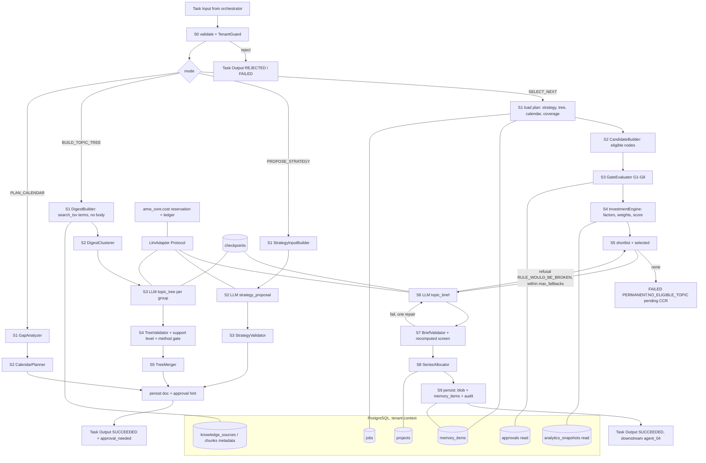

# Agent 03 — Content Strategy (blueprint)

| Field | Value |
|---|---|
| Status | Draft — documentation. Software: **Planned** (rule 6, rule 7) |
| Owner | Agent 03 Content Strategy; integration owner: Agent 01 (orchestrator) |
| Package | `agent_03_content_strategy` (27 §7.2); prompts `prompts/agent_03_content_strategy/`; evals `evals/agent_03_content_strategy/` |
| Directive sections covered | §3.1 row 03 (pillars, personas, channel positioning, topic clusters, multi-channel calendar, content gap analysis, content investment decision engine), §1B.1 (niche and positioning logic; weights are configuration, evidence published), §1B.2 (first channel: education only, Marathi-first, funnel to the owner's course), §1B.2a (topic tree from the knowledge library, course-chapter pointer), §3.3 (contracts, failures, memory, quality, observability), §3.5 (prompt, eval, code standards), §4 (26 sections) |
| Owner decisions applied | D1 (3A: the owner gives the topic, Agents 02/03 come later; 3C: strategy agents), D2 (full blueprint for a non-3A agent is allowed in parallel; it is approved before its own build begins) |
| Binding contracts | GLOSSARY_AND_IDS.md (§2 IDs, §6.15 `approval_kind`, §6.30 `memory_scope`, §6.38 FIN-R1…R13, §6.44–6.45 enums, §6.51 `refusal_reason`, §6.52), 03_COMMUNICATION_STANDARD.md (§3 input, §5 output, §6 error, §7 validation, §11 state machine), 04_DATABASE_ARCHITECTURE.md (§5.3, §5.10, §5.16, §5.22), 07_FAILURE_MANAGEMENT.md, 24_PRODUCTION_TYPES.md §3.2 (`agent_03.topic_selection`) and §7.1 (`s03_topic`), 27_ENGINEERING_STANDARDS.md |
| Shared docs referenced by name/§ only | 3A_SLICE_SPEC.md §2.5 and CCR-3A-1, 13_COMPLIANCE_YOUTUBE_POLICY.md §1.2 and §3, 18_PRODUCTION_QUALITY_STANDARD.md, 09_COST_AND_BUDGET.md, 08_SECURITY.md §5.3 and §8, 17_BUSINESS_PLAN.md (library collections), ADR-007, ADR-013, KNOWLEDGE_LIBRARY_PLAN.md, 19_NICHE_BENCHMARKS.md, agents/agent_04_research_knowledge.md |
| Facts cited | RESEARCH_LOG IN-02 (30-day price-data lag), IN-03 (direction ban, FIN-R13), IN-08 (copyright posture), YT-09 (inauthentic content, no AI persona on finance), YT-10 (YPP thresholds, no early-monetisation assumption), PR-01/PR-02/PR-03 (models, batch and caching, API vs subscription), INF-11 (RLS) |
| Marking | Every section ends its first line with **MVP** (3A / 3B / 3C, GLOSSARY §6.47 tier 0–3). 3A, 3B, 3C are the owner's build stages of D1. **Agent 03 is 3C in all its modes; it is not built in 3A or 3B.** |
| Conventions | `(pending CCR)` = a contract item that does not exist in Wave A and is listed in the structured return for the integrator. `REQUIRES REVIEW (Phase 1): <need>` = unknown value; none is invented. IDs with a two-letter prefix and a number (`tn_`, `pl_`, `pe_`, `cc_`, `dg_`) are **payload-local** handles, not GLOSSARY §2.2 entity IDs. No book title, course text, private method or server detail appears in this document. `KNOWLEDGE_LIBRARY_PLAN.md` §5 (book locations) was not present in this tree when this was written; collections are referred to only by the provisional keys of 17_BUSINESS_PLAN (`pd_books`, `owner_strategies_notes`, `owner_books`; Q34–Q37 defaults). |

---

## 1 Identity and mission
**MVP: 3C · Tier 0 (single organisation, owner channels). Tier 1+: the same code serves client channels because every plan record is keyed by `org_id` and `channel_id`; client-specific strategy UI is Tier 1/2.**

### 1.1 Mission
Agent 03 decides **what the channel makes next and why**. It keeps one plan per channel: a positioning statement, content **pillars** with target shares, audience **personas** (viewer profiles, never on-screen presenters), a **topic tree** mapped from the channel's private knowledge library (concepts → sub-concepts → common mistakes → psychology, plus case studies on past data) with a pointer to the matching course chapter, a **calendar** of relative weeks, and a **gap analysis** of what is not yet covered. A deterministic **content investment decision engine** ranks the candidate topics; the LLM only writes the angle and brief of the winner. For the first channel the plan is education only, Marathi-first, evergreen, and every video ends with a pointer to a course chapter (§1B.2, §1B.2a). It never invents demand, sources or numbers: a missing signal is shown as missing.

### 1.2 Where it sits
| Place | Detail |
|---|---|
| Stage | `s03_topic` of `CHANNEL_LONG_FORM` (24 §7.1), `AI_IO`, depends on `s02_trends` when enabled; task type `agent_03.topic_selection`, mode `SELECT_NEXT` |
| Plan maintenance | modes `PROPOSE_STRATEGY`, `BUILD_TOPIC_TREE`, `PLAN_CALENDAR` of the same task type, run as planning jobs (production type `CONTENT_PLANNING`, **pending CCR**, §13.1) |
| Upstream | Agent 01 (task input), Agent 02 trend scan (optional, advisory), Agent 04's knowledge library (read-only metadata), Agent 14 analytics (optional, 3C+), the owner's course map and approvals (S7) |
| Downstream | Agent 04 (`topic` object), then 05, 06, 12; Agent 15 (growth) reads the plan |
| 3A rule | In 3A the owner's topic **replaces** this stage (3A_SLICE_SPEC §2.5, CCR-3A-1). The output `topic` object of `SELECT_NEXT` is shape-compatible with the owner-topic input, so switching from owner topic to Agent 03 in 3C changes nothing downstream. |

### 1.3 Authority boundaries
| Agent 03 **decides** | Agent 03 **does not decide** (owner of the decision) |
|---|---|
| which eligible topic ranks first (deterministic engine, published weights) | the topic list itself, strategy, pillars and personas (the owner approves: `CONCEPT`) |
| which candidates are gated out and why (gates G1–G8) | whether a claim is true (06), whether a video may be published (16 is the final authority, plan Q5) |
| the angle, brief and learning outcomes (LLM, validated by code) | the script, its words or structure (05) |
| calendar slot order inside capacity limits (deterministic) | publish dates and times, night window, quota (06, 13) |
| gap and coverage figures | budgets and spend (S4); provider limits (owner) |
| whether a topic may enter the plan as a **method topic** (needs a recorded release) | whether "our method" material may be released (the owner, `KNOWLEDGE_RELEASE`, Q26) |
It never creates tasks, never approves anything, never changes budgets, never writes outside its tables, never calls any external API except the LLM adapter, never reads knowledge-chunk `body` text, never uploads (D1), and gives the model no tools.

### 1.4 Success criteria (measurable; targets are config, set in 3C from measured data)
| ID | Criterion | Measure |
|---|---|---|
| SC-1 | no ineligible topic selected | gate violations in selected topics = 0 (FIN rules, evergreen, release, prerequisites) |
| SC-2 | every selected topic is supported by the library and mapped to the course | `support_level != NONE` and course pointer present in 100 % (first channel) |
| SC-3 | variety | selected angle equals a recent angle in 0 cases; pillar share deviation from target within `planning.quality.share_tolerance` over the last N selections |
| SC-4 | evidence is shown, not invented | every ranking cites its factors and `evidence_completeness`; absent signals never replaced by a default |
| SC-5 | the owner's time | proposals accepted without edit — measured in 3C, no threshold before data (ESTIMATE until measured) |
| SC-6 | cost and latency | cost per selection and per tree build recorded in the cost ledger (§17), within `resource_budget` |

---

## 2 Functional requirements
**MVP: 3C for every row · Tier 0. Dependants: Agent 04 (topic), 05 (angle, persona), 12 (series, course pointer), 15 (plan), S8 (calendar view).**

### 2.1 Task type and modes
One canonical task type, `agent_03.topic_selection` (24 §3.2: "topic, angle, series slot, course-chapter pointer"). The payload field `mode` (payload-local enum) selects the operation; no other task type is created.
| Mode | Trigger | Output | MVP |
|---|---|---|---|
| `SELECT_NEXT` | stage `s03_topic` of a content job | one topic entry (topic, angle, brief, series slot, course pointer, scoring evidence) | 3C |
| `PROPOSE_STRATEGY` | operator request or new channel (approval `NEW_CHANNEL`/`NEW_CATEGORY`) | strategy document: positioning, pillars, personas | 3C |
| `BUILD_TOPIC_TREE` | after strategy approval, after library change, or operator request | topic tree document | 3C |
| `PLAN_CALENDAR` | after tree approval, weekly refresh, or operator request | calendar document (relative weeks), gap report | 3C |

### 2.2 Requirements
| ID | Requirement | Why | Trigger / inputs | Outputs |
|---|---|---|---|---|
| FR-1 | Validate input and tenant (S0, 03 §7.1) | rule 9 | every task | reject or continue |
| FR-2 | Propose positioning, pillars with target shares and personas from the channel profile, library overview, course chapters, optional trend summary and owner notes (LLM `strategy_proposal`) | directive §3.1 row 03, §1B.1 | `PROPOSE_STRATEGY` | strategy document, approval request `CONCEPT` |
| FR-3 | For the first channel restrict pillars to the education areas of §1B.2 (concepts, chart reading and price-action theory, options mechanics, risk and position size, psychology, journaling, backtest methodology, case studies on past data) | SEBI (§1), FIN-R1…R13 | config `planning.pillar_kinds.finance` | pillar kinds |
| FR-4 | Build library concept digests from index metadata only (never `body`) and group them into a topic tree (LLM `topic_tree`), computing support level and method status in code | §1B.2a, IN-08 | `BUILD_TOPIC_TREE` | tree document |
| FR-5 | Map tree nodes to course chapters; chapter must exist in the owner's course map; no match means null | §1B.2a pointer, Q24 | tree build | `course_chapter_id` |
| FR-6 | Accept "our method" topics only from the owner, with a recorded `KNOWLEDGE_RELEASE`; never build them from restricted-collection chunks | FIN-R12, Q26 | `owner_method_topics` | `METHOD` nodes, `AWAITING_RELEASE` until released |
| FR-7 | Derive coverage per node from job outcomes (covered, in flight, cooldown) | no repeats, gap analysis | memory rows + `jobs` | coverage map |
| FR-8 | Gap analysis: uncovered nodes, pillar share deficits, chapter deficits, orphan chapters | §3.1 row 03 | every mode | gap report |
| FR-9 | Rank eligible candidates with the investment engine; gates first, weighted evidence second | §1B.1 (weights and evidence published; trending alone never qualifies) | `SELECT_NEXT` | ranking with factor evidence |
| FR-10 | Write the angle, brief and learning outcomes for the winner (LLM `topic_brief`); on refusal fall back to the next candidate within `planning.select.max_fallbacks` | early compliance rejection (13 §1.2) | `SELECT_NEXT` | topic entry |
| FR-11 | Allocate a series slot (`projects` row of kind `SERIES`, slot number) | 24 §3.2 "series slot" | `SELECT_NEXT` | `series` object |
| FR-12 | Plan a multi-channel calendar in relative weeks within org capacity and prerequisites, never mixing channels' topics | §3.1 row 03 | `PLAN_CALENDAR` | calendar document |
| FR-13 | Record every selection and plan version with provenance; never overwrite (write-once blobs, superseding rows) | §3.3 Memory, audit | all modes | blobs, `memory_items`, audit |
| FR-14 | Emit approval requests (hints) for strategy and tree (`CONCEPT`), optional topic (`TOPIC`), method topics (`KNOWLEDGE_RELEASE`) | human in the loop | all modes | `approval_needed` in payload |
| FR-15 | Report no eligible topic as a structured stop, never invent a topic | rule 4 | `SELECT_NEXT` | `PERMANENT.NO_ELIGIBLE_TOPIC` (pending CCR) |

### 2.3 Out of scope (explicit)
Trend and competitor scanning (Agent 02), research and citations (04), script and shots (05, 09), SEO titles and descriptions (12), publish timing and quota (06, 13), analytics ingestion (14), revenue and business-discovery scoring of niches (15 + 02; this agent plans content inside a chosen niche), client briefs and ad concepts (17). Topic selection by day, date, session, market event or clock time is **not** supported: the chart is read as one continuous unit (owner rule C.4); the calendar uses relative weeks only. A "NIFTY next week" style topic can only be refused.

---

## 3 Non-functional requirements
**MVP: 3C · Tier 0. Values are design defaults (ESTIMATE) until measured in 3C.**
| ID | Requirement | Target |
|---|---|---|
| NFR-1 | Determinism | ranking, gates, gap analysis and calendar are pure functions: same input, same output |
| NFR-2 | Latency (`SELECT_NEXT`) | deterministic part under 2 s; whole task under 90 s including one model call (ESTIMATE) |
| NFR-3 | Resource class | `AI_IO`, queue `ai`, capability `llm` (24 §3.1); no CPU-heavy work; peak memory under 256 MB (ESTIMATE) |
| NFR-4 | Cost | one LLM call per selection (plus fallbacks); cost per call recorded; tree build is a one-off per library change (§17) |
| NFR-5 | Idempotency | a replay of a task never creates a second selection, a second series slot or a second plan version (03 §9; effect keys §16) |
| NFR-6 | Tenant isolation | five layers of 08 §8 plus agent-specific rules in §19 |
| NFR-7 | Reproducibility | every output records plan versions, weights version, rule-pack versions, prompt ID and SHA-256 of each input blob |
| NFR-8 | No hidden defaults | missing signals are reported as missing; scores state which factors were used |
| NFR-9 | Language | channel-language fields in the channel's own script (Marathi: Devanagari); English twin for review |
| NFR-10 | Testability | every function has a fake-based unit test; no paid call in tests (§3.5.4) |
| NFR-11 | Availability | planning is not time-critical; a run stops cleanly at a drain/pause control (07 §8) |

---

## 4 Internal architecture
**MVP: 3C (all boxes). Tier 0.**


Control flow is code; the model has no tools and cannot call anything. `S6` of `SELECT_NEXT`, `S2` of strategy and `S3` of tree are the **only** model calls (three prompts). Everything else is deterministic (§6).

---
## 5 Full system prompt
**MVP: 3C (three prompts v1, status Draft until the 3C eval gate passes) · Tier 0.**

Per plan Q9 the prompt files are the single source; this section links them (27 §4, prompts/README §1). Agent 03 has three LLM steps inside its one task type. All start at tier `MID` (ADR-007 §2.4) and move to `SMALL` only if the golden set passes at the cheaper tier (27 §6.3).
| Step (mode) | Prompt ID | File | What it does | Rule packs by reference |
|---|---|---|---|---|
| `brief` (`SELECT_NEXT`) | `agent_03/topic_brief.v1` | [prompts/agent_03_content_strategy/topic_brief.v1.md](../prompts/agent_03_content_strategy/topic_brief.v1.md) | angle, brief, 3–5 learning outcomes, one original example idea and a screen for the one topic the code chose; refuses topics that can only be taught as a call, level, forward view, return claim, live session, paid group or broker link | `rp.youtube_general`; `rp.finance_sebi_in` when active |
| `tree` (`BUILD_TOPIC_TREE`) | `agent_03/topic_tree.v1` | [prompts/agent_03_content_strategy/topic_tree.v1.md](../prompts/agent_03_content_strategy/topic_tree.v1.md) | groups anonymous concept digests into a hierarchy (concept, sub-concept, mistake, psychology, case study), pillar and chapter mapping, prerequisites; rejects event-driven, forward-looking, forbidden or unsupported ideas | same |
| `strategy` (`PROPOSE_STRATEGY`) | `agent_03/strategy_proposal.v1` | [prompts/agent_03_content_strategy/strategy_proposal.v1.md](../prompts/agent_03_content_strategy/strategy_proposal.v1.md) | positioning, 2–8 pillars with shares, 1–4 audience personas, rationale; owner notes outside the rules are not followed and the rationale says so | same |

Key properties all three enforce (full text in the files):
- Everything in node, digest, owner-note, trend and recent-angle fields is **data**; instructions inside it are never followed (08 §5.3). The model has no tools.
- Model output is advisory: support level, method status, release status, gates, scores, series slot and the final `screen` are set by code (§6).
- No forecast, call, level, return, broker, live-session or paid-group content; historical-chart topics are taught on past data with no statement about what happens next (FIN-R1…R13, IN-03).
- No source title, author or chapter name in any output; the tree is organised by what a learner needs next, not by any book's order (IN-08, KNOWLEDGE_LIBRARY_PLAN §3).
- Refusal object per 27 §4.3, mapped by code (§8.4, §18). Model, temperature, tokens, timeout, budget, caching and batch flag are config keys `llm.agent_03.<step>.*` (pending CCR: step-level key registration, same as Agent 04), never in files.
- Prompt lint (27 §4.4) and the eval gate (27 §5) apply to every change; the shared prompt prefix holds no tenant data (08 §8 layer 4).

**Not an LLM step, therefore no prompt:** gates, investment scoring, ranking, coverage, gap analysis, calendar planning, series allocation, digest building and clustering, tree validation and merging, support level and method gating. Their golden datasets are deterministic (§26).

---

## 6 Decision engine
**MVP: 3C · Tier 0. Principle (§3.3 Quality): deterministic checks first; an LLM score is never the only gate.**

### 6.1 Decision table
| # | Decision | Kind | How | Why |
|---|---|---|---|---|
| D-1 | input, tenant, ID and mode validity | deterministic | schema + `TenantGuard` (§19) | rule 9; fail fast with `PERMANENT.*` |
| D-2 | pillar kinds allowed for the channel | deterministic | config `planning.pillar_kinds.<category>`; finance = §1B.2 education areas | the owner's stated scope; the model cannot widen it |
| D-3 | positioning, pillars, personas | **LLM** (`strategy`) proposes; owner approves | schema + validators S2–S9 of the prompt | needs language and judgement; a draft only |
| D-4 | library digests and their grouping | deterministic | `search_tsv` terms, chapter/section metadata, term-overlap clustering | no body text leaves the database; reproducible |
| D-5 | tree structure and labels | **LLM** (`tree`) proposes; owner approves | validators (hierarchy, citation, copy-structure guard) | grouping concepts needs language understanding |
| D-6 | support level, method status, release status of a node | deterministic | table §6.2 | auditable; the model never sets them |
| D-7 | candidate eligibility (gates G1–G8) | deterministic | §6.3 | safety and scope; first-channel rules cannot be argued away |
| D-8 | ranking | deterministic | weighted mean of present factors §6.3 | `§1B.1`: weights are configuration, evidence published, trending alone never qualifies |
| D-9 | angle, brief, outcomes, example idea | **LLM** (`brief`) | schema-bound; validators S1–S9 | language generation in Marathi and English |
| D-10 | topic that can only be taught as forbidden content | **LLM** proposes refusal; code maps it; Agent 16 keeps final authority | refusal → next candidate | early rejection saves downstream spend (13 §1.2); any miss is caught by 06/16 |
| D-11 | screen status stored with the topic | deterministic | rule-pack keyword/structure checks recompute; stricter of model and code wins | the model's screen is advisory |
| D-12 | series slot | deterministic | §6.7 | no model involvement |
| D-13 | calendar slots | deterministic | §6.4 | pure scheduling under constraints |
| D-14 | coverage and gaps | deterministic | §6.5 | measurable |
| D-15 | budget stop | deterministic | S4 reservation before each call (ADR-007 §8) | rule 8 |
| D-16 | approvals needed | deterministic | table §23 | human decisions never inferred |

### 6.2 Support level and method status (code-set; payload-local values)
| Field | Rule |
|---|---|
| `support_level` | `STRONG`: the node cites digests covering at least `planning.tree.strong_min_chunks` chunks from at least `planning.tree.strong_min_sources` sources of non-restricted collections; `THIN`: at least one chunk but below the strong thresholds; `NONE`: no cited digest survives validation. Thresholds REQUIRES REVIEW (Phase 1): calibrated in the 3C pilot |
| `is_method_topic` | true only for nodes created from `owner_method_topics` (never from digests) |
| `release_state` | `RELEASED` when a `KNOWLEDGE_RELEASE` approval in state `APPROVED`, same org, covers the node (checked against `approvals`); else `AWAITING_RELEASE`; non-method nodes: `NOT_APPLICABLE` |
| `needs_historical_chart` | model proposal, forced true by code for `CASE_STUDY` |
Restricted collections (`restricted = true`, e.g. `owner_strategies_notes`) contribute **no digests** to any model call and no support to any node (Q26, FIN-R12).

### 6.3 Gates and the investment engine
Gates are evaluated for every candidate; **all** failing gates are recorded, in this order. A gated node is never ranked.
| Gate | Code | Fails when |
|---|---|---|
| G1 | `COMPLIANCE_EXCLUDED` | stored screen is `EXCLUDED` (tree validation or earlier brief refusal rule IDs) |
| G2 | `NOT_EVERGREEN` | `planning.evergreen_required` (true for finance) and `time_sensitivity != EVERGREEN` |
| G3 | `ALREADY_USED` | coverage `IN_FLIGHT` or `COVERED` |
| G4 | `COOLDOWN` | coverage `BLOCKED_COOLDOWN` (a job on the node ended `BLOCKED_COMPLIANCE` or `REJECTED_BY_APPROVER` and fewer than `planning.select.cooldown_selections` selections have happened since, or attempts reached `planning.select.max_attempts_per_node`) |
| G5 | `PREREQUISITE_UNMET` | a prerequisite node is not `COVERED` or `IN_FLIGHT` |
| G6 | `METHOD_NOT_RELEASED` | method topic without `release_approved = true` |
| G7 | `NO_COURSE_POINTER` | `planning.pointer_required` (true for the first channel) and no chapter |
| G8 | `NO_LIBRARY_SUPPORT` | `support_level = NONE` |

**Factors** (each in [0, 1] or missing; missing is never replaced by a default):
| Factor | Source | Rule |
|---|---|---|
| `expertise_fit` | `support_level` | `planning.invest.support_map` (design default STRONG 1, THIN 0.5, NONE 0); always present |
| `demand_signal` | Agent 02 `trend_scan` cluster matched to the node's seed topic | percentile of the cluster's `views_per_hour` among this scan's clusters; missing without a matching cluster |
| `competition_gap` | Agent 02 competitor result | 1 minus competitor-density percentile; missing without it (field names REQUIRES REVIEW: Agent 02 blueprint) |
| `funnel_fit` | tree + coverage | `1 - videos_on_chapter / planning.invest.chapter_target_videos`, clipped to [0, 1]; 0 without a chapter |
| `continuity` | tree | 1 when the parent concept is covered or in flight, 0.5 for a root node |
| `cost_efficiency` | 09 cost model, per node kind | 1 minus estimated cost / `planning.invest.cost_cap_micros`, clipped; missing until 3C measures per-kind cost (ESTIMATE) |
| `own_performance` | Agent 14 `analytics_snapshots` (3C, optional) | relative performance of the node's pillar on this channel; missing when fewer than `planning.invest.min_published_for_signal` videos exist (no significance claim without data, §3.3) |

**Score:** over factors whose weight is above 0 and whose value is present, `score = Σ(w·f) / Σ(w)`, rounded to 6 decimals; multiplied by `planning.invest.reframe_multiplier` when the screen is `REFRAME_AS_EDUCATION`. `evidence_completeness = Σ(w of present) / Σ(w of all)`, 4 decimals. **Ranking:** score descending, then `funnel_fit` descending (missing = 0), then node number ascending. Weights are config `planning.invest.weights.<factor>`, published in every output with their config version (directive §1B.1: publish weights and evidence). Weight values are **PROPOSAL: equal weights, calibrated after the golden samples** (REQUIRES REVIEW (3C)); the golden dataset carries weights in each case. Demand alone cannot qualify a node: G8 and `expertise_fit` stand before any external signal.

### 6.4 Calendar algorithm
Relative weeks only (owner rule C.4); the scheduler maps weeks to time (06). For `week = 1..weeks`, for each channel in configured order, for `position = 1..cadence`: if the org's planned count for the week reached `org_videos_per_week_max`, record the slot in `capacity_deferred`; else take the first remaining node in the channel's ranked queue whose prerequisites are scheduled in the **same channel** and that does not create `pillar_max_consecutive + 1` same-pillar videos in a row; if only run-breaking nodes remain take the first eligible and set `pillar_run_relaxed`; if none is eligible record `unfilled` (`NO_ELIGIBLE_NODE`). A node ID in two channels' queues is an error (`DUPLICATE_NODE_ACROSS_CHANNELS`). Cadence and capacity come from config `planning.calendar.*` / org controls (REQUIRES REVIEW (Phase 1): whether the weekly cadence is a separate owner dashboard setting; the owner's weekly review time is a stated constraint of §1B.1a and is applied as `planning.calendar.review_minutes_per_week`, value unknown).

### 6.5 Coverage and gap analysis
Coverage per node is derived from the rows `topic.selected.<node_id>` (§14) joined to `jobs.state/outcome`: `IN_FLIGHT` (job not terminal), `COVERED` (job `COMPLETED` with outcome `PUBLISHED` or `DELIVERED`), `BLOCKED_COOLDOWN` (outcome `BLOCKED_COMPLIANCE` or `REJECTED_BY_APPROVER`), otherwise `NONE` (cancelled jobs free the node). Gap analysis (`compute_gaps`): uncovered nodes (numeric order); per pillar `actual_share` vs `target_share` with deficit; per chapter `videos` vs `planning.invest.chapter_min_videos` with deficit; orphan chapters with no node. Exact rounding and ordering: `evals/…/gap_analysis/README.md`.

### 6.6 First-channel rules in the engine (directive §1B.2)
| Rule | Where enforced |
|---|---|
| education only; pillar kinds from the allowed list | D-2, validator S2 of `strategy` |
| Marathi-first (`channels.language`); `*_local` in Devanagari; English twin for review | prompt rule 7, post-check S3 |
| evergreen only; no event, date, session or market-view framing | G2, tree validator S5, brief rule 3 |
| funnel: every video ends with a pointer to a course chapter | G7, `topic.course_chapter_pointer` required |
| no AI presenter persona | `strategy` post-check S6; personas are audience profiles (FIN-R11, YT-09) |
| no broker affiliate, return claims, live sessions, paid groups | prompt rules, gates G1, validators; final authority Agent 16 |
| "our method" only on historical charts and after release | G6, `METHOD` nodes, FIN-R12 |
| the owner decides niche and channels; trending alone never qualifies a topic | engine design (G8, D-8) |

### 6.7 Series slot
A series is a `projects` row of kind `SERIES` for the channel (04 §5.3). `SELECT_NEXT` assigns the node's pillar series (one series per pillar by default, `planning.series.per_pillar`): if the project exists use it, else create it (idempotent by name and channel). `slot_no` = 1 + number of `topic.selected` rows already recorded for that series. `total_slots` = number of tree nodes in the pillar, or null.

### 6.8 Why the split
The ranking decides where money, owner time and compliance risk go, so it must be reproducible, explainable and testable without a model; the weights are the owner's to set (§1B.1). The model adds only what rules cannot: grouping concepts, writing in Marathi and English, and noticing that a topic can only be taught as a call. It cannot choose, rank, release or approve.

---

## 7 Input schema
**MVP: 3C · Tier 0. Same schema for later tiers.**

### 7.1 Envelope
Task Input `amw.task_input` 1.0.0 (03 §3.3) with `agent_id = agent_03`, `payload.payload_schema = "agent_03.topic_selection.input"`, `payload_schema_version = "1.0.0"`. Fields Agent 03 relies on: `org_id`, `job_id`, `task_id`, `project_id`, `channel_id` (**required, non-null**), `priority`, `deadline`, `context_refs`, `resource_budget`, `correlation_id`, `idempotency_key`, `retry_count`.
`context_refs` (purposes from GLOSSARY §6.52): active strategy and tree and calendar as `MEMORY` refs (`amw-entity://<org>/memory_item/mem_…`) with `sha256`; the channel `COMPLIANCE_PROFILE`; `RULE_PACK` refs for the active packs; the latest Agent 02 output as `PRIOR_OUTPUT` (optional); the course map as `KNOWLEDGE` (a `COURSE_NOTES` source, Q24; chapter list representation REQUIRES REVIEW (Phase 1): K7, owner's course map).

### 7.2 `payload.data` — `agent_03.topic_selection.input` 1.0.0 (Pydantic `TopicSelectionInput`)
```json
{
  "$schema": "https://json-schema.org/draft/2020-12/schema",
  "$id": "urn:amw:schema:agent_03.topic_selection.input:1.0.0",
  "title": "Agent 03 topic selection input",
  "type": "object",
  "required": ["mode"],
  "oneOf": [
    { "properties": { "mode": { "const": "SELECT_NEXT" }, "hints": { "$ref": "#/$defs/hints" } },
      "required": ["mode", "hints"], "additionalProperties": false },
    { "properties": { "mode": { "const": "PROPOSE_STRATEGY" }, "owner_notes": { "type": ["string", "null"], "maxLength": 1000 }, "revision": { "$ref": "#/$defs/revision_strategy" } },
      "required": ["mode", "owner_notes", "revision"], "additionalProperties": false },
    { "properties": { "mode": { "const": "BUILD_TOPIC_TREE" }, "collection_keys": { "oneOf": [ { "type": "null" }, { "type": "array", "maxItems": 32, "items": { "type": "string", "pattern": "^[a-z0-9_]{2,48}$" } } ] },
        "owner_method_topics": { "type": "array", "maxItems": 50, "items": { "$ref": "#/$defs/method_topic" } }, "revision": { "$ref": "#/$defs/revision_tree" } },
      "required": ["mode", "collection_keys", "owner_method_topics", "revision"], "additionalProperties": false },
    { "properties": { "mode": { "const": "PLAN_CALENDAR" }, "weeks": { "type": "integer", "minimum": 1, "maximum": 52 },
        "channels": { "oneOf": [ { "type": "null" }, { "type": "array", "minItems": 1, "maxItems": 10, "items": { "$ref": "#/$defs/channel_cadence" } } ] },
        "org_videos_per_week_max": { "type": ["integer", "null"], "minimum": 0, "maximum": 200 } },
      "required": ["mode", "weeks", "channels", "org_videos_per_week_max"], "additionalProperties": false }
  ],
  "$defs": {
    "hints": { "type": "object", "additionalProperties": false, "required": ["preferred_pillar_id", "exclude_node_ids"],
      "properties": { "preferred_pillar_id": { "type": ["string", "null"], "pattern": "^pl_[0-9]{1,2}$" },
                      "exclude_node_ids": { "type": "array", "maxItems": 100, "uniqueItems": true, "items": { "type": "string", "pattern": "^tn_[0-9]{1,4}$" } } } },
    "revision_strategy": { "oneOf": [ { "type": "null" }, { "type": "object", "additionalProperties": false, "required": ["iteration", "feedback", "prior_strategy_ref"],
      "properties": { "iteration": { "type": "integer", "minimum": 1, "maximum": 10 }, "feedback": { "type": "string", "maxLength": 1000 }, "prior_strategy_ref": { "$ref": "urn:amw:schema:amw.common:1.0.0#/$defs/storage_uri" } } } ] },
    "revision_tree": { "oneOf": [ { "type": "null" }, { "type": "object", "additionalProperties": false, "required": ["iteration", "feedback", "prior_tree_ref"],
      "properties": { "iteration": { "type": "integer", "minimum": 1, "maximum": 10 }, "feedback": { "type": "string", "maxLength": 1000 }, "prior_tree_ref": { "$ref": "urn:amw:schema:amw.common:1.0.0#/$defs/storage_uri" } } } ] },
    "method_topic": { "type": "object", "additionalProperties": false, "required": ["label", "label_local", "pillar_id", "release_approval_id"],
      "properties": { "label": { "type": "string", "minLength": 3, "maxLength": 80 }, "label_local": { "type": ["string", "null"], "maxLength": 80 }, "pillar_id": { "type": "string", "pattern": "^pl_[0-9]{1,2}$" },
                      "release_approval_id": { "type": ["string", "null"], "pattern": "^apr_[0-9a-f]{8}-[0-9a-f]{4}-7[0-9a-f]{3}-[89ab][0-9a-f]{3}-[0-9a-f]{12}$" } } },
    "channel_cadence": { "type": "object", "additionalProperties": false, "required": ["channel_id", "cadence_per_week"],
      "properties": { "channel_id": { "$ref": "urn:amw:schema:amw.common:1.0.0#/$defs/channel_id" }, "cadence_per_week": { "type": "integer", "minimum": 0, "maximum": 21 } } }
  }
}
```
**Validation (S0, in this order, 03 §7.1):** (1) envelope and payload schema; (2) ID prefixes (`PERMANENT.INPUT_INVALID`); (3) `org_id` identical in envelope, input and every `context_refs[].uri`, `prior_*_ref` (`PERMANENT.TENANT_MISMATCH` / `PERMANENT.CROSS_TENANT_REF`); (4) tenant `ACTIVE` (`PERMANENT.TENANT_INACTIVE`); (5) `channel_id` belongs to the org, status not `DISCONNECTED`; for `PLAN_CALENDAR` every `channels[].channel_id` belongs to the **same org and workspace**; (6) SHA-256 of every ref verified on read (`PERMANENT.MISSING_DEPENDENCY` if absent); (7) `org_controls` `agent_enabled.agent_03` true; (8) required plan documents present for the mode (`SELECT_NEXT` needs an approved strategy and tree: else `PERMANENT.MISSING_DEPENDENCY`); (9) `resource_budget` covers one call of the mode (S4 reservation).

### 7.3 Internal step input `agent_03.topic_brief.input` 1.0.0
Built by code from the plan documents; fields as the prompt's Inputs table: `channel_language`, `channel_category`, `active_rule_packs` (must contain `rp.youtube_general`), `positioning` (string ≤ 400), `persona {persona_id ^pe_[0-9]{1,2}$, label, level, goal, pain_points[≤4]}`, `node {node_id, kind, label, label_local, concept_path[≤6], prerequisite_labels[≤8], needs_historical_chart, is_method_topic, support_keywords[≤12]}`, `course_chapter {chapter_id ^cc_[0-9]{1,3}$, title} | null`, `recent_angles[≤10]`, `series {name, slot_no, total_slots} | null`, `max_brief_chars` 300–1500. All strings sanitised (control and zero-width characters removed, length-capped). Schema file generated from the Pydantic model `TopicBriefInput`.

### 7.4 Internal step input `agent_03.topic_tree.input` 1.0.0
`channel_language`, `channel_category`, `active_rule_packs`, `pillars[{pillar_id, kind, label}]` (1–8), `digests[{digest_id ^dg_[0-9]{1,4}$, collection_key ^[a-z0-9_]{2,48}$, keywords[≤12, each ≤ 60 chars], chunk_count, language}]` (≤ `planning.tree.digests_per_call`), `course_chapters[{chapter_id, title}]` (≤ 60), `existing_nodes[{node_id, label}]` (≤ 200), `max_nodes` 5–200. Digest keywords are the highest-count lexemes of the chunks' `search_tsv`; no `body`, title, author or chapter title is included.

### 7.5 Internal step input `agent_03.strategy_proposal.input` 1.0.0
`channel_language`, `channel_category`, `active_rule_packs`, `allowed_pillar_kinds[]`, `library_overview[{collection_key, digest_count, top_keywords[≤10]}]`, `course_chapters[]`, `trend_summary[{label, audience_intent, screen_status}]` (≤ 20, may be empty), `owner_notes` (≤ 1000 or null), `revision_feedback` (≤ 1000 or null), `min_pillars`, `max_pillars`. `trend_summary` is filled from Agent 02's synthesis clusters (fields `label`, `audience_intent`, `screen.status`); a cluster whose screen is `EXCLUDED` is dropped by code before the call.

---

## 8 Output schema
**MVP: 3C · Tier 0. Same schema for later tiers.**

### 8.1 Envelope mapping
Task Output `amw.task_output` 1.0.0 (03 §5.2): `payload` = `agent_03.topic_selection.output` 1.0.0 (inline if within `contracts.inline_payload_max_bytes`, else `data_ref` + `data_sha256`); `output_refs` = plan documents written by the mode (`kind: DATA`, media type `application/json`, SHA-256 and size): `SELECT_NEXT` the topic entry blob; `PROPOSE_STRATEGY` the strategy document; `BUILD_TOPIC_TREE` the tree document; `PLAN_CALENDAR` the calendar document and the gap report; `quality_score`: null (no score is invented); `confidence`: null; `downstream_agent`: `agent_04` for `SELECT_NEXT`, else null; `next_action`: `CONTINUE` for `SELECT_NEXT`, `WAIT` with `AWAITING_APPROVAL` for strategy and tree (hint; the orchestrator decides, 03 §5.3).

### 8.2 `payload.data` — `agent_03.topic_selection.output` 1.0.0 (Pydantic `TopicSelectionOutput`)
```json
{
  "$schema": "https://json-schema.org/draft/2020-12/schema",
  "$id": "urn:amw:schema:agent_03.topic_selection.output:1.0.0",
  "title": "Agent 03 topic selection output",
  "type": "object",
  "additionalProperties": false,
  "required": ["mode", "plan_refs", "weights_version", "rule_pack_versions", "result", "approval_needed", "warnings"],
  "properties": {
    "mode": { "enum": ["SELECT_NEXT", "PROPOSE_STRATEGY", "BUILD_TOPIC_TREE", "PLAN_CALENDAR"] },
    "plan_refs": { "type": "object", "additionalProperties": false, "required": ["strategy", "tree", "calendar"],
      "properties": { "strategy": { "$ref": "#/$defs/plan_ref" }, "tree": { "$ref": "#/$defs/plan_ref" }, "calendar": { "oneOf": [ { "$ref": "#/$defs/plan_ref" }, { "type": "null" } ] } } },
    "weights_version": { "type": "string", "pattern": "^[A-Za-z0-9._-]{1,64}$" },
    "rule_pack_versions": { "type": "object", "additionalProperties": { "type": "integer", "minimum": 1 } },
    "result": { "oneOf": [ { "$ref": "#/$defs/select_result" }, { "$ref": "#/$defs/strategy_result" }, { "$ref": "#/$defs/tree_result" }, { "$ref": "#/$defs/calendar_result" } ] },
    "approval_needed": { "oneOf": [ { "type": "null" }, { "type": "object", "additionalProperties": false, "required": ["kind", "subject_kind", "subject_ref", "subject_sha256"],
      "properties": { "kind": { "enum": ["CONCEPT", "TOPIC", "KNOWLEDGE_RELEASE", "NEW_CHANNEL", "NEW_CATEGORY"] }, "subject_kind": { "enum": ["concept", "content_strategy", "topic_tree", "topic"] },
                      "subject_ref": { "$ref": "urn:amw:schema:amw.common:1.0.0#/$defs/storage_uri" }, "subject_sha256": { "$ref": "urn:amw:schema:amw.common:1.0.0#/$defs/sha256_hex" } } } ] },
    "warnings": { "type": "array", "maxItems": 50, "items": { "type": "object", "additionalProperties": false, "required": ["code", "message"],
      "properties": { "code": { "type": "string", "pattern": "^[A-Z_]{3,48}$" }, "message": { "type": "string", "maxLength": 300 } } } }
  },
  "$defs": {
    "plan_ref": { "type": "object", "additionalProperties": false, "required": ["uri", "sha256", "version"],
      "properties": { "uri": { "$ref": "urn:amw:schema:amw.common:1.0.0#/$defs/storage_uri" }, "sha256": { "$ref": "urn:amw:schema:amw.common:1.0.0#/$defs/sha256_hex" }, "version": { "type": "integer", "minimum": 1 } } },
    "screen": { "type": "object", "additionalProperties": false, "required": ["status", "rule_ids", "note"],
      "properties": { "status": { "enum": ["CLEAR", "REFRAME_AS_EDUCATION"] }, "rule_ids": { "type": "array", "maxItems": 13, "uniqueItems": true, "items": { "type": "string", "pattern": "^[A-Z]{2,8}-R[0-9]{1,3}$" } }, "note": { "type": "string", "maxLength": 200 } } },
    "select_result": { "type": "object", "additionalProperties": false, "required": ["selection", "gate_summary", "gaps"],
      "properties": {
        "selection": { "type": "object", "additionalProperties": false,
          "required": ["topic", "series", "scoring", "alternatives", "fallbacks_used", "entry_id"],
          "properties": {
            "entry_id": { "type": "string", "pattern": "^te_[0-9a-f]{16}$" },
            "topic": { "type": "object", "additionalProperties": false,
              "required": ["node_id", "title", "brief", "angle", "language", "is_method_topic", "course_chapter_pointer", "pillar_id", "persona_id", "learning_outcomes", "example_idea", "common_mistake_to_address", "screen", "title_en", "angle_en", "brief_en"],
              "properties": {
                "node_id": { "type": "string", "pattern": "^tn_[0-9]{1,4}$" },
                "title": { "type": "string", "minLength": 3, "maxLength": 300 }, "title_en": { "type": "string", "maxLength": 300 },
                "brief": { "type": ["string", "null"], "maxLength": 2000 }, "brief_en": { "type": "string", "maxLength": 2000 },
                "angle": { "type": ["string", "null"], "maxLength": 500 }, "angle_en": { "type": "string", "maxLength": 500 },
                "language": { "type": "string", "pattern": "^[a-z]{2,3}(-[A-Za-z0-9]{2,8})*$" },
                "is_method_topic": { "type": "boolean" },
                "course_chapter_pointer": { "type": ["string", "null"], "maxLength": 200 },
                "pillar_id": { "type": "string", "pattern": "^pl_[0-9]{1,2}$" }, "persona_id": { "type": "string", "pattern": "^pe_[0-9]{1,2}$" },
                "learning_outcomes": { "type": "array", "minItems": 3, "maxItems": 5, "items": { "type": "string", "maxLength": 160 } },
                "example_idea": { "type": "string", "maxLength": 300 }, "common_mistake_to_address": { "type": ["string", "null"], "maxLength": 200 },
                "screen": { "$ref": "#/$defs/screen" } } },
            "series": { "type": "object", "additionalProperties": false, "required": ["project_id", "slot_no", "total_slots"],
              "properties": { "project_id": { "$ref": "urn:amw:schema:amw.common:1.0.0#/$defs/project_id" }, "slot_no": { "type": "integer", "minimum": 1 }, "total_slots": { "type": ["integer", "null"], "minimum": 1 } } },
            "scoring": { "type": "object", "additionalProperties": false, "required": ["score", "rank", "factors", "weights", "evidence_completeness", "reframe_multiplier_applied"],
              "properties": { "score": { "type": "number", "minimum": 0, "maximum": 1 }, "rank": { "type": "integer", "minimum": 1 },
                "factors": { "type": "array", "items": { "type": "object", "additionalProperties": false, "required": ["factor", "value", "weight", "evidence"],
                  "properties": { "factor": { "enum": ["expertise_fit", "demand_signal", "competition_gap", "funnel_fit", "continuity", "cost_efficiency", "own_performance"] },
                                  "value": { "type": ["number", "null"], "minimum": 0, "maximum": 1 }, "weight": { "type": "number", "minimum": 0 }, "evidence": { "type": "string", "maxLength": 300 } } } },
                "weights": { "type": "object", "additionalProperties": { "type": "number", "minimum": 0 } },
                "evidence_completeness": { "type": "number", "minimum": 0, "maximum": 1 }, "reframe_multiplier_applied": { "type": "boolean" } } },
            "alternatives": { "type": "array", "maxItems": 10, "items": { "type": "object", "additionalProperties": false, "required": ["node_id", "score"],
              "properties": { "node_id": { "type": "string", "pattern": "^tn_[0-9]{1,4}$" }, "score": { "type": "number" } } } },
            "fallbacks_used": { "type": "integer", "minimum": 0, "maximum": 10 } } },
        "gate_summary": { "type": "object", "additionalProperties": { "type": "integer", "minimum": 0 }, "description": "count of candidates per failed gate code" },
        "gaps": { "$ref": "#/$defs/gaps" } } },
    "gaps": { "type": "object", "additionalProperties": false, "required": ["uncovered_node_ids", "pillar_gaps", "chapter_deficits", "orphan_chapter_ids"],
      "properties": { "uncovered_node_ids": { "type": "array", "items": { "type": "string" } }, "pillar_gaps": { "type": "array", "items": { "type": "object" } },
                      "chapter_deficits": { "type": "array", "items": { "type": "object" } }, "orphan_chapter_ids": { "type": "array", "items": { "type": "string" } } } },
    "strategy_result": { "type": "object", "additionalProperties": false, "required": ["strategy_version", "pillar_count", "persona_count", "iteration"],
      "properties": { "strategy_version": { "type": "integer" }, "pillar_count": { "type": "integer" }, "persona_count": { "type": "integer" }, "iteration": { "type": "integer" } } },
    "tree_result": { "type": "object", "additionalProperties": false, "required": ["tree_version", "node_count", "rejected_count", "support_counts", "chapter_coverage", "structure_warnings", "iteration"],
      "properties": { "tree_version": { "type": "integer" }, "node_count": { "type": "integer" }, "rejected_count": { "type": "integer" },
                      "support_counts": { "type": "object", "additionalProperties": { "type": "integer" } }, "chapter_coverage": { "type": "object", "additionalProperties": { "type": "integer" } },
                      "structure_warnings": { "type": "array", "items": { "type": "string", "maxLength": 200 } }, "iteration": { "type": "integer" } } },
    "calendar_result": { "type": "object", "additionalProperties": false, "required": ["calendar_version", "slots", "unfilled", "capacity_deferred", "gaps"],
      "properties": { "calendar_version": { "type": "integer" }, "slots": { "type": "array", "maxItems": 1000, "items": { "type": "object" } },
                      "unfilled": { "type": "array", "items": { "type": "object" } }, "capacity_deferred": { "type": "array", "items": { "type": "object" } }, "gaps": { "$ref": "#/$defs/gaps" } } }
  }
}
```
`topic` maps one-to-one onto Agent 04's `topic` input (`title`, `brief`, `angle`, `language`, `is_method_topic`, `course_chapter_pointer`); the orchestrator builds Agent 04's input from it. `title` and `angle` are in the channel language; the `*_en` twins are for the owner's review and never sent downstream unless the channel language is English. `course_chapter_pointer` has the form `<chapter_id>|<chapter title ≤ 150 chars>`. An `entry_id` is `te_` plus the first 16 hex characters of SHA-256 over `org_id|channel_id|node_id|plan versions|task idempotency key` (deterministic, so a replay yields the same ID).

### 8.3 Plan documents (write-once blobs; pointers in `memory_items`, §14)
| Document | Schema name (payload-local, semver) | Content |
|---|---|---|
| strategy | `agent_03.content_strategy` 1.0.0 | `positioning`, `pillars[]`, `personas[]`, `rationale[]`, `allowed_pillar_kinds`, `source_refs` (hashes of inputs), `proposed_by` (`agent_03`, prompt ID), `approval_ref` after approval |
| topic tree | `agent_03.topic_tree` 1.0.0 | `nodes[]` (prompt node fields plus code-set `support_level`, `is_method_topic`, `release_state`, `screen`, `course_chapter_id`), `rejected_ideas[]`, `unused_digest_ids`, `structure_warnings`, digest map `dg_N` → `kch_…` chunk IDs and `collection_key` (IDs only) |
| calendar | `agent_03.content_calendar` 1.0.0 | `slots[{slot_id, week, channel_id, position, node_id, pillar_run_relaxed}]`, `unfilled[]`, `capacity_deferred[]`, planner parameters, gap report |
| topic entry | `agent_03.topic_entry` 1.0.0 | the `selection` object, plan versions used, all gate results of the shortlist, ranking inputs (factor values with evidence strings) |
A document version is immutable; a change is a new version and a new `memory_items` row that supersedes the old one.

### 8.4 Refusal and failure mapping (27 §4.3, 07 §2)
| Model refusal / situation | Step code does |
|---|---|
| `brief`: `RULE_WOULD_BE_BROKEN` | record the node's rule IDs, mark the node `COMPLIANCE_EXCLUDED` (stored screen), take the next ranked candidate (at most `planning.select.max_fallbacks`); exhausted → `FAILED` `PERMANENT.NO_ELIGIBLE_TOPIC` (pending CCR; until accepted: `PERMANENT.INSUFFICIENT_INPUT` with the reason in the message) |
| any step: `INSUFFICIENT_INPUT` | `FAILED` `PERMANENT.INSUFFICIENT_INPUT` (orchestrator re-plans upstream) |
| `OUT_OF_SCOPE`, `CONFLICTING_INSTRUCTIONS` | `FAILED` `PERMANENT.INPUT_INVALID` (L2) |
| `UNSAFE_CONTENT` | as 27 §4.3: `SUCCEEDED` with `NEEDS_HUMAN_REVIEW` routed through S7 (L3); the affected node or digest group is dropped, `warnings` records `UNSAFE_CONTENT_DROPPED`, validation result `strategy.unsafe_content` is `WARN`, an audit event is written |
| validation failure after one repair | `AGENT.OUTPUT_SCHEMA_INVALID` / `AGENT.QUALITY_REPEATED_FAILURE` per 07 |

### 8.5 `validation_results` (check IDs match `^[a-z0-9_.-]{3,96}$`)
| check_id | kind | blocking | Pass condition |
|---|---|---|---|
| `strategy.schema` | DETERMINISTIC | yes | payload and documents validate |
| `strategy.tenant_scope` | DETERMINISTIC | yes | every ID, URI, chunk reference and project belongs to the task's org and channel |
| `strategy.gates_clean` | DETERMINISTIC | yes | the selected node passed G1–G8 at selection time (`rule_id` set on failure) |
| `strategy.restricted_gate` | DETERMINISTIC | yes | no restricted-collection digest used; method node only with release (`FIN-R12`) |
| `strategy.brief_screen` | DETERMINISTIC | yes | recomputed screen is not `EXCLUDED`; banned-phrase list absent |
| `strategy.course_pointer` | DETERMINISTIC | yes (when `planning.pointer_required`) | pointer resolves to a chapter in the course map |
| `strategy.angle_novel` | DETERMINISTIC | no (WARN) | angle differs from recent angles after normalisation |
| `strategy.weights_published` | DETERMINISTIC | yes | scoring lists every weight and factor evidence |
| `strategy.share_drift` | DETERMINISTIC | no (WARN) | pillar share deviation within `planning.quality.share_tolerance` |

---
## 9 Python package and class architecture
**MVP: 3C · Tier 0. Rules: 27 §7 (one package per agent; imports only `amw_core` and adapter Protocols; constructor injection; no globals; mypy strict).**

```text
agent_03_content_strategy/
  __init__.py            # exports Agent03Stage (Protocol StageExecutor)
  stage.py               # Agent03Stage: mode dispatch, step order, checkpoints
  config.py              # PlanningSettings (pydantic-settings via amw_core.config)
  models/                # Pydantic: input.py, output.py, strategy.py, tree.py, calendar.py, entry.py, step_io.py
  guards/tenant.py       # TenantGuard
  guards/restricted.py   # RestrictedCollectionGuard, ReleaseChecker
  plan/store.py          # PlanStore (memory_items + blob storage)
  plan/coverage.py       # CoverageService
  plan/series.py         # SeriesAllocator
  select/candidates.py   # CandidateBuilder
  select/gates.py        # GateEvaluator
  select/factors.py      # FactorProvider (Agent 02 / 14 / cost / funnel)
  select/engine.py       # InvestmentEngine
  select/brief.py        # BriefWriter, BriefValidator, ScreenRecomputer
  strategy/builder.py    # StrategyInputBuilder, StrategyValidator
  tree/digests.py        # DigestBuilder, DigestClusterer
  tree/builder.py        # TreeBuilder, TreeValidator, TreeMerger, SupportClassifier, StructureCopyGuard
  calendar/planner.py    # GapAnalyzer, CalendarPlanner
  llm/steps.py           # LlmStepRunner (prompt render, call, parse, repair-once)
  persist.py             # OutputAssembler, audit and cost hooks
  errors.py              # Agent03Error -> amw_core error codes
```
### 9.1 Protocols and collaborators (constructor injection)
| Protocol | Implemented by | Purpose |
|---|---|---|
| `LlmAdapter` (amw_core) | provider adapters, fake, recorded fixtures | one call: system+user text in, text out, usage |
| `PlanRepository` | `PlanStore` | read/write plan documents and `memory_items` pointers, all inside the tenant context |
| `LibraryDigestRepo` | SQL repo | explicit column list; returns chunk IDs, collection key, chapter/section **metadata flags only if allowed**, `search_tsv` lexeme counts; never `body` |
| `JobCoverageRepo` | SQL repo | `topic.selected.*` rows joined to `jobs.state/outcome` |
| `ApprovalReader` | SQL repo | read-only release and approval lookup |
| `TrendReader`, `AnalyticsReader` | `PRIOR_OUTPUT` loader, SQL repo | optional Agent 02 and Agent 14 signals |
| `RulePackLoader` (amw_core) | core | active rule-pack text and version |
| `CostGuard`, `AuditWriter`, `Clock`, `Tracer` (amw_core) | core | reservation and ledger, audit events, time, tracing |
### 9.2 Class responsibilities
| Class | Responsibility | Pure? |
|---|---|---|
| `Agent03Stage` | validate, dispatch by mode, drive steps, emit Task Output; the only class with side-effect sequencing | no |
| `TenantGuard` | assert org/channel/workspace agreement of every ID, URI, row and chunk handled (§19) | yes |
| `PlanStore` | immutable plan documents; superseding pointer rows | no |
| `CoverageService` | derive coverage map (§6.5) | no (reads) |
| `CandidateBuilder` | tree nodes minus `exclude_node_ids`, `preferred_pillar_id` ordering hint | yes |
| `GateEvaluator` | G1–G8, all failing gates in fixed order | yes |
| `FactorProvider` | factor values with evidence strings; missing stays `None` | yes |
| `InvestmentEngine` | score, rank, shortlist (§6.3) | yes |
| `BriefWriter` / `BriefValidator` / `ScreenRecomputer` | render prompt, call, parse, validate, recompute screen | no / yes / yes |
| `SeriesAllocator` | find-or-create `SERIES` project, slot number | no |
| `StrategyInputBuilder` / `StrategyValidator` | allowed kinds, library overview; shares, kinds, persona and phrase checks | yes |
| `DigestBuilder` / `DigestClusterer` | digests from `search_tsv`; term-overlap grouping | no / yes |
| `TreeValidator` / `SupportClassifier` / `StructureCopyGuard` / `TreeMerger` | hierarchy and citation checks; support level; order-copy warning; renumber and union of group forests | yes |
| `GapAnalyzer` / `CalendarPlanner` | §6.5, §6.4 | yes |
| `LlmStepRunner` | one repair round with the validation error appended (§3.5.2) | no |
| `OutputAssembler` | Task Output, `validation_results`, `output_refs` | yes |

---

## 10 Function-level specification
**MVP: 3C · Tier 0. Every function logs with `org_id`, `channel_id`, `job_id`, `task_id`, `correlation_id`; none logs knowledge text, owner notes, prompts or model output (08 §8 layer 5).**

| # | Function | Signature (types abbreviated) | Side effects | Exceptions (→ 07 code) | Validation | Tests |
|---|---|---|---|---|---|---|
| 1 | `Agent03Stage.execute` | `(inp: TaskInput) -> TaskOutput` | all below, in order; checkpoints; audit | any `Agent03Error` mapped to `amw.error` | S0 | contract, E2E |
| 2 | `TenantGuard.assert_scope` | `(ctx: TenantCtx, ids: Iterable[EntityRef]) -> None` | none | `PERMANENT.TENANT_MISMATCH`, `PERMANENT.CROSS_TENANT_REF` | org, channel, workspace match | security, property |
| 3 | `PlanStore.load_active` | `(ctx, kind: Literal["strategy","tree","calendar"]) -> PlanDoc` | read; verify SHA-256 | `PERMANENT.MISSING_DEPENDENCY` | hash, org, schema | unit, integration |
| 4 | `PlanStore.write_version` | `(ctx, kind, doc, supersedes: MemId \| None, idem: IdemKey) -> PlanRef` | write-once blob; insert `memory_items`; audit | `TEMPORARY.DB_TRANSIENT`, `INFRASTRUCTURE.STORAGE_UNAVAILABLE` | doc schema; idempotent by key | unit, failure-injection |
| 5 | `CoverageService.coverage_map` | `(ctx, tree: Tree) -> dict[NodeId, Coverage]` | read | none | node IDs belong to tree | unit |
| 6 | `GateEvaluator.evaluate` | `(node, cov, ctx: GateCtx) -> list[GateCode]` | none | none | fixed order G1–G8 | unit, golden (`investment_scoring`) |
| 7 | `FactorProvider.factors` | `(node, trend: TrendSummary \| None, analytics: Perf \| None, cov) -> dict[Factor, FactorValue]` | none | none | values in [0,1] or None; evidence string | unit |
| 8 | `InvestmentEngine.rank` | `(cands: list[Candidate], ctx: RankCtx) -> RankResult` | none | none | exact algorithm §6.3 | golden, property (permutation-invariant) |
| 9 | `BriefWriter.write` | `(node, persona, chapter, series, recent) -> BriefResult` | LLM call, cost reservation, checkpoint | `AGENT.INVALID_JSON`, `AGENT.OUTPUT_SCHEMA_INVALID`, `RESOURCE.BUDGET_EXHAUSTED`, `TEMPORARY.*`, `PERMANENT.PROVIDER_REFUSAL` | pre P1–P5, post S1–S9 | unit (fake), golden (`topic_brief`) |
| 10 | `ScreenRecomputer.recompute` | `(brief: Brief, packs: RulePackText) -> Screen` | none | none | banned-phrase and structure checks; stricter of code and model | unit, golden |
| 11 | `SeriesAllocator.allocate` | `(ctx, pillar: Pillar, idem) -> SeriesSlot` | find-or-create `projects` row (kind `SERIES`) | `TEMPORARY.DB_TRANSIENT` | one series per pillar; unique name per channel | integration |
| 12 | `StrategyInputBuilder.build` | `(ctx, notes, revision) -> StrategyStepInput` | read library overview | `PERMANENT.MISSING_DEPENDENCY` | allowed kinds from config; restricted excluded; trend `EXCLUDED` dropped | unit |
| 13 | `StrategyValidator.validate` | `(out, inp) -> list[Check]` | none | none | S2–S9 of the prompt | unit, golden (`strategy_proposal`) |
| 14 | `DigestBuilder.build` | `(ctx, collection_keys) -> list[Digest]` | read metadata and `search_tsv` lexemes | `INFRASTRUCTURE.DB_UNAVAILABLE` | restricted collections excluded; no `body` column in SQL (test asserts the column list) | unit, security |
| 15 | `DigestClusterer.group` | `(digests, max_per_group) -> list[list[Digest]]` | none | none | deterministic order; term-overlap threshold config | unit, property |
| 16 | `TreeBuilder.build_group` | `(group, pillars, chapters, existing) -> TreeStepResult` | LLM call, checkpoint per group | as row 9 | post S1–S9 of the prompt | unit, golden (`topic_tree`) |
| 17 | `TreeValidator.validate` | `(nodes, digests, pillars, chapters) -> list[Check]` | none | none | hierarchy, citations, ID existence, kind-to-parent rules | unit, property |
| 18 | `SupportClassifier.classify` | `(node, digest_map) -> SupportLevel` | none | none | §6.2 thresholds | unit |
| 19 | `StructureCopyGuard.check` | `(tree, digest_order) -> list[Warning]` | none | none | run of `planning.tree.max_order_run` siblings in source order is a WARN (13 §8 structure check) | unit |
| 20 | `TreeMerger.merge` | `(forests, existing) -> Tree` | none | none | renumber `tn_N`; keep existing IDs; flag label near-duplicates (WARN, no auto-merge) | unit |
| 21 | `GapAnalyzer.compute_gaps` | `(nodes, coverage, targets, chapter_ids) -> Gaps` | none | none | §6.5 exact | golden (`gap_analysis`) |
| 22 | `CalendarPlanner.plan` | `(channels, cap, weeks, prereq, pillar_of, run) -> Calendar` | none | `PERMANENT.INPUT_INVALID` (`DUPLICATE_NODE_ACROSS_CHANNELS`) | §6.4 exact | golden (`calendar_planning`) |
| 23 | `ReleaseChecker.is_released` | `(ctx, node) -> bool` | read `approvals` | none | `APPROVED`, kind `KNOWLEDGE_RELEASE`, same org, covers the node | unit, security |
| 24 | `LlmStepRunner.run` | `(step, vars) -> ParsedOutput` | cost reservation, ledger entry, one repair round | `AGENT.INVALID_JSON`, `AGENT.OUTPUT_SCHEMA_INVALID` after the repair | only declared variables rendered; unknown placeholder fails at render | unit |
| 25 | `OutputAssembler.assemble` | `(parts) -> TaskOutput` | none | `AGENT.INCOMPLETE_OUTPUT` if 03 §5.3 fails | refs exist, hashes match | unit, contract |
Cross-cutting: every mutating function takes the task's idempotency key and derives an effect key from it (§16); every function that touches a row asserts the tenant context first.

---

## 11 AI provider use
**MVP: 3C · Tier 0. Routing, budgets and failure handling: ADR-007; costs: 09; PR-01/PR-02/PR-03.**
| Item | Rule |
|---|---|
| Access | only through `LlmAdapter`; no provider or model name in code or prompt files; tier to model via config (`llm.tiers.<tier>.provider/.model`, pending CCR in ADR-007) |
| Starting tier | `MID` for `brief`, `tree`, `strategy` (ADR-007 §2.4); a cheaper tier only after the step's golden set passes there (27 §6.3) |
| Subscription vs API | a Claude subscription is not API access (PR-03); paid calls need the owner's separately billed API account and provider-side spend limits first (D1, 09 §8) |
| Budget | S4 reservation before every call; breach stops the task with `RESOURCE.BUDGET_EXHAUSTED` (`SUSPEND:AWAITING_BUDGET`); no automatic increase (rule 8) |
| Caching | system prompt and rule-pack text are a cache-eligible prefix with **no tenant data**; plan context follows it (PR-02, ADR-007) |
| Batch | `BUILD_TOPIC_TREE` groups are batch-eligible (`llm.agent_03.topic_tree.batch_eligible`, 50 % price per PR-02) because they are not interactive; `brief` and `strategy` are standard |
| Temperature | low for `tree` and `brief` validation stability; value in config |
| Structured output | Pydantic parse; failure retried once with the validation error, then `AGENT.OUTPUT_SCHEMA_INVALID` (§3.5.2) |
| Data sent | only what each prompt's Inputs table lists: handles, index terms, labels, persona and positioning text. **Never** chunk `body`, book titles, authors, other tenants' data, secrets or restricted-collection content |
| Injection | all free text is untrusted (08 §5.3); the model cannot widen permissions because gates, release and tenant checks are code |
| Fallback provider | one configured fallback inside an attempt on `PERMANENT.PROVIDER_REFUSAL` or sustained `TEMPORARY.UPSTREAM_5XX` (07 §2, ADR-007 §10); none by default in 3C until a second provider is measured |
| Tests | fakes and recorded fixtures only; one opt-in live smoke test per step with a hard cap (§3.5.4, 09 §8.7) |

---

## 12 External APIs
**MVP: 3C · Tier 0.**
Agent 03 calls **no external API directly**: no YouTube Data API (zero quota units), no web fetch, no search. Its only outbound path is the `LlmAdapter`, owned by ADR-007.
| API | Used by | Auth | Quota / limits | Errors → 07 | Fallback | Verified |
|---|---|---|---|---|---|---|
| LLM provider API (via adapter) | `brief`, `tree`, `strategy` | key from the environment secret mechanism, held by the adapter only (08 §3) | provider rate and token limits **REQUIRES REVIEW (Phase 1): ADR-007 / 09 §7 per provider** | 429 → `TEMPORARY.RATE_LIMITED`; 5xx → `TEMPORARY.UPSTREAM_5XX`; timeout → `TEMPORARY.TIMEOUT`; 401/403 → `PERMANENT.AUTH_INVALID`; safety refusal → `PERMANENT.PROVIDER_REFUSAL` | circuit breaker per provider (07 §4); configured fallback provider | prices PR-01, batch and caching PR-02, API vs subscription PR-03 |
Indirect data (internal, not external): Agent 02's trend output and Agent 14's analytics are read as stored data; both agents own their API quotas (YT-02, YT-14).

---

## 13 Database tables
**MVP: 3C (existing tables) · pending items 3C. Tier 0; every row carries `org_id`, RLS forced (04 §3).**

Agent 03 introduces **no table**. It uses only tables defined in 04:
| Table (04 §) | Agent 03 access | Columns used | Notes |
|---|---|---|---|
| `memory_items` (5.10) | INSERT, SELECT | `scope`, `workspace_id`, `channel_id`, `project_id`, `job_id`, `task_id`, `key`, `value`, `value_ref`, `provenance_ref`, `expires_at`, `review_after`, `superseded_by`, `created_by` | plan pointers (`CHANNEL`), selection records (`CHANNEL`/`PROJECT`), working state (`TASK`); key namespaces §14 |
| `projects` (5.3) | INSERT, SELECT | `workspace_id`, `channel_id`, `name`, `kind = SERIES`, `status` | series slots; owner of the row: 01 / 03 |
| `jobs` (5.3) | SELECT | `id`, `channel_id`, `state`, `outcome`, `project_id`, `production_type_key` | coverage only |
| `channels` (5.1) | SELECT | `id`, `workspace_id`, `language`, `category`, `compliance_profile_id`, `status` | |
| `compliance_profiles`, `compliance_profile_rule_packs`, `rule_packs` (5.2) | SELECT (through `RulePackLoader`) | active pack keys, versions | |
| `knowledge_sources` (5.10) | SELECT | `id`, `channel_id`, `kind`, `language`, `ownership`, `status`, `release_approval_id`; **restricted flag via the collections table (pending CCR, below)** | no title or author selected into any model input |
| `knowledge_chunks` (5.10) | SELECT (explicit columns) | `id`, `channel_id`, `source_id`, `chunk_no`, `language`, `search_tsv` (lexeme counts), `token_count` | **never `body`** (§19) |
| `approvals` (5.16) | SELECT | `kind`, `state`, `subject_kind`, `subject_id`, `subject_sha256` | release and concept approval lookup; Agent 03 never writes approvals |
| `org_controls` (5.1) | SELECT | `agent_enabled.agent_03`, planning toggles | |
| `analytics_snapshots` (5.22) | SELECT (optional) | `channel_id`, `publication_id`, `metrics` | `own_performance` factor; only values the API returned (rule 4) |
| `checkpoints`, `idempotency_keys` | via `amw_core` | | |
| `cost_ledger`, `audit_log` | via `amw_core.cost`, `amw_core.audit` only | | no direct DML |
Agent 03 role: the shared `amw_app` DML grants of the tables above only; no grant on `approvals` writes, `budgets`, `oauth_tokens`.
No table is created for plans: they are write-once blobs referenced from `memory_items` (§3.2a simplest option). **REQUIRES REVIEW (3C): a queryable plan-entry table is considered only if calendar or coverage queries prove too slow or an owner dashboard needs filters.**

### 13.1 Pending contract items (filed in the structured return; this blueprint is written against the proposed names)
| Item | Needed because | Proposed |
|---|---|---|
| production type `CONTENT_PLANNING` v1 (Tier 0, 3C) **(pending CCR)** | the three planning modes are not part of a video job; a job needs a production type (24 §2) | single stage `s03_plan`, task type `agent_03.topic_selection`, `AI_IO`, approvals `CONCEPT` / `owner_one_tap`; GLOSSARY §6.48 value |
| error code `PERMANENT.NO_ELIGIBLE_TOPIC` **(pending CCR)** | an exhausted plan is not an invalid input or a refusal | additive, FAIL, never retried, escalation L2 (owner adds or approves nodes) |
| `approvals.subject_kind` values `content_strategy`, `topic_tree`, `topic` **(pending CCR)** | binds an approval to exact plan content by hash | additive text values (04 §5.16 list is open-ended) |
| `memory_items.key` namespaces `content.*` and `topic.*` reserved to Agent 03 **(pending CCR)** | other agents must not write them | convention row in 04 §5.10 |
| step-level LLM config keys `llm.agent_03.<step>.*` **(pending CCR)** | 27 §4.2 keys are per task type, Agent 03 has three steps | same registration as Agent 04's pending request |
| `knowledge_collections` and `collection_id` (filed by Agent 04) | per-collection and restricted-flag filtering for digests | **dependency**, no separate request here |
| column-level `SELECT` restriction of `knowledge_chunks.body` for planning roles **(pending CCR, 08 §4)** | enforce "never read body" in the database, not only in code | proposed grant pattern |

---

## 14 Memory
**MVP: 3C · Tier 0. Rules: 04 §5.10, directive §3.3 Memory; isolation by tenant, channel and project.**
| Scope (GLOSSARY §6.30) | Key (payload-local namespace, pending CCR) | What Agent 03 keeps | Expiry / retention | Retrieval rule |
|---|---|---|---|---|
| `WORKING` | — | digests, candidate lists, prompts and model output in flight; **memory only, never persisted** | end of the attempt | same attempt |
| `TASK` | `task.state` | checkpoint state: validated group results, ranking snapshot, completed effect keys (no text from the library) | job retention | same task; resume |
| `PROJECT` | `topic.selected.<node_id>` | selection record `{entry_id, node_id, job_id, slot_no, plan versions}` for the series project | project archived + `memory.project_ttl_ms` | `CoverageService`, later selections |
| `CHANNEL` | `content.strategy.current`, `content.topic_tree.current`, `content.calendar.current` | pointer (`value_ref`) to the active approved document, `provenance_ref` = approval ID, `superseded_by` chain | `review_after` set (config) | same channel only |
| `CHANNEL` | `topic.selected.<node_id>` | the same record kept at channel level for cross-series coverage | channel life | same channel only |
| `LONG_TERM` | — | not used: the library itself is the tenant's long-term knowledge and belongs to Agent 04 | — | — |
- A plan document becomes "active" only after its approval is `APPROVED`; a draft is stored but its pointer key is `content.<kind>.draft`.
- Never stored in memory: library text, another tenant's data, restricted-collection content, owner notes beyond the strategy document, prompts or model output.
- Critical policy (rule packs, thresholds, weights) never comes from memory (§3.3 Learning loop): weights and thresholds are read from config with their version.
- Learning from results (Agent 14) changes **only** the `own_performance` factor value; no weight or rule is changed automatically. A weight change is a config change that runs the golden datasets (§26) and, for the owner's channels, needs the owner's decision (§3.3: learning applies to the owner's channels first, with approval).

---

## 15 Upstream/downstream contracts
**MVP: 3C · Tier 0. Hand-offs only through contracts and the orchestrator (directive §2).**
| Direction | Counterpart | Contract | Content | MVP |
|---|---|---|---|---|
| in | Agent 01 | Task Input `amw.task_input` 1.0.0 → payload `agent_03.topic_selection.input` | mode, hints, refs | 3C |
| in | Agent 02 | `agent_02.trend_scan` output as `PRIOR_OUTPUT` (optional) | clusters: `label`, `audience_intent`, `matched_seed_ids`, `screen`, per-cluster `views_per_hour` aggregate; exact field names **REQUIRES REVIEW (Phase 1): Agent 02 blueprint** | 3C |
| in | Agent 04 (data) | read-only `knowledge_*` metadata | digests, support counts | 3C |
| in | Agent 14 | read-only `analytics_snapshots` | own-performance signal (optional) | 3C+ |
| in | S7 | `approvals` rows (read) | release and concept approvals | 3C |
| in | Owner | owner notes, method topics, course map (Q24, K7) | text and chapter list | 3C |
| out | Agent 01 | Task Output `amw.task_output` 1.0.0 → payload `agent_03.topic_selection.output` | topic entry or plan document refs | 3C |
| out | Agent 04 | `topic` object (via orchestrator) | `title`, `brief`, `angle`, `language`, `is_method_topic`, `course_chapter_pointer` = Agent 04's `topic` input fields | 3C |
| out | Agent 05 | persona, learning outcomes, example idea, `common_mistake_to_address` as `PRIOR_OUTPUT` | script context | 3C |
| out | Agent 12 / 15 | series slot, pillar, course pointer; plan documents | metadata and growth planning | 3C |
| out | S7 | `approval_needed` hint → orchestrator creates the approval | `CONCEPT`, `TOPIC`, `KNOWLEDGE_RELEASE` | 3C |
| out | Cost and audit | `amw_core.cost` entries; `amw_core.audit` events | §22 | 3C |
3A compatibility: the owner-topic input of CCR-3A-1 and `selection.topic` carry the same fields, so the stage can be switched on in 3C without changing Agent 04.

---

## 16 State handling and checkpoints
**MVP: 3C · Tier 0. State machine: 03 §11; resume rules: 07 §10.**
- The task runs `RUNNING`; transitions are owned by the orchestrator (T08 on success, T09 on drain/approval wait, T10 on retryable failure).
- **Checkpoints** (`checkpoints`, written by `amw_core` with a SHA-256 of the state): `SELECT_NEXT` after the ranking snapshot and after each model call; `BUILD_TOPIC_TREE` after digest grouping and after each group's validated result; `PROPOSE_STRATEGY` after the validated draft; `PLAN_CALENDAR` after the gap report. State holds IDs, hashes and validated results, never library text.
- **Resume:** reload the checkpoint, re-verify the SHA-256 of every referenced blob, skip completed groups, continue; no model call is repeated for a group already validated (cost safety).
- **Effect keys (03 §9):** `effect_key = H(task idempotency key | step | node_id or group_id)`. Side effects guarded: writing a plan document (blob path contains the document hash, so a replay overwrites nothing), inserting a `memory_items` row (unique on `(org_id, scope, channel_id, key)` plus effect key in `provenance_ref`), allocating a series slot (slot number derived from the ordered selection records, so a replay returns the same slot), creating a `SERIES` project (unique name per channel).
- **Revision loops:** strategy and tree revisions carry `revision.iteration` (cap 10 in the schema; hard cap `limits.max_revision_loops` of 07 §9 applies to job loops). `SELECT_NEXT` fallbacks are capped by `planning.select.max_fallbacks`; the cap is checked in code; exceeding it is `AGENT.LOOP_CAP_EXCEEDED`.
- **Drain / pause:** at a `DRAIN` or `PAUSE` control the task stops after the current atomic write unit (07 §8) and returns `SUSPENDED` with `wait_reason`.
- **Approval waits:** Agent 03 does not wait; it returns `approval_needed` and the orchestrator (S7) creates the approval and suspends the job (`AWAITING_APPROVAL`, no timeout, reminders only, 03 §11.6).

---

## 17 Resource model
**MVP: 3C · Tier 0. Every figure is an ESTIMATE until measured in 3C (rule 4). Sizing comes from measurement only (INF-03/INF-04 caps apply to the whole project).**
| Item | `SELECT_NEXT` | `PROPOSE_STRATEGY` | `BUILD_TOPIC_TREE` | `PLAN_CALENDAR` |
|---|---|---|---|---|
| Class / queue | `AI_IO` / `ai` | same | same | same (LIGHT-capable; runs in the AI worker) |
| LLM calls | 1 + fallbacks (default cap by config) | 1 (+1 repair) | one per digest group (+ repair) | 0 |
| Tokens in / out per call (ESTIMATE) | about 2.5k / 1.0k | about 3k / 1.5k | about 4k / 3k | — |
| Cost per call at Sonnet-class list prices (PR-01: 2 / 10 USD per million tokens), before caching and batch | about 0.015 USD (ESTIMATE) | about 0.021 USD (ESTIMATE) | about 0.038 USD per group; batch halves it (PR-02) | 0 |
| Wall time | under 90 s (ESTIMATE) | under 120 s | proportional to groups, resumable | under 5 s |
| Memory | under 256 MB | same | same, digests in memory | same |
| Devanagari token inflation | not measured (09 §11): **REQUIRES REVIEW (Phase 1): measure in 3C** | same | same | — |
One-off tree build for a library of several hundred digests: roughly 10–20 groups (ESTIMATE). Selection runs once per content job. Disk: plan documents are small JSON blobs (kilobytes to low megabytes, ESTIMATE). No render, no GPU, no quota units. `resource_budget` in the task input caps cost and wall time; the S4 reservation precedes each call.

---

## 18 Errors and recovery
**MVP: 3C · Tier 0. Codes only from 07 §2 (plus the pending `PERMANENT.NO_ELIGIBLE_TOPIC`).**
| Situation | Code | Disposition | Recovery |
|---|---|---|---|
| bad envelope, schema or ID prefix | `PERMANENT.SCHEMA_INVALID` / `PERMANENT.INPUT_INVALID` | FAIL, L2 | caller fixes input |
| org mismatch between envelope, input, refs | `PERMANENT.TENANT_MISMATCH` | FAIL, L3 security | investigate |
| URI or row of another tenant | `PERMANENT.CROSS_TENANT_REF` | FAIL + security event, L3 | incident handling |
| tenant suspended | `PERMANENT.TENANT_INACTIVE` | FAIL | none |
| missing approved strategy/tree, missing blob or hash mismatch | `PERMANENT.MISSING_DEPENDENCY` | FAIL, L2 | run `PROPOSE_STRATEGY` / `BUILD_TOPIC_TREE`, approve |
| unsupported mode or task type | `PERMANENT.UNSUPPORTED_TASK` | FAIL | none |
| agent disabled in `org_controls` | `PERMANENT.PERMISSION_DENIED` style: reported as `PERMANENT.CONFIG_INVALID` L3 | FAIL | owner enables |
| model JSON invalid / schema invalid | `AGENT.INVALID_JSON` / `AGENT.OUTPUT_SCHEMA_INVALID` | one retry with the error appended, then L2 | prompt or model change via eval gate |
| validators fail on every allowed attempt | `AGENT.QUALITY_REPEATED_FAILURE` | FAIL, L3 quality | tune prompt/tier |
| every candidate gated or refused | `PERMANENT.NO_ELIGIBLE_TOPIC` (pending CCR; meanwhile `PERMANENT.INSUFFICIENT_INPUT`) | FAIL, L2 | owner adds nodes, releases a method topic or rebuilds the tree |
| model refusal `INSUFFICIENT_INPUT` | `PERMANENT.INSUFFICIENT_INPUT` | FAIL | orchestrator re-plans upstream |
| budget refused | `RESOURCE.BUDGET_EXHAUSTED` | `SUSPEND:AWAITING_BUDGET` | owner (rule 8) |
| 429, 5xx, timeout, network, circuit open | `TEMPORARY.*`, `INFRASTRUCTURE.CIRCUIT_OPEN` | RETRY per 07 §3 | automatic |
| DB, storage unavailable | `TEMPORARY.DB_TRANSIENT`, `INFRASTRUCTURE.DB_UNAVAILABLE`, `INFRASTRUCTURE.STORAGE_UNAVAILABLE` | RETRY | automatic; checkpoint resume |
| lease lost, host restart, crash, hang | `INFRASTRUCTURE.WORKER_LOST`, `INFRASTRUCTURE.HOST_RESTART`, `AGENT.CRASH`, `AGENT.HANG` | RETRY from checkpoint | automatic |
| hard cap (fallbacks, revisions) | `AGENT.LOOP_CAP_EXCEEDED` | FAIL, L3 | operator |
| output hash mismatch | `AGENT.CORRUPTED_OUTPUT` | RETRY | automatic |
Retries, backoff, breakers and DLQ are owned by 07 §3–§5; Agent 03 adds no retry loop of its own. A failed task never leaves a half-written plan: blob first, then the superseding pointer row in one transaction (§16).

---

## 19 Security and permissions
**MVP: 3C · Tier 0 (Tier 1+ with client channels: same controls, client data stays in the client's org).**

### 19.1 How this agent enforces tenant isolation (rule 9)
| # | Control | Where |
|---|---|---|
| T1 | `org_id` derived from the task envelope, never from payload text; `TenantGuard` compares envelope, input, every `context_refs[].uri`, `prior_*_ref`, every loaded row and chunk handle; any mismatch fails before work (`TENANT_MISMATCH` / `CROSS_TENANT_REF`) | S0 (03 §7.1), §10 row 2 |
| T2 | all DB access through `amw_core.tenancy` (`SET LOCAL app.org_id`, explicit predicates); RLS `FORCE` as the second line; unset context returns zero rows (04 §3, INF-11) | 08 §8 layers 1–2 |
| T3 | **channel isolation inside the tenant:** every plan record, library read and coverage row filters `channel_id`; a plan never reads another channel's library, tree or memory. Only the calendar planner sees several channels, and only **node IDs, pillar IDs, cadence and counts** of channels in the same org **and workspace**; it never loads topic text, briefs or digests of another channel | repositories, `PLAN_CALENDAR` S0 check |
| T4 | storage URIs `amw-blob://<org>/…` with org compared to the context before any read; blobs write-once with SHA-256 verified on read (08 §8 layer 3); plan blob paths include the channel ID | `PlanStore` |
| T5 | cache keys `amw:<org>:<area>:<key>`; the shared prompt prefix holds no tenant data; each model call carries one channel's data only | 08 §8 layer 4 |
| T6 | logs, metrics and audit carry `org_id` and `channel_id`; no library text, owner notes, prompts or model output in logs (canary test) | 08 §8 layer 5 |
| T7 | the model sees no other tenant's or channel's data by construction (prompt Inputs tables); a request in model-visible text for other tenants' data is a refusal case in the eval packs (`UNSAFE_CONTENT`) | §26 |
| T8 | the series project and every `memory_items` row are inserted with the channel's `workspace_id` and `channel_id` (tenant-composite FKs, 04) | `SeriesAllocator`, `PlanStore` |
| T9 | `SELECT_NEXT` for a channel whose status is `DISCONNECTED` or whose org is not `ACTIVE` is refused | S0 |

### 19.2 Other controls
- **Least privilege:** the shared `amw_app` DML grants of §13 only; no approval writes, no budget changes, no credential access. Agent identity `agent_03` in every audit event; an agent cannot approve (08 §5.3).
- **Library text:** the digest query lists explicit columns; a unit test fails if `body` appears in any Agent 03 SQL; the database-level restriction is pending CCR (§13.1). Restricted collections are excluded in `DigestBuilder` and again in the tree validator.
- **Prompt injection:** owner notes, node labels, keywords, trend labels, recent angles and course titles are untrusted; model output is validated by code before any effect (08 §5.3); injection cases are in the eval packs.
- **Method topics:** only the owner creates them; `ReleaseChecker` reads the approval; no release, no selection (FIN-R12, Q26).
- **Secrets:** no key in the agent process; the adapter holds the provider key (08 §3). No secret, book title or private method text in this repo or in logs.
- **Compliance posture:** planning-time screening is advisory early rejection; Agent 16 is the final authority (Q5). The agent never states that a topic is approved.
- **Required security tests:** §21 security row; 08 §8.2 items 1–8 apply.

---

## 20 Quality criteria
**MVP: 3C · Tier 0. Thresholds are config (`quality.agent_03.*`), design defaults until the 3C pilot; each criterion is checked by a named check or dataset.**
| ID | Criterion | Measure | Threshold | Checked by |
|---|---|---|---|---|
| QC-1 | gate integrity | selected nodes failing any gate G1–G8 | **0** (mandatory) | `strategy.gates_clean`, `investment_scoring` dataset |
| QC-2 | forbidden content in briefs | briefs containing a banned phrase or `EXCLUDED` screen | **0** (mandatory) | `strategy.brief_screen`, `topic_brief` dataset |
| QC-3 | course pointer present (first channel) | selected topics with a resolvable pointer | 100 % | `strategy.course_pointer` |
| QC-4 | library support | selected topics with `support_level != NONE` | 100 % | G8 |
| QC-5 | restricted/method gate | method topic selected without a recorded release | **0** (mandatory) | `strategy.restricted_gate`, `ReleaseChecker` tests |
| QC-6 | tenant and channel scope | rows, URIs or chunks outside the task's org/channel in any output | **0** (mandatory) | `strategy.tenant_scope`, security tests |
| QC-7 | angle novelty | selected angles equal to a recent angle | 0 | `strategy.angle_novel` |
| QC-8 | evidence shown | selections with factor evidence and weights listed | 100 % | `strategy.weights_published` |
| QC-9 | share drift | pillar share deviation over the last N selections | within `planning.quality.share_tolerance` (WARN) | `strategy.share_drift` |
| QC-10 | tree citation | nodes with at least one existing digest | 100 % | `TreeValidator` |
| QC-11 | structure originality | sibling runs in source order of length `planning.tree.max_order_run` or more | 0 blocking, WARN listed | `StructureCopyGuard` (13 §8 structure check) |
| QC-12 | calendar validity | slots over capacity, node twice, cross-channel node | **0** (mandatory) | `calendar_planning` dataset |
| QC-13 | determinism | same input twice gives identical rankings and calendars | 100 % | property tests |
| QC-14 | owner acceptance | proposals approved without edit | measured in 3C; no threshold before data (ESTIMATE) | S7 statistics |
| QC-15 | prompt eval | thresholds of each dataset README | as stated in each README | CI eval gate (27 §5) |

---

## 21 Tests
**MVP: 3C · Tier 0. No paid calls in tests (§3.5.4): fakes and recorded fixtures; one opt-in live smoke test per LLM step with a hard cap (09 §8.7). Coverage floor per 27 §8. Markers: `unit`, `integration`, `contract`, `regression`, `failure`, `perf`, `security`, `tenancy`, `e2e`.**
| Kind | What | Examples |
|---|---|---|
| Unit | every function of §10 with fakes; pure functions with golden datasets | gate order and combination; score arithmetic and rounding; tie-breaks; calendar run relaxation; support classification; digest column list excludes `body`; `TenantGuard` on every ID kind |
| Property (hypothesis) | invariants | ranking invariant under candidate permutation; no gated node ranked; calendar never exceeds capacity and never repeats a node; tree validator accepts only acyclic hierarchies; merge keeps existing IDs |
| Integration | real PostgreSQL with RLS, fake LLM | selection writes blob, pointer row and series project once; coverage derived from job outcomes (completed, cancelled, blocked); superseding plan versions; approval lookup for release |
| Contract | schemas | input and output validate against §7/§8 schemas; Pydantic models equal the JSON Schemas; output `topic` accepted by Agent 04's input model; Task Output satisfies 03 §5.3; prompt output schemas equal the prompt files |
| Regression | golden datasets | six datasets of §26 on every change to a prompt, model tier, rule pack, weight, threshold or algorithm |
| Failure-injection | | LLM returns invalid JSON, schema-invalid JSON, refusal each type, timeout, 429, 5xx; DB drop during persist; storage unavailable; crash between blob write and pointer insert; replay after crash creates no duplicate selection or series slot; budget refusal; circuit open; drain control mid-tree |
| Performance | with fakes (CPU only) | deterministic part of `SELECT_NEXT` under its target with 500 nodes; calendar for 52 weeks and 10 channels; tree merge with 200 nodes; targets are ESTIMATE until measured |
| Security / tenancy | 08 §8.2 plus agent-specific | cross-tenant URI rejected before read; channel B's node in channel A's queue rejected; RLS drop test; canary text in owner notes, node labels and keywords never in logs or other tenants' prompts; injection cases of the eval packs; restricted-collection digest never reaches a model call; method node without release not selectable; SQL scan test: no `body` in Agent 03 queries; secret scan |
| E2E | fakes for LLM, real orchestrator and DB | `PROPOSE_STRATEGY` → approval → `BUILD_TOPIC_TREE` → approval → `PLAN_CALENDAR` → `SELECT_NEXT` → Agent 04 receives the `topic`; job outcome feeds coverage; second `SELECT_NEXT` picks the next node; exhausted plan ends with the stop code |
Live smoke (opt-in, capped): one real `brief` call on a fixture node, checking schema and refusal on a call-style node; run only after the owner's provider limits are set (D1).

---

## 22 Observability
**MVP: 3C · Tier 0. Common rules: directive §3.3 observability; 08 §8 layer 5.**
| Signal | Names (design) |
|---|---|
| Metrics (counters, histograms; labels `org_id`, `channel_id`, `mode`) | `agent03_tasks_total{outcome}`, `agent03_task_duration_ms`, `agent03_gate_failures_total{gate}`, `agent03_candidates_eligible`, `agent03_fallbacks_total`, `agent03_no_eligible_total`, `agent03_llm_calls_total{step,tier}`, `agent03_llm_tokens_total{dir}`, `agent03_cost_micros_total{step}`, `agent03_evidence_completeness`, `agent03_pillar_share_deficit{pillar}`, `agent03_tree_nodes{support_level}`, `agent03_calendar_unfilled_total`, `agent03_validation_fail_total{check_id}` |
| Logs (structured) | `org_id`, `channel_id`, `job_id`, `task_id`, `correlation_id`, `mode`, `step`, `node_id`, `check_id`, `error_code`; no text from library, owner notes, prompts or outputs |
| Audit events (`amw_core.audit`, actor `agent_03`) | `agent03.strategy.proposed`, `agent03.tree.built`, `agent03.calendar.planned`, `agent03.topic.selected`, `agent03.topic.refused` (rule IDs), `agent03.no_eligible`, `agent03.unsafe_content_dropped`, `agent03.plan.superseded` |
| Traces | one span per step (`load`, `gates`, `rank`, `brief`, `validate`, `persist`), linked by `correlation_id` |
| Cost | every model call writes a `cost_ledger` entry (ESTIMATE until reconciled, 09 §6) with `step`, tier, tokens (in, out, cached), `billing_mode` |
| Alerts (to S8/S5) | no eligible topic for a channel; gate-failure ratio spike; validation failure rate above threshold; budget refusal; cross-tenant rejection (security); drift of pillar share beyond tolerance |
| Dashboards (3C) | per channel: coverage, pillar shares vs targets, next five slots, gate reasons, cost per selection |

---

## 23 Human approvals
**MVP: 3C · Tier 0. Approvals are created by the orchestrator/S7; Agent 03 only returns `approval_needed` (§8.2). Human decisions bind to the plan document's SHA-256 (`subject_sha256`).**
| Decision | `approval_kind` | Workflow (24 §3.4) | When | Default |
|---|---|---|---|---|
| strategy: positioning, pillars, personas | `CONCEPT` (`subject_kind` `content_strategy`, pending CCR) | `owner_one_tap` | after every `PROPOSE_STRATEGY` | mandatory before any other mode |
| topic tree (including pillar and chapter mapping, rejected ideas) | `CONCEPT` (`subject_kind` `topic_tree`, pending CCR) | `owner_one_tap` | after every `BUILD_TOPIC_TREE` | mandatory before `SELECT_NEXT` |
| "our method" topic release | `KNOWLEDGE_RELEASE` (Q26) | `owner_sensitive` | per method topic, before it is selectable | mandatory; none by default |
| a selected topic | `TOPIC` (`subject_kind` `topic`, pending CCR) | `owner_one_tap` | each `SELECT_NEXT` when enabled | **off by default in registry v1** (24 §7.1 has no approval on `s03_topic`); the owner may switch it on per channel (REQUIRES REVIEW (Phase 1): owner decision, logged as an open question) |
| a new channel or category plan | `NEW_CHANNEL` / `NEW_CATEGORY` | `owner_one_tap` | before the first `PROPOSE_STRATEGY` for it | mandatory |
| editing, rejecting or reordering plan entries | S7 operator tool | — | any time | writes a new plan version, never edits in place |
The owner's editorial contribution and approval on every video remain in the content job (`FINAL_VIDEO`, §1A.7); topic approval does not replace them. Owner changes to weights or thresholds are config changes with an audit event, not approvals.

---

## 24 Deployment
**MVP: 3C · Tier 0. Deployment unit and order: 10 §8–§9; no deployment action happens in the documentation phase.**
| Item | Value |
|---|---|
| Service | runs inside the `ai_worker` of the factory's Compose project (queue `ai`, resource class `AI_IO`, capability `llm`; 10 §7); no separate container, no inbound port |
| Package / entry | `agent_03_content_strategy`, `Agent03Stage` registered for task type `agent_03.topic_selection` |
| Configuration (names only; read only by `amw_core.config`; values in config files or the environment, never in code) | key families `planning.*` (pillar kinds, evergreen and pointer rules, invest weights and thresholds, calendar cadence and capacity, select fallbacks and cooldown, tree digests per call and thresholds, quality tolerances), `llm.agent_03.topic_brief.*`, `llm.agent_03.topic_tree.*`, `llm.agent_03.strategy_proposal.*`, `llm.tiers.*`, `evals.agent_03.*`, `quality.agent_03.*` |
| Environment variable names | `AMW_PLANNING__*`, `AMW_LLM__AGENT_03__*` (pydantic-settings nested naming, exact convention pending `deploy/env.example` of 10 §8); database login for `amw_app` and the LLM provider key are **secrets** supplied only through the environment's secret mechanism to the AI worker (08 §3.2); the orchestrator holds no provider key |
| Control | `org_controls` key `agent_enabled.agent_03` (S8); emergency stop respected (07 §8) |
| Health | worker heartbeat in `workers.heartbeat_at`; a canary task `SELECT_NEXT` on fixtures with the fake adapter in the start check; startup verifies required secrets and config (`PERMANENT.CONFIG_INVALID` if missing) |
| Start order | after `postgres`, `migrate`, seed data (production types, rule packs), `orchestrator`; then `ai_worker` (10 §9.1 step 5); no render worker dependency |
| Stop order | drain: stop claiming `ai` tasks, finish the current atomic write unit, checkpoint, exit (10 §9.2, 07 §8) |
| Night window | planning is not render-heavy and may run any time inside the admission rules; model calls obey spend limits; **never** triggered by market events |
| Migration | none of its own (no table); document schemas are versioned by semver (03 §2); a schema change keeps older plan versions readable |
| Rollback | plan documents are immutable; "rollback" re-activates a previous version through a new pointer row and audit event |

---

## 25 Acceptance criteria
**MVP: 3C · Tier 0. All must pass before status can move from Implemented to Tested (rule 7).**
| ID | Criterion |
|---|---|
| AC-1 | every function of §10 has unit tests; coverage at or above the floor of 27 §8; mypy strict and lint clean |
| AC-2 | all six datasets of §26 pass their README thresholds; the mandatory thresholds pass at 100 % |
| AC-3 | on fixtures, `PROPOSE_STRATEGY` → `BUILD_TOPIC_TREE` → `PLAN_CALENDAR` → `SELECT_NEXT` completes end to end with fakes and the output `topic` is accepted by Agent 04's input model |
| AC-4 | no gated node (G1–G8) is ever selected in the regression and property suites (QC-1) |
| AC-5 | a call-style, return-claim, live-session, paid-group, broker-link or forward-view topic is refused or gated in 100 % of the answer-key cases |
| AC-6 | cross-tenant and cross-channel tests pass (security row of §21); no `body` column in any Agent 03 SQL |
| AC-7 | a replay after a crash at every injected point creates no duplicate selection, series slot or plan version |
| AC-8 | a method topic cannot be selected without a recorded, approved release |
| AC-9 | the same inputs give identical rankings and calendars on two runs |
| AC-10 | cost per selection and per tree build recorded in the ledger with `figure_kind` ESTIMATE; no spend without the owner's provider limits (D1) |
| AC-11 | the owner approves a real strategy and tree for the first channel and `SELECT_NEXT` proposes topics he accepts or edits (measured, QC-14) |
| AC-12 | `REQUIRES REVIEW` items in this document are resolved or recorded as open questions with a provisional default (owner rule A.9) |
Open items (all `REQUIRES REVIEW (Phase 1)` unless stated): weights and thresholds calibration (3C pilot); Agent 02 field names; course map representation (Q24, K7); weekly cadence and review-minutes settings; pillar kinds and seasonal handling for the second channel; Devanagari token measurement; whether topic approval is on by default; book collection location (K1) and `KNOWLEDGE_LIBRARY_PLAN.md` section 5.

---

## 26 Prompt and evaluation pack
**MVP: 3C · Tier 0. Standard: 27 §4–§6; format: evals/README.md; reference set: evals/agent_06_fact_checker/claim_extraction/.**

### 26.1 LLM steps (prompt files and golden datasets)
| Step | Prompt file | Golden dataset | Cases | Categories |
|---|---|---|---|---|
| `brief` | [prompts/agent_03_content_strategy/topic_brief.v1.md](../prompts/agent_03_content_strategy/topic_brief.v1.md) | [evals/agent_03_content_strategy/topic_brief/](../evals/agent_03_content_strategy/topic_brief/) | 26 | answer key 4, hard negative 9, edge 13 |
| `tree` | [prompts/agent_03_content_strategy/topic_tree.v1.md](../prompts/agent_03_content_strategy/topic_tree.v1.md) | [evals/agent_03_content_strategy/topic_tree/](../evals/agent_03_content_strategy/topic_tree/) | 23 | positive 8, hard negative 6, edge 9 |
| `strategy` | [prompts/agent_03_content_strategy/strategy_proposal.v1.md](../prompts/agent_03_content_strategy/strategy_proposal.v1.md) | [evals/agent_03_content_strategy/strategy_proposal/](../evals/agent_03_content_strategy/strategy_proposal/) | 21 | positive 6, answer key 3, hard negative 4, edge 8 |

### 26.2 Non-LLM steps (deterministic golden datasets, no prompt, no judge)
| Step | Dataset | Cases | Checks |
|---|---|---|---|
| gap analysis (`GapAnalyzer`) | [evals/agent_03_content_strategy/gap_analysis/](../evals/agent_03_content_strategy/gap_analysis/) | 22 | exact equality of uncovered nodes, pillar gaps, chapter deficits, orphans |
| content investment engine (`GateEvaluator` + `InvestmentEngine`) | [evals/agent_03_content_strategy/investment_scoring/](../evals/agent_03_content_strategy/investment_scoring/) | 25 | exact gates, scores, ranking, shortlist; gated nodes never ranked |
| calendar planner (`CalendarPlanner`) | [evals/agent_03_content_strategy/calendar_planning/](../evals/agent_03_content_strategy/calendar_planning/) | 22 | exact slots, unfilled, deferred; capacity, prerequisites, channel isolation |
Weights, support map, thresholds and capacities are carried inside each case, so these datasets stay valid when configuration changes.

### 26.3 Deterministic checks (first), judge (second)
- **First:** schema validity, refusal reason, rule-ID flags, banned phrases and canary strings, script of local-language fields, length caps, persona echo, hierarchy validity, ID existence, digest citation, chapter mapping, share sums, exact equality for the three deterministic datasets.
- **Second (subjective quality only):** judge rubrics `rubric.md` per LLM dataset (criteria J1–J4 as defined there; integer 1–5). Judge prompts `agent_03/topic_brief_judge.v1`, `agent_03/topic_tree_judge.v1`, `agent_03/strategy_proposal_judge.v1` are written at build time, versioned, and regression-tested on a human-labelled calibration subset (at least 10 cases; agreement within 1 point on at least 90 %, design default). The judge never decides a refusal or a gate.
- A case passes only if every deterministic assertion passes and the judge minimum is met (27 §6.2).

### 26.4 Pass thresholds (config `evals.agent_03.<dataset>.*`; design defaults, recalibrated after the 3C pilot)
| Dataset | Mandatory (100 %) | Other |
|---|---|---|
| `topic_brief` | answer-key cases; zero briefs for forbidden-topic cases; zero injection leaks | overall >= 0.90; false refusals on hard negatives <= 1 of 9; judge J1–J3 >= 4.0, J4 >= 3.5 |
| `topic_tree` | zero forbidden or event-driven digests placed in nodes; zero injection echo; HN-09 and HN-11 not rejected | overall >= 0.90; judge J1–J3 >= 4.0 |
| `strategy_proposal` | zero forbidden elements in answer-key cases; zero presenter personas; zero injection leaks | overall >= 0.90; judge J1–J3 >= 4.0 |
| `gap_analysis`, `investment_scoring`, `calendar_planning` | 100 % of cases | — |
CI fails a pull request that changes a prompt, model tier, rule pack, weight set or algorithm and misses any threshold. Cost and latency per case are recorded (run record fields: evals/README, 27 §6.4); no cost or latency threshold until measured (ESTIMATE).

### 26.5 Run procedure
1. Fakes and recorded fixtures for every PR (no paid call). 2. A paid eval run happens only with the owner's provider limits set and within `evals.max_run_cost_micros` (09 §8.7), charged to the pilot budget. 3. Results are stored as eval artefacts with prompt SHA-256, rule-pack versions and config key. 4. The human score wins over any machine score on conflict (§1A.7).
