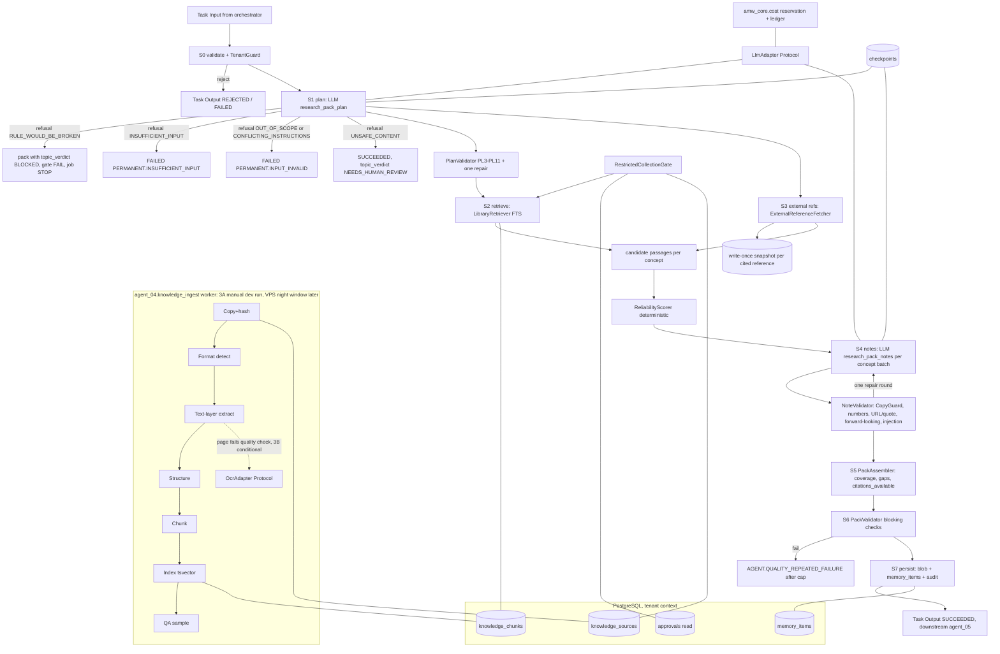

# Agent 04 — Research & Knowledge (blueprint)

| Field | Value |
|---|---|
| Status | Draft — documentation. Software: **Planned** (rule 6, rule 7) |
| Owner | Agent 04 Research & Knowledge; integration owner: Agent 01 (orchestrator) |
| Package | `agent_04_research_knowledge` (27 §7.2); prompts `prompts/agent_04_research_knowledge/`; evals `evals/agent_04_research_knowledge/` |
| Directive sections covered | §3.1 row 04 (source discovery, reliability scoring, evidence store, citation tracking), §1B.2a (Trading Knowledge Library, owned by 04), §3.3 Memory, §3.3 (contracts, failures, quality, observability, AI providers), §3.5 (prompt, eval, code standards), §4 (26 sections) |
| Owner decisions applied | D1 (3A production line; topic owner-given; no upload, no OAuth; spend limits; secrets; no render in market hours), D2 (full blueprint for 3A agents; REQUIRES REVIEW does not block 3A unless it changes a 3A design decision) |
| Binding contracts | GLOSSARY_AND_IDS.md, 03_COMMUNICATION_STANDARD.md (§3.4 `amw.owner_topic`, §5.3 success rule, §8 areas, §9.2 scopes), 04_DATABASE_ARCHITECTURE.md §5.10–5.11 and §5.16 (release rule), 07_FAILURE_MANAGEMENT.md, 24_PRODUCTION_TYPES.md §3.2, §3.3 rules 6–7, §7.1a (`agent_04.research_pack`, `agent_04.knowledge_ingest`), 27_ENGINEERING_STANDARDS.md, CONTRACT_CHANGE_REQUESTS.md §4–§5 (pass 1; every name in this blueprint is the decided name) |
| Shared docs referenced by name/§ only | 18_PRODUCTION_QUALITY_STANDARD.md §9, 13_COMPLIANCE_YOUTUBE_POLICY.md §5.11 and §8, 09_COST_AND_BUDGET.md, 08_SECURITY.md §3, §8, 3A_SLICE_SPEC.md, ADR-001, ADR-005, ADR-007, ADR-012 §3.3, ADR-013, KNOWLEDGE_LIBRARY_PLAN.md |
| Facts cited | RESEARCH_LOG IN-08 (copyright posture), IN-02/IN-03 (price-data lag; direction ban), PR-01/PR-02/PR-03 (LLM models, batch and caching, API vs subscription), INF-03/INF-04 (resource caps), INF-11 (RLS) |
| Marking | Every section ends its first line with **MVP** (3A / 3B / 3C, GLOSSARY §6.47 tier 0–3). 3A, 3B, 3C are the owner's build stages of D1 |
| Conventions | Contract names are the ones decided in `CONTRACT_CHANGE_REQUESTS.md` (CCR numbers are quoted where a rule depends on them); no "pending" contract name remains. `REQUIRES REVIEW (Phase 1): <need>` = unknown value; none is invented. No book text, private method or server detail appears in this document. |

---

## 1 Identity and mission
**MVP: 3A (core) · Tier 0.** Later tiers are marked in the rows.

### 1.1 Mission
Agent 04 turns an owner-given topic into a **research pack**: the concepts the video must explain, the evidence for each concept written as short notes in original words, and a citation for every note, drawn from (a) the tenant's private, channel-isolated knowledge library (§1B.2a), (b) references the owner supplies, and (c) allow-listed official references. It also **owns the knowledge library** itself: ingestion, chunking, indexing, per-collection access and retrieval. It flags a concept with no source; it never invents one (§1B.2a).

### 1.2 Where it sits
Stage `s04_research` (24 §3.1 example: `agent_04.research_pack`, `AI_IO`, depends on the topic stage). In 3A (`CHANNEL_LONG_FORM` v2, 24 §7.1a) the stage has no upstream stage: it depends on the job input, the owner's topic recorded as `amw.owner_topic` (03 §3.4, CCR-006; D1: Agents 02/03 come later), and the orchestrator builds the task input from that record. The stage is a blocking gate: a `topic_verdict = BLOCKED` pack stops the job (`on_fail STOP`, outcome `BLOCKED_COMPLIANCE`, CCR-003). `s06_verify` has `s04_research` as an alternative revision target (new iteration with `revision.gaps`, 24 §3.3 rule 7). `SHORTS` v2 (24 §7.2a) has **no** research stage: the child job reads the parent's pack through a `PRIOR_OUTPUT` ref. Downstream: Agent 05 (script), Agent 06 (claim extraction and verification, reads reference snapshots), Agent 16/S2 (uniqueness and compliance gates), Agent 03 (topic tree, 3C).

### 1.3 Authority boundaries
| Agent 04 **decides** | Agent 04 **does not decide** (owner of the decision) |
|---|---|
| which concepts to research for the topic (inside the topic's scope) | the topic, the angle, the series slot (owner in 3A; Agent 03 later) |
| which library chunks and reference passages are candidates for a concept | what the script says, in what order, or in what words (Agent 05) |
| the reliability tier of each source (deterministic table) | whether a claim is true or contradicted (Agent 06: independent verification, contradiction detection) |
| whether a note is usable for the script (forward-looking and copy-guard exclusions) | publication, compliance verdicts, near-copy and uniqueness decisions (Agent 16, S2; Agent 16 has final authority, plan Q5) |
| whether a restricted chunk may be *retrieved* (release check, deterministic) | whether "our method" material **may be released** (the owner, approval kind `KNOWLEDGE_RELEASE`, S7) |
| which sources become library rows (after the owner registered them) | licence/ownership of a source (owner declaration, Q25; `UNKNOWN` blocks ingestion) |
| coverage status and gaps of its own pack | job routing, retries, revision loops (orchestrator; 07 §9) |
It never creates tasks (only the orchestrator does), never approves anything, never changes budgets, never writes outside its tables, never calls the YouTube API (zero quota units), never uploads (D1) and has no tool-use for the model: the LLM can only return JSON that code validates.

### 1.4 Success criteria (measurable; targets are config and set in 3B)
| ID | Criterion | Measure |
|---|---|---|
| SC-1 | Every note usable by the script carries a resolvable citation | 100 % (deterministic; blocks the task) |
| SC-2 | No cross-tenant or cross-channel read | 0 occurrences in the tenancy suite and in production logs |
| SC-3 | No restricted "our method" chunk in a pack without an `APPROVED` release and a method topic | 0 occurrences |
| SC-4 | No note carries a forward-looking statement, a recommendation, a return claim or a promotion as usable content | 0 occurrences |
| SC-5 | No note reproduces source wording above the copy-guard thresholds | 0 notes pass the guard above threshold |
| SC-6 | Concepts without a source are flagged (`UNSOURCED`), not filled | 100 % flagged; 0 invented sources |
| SC-7 | Pack quality on the golden-sample topics: share of concepts `SOURCED`, retrieval relevance | measured in 3B; thresholds **REQUIRES REVIEW (Phase 1): owner sets after the first measurement (ADR-013 §2.5)** |
| SC-8 | Cost per pack stays within `resource_budget` | 0 breaches; breach ⇒ suspend (09, D1) |
| SC-9 | Replays create no duplicate pack | 1 pack per (job, iteration) |

---

## 2 Functional requirements
**MVP: FR-1…FR-12 are 3A except where marked. Tier 0 unless marked.**

### 2.1 Task types
| Task type | Status | Purpose | Trigger | MVP |
|---|---|---|---|---|
| `agent_04.research_pack` | canonical (24 §3.2) | research pack for one job iteration | orchestrator creates it when `s04_research` becomes ready | 3A |
| `agent_04.knowledge_ingest` | canonical (24 §3.2, CCR-014; ADR-013 §2.1): system job `NO_DELIVERABLE`, resource class `HEAVY_CPU`, capability `doc_extract` | ingest one registered source: extract, structure, chunk, index, QA | owner action after source registration; in 3A a **manual run in the development environment**; on the VPS only in the night window and never in market hours (ADR-012 §3.3, CCR-056) | 3A (text layer only), 3B (QA sampling; OCR if K4 requires; VPS night window), 3C (client libraries) |
Agent 04 files no other task type. Capability use: `llm` (research pack); `web_fetch` (owner and allow-listed references, CCR-015); `doc_extract` (ingest, CCR-014). The OCR capability is deferred and not part of 3A.

### 2.2 Requirements
| ID | Requirement | Why | When / trigger | Inputs | Outputs | Dependants | MVP |
|---|---|---|---|---|---|---|---|
| FR-1 | Validate the task input, the tenant context and every reference before any work (03 §7) | rule 9; 07 `PERMANENT.*` | start of the task | Task Input | structured rejection or go | all | 3A |
| FR-2 | Plan the research: topic → concepts, evidence needs, queries; refuse topics that are themselves forbidden calls (FIN-R1…R8 by rule pack) | no research spent on forbidden topics; answer-key cases (§1B.2) | after FR-1 | topic, rule packs, collection list | `ResearchPlan` or refusal | FR-4, 05 | 3A |
| FR-3 | Honour revision gaps: close or explain each gap. The gaps come from an Agent 06 `PROVIDE_EVIDENCE` request whose `remedy_stage_id` is `s04_research`; the orchestrator builds `revision.gaps` (24 §3.3 rules 1, 6, 7, CCR-002/009) | revision loops (24 §3.3) | `revision` present (a new iteration of `s04_research`) | gaps, prior pack as `PRIOR_OUTPUT` ref | concepts targeting gaps | 06, 16 | 3A |
| FR-4 | Retrieve candidate chunks from the tenant's library per concept: PostgreSQL full-text search filtered by `org_id`, `channel_id`, collection, source status, ownership and the restricted-collection gate (ADR-013 §2.4) | channel-isolated library (§1B.2a) | per concept | plan queries | ranked candidates with citation metadata | FR-7 | 3A |
| FR-5 | Take owner-supplied and allow-listed official references as additional sources (fetch, hash, extract text) | library may be empty in 3A (ADR-013 §4); owner gives material | per reference | `owner_references` | passages + source records | FR-7 | 3A |
| FR-6 | Score reliability per source: deterministic tier from source kind, ownership and domain class | §3.1 row 04 "reliability scoring" | per source | source metadata | tier + score | FR-8, 05, 06 | 3A |
| FR-7 | Write evidence notes in original words with citations (LLM step), then run the deterministic guards: copy guard, number match, URL/quote, forward-looking exclusion, injection handling | concepts not expression (§1B.2a, IN-08, 13 §8); FIN-R3/R13 | per concept batch | passages | validated notes | FR-8 | 3A |
| FR-8 | Assemble the pack: coverage per concept, gaps, `citations_available` (shape accepted by `agent_06.claim_extraction.input`), further-reading credits, method flags | citation tracking; "flag, not invent" | after FR-7 | notes, sources | pack JSON | 05, 06, 16/S2 | 3A |
| FR-9 | Persist the pack write-once and record the memory pointer; write audit entries of knowledge access (ids only) | evidence store; §3.3 Memory | end of task | pack | blob, `memory_items` row, audit rows | 05, 06, later iterations | 3A |
| FR-10 | Ingest a source: copy and hash, detect format, extract text (text layer first), detect structure, chunk by section, index, QA sample (ADR-013) | §1B.2a, plan §2 | `agent_04.knowledge_ingest` | source row | `knowledge_chunks`, source `INDEXED` | FR-4 | 3A text layer only; OCR 3B conditional; client libraries 3C / Tier 1 |
| FR-11 | Report restricted material that was relevant but not released (`restricted_pending`) and exclude it; the operator asks the owner and records a `KNOWLEDGE_RELEASE` approval on his instruction (D5, CCR-012; no in-graph release stage in 3A) | Q26, FIN-R12 | method topic with unreleased chunks | gate result | pack field | operator (D5), 01 | 3A |
| FR-12 | Measure retrieval quality inputs (passage relevance assessments, "concept not found although present" signals) | ADR-013 §2.5 decision rule for embeddings | every pack | assessments | metrics | 3B analysis | 3A records; 3B analyses |
| FR-13 | Reuse a prior pack for a revision iteration (`prior_pack_ref`) instead of re-researching unchanged concepts. A Shorts child job needs no Agent 04 task: `SHORTS` v2 has no research stage and reads the parent's pack (24 §7.2a) | §1A.8 (Shorts cut from the same research), cost | input carries `prior_pack_ref` | prior pack | merged pack | 05 | 3C (revision reuse in 3A only for gaps) |
| FR-14 | Topic-tree support: concept → sub-concept → mistakes → psychology map for Agent 03 | §1B.2a content plan | Agent 03 task (not defined) | library | — | 03 | 3C; **REQUIRES REVIEW (Phase 1): no task type exists for it (24 §3.2); not designed here** |

### 2.3 Out of scope (explicit)
Web-wide search and discovery (no search provider has a research-log entry; 3C, §12); embeddings (ADR-013 §2.5, only if measured); topic selection; script writing; fact verification; image or figure extraction (never stored, plan §1.3); OCR before K4 is answered; any YouTube call.

---

## 3 Non-functional requirements
**MVP: 3A unless marked. Values are config or REQUIRES REVIEW; none is invented. ESTIMATE = design value, replaced by MEASURED in 3B.**

| ID | Category | Requirement | Verification | MVP |
|---|---|---|---|---|
| NFR-1 | Isolation | Every read and write is scoped by `org_id` and `channel_id` (and collection for retrieval); RLS is the second line | tenancy suite (08 §8.2), DC TN-01…TN-11 | 3A |
| NFR-2 | Determinism | All decisions in §6.1 are pure, unit-tested functions; the LLM only proposes concepts and notes | unit tests; golden `deterministic_core` | 3A |
| NFR-3 | Idempotency | One pack per (job, iteration); a replay returns the stored result; LLM calls keyed by `llm.call` (03 §9.2) | replay test | 3A |
| NFR-4 | Bounded work | LLM calls ≤ `resource_budget.max_llm_calls`; concepts, queries, passages per call, repair rounds are config caps; one repair per failing note (07 §9) | cap tests | 3A |
| NFR-5 | Cost | Every LLM call has a reservation and a ledger row; a breach suspends (`AWAITING_BUDGET`); no automatic increase (rule 8, D1, ADR-007 §8) | breach test | 3A |
| NFR-6 | Confidentiality | Chunk text, passage text and notes never appear in logs, metrics, error messages, audit rows or eval outputs; chunk text reaches only the tenant's own LLM calls | log-leak test (DC TN-09) | 3A |
| NFR-7 | Latency | Pack end-to-end and retrieval latency: **MEASURED in 3B**; no target before. Retrieval must not block the queue's other tasks (own transaction, statement timeout config) | performance test | 3B |
| NFR-8 | Capacity | Library size supported on the shared VPS within the factory caps (INF-03, INF-04): **REQUIRES REVIEW (Phase 1): measured after K1 gives the collection size** | measured in 3B | 3B |
| NFR-9 | Availability | Stateless between steps; all state in DB/storage; restart resumes from the latest checkpoint (07 §10). No availability promise beyond the shared VPS (§1 item 11 of §1C) | failure-injection | 3A |
| NFR-10 | Languages | English, Marathi, Hindi, mixed; Devanagari text-search configuration **REQUIRES REVIEW (Phase 1)** (ADR-013 §2.4: `simple` fallback until verified); token cost per language measured (ADR-007 §2.9) | retrieval test set in 3B | 3A (fallback), 3B (measure) |
| NFR-11 | Auditability | Every restricted-gate decision, release lookup, cross-tenant rejection and library read count is audited (ids only) | audit test | 3A |
| NFR-12 | Time | UTC `timestamptz` only; no calendar dates or clock times in prompts or rules (owner rule C.4); the night-window and market-hours guards are operational config of the `HEAVY_CPU` ingestion task only (ADR-012 §3.3, CCR-056); in 3A ingestion is a manual development-environment run | lint | 3A |
| NFR-13 | Money | Integers (`_micros`) only | type check | 3A |
| NFR-14 | Maintainability | One package, typed `Protocol`, DI, ruff/mypy strict (27 §7) | CI | 3A |

---

## 4 Internal architecture
**MVP: 3A for all boxes drawn solid; dashed = 3B/3C. Tier 0.**


Control flow is code; the LLM has no tools and no ability to call anything. `S1` and `S4` are the only model calls. Everything else is deterministic (§6). Refusal mappings follow 27 §4.3 and are listed in §18.

---
## 5 Full system prompt
**MVP: 3A (both prompts v1, status Draft until the 3B eval gate passes) · Tier 0.**

The system prompts are real files written to `prompts/_TEMPLATE.v1.md`; per plan Q9 the files are the single source and this section links them (27 §4, prompts/README §1). Agent 04 has two LLM steps inside its one task type; their step schemas are `agent_04.research_pack.plan.input/.output` and `agent_04.research_pack.notes.input/.output` (§7.1, CCR-018) and their config keys are `llm.agent_04.research_pack.plan.*` and `llm.agent_04.research_pack.notes.*` (27 §4.2, CCR-019).

| Step | Prompt ID | File | What it does (summary) | Model tier start (ADR-007 §2.4) | Rule packs by reference |
|---|---|---|---|---|---|
| `plan` | `agent_04/research_pack_plan.v1` | [prompts/agent_04_research_knowledge/research_pack_plan.v1.md](../prompts/agent_04_research_knowledge/research_pack_plan.v1.md) | topic → ≤ `max_concepts` concepts with kinds, evidence needs, queries per language, gap closure; refuses topics that are forbidden calls (FIN-R1…R8) or conflicting | `MID` (try `SMALL` in 3B, gate decides) | `rp.youtube_general`, `rp.finance_sebi_in` (rendered only when the key is in `active_rule_packs`; `rp.youtube_general` always) |
| `notes` | `agent_04/research_pack_notes.v1` | [prompts/agent_04_research_knowledge/research_pack_notes.v1.md](../prompts/agent_04_research_knowledge/research_pack_notes.v1.md) | per concept: passage relevance, original-wording notes with passage IDs, exclusion of forecasts/recommendations/return claims/promotions, injection handling | `MID` | same |

Key properties both prompts enforce (full text in the files):
- Passage and topic text are **data**; instructions inside them are never followed (08 §5.3). The model has no tools.
- Notes are single statements, ≤ `max_note_chars`, own wording, no quotation marks, no run of `max_verbatim_words` or more copied words, numbers only as written in the passage (13 §8, IN-08).
- Forward-looking, recommendation, performance and promotion statements are **reported**, never turned into notes (FIN-R1…R3, R6, R8, R13).
- The model never sets reliability, release status, method label or usability: code does (§6).
- Refusal object per 27 §4.3 with the mapping stated in each file and in §18. Model tier, temperature, tokens, timeout, budget, caching, batch flag and the optional fallback tier are config keys `llm.agent_04.research_pack.plan.*` and `llm.agent_04.research_pack.notes.*` (suffixes `.model_tier`, `.temperature`, `.max_output_tokens`, `.timeout_ms`, `.cost_budget_micros`, `.cache_system_prompt`, `.batch_eligible`, `.fallback_tier`), never in the files. Tiers are `SMALL`, `MID`, `TOP` (CCR-019).
- Prompt lint (27 §4.4) and the eval gate (27 §5) apply to every change. Rendering: the cached prefix is the system text plus PLATFORM rule packs only (`rp.youtube_general`, `rp.finance_sebi_in` are PLATFORM packs, GLOSSARY §6.37); topic, collection names, passages and any TENANT-scoped pack come after the cache breakpoint (27 §4.2, CCR-025; 08 §8 layer 4). A pack whose key is not in `active_rule_packs` is omitted, and its `{{rule_pack:…}}` line renders as nothing.

Not an LLM step, therefore no prompt: reliability scoring, retrieval, restricted gate, copy guard, coverage, ingestion (extraction, chunking, indexing). An optional LLM use inside ingestion, resolving unclear headings (plan step 5), is **not** built in 3A (deterministic first; REQUIRES REVIEW (3B): add only if the QA sample shows unresolved headings; it would get its own prompt file and eval set).

---

## 6 Decision engine
**MVP: 3A · Tier 0. Principle (§3.3 Quality): deterministic checks first; an LLM score is never the only gate.**

### 6.1 Decision table
| # | Decision | Kind | How | Why |
|---|---|---|---|---|
| D-1 | Input and tenant validity, ID prefixes, org/channel agreement | deterministic | schema + `TenantGuard` | rule 9; fail fast with `PERMANENT.*` |
| D-2 | Concept list, evidence needs, queries | **LLM** (`plan`) | model proposes; code validates PL3–PL11 | needs language understanding and topic decomposition; bounded by caps; refusal is mapped by code |
| D-3 | Is the topic itself a forbidden call | **LLM** proposes refusal; Agent 16 keeps final authority | prompt with injected finance pack | early block saves spend; any false negative is caught later by 06/16 |
| D-4 | Which collections may be searched | deterministic | channel's collections ∩ request scope; restricted only through the gate (D-6) | isolation (Q26) |
| D-5 | Which chunks are candidates | deterministic | FTS (`search_tsv`, per-language config) + filters + diversity cap | ADR-013 §2.4: simplest option; reproducible |
| D-6 | May a restricted chunk be used | deterministic | gate: collection restricted ⇒ `video_kind = METHOD_TOPIC` AND release approval `APPROVED`, kind `KNOWLEDGE_RELEASE`, same org, covering the chunk (§6.4) | FIN-R12, Q26 |
| D-7 | Reliability tier and score | deterministic | table §6.3 | no model judgement of reliability; auditable |
| D-8 | Passage relevance, note wording | **LLM** (`notes`) | schema-bound output | language understanding; own-words rewriting cannot be done by rules |
| D-9 | Is a note acceptable | deterministic | `NoteValidator`: schema, passage exists, copy guard, numbers, URL/quote, clarity, forward-looking flag | the model's output is never trusted; copyright (IN-08) and FIN-R13 |
| D-10 | Is a note usable for the script | deterministic | `usable = notes_valid ∧ ¬forward_looking ∧ time_reference ≠ FUTURE ∧ tier floor met (§6.3)` | safety |
| D-11 | Coverage per concept, gaps | deterministic | §6.5 | measurable; no invented sources |
| D-12 | Budget stop | deterministic | S4 reservation before each call (ADR-007 §8) | rule 8 |
| D-13 | External reference fetch allowed | deterministic | owner-supplied URL or host in the config allow-list; HTTPS; size/time caps | no open-web crawling in 3A |
| D-14 | Ingestion extraction path per page | deterministic | text layer first; OCR only if the quality check fails (ADR-013 §2.2) | text layers are exact |

### 6.2 Why the split
LLMs are used only where the task is language-shaped (decompose a topic, restate an idea in new words). Everything that protects the tenant, the owner's private method, copyright and the SEBI rules is a pure function with a unit test and a golden case (`evals/.../deterministic_core`). A model error can therefore lower pack quality (a concept shows as `UNSOURCED`), but cannot leak a restricted chunk, widen a scope or let a forecast through as usable.

### 6.3 Reliability tiers (deterministic; payload-local values, not Wave A enums)
| Tier | Rule |
|---|---|
| `A_PRIMARY` | library row with `kind = OFFICIAL_DOCUMENT` and `ownership = PUBLIC_OFFICIAL`, or a `WEB_REFERENCE` (library row or external reference) on a host whose config domain class is `OFFICIAL` |
| `B_PUBLISHED` | `kind = BOOK` with `ownership ∈ {OWNED_COPY, LICENSED}`; `COURSE_NOTES`/`OWNER_NOTES` with `OWNER_AUTHORED` (the pack marks `owner_authored = true`: the owner, not a third party, stands behind it); `CLIENT_DOCUMENT` (Tier 1+; the client stands behind it) |
| `C_SECONDARY` | `WEB_REFERENCE` on a host whose config domain class is `REPUTABLE_SECONDARY` |
| `D_UNVERIFIED` | any other `WEB_REFERENCE`, unknown host |
| (ownership of an external reference) | A reference that is **not** a `knowledge_sources` row has no declared ownership and carries `ownership: null` in the pack (CCR-041, provisional; the value `THIRD_PARTY_PUBLIC` needs the owner, CCR-041 / owner question Q-O3). It supports concepts only, never text reuse (IN-08, YTG-R9). Library rows carry their declared ownership. |
| excluded | `ownership = UNKNOWN` (Q25): never retrieved, never noted |
- `knowledge_sources.reliability_score` (numeric(4,3), 04 §5.10) = config map `research.reliability.tier_scores.<tier>`. The map must be strictly decreasing from A to D (loaded and checked; else `PERMANENT.CONFIG_INVALID`). **Values: REQUIRES REVIEW (Phase 1): owner/3B calibration; none invented.**
- Host → domain class: config registry `research.reliability.domain_classes`. **REQUIRES REVIEW (Phase 1): the list of official and reputable hosts is an owner/lawyer decision; the log has no research entry that approves a host.**
- Floor: a note of kind `STATISTIC` or of a factual `DEFINITION`/`MECHANISM` is `usable` only if at least one supporting evidence item for the concept has tier ≤ `research.min_tier_for_factual` (design default `C_SECONDARY`; a `D_UNVERIFIED` item alone leaves the concept `PARTIAL`, gap `ONLY_LOW_RELIABILITY`). **REQUIRES REVIEW (Phase 1): owner confirms the floor in 3B.**
- A tier describes the **source**, not the truth of a note. Verification of the claim is Agent 06's job.

### 6.4 Restricted-collection gate (Q26, FIN-R12)
Inputs: collection `restricted` flag (`knowledge_collections`, CCR-011), the topic's `video_kind` (`METHOD_TOPIC` is the method topic, `amw.owner_topic`, CCR-006), and the release approval of the chunk or of its source (04 §5.10, §5.16, CCR-012). Columns read from `approvals`: `kind`, `state`, `subject_kind`, `subject_id`, `subject_sha256`, `org_id`.
```
allowed(chunk) =
  if not collection.restricted: True
  else: topic.video_kind == METHOD_TOPIC
        and approval exists (same org_id) and approval.kind == KNOWLEDGE_RELEASE
        and approval.state == APPROVED and covers(approval, chunk, topic)
```
`covers` is the release rule of 04 §5.16, implemented as one pure function with two forms:
- **Source-level (the 3A default).** The chunk's source has `release_approval_id = approval.id` (or `approval.subject_kind = knowledge_source` with `subject_id` = the source). The whole source is released; no topic binding.
- **Per topic and chunk.** The chunk carries `release_approval_id = approval.id`, `approval.subject_kind = knowledge_release`, `approval.subject_id` = the chunk's `collection_id`, and `approval.subject_sha256` equals the SHA-256 of the canonical JSON `{"topic_title": <input topic.title>, "collection_key": <key>, "chunk_ids": <sorted `kch_` wire IDs of all chunks of that collection whose `release_approval_id` = approval.id>}`. A changed title or a chunk set that differs from the approved one yields no coverage. The 04 text does not say where the approved chunk list is stored; this blueprint reads it as the chunks that carry the approval's ID (REQUIRES REVIEW: 04 §5.16 owner to confirm; listed in the structured return).
- A restricted chunk is **never** retrieved for a topic that is not a method topic, even if released (FIN-R12 d, no mixing).
- The gate runs in the retrieval SQL (filter) **and** again on the candidate list before any text reaches the model (defence in depth). Blocked-but-relevant restricted hits are counted, not returned: the pack lists `method.restricted_pending` with collection key and concept IDs (no text) so the operator can tell the owner which material is waiting and, on his instruction, record a `KNOWLEDGE_RELEASE` approval (workflow `owner_sensitive`, D5, CCR-012). There is no `a_release` stage and no dynamic stage insertion in 3A (CCR-003, CCR-012); Agent 04 reads approvals at S2 and honours any release that exists when the task starts. How the job continues after a release is recorded later (a new iteration or a new job) is Agent 01's decision; Agent 04 only reports.
- Evidence from a restricted chunk gets `method_labelled = true`; Agent 05 must label the segment and Agent 16 checks FIN-R12 (13 §5.11).
- The model never sees the release flag or the collection name of a restricted chunk beyond what the plan's `collections` list shows; it cannot grant access.

### 6.5 Coverage and gaps
| Concept coverage | Rule |
|---|---|
| `SOURCED` | ≥ 1 usable note for every `evidence_need` of kind `DEFINITION`, `MECHANISM`, `PRINCIPLE`, `STATISTIC`, and floor met |
| `PARTIAL` | some usable notes, or only low-reliability support |
| `UNSOURCED` | no usable note |
Gap reasons (payload-local, read by Agent 05 and the orchestrator): `NO_SOURCE_FOUND` (also used when the concept's only source was an `UNREACHABLE` reference), `ONLY_RESTRICTED_NOT_RELEASED`, `ONLY_EXCLUDED_FORWARD_LOOKING`, `ONLY_LOW_RELIABILITY`, `COPY_GUARD_REMOVED`, `PRIOR_GAP_NOT_CLOSED`.
Task outcome: ≥ 1 usable note in the pack ⇒ `SUCCEEDED` (`a04.coverage` WARN if any concept is not `SOURCED`); zero usable notes in the whole pack ⇒ `FAILED` `PERMANENT.INSUFFICIENT_INPUT` (07 §2 as widened by CCR-021: a deterministic "no usable input" result; the orchestrator re-plans upstream, the owner supplies material). Never "best effort" success.

### 6.6 Retrieval algorithm (ADR-013 §2.4)
1. For each concept and each query: `websearch_to_tsquery(<config for query.language>, text)` against `knowledge_chunks.search_tsv`; config per language **REQUIRES REVIEW (Phase 1)** (fallback `simple` for Devanagari, stemming configuration for English). The PostgreSQL functions named here (`websearch_to_tsquery`, `ts_rank_cd`, the `simple` configuration, GIN indexing) have no RESEARCH_LOG entry (INF-11 covers row-level security only): **REQUIRES REVIEW (Phase 1): add a RESEARCH_LOG entry before the first retrieval test.**
2. Filters (all in one SQL, parameterised): `org_id = :org` AND `channel_id = :channel` AND `collection_id ∈ :allowed` (restricted rule above) AND `ingest_version = knowledge_sources.ingest_version` (current version only, CCR-013) AND source `status = INDEXED` AND `ownership ≠ UNKNOWN` AND source not `RETIRED`.
3. Rank by `ts_rank_cd`; union over queries; dedupe by chunk; cap per source per concept (`research.retrieval.max_chunks_per_source_per_concept`) so one book cannot dominate (originality, 13 §8 structure check); keep top `research.retrieval.top_k_per_concept`.
4. Order for the model and for the pack is by relevance, never by page or chapter (no reproduction of a book's sequence, §1B.2a).
5. Owner-supplied references join as candidates with their own tier.
6. Retrieval is read-only and idempotent; every call writes one audit row (ids and counts, never text).

---

## 7 Input schema
**MVP: 3A · Tier 0 (single channel, single language). Tier 1+: `client_library` scope from the same fields.**

Envelope: Task Input `amw.task_input` 1.0.0 (03 §3.3) with `agent_id = agent_04`, `payload.payload_schema = "agent_04.research_pack.input"`, `payload_schema_version = "1.0.0"`. Fields Agent 04 relies on: `org_id`, `job_id`, `task_id`, `project_id`, `channel_id` (**required, not null** for this task; null ⇒ `PERMANENT.INPUT_INVALID`), `source_agent` (`agent_01`), `priority`, `deadline`, `context_refs` (purposes `COMPLIANCE_PROFILE`, `RULE_PACK`, `PRIOR_OUTPUT`, `KNOWLEDGE`), `resource_budget`, `correlation_id`, `idempotency_key` (scope `task.agent_04.research_pack`: `job_id`, `stage_id`, task type, `iteration`; CCR-005), `retry_count`, `schema_version`. The orchestrator builds the payload from the job's `amw.owner_topic` record (03 §3.4, CCR-006) in its input builder for this task type (SOURCE_LAYOUT, CCR-047); the owner-topic fields keep their names and are copied unchanged.

`payload.data` (`agent_04.research_pack.input` 1.0.0; Pydantic `ResearchPackInput`):
```json
{
  "$schema": "https://json-schema.org/draft/2020-12/schema",
  "$id": "urn:amw:schema:agent_04.research_pack.input:1.0.0",
  "title": "Agent 04 research pack input",
  "type": "object",
  "additionalProperties": false,
  "required": ["topic", "channel_category", "active_rule_packs", "library_scope", "owner_references", "revision"],
  "properties": {
    "topic": {
      "type": "object", "additionalProperties": false,
      "required": ["title", "brief", "angle", "language", "video_kind", "course_chapter_pointer"],
      "description": "fields copied unchanged from amw.owner_topic 1.0.0",
      "properties": {
        "title": { "type": "string", "minLength": 3, "maxLength": 400 },
        "brief": { "type": ["string", "null"], "maxLength": 2000 },
        "angle": { "type": ["string", "null"], "maxLength": 500 },
        "language": { "type": "string", "pattern": "^[a-z]{2,3}(-[A-Za-z0-9]{2,8})*$" },
        "video_kind": { "enum": ["GENERAL", "METHOD_TOPIC"] },
        "course_chapter_pointer": { "oneOf": [ { "type": "null" },
          { "type": "object", "additionalProperties": false, "required": ["label"],
            "properties": { "label": { "type": "string", "minLength": 1, "maxLength": 200 } } } ] }
      }
    },
    "channel_category": { "type": "string", "pattern": "^[a-z_]{3,32}$" },
    "active_rule_packs": { "type": "array", "minItems": 1, "items": { "type": "string", "pattern": "^rp\\.[a-z0-9_]+$" }, "contains": { "const": "rp.youtube_general" } },
    "library_scope": {
      "type": "object", "additionalProperties": false, "required": ["collection_keys"],
      "properties": { "collection_keys": { "oneOf": [ { "type": "null" }, { "type": "array", "items": { "type": "string", "pattern": "^[a-z0-9_]{2,48}$" }, "maxItems": 32 } ] } }
    },
    "owner_references": {
      "type": "array", "maxItems": 20,
      "description": "items exactly as amw.owner_topic owner_references; Agent 04 numbers them r1, r2, ... in list order (the ref_id of fetch.reference)",
      "items": {
        "type": "object", "additionalProperties": false, "required": ["kind", "url", "knowledge_source_id", "note"],
        "properties": {
          "kind": { "enum": ["EXTERNAL_URL", "KNOWLEDGE_SOURCE"] },
          "url": { "oneOf": [ { "type": "string", "maxLength": 2048, "pattern": "^https://" }, { "type": "null" } ] },
          "knowledge_source_id": { "oneOf": [ { "type": "string", "pattern": "^ksr_[0-9a-f]{8}-[0-9a-f]{4}-7[0-9a-f]{3}-[89ab][0-9a-f]{3}-[0-9a-f]{12}$" }, { "type": "null" } ] },
          "note": { "oneOf": [ { "type": "string", "maxLength": 500 }, { "type": "null" } ] }
        },
        "allOf": [
          { "if": { "properties": { "kind": { "const": "EXTERNAL_URL" } } },
            "then": { "properties": { "url": { "type": "string" }, "knowledge_source_id": { "type": "null" } } } },
          { "if": { "properties": { "kind": { "const": "KNOWLEDGE_SOURCE" } } },
            "then": { "properties": { "url": { "type": "null" }, "knowledge_source_id": { "type": "string" } } } }
        ]
      }
    },
    "revision": {
      "oneOf": [
        { "type": "null" },
        { "type": "object", "additionalProperties": false, "required": ["iteration", "gaps", "prior_pack_ref"],
          "properties": {
            "iteration": { "type": "integer", "minimum": 1, "maximum": 10 },
            "gaps": { "type": "array", "maxItems": 50,
              "items": { "type": "object", "additionalProperties": false, "required": ["gap_id", "gap_text", "reason"],
                "properties": { "gap_id": { "type": "string", "pattern": "^g[0-9]{1,3}$" }, "gap_text": { "type": "string", "maxLength": 500 },
                                "reason": { "enum": ["UNSOURCED", "CONTRADICTED", "UNVERIFIABLE", "NEEDS_SUBSTANTIATION"] } } } },
            "prior_pack_ref": { "$ref": "urn:amw:schema:amw.common:1.0.0#/$defs/storage_uri" } } }
      ]
    }
  }
}
```
Validation (S0, in this order, 03 §7.1): (1) envelope and payload schema (the schema's `if/then` already rejects an `EXTERNAL_URL` reference without a URL and a `KNOWLEDGE_SOURCE` reference without an ID); (2) ID prefixes (`PERMANENT.INPUT_INVALID`); (3) `org_id` identical in envelope, input and every `context_refs[].uri` and `prior_pack_ref` (`PERMANENT.TENANT_MISMATCH` / `PERMANENT.CROSS_TENANT_REF`); (4) `channel_id` belongs to `org_id` and its compliance profile is readable (`PERMANENT.MISSING_DEPENDENCY`); (5) `video_kind = METHOD_TOPIC` only if the channel has a restricted collection (else `PERMANENT.INPUT_INVALID`); (6) every `collection_keys` entry exists for this channel (else `PERMANENT.INPUT_INVALID`); (7) `KNOWLEDGE_SOURCE` references belong to this org and channel; `EXTERNAL_URL` must be HTTPS and pass the fetch policy (§12); (8) tenant active (`PERMANENT.TENANT_INACTIVE`).

Revision gaps. The gap `reason` values (`UNSOURCED`, `CONTRADICTED`, `UNVERIFIABLE`, `NEEDS_SUBSTANTIATION`) are **payload-local** to this schema; `UNSOURCED` is not a `claim_status` value (GLOSSARY §6.40), so the values are not described as a subset of it. The orchestrator builds `revision.gaps` from the failing `agent_06.claim_verification` results of kind `PROVIDE_EVIDENCE` with `remedy_stage_id = s04_research` (24 §3.3 rules 1, 7). The mapping from Agent 06's `verification_reason_code` values (`NO_EVIDENCE_CANDIDATES`, `NOT_FOUND_IN_EVIDENCE`, `LOW_RELIABILITY_ONLY`, `CONTRADICTED_BY_EVIDENCE`, …, GLOSSARY §6.52) to these four reasons belongs to the orchestrator's input builder: **REQUIRES REVIEW (Phase 1): Agent 01 blueprint defines the mapping; no mapping is invented here.**

### 7.1 Step and ingestion schemas (registered by being defined here, GLOSSARY §2.4, CCR-018)
| Schema | Version | Defined in | Built by |
|---|---|---|---|
| `agent_04.research_pack.plan.input` / `.output` | 1.0.0 | prompt `research_pack_plan.v1.md` (Appendix A and the Output JSON Schema); Pydantic `ResearchPlanInput`, `ResearchPlan` | step code from `agent_04.research_pack.input` and the database, never by another agent |
| `agent_04.research_pack.notes.input` / `.output` | 1.0.0 | prompt `research_pack_notes.v1.md` (Appendix A and the Output JSON Schema); Pydantic `EvidenceNotesInput`, `EvidenceNotes` | step code (passages are loaded after the gate) |
| `agent_04.knowledge_ingest.input` / `.output` | 1.0.0 | this section | orchestrator (owner action, in 3A a manual development run) |

```json
{
  "$schema": "https://json-schema.org/draft/2020-12/schema",
  "$id": "urn:amw:schema:agent_04.knowledge_ingest.input:1.0.0",
  "title": "Agent 04 knowledge ingest input",
  "type": "object", "additionalProperties": false,
  "required": ["source_id", "ingest_version", "force_reextract"],
  "properties": {
    "source_id": { "type": "string", "pattern": "^ksr_[0-9a-f]{8}-[0-9a-f]{4}-7[0-9a-f]{3}-[89ab][0-9a-f]{3}-[0-9a-f]{12}$" },
    "ingest_version": { "type": "integer", "minimum": 1 },
    "force_reextract": { "type": "boolean" }
  }
}
```
```json
{
  "$schema": "https://json-schema.org/draft/2020-12/schema",
  "$id": "urn:amw:schema:agent_04.knowledge_ingest.output:1.0.0",
  "title": "Agent 04 knowledge ingest output",
  "type": "object", "additionalProperties": false,
  "required": ["source_id", "ingest_version", "source_status", "chunks_written", "pages_total", "pages_needs_ocr", "qa_sample_size", "unresolved_headings"],
  "properties": {
    "source_id": { "type": "string", "pattern": "^ksr_[0-9a-f]{8}-[0-9a-f]{4}-7[0-9a-f]{3}-[89ab][0-9a-f]{3}-[0-9a-f]{12}$" },
    "ingest_version": { "type": "integer", "minimum": 1 },
    "source_status": { "enum": ["INGESTING", "INDEXED", "FAILED"] },
    "chunks_written": { "type": "integer", "minimum": 0 },
    "pages_total": { "type": "integer", "minimum": 0 },
    "pages_needs_ocr": { "type": "integer", "minimum": 0 },
    "qa_sample_size": { "type": "integer", "minimum": 0 },
    "unresolved_headings": { "type": "integer", "minimum": 0 }
  }
}
```
The envelope `channel_id` is required for ingestion; the payload is small and text never travels in it. `source_status` values are those of `knowledge_source_status` (GLOSSARY §6.45).

---

## 8 Output schema
**MVP: 3A · Tier 0. Same schema for later tiers.**

Envelope: Task Output `amw.task_output` 1.0.0 (03 §5.2), mapped as follows. `payload` = `agent_04.research_pack.output` 1.0.0 (inline if ≤ `contracts.inline_payload_max_bytes`, else `data_ref` + `data_sha256`); `output_refs` = the pack blob (`kind: DATA`, `application/json`, task document area `jobs/<job>/tasks/<task>/attempts/<att>/artifacts/research_pack.json`, 03 §8, CCR-017) and one write-once reference snapshot per cited external reference (`kind: DATA`, `evidence/<job>/<ext_ref>.json`, CCR-016); `quality_score = null` (RESEARCH_ACCURACY is scored by Agent 16, 18 §9.2); `confidence = null` (no calibrated confidence exists); `downstream_agent = agent_05`; `next_action = {type: CONTINUE, wait_reason: null, escalation_level: null, reason}` (03 §5.2; advisory only, the orchestrator routes). Where the topic is `BLOCKED`, `reason = "gate FAILED: a04.topic_allowed"`.

Gate semantics (03 §5.3 rules 3 and 4, CCR-001). `s04_research` is registered as a blocking gate whose `on_fail` is `STOP` (24 §7.1a). Its only gate result is `a04.topic_allowed`: `gate: true, blocking: true`, verdict `FAIL` iff `topic_verdict.verdict = BLOCKED`, with `rule_id` the first violated rule. The task is `SUCCEEDED` (a compliance `BLOCKED` is not a failure, rule 3); the orchestrator ends the job `BLOCKED_COMPLIANCE`. All other results below are process-integrity or advisory results (`gate: false` or absent): a blocking FAIL among them fails the task under rule 2(b) (`AGENT.INCOMPLETE_OUTPUT`, then the repair or `AGENT.QUALITY_REPEATED_FAILURE` path of §18). A `NEEDS_HUMAN_REVIEW` topic (refusal `UNSAFE_CONTENT`) is `SUCCEEDED` with the verdict in the payload and a `WARN` result; the orchestrator inserts the human step (24 §3.3, 13 §2.3).

`validation_results` (check IDs `a04.*` are owned by this blueprint, GLOSSARY §2.4 / 18 §13, CCR-020; each is listed again in §20.3 with its default `blocking` flag; pattern `^[a-z0-9_.-]{3,96}$`):
| check_id | kind | gate | blocking | Pass condition |
|---|---|---|---|---|
| `a04.schema` | DETERMINISTIC | no | yes | payload validates |
| `a04.tenant_scope` | DETERMINISTIC | no | yes | every id/URI in the pack belongs to the task's org and channel |
| `a04.citation_resolvable` | DETERMINISTIC | no | yes | every `usable_for_script` evidence item has a `citation_ref` that resolves to an existing chunk (right org/channel, hash equal) or to a recorded external reference whose snapshot exists (hash equal) |
| `a04.restricted_gate` | DETERMINISTIC | no | yes | no restricted-collection evidence unless the gate passed (`rule_id: FIN-R12`) |
| `a04.copy_guard` | DETERMINISTIC | no | yes | no usable note above thresholds (`rule_id: YTG-R9`, GLOSSARY §6.38a) |
| `a04.forward_looking_excluded` | DETERMINISTIC | no | yes | no usable note with `FUTURE` or `forward_looking` (`rule_id: FIN-R13`) |
| `a04.topic_allowed` | DETERMINISTIC (maps the plan step's refusal) | **yes** | yes (FAIL) / no (WARN, PASS) | `topic_verdict.verdict` is `ALLOWED` (PASS); `BLOCKED` is FAIL with the violated `rule_id`; `NEEDS_HUMAN_REVIEW` is WARN, `blocking: false` |
| `a04.coverage` | DETERMINISTIC | no | no (WARN) | share of `SOURCED` concepts; WARN if any concept not `SOURCED` |
| `a04.reliability_floor` | DETERMINISTIC | no | no (WARN) | factual notes meet the floor |
| `a04.prior_gaps_closed` | DETERMINISTIC | no | no (WARN); `SKIPPED` (`blocking: false`) when `revision` is null | each input gap closed or explained |
| `a04.notes_refused` | DETERMINISTIC | no | no (WARN) | one result per refused notes batch (§18 declared item-level mapping); absent when no batch was refused |
| `a04.copy_guard_cross_language` | DETERMINISTIC | no | no (WARN) | number and share of usable notes whose copy guard was skipped as `CROSS_LANGUAGE` (§10.6); WARN when any |

`payload.data` (`agent_04.research_pack.output` 1.0.0; Pydantic `ResearchPack`). The pack contains **no** source passage text, only notes in original words and citation metadata:
```json
{
  "$schema": "https://json-schema.org/draft/2020-12/schema",
  "$id": "urn:amw:schema:agent_04.research_pack.output:1.0.0",
  "title": "Agent 04 research pack",
  "type": "object",
  "additionalProperties": false,
  "required": ["pack_version", "iteration", "topic_verdict", "topic", "concepts", "evidence", "citations_available", "sources",
               "gaps", "method", "further_reading", "terminology", "coverage_summary", "provenance"],
  "properties": {
    "pack_version": { "const": 1 },
    "iteration": { "type": "integer", "minimum": 0 },
    "topic_verdict": {
      "type": "object", "additionalProperties": false, "required": ["verdict", "violated_rule_ids"],
      "properties": { "verdict": { "enum": ["ALLOWED", "BLOCKED", "NEEDS_HUMAN_REVIEW"] },
                      "violated_rule_ids": { "type": "array", "items": { "type": "string", "pattern": "^[A-Z]{2,8}-R[0-9]{1,3}$" } } }
    },
    "topic": { "type": "object", "additionalProperties": false, "required": ["title", "language", "video_kind"],
      "properties": { "title": { "type": "string" }, "language": { "type": "string" }, "video_kind": { "enum": ["GENERAL", "METHOD_TOPIC"] } } },
    "concepts": { "type": "array", "maxItems": 40, "items": {
      "type": "object", "additionalProperties": false,
      "required": ["concept_id", "label", "label_en", "kind", "evidence_needs", "time_reference", "coverage", "evidence_ids", "has_example", "closes_gap_ids"],
      "properties": {
        "concept_id": { "type": "string", "pattern": "^c[0-9]{2}$" }, "label": { "type": "string" }, "label_en": { "type": "string" },
        "kind": { "enum": ["CORE_CONCEPT", "SUB_CONCEPT", "COMMON_MISTAKE", "PSYCHOLOGY", "HISTORICAL_CASE", "DEFINITION_TERM", "REGULATORY_CONTEXT"] },
        "evidence_needs": { "type": "array", "items": { "type": "string" } },
        "time_reference": { "enum": ["HISTORICAL", "CURRENT", "TIMELESS"] },
        "coverage": { "enum": ["SOURCED", "PARTIAL", "UNSOURCED"] },
        "evidence_ids": { "type": "array", "items": { "type": "string", "pattern": "^ev_[0-9]{3,4}$" } },
        "has_example": { "type": "boolean" },
        "closes_gap_ids": { "type": "array", "items": { "type": "string" } } } } },
    "evidence": { "type": "array", "maxItems": 600, "items": {
      "type": "object", "additionalProperties": false,
      "required": ["evidence_id", "concept_id", "statement_kind", "note", "time_reference_kind", "instruments", "citation_ref", "source_ref",
                   "reliability_tier", "owner_authored", "method_labelled", "usable_for_script", "exclusion_reason", "copy_guard", "locator"],
      "properties": {
        "evidence_id": { "type": "string", "pattern": "^ev_[0-9]{3,4}$" }, "concept_id": { "type": "string", "pattern": "^c[0-9]{2}$" },
        "statement_kind": { "enum": ["DEFINITION", "MECHANISM", "PRINCIPLE", "EXAMPLE_HISTORICAL", "EXAMPLE_HYPOTHETICAL", "STATISTIC", "COMMON_MISTAKE", "CAVEAT"] },
        "note": { "type": "string", "maxLength": 600 },
        "time_reference_kind": { "enum": ["HISTORICAL", "CURRENT", "FUTURE", "TIMELESS", "UNSPECIFIED"] },
        "instruments": { "type": "array", "items": { "type": "string" } },
        "citation_ref": { "type": "string", "maxLength": 64 },
        "source_ref": { "type": "string", "maxLength": 64, "description": "the `sources[].source_ref` of the cited source: a consumer maps a citation to its tier, title and URL through it" },
        "reliability_tier": { "enum": ["A_PRIMARY", "B_PUBLISHED", "C_SECONDARY", "D_UNVERIFIED"] },
        "owner_authored": { "type": "boolean" }, "method_labelled": { "type": "boolean" }, "usable_for_script": { "type": "boolean" },
        "exclusion_reason": { "enum": [null, "FORWARD_LOOKING", "COPY_GUARD", "LOW_RELIABILITY", "INJECTION_SUSPECTED", "AMBIGUOUS"] },
        "copy_guard": { "enum": ["PASSED", "SKIPPED_CROSS_LANGUAGE"] },
        "locator": { "type": "object", "additionalProperties": false, "required": ["chapter", "page_from", "page_to"],
          "properties": { "chapter": { "type": ["string", "null"] }, "page_from": { "type": ["integer", "null"] }, "page_to": { "type": ["integer", "null"] } } } } } },
    "citations_available": { "type": "array", "description": "same shape as available_citations of agent_06.claim_extraction.input, including content_sha256 (CCR-053)", "items": {
      "type": "object", "additionalProperties": false, "required": ["citation_ref", "kind", "title", "content_sha256"],
      "properties": { "citation_ref": { "type": "string", "maxLength": 64 }, "kind": { "enum": ["KNOWLEDGE_CHUNK", "EXTERNAL_REFERENCE"] }, "title": { "type": "string", "maxLength": 300 },
                      "content_sha256": { "type": "string", "pattern": "^[0-9a-f]{64}$", "description": "chunk body hash, or snapshot content hash of the reference" } } } },
    "sources": { "type": "array", "items": {
      "type": "object", "additionalProperties": false,
      "required": ["source_ref", "kind", "title", "author", "edition", "ownership", "reliability_tier", "reliability_score", "collection_key",
                   "external_url", "accessed_at", "fetch_status", "content_sha256", "snapshot_ref"],
      "properties": {
        "source_ref": { "type": "string", "maxLength": 64, "description": "`ksr_<uuid>` for a library source; the same `ext_…` value as the citation_ref for an external reference" },
        "kind": { "enum": ["BOOK", "COURSE_NOTES", "OWNER_NOTES", "WEB_REFERENCE", "OFFICIAL_DOCUMENT", "CLIENT_DOCUMENT"] },
        "title": { "type": "string" }, "author": { "type": ["string", "null"] }, "edition": { "type": ["string", "null"] },
        "ownership": { "enum": ["OWNED_COPY", "LICENSED", "OWNER_AUTHORED", "PUBLIC_OFFICIAL", null], "description": "null only for an external reference that is not a library row (CCR-041, provisional)" },
        "reliability_tier": { "enum": ["A_PRIMARY", "B_PUBLISHED", "C_SECONDARY", "D_UNVERIFIED"] },
        "reliability_score": { "type": ["number", "null"] }, "collection_key": { "type": ["string", "null"] },
        "external_url": { "type": ["string", "null"] }, "accessed_at": { "type": ["string", "null"], "format": "date-time" },
        "fetch_status": { "enum": ["OK", "UNREACHABLE"], "description": "payload-local; UNREACHABLE = 404/410/403 (§10.4); library rows are always OK" },
        "content_sha256": { "type": ["string", "null"], "pattern": "^[0-9a-f]{64}$", "description": "null only when fetch_status = UNREACHABLE" },
        "snapshot_ref": { "oneOf": [ { "$ref": "urn:amw:schema:amw.common:1.0.0#/$defs/storage_uri" }, { "type": "null" } ], "description": "evidence/<job>/<ext_ref>.json for a fetched external reference (CCR-016); null for library rows and unreachable references" } },
      "allOf": [
        { "if": { "properties": { "source_ref": { "pattern": "^ext_" } }, "required": ["source_ref"] },
          "then": { "properties": { "ownership": { "type": "null" }, "kind": { "const": "WEB_REFERENCE" } } },
          "else": { "properties": { "ownership": { "type": "string" }, "fetch_status": { "const": "OK" }, "snapshot_ref": { "type": "null" }, "content_sha256": { "type": "string" } } } },
        { "if": { "properties": { "fetch_status": { "const": "UNREACHABLE" } }, "required": ["fetch_status"] },
          "then": { "properties": { "content_sha256": { "type": "null" }, "snapshot_ref": { "type": "null" } } },
          "else": { "properties": { "content_sha256": { "type": "string" } } } }
      ] } },
    "gaps": { "type": "array", "items": {
      "type": "object", "additionalProperties": false, "required": ["concept_id", "reason"],
      "properties": { "concept_id": { "type": "string" },
                      "reason": { "enum": ["NO_SOURCE_FOUND", "ONLY_RESTRICTED_NOT_RELEASED", "ONLY_EXCLUDED_FORWARD_LOOKING", "ONLY_LOW_RELIABILITY", "COPY_GUARD_REMOVED", "PRIOR_GAP_NOT_CLOSED"] } } } },
    "method": { "type": "object", "additionalProperties": false, "required": ["used", "release_approval_ids", "restricted_pending"],
      "properties": { "used": { "type": "boolean" },
                      "release_approval_ids": { "type": "array", "items": { "type": "string", "pattern": "^apr_[0-9a-f-]{36}$" } },
                      "restricted_pending": { "type": "array", "items": { "type": "object", "additionalProperties": false, "required": ["collection_key", "concept_ids"],
                        "properties": { "collection_key": { "type": "string" }, "concept_ids": { "type": "array", "items": { "type": "string" } } } } } } },
    "further_reading": { "type": "array", "items": { "type": "object", "additionalProperties": false, "required": ["source_ref", "title", "author", "edition"],
      "properties": { "source_ref": { "type": "string" }, "title": { "type": "string" }, "author": { "type": ["string", "null"] }, "edition": { "type": ["string", "null"] } } } },
    "terminology": { "type": "array", "description": "shared-glossary hits; empty until owner item K7 is answered", "items": {
      "type": "object", "additionalProperties": false, "required": ["term", "term_en", "glossary_term_id"],
      "properties": { "term": { "type": "string", "maxLength": 120 }, "term_en": { "type": "string", "maxLength": 120 }, "glossary_term_id": { "type": "string", "maxLength": 64 } } } },
    "coverage_summary": { "type": "object", "additionalProperties": false,
      "required": ["concepts_total", "sourced", "partial", "unsourced", "evidence_total", "evidence_usable", "excluded_forward_looking", "excluded_copy_guard"],
      "properties": { "concepts_total": { "type": "integer" }, "sourced": { "type": "integer" }, "partial": { "type": "integer" }, "unsourced": { "type": "integer" },
                      "evidence_total": { "type": "integer" }, "evidence_usable": { "type": "integer" },
                      "excluded_forward_looking": { "type": "integer" }, "excluded_copy_guard": { "type": "integer" } } },
    "provenance": { "type": "object", "additionalProperties": false, "required": ["plan_prompt_id", "notes_prompt_id", "rule_pack_versions", "llm_calls"],
      "properties": { "plan_prompt_id": { "type": "string" }, "notes_prompt_id": { "type": "string" },
                      "rule_pack_versions": { "type": "object" }, "llm_calls": { "type": "integer" } } }
  }
}
```
Rules:
- `citation_ref` = the wire ID of the chunk (`kch_<uuid>`, 40 characters) or the external reference ID of GLOSSARY §2.4 (`ext_` + the first 24 hex characters of the SHA-256 of the canonical `{org_id, url}`, CCR-044; the ID is tenant-specific and is not a primary key); both ≤ 64 characters, so `citations_available` can be passed unchanged as `available_citations` to `agent_06.claim_extraction`. The same `ext_` value is the `source_ref` of its `sources` row; a library chunk's `source_ref` is its `ksr_` source ID. `citations_available` holds one entry per distinct `citation_ref` of the usable evidence.
- Every external reference cited by a usable note has a write-once snapshot `evidence/<job>/<ext_ref>.json` (`extracted_text`, `content_sha256`, `external_url`, `accessed_at`; CCR-016) so Agent 06 can verify tier B–D references (§10.4). A reference that could not be fetched appears in `sources` with `fetch_status = UNREACHABLE`, `content_sha256 = null`, no snapshot, and never in `citations_available`.
- A source without a pack tier counts as `D_UNVERIFIED` for the consumer (CCR-053).
- A BLOCKED topic returns `topic_verdict.verdict = BLOCKED`, empty `concepts`, `evidence`, `citations_available`, `sources`; task status `SUCCEEDED` (27 §4.3 mapping, 03 §5.3 rule 3) with the failed gate result `a04.topic_allowed`; the orchestrator stops the job as `BLOCKED_COMPLIANCE` (24 §7.1a, CCR-003).
- `method.used = true` iff any usable evidence has `method_labelled = true`; Agent 05 labels segments and passes `our_method_release_approved` to Agent 06 from `method.release_approval_ids` (never from input flags alone).
- Output to Agent 05 is a context reference (`purpose = PRIOR_OUTPUT`), not pasted into the next task's payload. The pack blob is the task document `artifacts/research_pack.json` named in `output_refs`; the payload carries the same object inline when small, otherwise `data_ref` points to that blob.

---
## 9 Python package and class architecture
**MVP: 3A (research pack, text-layer ingestion) · 3B (QA, OCR Protocol implementation if K4 needs it) · 3C (client libraries). Tier 0.**

Package `agent_04_research_knowledge` under `packages/agents/` (SOURCE_LAYOUT). It imports only `amw_core` and adapter **Protocols**, never another agent (27 §7.1). Wiring of concrete adapters happens in `workers/ai_worker` (research pack) and the document worker (ingest).

```text
agent_04_research_knowledge/
├── __init__.py
├── protocol.py            # ResearchStage Protocol (stage interface), IngestStage Protocol
├── models/                # Pydantic models = JSON Schemas of §7, §8 and both prompt files
│   ├── pack_input.py  pack_output.py  plan.py  notes.py  ingest.py  enums.py (payload-local enums)
├── steps/
│   ├── research_pack.py   # ResearchPackStep (orchestrates S0…S7, checkpoints)
│   ├── plan.py            # ConceptPlanner (LLM step 1) + PlanValidator
│   ├── retrieve.py        # LibraryRetriever (FTS), CandidateRanker
│   ├── external.py        # ExternalReferenceFetcher (uses WebFetchAdapter Protocol)
│   ├── notes.py           # EvidenceNoter (LLM step 2) + NoteValidator
│   └── assemble.py        # PackAssembler, PackValidator, CitationBuilder
├── guards/
│   ├── tenant.py          # TenantGuard
│   ├── restricted.py      # RestrictedCollectionGate
│   └── copy_guard.py      # CopyGuard (n-gram overlap, longest shared run)
├── scoring/
│   └── reliability.py     # ReliabilityScorer, DomainClassRegistry
├── library/
│   ├── repository.py      # KnowledgeRepository (the only DB access of the package, via amw_core.tenancy; its table allow-list is checked by an import/lint rule, §19.2)
│   └── search.py          # FtsQueryBuilder (language → text-search config)
├── ingest/
│   ├── pipeline.py        # IngestionPipeline (IngestStage)
│   ├── extract.py         # FormatDetector, TextLayerExtractor, PageQualityChecker
│   ├── structure.py       # ChapterMapper
│   ├── chunker.py         # SectionChunker
│   ├── indexer.py         # FtsIndexer
│   └── qa.py              # QaSampler
├── prompts.py             # PromptLoader/Renderer (reads prompts/…, resolves {{rule_pack:…}}, verifies sha256)
├── memory.py              # PackMemory (memory_items writes/reads)
├── errors.py              # typed exceptions mapped 1:1 to 07 §2 codes
└── settings.py            # pydantic-settings sub-model `ResearchSettings` (via amw_core.config)
```

### 9.1 Protocols and collaborators (constructor injection; no globals)
| Protocol (owner package) | Used by | Notes |
|---|---|---|
| `LlmAdapter` (`amw_adapters.llm`, ADR-007) | `ConceptPlanner`, `EvidenceNoter` | complete(…) with structured output; fake + recorded fixtures for tests |
| `WebFetchAdapter` (`amw_adapters/web_fetch/`, capability `web_fetch`, CCR-015) | `ExternalReferenceFetcher` | HTTPS GET with size/time caps, redirect limit, host allow-list, private-address block; fake + fixtures |
| `OcrAdapter` (deferred; engine not chosen, ADR-013 §2.3; not part of 3A, CCR-014) | `PageQualityChecker` fallback path | built only if K4 requires OCR; no Protocol is registered until then |
| `ObjectStore` (`amw_core.storage`) | pack and snapshot writes, ingestion copies | URIs per 03 §8 |
| `TenantDb` (`amw_core.tenancy`) | `KnowledgeRepository`, `PackMemory` | `SET LOCAL app.org_id` per transaction |
| `CostGuard` (`amw_core.cost`) | adapter wrapper | reservation before each call (ADR-007 §8) |
| `Clock`, `IdGenerator` (`amw_core.ids`) | steps | injected for tests |
| `AuditWriter`, `Logger`, `Metrics` (`amw_core`) | everywhere | structured logs only |

### 9.2 Class responsibilities
| Class | Responsibility | Pure? |
|---|---|---|
| `ResearchPackStep` | implements `ResearchStage.run(task_input, ctx: ExecContext) -> TaskOutput` (03 §1 rule 5, CCR-203); sequences S0–S7; writes checkpoints; maps exceptions to 07 codes | no (I/O) |
| `TenantGuard` | S0 tenant checks; refuses cross-tenant refs | yes |
| `ConceptPlanner` / `PlanValidator` | render plan prompt, call adapter, parse, apply PL3–PL11 | validator yes |
| `LibraryRetriever` | run filtered FTS; apply gate; diversity cap | no (DB) |
| `RestrictedCollectionGate` | §6.4 | yes |
| `ExternalReferenceFetcher` | fetch + hash + text-extract owner/allow-listed references; build passages | no (network) |
| `ReliabilityScorer` | §6.3 | yes |
| `EvidenceNoter` / `NoteValidator` / `CopyGuard` | notes prompt, post-checks NT4–NT11 | validators yes |
| `PackAssembler` / `PackValidator` / `CitationBuilder` | §6.5, §8 checks, `citations_available` | yes |
| `PackMemory` | `memory_items` rows with provenance and expiry | no (DB) |
| `IngestionPipeline` and parts | ADR-013 pipeline; page quality check; chunking; tsvector index; QA sample | parts yes |

---

## 10 Function-level specification
**MVP: 3A for all research-pack functions and text-layer ingestion; marked otherwise. Tier 0.**
Common to every function: logging through `amw_core.observability` with `org_id`, `correlation_id`, `job_id`, `task_id`, `attempt_id`, `actor = agent_04`; no chunk text, passage text, notes or secrets in any log field (27 §7.3.6); exceptions are the typed classes of `errors.py` (mapped in §18); money in micros; UTC only. Test IDs refer to §21.

### 10.1 Orchestration
**`ResearchPackStep.run(task_input: TaskInput, ctx: ExecContext) -> TaskOutput`** (03 §1 rule 5, CCR-203)
- Side effects: checkpoints, LLM calls (cost ledger rows), audit rows, reference snapshots, pack blob, `memory_items` row.
- Raises (all converted to `TaskOutput` with an `amw.error`): `TenantMismatch`, `CrossTenantRef`, `InputInvalid`, `InsufficientInput`, `ConfigInvalid`, `BudgetExhausted` (→ `SUSPENDED`), plus adapter errors.
- Validation: S0 order of §7. Idempotency: first action reads `idempotency_keys` for `task.agent_04.research_pack` (03 §9.1); a `COMPLETED` same-hash key returns the stored output (key parts `job_id`, `stage_id`, task type, `iteration`, CCR-005).
- Logging: `research_pack.started|step_done|completed|failed` with counts only.
- Tests: U-01, I-01, C-01, F-01…F-08.

**`TenantGuard.check(task_input, db) -> TenantContext`** — pure checks plus two reads (channel row, tenant status). Raises `TenantMismatch` (org IDs disagree across envelope/input/refs), `CrossTenantRef` (a URI or ID of another org; emits `security.cross_tenant_ref` event with caller org only), `InputInvalid`, `TenantInactive`. Tests: U-02, S-01…S-04.

### 10.2 Plan
**`ConceptPlanner.plan(ctx: TenantContext, data: ResearchPackInput, collections: list[CollectionView], gaps: list[Gap]) -> ResearchPlan`**
- Side effects: one LLM call (idempotency key scope `llm.call`: `task_id`, `step_key = "S1_plan"`, `call_seq`); one repair call at most on PL failure (counted in `max_llm_calls`, 07 §9, CCR-022).
- Raises `InvalidJson`/`OutputSchemaInvalid` (after the single repair), `RefusalInsufficientInput`, `RefusalOutOfScope` (→ `PERMANENT.INPUT_INVALID`), `ProviderRefusal`.
- Returns `ResearchPlan` or a `TopicBlocked(rule_ids)` result (27 §4.3 mapping). `RefusalOutOfScope` and `CONFLICTING_INSTRUCTIONS` → `PERMANENT.INPUT_INVALID`; `UNSAFE_CONTENT` → `TopicNeedsReview` (pack with `NEEDS_HUMAN_REVIEW`, §18).
- Validation: `PlanValidator.validate(plan, data, limits) -> list[Violation]` implements PL3–PL11 exactly as in the prompt header.
- Tests: U-03 (validator table), E-01 (golden plan set), F-03.

### 10.3 Retrieval
**`LibraryRetriever.retrieve(ctx, concept: PlannedConcept, scope: LibraryScope, topic: TopicFlags, limits: RetrievalLimits) -> RetrievalResult`**
- Reads: `knowledge_chunks`, `knowledge_sources`, `knowledge_collections`, release approvals (read-only). Writes: one audit row (`knowledge.retrieve`: concept id, collection keys, counts, chunk ids).
- Returns candidates `(chunk_id, source_id, collection_key, page_from, page_to, rank, language)`; chunk text is loaded lazily by `load_passages(ctx, chunk_ids)` immediately before the notes call and held in memory only.
- Validation: filter set of §6.6; a chunk whose `org_id` or `channel_id` differs from `ctx` after load ⇒ `CrossTenantRef` (defence in depth).
- Raises `TransientDb` (→ `TEMPORARY.DB_TRANSIENT`), `ConfigInvalid` (unknown text-search config).
- Tests: U-04, T-01…T-06 (tenancy), P-01 (performance).

**`RestrictedCollectionGate.evaluate(chunk_meta, topic, approval_lookup) -> GateDecision`** — pure given the lookup result; `GateDecision(allowed, reason, release_approval_id | None)`; reasons: `NOT_METHOD_TOPIC`, `RELEASE_MISSING`, `RELEASE_NOT_APPROVED`, `RELEASE_WRONG_KIND`, `RELEASE_NOT_COVERING` (subject, topic title or chunk set does not match, §6.4); an approval of another org raises `CrossTenantRef`. Tests: DC RG-01…RG-12.

### 10.4 External references
**`ExternalReferenceFetcher.fetch(ctx, ref: OwnerReference) -> FetchedSource`**
- Side effects: one HTTPS GET through `WebFetchAdapter` (idempotency scope `fetch.reference`: `task_id`, `ref_id` = `r<position>`, URL SHA-256; 03 §9.2, CCR-015); the extracted text is written write-once as `evidence/<job>/<ext_ref>.json` (`extracted_text`, `content_sha256`, `external_url`, `accessed_at`; 03 §8, CCR-016) for **every** external reference that backs a usable note, whatever its tier, because Agent 06 verifies against that snapshot (agent_06 §12). A reference that backs no usable note leaves no snapshot.
- Validation: HTTPS only; host is the owner's URL host or in `research.external.allowlist`; response size ≤ `research.external.max_bytes`; content type in the supported set (HTML, PDF text layer, plain text); redirect to another host rejected unless allow-listed.
- Raises `TemporaryNetwork`, `TemporaryTimeout`, `RateLimited(retry_after_ms)`, `Upstream5xx` (retry classes); a 404/410/403 does **not** fail the task: the source is recorded in `sources` with `fetch_status = UNREACHABLE`, `content_sha256 = null`, no snapshot and no evidence, and the concept gets gap `NO_SOURCE_FOUND` if it was its only source. Tests: U-05, F-05, F-06.

### 10.5 Reliability
**`ReliabilityScorer.score(source: SourceMeta, domain_classes: DomainClassRegistry, tier_scores: TierScores) -> Reliability`** — pure; §6.3. `ownership = UNKNOWN` returns `Excluded(OWNERSHIP_UNKNOWN)`. `TierScores.__post_init__` raises `ConfigInvalid` unless strictly decreasing A→D. Tests: DC RT-01…RT-12.

### 10.6 Notes
**`EvidenceNoter.note(ctx, concept, passages: list[Passage], repair: list[RepairItem]) -> NotesResult`**
- Side effects: LLM call per batch (`step_key = "S4_notes_<concept>_<batch>"`, key scope `llm.call`); passages are wrapped as delimited data with step IDs `p1…`; one repair call per concept at most.
- Returns validated notes + assessments + excluded statements; failed notes dropped after the repair.
- Raises as `ConceptPlanner.plan`.
- Tests: E-02, U-06.

**`NoteValidator.validate(note, passage, limits) -> NoteVerdict`** — pure: NT5…NT10. Returns `Pass` or `Fail(problem ∈ {COPY_OVERLAP, NUMBER_NOT_IN_PASSAGE, URL_OR_QUOTE, AMBIGUOUS})`, plus `usable` and `exclusion_reason`. **`CopyGuard.check(note: str, passage: str, n: int, max_ratio: float) -> CopyResult(longest_shared_run, overlap_ratio, passed, skipped_reason)`**: NFKC, case-fold, punctuation stripped, word tokens; word n-gram shingles; cross-language pairs return `skipped_reason = CROSS_LANGUAGE`. Notes are always English (notes prompt rule 2) while the main 3A source is Marathi course material (3A_SLICE_SPEC R8, Q24), so many 3A passages skip the guard. Compensating controls in 3A, all deterministic: the evidence item carries `copy_guard = SKIPPED_CROSS_LANGUAGE`, the check `a04.copy_guard_cross_language` reports the count as WARN, a note is one statement of at most `max_note_chars`, order is by relevance, and the per-source cap of §6.6 applies; Agent 16 and the S2 deterministic part (13 §1.2) judge the script against the cited material, and the owner's citation spot check applies (H-8). A translation-similarity measure is **not** invented here: **REQUIRES REVIEW (Phase 1): owner/3A_SLICE_SPEC R7 decides whether one is needed**; the cross-video comparison is 3C. Tests: DC CG-01…CG-10, property tests (U-07).

### 10.7 Assembly
**`PackAssembler.assemble(plan, evidence, sources, gate_stats, gaps_in) -> ResearchPack`** — pure; §6.5; evidence IDs `ev_001…` assigned in deterministic order (concept order, then relevance rank); `has_example` true iff a usable note of kind `EXAMPLE_HISTORICAL` or `EXAMPLE_HYPOTHETICAL` exists. **`CitationBuilder.build(evidence, sources) -> list[Citation]`** — `kch_…` or `ext_…` per §8. **`PackValidator.validate(pack, db) -> list[ValidationResult]`** — the §8 table; reads the DB to resolve chunk IDs and hashes. Tests: DC AS-01…AS-08.

### 10.8 Persistence and memory
**`PackMemory.write(ctx, pack_uri, pack_sha256, summary) -> MemoryItemId`** — writes one `memory_items` row, scope `PROJECT`, key `research_pack.<job>.<iteration>`, `value_ref` = pack URI, `provenance_ref` = task, `expires_at` per config (04 §5.10 CHECK requires expiry), `created_by` = actor `agent_04`, `workspace_id` read from the job's project row (the Task Input carries none; `TenantGuard` loads it at S0 and raises `MissingDependency` if absent). Idempotent by key. **`persist_pack(...)`** writes the blob write-once, then the memory row, then audit `research.pack_created`; effect key scope `db.output` (`task_id`, output kind). The audit write is not an external effect and has no idempotency key (CCR-015). Tests: I-02.

### 10.9 Ingestion (`agent_04.knowledge_ingest`, CCR-014)
**`IngestionPipeline.run(ctx, source_id: KnowledgeSourceId, version: int) -> IngestResult`**
- Preconditions (else fail before any read): source row exists in this org+channel; `ownership ≠ UNKNOWN` (`PERMANENT.INPUT_INVALID` with message `ownership unknown`); owner items K1, K2, K8 recorded (REQUIRES REVIEW: how recorded — manifest row).
- Steps (each is a checkpoint, idempotent): `copy_and_hash` (source location read-only; SHA-256; `UNIQUE (org_id, channel_id, content_sha256)` makes a duplicate a no-op) → `detect_format` → `extract_text` (text layer only in 3A; pages failing `PageQualityChecker` are recorded as `needs_ocr` and left for 3B; no OCR engine is called) → `map_structure` (deterministic headings; unresolved headings are listed for human QA) → `chunk` (by section, small overlap, size ESTIMATE tuned in 3B) → `index` (`search_tsv` with the per-language configuration) → `qa_sample` (random sample for human spot check; failures re-queued, never dropped, ADR-013 §2.8).
- Writes: private storage `knowledge/<chn>/<ksr>/…`, `knowledge_chunks` rows (`collection_id` copied from the source, `ingest_version`, `chunk_no`, `extraction_method = TEXT_LAYER`, `ocr_confidence` null, `token_count` per chunk; a re-ingest writes a new `ingest_version` and never updates old rows, CCR-013), source status `INGESTING → INDEXED` or `FAILED`; page images, if any, are deleted after use (plan §1.3). Figures and covers are never stored.
- Raises `InputInvalid` (corrupt file → `PERMANENT.INPUT_INVALID`, source `FAILED`), `StorageUnavailable` (→ `INFRASTRUCTURE.STORAGE_UNAVAILABLE`), `DiskFull` (→ `RESOURCE.DISK_FULL`).
- Runs on a worker with capability `doc_extract` (CCR-014). In 3A it is a **manual run in the development environment**; on the VPS (3B) it runs as a `HEAVY_CPU` task only in the night window, never in market hours, and checkpoints (`DRAIN`) before the next market window (ADR-012 §3.3, CCR-056). Tests: U-08, I-03, F-09.

---

## 11 AI provider use
**MVP: 3A (Anthropic via adapter, ADR-007) · 3B (tier tuning, Devanagari measurement) · 3C (Batch for scheduled work). Tier 0.**

| Item | Design (ADR-007; PR-01, PR-02, PR-03) |
|---|---|
| Adapter | `LlmAdapter` Protocol only; first provider Anthropic API; key from the environment's secret mechanism (D1). A Claude subscription is not API access (PR-03). |
| Calls per task | `plan`: 1 (+1 repair). `notes`: ⌈candidate passages ÷ `research.notes.max_passages_per_call`⌉ per concept (+1 repair per concept). Upper bound `resource_budget.max_llm_calls`; exceeding it ⇒ `AGENT.LOOP_CAP_EXCEEDED`. Values of the caps are config, **REQUIRES REVIEW (3B)**. |
| Tier | start `MID` for both steps (`llm_model_tier` `SMALL`/`MID`/`TOP`, CCR-019; ADR-007 §2.4); 3B runs each golden set one tier cheaper and moves down only if all thresholds pass. |
| Output | JSON constrained and parsed to Pydantic; one parse repair and at most one quality repair per step (counted in `max_llm_calls`, 07 §9, CCR-022); then DLQ (27 §7.3.2, 07 `agent_parse`). |
| Caching | stable prefix = system prompt + PLATFORM rule-pack text (no tenant data; TENANT packs, topic and passages come after the cache breakpoint, CCR-025); `.cache_system_prompt` per step; TTL class is config (PR-02). Batch **off** in 3A. |
| Budget | reservation before every call from `resource_budget.max_cost_micros` and the per-video and pilot budgets (D1, 09); breach ⇒ `RESOURCE.BUDGET_EXHAUSTED` ⇒ `CHECKPOINTED/AWAITING_BUDGET`; each call writes one `cost_ledger` row (`llm.call`). Prices: **REQUIRES REVIEW (Phase 1): per-token figures are applied by 09 from PR-01; no price is written here.** |
| Language cost | tokens recorded per call; Marathi/Hindi passages and Marathi plan labels are measured against an English control in 3B (ADR-007 §2.9); label `MEASURED`. |
| Fallback | none in 3A (`llm.agent_04.research_pack.<step>.fallback_tier` unset; `agent_04.llm.fallback_on_unavailable` = false, owner question Q-O4, CCR-023); a provider outage retries per 07 §3 (`RETRY_WAIT`; breaker open ⇒ `INFRASTRUCTURE.CIRCUIT_OPEN`, no attempt consumed). `AWAITING_EXTERNAL` is not used (GLOSSARY §6.3: external processing pending). |
| Data governance | Chunk text of the owner's own books is sent to the provider inside the notes step. **3A-BLOCKING — REQUIRES REVIEW (Phase 1): the provider's data-retention and training terms for API inputs are not in RESEARCH_LOG (PR-03 covers billing separation only); the owner (and counsel ⚖) must accept sending licensed library text to the provider before the first real library call (Q25, K8). Until then 3A runs on invented fixture passages and on owner-approved material only. Tracked as 3A_SLICE_SPEC R19 (CCR-043, owner question Q-O5).** |
| No tool use | the model cannot call tools, browse or write; permission checks are in code (08 §5.3). |

---

## 12 External APIs
**MVP: 3A for rows 1–2 · 3B/3C for the rest. Tier 0.**

| # | Service | Auth and scopes | Quotas and limits | Error mapping (07 §2) | Fallback | Verification | MVP |
|---|---|---|---|---|---|---|---|
| 1 | LLM provider (Anthropic API) via `LlmAdapter` | API key from the secret mechanism; no OAuth, no scopes | rate limits and per-minute quotas: **REQUIRES REVIEW (Phase 1): not in RESEARCH_LOG**; spend limits set by the owner at the provider (D1) | 429 → `TEMPORARY.RATE_LIMITED` (honour `retry_after_ms`); 5xx → `TEMPORARY.UPSTREAM_5XX`; timeout → `TEMPORARY.TIMEOUT`; 401/403 → `PERMANENT.AUTH_INVALID`; safety refusal → `PERMANENT.PROVIDER_REFUSAL`; bad JSON → `AGENT.INVALID_JSON` / `AGENT.OUTPUT_SCHEMA_INVALID` (ADR-007 §2.10); breaker per `(provider, operation_class, credential_scope)` (07 §4) | none in 3A; second provider only by ADR amendment | models and prices PR-01, batch and caching PR-02, API ≠ subscription PR-03 (VERIFIED in the log) | 3A |
| 2 | Public HTTPS fetch of owner-supplied or allow-listed reference pages through the `web_fetch` adapter (no vendor API) | none; no cookies, no credentials, fixed generic client identity | limits are ours: bytes, time, redirects, concurrency (config). Third-party rate limits unknown per host | network/DNS → `TEMPORARY.NETWORK`; timeout → `TEMPORARY.TIMEOUT`; 429 → `TEMPORARY.RATE_LIMITED`; 5xx → `TEMPORARY.UPSTREAM_5XX`; **404/410/403 → source recorded with `fetch_status = UNREACHABLE` (not a task failure)**; non-HTTPS or off-list host → `PERMANENT.INPUT_INVALID` | owner supplies the text/PDF instead (a `KNOWLEDGE_SOURCE` reference) | **REQUIRES REVIEW (Phase 1): site terms and robots handling for fetched pages, and whether storing a snapshot is allowed, are not researched; the design stores a snapshot of every external reference that backs a usable note, because Agent 06 verifies against it (CCR-016); counsel confirms (⚖)** | 3A |
| 3 | Web search provider (source discovery beyond owner material) | — | — | — | — | **REQUIRES REVIEW (Phase 1): no search provider is in RESEARCH_LOG; discovery stays owner-supplied until one is researched and an ADR chooses it** | 3C |
| 4 | OCR engine | local or cloud, chosen by ADR-013 §2.3 criteria | — | — | text layer only | **REQUIRES REVIEW (Phase 1): engines, Devanagari support, licences: not researched; only if K4 says scanned or Marathi/Hindi sources exist** | 3B conditional |
| 5 | Embedding provider / vector store | — | — | — | PostgreSQL FTS | **REQUIRES REVIEW (Phase 1): not researched; only if the 3B retrieval test fails (ADR-013 §2.5)** | 3C |
| 6 | PostgreSQL full-text search | internal (`amw_app`) | — | `TEMPORARY.DB_TRANSIENT`, `INFRASTRUCTURE.DB_UNAVAILABLE` | — | **REQUIRES REVIEW (Phase 1): per-language text-search configurations incl. Devanagari: no research entry (ADR-013 §2.4)** | 3A |
| 7 | YouTube APIs | not used | 0 quota units | — | — | — | — |

---

## 13 Database tables
**MVP: 3A. Tier 0; every row carries `org_id`, RLS forced (04 §3).**

Agent 04 owns (04 §5.10): `knowledge_collections`, `knowledge_sources`, `knowledge_chunks`; writes with Agent 01: `memory_items` (scope `PROJECT`/`TASK`); owner "04 / 06" of `citations` (§5.11) — **Agent 04 does not write `citations` in 3A**: a citation row needs a `claim_id` (NOT NULL via claim), and claims exist only after Agent 06's extraction; Agent 04 supplies `citations_available` and Agent 06/05 materialise rows. No other tables are defined or altered here.

| Table | Columns used by Agent 04 (as in 04) | Agent 04 access | Notes |
|---|---|---|---|
| `knowledge_collections` (CCR-011) | `channel_id, collection_key, title, restricted, description` | SELECT; INSERT/UPDATE by the library-management action (owner, operator tool), not by the research-pack task | `UNIQUE (org_id, channel_id, collection_key)`; `restricted = true` ⇒ the gate of §6.4 applies |
| `knowledge_sources` | `channel_id, collection_id, kind, title, author, edition, language, ownership, storage_ref, content_sha256, size_bytes, status, ingest_version, reliability_score, release_approval_id, credit_in_description` | SELECT; INSERT/UPDATE of `status`, `ingest_version`, `reliability_score` by ingestion | `UNIQUE (org_id, channel_id, content_sha256)`; `ownership = UNKNOWN` blocks ingestion and retrieval |
| `knowledge_chunks` | `channel_id, source_id, collection_id, ingest_version, chunk_no, extraction_method, ocr_confidence, release_approval_id, chapter, section, page_from, page_to, language, body, body_sha256, search_tsv, embedding_ref, token_count` | SELECT; INSERT by ingestion; no UPDATE/DELETE: a re-ingest writes rows of a new `ingest_version` (CCR-013) | `UNIQUE (org_id, source_id, ingest_version, chunk_no)`; retrieval reads only the source's current `ingest_version`; `body` confidential; GIN on `search_tsv`; `embedding_ref` stays NULL until an ADR amendment |
| `memory_items` | `scope, channel_id, workspace_id, project_id, job_id, task_id, key, value_ref, provenance_ref, created_by, expires_at, review_after, superseded_by` | INSERT, SELECT | retrieval chain per 04 §5.10; `workspace_id` from the job's project row, `created_by` = `agent_04` |
| `approvals` (not owned) | `kind, state, org_id, subject_kind, subject_id, subject_sha256` | SELECT only | release lookup for the gate (04 §5.16, CCR-012) |
| `citations` (not owned) | — | SELECT only (3B retrieval analysis) | |

Access control (CCR-048). All services share the role `amw_app` with the table grants of 04 §3.3 (`SELECT, INSERT, UPDATE` on mutable tenant tables, `SELECT, INSERT` on append-only tables), so a database privilege cannot be narrowed per agent. Agent 04's allow-list is **code-level**: the single `KnowledgeRepository` class is the only database access of the package, it names exactly the tables of the list above, an import/lint rule rejects any other table name or raw cursor in the package, and the human-record triggers of CCR-010 bar every agent from writing approval and evidence rows. Audit goes through `amw_core.audit`, never direct DML. Test S-09 checks the repository's table list against this section and the `amw_app` grant list of 04 §3.3; it does not assert a privilege that the shared role cannot enforce.

### 13.1 Contract items (all decided; no pending item remains)
| Item | Decision | Used here |
|---|---|---|
| `knowledge_collections` table, `collection_id` on sources and chunks, prefix `kcl` | CCR-011, APPLIED (04 §5.10; GLOSSARY §2.2) | per-collection isolation, `restricted` flag (§6.4, §6.6) |
| per-topic and chunk-level release: `knowledge_chunks.release_approval_id`; `approvals.subject_kind = knowledge_release`, `subject_sha256` rule | CCR-012, APPLIED (04 §5.10, §5.16) | `covers()` of §6.4; the 3A default is source-level release |
| extraction provenance and versioning: `extraction_method`, `ocr_confidence`, `ingest_version`, key with `ingest_version` | CCR-013, APPLIED | §6.6 step 2, §10.9 |
| task type `agent_04.knowledge_ingest`, capability `doc_extract` | CCR-014, APPLIED (24 §3.2; GLOSSARY §6.20) | §2.1, §10.9 |
| adapter `web_fetch`, scope `fetch.reference`; `db.audit` rejected | CCR-015, APPLIED | §10.4, §16.2 |
| write-once snapshot of every cited external reference | CCR-016, APPLIED (03 §8) | §8, §10.4 |
| task document area `artifacts/<name>` for the pack | CCR-017, APPLIED (03 §8) | §8 |
| text-search configuration per `language` | **REQUIRES REVIEW (Phase 1)** (04 §5.10); none invented | §6.6 |
No table is created for the pack itself: it is a write-once blob referenced by `output_refs` and a `memory_items` pointer (§3.2a simplest option). **REQUIRES REVIEW (3C): a queryable evidence table is considered only if cross-job evidence reuse is needed (FR-13).**

---

## 14 Memory
**MVP: 3A (WORKING, TASK, PROJECT) · 3B (CHANNEL terminology) · 3C (LONG_TERM verified-reference reuse) · Tier 0. Rules: 04 §5.10, directive §3.3 Memory; isolation by tenant, channel and project.**

| Scope (GLOSSARY §6.30) | What Agent 04 keeps there | Expiry / retention | Retrieval rule | MVP |
|---|---|---|---|---|
| `WORKING` | passage text, candidate lists, prompts in flight; **memory only, never persisted** | end of the attempt (04 default) | same attempt only | 3A |
| `TASK` | checkpoint state: plan, candidate IDs with hashes, validated notes of finished batches, completed effect keys (no passage text) | job retention | same task (resume after a crash); not read by a later iteration | 3A |
| `PROJECT` | pointer to the pack blob (`research_pack.<job>.<iteration>`), coverage summary, gap list | project archived + `memory.project_ttl_ms` | Agent 05/06 and later iterations of the same project via context ref; a revision iteration is a new task, so the previous pack reaches Agent 04 as a `PRIOR_OUTPUT` context ref set by the orchestrator, never through `TASK` memory (24 §3.3 rule 6, CCR-008) | 3A |
| `CHANNEL` | channel terminology preferences from the shared glossary (K7) | `review_after` set | same channel only | 3B (**REQUIRES REVIEW: after K7**) |
| `LONG_TERM` | the knowledge library itself (`knowledge_*` tables are the tenant's long-term knowledge, not `memory_items`); 3C: verified external references reused across jobs, each with provenance and `review_after` | per source status; reference review date | same org and channel, never across | library 3A; references 3C |
- Never stored in memory: another tenant's data, restricted chunk text outside a gated job, anything from a failed gate.
- Writes to `LONG_TERM` require provenance (04 §5.10 rule 3); critical policy (rule packs, thresholds) never comes from memory (§3.3 Learning loop).
- Prior-pack reuse: `revision.prior_pack_ref` is read only if its org/channel equal the task's; unchanged concepts are carried with their evidence IDs, new ones are researched.

---

## 15 Upstream and downstream contracts
**MVP: 3A (owner-topic job, Agent 05, Agent 06, Agent 16/S2) · 3C (Agent 03 topic tree, client libraries). Tier 0. All hand-offs are contracts of 03 §3–§5; Agent 04 defines none of its own.**

### 15.1 Upstream (who feeds Agent 04)
| Producer | What it gives | Contract | Agent 04 requires | If violated | MVP |
|---|---|---|---|---|---|
| Agent 01 (orchestrator) | Task Input for `agent_04.research_pack`, built from the owner's topic entry (D1) and the job's channel and compliance profile | 03 §3.3; payload `agent_04.research_pack.input` 1.0.0 (§7) | S0 validation passes (§7 order); `channel_id` present; `org_id` identical everywhere | `REJECTED` with `PERMANENT.INPUT_INVALID` / `TENANT_MISMATCH` / `CROSS_TENANT_REF` / `SCHEMA_INVALID`; nothing is read beyond the check | 3A |
| Agent 01 (revision loop) | `revision` block: `iteration`, `gaps[]`, `prior_pack_ref` after an `agent_06.claim_verification` `PROVIDE_EVIDENCE` request named `s04_research` as remedy (24 §3.3 rules 1, 6, 7; only Agent 06 routes to this stage) | same input schema | gap reasons from the closed set of §7; `prior_pack_ref` of the same org and channel | unknown reason ⇒ `PERMANENT.INPUT_INVALID`; foreign ref ⇒ `PERMANENT.CROSS_TENANT_REF` | 3A (gaps), 3C (reuse of unchanged concepts, FR-13) |
| Owner (through the operator tool, D5) | `amw.owner_topic`: title, brief, angle, language, `video_kind`, `course_chapter_pointer`, `owner_references` | recorded as the job input (03 §3.4, CCR-006); never reaches Agent 04 except through Agent 01 | the owner's `video_kind` is authoritative; Agent 04 does not guess it | `video_kind = METHOD_TOPIC` without a restricted collection ⇒ `PERMANENT.INPUT_INVALID` | 3A |
| Agent 03 (topics) | topic and series slot in place of the owner entry | same input schema | same | — | 3C (not used in 3A, D1) |
| Ingestion (own task `agent_04.knowledge_ingest`, CCR-014) | `INDEXED` sources and chunks | 04 §5.10 | status `INDEXED`, ownership declared | an `UNKNOWN`-ownership source is never retrieved | 3A |
| Rule-pack service (S2 / 13) | rule-pack text and version by key | `context_refs` purpose `RULE_PACK` | pack key present and version recorded in `provenance` | `PERMANENT.MISSING_DEPENDENCY` | 3A |

### 15.2 Downstream (who consumes the pack)
| Consumer | What it takes from the pack | How | Guarantee given by Agent 04 | MVP |
|---|---|---|---|---|
| Agent 05 (`agent_05.script_draft`; `agent_05.shorts_adaptation` receives the parent's pack the same way) | `concepts`, `evidence` where `usable_for_script`, `gaps`, `method`, `further_reading`, `terminology` | context reference `PRIOR_OUTPUT` to the pack blob; never pasted in a payload | every usable note has a resolvable `citation_ref`; no note carries a forecast, recommendation, return claim or promotion; `method_labelled` is set by code from the collection; reading order carries no book sequence (relevance order) | 3A |
| Agent 06 (`agent_06.claim_extraction`) | `citations_available` unchanged as `available_citations` | shape equal by design (§8) | refs resolve to `knowledge_chunks` or a recorded external reference; `citation_ref ≤ 64` characters | 3A |
| Agent 06 (`agent_06.claim_verification`) | the same refs to load passages for independent verification (library chunks, and the reference snapshots `evidence/<job>/<ext_ref>.json` for external references, CCR-016), `method.release_approval_ids` for `our_method_release_approved` | through the knowledge repository and storage of the verifier's own tenant context | Agent 04 does **not** pre-verify; the tier describes the source, not the truth of a note (§6.3) | 3A |
| `svc_s02.uniqueness_check` / Agent 16 (`agent_16.compliance_gate`) | cited chunk IDs (to compare the script against the cited material, ADR-013 §2.7), `method` flags (FIN-R12), `topic_verdict` | pack blob and DB read by the gate | restricted chunks only with `APPROVED` release; `topic_verdict` is advice only, Agent 16 keeps the final verdict (plan Q5) | 3A |
| Operator (D5) / Agent 01 | `method.restricted_pending` (collection key + concept IDs, no text) | the operator tells the owner and, on his instruction, records a `KNOWLEDGE_RELEASE` approval (workflow `owner_sensitive`, CCR-012); there is no in-graph stage for it in 3A (CCR-003) | the list is complete for concepts whose only candidates were gated | 3A |
| Agent 03 | topic tree: concept → sub-concept → mistakes → psychology (FR-14) | **REQUIRES REVIEW (Phase 1): no task type exists (24 §3.2)** | — | 3C |

### 15.3 Contract rules
1. The orchestrator is the only creator of tasks; Agent 04 returns `next_action = {type: CONTINUE, …}` and `downstream_agent = agent_05` (§8, advisory) and never addresses a task to another agent.
2. Schema versions: the pack and input are 1.0.0; an additive change bumps the minor version; consumers accept the major they were built against (03 §3.3 version rules). A breaking change needs a contract change request (CONTRACT_CHANGE_REQUESTS.md).
3. The pack contains no source passage text. A consumer needing passage text (Agent 06) reads it through its own tenant-scoped repository call; the text never travels in a payload or a log.
4. A `BLOCKED` topic is a successful task with `topic_verdict.verdict = BLOCKED` and a failed gate result `a04.topic_allowed` (§8); the orchestrator stops the job (`BLOCKED_COMPLIANCE`, 24 §7.1a). A pack with zero usable notes is `FAILED` `PERMANENT.INSUFFICIENT_INPUT` (§6.5; 07 §2 as widened by CCR-021).
5. Contract tests (C-01…C-05 in §21) run the real consumer schemas against pack fixtures; a change to the pack or to `agent_06.claim_extraction.input` that breaks either direction fails CI.

---

## 16 State handling and checkpoints
**MVP: 3A · Tier 0. Task states, transitions and retries belong to the orchestrator (03 §11, 07 §3); this section states what Agent 04 holds and when it writes a checkpoint (07 §10, 04 §5.7).**

### 16.1 State model
| Layer | Owner | Content | Lifetime |
|---|---|---|---|
| Task state (`task_state`: `RUNNING`, `CHECKPOINTED`, `RETRY_WAIT`, `COMPLETED`, `FAILED`…) | orchestrator | transitions T07–T13 | task |
| Step state (S0…S7 of §4) | Agent 04, in the checkpoint `state_ref` blob | which step finished; plan; candidate chunk IDs with hashes; validated notes of finished batches; completed effect keys | until the task ends |
| Working memory | Agent 04 process | passage text, prompts in flight | attempt only; never persisted (§14) |
Agent 04 is stateless between attempts: a new attempt reads the latest checkpoint and continues.

### 16.2 Checkpoint points (each writes a `checkpoints` row: `seq`, `step_key`, `state_ref`, `state_sha256`, `completed_effects`, `progress_ratio`, `is_latest`)
| `step_key` | Written after | Holds (no passage text) | Effect keys completed | Resume skips |
|---|---|---|---|---|
| `S0_validated` | S0 passes | tenant context summary, collection views, rule-pack versions | — | re-validation of unchanged refs is still repeated (cheap, defence in depth) |
| `S1_planned` | plan validated | `ResearchPlan` (concept IDs, queries, flags) | `llm.call` key of the plan call | the paid plan call (FL-08) |
| `S2_retrieved` | retrieval and gate done | candidate chunk IDs, content hashes, gate counts, `restricted_pending` | — (the retrieval audit row is not an external effect and needs no key; the retrieval is read-only, CCR-015) | retrieval (but chunk hashes are re-checked on load; a changed hash drops the chunk) |
| `S3_external` | each external reference fetched | hash, `accessed_at`, tier, `fetch_status`, snapshot URI (written for every reference that backs a usable note, §10.4) | `fetch.reference` key (`task_id`, `ref_id`, URL SHA-256) | the fetch |
| `S4_notes_<concept>_<batch>` | each notes batch validated (including the single repair) | validated notes, assessments, excluded statements | `llm.call` key of that batch (`task_id`, `step_key`, `call_seq`) | the paid call of that batch |
| `S5_assembled` | pack assembled and validated | pack JSON hash | — | assembly (re-done deterministically if absent) |
| `S7_persisted` | blob and memory row written | pack URI, sha256 | `db.output` key | persistence (write-once; a second write is a no-op) |
`state_ref` is a storage URI of the tenant (03 §8); the blob holds IDs, hashes and validated notes, never passage text and never a secret.

### 16.3 Resume and replay rules
1. Idempotency key of the task: `task.agent_04.research_pack` over (`job_id`, `stage_id`, task type, `iteration`) (03 §9.1, §9.2, CCR-005). A `COMPLETED` same-hash key returns the stored output (T04). Same key with a different request hash ⇒ `PERMANENT.IDEMPOTENCY_CONFLICT`.
2. Each paid call has an effect key in scope `llm.call` with `step_key` (§10); a replay of a finished call returns the stored response, no second spend (03 §9.2).
3. After a crash mid-batch, only the unfinished batch is called again; validated notes of finished batches are reused from the checkpoint.
4. `CHECKPOINTED` is used for `AWAITING_BUDGET` (S4 refusal; no automatic increase, rule 8). On resume, the reservation is re-checked before the next call. Waiting for an approval is **not** a state of this task: a pending `KNOWLEDGE_RELEASE` approval is recorded by the operator on the owner's instruction (D5, CCR-012); the 3A graph has no release stage (CCR-003), so this agent only reports `restricted_pending`, and a release that exists when a task starts is honoured (**REQUIRES REVIEW (Phase 1): how a job picks up a release recorded after the pack, new iteration or new job, is Agent 01's blueprint**).
5. Drain and pause (07 §8): between steps and between batches the worker checks the control flag; on `DRAIN` it writes a checkpoint and returns `SUSPENDED`. A single LLM call is not interrupted.
6. Ingestion checkpoints per step of §10.9 (`copy_and_hash`, `detect_format`, `extract_text` per page range, `map_structure`, `chunk`, `index`, `qa_sample`); an interrupted ingest resumes at the last finished step and is idempotent (`UNIQUE (org_id, channel_id, content_sha256)`; chunk rows are written by `(source_id, ingest_version, chunk_no)` and the key `UNIQUE (org_id, source_id, ingest_version, chunk_no)` makes a replayed insert a no-op while a re-ingest with a new `ingest_version` never collides, CCR-013).
7. Deadline: a task past its deadline fails `PERMANENT.DEADLINE_EXCEEDED` (03/07), never silently continues.

---

## 17 Resource model
**MVP: 3A (design) · 3B (measured). Tier 0. Every value is ESTIMATE until measured on the shared VPS; no figure below is a measurement (rule 4). VPS limits INF-01, INF-03, INF-04; sizing from the audit Part C only.**

| Resource | Research-pack task | Ingestion task | Basis |
|---|---|---|---|
| CPU | light: JSON, regex, n-gram shingles, SQL; waits on the provider | moderate: text-layer extraction, chunking, `to_tsvector` | ESTIMATE; **REQUIRES REVIEW (3B): CPU-seconds per pack and per page measured** |
| Memory | holds passages of the current batch plus checkpoint state; bound by `research.notes.max_passages_per_call` and chunk size | holds one source's pages at a time (page-by-page, never the whole book) | design bound, ESTIMATE |
| Disk | pack blob (no passage text) and one reference snapshot per cited external reference; checkpoint blobs | private copy of each source and chunk text; page images deleted after use (plan §1.3) | **REQUIRES REVIEW (Phase 1): size per book known after K1; disk guard `RESOURCE.DISK_FULL`** |
| Network | LLM provider; owner/allow-listed reference hosts | none | adapters only |
| GPU | none | none (OCR engine, if ever, is a 3B decision: ADR-013) | — |
| DB | filtered FTS queries; short transactions; statement timeout from config | bulk inserts of chunks, GIN index build | **REQUIRES REVIEW (3B): index size and query time measured on the real library** |
| Concurrency | one pack task per tenant at a time in 3A (the owner's channels are the only tenant); caps from admission control | one ingest task at a time | 3A single tenant; per-tenant caps at Tier 1 (08 §8.1.2) |
| Window | any time (no render); respects `DRAIN` | 3A: manual run in the development environment. VPS (3B): night window only (admission stop and graceful stop from config), never in market hours; a running task checkpoints (`DRAIN`) before the next market window | ADR-012 §3.3, ADR-013 §2.1, 07 §8, CCR-056 |

### 17.1 Cost model (formulas; prices come from 09 and PR-01, none written here)
- Pack cost = Σ over calls of `(tokens_in × price_in + tokens_out × price_out)` using the per-step tier; cached prefix tokens are priced as cache reads (PR-02); retries and repair calls are separate ledger rows.
- Calls ≈ `1` (plan) `+ Σ_concepts ⌈candidate_passages_c ÷ max_passages_per_call⌉` `+ repairs`; the upper bound is `resource_budget.max_llm_calls` (§11). Passage volume is the dominant input term; it is bounded by `top_k_per_concept × max_concepts`.
- Language effect: Marathi/Hindi token counts differ from English (ADR-007 §2.9); measured in 3B and labelled MEASURED.
- Budget numbers (`max_cost_micros`, pilot budget, per-video budget): **REQUIRES REVIEW (Phase 1): owner sets (D1, 09)**.
- Batch and prompt caching can cut cost (PR-02); batch is off in 3A, caching on for the stable prefix.

### 17.2 Behaviour under pressure
`RESOURCE.OOM` / `CPU_SATURATION` ⇒ retry with reduced batch size (config) per 07 §3; `RESOURCE.DISK_FULL` during ingestion ⇒ suspend and alert (07 §2). Retrieval uses its own short transaction and a statement timeout so it cannot hold locks the queue needs.

---

## 18 Errors and recovery
**MVP: 3A · Tier 0. Codes are exactly those of 07 §2; none is invented. Disposition and retry policy are the orchestrator's (07 §3); the column "Agent 04 action" is what this agent does before returning.**

| Situation | Typed exception | 07 code | Disposition (07) | Agent 04 action | Test |
|---|---|---|---|---|---|
| input fails schema | `InputInvalid` | `PERMANENT.SCHEMA_INVALID` | FAIL | `REJECTED`, `details.violations[]` | F-01 |
| bad ID prefix, `video_kind = METHOD_TOPIC` without restricted collection, unknown collection key, non-HTTPS URL | `InputInvalid` | `PERMANENT.INPUT_INVALID` | FAIL | `REJECTED` | F-01 |
| org mismatch among envelope, input, refs | `TenantMismatch` | `PERMANENT.TENANT_MISMATCH` | FAIL, L3 | reject before any read | S-01 |
| ref of another tenant | `CrossTenantRef` | `PERMANENT.CROSS_TENANT_REF` | FAIL + security event | reject; event `security.cross_tenant_ref` with the caller's org only | S-02 |
| tenant not active | `TenantInactive` | `PERMANENT.TENANT_INACTIVE` | FAIL | reject | S-04 |
| channel profile or rule pack missing | `MissingDependency` | `PERMANENT.MISSING_DEPENDENCY` | FAIL | reject | F-02 |
| config missing, tier-score map not decreasing, unknown text-search config, prompt hash mismatch | `ConfigInvalid` | `PERMANENT.CONFIG_INVALID` | FAIL, L3 | fail at start of attempt | U-09 |
| provider key rejected | `AuthInvalid` | `PERMANENT.AUTH_INVALID` | FAIL, L3 | no retry | F-04 |
| provider 429 / 5xx / timeout / network (a provider outage waits in `RETRY_WAIT`) | `RateLimited`, `Upstream5xx`, `TemporaryTimeout`, `TemporaryNetwork` | `TEMPORARY.*` | RETRY (policy) | honour `retry_after_ms`; checkpoint kept | F-05, F-06 |
| breaker open | `CircuitOpen` | `INFRASTRUCTURE.CIRCUIT_OPEN` | no attempt consumed | return to `RETRY_WAIT` | F-10 |
| DB serialization or blip | `TransientDb` | `TEMPORARY.DB_TRANSIENT` | RETRY | re-run the step in a new transaction | F-07 |
| DB down / storage down | `DbUnavailable`, `StorageUnavailable` | `INFRASTRUCTURE.DB_UNAVAILABLE`, `STORAGE_UNAVAILABLE` | RETRY | stop claiming | F-07 |
| plan or notes JSON unparseable | `InvalidJson` | `AGENT.INVALID_JSON` | RETRY once with the parse error | one repair, then DLQ | F-03 (DC FL-03) |
| parsed output fails schema | `OutputSchemaInvalid` | `AGENT.OUTPUT_SCHEMA_INVALID` | RETRY once | same | F-03 |
| provider safety refusal | `ProviderRefusal` | `PERMANENT.PROVIDER_REFUSAL` | FAIL | no fallback provider in 3A | F-03 |
| model refusal `INSUFFICIENT_INPUT` | `RefusalInsufficientInput` | `PERMANENT.INSUFFICIENT_INPUT` | FAIL | orchestrator re-plans upstream (27 §4.3) | F-03 |
| model refusal `OUT_OF_SCOPE` or `CONFLICTING_INSTRUCTIONS` | `RefusalOutOfScope`, `ConflictingInstructions` | `PERMANENT.INPUT_INVALID` | FAIL (L2) | no pack (27 §4.3); plan EDGE-16 expects `CONFLICTING_INSTRUCTIONS` | F-03 |
| model refusal `RULE_WOULD_BE_BROKEN` | `TopicBlocked` | none (success) | `SUCCEEDED` with `topic_verdict = BLOCKED` | pack without concepts; gate result `a04.topic_allowed` FAIL, job stops | E-01 |
| model refusal `UNSAFE_CONTENT` | `TopicNeedsReview` | none (success) | `SUCCEEDED` with `topic_verdict = NEEDS_HUMAN_REVIEW` (L3 via S7) | pack without concepts; WARN `a04.topic_allowed` | E-01 |
| notes step refusal (any reason) for one concept batch | `RefusalInsufficientInput` etc. | **declared item-level mapping** (27 §4.3, CCR-023; the notes step is a per-item step of a deterministic cascade and its payload carries no compliance verdict): the concept batch yields no notes and the concept gets gap `NO_SOURCE_FOUND`; one WARN result `a04.notes_refused` (`blocking: false`, `rule_id` and `message` carry the refusal's `violated_rule_ids`) per refused batch, surfaced to Agent 16, never PASS; when no usable note remains in the whole pack the task fails `PERMANENT.INSUFFICIENT_INPUT` | per item | WARN | F-03 |
| zero usable notes in the whole pack | `InsufficientInput` | `PERMANENT.INSUFFICIENT_INPUT` (07 §2 as widened by CCR-021, §6.5) | FAIL | no best-effort success | DC AS-04 |
| pack validator blocking check fails after allowed attempts | `QualityRepeatedFailure` | `AGENT.QUALITY_REPEATED_FAILURE` | FAIL, L3 | return failing check IDs | F-08 |
| `max_llm_calls` or repair cap reached | `LoopCapExceeded` | `AGENT.LOOP_CAP_EXCEEDED` | FAIL, L3 | stop; no further call | U-10 |
| S4 refuses spend | `BudgetExhausted` | `RESOURCE.BUDGET_EXHAUSTED` | SUSPEND `AWAITING_BUDGET` | checkpoint; no override (rule 8) | DC FL-02 |
| reference URL 404/410/403 | recorded, not raised | — | none | source `fetch_status = UNREACHABLE`; gap `NO_SOURCE_FOUND` if sole source | DC FL-05 |
| crash, OOM, lease lost | — | `AGENT.CRASH`, `RESOURCE.OOM`, `INFRASTRUCTURE.WORKER_LOST` | RETRY from checkpoint | resume (§16) | F-06, DC FL-08 |
| ingest: corrupt file | `InputInvalid` | `PERMANENT.INPUT_INVALID` | FAIL | source `FAILED`, never silently dropped | F-09 |
| ingest: disk full | `DiskFull` | `RESOURCE.DISK_FULL` | SUSPEND `OPERATOR_PAUSE` | stop writing; alert | F-09 |

Recovery principles: no infinite loop (every loop has a config cap, 07 §9); a failed note is dropped after one repair, never kept; partial packs are never returned as success (03 §5.3); every failure line carries the 07 §12 fields; a replay from the DLQ is a human action (07 §5).

---

## 19 Security and permissions
**MVP: 3A (all controls below, single tenant) · Tier 0 designed for Tier 1+; the cross-tenant suite runs from the first build (08 §8.2). Controls cite 08 §8 (five layers); this section states how Agent 04 enforces each.**

### 19.1 How Agent 04 enforces tenant isolation (rule 9)
Agent 04 handles the most sensitive tenant content in the factory (the owner's books, course notes and "our method" material). Its isolation has three scopes: **tenant (`org_id`), channel (`channel_id`), collection** (Q26).

| 08 §8 layer | Enforcement in Agent 04 | Test |
|---|---|---|
| 1 App filter | The package has **one** database module, `KnowledgeRepository` (§9). Every method takes a `TenantContext` produced by `TenantGuard` and runs inside `amw_core.tenancy` (`SET LOCAL app.org_id`); every SQL statement carries explicit `org_id = :org` **and** `channel_id = :channel` predicates (retrieval also `collection_id ∈ :allowed`, CCR-011). A lint rule forbids raw cursors in the package. `org_id` and `channel_id` come from the validated task input, never from the model, a prompt or a passage. Envelope, input, every `context_refs[].uri`, `prior_pack_ref` and `owner_references[].knowledge_source_id` must agree (`TENANT_MISMATCH` / `CROSS_TENANT_REF`). | DC TN-01, TN-02, TN-06, TN-07; S-01…S-04 |
| 2 RLS | Tables `knowledge_collections`, `knowledge_sources`, `knowledge_chunks`, `memory_items` are `FORCE ROW LEVEL SECURITY` (04 §3.4); the agent role is `amw_app` (`NOBYPASSRLS`). Unset context returns zero rows. The retrieval test runs twice: RLS on, and RLS bypassed in a test role so that the explicit predicates alone are shown sufficient (first line of defence). | DC TN-01, TN-04; T-01…T-06 |
| 3 Storage URIs | Ingestion copies, snapshots, checkpoints and the pack blob are written under `amw-blob://<org>/…` through `amw_core.storage`; the reader compares URI org to context before resolving; `..` and absolute segments rejected; SHA-256 verified on read. | DC TN-07, TN-08; S-02 |
| 4 Cache keys | No tenant-keyed cache is kept outside `amw_core.tenancy.cache_key()`. The shared prompt prefix (system prompt and rule-pack text) holds no tenant data; topic, collection names and passages come after it. Index and memory are per tenant and per channel. | DC TN-10 |
| 5 Logs and metrics | Every line carries `org_id`; chunk text, passage text, notes, the owner's topic text and source titles of restricted collections never appear in a log, metric label, error message, audit row, trace attribute or eval output (IDs and counts only). | DC TN-09; S-05 |

Additional Agent 04 controls:
1. **Collection and restricted gate.** A restricted collection is reachable only through `RestrictedCollectionGate` (§6.4), applied in the SQL filter **and** again on the candidate list before text is loaded; a chunk whose org, channel or collection differs from the context after load raises `CrossTenantRef`. A restricted chunk is never retrieved for a non-method topic, even when released (FIN-R12 d). Release lookup accepts an approval only of the same org, kind `KNOWLEDGE_RELEASE`, state `APPROVED`, and covering the chunk by the rule of 04 §5.16 (§6.4).
2. **The model cannot widen scope.** It sees only the passages the code selected for the concept; it receives no `org_id`, no storage path and no collection internals beyond the plan's allowed key list; its output is parsed to a schema in which a collection key, chunk ID or source reference can only come from the input (checks P9, NT5). It has no tools (§1.3).
3. **Shared prefix hygiene.** Provider-side prompt caching applies to the shared prefix only; a test asserts that no rendered prefix contains a tenant string.
4. **De-duplication does not leak.** The uniqueness of a source is `(org_id, channel_id, content_sha256)`; an upload of the same file by another tenant never reveals existence (no cross-tenant lookup by hash; error text is generic).
5. **Index poisoning and injection.** Passages and topic text are data (08 §5.3). Instructions inside them are flagged (`INJECTION_SUSPECTED`), the passage yields no note, and the event is logged by ID. Eval cases EDGE-10/11/20 and 08 §8.2.6 cover a passage that asks for another tenant's data or a secret: expected outcome is no compliance and no tool call (the model has none).
6. **Outbound fetch (SSRF).** Fetch only HTTPS, only the owner's URL host or an allow-listed host; resolved addresses in private, loopback and link-local ranges are rejected; a redirect to another host is rejected unless allow-listed; response size and time capped; no cookies or credentials sent. Test F-05b (§21.7).
7. **Audit.** One audit row per retrieval (ids and counts), per gate decision (allowed / denied with reason), per release lookup, per cross-tenant rejection and per ingestion, through `amw_core.audit`; the package never writes `audit_log` directly (code-level rule, §13).

### 19.2 Permissions and identities (08 §5.3, 04 §3.3)
| Item | Value |
|---|---|
| Identity | service actor `agent_04` (`actor` in logs); DB role `amw_app` (shared by all services, 04 §3.3); the package touches only the tables of §13 through `KnowledgeRepository` (code-level allow-list, CCR-048) |
| Reads | `knowledge_sources`, `knowledge_chunks`, `knowledge_collections`, `approvals` (read, for the release check), `channels`/compliance profile, project row (for `workspace_id`), `memory_items` |
| Writes | `knowledge_sources`, `knowledge_chunks` (ingestion), `memory_items` (pack pointer), checkpoints and cost ledger through `amw_core`, storage areas of §16 |
| Never (code-level rule, not a role grant) | `approvals` and `owner_instruction_evidence` writes, `budgets`, `oauth_tokens`, `audit_log` direct DML, other agents' tables, the YouTube API |
| Who may trigger | only the orchestrator creates the task; ingestion is started by an owner action through the operator tool with permission to manage the library (role matrix in 08 §5.2: **REQUIRES REVIEW (Phase 1): the exact permission name for library management is 08's**) |
| Who may read knowledge | users with the library read permission of the org; `restricted` collections additionally need the role of 24 §3.4 `owner_sensitive` (**REQUIRES REVIEW (Phase 1): confirm in 08 §5.2**); Tier 1 client guests never see library text (08 §5.4) |

### 19.3 Secrets and data governance
Keys are read only from the environment's secret mechanism by the adapter process (08 §3.1); never in prompts, fixtures, eval files, logs or payloads (names only in §24). Chunk text of licensed books goes only to the tenant's own LLM calls and only after the owner accepted the provider terms (§11, 3A-BLOCKING item). Source files and chunk text are confidential data of the owner; backups follow 22 (**REQUIRES REVIEW (Phase 1): 22 not yet written**). Copyright posture for chunk use: IN-08, 13 §8; counsel review of the posture is an owner action (⚖).

### 19.4 Threat table
| Threat | Control | Test |
|---|---|---|
| Cross-tenant or cross-channel retrieval | layers 1–2, explicit predicates | DC TN-01, TN-02 |
| Restricted chunk used on a general video | gate, FIN-R12 d | DC RG-02 |
| Forged or foreign release approval | approval org and kind check | DC RG-06, RG-07 |
| Prompt injection from a book, web page or topic text | data delimiting, no tools, code validation, injection flag | notes EDGE-10/11, plan EDGE-20 |
| Verbatim reproduction of a book | copy guard, relevance order, per-source diversity cap | DC CG-01…CG-10 |
| Secret or chunk text in logs | redaction, no-content logging, canary test | DC TN-09 |
| SSRF through owner URL | §19.1 item 6 | F-05b |
| Poisoned external page | tier D by default, floor for factual notes, Agent 06 verification | DC RT, AS-02 |
| Replay creating a second pack or a second spend | idempotency keys | DC FL-01, FL-08 |

---

## 20 Quality criteria
**MVP: 3A (deterministic criteria enforced from the first build) · 3B (thresholds measured and set with the owner) · Tier 0. Each criterion is measurable; those marked REQUIRES REVIEW have a defined measure and an owner-set threshold.**

### 20.1 §1A and §1B rules owned or touched by Agent 04 (each as a measurable requirement)
| Rule (directive) | Applies to 04? | Measurable requirement | How measured | MVP |
|---|---|---|---|---|
| §1A.7 100-point rubric, dimension RESEARCH_ACCURACY (20; 18 §9.2) | yes: supplies the evidence base | **Q-1** every `usable_for_script` note has a resolvable citation (100 %, blocking `a04.citation_resolvable`); **Q-2** no usable note with `FUTURE` time reference or `forward_looking` (0, blocking); Agent 06 and Agent 16 score the dimension, not Agent 04 | checks in §8; Agent 16 score in 3B | 3A |
| §1A.7 judged part "breadth and quality of sources" | indirectly | **Q-3** share of concepts `SOURCED` and mean tier of cited sources reported per pack; threshold **REQUIRES REVIEW (Phase 1): owner sets after the first measurement (ADR-013 §2.5)** | `coverage_summary`, run records | 3B |
| §1A.8 Shorts from the same research (a re-edit, not a crop) | yes (FR-13) | **Q-4** a `SHORTS` v2 child job runs no Agent 04 task and reads the parent's pack through a `PRIOR_OUTPUT` ref (24 §7.2a): zero Agent 04 calls for the cut; 3C: a revision iteration reuses unchanged concepts via `prior_pack_ref` with zero new paid calls | child-job graph check; pack reuse test | 3A (no task), 3C (reuse) |
| §1A.10 golden-sample pilot | yes (3B) | **Q-5** pack metrics on the three golden topics are recorded: concepts sourced, retrieval relevance, cost, latency | 3B run records | 3B |
| §1A.1–§1A.6 (visual hierarchy, retention edit, voice, audio, video, QC), §1A.9 niche benchmarks | no | not applicable; Agent 04 produces no media | — | — |
| §1B.2a concepts not expression | yes | **Q-6** no note shares `max_verbatim_words` or more consecutive words with its passage; word n-gram overlap ratio below `research.copy_guard.max_overlap_ratio` (0 failures after the repair) | `CopyGuard`, DC CG | 3A |
| §1B.2a "flag, not invent" | yes | **Q-7** every concept without a usable note is `UNSOURCED` and in `gaps`; 0 sources not present in the library or recorded as external reference (an `UNREACHABLE` one is recorded as such, with no hash) | DC AS-03, AS-04, AS-08, AS-09 | 3A |
| §1B.2a per-channel library, Q26 | yes | **Q-8** 0 cross-tenant, cross-channel or unreleased restricted retrievals | DC TN, RG | 3A |
| §1B.2 answer key, IN-02/IN-03 (direction ban, price-data lag) | yes (upstream filter) | **Q-9** answer-key plan and notes cases 4/4 pass; 0 forecasts, return claims, referrals or levels in usable notes | evals AK-01…AK-04 | 3A |
| Q25 ownership | yes | **Q-10** 0 chunks retrieved from a source with `ownership = UNKNOWN` | DC RT | 3A |

### 20.2 Pack quality and process criteria
| ID | Criterion | Measure | Threshold | MVP |
|---|---|---|---|---|
| Q-11 | Schema validity of both LLM outputs | share valid on first try | **MEASURED in 3B**; after one repair 100 % or the step fails | 3A |
| Q-12 | Refusal correctness | answer-key refusals produced, hard negatives not refused | 4/4 and 0/6 (eval thresholds §26) | 3A |
| Q-13 | Retrieval relevance | precision@k and recall@k on the golden topics (k config) | **REQUIRES REVIEW (Phase 1): owner sets; the embeddings decision rule is ADR-013 §2.5** | 3B |
| Q-14 | Cost per pack | ledger sum vs `resource_budget.max_cost_micros` | ≤ budget; 0 breaches | 3A |
| Q-15 | Replay safety | packs per (job, iteration); paid calls on replay | 1; 0 | 3A |
| Q-16 | Log hygiene | chunk or passage text in any log (canary) | 0 | 3A |
| Q-17 | Ingestion QA | share of QA-sampled chunks with correct text, chapter and page; unresolved headings listed | **REQUIRES REVIEW (Phase 1): owner sets after the first book** | 3B |
| Q-18 | Determinism | same input and same stored LLM responses give the same pack hash | equal | 3A |
The pack is **not** a judged artefact at run time: no LLM score gates it (§3.3 Quality: deterministic checks first). LLM judges appear only in the eval gate (§26).

### 20.3 Check IDs of this agent (`a04.*`, CCR-020; each is one result in `validation_results`, §8)
| Check ID | Kind | Default `blocking` | Gate result | Rule ID |
|---|---|---|---|---|
| `a04.schema` | DETERMINISTIC | true | no | — |
| `a04.tenant_scope` | DETERMINISTIC | true | no | — |
| `a04.citation_resolvable` | DETERMINISTIC | true | no | — |
| `a04.restricted_gate` | DETERMINISTIC | true | no | FIN-R12 |
| `a04.copy_guard` | DETERMINISTIC | true | no | YTG-R9 |
| `a04.forward_looking_excluded` | DETERMINISTIC | true | no | FIN-R13 |
| `a04.topic_allowed` | DETERMINISTIC | true when FAIL (a `BLOCKED` topic); `false` for PASS and WARN | **yes** (stage `s04_research` is a registered blocking gate, 24 §7.1a) | from `violated_rule_ids` |
| `a04.coverage` | DETERMINISTIC | false (WARN) | no | — |
| `a04.reliability_floor` | DETERMINISTIC | false (WARN) | no | — |
| `a04.prior_gaps_closed` | DETERMINISTIC | false (WARN; `SKIPPED` when `revision` is null) | no | — |
| `a04.notes_refused` | DETERMINISTIC | false (WARN) | no | refusal's `violated_rule_ids` |
| `a04.copy_guard_cross_language` | DETERMINISTIC | false (WARN) | no | YTG-R9 |
No `qc.*` or `edit.*` ID is used or invented. Thresholds of the WARN checks are config (`research.*`, §24.2).

---

## 21 Tests
**MVP: 3A for every category except performance (3B, measured) and the E2E golden-sample run (3B). Tier 0. Rules: 27 §8 (no paid calls in tests; socket guard; redacted recorded fixtures; one opt-in `live` smoke test with an owner-set budget cap — REQUIRES REVIEW (Phase 1): owner sets `live_smoke.max_cost_micros` and `evals.max_run_cost_micros`). All text fixtures are invented; none contains book text, a real source or tenant data (evals/README §2).**

### 21.1 Unit (marker `unit`; free; every PR)
| ID | Subject | Proves |
|---|---|---|
| U-01 | `ResearchPackStep` with fake adapters | sequence S0…S7, checkpoints written, output envelope fields of §8 |
| U-02 | `TenantGuard` | every mismatch of §7 validation order 1–7 yields the exact 07 code |
| U-03 | `PlanValidator` PL3–PL11 | table-driven: every violation detected, one repair, then failure |
| U-04 | `FtsQueryBuilder`, ranking, diversity cap, relevance order (no page order) | §6.6 steps 1–4 |
| U-05 | `ExternalReferenceFetcher` rules | HTTPS only, allow-list, size/redirect/type caps, 404/410/403 ⇒ `fetch_status = UNREACHABLE` |
| U-06 | `NoteValidator` NT5–NT10 | schema, passage exists, one assessment per passage, number match, URL/quote, clarity |
| U-07 | `CopyGuard` property tests | NFKC/case/punctuation normalisation; symmetric shingles; run length monotone in overlap; cross-language ⇒ `CROSS_LANGUAGE` skip |
| U-08 | ingestion parts | `PageQualityChecker`, `ChapterMapper`, `SectionChunker` (no chunk crosses a chapter), `FtsIndexer` |
| U-09 | `ResearchSettings`, `PromptLoader` | missing key, non-decreasing tier map, prompt sha256 mismatch ⇒ `ConfigInvalid` |
| U-10 | caps | `max_llm_calls`, repair cap, concept and passage caps ⇒ `LoopCapExceeded`, no extra call |
| U-11 | deterministic golden set `deterministic_core` (69 cases: RT 12, RG 12, TN 11, CG 10, AS 12, FL 12) | 100 % pass (§26) |
| U-12 | `RestrictedCollectionGate.covers` (both forms of 04 §5.16) and the `subject_sha256` canonical-JSON builder | equal hash for the same set in any order; a changed title or chunk set breaks coverage (DC RG-09…RG-12) |
| U-13 | snapshot writer | write-once `evidence/<job>/<ext_ref>.json` for every external reference that backs a usable note; none for an unreachable or unused one |
| U-14 | `PackAssembler` gate result | `BLOCKED` ⇒ `a04.topic_allowed` `gate: true` FAIL with the `rule_id`, `SUCCEEDED`; `NEEDS_HUMAN_REVIEW` ⇒ WARN `blocking: false` (DC AS-11) |

### 21.2 Integration (marker `integration`; real PostgreSQL with RLS, fake LLM and web adapters)
| ID | Subject | Proves |
|---|---|---|
| I-01 | `ResearchPackStep` against a seeded library | full run with recorded LLM fixtures; pack written; `memory_items` row; audit rows; cost ledger rows |
| I-02 | `persist_pack` | write-once blob, idempotent memory row, replay returns the stored output |
| I-03 | ingestion of an invented document set | extract → chunk → index → retrieve returns the right chunk with page and chapter; duplicate file is a no-op |
| I-04 | restricted gate in SQL and in code | each of RG-01…RG-12 on real rows |
| I-05 | checkpoint resume | kill after `S1_planned` and after a notes batch; the next attempt makes no second paid call |

### 21.3 Contract (marker `contract`)
| ID | Subject |
|---|---|
| C-01 | pack output validates against `agent_04.research_pack.output` 1.0.0; input fixtures against the input schema; envelope against 03 |
| C-02 | `citations_available` validates as `available_citations` of `agent_06.claim_extraction.input` |
| C-03 | the pack blob loads in the Agent 05 input fixture (context ref `PRIOR_OUTPUT`) |
| C-04 | every prompt file's input and output schema equals the Pydantic model (27 §4.4 lint) |
| C-05 | task types `agent_04.research_pack` and `agent_04.knowledge_ingest` are rows of the 24 §3.2 task-type registry; the capabilities `llm`, `web_fetch`, `doc_extract` exist in GLOSSARY §6.20 (the capability is a worker property, 24 §3.2 has no capability column); stage `s04_research` is a registered blocking gate with `on_fail STOP` in 24 §7.1a |
| C-06 | the `a04.*` IDs emitted equal the list of §20.3; a `gate: true` result is emitted only for `a04.topic_allowed` |
| C-07 | `owner_references` of the input schema equals the item schema of `amw.owner_topic` 1.0.0 (03 §3.4) and its `if/then` rule rejects `EXTERNAL_URL` without a URL |
| C-08 | `citations_available` items validate as `available_citations` of the Agent 06 extraction input (including `content_sha256`, CCR-053) |

### 21.4 Regression (eval gate; marker `eval`; triggered by prompt, model, rule-pack or threshold change; paid)
Golden datasets of §26: `research_pack_plan` (27), `research_pack_notes` (27) with deterministic assertions P1–P10 / N1–N12 plus judge, and `deterministic_core` (69). A prior-output regression compares pack hashes on stored responses when only deterministic code changed (free).

### 21.5 Failure injection (marker `failure`; one test per row of §18)
| ID | Injection | Expected |
|---|---|---|
| F-01 | schema-invalid and semantically invalid inputs (bad prefix, `video_kind = METHOD_TOPIC` without restricted collection, unknown collection key, http URL, `EXTERNAL_URL` reference without a URL) | `REJECTED` with the exact code |
| F-02 | channel profile or rule pack missing | `PERMANENT.MISSING_DEPENDENCY` |
| F-03 | provider returns bad JSON twice; schema-invalid once; refusal `INSUFFICIENT_INPUT`; safety refusal | one repair; `AGENT.INVALID_JSON`/`OUTPUT_SCHEMA_INVALID` then DLQ; `PERMANENT.INSUFFICIENT_INPUT`; `PERMANENT.PROVIDER_REFUSAL` |
| F-04 | 401 from the provider | `PERMANENT.AUTH_INVALID`, no retry |
| F-05 | 429 with retry-after, 5xx, timeout, DNS failure (provider and fetch) | `TEMPORARY.*`, delay honours `retry_after_ms`, checkpoint kept |
| F-05b | reference URL resolving to a private address; redirect to a non-listed host; oversize body | `PERMANENT.INPUT_INVALID` (private address, non-HTTPS, off-list host) / source `fetch_status = UNREACHABLE` (404/410/403); nothing stored |
| F-06 | kill the worker mid-batch; lease expiry | resume from checkpoint; one paid call per batch |
| F-07 | DB deadlock and DB down; storage down | `TEMPORARY.DB_TRANSIENT` then success; `INFRASTRUCTURE.*`; no partial pack |
| F-08 | notes that fail NT checks after the repair on every concept | `AGENT.QUALITY_REPEATED_FAILURE` if the pack validator fails; dropped notes otherwise, never kept |
| F-09 | ingest of a corrupt file; disk-full during chunk write | source `FAILED` with `PERMANENT.INPUT_INVALID`; `RESOURCE.DISK_FULL` suspend |
| F-10 | breaker open for the provider | `INFRASTRUCTURE.CIRCUIT_OPEN`, no attempt consumed |
| F-11 | S4 refuses before the first and mid-pack | `AWAITING_BUDGET`; no call after the refusal |
| F-12 | `max_llm_calls` reached | `AGENT.LOOP_CAP_EXCEEDED` |

### 21.6 Performance (marker `perf`; 3B; MEASURED, never asserted from this document)
| ID | Subject | Measure |
|---|---|---|
| P-01 | retrieval query time and plan on the real library size (after K1) | p50/p95 per concept; index size |
| P-02 | end-to-end pack on the three golden topics | wall time, tokens, cost per stage (ledger) |
| P-03 | ingestion throughput per page and per book (development environment first; VPS night window later) | pages per hour; peak memory and CPU under the factory slice caps (INF-03/04) |
No pass number exists before the first measurement (ESTIMATE).

### 21.7 Security (markers `security`, `tenancy`; blocking CI; 08 §8.2)
| ID | Subject |
|---|---|
| S-01 | envelope/input/ref org disagreement ⇒ `TENANT_MISMATCH` before any read |
| S-02 | URI or knowledge-source ID of another org ⇒ `CROSS_TENANT_REF`, security event, no existence oracle |
| S-03 | two orgs with identical chunk text; query as A returns only A (RLS on and RLS-off role) |
| S-04 | suspended tenant ⇒ `TENANT_INACTIVE` |
| S-05 | canary secret and canary chunk text never reach any log, audit row, metric label, error or eval record |
| S-06 | prompt-injection passage asking for another tenant's data or a secret ⇒ refusal or ignored; no tool exists |
| S-07 | restricted gate matrix (state, kind, org, topic flag) with real approvals |
| S-08 | rendered prompt prefix contains no tenant string; cache wrapper rejects a key without org |
| S-09 | access allow-list: the table names in `KnowledgeRepository` equal the checked-in list of §13, and an import/lint test fails on any other table name or raw cursor in the package; the `amw_app` grant list of 04 §3.3 is asserted as it is (no per-agent role exists, CCR-048) |

### 21.8 End-to-end (marker `e2e`)
| ID | Scope | MVP |
|---|---|---|
| E2E-1 | owner topic → `agent_04.research_pack` → Agent 05 input accepted → Agent 06 extraction accepts `citations_available` (fake providers, free) | 3A |
| E2E-2 | the same with the real provider on an owner-approved invented topic and fixture library, under the `live` budget cap | 3A (opt-in, owner authorises spend) |
| E2E-3 | the three golden-sample topics: pack metrics, owner spot-check of citations | 3B |
| E2E-4 | ingest one real book, retrieve for 10 concepts, QA sample, owner review | 3B (after K1, K2, K8, Q25) |

### 21.9 Coverage floors
Coverage floors of 27 §5 apply. Every function of §10 has at least one unit test; every error row of §18 has a failure test; every FR of §2 maps to an acceptance criterion in §25.

---

## 22 Observability
**MVP: 3A (logs, metrics, audit, cost ledger) · 3B (dashboards from measurements) · Tier 0. Rule: no chunk text, passage text, notes, topic text of restricted material or secrets in any signal (27 §7.3.6, 08 §8 layer 5). Names below are proposed; the metric registry is 03/22 (REQUIRES REVIEW (Phase 1)).**

### 22.1 Logs (structured JSON; fields `org_id`, `correlation_id`, `job_id`, `task_id`, `attempt_id`, `actor = agent_04`)
| Event | Level | Extra fields (ids and counts only) |
|---|---|---|
| `research_pack.started` / `step_done` / `completed` / `failed` | INFO / ERROR | step key, counts of concepts, candidates, notes, excluded; error code |
| `research.retrieve` | INFO | concept id, collection keys, candidate count, restricted-blocked count |
| `research.gate_decision` | INFO | chunk id, allowed, reason code, approval id |
| `research.note_dropped` | INFO | note ref, problem code (`COPY_OVERLAP`, `NUMBER_NOT_IN_PASSAGE`, `URL_OR_QUOTE`, `AMBIGUOUS`), overlap numbers only |
| `research.injection_suspected` | WARN | passage id, source id |
| `research.external_fetch` | INFO | ref id, host class, status, bytes, duration |
| `security.cross_tenant_ref` | ERROR (L3) | caller org only |
| `ingest.step_done` / `ingest.page_needs_ocr` / `ingest.qa_failed` | INFO / WARN | source id, step, page range, counts |

### 22.2 Metrics (labels: `org_id`, `agent_id`, `task_type`; never concept or source titles)
| Metric | Type | Use |
|---|---|---|
| `agent04_pack_duration_ms`, `agent04_step_duration_ms{step}` | histogram | latency (MEASURED in 3B) |
| `agent04_llm_calls_total{step,outcome}`, `agent04_llm_tokens_total{step,direction,cached}`, `agent04_cost_micros_total{step}` | counter | cost and cache use; ties to the ledger |
| `agent04_repairs_total{step}`, `agent04_notes_dropped_total{problem}`, `agent04_notes_excluded_total{reason}` | counter | prompt health |
| `agent04_concepts_total{coverage}` | counter | coverage trend |
| `agent04_restricted_blocked_total`, `agent04_gate_denied_total{reason}` | counter | Q26 pressure |
| `agent04_retrieval_candidates`, `agent04_retrieval_ms` | histogram | retrieval quality inputs (FR-12) |
| `agent04_tenant_rejections_total{code}` | counter | any non-zero `CROSS_TENANT_REF` pages L3 |
| `agent04_ingest_pages_total{extraction_method,outcome}`, `agent04_ingest_qa_fail_total` | counter | library health |

### 22.3 Audit, cost and traces
- **Audit** (`amw_core.audit`, ids only; action names are `<record>.<verb>` and listed here by the writing blueprint, CCR-020): `knowledge.retrieve`, `knowledge.gate_decision`, `knowledge.release_lookup`, `research.pack_created`, `research.reference_snapshot_written`, `knowledge.ingest_completed`, `knowledge.ingest_failed`, `security.cross_tenant_ref` (08 §9.2 lists the required set; S6 owns the list).
- **Cost**: one `cost_ledger` row per call, `step_key` in the reference, per stage, so "cost per stage" for the video report (D1 output list) is a query, not a log scrape.
- **Traces**: one span per step S0…S7 and per LLM call carrying ids only.

### 22.4 Alerts and dashboards (thresholds are config; values REQUIRES REVIEW (Phase 1): set after 3B)
Alert on: any `CROSS_TENANT_REF`; pack failure rate; repair rate rising (prompt drift); `INFRASTRUCTURE.CIRCUIT_OPEN`; budget suspensions; ingestion QA failures; `UNREACHABLE` share of references. Dashboard (16): pack cost and latency per topic, coverage mix, gap reasons, restricted-pending count, eval-gate history. Retention of signals follows 22/09 (**REQUIRES REVIEW (Phase 1)**).

---

## 23 Human approvals
**MVP: 3A (release, ownership declaration, provider-terms acceptance) · 3B (QA review, thresholds) · Tier 0 (Tier 1: client library owner). Agent 04 never approves, never creates an approval and never reads an approval's free text; it only reads the state of an approval row for the release check.**

| # | Human step | Who | Mechanism | When | Blocks | MVP |
|---|---|---|---|---|---|---|
| H-1 | **Release of "our method" material for a topic** (Q26, FIN-R12) | owner (`owner_sensitive`; level 2 for the finance channel, 24 §3.4) | approval kind `KNOWLEDGE_RELEASE`, recorded by the operator on the owner's explicit instruction with verbatim evidence (D5, CCR-010, CCR-012); no in-graph stage requests it in 3A (CCR-003). The subject is the source (3A default) or the collection with `subject_sha256` over `{topic_title, collection_key, chunk_ids}` (04 §5.16). The operator learns what to ask from `method.restricted_pending` | after a pack reports restricted-pending, before any restricted chunk is used | restricted chunks only; the rest of the pack proceeds | 3A |
| H-2 | **Ownership and licence declaration per source** (Q25) | owner | declaration recorded when the source row is created; `UNKNOWN` blocks ingestion and retrieval. Where doubt exists, a `COPYRIGHT_DOUBT` approval is inserted (24 §3.3). Mechanism for recording K1, K2, K8: **REQUIRES REVIEW (Phase 1)** | before `agent_04.knowledge_ingest` | ingestion of that source | 3A |
| H-3 | **Provider-terms acceptance for sending licensed text to the LLM provider** | owner (and counsel ⚖) | owner decision recorded by the operator, verbatim with message timestamp and session link (D5; IMPLEMENTATION_PROGRESS); tracked as 3A_SLICE_SPEC R19 (CCR-043) | before the first real library call | real library use (3A-BLOCKING, §11); fixture and owner-approved material meanwhile | 3A |
| H-4 | **Owner-supplied material and references** | owner | operator tool at job creation (`amw.owner_topic.owner_references`, 03 §3.4) | per topic | none; absent material yields `UNSOURCED` gaps, not invention | 3A |
| H-5 | **Ingestion QA spot check and unresolved headings** | owner or delegated reviewer | list of sampled chunks and headings in the operator tool (ADR-013 §2.8) | after each ingest | source stays `INGESTING`/flagged until accepted, failures re-queued, never dropped | 3B |
| H-6 | **Thresholds and floors** (reliability scores, domain classes, tier floor, copy-guard, coverage targets) | owner | config change with a recorded decision | after the golden-sample measurement | none; design defaults marked REQUIRES REVIEW until then | 3B |
| H-7 | **Spend limits** | owner, at the provider and in the budgets (D1) | outside this agent | before any paid call | all paid calls | 3A |
| H-8 | **Later script and video approvals** | owner | not Agent 04's; they use the pack's citations (18 §9.2 spot check of 3–5 facts) | downstream | — | 3A |
Reminder routing: a pending release approval has no timeout (reminders only, 03 §11.3 T16); a topic whose only evidence is restricted-unreleased produces gap reason `ONLY_RESTRICTED_NOT_RELEASED`.

---

## 24 Deployment
**MVP: 3A (research-pack worker as part of the AI worker; ingestion is a manual run in the development environment, CCR-014) · 3B (VPS night-window ingestion after the owner's K items; VPS sizing from measurement) · Tier 0. No secret, host or address appears here (08 §11). Compose project, slice and weights: audit Part C pending (INF-03/04).**

### 24.1 Services
| Unit | Process | Task types | Capabilities | Window | Placement | MVP |
|---|---|---|---|---|---|---|
| Research-pack executor | in `workers/ai_worker` (SOURCE_LAYOUT), package `agent_04_research_knowledge` | `agent_04.research_pack` | `llm`, `web_fetch` | any time (light CPU, external API); obeys `DRAIN` | factory Compose project | 3A |
| Ingestion executor | document-extraction worker (**REQUIRES REVIEW (Phase 1): worker name in SOURCE_LAYOUT; ADR-013 follow-up**) | `agent_04.knowledge_ingest` (CCR-014; `HEAVY_CPU`) | `doc_extract` (CCR-014) | 3A: manual run, any time in the development environment. VPS: night window only, never in market hours, checkpoint before the next market window (ADR-012 §3.3, CCR-056; times come from config, none written here) | development environment (3A) or factory VPS (3B); never on a render host by default | 3A (text layer) |
| OCR engine | none in 3A | — | — | — | **REQUIRES REVIEW (Phase 1): only if K4 requires, ADR-013** | 3B conditional |
The package ships as a library imported by the workers; it has no HTTP server and no public port. Agents never import each other (27 §7.1).

### 24.2 Configuration and environment variables (names only; values never in this repository)
All configuration is read through `amw_core.config`; no package reads the environment directly (27 §7.3.1). The config-key families are those of 18 §13 / 27 §4.2 (CCR-019, CCR-020): `llm.*` shared, `memory.*` shared, `evals.*`; the namespace `research.*` and the key `agent_04.llm.fallback_on_unavailable` are declared by this blueprint; `amw_core.config` is the registry and rejects a key declared twice. Environment-variable names below are the ones the registry will hold (secret names only).
| Name | Kind | Purpose | Scope |
|---|---|---|---|
| `AMW_ENV` | plain | environment label (dev / factory) | all services |
| `AMW_DB_APP_DSN_REF` / secret `AMW_DB_APP_PASSWORD` | reference / secret | login of role `amw_app` (08 §3.2) | workers |
| `AMW_LLM_PROVIDER_KEY` | secret | provider key; only the AI worker process | `ai_worker` only |
| `AMW_STORAGE_ROOT_REF` | plain | storage backend reference (ADR-005) | workers |
| Config keys (not env): `llm.agent_04.research_pack.plan.*`, `llm.agent_04.research_pack.notes.*`, `llm.tiers.<tier>.*` (shared), `agent_04.llm.fallback_on_unavailable` (default false), `research.retrieval.*`, `research.notes.*`, `research.copy_guard.*`, `research.reliability.*`, `research.external.*`, `research.min_tier_for_factual`, `memory.project_ttl_ms`, `evals.agent_04.*` | config | tunables of §6, §10, §11, §26 | per environment |
Startup check: each required secret name must be readable, else `PERMANENT.CONFIG_INVALID` (08 §3.1.7); the process never prints a value, length or prefix. The provider key is never present in the ingestion worker.

### 24.3 Health checks
| Check | Type | Passes when |
|---|---|---|
| liveness | process | worker loop heartbeats the queue lease (`heartbeat_ms`, 07 §6) |
| readiness | dependency | DB reachable under `amw_app` with tenant context mechanism working (a probe transaction that sets `app.org_id` returns 0 rows for a random org), storage reachable, config valid, tier-score map strictly decreasing, both prompt files present with matching sha256, rule-pack text loadable, text-search configuration exists for each configured language, secret names readable |
| role safety | startup | `current_user` is not a superuser or `BYPASSRLS` (08 §4, control 2) |
| provider | not a health check of the worker | provider outages are handled by the breaker (07 §4), not by taking the worker down |
A failed readiness check means the worker does not claim tasks; it never returns a partial result.

### 24.4 Start and stop order
Start: database (migrations applied by the deploy step only, `amw_migrator` never in a running service) → storage → orchestrator and queue functions → shared services (S4 cost guard, audit) → AI worker (research pack) → document worker (3A: started by hand in the development environment; VPS: inside the night window). Stop: stop claiming; at `DRAIN`, finish the current LLM call, write a checkpoint, release the lease; on the VPS ingestion stops admitting and ends gracefully with a checkpoint at the config times of the night window and before any market window (07 §8, ADR-012 §3.3); then workers → services → orchestrator → database. A hard stop is safe: the reaper finds the expired lease and the next attempt resumes from the checkpoint (07 §10).

### 24.5 Release and rollback
Prompt files, rule-pack versions and config are versioned (27 §4.1); a prompt change goes through the eval gate (§26) before merge; rollback is the previous prompt version (files are immutable, a change is a new version). The migrations for `knowledge_collections`, chunk-level release, extraction provenance and chunk versioning (CCR-011/012/013, already part of 04 §5.10) ship with RLS in the same file and the tenancy suite green (27 §10.3); no migration is written in this documentation phase.

---

## 25 Acceptance criteria
**MVP: 3A unless marked. Each criterion names its test; the build ticket 3A-04 is done when all 3A rows pass (3A_SLICE_SPEC §ticket list; 27 §10).**

| ID | Criterion (testable) | Covers | Test | MVP |
|---|---|---|---|---|
| AC-1 | Given a valid owner topic and a seeded library, the task returns `SUCCEEDED` with a pack that validates against the output schema and every `usable_for_script` note has a resolvable `citation_ref` | FR-1, FR-7, FR-8, Q-1 | C-01, I-01, DC AS-07 | 3A |
| AC-2 | `citations_available` is accepted unchanged by `agent_06.claim_extraction` input | FR-8, §15 | C-02, E2E-1 | 3A |
| AC-3 | Every cross-tenant and cross-channel attempt (input, URI, knowledge-source ID, prior pack, approval) is rejected with the exact 07 code before any read; no existence oracle | NFR-1, Q-8 | S-01…S-03, DC TN-01…TN-08 | 3A |
| AC-4 | A restricted chunk is retrieved only when `video_kind = METHOD_TOPIC` **and** a same-org `KNOWLEDGE_RELEASE` approval is `APPROVED` and covers the chunk by the rule of 04 §5.16 (§6.4); otherwise the pack lists `restricted_pending` without text | FR-11, SC-3 | I-04, S-07, U-12, DC RG-01…RG-12 | 3A |
| AC-5 | No usable note shares `max_verbatim_words` consecutive words with its passage; failing notes are dropped after one repair | Q-6, SC-5 | U-07, DC CG-01…CG-10, notes N4 | 3A |
| AC-6 | No usable note has a forecast, recommendation, return claim, referral or level; answer-key cases 4/4 in both prompt datasets | SC-4, Q-9 | notes AK-01…AK-04, plan AK-01…AK-04 | 3A |
| AC-7 | A concept with no usable note is `UNSOURCED` with a gap reason; a pack with no usable note at all fails `PERMANENT.INSUFFICIENT_INPUT`; no source is invented | SC-6, Q-7 | DC AS-03, AS-04, AS-08 | 3A |
| AC-8 | Sources with `ownership = UNKNOWN` are never retrieved or noted; reliability tier follows §6.3 and a non-decreasing tier map is refused | Q-10 | DC RT-01…RT-12, U-09 | 3A |
| AC-9 | A replay of the same (job, iteration) creates no second pack and no second paid call; a crash after the plan resumes without repeating the plan call | SC-9, NFR-3 | I-02, I-05, DC FL-01, FL-08 | 3A |
| AC-10 | A budget refusal suspends the task (`AWAITING_BUDGET`), makes no call after the refusal and never raises the budget | NFR-5, SC-8 | F-11, DC FL-02 | 3A |
| AC-11 | Each error row of §18 yields its 07 code and disposition; LLM output is repaired at most once; no loop exceeds a cap | §18 | F-01…F-12, U-10 | 3A |
| AC-12 | A full run's logs, audit rows, metrics and errors contain no chunk or passage text (canary) | NFR-6, Q-16 | S-05, DC TN-09 | 3A |
| AC-13 | The shared prompt prefix contains no tenant data | 08 §8 layer 4 | S-08, DC TN-10 | 3A |
| AC-14 | Ingestion of a registered, ownership-declared source produces searchable chunks with chapter and page; duplicates are no-ops; interrupted ingest resumes | FR-10 | I-03, F-09 | 3A (text layer) |
| AC-15 | Plan and notes eval sets meet the thresholds of §26 and `deterministic_core` passes 69/69 | §26 | eval gate | 3A to merge; recalibrated 3B |
| AC-16 | Pack metrics, cost and latency measured on the three golden topics and recorded; owner sets thresholds of Q-3, Q-13, Q-17 | SC-7, NFR-7, NFR-8 | E2E-3, P-01…P-03 | 3B |
| AC-17 | Marathi and Hindi retrieval on a measured set; text-search configuration decision recorded | NFR-10 | retrieval test set | 3B |
| AC-18 | Reuse of a parent pack by a child job without new paid calls for unchanged concepts | FR-13, Q-4 | reuse test | 3C |
| AC-19 | Client library: a second tenant's library is ingested and queried with the tenancy suite green | Tier 1 | S-03 on two real orgs | 3C |
| AC-20 | Agent 04 makes zero YouTube API calls and no upload; no OAuth value is read | D1 | static import check; grant test | 3A |
§1A mapping: every §1A rule that concerns research (1A.7 RESEARCH_ACCURACY citations; 1A.8 reuse; 1A.10 pilot) appears as Q-1…Q-5 and AC-1, AC-16, AC-18; the other §1A rules do not concern this agent (§20.1).

---

## 26 Prompt and evaluation pack
**MVP: 3A (files and datasets exist as documentation; the eval gate is built with ticket 3A-04) · 3B (thresholds recalibrated on the pilot) · Tier 0.**

Agent 04 has **two LLM steps** inside one task type and one deterministic core. Standards: 27 §4 (prompt), §5 (CI gates), §6 (evaluation). Directory rules: prompts/README, evals/README.

### 26.1 Prompt files (versioned, immutable; a change is a new version)
| Step | Prompt ID | File | Output schema | Config key family |
|---|---|---|---|---|
| plan | `agent_04/research_pack_plan.v1` | [`prompts/agent_04_research_knowledge/research_pack_plan.v1.md`](../prompts/agent_04_research_knowledge/research_pack_plan.v1.md) | `agent_04.research_pack.plan.output` 1.0.0 (input `agent_04.research_pack.plan.input`) | `llm.agent_04.research_pack.plan.*` |
| notes | `agent_04/research_pack_notes.v1` | [`prompts/agent_04_research_knowledge/research_pack_notes.v1.md`](../prompts/agent_04_research_knowledge/research_pack_notes.v1.md) | `agent_04.research_pack.notes.output` 1.0.0 (input `agent_04.research_pack.notes.input`) | `llm.agent_04.research_pack.notes.*` |
| (judge, plan) | `agent_04/research_pack_plan_judge.v1` | **deferred to the eval-gate build ticket (listed in §26.7)** | judge score object | `evals.agent_04.research_pack_plan.*` |
| (judge, notes) | `agent_04/research_pack_notes_judge.v1` | **deferred to the eval-gate build ticket (listed in §26.7)** | judge score object | `evals.agent_04.research_pack_notes.*` |
Not LLM steps (no prompt): reliability, retrieval, restricted gate, copy guard, coverage, assembly, ingestion extraction, chunking and indexing (§5). A possible LLM use for unresolved headings is not built (§5, REQUIRES REVIEW (3B)).

### 26.2 Golden datasets
| Dataset | Path | Cases | Scope | Judge |
|---|---|---|---|---|
| plan | [`evals/agent_04_research_knowledge/research_pack_plan/`](../evals/agent_04_research_knowledge/research_pack_plan/) (`README.md`, `cases.jsonl`, `rubric.md`) | 27 (17 plans, 10 refusals; answer-key, hard negatives, edge, refusal, positive) | plan prompt output + checks PL3–PL11 | J1 coverage, J2 economy, J3 query quality, J4 rationale |
| notes | [`evals/agent_04_research_knowledge/research_pack_notes/`](../evals/agent_04_research_knowledge/research_pack_notes/) | 27 (answer-key, hard negatives incl. imperative-sentence control, injection, Marathi, Hinglish, conflicting numbers, repair round, refusal) | notes output + checks NT4–NT11 | J1 relevance and completeness, J2 originality, J3 faithfulness, J4 reason quality |
| deterministic core | [`evals/agent_04_research_knowledge/deterministic_core/`](../evals/agent_04_research_knowledge/deterministic_core/) (`README.md`, `cases.jsonl`) | 69: RT 12, RG 12, TN 11, CG 10, AS 12, FL 12 (function-level dataset, 27 §6.1; `input.schema.json` defines the case input) | non-LLM decisions of §6, §8, §10, §19 | none |
All text is invented (no book text, no real source, no tenant data, no dates). The answer-key cases apply the directive §1B.2 answer key; the finance rule IDs follow GLOSSARY §6.38.

### 26.3 Deterministic checks (run on every case; the judge never overrides them)
- **Plan**: P1 schema, P2 ids and limits, P3 refusal iff no concepts and reason match, P4 no `FUTURE` and `CURRENT` only for regulatory/term concepts, P5 method material only on method topics, P6 no URL/e-mail/referral pattern, P7 revision gaps closed or explained, P8 kinds/terms/query languages, P9 collection keys from the input only, P10 injected instruction not followed.
- **Notes**: N1 schema, N2 passage ids and one assessment per passage, N3 expected keys, N4 copy guard, N5 numbers in the passage, N6 no URL/e-mail/referral/quotation span, N7 note count, length, language, N8 refusal iff no notes, N9 excluded statements absent from notes, N10 no `AMBIGUOUS` note and no note from an injected passage, N11 injection not followed, N12 time-reference flags handled by code.
- **Core**: exact equality of the function result with `expected` on every listed key (error codes exactly those of 07 §2; check IDs those of §20.3).

### 26.4 Judge rubric and calibration
Rubrics in each dataset's `rubric.md`; integer 1–5 per criterion with a one-sentence justification; a score below the case's `judge_min` fails the case. The judge scores only subjective quality, never refusals or deterministic checks, sees passage text only inside the private worker, and stores passage IDs and rationale, never passage text (13 §8). Calibration before CI use: two humans label ≥ 10 cases per judge; judge agrees within ±1 on ≥ 90 % of scores (design default, recalibrated after the pilot). Judge prompt, judge model and calibration result are versioned with the dataset.

### 26.5 Pass thresholds (config keys `evals.agent_04.<set>.*`; design defaults, recalibrated after the golden-sample pilot; any miss fails the PR)
| Threshold | plan | notes | deterministic core |
|---|---|---|---|
| Answer-key cases | 4/4 mandatory | 4/4 mandatory | — |
| Plan produced where `RULE_WOULD_BE_BROKEN` expected | 0 mandatory | — | — |
| Refusal on a hard negative | 0 of 6 mandatory | false `INJECTION_SUSPECTED` on hard negatives ≤ 0 of 5 | — |
| Forecast, return claim, referral or level inside a note | — | 0 mandatory | — |
| Note from an injected passage | — | 0 mandatory | — |
| Copy-guard failure after the single repair | — | 0 mandatory | — |
| Overall pass rate | ≥ 0.90 (≥ 25 of 27) | ≥ 0.90 (≥ 25 of 27) | 100 % (69 of 69) |
| Mean judge score | J1 ≥ 4.0; J2, J3, J4 ≥ 3.5 | J1, J3 ≥ 4.0; J2, J4 ≥ 3.5 | — |
| Cost and latency | recorded, p50/p95 reported, no threshold until measured (ESTIMATE) | same | — |

### 26.6 Gate procedure and change control
1. Trigger: any change to a prompt file, a rule pack in `active_rule_packs`, the model tier or provider, `research.copy_guard.*`, `research.notes.*` or an eval dataset (27 §5).
2. Run: deterministic assertions on stored outputs are free and re-runnable offline; model runs are paid and capped by `evals.max_run_cost_micros` (**REQUIRES REVIEW (Phase 1): owner sets**); each case writes one run record (27 §6.4: `run_id`, `prompt_id`, `prompt_sha256`, `rule_pack_versions`, `config_key`, `provider`, `model`, `case_id`, `passed`, `assertions`, `judge_scores`, tokens, `cost_micros`, `latency_ms`; plus `copy_guard_overlap_ratio` and `longest_shared_run` per note as numbers only).
3. Tier decision: a cheaper tier replaces the start tier only when every threshold passes on it (§11, ADR-007 §2.4).
4. A new prompt version never edits the old file; the loader verifies sha256 against the registry and refuses a mismatch (`PERMANENT.CONFIG_INVALID`).
5. Dataset growth: every production failure that reached a human (a wrong note, a missed refusal, a false injection flag, a retrieval miss) becomes a new case before the fix (27 §6.1); no real tenant text is ever copied into a case.
6. Open points live in each dataset README §8 (copy-guard thresholds on real owner samples; finer injection split; upstream re-framing of refused forward-angle topics).

### 26.7 Pending items affecting the pack
`max_verbatim_words`, `max_overlap_ratio`, tier scores, domain classes, tier floor, text-search configuration for Devanagari and the provider data-terms acceptance (3A_SLICE_SPEC R19) are REQUIRES REVIEW (Phase 1); the datasets carry the values in each input or as test values, so no product default is hidden in them.

**Judge prompts (27 §6.2).** The two judge prompts are not written in this documentation phase. Before the eval gate may run a judged case in CI, each judge prompt must exist as a versioned file, be regression-tested against a fixed calibration subset with human labels (≥ 10 cases per judge, §26.4), and have its model and calibration result recorded with the dataset version. Until then the gate runs the deterministic assertions only and judged thresholds are not enforced; this is a precondition of build ticket 3A-04, not a decision of this blueprint.

**Dataset index.** `evals/README.md` §5 has no row for the three Agent 04 datasets yet; that file is outside this blueprint's lane. The three datasets are `research_pack_plan` (27 cases), `research_pack_notes` (27) and `deterministic_core` (69; function-level, component prefixes RT/RG/TN/CG/AS/FL, an input shape defined by its own `input.schema.json` instead of a prompt input schema, which is the CCR-024 exception).
