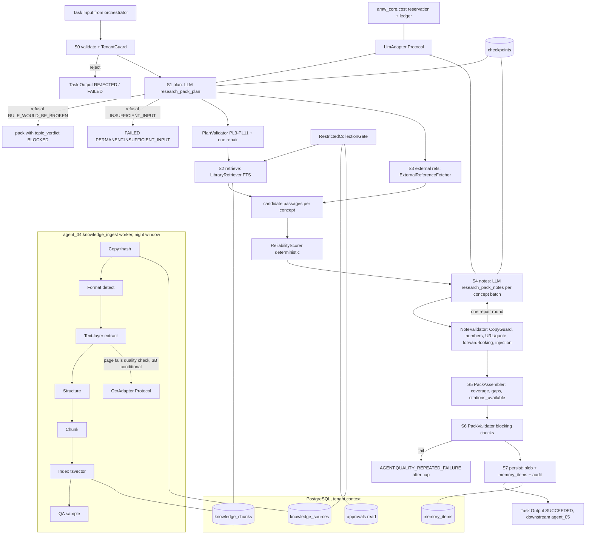

# Agent 04 — Research & Knowledge (blueprint)

| Field | Value |
|---|---|
| Status | Draft — documentation. Software: **Planned** (rule 6, rule 7) |
| Owner | Agent 04 Research & Knowledge; integration owner: Agent 01 (orchestrator) |
| Package | `agent_04_research_knowledge` (27 §7.2); prompts `prompts/agent_04_research_knowledge/`; evals `evals/agent_04_research_knowledge/` |
| Directive sections covered | §3.1 row 04 (source discovery, reliability scoring, evidence store, citation tracking), §1B.2a (Trading Knowledge Library, owned by 04), §3.3 Memory, §3.3 (contracts, failures, quality, observability, AI providers), §3.5 (prompt, eval, code standards), §4 (26 sections) |
| Owner decisions applied | D1 (3A production line; topic owner-given; no upload, no OAuth; spend limits; secrets; no render in market hours), D2 (full blueprint for 3A agents; REQUIRES REVIEW does not block 3A unless it changes a 3A design decision) |
| Binding contracts | GLOSSARY_AND_IDS.md, 03_COMMUNICATION_STANDARD.md, 04_DATABASE_ARCHITECTURE.md §5.10–5.11, 07_FAILURE_MANAGEMENT.md, 24_PRODUCTION_TYPES.md §3.2 (`agent_04.research_pack`), 27_ENGINEERING_STANDARDS.md |
| Shared docs referenced by name/§ only | 18_PRODUCTION_QUALITY_STANDARD.md §9, 13_COMPLIANCE_YOUTUBE_POLICY.md §5.11 and §8, 09_COST_AND_BUDGET.md, 08_SECURITY.md §3, §8, 3A_SLICE_SPEC.md (being written), ADR-001, ADR-005, ADR-007, ADR-013, KNOWLEDGE_LIBRARY_PLAN.md |
| Facts cited | RESEARCH_LOG IN-08 (copyright posture), IN-02/IN-03 (price-data lag; direction ban), PR-01/PR-02/PR-03 (LLM models, batch and caching, API vs subscription), INF-03/INF-04 (resource caps), INF-11 (RLS) |
| Marking | Every section ends its first line with **MVP** (3A / 3B / 3C, GLOSSARY §6.47 tier 0–3). 3A, 3B, 3C are the owner's build stages of D1 |
| Conventions | `(pending CCR)` = a contract item that does not exist in Wave A and is listed in the structured return for the integrator. `REQUIRES REVIEW (Phase 1): <need>` = unknown value; none is invented. No book text, private method or server detail appears in this document. |

---

## 1 Identity and mission
**MVP: 3A (core) · Tier 0.** Later tiers are marked in the rows.

### 1.1 Mission
Agent 04 turns an owner-given topic into a **research pack**: the concepts the video must explain, the evidence for each concept written as short notes in original words, and a citation for every note, drawn from (a) the tenant's private, channel-isolated knowledge library (§1B.2a), (b) references the owner supplies, and (c) allow-listed official references. It also **owns the knowledge library** itself: ingestion, chunking, indexing, per-collection access and retrieval. It flags a concept with no source; it never invents one (§1B.2a).

### 1.2 Where it sits
Stage `s04_research` (24 §3.1 example: `agent_04.research_pack`, `AI_IO`, depends on the topic stage). In 3A the topic stage is replaced by the owner's topic entered with the job (D1: Agents 02/03 come later), so the task input is built by the orchestrator from that entry. Downstream: Agent 05 (script), Agent 06 (claim extraction and verification), Agent 16/S2 (uniqueness and compliance gates), Agent 03 (topic tree, 3C).

### 1.3 Authority boundaries
| Agent 04 **decides** | Agent 04 **does not decide** (owner of the decision) |
|---|---|
| which concepts to research for the topic (inside the topic's scope) | the topic, the angle, the series slot (owner in 3A; Agent 03 later) |
| which library chunks and reference passages are candidates for a concept | what the script says, in what order, or in what words (Agent 05) |
| the reliability tier of each source (deterministic table) | whether a claim is true or contradicted (Agent 06: independent verification, contradiction detection) |
| whether a note is usable for the script (forward-looking and copy-guard exclusions) | publication, compliance verdicts, near-copy and uniqueness decisions (Agent 16, S2; Agent 16 has final authority, plan Q5) |
| whether a restricted chunk may be *retrieved* (release check, deterministic) | whether "our method" material **may be released** (the owner, approval kind `KNOWLEDGE_RELEASE`, S7) |
| which sources become library rows (after the owner registered them) | licence/ownership of a source (owner declaration, Q25; `UNKNOWN` blocks ingestion) |
| coverage status and gaps of its own pack | job routing, retries, revision loops (orchestrator; 07 §9) |
It never creates tasks (only the orchestrator does), never approves anything, never changes budgets, never writes outside its tables, never calls the YouTube API (zero quota units), never uploads (D1) and has no tool-use for the model: the LLM can only return JSON that code validates.

### 1.4 Success criteria (measurable; targets are config and set in 3B)
| ID | Criterion | Measure |
|---|---|---|
| SC-1 | Every note usable by the script carries a resolvable citation | 100 % (deterministic; blocks the task) |
| SC-2 | No cross-tenant or cross-channel read | 0 occurrences in the tenancy suite and in production logs |
| SC-3 | No restricted "our method" chunk in a pack without an `APPROVED` release and a method topic | 0 occurrences |
| SC-4 | No note carries a forward-looking statement, a recommendation, a return claim or a promotion as usable content | 0 occurrences |
| SC-5 | No note reproduces source wording above the copy-guard thresholds | 0 notes pass the guard above threshold |
| SC-6 | Concepts without a source are flagged (`UNSOURCED`), not filled | 100 % flagged; 0 invented sources |
| SC-7 | Pack quality on the golden-sample topics: share of concepts `SOURCED`, retrieval relevance | measured in 3B; thresholds **REQUIRES REVIEW (Phase 1): owner sets after the first measurement (ADR-013 §2.5)** |
| SC-8 | Cost per pack stays within `resource_budget` | 0 breaches; breach ⇒ suspend (09, D1) |
| SC-9 | Replays create no duplicate pack | 1 pack per (job, iteration) |

---

## 2 Functional requirements
**MVP: FR-1…FR-12 are 3A except where marked. Tier 0 unless marked.**

### 2.1 Task types
| Task type | Status | Purpose | Trigger | MVP |
|---|---|---|---|---|
| `agent_04.research_pack` | canonical (24 §3.2) | research pack for one job iteration | orchestrator creates it when `s04_research` becomes ready | 3A |
| `agent_04.knowledge_ingest` | **(pending CCR)**, named in ADR-013 §2.1 | ingest one registered source: extract, structure, chunk, index, QA | owner action after source registration; scheduled in the night window | 3A (text layer only), 3B (QA sampling; OCR if K4 requires), 3C (client libraries) |
Agent 04 files no other task type. Capability use: `llm` (research pack); `doc_extract` **(pending CCR: new `capability` value, ADR-013 §2.9)** (ingest).

### 2.2 Requirements
| ID | Requirement | Why | When / trigger | Inputs | Outputs | Dependants | MVP |
|---|---|---|---|---|---|---|---|
| FR-1 | Validate the task input, the tenant context and every reference before any work (03 §7) | rule 9; 07 `PERMANENT.*` | start of the task | Task Input | structured rejection or go | all | 3A |
| FR-2 | Plan the research: topic → concepts, evidence needs, queries; refuse topics that are themselves forbidden calls (FIN-R1…R8 by rule pack) | no research spent on forbidden topics; answer-key cases (§1B.2) | after FR-1 | topic, rule packs, collection list | `ResearchPlan` or refusal | FR-4, 05 | 3A |
| FR-3 | Honour revision gaps: close or explain each gap from Agent 06/16 | revision loops (24 §3.3) | `revision` present | gaps, prior pack | concepts targeting gaps | 06, 16 | 3A |
| FR-4 | Retrieve candidate chunks from the tenant's library per concept: PostgreSQL full-text search filtered by `org_id`, `channel_id`, collection, source status, ownership and the restricted-collection gate (ADR-013 §2.4) | channel-isolated library (§1B.2a) | per concept | plan queries | ranked candidates with citation metadata | FR-7 | 3A |
| FR-5 | Take owner-supplied and allow-listed official references as additional sources (fetch, hash, extract text) | library may be empty in 3A (ADR-013 §4); owner gives material | per reference | `owner_references` | passages + source records | FR-7 | 3A |
| FR-6 | Score reliability per source: deterministic tier from source kind, ownership and domain class | §3.1 row 04 "reliability scoring" | per source | source metadata | tier + score | FR-8, 05, 06 | 3A |
| FR-7 | Write evidence notes in original words with citations (LLM step), then run the deterministic guards: copy guard, number match, URL/quote, forward-looking exclusion, injection handling | concepts not expression (§1B.2a, IN-08, 13 §8); FIN-R3/R13 | per concept batch | passages | validated notes | FR-8 | 3A |
| FR-8 | Assemble the pack: coverage per concept, gaps, `citations_available` (shape accepted by `agent_06.claim_extraction.input`), further-reading credits, method flags | citation tracking; "flag, not invent" | after FR-7 | notes, sources | pack JSON | 05, 06, 16/S2 | 3A |
| FR-9 | Persist the pack write-once and record the memory pointer; write audit entries of knowledge access (ids only) | evidence store; §3.3 Memory | end of task | pack | blob, `memory_items` row, audit rows | 05, 06, later iterations | 3A |
| FR-10 | Ingest a source: copy and hash, detect format, extract text (text layer first), detect structure, chunk by section, index, QA sample (ADR-013) | §1B.2a, plan §2 | `agent_04.knowledge_ingest` | source row | `knowledge_chunks`, source `INDEXED` | FR-4 | 3A text layer only; OCR 3B conditional; client libraries 3C / Tier 1 |
| FR-11 | Report restricted material that was relevant but not released (`restricted_pending`), so the orchestrator can ask the owner for a `KNOWLEDGE_RELEASE` approval | Q26, FIN-R12 | method topic with unreleased chunks | gate result | pack field | 01, S7 | 3A |
| FR-12 | Measure retrieval quality inputs (passage relevance assessments, "concept not found although present" signals) | ADR-013 §2.5 decision rule for embeddings | every pack | assessments | metrics | 3B analysis | 3A records; 3B analyses |
| FR-13 | Reuse a prior pack for a Shorts/parent-child job or a revision iteration (`prior_pack_ref`) instead of re-researching unchanged concepts | §1A.8 (Shorts cut from the same research), cost | input carries `prior_pack_ref` | prior pack | merged pack | 05 | 3C (revision reuse in 3A only for gaps) |
| FR-14 | Topic-tree support: concept → sub-concept → mistakes → psychology map for Agent 03 | §1B.2a content plan | Agent 03 task (not defined) | library | — | 03 | 3C; **REQUIRES REVIEW (Phase 1): no task type exists for it (24 §3.2); not designed here** |

### 2.3 Out of scope (explicit)
Web-wide search and discovery (no search provider has a research-log entry; 3C, §12); embeddings (ADR-013 §2.5, only if measured); topic selection; script writing; fact verification; image or figure extraction (never stored, plan §1.3); OCR before K4 is answered; any YouTube call.

---

## 3 Non-functional requirements
**MVP: 3A unless marked. Values are config or REQUIRES REVIEW; none is invented. ESTIMATE = design value, replaced by MEASURED in 3B.**

| ID | Category | Requirement | Verification | MVP |
|---|---|---|---|---|
| NFR-1 | Isolation | Every read and write is scoped by `org_id` and `channel_id` (and collection for retrieval); RLS is the second line | tenancy suite (08 §8.2), DC TN-01…TN-10 | 3A |
| NFR-2 | Determinism | All decisions in §6.1 are pure, unit-tested functions; the LLM only proposes concepts and notes | unit tests; golden `deterministic_core` | 3A |
| NFR-3 | Idempotency | One pack per (job, iteration); a replay returns the stored result; LLM calls keyed by `llm.call` (03 §9.2) | replay test | 3A |
| NFR-4 | Bounded work | LLM calls ≤ `resource_budget.max_llm_calls`; concepts, queries, passages per call, repair rounds are config caps; one repair per failing note (07 §9) | cap tests | 3A |
| NFR-5 | Cost | Every LLM call has a reservation and a ledger row; a breach suspends (`AWAITING_BUDGET`); no automatic increase (rule 8, D1, ADR-007 §8) | breach test | 3A |
| NFR-6 | Confidentiality | Chunk text, passage text and notes never appear in logs, metrics, error messages, audit rows or eval outputs; chunk text reaches only the tenant's own LLM calls | log-leak test (DC TN-09) | 3A |
| NFR-7 | Latency | Pack end-to-end and retrieval latency: **MEASURED in 3B**; no target before. Retrieval must not block the queue's other tasks (own transaction, statement timeout config) | performance test | 3B |
| NFR-8 | Capacity | Library size supported on the shared VPS within the factory caps (INF-03, INF-04): **REQUIRES REVIEW (Phase 1): measured after K1 gives the collection size** | measured in 3B | 3B |
| NFR-9 | Availability | Stateless between steps; all state in DB/storage; restart resumes from the latest checkpoint (07 §10). No availability promise beyond the shared VPS (§1 item 11 of §1C) | failure-injection | 3A |
| NFR-10 | Languages | English, Marathi, Hindi, mixed; Devanagari text-search configuration **REQUIRES REVIEW (Phase 1)** (ADR-013 §2.4: `simple` fallback until verified); token cost per language measured (ADR-007 §2.9) | retrieval test set in 3B | 3A (fallback), 3B (measure) |
| NFR-11 | Auditability | Every restricted-gate decision, release lookup, cross-tenant rejection and library read count is audited (ids only) | audit test | 3A |
| NFR-12 | Time | UTC `timestamptz` only; no calendar dates or clock times in prompts or rules (owner rule C.4); the night window applies to ingestion only (ADR-013) | lint | 3A |
| NFR-13 | Money | Integers (`_micros`) only | type check | 3A |
| NFR-14 | Maintainability | One package, typed `Protocol`, DI, ruff/mypy strict (27 §7) | CI | 3A |

---

## 4 Internal architecture
**MVP: 3A for all boxes drawn solid; dashed = 3B/3C. Tier 0.**


Control flow is code; the LLM has no tools and no ability to call anything. `S1` and `S4` are the only model calls. Everything else is deterministic (§6).

---
## 5 Full system prompt
**MVP: 3A (both prompts v1, status Draft until the 3B eval gate passes) · Tier 0.**

The system prompts are real files written to `prompts/_TEMPLATE.v1.md`; per plan Q9 the files are the single source and this section links them (27 §4, prompts/README §1). Agent 04 has two LLM steps inside its one task type.

| Step | Prompt ID | File | What it does (summary) | Model tier start (ADR-007 §2.4) | Rule packs by reference |
|---|---|---|---|---|---|
| `plan` | `agent_04/research_pack_plan.v1` | [prompts/agent_04_research_knowledge/research_pack_plan.v1.md](../prompts/agent_04_research_knowledge/research_pack_plan.v1.md) | topic → ≤ `max_concepts` concepts with kinds, evidence needs, queries per language, gap closure; refuses topics that are forbidden calls (FIN-R1…R8) or conflicting | `MID` (try `SMALL` in 3B, gate decides) | `rp.youtube_general`, `rp.finance_sebi_in` |
| `notes` | `agent_04/research_pack_notes.v1` | [prompts/agent_04_research_knowledge/research_pack_notes.v1.md](../prompts/agent_04_research_knowledge/research_pack_notes.v1.md) | per concept: passage relevance, original-wording notes with passage IDs, exclusion of forecasts/recommendations/return claims/promotions, injection handling | `MID` | same |

Key properties both prompts enforce (full text in the files):
- Passage and topic text are **data**; instructions inside them are never followed (08 §5.3). The model has no tools.
- Notes are single statements, ≤ `max_note_chars`, own wording, no quotation marks, no run of `max_verbatim_words` or more copied words, numbers only as written in the passage (13 §8, IN-08).
- Forward-looking, recommendation, performance and promotion statements are **reported**, never turned into notes (FIN-R1…R3, R6, R8, R13).
- The model never sets reliability, release status, method label or usability: code does (§6).
- Refusal object per 27 §4.3 with the mapping stated in each file. Model, temperature, tokens, timeout, budget, caching, batch flag are config keys `llm.agent_04.research_pack_plan.*` and `llm.agent_04.research_pack_notes.*` (pending CCR: step-level key registration), never in the files.
- Prompt lint (27 §4.4) and the eval gate (27 §5) apply to every change; the shared prompt prefix holds no tenant data (08 §8 layer 4).

Not an LLM step, therefore no prompt: reliability scoring, retrieval, restricted gate, copy guard, coverage, ingestion (extraction, chunking, indexing). An optional LLM use inside ingestion, resolving unclear headings (plan step 5), is **not** built in 3A (deterministic first; REQUIRES REVIEW (3B): add only if the QA sample shows unresolved headings; it would get its own prompt file and eval set).

---

## 6 Decision engine
**MVP: 3A · Tier 0. Principle (§3.3 Quality): deterministic checks first; an LLM score is never the only gate.**

### 6.1 Decision table
| # | Decision | Kind | How | Why |
|---|---|---|---|---|
| D-1 | Input and tenant validity, ID prefixes, org/channel agreement | deterministic | schema + `TenantGuard` | rule 9; fail fast with `PERMANENT.*` |
| D-2 | Concept list, evidence needs, queries | **LLM** (`plan`) | model proposes; code validates PL3–PL11 | needs language understanding and topic decomposition; bounded by caps; refusal is mapped by code |
| D-3 | Is the topic itself a forbidden call | **LLM** proposes refusal; Agent 16 keeps final authority | prompt with injected finance pack | early block saves spend; any false negative is caught later by 06/16 |
| D-4 | Which collections may be searched | deterministic | channel's collections ∩ request scope; restricted only through the gate (D-6) | isolation (Q26) |
| D-5 | Which chunks are candidates | deterministic | FTS (`search_tsv`, per-language config) + filters + diversity cap | ADR-013 §2.4: simplest option; reproducible |
| D-6 | May a restricted chunk be used | deterministic | gate: collection restricted ⇒ `is_method_topic` AND release approval `APPROVED`, kind `KNOWLEDGE_RELEASE`, same org, covering the chunk (§6.4) | FIN-R12, Q26 |
| D-7 | Reliability tier and score | deterministic | table §6.3 | no model judgement of reliability; auditable |
| D-8 | Passage relevance, note wording | **LLM** (`notes`) | schema-bound output | language understanding; own-words rewriting cannot be done by rules |
| D-9 | Is a note acceptable | deterministic | `NoteValidator`: schema, passage exists, copy guard, numbers, URL/quote, clarity, forward-looking flag | the model's output is never trusted; copyright (IN-08) and FIN-R13 |
| D-10 | Is a note usable for the script | deterministic | `usable = notes_valid ∧ ¬forward_looking ∧ time_reference ≠ FUTURE ∧ tier floor met (§6.3)` | safety |
| D-11 | Coverage per concept, gaps | deterministic | §6.5 | measurable; no invented sources |
| D-12 | Budget stop | deterministic | S4 reservation before each call (ADR-007 §8) | rule 8 |
| D-13 | External reference fetch allowed | deterministic | owner-supplied URL or host in the config allow-list; HTTPS; size/time caps | no open-web crawling in 3A |
| D-14 | Ingestion extraction path per page | deterministic | text layer first; OCR only if the quality check fails (ADR-013 §2.2) | text layers are exact |

### 6.2 Why the split
LLMs are used only where the task is language-shaped (decompose a topic, restate an idea in new words). Everything that protects the tenant, the owner's private method, copyright and the SEBI rules is a pure function with a unit test and a golden case (`evals/.../deterministic_core`). A model error can therefore lower pack quality (a concept shows as `UNSOURCED`), but cannot leak a restricted chunk, widen a scope or let a forecast through as usable.

### 6.3 Reliability tiers (deterministic; payload-local values, not Wave A enums)
| Tier | Rule |
|---|---|
| `A_PRIMARY` | `kind = OFFICIAL_DOCUMENT`, or `WEB_REFERENCE` on a host whose config domain class is `OFFICIAL`; `ownership = PUBLIC_OFFICIAL` |
| `B_PUBLISHED` | `kind = BOOK` with `ownership ∈ {OWNED_COPY, LICENSED}`; `COURSE_NOTES`/`OWNER_NOTES` with `OWNER_AUTHORED` (the pack marks `owner_authored = true`: the owner, not a third party, stands behind it); `CLIENT_DOCUMENT` (Tier 1+; the client stands behind it) |
| `C_SECONDARY` | `WEB_REFERENCE` on a host whose config domain class is `REPUTABLE_SECONDARY` |
| `D_UNVERIFIED` | any other `WEB_REFERENCE`, unknown host |
| excluded | `ownership = UNKNOWN` (Q25): never retrieved, never noted |
- `knowledge_sources.reliability_score` (numeric(4,3), 04 §5.10) = config map `research.reliability.tier_scores.<tier>`. The map must be strictly decreasing from A to D (loaded and checked; else `PERMANENT.CONFIG_INVALID`). **Values: REQUIRES REVIEW (Phase 1): owner/3B calibration; none invented.**
- Host → domain class: config registry `research.reliability.domain_classes`. **REQUIRES REVIEW (Phase 1): the list of official and reputable hosts is an owner/lawyer decision; the log has no research entry that approves a host.**
- Floor: a note of kind `STATISTIC` or of a factual `DEFINITION`/`MECHANISM` is `usable` only if at least one supporting evidence item for the concept has tier ≤ `research.min_tier_for_factual` (design default `C_SECONDARY`; a `D_UNVERIFIED` item alone leaves the concept `PARTIAL`, gap `ONLY_LOW_RELIABILITY`). **REQUIRES REVIEW (Phase 1): owner confirms the floor in 3B.**
- A tier describes the **source**, not the truth of a note. Verification of the claim is Agent 06's job.

### 6.4 Restricted-collection gate (Q26, FIN-R12)
Inputs: collection `restricted` flag **(pending CCR: `knowledge_collections`)**, topic `is_method_topic`, the chunk's release approval **(pending CCR: chunk-level `release_approval_id`; until applied the source-level `knowledge_sources.release_approval_id` of 04 §5.10 is used, which releases the whole source)**.
```
allowed(chunk) =
  if not collection.restricted: True
  else: topic.is_method_topic
        and approval exists (same org_id) and approval.kind == KNOWLEDGE_RELEASE
        and approval.state == APPROVED and approval covers the chunk
```
- A restricted chunk is **never** retrieved for a topic that is not a method topic, even if released (FIN-R12 d, no mixing).
- The gate runs in the retrieval SQL (filter) **and** again on the candidate list before any text reaches the model (defence in depth). Blocked-but-relevant restricted hits are counted, not returned: the pack lists `method.restricted_pending` with collection key and concept IDs (no text) so the orchestrator can request a `KNOWLEDGE_RELEASE` approval (S7, workflow `owner_sensitive`).
- Evidence from a restricted chunk gets `method_labelled = true`; Agent 05 must label the segment and Agent 16 checks FIN-R12 (13 §5.11).
- The model never sees the release flag or the collection name of a restricted chunk beyond what the plan's `collections` list shows; it cannot grant access.

### 6.5 Coverage and gaps
| Concept coverage | Rule |
|---|---|
| `SOURCED` | ≥ 1 usable note for every `evidence_need` of kind `DEFINITION`, `MECHANISM`, `PRINCIPLE`, `STATISTIC`, and floor met |
| `PARTIAL` | some usable notes, or only low-reliability support |
| `UNSOURCED` | no usable note |
Gap reasons (payload-local): `NO_SOURCE_FOUND`, `ONLY_RESTRICTED_NOT_RELEASED`, `ONLY_EXCLUDED_FORWARD_LOOKING`, `ONLY_LOW_RELIABILITY`, `COPY_GUARD_REMOVED`, `PRIOR_GAP_NOT_CLOSED`.
Task outcome: ≥ 1 usable note in the pack ⇒ `SUCCEEDED` (`research.coverage` WARN if any concept is not `SOURCED`); zero usable notes in the whole pack ⇒ `FAILED` `PERMANENT.INSUFFICIENT_INPUT` (orchestrator re-plans upstream: the owner supplies material). **(pending CCR: clarify in 07 §2 that `PERMANENT.INSUFFICIENT_INPUT` also covers a deterministic "no usable evidence" result.)** Never "best effort" success.

### 6.6 Retrieval algorithm (ADR-013 §2.4)
1. For each concept and each query: `websearch_to_tsquery(<config for query.language>, text)` against `knowledge_chunks.search_tsv`; config per language **REQUIRES REVIEW (Phase 1)** (fallback `simple` for Devanagari, stemming configuration for English).
2. Filters (all in one SQL, parameterised): `org_id = :org` AND `channel_id = :channel` AND `collection_id ∈ :allowed` (restricted rule above) AND source `status = INDEXED` AND `ownership ≠ UNKNOWN` AND source not `RETIRED`.
3. Rank by `ts_rank_cd`; union over queries; dedupe by chunk; cap per source per concept (`research.retrieval.max_chunks_per_source_per_concept`) so one book cannot dominate (originality, 13 §8 structure check); keep top `research.retrieval.top_k_per_concept`.
4. Order for the model and for the pack is by relevance, never by page or chapter (no reproduction of a book's sequence, §1B.2a).
5. Owner-supplied references join as candidates with their own tier.
6. Retrieval is read-only and idempotent; every call writes one audit row (ids and counts, never text).

---

## 7 Input schema
**MVP: 3A · Tier 0 (single channel, single language). Tier 1+: `client_library` scope from the same fields.**

Envelope: Task Input `amw.task_input` 1.0.0 (03 §3.3) with `agent_id = agent_04`, `payload.payload_schema = "agent_04.research_pack.input"`, `payload_schema_version = "1.0.0"`. Fields Agent 04 relies on: `org_id`, `job_id`, `task_id`, `project_id`, `channel_id` (**required, not null** for this task; null ⇒ `PERMANENT.INPUT_INVALID`), `source_agent` (`agent_01`), `priority`, `deadline`, `context_refs` (purposes `COMPLIANCE_PROFILE`, `RULE_PACK`, `PRIOR_OUTPUT`, `KNOWLEDGE`), `resource_budget`, `correlation_id`, `idempotency_key` (scope `task.agent_04.research_pack`: `job_id`, task type, `iteration`), `retry_count`, `schema_version`.

`payload.data` (`agent_04.research_pack.input` 1.0.0; Pydantic `ResearchPackInput`):
```json
{
  "$schema": "https://json-schema.org/draft/2020-12/schema",
  "$id": "urn:amw:schema:agent_04.research_pack.input:1.0.0",
  "title": "Agent 04 research pack input",
  "type": "object",
  "additionalProperties": false,
  "required": ["topic", "channel_category", "active_rule_packs", "library_scope", "owner_references", "revision"],
  "properties": {
    "topic": {
      "type": "object", "additionalProperties": false,
      "required": ["title", "brief", "angle", "language", "is_method_topic", "course_chapter_pointer"],
      "properties": {
        "title": { "type": "string", "minLength": 3, "maxLength": 300 },
        "brief": { "type": ["string", "null"], "maxLength": 2000 },
        "angle": { "type": ["string", "null"], "maxLength": 500 },
        "language": { "type": "string", "pattern": "^[a-z]{2,3}(-[A-Za-z0-9]{2,8})*$" },
        "is_method_topic": { "type": "boolean" },
        "course_chapter_pointer": { "type": ["string", "null"], "maxLength": 200 }
      }
    },
    "channel_category": { "type": "string", "pattern": "^[a-z_]{3,32}$" },
    "active_rule_packs": { "type": "array", "minItems": 1, "items": { "type": "string", "pattern": "^rp\\.[a-z0-9_]+$" }, "contains": { "const": "rp.youtube_general" } },
    "library_scope": {
      "type": "object", "additionalProperties": false, "required": ["collection_keys"],
      "properties": { "collection_keys": { "oneOf": [ { "type": "null" }, { "type": "array", "items": { "type": "string", "pattern": "^[a-z0-9_]{2,48}$" }, "maxItems": 32 } ] } }
    },
    "owner_references": {
      "type": "array", "maxItems": 20,
      "items": {
        "type": "object", "additionalProperties": false, "required": ["ref_id", "kind", "url", "knowledge_source_id", "note"],
        "properties": {
          "ref_id": { "type": "string", "pattern": "^r[0-9]{1,3}$" },
          "kind": { "enum": ["EXTERNAL_URL", "KNOWLEDGE_SOURCE"] },
          "url": { "type": ["string", "null"], "pattern": "^https://", "maxLength": 1024 },
          "knowledge_source_id": { "type": ["string", "null"], "pattern": "^ksr_[0-9a-f]{8}-[0-9a-f]{4}-7[0-9a-f]{3}-[89ab][0-9a-f]{3}-[0-9a-f]{12}$" },
          "note": { "type": ["string", "null"], "maxLength": 300 }
        }
      }
    },
    "revision": {
      "oneOf": [
        { "type": "null" },
        { "type": "object", "additionalProperties": false, "required": ["iteration", "gaps", "prior_pack_ref"],
          "properties": {
            "iteration": { "type": "integer", "minimum": 1, "maximum": 10 },
            "gaps": { "type": "array", "maxItems": 50,
              "items": { "type": "object", "additionalProperties": false, "required": ["gap_id", "gap_text", "reason"],
                "properties": { "gap_id": { "type": "string", "pattern": "^g[0-9]{1,3}$" }, "gap_text": { "type": "string", "maxLength": 500 },
                                "reason": { "enum": ["UNSOURCED", "CONTRADICTED", "UNVERIFIABLE", "NEEDS_SUBSTANTIATION"] } } } },
            "prior_pack_ref": { "$ref": "urn:amw:schema:amw.common:1.0.0#/$defs/storage_uri" } } }
      ]
    }
  }
}
```
Validation (S0, in this order, 03 §7.1): (1) envelope and payload schema; (2) ID prefixes (`PERMANENT.INPUT_INVALID`); (3) `org_id` identical in envelope, input and every `context_refs[].uri` and `prior_pack_ref` (`PERMANENT.TENANT_MISMATCH` / `PERMANENT.CROSS_TENANT_REF`); (4) `channel_id` belongs to `org_id` and its compliance profile is readable (`PERMANENT.MISSING_DEPENDENCY`); (5) `is_method_topic` is true only if the channel has a restricted collection (else `PERMANENT.INPUT_INVALID`); (6) every `collection_keys` entry exists for this channel (else `PERMANENT.INPUT_INVALID`); (7) `KNOWLEDGE_SOURCE` references belong to this org and channel; `EXTERNAL_URL` must be HTTPS and pass the fetch policy (§12); (8) tenant active (`PERMANENT.TENANT_INACTIVE`). Contract-local values (`EXTERNAL_URL`, `KNOWLEDGE_SOURCE`, gap reasons) live only inside this payload; the gap reasons repeat a subset of `claim_status` (GLOSSARY §6.40).

`agent_04.knowledge_ingest.input` **(pending CCR)**: `{source_id: ksr_…, ingest_version: int, force_reextract: bool}`; envelope `channel_id` required; `payload` small, text never in the payload.

---

## 8 Output schema
**MVP: 3A · Tier 0. Same schema for later tiers.**

Envelope: Task Output `amw.task_output` 1.0.0 (03 §5.2), mapped as follows. `payload` = `agent_04.research_pack.output` 1.0.0 (inline if ≤ `contracts.inline_payload_max_bytes`, else `data_ref` + `data_sha256`); `output_refs` = the pack blob (`kind: DATA`, `application/json`, area `jobs/<job>/tasks/<task>/attempts/<att>/research_pack.json`); `quality_score = null` (RESEARCH_ACCURACY is scored by Agent 16, 18 §9.2); `confidence = null` (no calibrated confidence exists); `downstream_agent = agent_05`; `next_action = CONTINUE`.

`validation_results` (check IDs match `^[a-z0-9_.-]{3,96}$`):
| check_id | kind | blocking | Pass condition |
|---|---|---|---|
| `research.schema` | DETERMINISTIC | yes | payload validates |
| `research.tenant_scope` | DETERMINISTIC | yes | every id/URI in the pack belongs to the task's org and channel |
| `research.citation_resolvable` | DETERMINISTIC | yes | every `usable_for_script` evidence item has a `citation_ref` that resolves to an existing chunk (right org/channel, hash equal) or a recorded external reference |
| `research.restricted_gate` | DETERMINISTIC | yes | no restricted-collection evidence unless gate passed (`rule_id: FIN-R12`) |
| `research.copy_guard` | DETERMINISTIC | yes | no usable note above thresholds (`rule_id: YTG-R9`) |
| `research.forward_looking_excluded` | DETERMINISTIC | yes | no usable note with `FUTURE` or `forward_looking` (`rule_id: FIN-R13`) |
| `research.coverage` | DETERMINISTIC | no (WARN) | share of `SOURCED` concepts; WARN if any concept not `SOURCED` |
| `research.reliability_floor` | DETERMINISTIC | no (WARN) | factual notes meet the floor |
| `research.prior_gaps_closed` | DETERMINISTIC | no (WARN) | each input gap closed or explained |

`payload.data` (`agent_04.research_pack.output` 1.0.0; Pydantic `ResearchPack`). The pack contains **no** source passage text, only notes in original words and citation metadata:
```json
{
  "$schema": "https://json-schema.org/draft/2020-12/schema",
  "$id": "urn:amw:schema:agent_04.research_pack.output:1.0.0",
  "title": "Agent 04 research pack",
  "type": "object",
  "additionalProperties": false,
  "required": ["pack_version", "iteration", "topic_verdict", "topic", "concepts", "evidence", "citations_available", "sources",
               "gaps", "method", "further_reading", "terminology", "coverage_summary", "provenance"],
  "properties": {
    "pack_version": { "const": 1 },
    "iteration": { "type": "integer", "minimum": 0 },
    "topic_verdict": {
      "type": "object", "additionalProperties": false, "required": ["verdict", "violated_rule_ids"],
      "properties": { "verdict": { "enum": ["ALLOWED", "BLOCKED", "NEEDS_HUMAN_REVIEW"] },
                      "violated_rule_ids": { "type": "array", "items": { "type": "string", "pattern": "^[A-Z]{2,8}-R[0-9]{1,3}$" } } }
    },
    "topic": { "type": "object", "additionalProperties": false, "required": ["title", "language", "is_method_topic"],
      "properties": { "title": { "type": "string" }, "language": { "type": "string" }, "is_method_topic": { "type": "boolean" } } },
    "concepts": { "type": "array", "maxItems": 40, "items": {
      "type": "object", "additionalProperties": false,
      "required": ["concept_id", "label", "label_en", "kind", "evidence_needs", "time_reference", "coverage", "evidence_ids", "has_example", "closes_gap_ids"],
      "properties": {
        "concept_id": { "type": "string", "pattern": "^c[0-9]{2}$" }, "label": { "type": "string" }, "label_en": { "type": "string" },
        "kind": { "enum": ["CORE_CONCEPT", "SUB_CONCEPT", "COMMON_MISTAKE", "PSYCHOLOGY", "HISTORICAL_CASE", "DEFINITION_TERM", "REGULATORY_CONTEXT"] },
        "evidence_needs": { "type": "array", "items": { "type": "string" } },
        "time_reference": { "enum": ["HISTORICAL", "CURRENT", "TIMELESS"] },
        "coverage": { "enum": ["SOURCED", "PARTIAL", "UNSOURCED"] },
        "evidence_ids": { "type": "array", "items": { "type": "string", "pattern": "^ev_[0-9]{3,4}$" } },
        "has_example": { "type": "boolean" },
        "closes_gap_ids": { "type": "array", "items": { "type": "string" } } } } },
    "evidence": { "type": "array", "maxItems": 600, "items": {
      "type": "object", "additionalProperties": false,
      "required": ["evidence_id", "concept_id", "statement_kind", "note", "time_reference_kind", "instruments", "citation_ref",
                   "reliability_tier", "owner_authored", "method_labelled", "usable_for_script", "exclusion_reason", "locator"],
      "properties": {
        "evidence_id": { "type": "string", "pattern": "^ev_[0-9]{3,4}$" }, "concept_id": { "type": "string", "pattern": "^c[0-9]{2}$" },
        "statement_kind": { "enum": ["DEFINITION", "MECHANISM", "PRINCIPLE", "EXAMPLE_HISTORICAL", "EXAMPLE_HYPOTHETICAL", "STATISTIC", "COMMON_MISTAKE", "CAVEAT"] },
        "note": { "type": "string", "maxLength": 600 },
        "time_reference_kind": { "enum": ["HISTORICAL", "CURRENT", "FUTURE", "TIMELESS", "UNSPECIFIED"] },
        "instruments": { "type": "array", "items": { "type": "string" } },
        "citation_ref": { "type": "string", "maxLength": 64 },
        "reliability_tier": { "enum": ["A_PRIMARY", "B_PUBLISHED", "C_SECONDARY", "D_UNVERIFIED"] },
        "owner_authored": { "type": "boolean" }, "method_labelled": { "type": "boolean" }, "usable_for_script": { "type": "boolean" },
        "exclusion_reason": { "enum": [null, "FORWARD_LOOKING", "COPY_GUARD", "LOW_RELIABILITY", "INJECTION_SUSPECTED", "AMBIGUOUS"] },
        "locator": { "type": "object", "additionalProperties": false, "required": ["chapter", "page_from", "page_to"],
          "properties": { "chapter": { "type": ["string", "null"] }, "page_from": { "type": ["integer", "null"] }, "page_to": { "type": ["integer", "null"] } } } } } },
    "citations_available": { "type": "array", "description": "same shape as available_citations of agent_06.claim_extraction.input", "items": {
      "type": "object", "additionalProperties": false, "required": ["citation_ref", "kind", "title"],
      "properties": { "citation_ref": { "type": "string", "maxLength": 64 }, "kind": { "enum": ["KNOWLEDGE_CHUNK", "EXTERNAL_REFERENCE"] }, "title": { "type": "string", "maxLength": 300 } } } },
    "sources": { "type": "array", "items": {
      "type": "object", "additionalProperties": false,
      "required": ["source_ref", "kind", "title", "author", "edition", "ownership", "reliability_tier", "reliability_score", "collection_key", "external_url", "accessed_at", "content_sha256"],
      "properties": {
        "source_ref": { "type": "string" }, "kind": { "enum": ["BOOK", "COURSE_NOTES", "OWNER_NOTES", "WEB_REFERENCE", "OFFICIAL_DOCUMENT", "CLIENT_DOCUMENT"] },
        "title": { "type": "string" }, "author": { "type": ["string", "null"] }, "edition": { "type": ["string", "null"] },
        "ownership": { "enum": ["OWNED_COPY", "LICENSED", "OWNER_AUTHORED", "PUBLIC_OFFICIAL"] },
        "reliability_tier": { "enum": ["A_PRIMARY", "B_PUBLISHED", "C_SECONDARY", "D_UNVERIFIED"] },
        "reliability_score": { "type": ["number", "null"] }, "collection_key": { "type": ["string", "null"] },
        "external_url": { "type": ["string", "null"] }, "accessed_at": { "type": ["string", "null"], "format": "date-time" },
        "content_sha256": { "type": "string", "pattern": "^[0-9a-f]{64}$" } } } },
    "gaps": { "type": "array", "items": {
      "type": "object", "additionalProperties": false, "required": ["concept_id", "reason"],
      "properties": { "concept_id": { "type": "string" },
                      "reason": { "enum": ["NO_SOURCE_FOUND", "ONLY_RESTRICTED_NOT_RELEASED", "ONLY_EXCLUDED_FORWARD_LOOKING", "ONLY_LOW_RELIABILITY", "COPY_GUARD_REMOVED", "PRIOR_GAP_NOT_CLOSED"] } } } },
    "method": { "type": "object", "additionalProperties": false, "required": ["used", "release_approval_ids", "restricted_pending"],
      "properties": { "used": { "type": "boolean" },
                      "release_approval_ids": { "type": "array", "items": { "type": "string", "pattern": "^apr_[0-9a-f-]{36}$" } },
                      "restricted_pending": { "type": "array", "items": { "type": "object", "additionalProperties": false, "required": ["collection_key", "concept_ids"],
                        "properties": { "collection_key": { "type": "string" }, "concept_ids": { "type": "array", "items": { "type": "string" } } } } } } },
    "further_reading": { "type": "array", "items": { "type": "object", "additionalProperties": false, "required": ["source_ref", "title", "author", "edition"],
      "properties": { "source_ref": { "type": "string" }, "title": { "type": "string" }, "author": { "type": ["string", "null"] }, "edition": { "type": ["string", "null"] } } } },
    "terminology": { "type": "array", "description": "shared-glossary hits; empty until owner item K7 is answered", "items": { "type": "object" } },
    "coverage_summary": { "type": "object", "additionalProperties": false,
      "required": ["concepts_total", "sourced", "partial", "unsourced", "evidence_total", "evidence_usable", "excluded_forward_looking", "excluded_copy_guard"],
      "properties": { "concepts_total": { "type": "integer" }, "sourced": { "type": "integer" }, "partial": { "type": "integer" }, "unsourced": { "type": "integer" },
                      "evidence_total": { "type": "integer" }, "evidence_usable": { "type": "integer" },
                      "excluded_forward_looking": { "type": "integer" }, "excluded_copy_guard": { "type": "integer" } } },
    "provenance": { "type": "object", "additionalProperties": false, "required": ["plan_prompt_id", "notes_prompt_id", "rule_pack_versions", "llm_calls"],
      "properties": { "plan_prompt_id": { "type": "string" }, "notes_prompt_id": { "type": "string" },
                      "rule_pack_versions": { "type": "object" }, "llm_calls": { "type": "integer" } } }
  }
}
```
Rules:
- `citation_ref` = the wire ID of the chunk (`kch_<uuid>`, 40 characters) or `ext_` + the first 24 hex characters of the SHA-256 of (org, URL, content hash) for an external reference; both ≤ 64 characters, so `citations_available` can be passed unchanged as `available_citations` to `agent_06.claim_extraction`. `ext_` is a payload-local reference, not an entity ID prefix.
- A BLOCKED topic returns `topic_verdict.verdict = BLOCKED`, empty `concepts`, `evidence`, `citations_available`, `sources`; task status `SUCCEEDED` (27 §4.3 mapping, 03 §5.3.3). The orchestrator routes per 24 §3.3.
- `method.used = true` iff any usable evidence has `method_labelled = true`; Agent 05 labels segments and passes `our_method_release_approved` to Agent 06 from `method.release_approval_ids` (never from input flags alone).
- Output to Agent 05 is a context reference (`purpose = PRIOR_OUTPUT`), not pasted into the next task's payload.

---
## 9 Python package and class architecture
**MVP: 3A (research pack, text-layer ingestion) · 3B (QA, OCR Protocol implementation if K4 needs it) · 3C (client libraries). Tier 0.**

Package `agent_04_research_knowledge` under `packages/agents/` (SOURCE_LAYOUT). It imports only `amw_core` and adapter **Protocols**, never another agent (27 §7.1). Wiring of concrete adapters happens in `workers/ai_worker` (research pack) and the document worker (ingest).

```text
agent_04_research_knowledge/
├── __init__.py
├── protocol.py            # ResearchStage Protocol (stage interface), IngestStage Protocol
├── models/                # Pydantic models = JSON Schemas of §7, §8 and both prompt files
│   ├── pack_input.py  pack_output.py  plan.py  notes.py  ingest.py  enums.py (payload-local enums)
├── steps/
│   ├── research_pack.py   # ResearchPackStep (orchestrates S0…S7, checkpoints)
│   ├── plan.py            # ConceptPlanner (LLM step 1) + PlanValidator
│   ├── retrieve.py        # LibraryRetriever (FTS), CandidateRanker
│   ├── external.py        # ExternalReferenceFetcher (uses WebFetchAdapter Protocol)
│   ├── notes.py           # EvidenceNoter (LLM step 2) + NoteValidator
│   └── assemble.py        # PackAssembler, PackValidator, CitationBuilder
├── guards/
│   ├── tenant.py          # TenantGuard
│   ├── restricted.py      # RestrictedCollectionGate
│   └── copy_guard.py      # CopyGuard (n-gram overlap, longest shared run)
├── scoring/
│   └── reliability.py     # ReliabilityScorer, DomainClassRegistry
├── library/
│   ├── repository.py      # KnowledgeRepository (only DB access of the package, via amw_core.tenancy)
│   └── search.py          # FtsQueryBuilder (language → text-search config)
├── ingest/
│   ├── pipeline.py        # IngestionPipeline (IngestStage)
│   ├── extract.py         # FormatDetector, TextLayerExtractor, PageQualityChecker
│   ├── structure.py       # ChapterMapper
│   ├── chunker.py         # SectionChunker
│   ├── indexer.py         # FtsIndexer
│   └── qa.py              # QaSampler
├── prompts.py             # PromptLoader/Renderer (reads prompts/…, resolves {{rule_pack:…}}, verifies sha256)
├── memory.py              # PackMemory (memory_items writes/reads)
├── errors.py              # typed exceptions mapped 1:1 to 07 §2 codes
└── settings.py            # pydantic-settings sub-model `ResearchSettings` (via amw_core.config)
```

### 9.1 Protocols and collaborators (constructor injection; no globals)
| Protocol (owner package) | Used by | Notes |
|---|---|---|
| `LlmAdapter` (`amw_adapters.llm`, ADR-007) | `ConceptPlanner`, `EvidenceNoter` | complete(…) with structured output; fake + recorded fixtures for tests |
| `WebFetchAdapter` **(pending CCR: new adapter family `amw_adapters/web_fetch/`, SOURCE_LAYOUT)** | `ExternalReferenceFetcher` | HTTPS GET with size/time caps, redirect limit, host allow-list; fake + fixtures |
| `OcrAdapter` **(pending CCR with ADR-013 follow-up; engine not chosen)** | `PageQualityChecker` fallback path | built only if K4 requires OCR; not in 3A |
| `ObjectStore` (`amw_core.storage`) | pack and snapshot writes, ingestion copies | URIs per 03 §8 |
| `TenantDb` (`amw_core.tenancy`) | `KnowledgeRepository`, `PackMemory` | `SET LOCAL app.org_id` per transaction |
| `CostGuard` (`amw_core.cost`) | adapter wrapper | reservation before each call (ADR-007 §8) |
| `Clock`, `IdGenerator` (`amw_core.ids`) | steps | injected for tests |
| `AuditWriter`, `Logger`, `Metrics` (`amw_core`) | everywhere | structured logs only |

### 9.2 Class responsibilities
| Class | Responsibility | Pure? |
|---|---|---|
| `ResearchPackStep` | implements `ResearchStage.run(task_input) -> TaskOutput`; sequences S0–S7; writes checkpoints; maps exceptions to 07 codes | no (I/O) |
| `TenantGuard` | S0 tenant checks; refuses cross-tenant refs | yes |
| `ConceptPlanner` / `PlanValidator` | render plan prompt, call adapter, parse, apply PL3–PL11 | validator yes |
| `LibraryRetriever` | run filtered FTS; apply gate; diversity cap | no (DB) |
| `RestrictedCollectionGate` | §6.4 | yes |
| `ExternalReferenceFetcher` | fetch + hash + text-extract owner/allow-listed references; build passages | no (network) |
| `ReliabilityScorer` | §6.3 | yes |
| `EvidenceNoter` / `NoteValidator` / `CopyGuard` | notes prompt, post-checks NT4–NT11 | validators yes |
| `PackAssembler` / `PackValidator` / `CitationBuilder` | §6.5, §8 checks, `citations_available` | yes |
| `PackMemory` | `memory_items` rows with provenance and expiry | no (DB) |
| `IngestionPipeline` and parts | ADR-013 pipeline; page quality check; chunking; tsvector index; QA sample | parts yes |

---

## 10 Function-level specification
**MVP: 3A for all research-pack functions and text-layer ingestion; marked otherwise. Tier 0.**
Common to every function: logging through `amw_core.observability` with `org_id`, `correlation_id`, `job_id`, `task_id`, `attempt_id`, `actor = agent_04`; no chunk text, passage text, notes or secrets in any log field (27 §7.3.6); exceptions are the typed classes of `errors.py` (mapped in §18); money in micros; UTC only. Test IDs refer to §21.

### 10.1 Orchestration
**`ResearchPackStep.run(task_input: TaskInput) -> TaskOutput`**
- Side effects: checkpoints, LLM calls (cost ledger rows), audit rows, pack blob, `memory_items` row.
- Raises (all converted to `TaskOutput` with an `amw.error`): `TenantMismatch`, `CrossTenantRef`, `InputInvalid`, `InsufficientInput`, `ConfigInvalid`, `BudgetExhausted` (→ `SUSPENDED`), plus adapter errors.
- Validation: S0 order of §7. Idempotency: first action reads `idempotency_keys` for `task.agent_04.research_pack` (03 §9.1); a `COMPLETED` same-hash key returns the stored output.
- Logging: `research_pack.started|step_done|completed|failed` with counts only.
- Tests: U-01, I-01, C-01, F-01…F-08.

**`TenantGuard.check(task_input, db) -> TenantContext`** — pure checks plus two reads (channel row, tenant status). Raises `TenantMismatch` (org IDs disagree across envelope/input/refs), `CrossTenantRef` (a URI or ID of another org; emits `security.cross_tenant_ref` event with caller org only), `InputInvalid`, `TenantInactive`. Tests: U-02, S-01…S-04.

### 10.2 Plan
**`ConceptPlanner.plan(ctx: TenantContext, data: ResearchPackInput, collections: list[CollectionView], gaps: list[Gap]) -> ResearchPlan`**
- Side effects: one LLM call (idempotency key scope `llm.call`, `step_key = "S1_plan"`); one repair call at most on PL failure.
- Raises `InvalidJson`/`OutputSchemaInvalid` (after the single repair), `RefusalInsufficientInput`, `RefusalOutOfScope` (→ `PERMANENT.INPUT_INVALID`), `ProviderRefusal`.
- Returns `ResearchPlan` or a `TopicBlocked(rule_ids)` result (27 §4.3 mapping).
- Validation: `PlanValidator.validate(plan, data, limits) -> list[Violation]` implements PL3–PL11 exactly as in the prompt header.
- Tests: U-03 (validator table), E-01 (golden plan set), F-03.

### 10.3 Retrieval
**`LibraryRetriever.retrieve(ctx, concept: PlannedConcept, scope: LibraryScope, topic: TopicFlags, limits: RetrievalLimits) -> RetrievalResult`**
- Reads: `knowledge_chunks`, `knowledge_sources`, collection rows, release approvals (read-only). Writes: one audit row (`knowledge.retrieve`: concept id, collection keys, counts, chunk ids).
- Returns candidates `(chunk_id, source_id, collection_key, page_from, page_to, rank, language)`; chunk text is loaded lazily by `load_passages(ctx, chunk_ids)` immediately before the notes call and held in memory only.
- Validation: filter set of §6.6; a chunk whose `org_id` or `channel_id` differs from `ctx` after load ⇒ `CrossTenantRef` (defence in depth).
- Raises `TransientDb` (→ `TEMPORARY.DB_TRANSIENT`), `ConfigInvalid` (unknown text-search config).
- Tests: U-04, T-01…T-06 (tenancy), P-01 (performance).

**`RestrictedCollectionGate.evaluate(chunk_meta, topic, approval_lookup) -> GateDecision`** — pure given the lookup result; `GateDecision(allowed, reason, release_approval_id | None)`; reasons: `NOT_METHOD_TOPIC`, `RELEASE_MISSING`, `RELEASE_NOT_APPROVED`, `RELEASE_WRONG_KIND`; an approval of another org raises `CrossTenantRef`. Tests: DC RG-01…RG-08.

### 10.4 External references
**`ExternalReferenceFetcher.fetch(ctx, ref: OwnerReference) -> FetchedSource`**
- Side effects: one HTTPS GET through `WebFetchAdapter`; for tier A sources the snapshot is written write-once to `evidence/<job>/…` (03 §8), otherwise only hash, `accessed_at` and the extracted text in memory.
- Validation: HTTPS only; host is the owner's URL host or in `research.external.allowlist`; response size ≤ `research.external.max_bytes`; content type in the supported set (HTML, PDF text layer, plain text); redirect to another host rejected unless allow-listed.
- Raises `TemporaryNetwork`, `TemporaryTimeout`, `RateLimited(retry_after_ms)`, `Upstream5xx` (retry classes); a 404/410/403 does **not** fail the task: the source is recorded `UNREACHABLE` in `sources` with no evidence and a gap if it was the concept's only source. Tests: U-05, F-05, F-06.

### 10.5 Reliability
**`ReliabilityScorer.score(source: SourceMeta, domain_classes: DomainClassRegistry, tier_scores: TierScores) -> Reliability`** — pure; §6.3. `ownership = UNKNOWN` returns `Excluded(OWNERSHIP_UNKNOWN)`. `TierScores.__post_init__` raises `ConfigInvalid` unless strictly decreasing A→D. Tests: DC RT-01…RT-10.

### 10.6 Notes
**`EvidenceNoter.note(ctx, concept, passages: list[Passage], repair: list[RepairItem]) -> NotesResult`**
- Side effects: LLM call per batch (`step_key = "S4_notes_<concept>_<batch>"`, key scope `llm.call`); passages are wrapped as delimited data with step IDs `p1…`; one repair call per concept at most.
- Returns validated notes + assessments + excluded statements; failed notes dropped after the repair.
- Raises as `ConceptPlanner.plan`.
- Tests: E-02, U-06.

**`NoteValidator.validate(note, passage, limits) -> NoteVerdict`** — pure: NT5…NT10. Returns `Pass` or `Fail(problem ∈ {COPY_OVERLAP, NUMBER_NOT_IN_PASSAGE, URL_OR_QUOTE, AMBIGUOUS})`, plus `usable` and `exclusion_reason`. **`CopyGuard.check(note: str, passage: str, n: int, max_ratio: float) -> CopyResult(longest_shared_run, overlap_ratio, passed, skipped_reason)`**: NFKC, case-fold, punctuation stripped, word tokens; word n-gram shingles; cross-language pairs return `skipped_reason = CROSS_LANGUAGE` (covered by the S2 gate and Agent 16's judge, 13 §8). Tests: DC CG-01…CG-10, property tests (U-07).

### 10.7 Assembly
**`PackAssembler.assemble(plan, evidence, sources, gate_stats, gaps_in) -> ResearchPack`** — pure; §6.5; evidence IDs `ev_001…` assigned in deterministic order (concept order, then relevance rank); `has_example` true iff a usable note of kind `EXAMPLE_HISTORICAL` or `EXAMPLE_HYPOTHETICAL` exists. **`CitationBuilder.build(evidence, sources) -> list[Citation]`** — `kch_…` or `ext_…` per §8. **`PackValidator.validate(pack, db) -> list[ValidationResult]`** — the §8 table; reads the DB to resolve chunk IDs and hashes. Tests: DC AS-01…AS-08.

### 10.8 Persistence and memory
**`PackMemory.write(ctx, pack_uri, pack_sha256, summary) -> MemoryItemId`** — writes one `memory_items` row, scope `PROJECT`, key `research_pack.<job>.<iteration>`, `value_ref` = pack URI, `provenance_ref` = task, `expires_at` per config (04 §5.10 CHECK requires expiry). Idempotent by key. **`persist_pack(...)`** writes the blob write-once, then the memory row, then audit `research.pack_created`; effect key scope `db.output`. Tests: I-02.

### 10.9 Ingestion (`agent_04.knowledge_ingest`, pending CCR)
**`IngestionPipeline.run(ctx, source_id: KnowledgeSourceId, version: int) -> IngestResult`**
- Preconditions (else fail before any read): source row exists in this org+channel; `ownership ≠ UNKNOWN` (`PERMANENT.INPUT_INVALID` with message `ownership unknown`); owner items K1, K2, K8 recorded (REQUIRES REVIEW: how recorded — manifest row).
- Steps (each is a checkpoint, idempotent): `copy_and_hash` (source location read-only; SHA-256; `UNIQUE (org_id, channel_id, content_sha256)` makes a duplicate a no-op) → `detect_format` → `extract_text` (text layer only in 3A; pages failing `PageQualityChecker` are recorded as `needs_ocr` and left for 3B; no OCR engine is called) → `map_structure` (deterministic headings; unresolved headings are listed for human QA) → `chunk` (by section, small overlap, size ESTIMATE tuned in 3B) → `index` (`search_tsv` with the per-language configuration) → `qa_sample` (random sample for human spot check; failures re-queued, never dropped, ADR-013 §2.8).
- Writes: private storage `knowledge/<chn>/<ksr>/…`, `knowledge_chunks` rows (`token_count` per chunk), source status `INGESTING → INDEXED` or `FAILED`; page images, if any, are deleted after use (plan §1.3). Figures and covers are never stored.
- Raises `InputInvalid` (corrupt file → `PERMANENT.INPUT_INVALID`, source `FAILED`), `StorageUnavailable` (→ `INFRASTRUCTURE.STORAGE_UNAVAILABLE`), `DiskFull` (→ `RESOURCE.DISK_FULL`).
- Runs only in the night window on a worker with capability `doc_extract` (pending CCR). Tests: U-08, I-03, F-09.

---

## 11 AI provider use
**MVP: 3A (Anthropic via adapter, ADR-007) · 3B (tier tuning, Devanagari measurement) · 3C (Batch for scheduled work). Tier 0.**

| Item | Design (ADR-007; PR-01, PR-02, PR-03) |
|---|---|
| Adapter | `LlmAdapter` Protocol only; first provider Anthropic API; key from the environment's secret mechanism (D1). A Claude subscription is not API access (PR-03). |
| Calls per task | `plan`: 1 (+1 repair). `notes`: ⌈candidate passages ÷ `research.notes.max_passages_per_call`⌉ per concept (+1 repair per concept). Upper bound `resource_budget.max_llm_calls`; exceeding it ⇒ `AGENT.LOOP_CAP_EXCEEDED`. Values of the caps are config, **REQUIRES REVIEW (3B)**. |
| Tier | start `MID` for both steps (ADR-007 §2.4); 3B runs each golden set one tier cheaper and moves down only if all thresholds pass. |
| Output | JSON constrained and parsed to Pydantic; one retry with the validation error; then DLQ (27 §7.3.2, 07 `agent_parse`). |
| Caching | stable prefix = system prompt + rule-pack text (no tenant data); passages and topic follow it; `.cache_system_prompt` per step; TTL class is config (PR-02). Batch **off** in 3A. |
| Budget | reservation before every call from `resource_budget.max_cost_micros` and the per-video and pilot budgets (D1, 09); breach ⇒ `RESOURCE.BUDGET_EXHAUSTED` ⇒ `CHECKPOINTED/AWAITING_BUDGET`; each call writes one `cost_ledger` row (`llm.call`). Prices: **REQUIRES REVIEW (Phase 1): per-token figures are applied by 09 from PR-01; no price is written here.** |
| Language cost | tokens recorded per call; Marathi/Hindi passages and Marathi plan labels are measured against an English control in 3B (ADR-007 §2.9); label `MEASURED`. |
| Fallback | none in 3A (`llm.<step>.fallback_tier` unset); a provider outage retries per 07 §3 then waits (`AWAITING_EXTERNAL`). |
| Data governance | Chunk text of the owner's own books is sent to the provider inside the notes step. **3A-BLOCKING — REQUIRES REVIEW (Phase 1): the provider's data-retention and training terms for API inputs are not in RESEARCH_LOG (PR-03 covers billing separation only); the owner (and counsel ⚖) must accept sending licensed library text to the provider before the first real library call (Q25, K8). Until then 3A runs on invented fixture passages and on owner-approved material only.** |
| No tool use | the model cannot call tools, browse or write; permission checks are in code (08 §5.3). |

---

## 12 External APIs
**MVP: 3A for rows 1–2 · 3B/3C for the rest. Tier 0.**

| # | Service | Auth and scopes | Quotas and limits | Error mapping (07 §2) | Fallback | Verification | MVP |
|---|---|---|---|---|---|---|---|
| 1 | LLM provider (Anthropic API) via `LlmAdapter` | API key from the secret mechanism; no OAuth, no scopes | rate limits and per-minute quotas: **REQUIRES REVIEW (Phase 1): not in RESEARCH_LOG**; spend limits set by the owner at the provider (D1) | 429 → `TEMPORARY.RATE_LIMITED` (honour `retry_after_ms`); 5xx → `TEMPORARY.UPSTREAM_5XX`; timeout → `TEMPORARY.TIMEOUT`; 401/403 → `PERMANENT.AUTH_INVALID`; safety refusal → `PERMANENT.PROVIDER_REFUSAL`; bad JSON → `AGENT.INVALID_JSON` / `AGENT.OUTPUT_SCHEMA_INVALID` (ADR-007 §2.10); breaker per `(provider, operation_class, credential_scope)` (07 §4) | none in 3A; second provider only by ADR amendment | models and prices PR-01, batch and caching PR-02, API ≠ subscription PR-03 (VERIFIED in the log) | 3A |
| 2 | Public HTTPS fetch of owner-supplied or allow-listed reference pages (no vendor API) | none; no cookies, no credentials, fixed generic client identity | limits are ours: bytes, time, redirects, concurrency (config). Third-party rate limits unknown per host | network/DNS → `TEMPORARY.NETWORK`; timeout → `TEMPORARY.TIMEOUT`; 429 → `TEMPORARY.RATE_LIMITED`; 5xx → `TEMPORARY.UPSTREAM_5XX`; **404/410/403 → source `UNREACHABLE` (not a task failure)**; non-HTTPS or off-list host → `PERMANENT.INPUT_INVALID` | owner supplies the text/PDF instead (a `KNOWLEDGE_SOURCE` reference) | **REQUIRES REVIEW (Phase 1): site terms and robots handling for fetched pages, and whether storing a snapshot is allowed, are not researched; default stores snapshots of tier A sources only (⚖)** | 3A |
| 3 | Web search provider (source discovery beyond owner material) | — | — | — | — | **REQUIRES REVIEW (Phase 1): no search provider is in RESEARCH_LOG; discovery stays owner-supplied until one is researched and an ADR chooses it** | 3C |
| 4 | OCR engine | local or cloud, chosen by ADR-013 §2.3 criteria | — | — | text layer only | **REQUIRES REVIEW (Phase 1): engines, Devanagari support, licences: not researched; only if K4 says scanned or Marathi/Hindi sources exist** | 3B conditional |
| 5 | Embedding provider / vector store | — | — | — | PostgreSQL FTS | **REQUIRES REVIEW (Phase 1): not researched; only if the 3B retrieval test fails (ADR-013 §2.5)** | 3C |
| 6 | PostgreSQL full-text search | internal (`amw_app`) | — | `TEMPORARY.DB_TRANSIENT`, `INFRASTRUCTURE.DB_UNAVAILABLE` | — | **REQUIRES REVIEW (Phase 1): per-language text-search configurations incl. Devanagari: no research entry (ADR-013 §2.4)** | 3A |
| 7 | YouTube APIs | not used | 0 quota units | — | — | — | — |

---

## 13 Database tables
**MVP: 3A (existing tables) · pending items 3A unless marked. Tier 0; every row carries `org_id`, RLS forced (04 §3).**

Agent 04 owns (04 §5.10): `knowledge_sources`, `knowledge_chunks`; writes with Agent 01: `memory_items` (scope `PROJECT`/`TASK`); owner "04 / 06" of `citations` (§5.11) — **Agent 04 does not write `citations` in 3A**: a citation row needs a `claim_id` (NOT NULL via claim), and claims exist only after Agent 06's extraction; Agent 04 supplies `citations_available` and Agent 06/05 materialise rows. No other tables are defined or altered here.

| Table | Columns used by Agent 04 (as in 04) | Agent 04 access | Notes |
|---|---|---|---|
| `knowledge_sources` | `channel_id, kind, title, author, edition, language, ownership, storage_ref, content_sha256, size_bytes, status, ingest_version, reliability_score, release_approval_id, credit_in_description` | SELECT; INSERT/UPDATE of `status`, `ingest_version`, `reliability_score` by ingestion | `UNIQUE (org_id, channel_id, content_sha256)`; `ownership = UNKNOWN` blocks ingestion and retrieval |
| `knowledge_chunks` | `channel_id, source_id, chunk_no, chapter, section, page_from, page_to, language, body, body_sha256, search_tsv, embedding_ref, token_count` | SELECT; INSERT by ingestion; no UPDATE/DELETE except re-ingest by version | `body` confidential; GIN on `search_tsv`; `embedding_ref` stays NULL until an ADR amendment |
| `memory_items` | `scope, channel_id, project_id, job_id, task_id, key, value_ref, provenance_ref, expires_at, review_after, superseded_by` | INSERT, SELECT | retrieval chain per 04 §5.10 |
| `approvals` (not owned) | `kind, state, org_id` | SELECT only | release lookup for the gate |
| `citations` (not owned) | — | SELECT only (3B retrieval analysis) | |

Agent 04 role: the shared `amw_app` DML grants of the tables above only; it has no grant on `approvals` writes, `budgets`, `oauth_tokens`, `audit_log` direct DML (audit goes through `amw_core.audit`).

### 13.1 Pending contract items (filed in the structured return; this blueprint is written against the proposed names)
| Item | Needed because | Proposed |
|---|---|---|
| `knowledge_collections` table and `collection_id` on `knowledge_sources` and `knowledge_chunks` (prefix `kcl`) **(pending CCR)** | the plan, ADR-013 §2.4 and Q26 require per-collection isolation and a restricted flag; 04 has only `channel_id` | columns: `channel_id`, `collection_key text` (`^[a-z0-9_]{2,48}$`, unique per channel), `title`, `restricted boolean` (default false), `description` |
| chunk-level `release_approval_id` on `knowledge_chunks` **(pending CCR)** | Q26 releases material **per topic**; `knowledge_sources.release_approval_id` releases a whole source | nullable `uuid`, TFK → approvals; the approval's `subject` lists the topic |
| extraction provenance on `knowledge_chunks` **(pending CCR, ADR-013 §2.2.3)** | QA of OCR chunks and reduced-confidence citations | `extraction_method` (`TEXT_LAYER`/`OCR`), `ocr_confidence numeric(4,3) NULL` |
| `capability` value `doc_extract`; task type `agent_04.knowledge_ingest` **(pending CCR, ADR-013)** | ingestion is a separate task | additive |
| text-search configuration per `language` **REQUIRES REVIEW (Phase 1)** | 04 §5.10 | none invented here |
No table is created for the pack itself: it is a write-once blob referenced by `output_refs` and a `memory_items` pointer (§3.2a simplest option). **REQUIRES REVIEW (3C): a queryable evidence table is considered only if cross-job evidence reuse is needed (FR-13).**

---

## 14 Memory
**MVP: 3A (WORKING, TASK, PROJECT) · 3B (CHANNEL terminology) · 3C (LONG_TERM verified-reference reuse) · Tier 0. Rules: 04 §5.10, directive §3.3 Memory; isolation by tenant, channel and project.**

| Scope (GLOSSARY §6.30) | What Agent 04 keeps there | Expiry / retention | Retrieval rule | MVP |
|---|---|---|---|---|
| `WORKING` | passage text, candidate lists, prompts in flight; **memory only, never persisted** | end of the attempt (04 default) | same attempt only | 3A |
| `TASK` | checkpoint state: plan, candidate IDs with hashes, validated notes of finished batches, completed effect keys (no passage text) | job retention | same task; resume | 3A |
| `PROJECT` | pointer to the pack blob (`research_pack.<job>.<iteration>`), coverage summary, gap list | project archived + `memory.project_ttl_ms` | Agent 05/06 and later iterations of the same project via context ref | 3A |
| `CHANNEL` | channel terminology preferences from the shared glossary (K7) | `review_after` set | same channel only | 3B (**REQUIRES REVIEW: after K7**) |
| `LONG_TERM` | the knowledge library itself (`knowledge_*` tables are the tenant's long-term knowledge, not `memory_items`); 3C: verified external references reused across jobs, each with provenance and `review_after` | per source status; reference review date | same org and channel, never across | library 3A; references 3C |
- Never stored in memory: another tenant's data, restricted chunk text outside a gated job, anything from a failed gate.
- Writes to `LONG_TERM` require provenance (04 §5.10 rule 3); critical policy (rule packs, thresholds) never comes from memory (§3.3 Learning loop).
- Prior-pack reuse: `revision.prior_pack_ref` is read only if its org/channel equal the task's; unchanged concepts are carried with their evidence IDs, new ones are researched.

---
