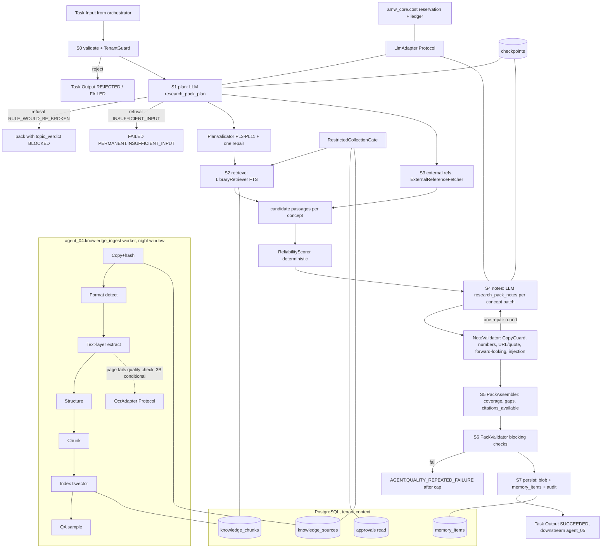

# Agent 04 — Research & Knowledge (blueprint)

| Field | Value |
|---|---|
| Status | Draft — documentation. Software: **Planned** (rule 6, rule 7) |
| Owner | Agent 04 Research & Knowledge; integration owner: Agent 01 (orchestrator) |
| Package | `agent_04_research_knowledge` (27 §7.2); prompts `prompts/agent_04_research_knowledge/`; evals `evals/agent_04_research_knowledge/` |
| Directive sections covered | §3.1 row 04 (source discovery, reliability scoring, evidence store, citation tracking), §1B.2a (Trading Knowledge Library, owned by 04), §3.3 Memory, §3.3 (contracts, failures, quality, observability, AI providers), §3.5 (prompt, eval, code standards), §4 (26 sections) |
| Owner decisions applied | D1 (3A production line; topic owner-given; no upload, no OAuth; spend limits; secrets; no render in market hours), D2 (full blueprint for 3A agents; REQUIRES REVIEW does not block 3A unless it changes a 3A design decision) |
| Binding contracts | GLOSSARY_AND_IDS.md, 03_COMMUNICATION_STANDARD.md, 04_DATABASE_ARCHITECTURE.md §5.10–5.11, 07_FAILURE_MANAGEMENT.md, 24_PRODUCTION_TYPES.md §3.2 (`agent_04.research_pack`), 27_ENGINEERING_STANDARDS.md |
| Shared docs referenced by name/§ only | 18_PRODUCTION_QUALITY_STANDARD.md §9, 13_COMPLIANCE_YOUTUBE_POLICY.md §5.11 and §8, 09_COST_AND_BUDGET.md, 08_SECURITY.md §3, §8, 3A_SLICE_SPEC.md (being written), ADR-001, ADR-005, ADR-007, ADR-013, KNOWLEDGE_LIBRARY_PLAN.md |
| Facts cited | RESEARCH_LOG IN-08 (copyright posture), IN-02/IN-03 (price-data lag; direction ban), PR-01/PR-02/PR-03 (LLM models, batch and caching, API vs subscription), INF-03/INF-04 (resource caps), INF-11 (RLS) |
| Marking | Every section ends its first line with **MVP** (3A / 3B / 3C, GLOSSARY §6.47 tier 0–3). 3A, 3B, 3C are the owner's build stages of D1 |
| Conventions | `(pending CCR)` = a contract item that does not exist in Wave A and is listed in the structured return for the integrator. `REQUIRES REVIEW (Phase 1): <need>` = unknown value; none is invented. No book text, private method or server detail appears in this document. |

---

## 1 Identity and mission
**MVP: 3A (core) · Tier 0.** Later tiers are marked in the rows.

### 1.1 Mission
Agent 04 turns an owner-given topic into a **research pack**: the concepts the video must explain, the evidence for each concept written as short notes in original words, and a citation for every note, drawn from (a) the tenant's private, channel-isolated knowledge library (§1B.2a), (b) references the owner supplies, and (c) allow-listed official references. It also **owns the knowledge library** itself: ingestion, chunking, indexing, per-collection access and retrieval. It flags a concept with no source; it never invents one (§1B.2a).

### 1.2 Where it sits
Stage `s04_research` (24 §3.1 example: `agent_04.research_pack`, `AI_IO`, depends on the topic stage). In 3A the topic stage is replaced by the owner's topic entered with the job (D1: Agents 02/03 come later), so the task input is built by the orchestrator from that entry. Downstream: Agent 05 (script), Agent 06 (claim extraction and verification), Agent 16/S2 (uniqueness and compliance gates), Agent 03 (topic tree, 3C).

### 1.3 Authority boundaries
| Agent 04 **decides** | Agent 04 **does not decide** (owner of the decision) |
|---|---|
| which concepts to research for the topic (inside the topic's scope) | the topic, the angle, the series slot (owner in 3A; Agent 03 later) |
| which library chunks and reference passages are candidates for a concept | what the script says, in what order, or in what words (Agent 05) |
| the reliability tier of each source (deterministic table) | whether a claim is true or contradicted (Agent 06: independent verification, contradiction detection) |
| whether a note is usable for the script (forward-looking and copy-guard exclusions) | publication, compliance verdicts, near-copy and uniqueness decisions (Agent 16, S2; Agent 16 has final authority, plan Q5) |
| whether a restricted chunk may be *retrieved* (release check, deterministic) | whether "our method" material **may be released** (the owner, approval kind `KNOWLEDGE_RELEASE`, S7) |
| which sources become library rows (after the owner registered them) | licence/ownership of a source (owner declaration, Q25; `UNKNOWN` blocks ingestion) |
| coverage status and gaps of its own pack | job routing, retries, revision loops (orchestrator; 07 §9) |
It never creates tasks (only the orchestrator does), never approves anything, never changes budgets, never writes outside its tables, never calls the YouTube API (zero quota units), never uploads (D1) and has no tool-use for the model: the LLM can only return JSON that code validates.

### 1.4 Success criteria (measurable; targets are config and set in 3B)
| ID | Criterion | Measure |
|---|---|---|
| SC-1 | Every note usable by the script carries a resolvable citation | 100 % (deterministic; blocks the task) |
| SC-2 | No cross-tenant or cross-channel read | 0 occurrences in the tenancy suite and in production logs |
| SC-3 | No restricted "our method" chunk in a pack without an `APPROVED` release and a method topic | 0 occurrences |
| SC-4 | No note carries a forward-looking statement, a recommendation, a return claim or a promotion as usable content | 0 occurrences |
| SC-5 | No note reproduces source wording above the copy-guard thresholds | 0 notes pass the guard above threshold |
| SC-6 | Concepts without a source are flagged (`UNSOURCED`), not filled | 100 % flagged; 0 invented sources |
| SC-7 | Pack quality on the golden-sample topics: share of concepts `SOURCED`, retrieval relevance | measured in 3B; thresholds **REQUIRES REVIEW (Phase 1): owner sets after the first measurement (ADR-013 §2.5)** |
| SC-8 | Cost per pack stays within `resource_budget` | 0 breaches; breach ⇒ suspend (09, D1) |
| SC-9 | Replays create no duplicate pack | 1 pack per (job, iteration) |

---

## 2 Functional requirements
**MVP: FR-1…FR-12 are 3A except where marked. Tier 0 unless marked.**

### 2.1 Task types
| Task type | Status | Purpose | Trigger | MVP |
|---|---|---|---|---|
| `agent_04.research_pack` | canonical (24 §3.2) | research pack for one job iteration | orchestrator creates it when `s04_research` becomes ready | 3A |
| `agent_04.knowledge_ingest` | **(pending CCR)**, named in ADR-013 §2.1 | ingest one registered source: extract, structure, chunk, index, QA | owner action after source registration; scheduled in the night window | 3A (text layer only), 3B (QA sampling; OCR if K4 requires), 3C (client libraries) |
Agent 04 files no other task type. Capability use: `llm` (research pack); `doc_extract` **(pending CCR: new `capability` value, ADR-013 §2.9)** (ingest).

### 2.2 Requirements
| ID | Requirement | Why | When / trigger | Inputs | Outputs | Dependants | MVP |
|---|---|---|---|---|---|---|---|
| FR-1 | Validate the task input, the tenant context and every reference before any work (03 §7) | rule 9; 07 `PERMANENT.*` | start of the task | Task Input | structured rejection or go | all | 3A |
| FR-2 | Plan the research: topic → concepts, evidence needs, queries; refuse topics that are themselves forbidden calls (FIN-R1…R8 by rule pack) | no research spent on forbidden topics; answer-key cases (§1B.2) | after FR-1 | topic, rule packs, collection list | `ResearchPlan` or refusal | FR-4, 05 | 3A |
| FR-3 | Honour revision gaps: close or explain each gap from Agent 06/16 | revision loops (24 §3.3) | `revision` present | gaps, prior pack | concepts targeting gaps | 06, 16 | 3A |
| FR-4 | Retrieve candidate chunks from the tenant's library per concept: PostgreSQL full-text search filtered by `org_id`, `channel_id`, collection, source status, ownership and the restricted-collection gate (ADR-013 §2.4) | channel-isolated library (§1B.2a) | per concept | plan queries | ranked candidates with citation metadata | FR-7 | 3A |
| FR-5 | Take owner-supplied and allow-listed official references as additional sources (fetch, hash, extract text) | library may be empty in 3A (ADR-013 §4); owner gives material | per reference | `owner_references` | passages + source records | FR-7 | 3A |
| FR-6 | Score reliability per source: deterministic tier from source kind, ownership and domain class | §3.1 row 04 "reliability scoring" | per source | source metadata | tier + score | FR-8, 05, 06 | 3A |
| FR-7 | Write evidence notes in original words with citations (LLM step), then run the deterministic guards: copy guard, number match, URL/quote, forward-looking exclusion, injection handling | concepts not expression (§1B.2a, IN-08, 13 §8); FIN-R3/R13 | per concept batch | passages | validated notes | FR-8 | 3A |
| FR-8 | Assemble the pack: coverage per concept, gaps, `citations_available` (shape accepted by `agent_06.claim_extraction.input`), further-reading credits, method flags | citation tracking; "flag, not invent" | after FR-7 | notes, sources | pack JSON | 05, 06, 16/S2 | 3A |
| FR-9 | Persist the pack write-once and record the memory pointer; write audit entries of knowledge access (ids only) | evidence store; §3.3 Memory | end of task | pack | blob, `memory_items` row, audit rows | 05, 06, later iterations | 3A |
| FR-10 | Ingest a source: copy and hash, detect format, extract text (text layer first), detect structure, chunk by section, index, QA sample (ADR-013) | §1B.2a, plan §2 | `agent_04.knowledge_ingest` | source row | `knowledge_chunks`, source `INDEXED` | FR-4 | 3A text layer only; OCR 3B conditional; client libraries 3C / Tier 1 |
| FR-11 | Report restricted material that was relevant but not released (`restricted_pending`), so the orchestrator can ask the owner for a `KNOWLEDGE_RELEASE` approval | Q26, FIN-R12 | method topic with unreleased chunks | gate result | pack field | 01, S7 | 3A |
| FR-12 | Measure retrieval quality inputs (passage relevance assessments, "concept not found although present" signals) | ADR-013 §2.5 decision rule for embeddings | every pack | assessments | metrics | 3B analysis | 3A records; 3B analyses |
| FR-13 | Reuse a prior pack for a Shorts/parent-child job or a revision iteration (`prior_pack_ref`) instead of re-researching unchanged concepts | §1A.8 (Shorts cut from the same research), cost | input carries `prior_pack_ref` | prior pack | merged pack | 05 | 3C (revision reuse in 3A only for gaps) |
| FR-14 | Topic-tree support: concept → sub-concept → mistakes → psychology map for Agent 03 | §1B.2a content plan | Agent 03 task (not defined) | library | — | 03 | 3C; **REQUIRES REVIEW (Phase 1): no task type exists for it (24 §3.2); not designed here** |

### 2.3 Out of scope (explicit)
Web-wide search and discovery (no search provider has a research-log entry; 3C, §12); embeddings (ADR-013 §2.5, only if measured); topic selection; script writing; fact verification; image or figure extraction (never stored, plan §1.3); OCR before K4 is answered; any YouTube call.

---

## 3 Non-functional requirements
**MVP: 3A unless marked. Values are config or REQUIRES REVIEW; none is invented. ESTIMATE = design value, replaced by MEASURED in 3B.**

| ID | Category | Requirement | Verification | MVP |
|---|---|---|---|---|
| NFR-1 | Isolation | Every read and write is scoped by `org_id` and `channel_id` (and collection for retrieval); RLS is the second line | tenancy suite (08 §8.2), DC TN-01…TN-10 | 3A |
| NFR-2 | Determinism | All decisions in §6.1 are pure, unit-tested functions; the LLM only proposes concepts and notes | unit tests; golden `deterministic_core` | 3A |
| NFR-3 | Idempotency | One pack per (job, iteration); a replay returns the stored result; LLM calls keyed by `llm.call` (03 §9.2) | replay test | 3A |
| NFR-4 | Bounded work | LLM calls ≤ `resource_budget.max_llm_calls`; concepts, queries, passages per call, repair rounds are config caps; one repair per failing note (07 §9) | cap tests | 3A |
| NFR-5 | Cost | Every LLM call has a reservation and a ledger row; a breach suspends (`AWAITING_BUDGET`); no automatic increase (rule 8, D1, ADR-007 §8) | breach test | 3A |
| NFR-6 | Confidentiality | Chunk text, passage text and notes never appear in logs, metrics, error messages, audit rows or eval outputs; chunk text reaches only the tenant's own LLM calls | log-leak test (DC TN-09) | 3A |
| NFR-7 | Latency | Pack end-to-end and retrieval latency: **MEASURED in 3B**; no target before. Retrieval must not block the queue's other tasks (own transaction, statement timeout config) | performance test | 3B |
| NFR-8 | Capacity | Library size supported on the shared VPS within the factory caps (INF-03, INF-04): **REQUIRES REVIEW (Phase 1): measured after K1 gives the collection size** | measured in 3B | 3B |
| NFR-9 | Availability | Stateless between steps; all state in DB/storage; restart resumes from the latest checkpoint (07 §10). No availability promise beyond the shared VPS (§1 item 11 of §1C) | failure-injection | 3A |
| NFR-10 | Languages | English, Marathi, Hindi, mixed; Devanagari text-search configuration **REQUIRES REVIEW (Phase 1)** (ADR-013 §2.4: `simple` fallback until verified); token cost per language measured (ADR-007 §2.9) | retrieval test set in 3B | 3A (fallback), 3B (measure) |
| NFR-11 | Auditability | Every restricted-gate decision, release lookup, cross-tenant rejection and library read count is audited (ids only) | audit test | 3A |
| NFR-12 | Time | UTC `timestamptz` only; no calendar dates or clock times in prompts or rules (owner rule C.4); the night window applies to ingestion only (ADR-013) | lint | 3A |
| NFR-13 | Money | Integers (`_micros`) only | type check | 3A |
| NFR-14 | Maintainability | One package, typed `Protocol`, DI, ruff/mypy strict (27 §7) | CI | 3A |

---

## 4 Internal architecture
**MVP: 3A for all boxes drawn solid; dashed = 3B/3C. Tier 0.**

Control flow is code; the LLM has no tools and no ability to call anything. `S1` and `S4` are the only model calls. Everything else is deterministic (§6).

---
