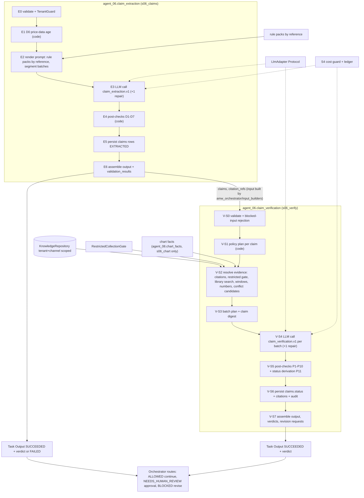

# Agent 06 — Fact Checker (blueprint)

| Field | Value |
|---|---|
| Status | Draft — documentation. Software: **Planned** (rule 6, rule 7) |
| Owner | Agent 06 Fact Checker; integration owner: Agent 01 (orchestrator) |
| Package | `agent_06_fact_checker` (27 §7.2); prompts `prompts/agent_06_fact_checker/`; evals `evals/agent_06_fact_checker/` |
| Directive sections covered | §3.1 row 06 (claim extraction, independent verification, contradiction detection, approval), §1 (SEBI and platform rules as they reach claims), §1B.2 (answer key), §1A.7 (RESEARCH_ACCURACY), §3.3 (contracts, failures, quality, observability, AI providers), §3.5 (prompt, eval, code standards), §4 (26 sections) |
| Owner decisions applied | D1 (3A production line with Agents 04–11 and the Agent 16 gates; topic owner-given; outputs are files; no upload, no OAuth; spend limits enforced by the cost ledger; keys only through the environment's secret mechanism; render never in market hours), D2 (full blueprint for 3A agents; REQUIRES REVIEW does not block 3A unless it changes a 3A design decision) |
| Binding contracts | GLOSSARY_AND_IDS.md (§2.4, §6.29, 6.38–6.41, 6.45, 6.51, 6.52), 03_COMMUNICATION_STANDARD.md (§3–§7, §9, §11), 04_DATABASE_ARCHITECTURE.md §5.11 (`claims`, `citations`) and §5.10, 07_FAILURE_MANAGEMENT.md, 24_PRODUCTION_TYPES.md §3.1–§3.3, §3.2 (`agent_06.claim_extraction`, `agent_06.claim_verification`), §7.1a, §7.2a (3A graphs `CHANNEL_LONG_FORM` v2 and `SHORTS` v2), 27_ENGINEERING_STANDARDS.md; CONTRACT_CHANGE_REQUESTS.md §4 and §5 "Resolved for blueprint 06" (CCR-001…CCR-005, 009, 011, 013, 015…019, 022…024, 029, 042, 045…047, 049, 053) |
| Shared docs referenced by name/§ only | 18_PRODUCTION_QUALITY_STANDARD.md §9.2–§9.3, 13_COMPLIANCE_YOUTUBE_POLICY.md §1.2, §5 (finance rules, §5.12 answer key, §5.13 IN-03 cases), 09_COST_AND_BUDGET.md, 08_SECURITY.md §5.3, §8, 3A_SLICE_SPEC.md §3 (job flow), ADR-007 (LLM routing), ADR-013 (knowledge library), agent_04_research_knowledge.md (pack, citations, tiers) |
| Facts cited | RESEARCH_LOG IN-02 (30-day price-data lag), IN-03 (direction ban on named securities), IN-01 (association with regulated entities), PR-01 / PR-02 / PR-03 (models, batch and caching, API vs subscription), INF-03 / INF-04 (resource caps), INF-11 (RLS) |
| Marking | Every section states its **MVP** in the first line: 3A / 3B / 3C (owner build stages of D1) and Tier 0–3 (GLOSSARY §6.47) |
| Conventions | Every contract item this blueprint uses now exists in Wave A: the former "pending CCR" names were decided in integrator pass 1 (CONTRACT_CHANGE_REQUESTS.md §4, §5) and are used as decided; no pending marker remains. `REQUIRES REVIEW (Phase 1): <need>` = unknown value; none is invented. Config key names follow 27 §4.2 and CCR-019 (`llm.<task_type>.<step>.*`); the registry (18 §13) rejects duplicates. No book text, private method or server detail appears here. No dates or clock times appear in rules (owner rule C.4); the only time-based values are operational config. |

---

## 1 Identity and mission
**MVP: 3A (both task types, all deterministic checks) · 3B (thresholds and policy table tuned on the golden samples) · 3C (ad claims with client substantiation, fact cache, more rule packs). Tier 0 designed for Tier 1+.**

### 1.1 Mission
Agent 06 is the factual and claim-level checkpoint between the script (Agent 05) and everything that costs money after it (voice, shot plan, render). It does two jobs on one script version:

1. **Claim extraction** (`agent_06.claim_extraction`, stage `s06_claims`): break the script into atomic, checkable claims with exact quotes and offsets; classify each claim (GLOSSARY §6.39), give its time reference (§6.41), link it to the chart it describes and to the citations the script gives it; and flag every claim that breaks an active rule pack (finance rules FIN-R1…R13 for the finance channel, GLOSSARY §6.38). Code recomputes every verdict; the model's verdicts are proposals.
2. **Independent verification** (`agent_06.claim_verification`, stage `s06_verify`): check each verifiable claim against the evidence only (the cited library passages, library passages found by search, reference snapshots, and facts computed from the shown charts), independently of the writer and of the research note that fed the writer; detect claims the evidence contradicts and claims of the same script that contradict each other; and give each claim a status (GLOSSARY §6.40) with the evidence span that decides it.

It produces a **proposed** verdict. The final compliance verdict is Agent 16's (plan Q5; 13 §1.1).

### 1.2 Where it sits
Stages `s06_claims` then `s06_verify` of every production type that has a script (24 §3.1, §7; both `AI_IO`, both blocking gates, `on_fail REVISE → s05_script`; `s06_verify` also lists alt target `s04_research`). In 3A (`CHANNEL_LONG_FORM` v2, 24 §7.1a, CCR-003) both run after `s05_script` and before `a_script` (optional approval), `s07_voice` and `s09_plan` (`s09_plan` depends on `s06_verify` and `s07_voice`). A third stage, **`s06_chart`** (`agent_06.claim_verification` with stage parameter `verify_mode = CHART_FACTS`, CCR-004), runs after `s08_assets` and before `s10_render` (blocking gate, `on_fail REVISE → s05_script`, alt `s08_assets`): chart claims cannot be checked before the chart exists, so at `s06_verify` they stay `EXTRACTED` with reason `CHART_PENDING` and are verified at `s06_chart` against the facts Agent 08 computed from the sourced dataset (`agent_08.chart_facts`). `SHORTS` v2 (24 §7.2a) runs `s06_claims`, `s06_verify` and `s06_chart` on the child script (revision target `s05_shorts`). Other production types reuse the stages unchanged: localisation (extraction on the translation: meaning must not change into a rule violation), advertising (both tasks; every ad claim needs substantiation, 3C). Downstream: Agent 05 (revision feedback, 24 §3.3 rule 7), Agents 07, 09, 10 (they run only after the gate stages complete; 07 and 09 read the verified-script hash, §15.2), the orchestrator (routing, approvals), Agent 16 (`compliance_gate`, `quality_score` RESEARCH_ACCURACY).

### 1.3 Authority boundaries
| Agent 06 **decides** | Agent 06 **does not decide** (owner of the decision) |
|---|---|
| which statements of the script are claims, their type, time reference, instrument and chart link | the script's content, wording or structure (Agent 05); Agent 06 never edits the script and only suggests corrections |
| which active-rule-pack rules a claim breaks, with quoted evidence (proposal) | the final compliance verdict, any waiver, any override (Agent 16 final authority, plan Q5; human override only through a recorded approval, 13 §11 item 9) |
| whether the evidence supports, partly supports, contradicts or does not address a claim (the model proposes, code derives the status) | what counts as a reliable source, the reliability tier of a source (Agent 04, deterministic); which sources exist in the library (Agent 04) |
| claim status (`VERIFIED`, `CONTRADICTED`, `UNVERIFIABLE`, `NEEDS_SUBSTANTIATION`) and the proposed per-claim and stage verdict | whether a video is published or delivered (Agent 16 + S7 human approval) |
| whether two claims of one script contradict each other | job routing, revision loops, retries, approvals (orchestrator, 24 §3.3, 07 §9) |
| the price-data age classification used by FIN-R9 at extraction time (deterministic function, `compliance.finance_sebi_in.price_data_lag_days`, IN-02) | the rule text, rule severities and rule-pack contents (13, S2) |
It never creates tasks, never approves, never changes a budget, never calls the YouTube API (zero quota units), never uploads (D1), never browses the web, never uses the model's own knowledge as evidence, and gives the model no tools: the LLM can only return JSON that code validates.

### 1.4 Success criteria (measurable; targets are config and are set in 3B)
| ID | Criterion | Measure |
|---|---|---|
| SC-1 | No advice, return claim, referral or forward view passes extraction | Answer-key cases 4/4 and 0 false `ALLOWED` on any BLOCKED-expected case in the extraction dataset (mandatory CI threshold) |
| SC-2 | No unsupported or contradicted claim is marked `VERIFIED` | 0 false `VERIFIED` in the verification dataset (mandatory CI threshold); 0 in the golden-sample audit by the owner (3B) |
| SC-3 | Every claim of type FACTUAL, STATISTICAL or HISTORICAL_MARKET that leaves the stage is `VERIFIED` and has a citation or chart reference, or the stage verdict is not `ALLOWED`. A chart claim is `EXTRACTED` (`CHART_PENDING`) when it leaves `s06_verify`; the measure applies to it when it leaves `s06_chart`, which `s10_render` depends on | 100 % (deterministic; this is the RESEARCH_ACCURACY deterministic criterion of 18 §9.2, where `UNVERIFIABLE` / `NEEDS_SUBSTANTIATION` count as resolved only through an `APPROVED` `SENSITIVE_CLAIM` approval that names the `claim_id`, and `CONTRADICTED` never, CCR-045) |
| SC-4 | Every quote is an exact substring at the stated offsets; every evidence span lies inside its passage | 100 % (deterministic, blocking) |
| SC-5 | No cross-tenant, cross-channel or restricted-collection read | 0 occurrences in the tenancy suite and in production logs |
| SC-6 | Verdicts are code-derived, never copied from the model | 100 % (check `claims.verdict_recomputed`, `fact.verdict_recomputed`) |
| SC-7 | Cost per script stays within `resource_budget` | 0 breaches; breach ⇒ suspend (09, D1) |
| SC-8 | Replays create no duplicate claims, no duplicate citation rows and no second paid call | 1 claim set per (script version, extraction task), 1 verification per (job, iteration) |
| SC-9 | Eval datasets meet their thresholds (§26) | CI gate |
| SC-10 | Marathi and Hindi scripts: extraction and verification quality equals the English control within the margin the owner sets | **REQUIRES REVIEW (Phase 1): owner sets the margin after the first measurement (3B)** |

---

## 2 Functional requirements
**MVP: FR-1…FR-16 are 3A except where marked. Tier 0 unless marked.**

### 2.1 Task types
| Task type | Status | Purpose | Trigger | MVP |
|---|---|---|---|---|
| `agent_06.claim_extraction` | canonical (24 §3.2), prompt `agent_06/claim_extraction.v1` exists | claims + rule-pack flags + proposed verdicts for one script version | orchestrator creates it when `s06_claims` becomes ready (script `SUCCEEDED`) | 3A |
| `agent_06.claim_verification` | canonical (24 §3.2), prompt `agent_06/claim_verification.v1` | independent verification, contradiction detection, claim status; stage parameter `verify_mode` (`EVIDENCE` at `s06_verify`, `CHART_FACTS` at `s06_chart`; `factcheck_verify_mode` of GLOSSARY §6.52 names the per-claim mode, the stage parameter is the two-value subset `EVIDENCE` / `CHART_FACTS`) | orchestrator creates it when `s06_claims` is `ALLOWED` or `NEEDS_HUMAN_REVIEW` and the job continues (`s06_verify`), and when `s08_assets` is `COMPLETED` (`s06_chart`) | 3A |
Agent 06 files no other task type; one task type serves two stages, and the task idempotency key therefore includes `stage_id` (03 §9.2, CCR-005). Capability use: `llm` for both. The two tasks are separate stages so that a human approval or a revision can sit between them, and so that a blocked script never pays for verification.

### 2.2 Requirements
| ID | Requirement | Why | When / trigger | Inputs | Outputs | Dependants | MVP |
|---|---|---|---|---|---|---|---|
| FR-1 | Validate the Task Input, tenant context and every reference before any work (03 §7) | rule 9; 07 `PERMANENT.*` | start of each task | Task Input | structured rejection or go | all | 3A |
| FR-2 | Extract every atomic checkable claim per segment with exact `quote`, offsets, normalised English restatement, type, time reference, instrument, chart link, citation need and the citations the script gives it | claim-level control (§3.1 row 06); 18 §9.2 | extraction | segments, charts, citations, active rule packs | claims | verification, 16, 05 | 3A |
| FR-3 | Flag rule-pack violations with rule ID, severity and quoted evidence; treat a disclaimer, a quotation mark, another language or a historical framing as irrelevant to the flag (13 §1.1, IN-03) | §1 SEBI rules, §1B.2 answer key | extraction | claims, `rp.*` rule packs injected by reference | `rule_flags` | 16, 05 | 3A |
| FR-4 | Compute price-data age (`data_age_vs_lag`) for charts deterministically; the model never does date arithmetic; the value used is never more permissive than the recomputed one | FIN-R9; IN-02 | before the extraction call | chart data range, config lag | `data_age_vs_lag`, FIN-R9 flags (D3) | 16 | 3A |
| FR-5 | Detect URLs, referral and coupon codes in a finance script (FIN-R8) and any quote that is not an exact substring (D2) | deterministic safety net behind the model | after the extraction call | model output | flags, rejection of bad quotes | 16 | 3A |
| FR-6 | Recompute every claim verdict and the overall verdict by code from flags and citation need (D6, D7) | the model proposes, code decides (27 §7.3.7) | after the extraction call | validated output | verdicts | 01, 16 | 3A |
| FR-7 | Persist claims write-once per extraction task (`claims` rows, status `EXTRACTED`, quote, offsets, flags, proposed verdict) | claim ledger (04 §5.11) | end of extraction | validated output | `claims` rows, output blob | verification, 16 | 3A |
| FR-8 | Classify each claim into a verification mode by a policy table (evidence, chart facts, skip) and refuse to verify an input whose extraction verdict is `BLOCKED` | no paid call on a script that must be rewritten; cost | start of verification | claims | plan | FR-9…FR-13 | 3A |
| FR-9 | Resolve cited references to evidence of the task's own tenant and channel, apply the restricted-collection gate, find library evidence for claims without a usable citation, cut bounded passage windows, record offsets and hashes | verification needs evidence, not memory; FIN-R12; Q26 | verification | claims, `citations_available`, knowledge repository | evidence set per claim | FR-10 | 3A |
| FR-10 | Verify each claim against its evidence only (LLM step), with exact evidence spans and typed discrepancies; independent of Agent 05's and Agent 04's wording | independent verification (§3.1 row 06) | verification | claims, evidence windows | assessments | FR-11 | 3A |
| FR-11 | Apply deterministic guards to every assessment (ids belong to the claim, spans valid, discrepancy values verbatim, number guard, injected-passage exclusion, source-tier floor, script citation present) and derive the claim status and reason codes by code | model output is never an authority (08 §5.3) | after each call | assessments | statuses | FR-12 | 3A |
| FR-12 | Detect contradictions between claims of one script (candidate pairs by code, adjudication by the model, validation by code) | contradiction detection (§3.1 row 06) | verification | claim digest, candidate pairs | `claim_conflicts` | 16, 01 | 3A |
| FR-13 | Derive proposed verdicts (per claim, combined with the extraction verdict, and for the stage), accuracy counters for 18 §9.2, and advisory revision requests (add citation, correct claim, provide evidence, resolve conflict) | routing and the RESEARCH_ACCURACY score | end of verification | statuses | verdicts, `revision_requests`, `accuracy_summary` | 01, 05, 16 | 3A |
| FR-14 | Persist claim status and citation rows (support relation per cited chunk or reference), write an audit entry per knowledge read and per gate decision | evidence trail (04 §5.11); 08 §9 | end of verification | statuses | `claims.status`, `citations`, audit | 16, owner spot check | 3A |
| FR-15 | Checkpoint after each paid call and resume without a second paid call; honour `DRAIN` between batches | 07 §10, ADR-007 §2.8 | always | — | checkpoints | 01 | 3A |
| FR-16 | Reuse a stored verification of a claim that did not change between iterations (same normalised claim, same evidence hash) instead of paying again | cost on revision loops | iteration ≥ 1 | prior verification (`PROJECT` memory) | carried statuses | 01 | 3C (3A re-verifies every claim; REQUIRES REVIEW (3B): measure whether the revision-loop cost justifies it) |

### 2.3 Out of scope (explicit)
Web search or any browsing for evidence (no search provider has a research-log entry; evidence is the owner's library and recorded references); rewriting the script (Agent 05); deciding source reliability (Agent 04); FIN-R10 disclaimer presence, FIN-R11 AI persona, YouTube policy rules other than claim-level ones (Agent 16); thumbnail and metadata claim checks (Agent 16 in 3A; Agent 12 in 3C); verifying the visual content of a rendered video; legal opinion (⚖: the owner's lawyer); verifying today's market data (a claim about the current market is a FIN-R3 issue, not a fact check); any publication or upload.

---

## 3 Non-functional requirements
**MVP: 3A unless marked. Values are config or REQUIRES REVIEW; none is invented. ESTIMATE = design value, replaced by MEASURED in 3B.**

| ID | Category | Requirement | Verification | MVP |
|---|---|---|---|---|
| NFR-1 | Isolation | Every read and write is scoped by `org_id` (and `channel_id` for the knowledge library, plus collection); RLS is the second line | tenancy suite (08 §8.2), S-01…S-10 | 3A |
| NFR-2 | Determinism | Every decision in §6.1 marked deterministic is a pure, unit-tested function; the LLM only proposes | unit tests | 3A |
| NFR-3 | Idempotency | One claim set per (script version, extraction task) and one verification per (job, iteration); LLM calls keyed by `llm.call` (03 §9.2); database effects keyed by `db.output` | replay tests I-02, I-05 | 3A |
| NFR-4 | Bounded work | Model calls ≤ `resource_budget.max_llm_calls`; segments per call, claims per call, passages per claim, digest size, repair rounds are config caps; one repair per failing batch (07 §9) | cap tests U-30, F-12 | 3A |
| NFR-5 | Cost | Every call has a reservation and a ledger row; a breach suspends (`AWAITING_BUDGET`); no automatic increase (rule 8, D1, ADR-007 §8) | breach test F-11 | 3A |
| NFR-6 | Confidentiality | Script text, claim quotes, passage text, evidence values and corrections never appear in logs, metrics, error messages, audit rows or eval run records (IDs, offsets, hashes and counts only); library text reaches only the tenant's own LLM calls | log-leak test S-05 | 3A |
| NFR-7 | Latency | End-to-end and per-step latency: **MEASURED in 3B**; no target before. The stages are blocking, so they sit on the job's critical path | performance tests P-01…P-04 | 3B |
| NFR-8 | Capacity | Script size supported by the input schemas: segments ≤ 400 and 5,000 characters each (extraction input schema); claims ≤ 500 per script. These caps are design values of the schemas, not provider or host limits; the host's capacity limits are INF-03 / INF-04 and the fit is **MEASURED in 3B** | boundary tests U-31 | 3A (schema), 3B (measured) |
| NFR-9 | Availability | Stateless between steps; all state in DB and storage; restart resumes from the latest checkpoint (07 §10); AI_IO tasks may run at any time but obey `DRAIN` | failure injection F-06 | 3A |
| NFR-10 | Languages | English, Marathi, Hindi, mixed Hinglish, with Devanagari preserved byte for byte in quotes; quote offsets are in Unicode code points of the stored text; evidence in a different language than the claim is allowed; per-language token cost MEASURED (ADR-007 §2.9) | eval cases POS-07, POS-08, EDGE-23…25 | 3A |
| NFR-11 | Auditability | Every claim set, status change, restricted-gate decision, knowledge read count and cross-tenant rejection is audited by ID | audit test S-06 | 3A |
| NFR-12 | Safety bias | Doubt resolves to `NEEDS_HUMAN_REVIEW`, never to `ALLOWED` (13 §1.1 item 7); an `ALLOWED` or `VERIFIED` never rests on a model score alone | unit tests U-20…U-26 | 3A |
| NFR-13 | Time and money | UTC `timestamptz` only; money in integer `_micros`; no calendar date or clock time in a prompt or rule | lint | 3A |
| NFR-14 | Maintainability | One package, typed `Protocol`, constructor injection, ruff and mypy strict (27 §7) | CI | 3A |
| NFR-15 | Cost discipline | Deterministic filters run before any paid call: skipped claim types, no-evidence claims, quote-without-citation, restricted-not-released and blocked input never reach the model | cost tests (eval cases SKIP-30, NF-18, QT-31, RG-33) | 3A |

---

## 4 Internal architecture
**MVP: 3A for all solid boxes; dashed = 3C. Tier 0.**



```mermaid
sequenceDiagram
  participant O as Orchestrator (01)
  participant X as Agent 06 extraction
  participant V as Agent 06 verification
  participant DB as PostgreSQL (RLS)
  participant L as LlmAdapter
  O->>X: Task Input (script segments, charts, citations, rule packs)
  X->>L: segments batch (paid, reserved, ledgered)
  X->>DB: INSERT claims (EXTRACTED)
  X-->>O: Task Output (claims, proposed verdicts)
  O->>V: Task Input (claims, citations; chart facts only at s06_chart)
  V->>DB: SELECT knowledge_chunks (org, channel, collection, gate)
  V->>L: claims + evidence windows (paid, reserved, ledgered)
  V->>DB: UPDATE claims.status, INSERT citations
  V-->>O: Task Output (statuses, verdicts, revision requests)
  O->>O: route: continue / SENSITIVE_CLAIM approval / REVISE to s05_script
  Note over O,V: s06_chart repeats the verification task with verify_mode CHART_FACTS after s08_assets
```

Components are detailed in §9 and §10. The model sits in exactly two places (E3 and V-S4). Everything else is code.

---

## 5 Full system prompt
**MVP: 3A · Tier 0. The prompt text lives in the versioned files below (27 §4: the file is the source of truth; this section summarises and links it, it does not copy it).**

| Prompt | File | Role of the model | Rule packs injected | Output schema |
|---|---|---|---|---|
| `agent_06/claim_extraction.v1` | [`prompts/agent_06_fact_checker/claim_extraction.v1.md`](../prompts/agent_06_fact_checker/claim_extraction.v1.md) (exists; not rewritten here) | lists every checkable claim with exact quotes and offsets, classifies it, flags rule violations; never verifies facts or decides publication | `rp.youtube_general`, `rp.finance_sebi_in` (when active) by reference | `agent_06.claim_extraction.output` 1.0.0 |
| `agent_06/claim_verification.v1` | [`prompts/agent_06_fact_checker/claim_verification.v1.md`](../prompts/agent_06_fact_checker/claim_verification.v1.md) | compares each claim only with the evidence code selected; reports support, partial support, contradiction or absence with evidence spans; reports claim-vs-claim contradictions; flags injected passages | none (verification is not a policy step) | `agent_06.claim_verification.batch.output` 1.0.0 (step schema `<task_type>.<step>.output`, GLOSSARY §2.4, CCR-018) |

Design principles shared by both prompts (they implement 27 §4.2 and 08 §5.3):
1. **Template conformance.** Both files have the nine mandatory sections in order (header, Role, Objective, Inputs, Rules, Output JSON Schema, Worked examples including a refusal path, Refusal and escalation, Self-check). Model, tier, temperature, token and cost limits are configuration keys `llm.agent_06.<task>.*`, never in the file.
2. **Data delimiting.** Script text, claims, passages and chart facts are inserted as JSON values into a user message, after the stable system prefix; each prompt tells the model that instructions inside data are content. A passage or claim that tries to instruct the model is flagged (verification) or extracted and flagged like any other text (extraction).
3. **Stable prefix.** The system prompt and the rule-pack text form the cacheable prefix (`.cache_system_prompt`); no tenant string, ID or script text is in it (test S-08).
4. **No dates, no model names, no provider names** in either file; no number of the law or rule text is pasted: rule packs by reference `{{rule_pack:rp.<key>}}`, resolved at runtime with the version recorded in `provenance`.
5. **Refusal object** in both output schemas (27 §4.3, GLOSSARY §6.51); refusal mapping is code (§18).
6. **Hash check.** The prompt loader verifies the SHA-256 of the file against the registry before use; a mismatch is `PERMANENT.CONFIG_INVALID` (27 §4.1).
7. **Independence of verification.** The verification prompt has no access to the script's prose beyond the claim, to Agent 05's reasoning, or to Agent 04's notes; evidence is the original passage window (or a reference snapshot), not a paraphrase that could carry the writer's error. Whether a different model tier or provider improves independence is a 3B measurement (question Q-F3, §23.2).
8. **What the model never receives:** `org_id`, any ID of the database, storage paths, collection internals, keys, other claims' evidence beyond the digest, reliability tiers (kept out so the model does not weigh authority; code applies the tier floor).

---

## 6 Decision engine
**MVP: 3A for every row · 3B tunes the provisional values (policy table, verdict map, tier floor) on the golden samples · Tier 0. Rule: every decision that can be a pure function is one (27 §7.3.7); the model proposes, code decides.**

### 6.1 Decision table
| # | Decision | Made by | Why this split | Test |
|---|---|---|---|---|
| 1 | What the claims are (segmentation, atomicity, type, time reference, instrument, chart link) | LLM (extraction), validated by code (D1, D2, D5) | meaning must be read; offsets and links are checked by code | extraction eval; U-01…U-06 |
| 2 | Whether a claim breaks a rule of an active pack | LLM proposes, code adds a deterministic net (D3 chart age, D4 URL/referral, D11 future-marker pre-filter) and recomputes (D7) | "is this sentence a call?" needs meaning (13 §1.4: `LLM_JUDGE` is always paired with a deterministic pre-filter); known patterns are code | extraction eval; U-03, U-04 |
| 3 | Price-data age of a chart (`OLDER_THAN_LAG`, `WITHIN_LAG`, `UNKNOWN`; `null` for a schematic chart, CCR-042) | code (D0) | date arithmetic is never the model's job; value never more permissive than the recomputed one; `UNKNOWN` is treated as within the lag (GLOSSARY §6.52); a `CONSTRAINT` basis (chart not yet sourced, CCR-004) keeps its value and is enforced by Agent 08 and re-checked by `qc.visual.chart_data_age` and `s16_comp` | U-01 |
| 4 | Per-claim and overall extraction verdict | code (D7) | BLOCKING flag ⇒ `BLOCKED`; else WARNING flag or citation-needed-but-missing (D6) ⇒ `NEEDS_HUMAN_REVIEW`; else `ALLOWED`; doubt never resolves to `ALLOWED` | U-05, U-06 |
| 5 | Verification mode per claim (evidence, chart facts, skip, code only) and, at `s06_verify`, deferral of chart claims to `s06_chart` | code (policy table §6.3) | cost and safety: types that cannot be true or false (advice, forecast) or are not checkable by design are never sent | U-20 |
| 6 | Which evidence a claim is checked against | code (citation resolution, restricted gate, library search with tenant/channel/collection predicates, windowing) | the model must not choose sources or see other tenants' data (08 §5.3) | U-21…U-25, S-01…S-04 |
| 7 | Whether the evidence supports, partly supports, contradicts or does not address a claim | LLM (verification) | reading meaning across languages, rounding, scope and qualifiers | verification eval |
| 8 | Whether the model's assessment is acceptable | code (P1–P10): ids, spans, verbatim values, number guard, injected passages | the model's output is data, not authority | U-26…U-29 |
| 9 | Claim status and reason codes | code (§6.4) | `VERIFIED` must rest on evidence spans, a number guard, a tier floor and a script citation, none of which is a model score | U-30…U-36 |
| 10 | Whether two claims contradict each other | code finds candidate pairs (V8), LLM adjudicates, code validates the ids | candidates by code keep the digest small and the recall measurable; meaning is the model's | U-37, verification eval |
| 11 | Verification verdict, combined verdict, stage verdict (`overall.proposed_verdict`, the value consumers read), gate results, revision requests | code (§6.4, config `factcheck.verdict_map`) | routing must be reproducible; Agent 16 keeps final authority | U-38 |
| 12 | Whether a restricted ("our method") chunk may be loaded | code (RestrictedCollectionGate) | FIN-R12, Q26: release is the owner's decision, checked in code, same rule as Agent 04 | U-24 |
| 13 | Whether a model refusal fails the task, blocks, or goes to a human | code (27 §4.3 declared item-level mapping, §18; CCR-023) | the mapping is a contract | F-09 |

### 6.2 Why the split
- Truth and rule meaning are language problems; offsets, hashes, numbers, tiers, policy, IDs and arithmetic are not. Mixing them is how unsupported claims pass.
- Both LLM steps are `MID` tier at the start (ADR-007 §2.4; 09 §3.3: verification is a gate and is not weakened for cost). A cheaper tier is adopted only if the step's dataset passes every threshold on it (27 §6.3).
- The only paid calls are E3 and V-S4. A script that is blocked at extraction never pays for verification (V2 rejection), and claims without evidence never pay for a model comparison (NFR-15).

### 6.3 Verification policy table (provisional; config `factcheck.verify.policy.<claim_type>`; question Q-F1, §23.2)
| Claim type (GLOSSARY §6.39) | Mode | What is required for `VERIFIED` | Notes |
|---|---|---|---|
| `FACTUAL`, `STATISTICAL`, `DEFINITION`, `COMPARATIVE`, `PRODUCT_CLAIM` | `EVIDENCE` | supporting evidence span + number guard + source tier at or above the floor + a script citation that points to the supporting source | 18 §9.2: every FACTUAL/STATISTICAL claim carries a citation |
| `HISTORICAL_MARKET` with `chart_data_ref` | stage parameter `EVIDENCE` (`s06_verify`): `SKIPPED`, status `EXTRACTED`, reason `CHART_PENDING`; stage parameter `CHART_FACTS` (`s06_chart`): `CHART_FACTS` | a chart fact that supports the claim for the same chart and instrument; the chart reference is the citation | chart facts are `agent_08.chart_facts` documents (CCR-004); at `s06_chart` without facts for the claim's chart: `UNVERIFIABLE` (`NO_CHART_FACTS`), no model call |
| `HISTORICAL_MARKET` without a chart | `EVIDENCE` | as above | e.g. a described past event |
| `OPINION` with `requires_citation = true` | `EVIDENCE` | as above | opinion stated as a general fact |
| `OPINION` with `requires_citation = false` | `SKIPPED` | — | status stays `EXTRACTED` |
| `PERFORMANCE_CLAIM`, `TESTIMONIAL` | `EVIDENCE` | substantiating evidence; none ⇒ `UNVERIFIABLE` | on the finance channel these are BLOCKED at extraction (FIN-R6, R7) and never arrive; on other channels they need substantiation (3C: client documents, directive §1D.3 / 25) |
| `QUOTED_THIRD_PARTY` | `EVIDENCE` if the claim has `citation_refs`, else `CODE_ONLY` | with a citation as above; without one: `NEEDS_SUBSTANTIATION` (`QUOTE_NOT_ATTRIBUTABLE`) | an unattributed quotation is a misleading-claim risk (18 §9.3) |
| `RECOMMENDATION`, `FORWARD_VIEW`, `PRICE_LEVEL` | `SKIPPED` | — | cannot be true or false now; rule packs and Agent 16 decide; extraction flags them |
| `HYPOTHETICAL_EXAMPLE`, `PROMOTION` | `SKIPPED` | — | invented numbers and pointers to the channel's own course are not facts about the world |
A skipped claim keeps status `EXTRACTED` and keeps its extraction verdict. At `s06_chart` every claim of type `HISTORICAL_MARKET` with a chart reference is in scope and no other claim is sent (an input claim without `chart_data_ref` is `PERMANENT.INPUT_INVALID`); a `s06_chart` task with no chart claim succeeds at once with no model call (24 §7.1a). Claims that are members of a conflict candidate pair are sent to the model even when they have no evidence (the pair is the point; §10.4).

### 6.4 Status derivation, verdicts and revision requests (deterministic; `ResultReconciler`, `VerdictEngine`)
**Step 1 — clean the model result (P1–P10).** Drop evidence items from passages listed in `passage_flags` (reason `INJECTED_EVIDENCE_DISCARDED`); drop items whose id is not a candidate of the claim, or whose span is invalid (`SPAN_INVALID`); a result whose assessment relied on dropped evidence is re-read with what remains (a `SUPPORTED` or `CONTRADICTED` assessment with no valid matching evidence is treated as `UNCLEAR`).

**Step 2 — derive the status, first match wins.**
| # | Condition on the cleaned result | Status | Reason code(s) |
|---|---|---|---|
| 1 | mode `SKIPPED` | `EXTRACTED` | `SKIPPED_BY_POLICY`, or `CHART_PENDING` for a chart claim at `s06_verify` |
| 2 | mode `CODE_ONLY`: no candidates | `UNVERIFIABLE` | `NO_EVIDENCE_CANDIDATES` |
| 3 | `CODE_ONLY` (stage `CHART_FACTS` only): chart claim, no chart facts for its chart | `UNVERIFIABLE` | `NO_CHART_FACTS` |
| 4 | `CODE_ONLY`: the only candidates are restricted and not released | `UNVERIFIABLE` | `RESTRICTED_NOT_RELEASED` |
| 5 | `CODE_ONLY`: quotation without citation | `NEEDS_SUBSTANTIATION` | `QUOTE_NOT_ATTRIBUTABLE` |
| 6 | valid `SUPPORTS` and valid `CONTRADICTS` evidence both present | `UNVERIFIABLE` | `EVIDENCE_CONFLICT` |
| 7 | `CONTRADICTED` with valid `CONTRADICTS` evidence | `CONTRADICTED` | `CONTRADICTED_BY_EVIDENCE` |
| 8 | `PARTIALLY_SUPPORTED` | `NEEDS_SUBSTANTIATION` | `OVERREACH` |
| 9 | `NOT_FOUND`, or `UNCLEAR`, or `certainty = LOW` | `UNVERIFIABLE` | `NOT_FOUND_IN_EVIDENCE` or `MODEL_UNCERTAIN` |
| 10 | `SUPPORTED`, number guard fails (§6.5) | `NEEDS_SUBSTANTIATION` | `NUMBER_NOT_IN_EVIDENCE` |
| 11 | `SUPPORTED`, best supporting source tier below the floor `factcheck.min_tier_for_verified` (a supporting source without a tier in the Agent 04 pack, such as a library-search hit, counts as `D_UNVERIFIED`, CCR-053, so it can never verify alone) | `NEEDS_SUBSTANTIATION` | `LOW_RELIABILITY_ONLY` |
| 12 | `SUPPORTED`, mode `EVIDENCE`, none of the claim's `citation_refs` is among the supporting sources | `NEEDS_SUBSTANTIATION` | `NO_SCRIPT_CITATION`; `suggested_citation_refs` = supporting sources |
| 13 | `SUPPORTED`, mode `CHART_FACTS`, supporting fact belongs to the claim's `chart_data_ref` | `VERIFIED` | — |
| 14 | `SUPPORTED`, all above pass | `VERIFIED` | — |
A cited reference that no longer resolves (chunk re-ingested, hash different from the `content_sha256` carried in `available_citations`) removes that source and adds `CITATION_UNRESOLVABLE`; the claim then follows the rows above with the remaining evidence.

**Step 3 — claim conflicts.** A reported pair is kept only if both claims exist, differ and are in the verified set. Both claims get `CLAIM_CONFLICT`. If both are `VERIFIED` (evidence contradicts itself), both become `UNVERIFIABLE`. A conflict never changes a `CONTRADICTED` claim; it forces the stage verdict to at least `NEEDS_HUMAN_REVIEW`.

**Step 4 — verdicts (config `factcheck.verdict_map`; provisional defaults, question Q-F2).**
| Status | Verification verdict | Why |
|---|---|---|
| `VERIFIED` | `ALLOWED` | evidence found |
| `CONTRADICTED` | `BLOCKED` | a false claim is a misleading claim (18 §9.3); routes to revision (24 §3.3) |
| `NEEDS_SUBSTANTIATION` | `NEEDS_HUMAN_REVIEW` | the claim may be true, but the script or the evidence is not good enough; doubt never resolves to `ALLOWED` (13 §1.1) |
| `UNVERIFIABLE` | `NEEDS_HUMAN_REVIEW` | no evidence decides; the owner sees it |
| `EXTRACTED` (skipped) | the extraction verdict | not examined here |
Combined verdict per claim = the more severe of the extraction verdict and the verification verdict (`ALLOWED` < `NEEDS_HUMAN_REVIEW` < `BLOCKED`); a verified claim never erases an extraction WARNING. Stage verdict = the most severe combined verdict, and at least `NEEDS_HUMAN_REVIEW` when any conflict is reported. `NEEDS_HUMAN_REVIEW` is not a failure: the orchestrator inserts a `SENSITIVE_CLAIM` approval (24 §3.3.2); `BLOCKED` routes to `s05_script` (24 §3.1) up to `limits.max_revision_loops`.

**Step 5 — revision requests (advisory; `RevisionAdvisor`).** `CONTRADICTED` or `OVERREACH` → `CORRECT_CLAIM` (detail = the validated `suggested_correction`, else the discrepancy list); `NO_SCRIPT_CITATION` → `ADD_CITATION` with `suggested_citation_refs`; `LOW_RELIABILITY_ONLY`, `NOT_FOUND_IN_EVIDENCE`, `NO_CHART_FACTS` → `PROVIDE_EVIDENCE`; `CLAIM_CONFLICT` → `RESOLVE_CONFLICT`; `QUOTE_NOT_ATTRIBUTABLE` → `REMOVE_OR_REWORD`. Each request carries the claim's `segment_id`. The orchestrator maps them to `revision.feedback[]` of Agent 05 by the table of 24 §3.3 rule 7 (source `CLAIM_VERIFICATION`, `segment_ref = segment_id`, `rule_ids` from the claim's extraction flags (may be empty), `instruction = "<revision_action>: " + detail`, `suggested_citation_refs` of the request), grouped per segment and capped at 60 items by the orchestrator (CCR-009). `PROVIDE_EVIDENCE` may send the revision to `s04_research` first (24 §3.3 rule 1 and rule 7 note). They never change the script by themselves.

**Step 5b — gate results.** `s06_claims`, `s06_verify` and `s06_chart` are registered blocking gates (24 §3.1), so the stage reports its domain outcome as validation results with `gate: true` (03 §5.3 rule 4, CCR-001; §8.4): the gate has failed exactly when the stage verdict is `BLOCKED` (a blocking rule flag at extraction; a `CONTRADICTED` claim at verification). The task is still `SUCCEEDED`; `remedy_stage_id` is `null`, so the orchestrator uses the stage's `target_stage_id` (`s05_script`, or `s05_shorts` for Shorts). `NEEDS_HUMAN_REVIEW` is never a gate failure: it inserts the `SENSITIVE_CLAIM` approval (24 §3.3 rule 2). Process-integrity checks (schema, tenant scope, hashes, persistence) keep `gate: false`.

**Step 6 — accuracy counters** for 18 §9.2: over claims of type FACTUAL, STATISTICAL, HISTORICAL_MARKET: total, with a citation or chart reference, and counts by status. Agent 16 turns them into the 12-point deterministic RESEARCH_ACCURACY criterion; Agent 06 computes no score.

### 6.5 Number guard (P7; `NumberGuard`)
- Extraction of numerals from the claim: ASCII and Devanagari digits (normalised to ASCII), decimals, Indian and Western digit grouping, percentages, ratios written `a:b` as one token. The unit or sign is not matched here (that is the model's `UNIT` discrepancy).
- Match: each claim numeral must occur in the text of at least one supporting evidence window; a numeral with fewer decimals than the evidence matches when the evidence value rounds to it (`rounding_match`, case POS-09). Numbers written in words are **not** converted in v1: a claim "25%" against "one in four" is downgraded (`NUMBER_NOT_IN_EVIDENCE`, case NUM-21). **REQUIRES REVIEW (3B): word-to-digit tables for Marathi, Hindi and English after measuring false downgrades on owner material.**
- The guard can only lower a status, never raise one.

### 6.6 Evidence selection (V-S2; `EvidenceResolver`)
1. Cited sources first: every `citation_ref` of the claim (`kch_…` chunk id or `ext_…` reference) is resolved inside the task's org and channel; hash equality with the recorded `body_sha256` (chunk) or snapshot hash (reference) is required.
2. Library search for claims with no usable citation, and for claims whose cited sources do not resolve: PostgreSQL full-text search over the tenant's channel library (same predicates and text-search configuration as Agent 04, ADR-013 §2.4), top `factcheck.search.top_k_per_claim`, never in a restricted collection unless the gate allows it for a **cited** chunk of a released method topic (search never expands into restricted collections).
3. Chart facts: for `CHART_FACTS` claims, only the facts of the claim's `chart_data_ref`.
4. Windowing: a chunk longer than `factcheck.evidence.max_window_chars` is cut into windows scored by lexical overlap with the claim (code only); each window keeps its offset into the chunk body, so a span in the window maps back to the chunk (`char_start = window_offset + span_start`). At most `factcheck.search.max_passages_per_claim` windows per claim.
5. Evidence ids `p01…` (windows) and `f01…` (chart facts) are assigned by code per batch and mapped back to `citation_ref` / `fact_id` after the call.

### 6.7 Conflict candidates (V8; `ConflictCandidateFinder`)
Two verifiable claims form a candidate pair when they share at least `factcheck.conflict.min_shared_tokens` content tokens (stop-words per language removed; Devanagari tokenised by whitespace and the Unicode word-break rules) and differ in a numeral, in an opposite-direction word pair from a per-language list, or in a negation marker. The finder is deliberately recall-oriented; the model decides, and a candidate pair is not reported unless the model reports it. Language word lists for Marathi and Hindi: **REQUIRES REVIEW (3B): written and tested with the owner's material; until then candidates for Devanagari claims rely on numerals only.**

### 6.8 Extraction determinism (D0–D7, specified in the prompt file header)
D0 price-data age; D1 schema; D2 exact quote at offsets (a claim failing D2 is dropped and the batch repaired once; a second failure is `AGENT.OUTPUT_SCHEMA_INVALID`); D3 FIN-R9 flag from `data_age_vs_lag` (`WITHIN_LAG` and `UNKNOWN` are BLOCKING; `OLDER_THAN_LAG` and `null` (schematic chart) add none); D4 URL, referral and coupon detector (at least WARNING `FIN-R8` in a finance script); D5 every `citation_refs` value exists in `available_citations`; D6 `requires_citation` without citation ⇒ at least `NEEDS_HUMAN_REVIEW`; D7 verdict recomputation. Added by this blueprint, still deterministic: **D8** (segments batched by `factcheck.extract.max_chars_per_call`; claims renumbered globally in segment order; no claim spans a segment), **D9** (the rule packs resolved for the call are exactly the `active_rule_packs` of the input; a missing pack is `PERMANENT.MISSING_DEPENDENCY`), **D10** (when `rp.finance_sebi_in` is not active, any `FIN-*` flag is dropped and logged: eval assertion A10), **D11** (future-marker pre-filter, CCR-046 and 13 §5.4: for a finance pack, a claim that names an instrument and contains a marker of the lists in config `compliance.finance_sebi_in.markers.*` (one list per language, shared with Agent 11 text checks; contents are 13's and S2's, **REQUIRES REVIEW (Phase 1): lists written with the owner's lawyer ⚖**) gets at least a WARNING `FIN-R13` flag, so it is `NEEDS_HUMAN_REVIEW` at minimum and never `ALLOWED` on the model's verdict alone; eval assertion A12). D11 runs before D7. D0 reads the data range and the lag in calendar days; whether the lag counts calendar or trading days is open in 13 §5.5 (**REQUIRES REVIEW ⚖**) and the function takes the unit from config.

---

## 7 Input schema
**MVP: 3A · Tier 0. Same schemas for later tiers (additive changes bump the minor version, 03 §2.2).**

Envelope: Task Input `amw.task_input` 1.0.0 (03 §3.3). `agent_id = agent_06`; `channel_id` required for finance and library use; `context_refs` as below; `resource_budget` set by the orchestrator from the production type; payload as named. Large payloads travel as `data_ref` + `data_sha256` (03 §3.2 payload object).

### 7.1 `agent_06.claim_extraction.input` 1.1.0
Defined in the worked-example prompt file (Appendix A of [`claim_extraction.v1.md`](../prompts/agent_06_fact_checker/claim_extraction.v1.md)) and used here unchanged; changes only through CONTRACT_CHANGE_REQUESTS.md. Version 1.1.0 is the additive minor bump of CCR-053 and CCR-004. Fields: `script_id`, `script_version`, `language`, `channel_category`, `owner_sebi_registration` (const `UNREGISTERED`), `active_rule_packs` (contains `rp.youtube_general`), `segments[]` (≤ 400, each ≤ 5,000 characters, with `visual_refs` and optional `citation_refs`), `chart_data_refs[]` (`ref_id`, `instrument`, `data_age_vs_lag` (`null` for a schematic chart), optional `data_age_basis` `MEASURED` (default) or `CONSTRAINT`), `available_citations[]` (optional `content_sha256`), `our_method_release_approved`.
Where each field comes from (built by the orchestrator, 03 §3):
| Field | Source |
|---|---|
| `segments` | the script blob of Agent 05 (context ref `PRIOR_OUTPUT`, `scripts.body_ref`); the SHA-256 of the blob must equal `scripts.content_sha256` (E0) |
| `chart_data_refs` | the chart requests of the script (`chart_requests[]` of `agent_05.script_draft.output`). A `REAL_HISTORICAL` request enters as `{ref_id = chart_id, data_age_vs_lag = OLDER_THAN_LAG, data_age_basis = CONSTRAINT}` (CCR-004: no chart is sourced yet at `s06_claims`; Agent 08 must meet the constraint, else the shot is unresolved `DATA_WITHIN_LAG`); a `SCHEMATIC` request enters with `data_age_vs_lag = null`; a request with a dataset range already known (owner-made dataset) enters `MEASURED` and D0 recomputes it, the stricter value winning |
| `available_citations` | `citations_available` of the Agent 04 pack, unchanged (shape equal by design, agent_04 §8; `content_sha256` is the chunk `body_sha256` or the reference snapshot hash, CCR-053); `segments[].citation_refs` is the per-segment citation list of the script (CCR-053) |
| `active_rule_packs` | the channel's compliance profile (context ref `COMPLIANCE_PROFILE`); the pack texts come by `RULE_PACK` refs |
| `our_method_release_approved` | derived from `method.release_approval_ids` of the pack (agent_04 §8 rule), never from a free flag |
| `owner_sebi_registration` | channel/owner profile; anything other than `UNREGISTERED` is `OUT_OF_SCOPE` in v1 (13 §15 open item) |

### 7.2 `agent_06.claim_verification.input` 1.0.0
JSON Schema 2020-12 (identical to the Pydantic model `VerificationInput`). The schema is unreleased, so the CCR-049 and CCR-053 changes (`script_sha256`, `verify_mode`, `content_sha256`) are made at 1.0.0 (03 §2.1):
```json
{
  "$schema": "https://json-schema.org/draft/2020-12/schema",
  "$id": "urn:amw:schema:agent_06.claim_verification.input:1.0.0",
  "title": "Agent 06 claim verification input",
  "type": "object",
  "additionalProperties": false,
  "required": [
    "script_id",
    "script_version",
    "script_sha256",
    "verify_mode",
    "iteration",
    "language",
    "channel_category",
    "active_rule_packs",
    "our_method_release_approved",
    "extraction_overall_verdict",
    "claims",
    "available_citations",
    "chart_facts",
    "claims_sha256"
  ],
  "properties": {
    "script_id": {"type": "string", "pattern": "^scr_[0-9a-f]{8}-[0-9a-f]{4}-7[0-9a-f]{3}-[89ab][0-9a-f]{3}-[0-9a-f]{12}$"},
    "script_version": {"type": "integer", "minimum": 1},
    "script_sha256": {"type": "string", "pattern": "^[0-9a-f]{64}$"},
    "verify_mode": {"enum": ["EVIDENCE", "CHART_FACTS"]},
    "iteration": {"type": "integer", "minimum": 0},
    "language": {"type": "string", "pattern": "^[a-z]{2,3}(-[A-Za-z0-9]{2,8})*$"},
    "channel_category": {"type": "string", "pattern": "^[a-z_]{3,32}$"},
    "active_rule_packs": {
      "type": "array",
      "minItems": 1,
      "items": {"type": "string", "pattern": "^rp\\.[a-z0-9_]+$"},
      "contains": {"const": "rp.youtube_general"}
    },
    "our_method_release_approved": {"type": "boolean"},
    "extraction_overall_verdict": {"enum": ["ALLOWED", "NEEDS_HUMAN_REVIEW", "BLOCKED"]},
    "claims": {
      "type": "array",
      "minItems": 0,
      "maxItems": 500,
      "items": {
        "type": "object",
        "additionalProperties": false,
        "required": [
          "claim_id",
          "local_id",
          "segment_id",
          "quote",
          "normalized_claim",
          "claim_type",
          "time_reference_kind",
          "instrument",
          "chart_data_ref",
          "requires_citation",
          "citation_refs",
          "extraction_verdict"
        ],
        "properties": {
          "claim_id": {
            "type": "string",
            "pattern": "^clm_[0-9a-f]{8}-[0-9a-f]{4}-7[0-9a-f]{3}-[89ab][0-9a-f]{3}-[0-9a-f]{12}$"
          },
          "local_id": {"type": "string", "pattern": "^c[0-9]{1,4}$"},
          "segment_id": {"type": "string", "pattern": "^s[0-9]{1,4}$"},
          "quote": {"type": "string", "minLength": 1, "maxLength": 2000},
          "normalized_claim": {"type": "string", "minLength": 1, "maxLength": 1000},
          "claim_type": {
            "enum": [
              "FACTUAL",
              "STATISTICAL",
              "DEFINITION",
              "HISTORICAL_MARKET",
              "HYPOTHETICAL_EXAMPLE",
              "RECOMMENDATION",
              "FORWARD_VIEW",
              "PRICE_LEVEL",
              "PERFORMANCE_CLAIM",
              "TESTIMONIAL",
              "PROMOTION",
              "QUOTED_THIRD_PARTY",
              "PRODUCT_CLAIM",
              "COMPARATIVE",
              "OPINION"
            ]
          },
          "time_reference_kind": {"enum": ["HISTORICAL", "CURRENT", "FUTURE", "TIMELESS", "UNSPECIFIED"]},
          "instrument": {"type": ["string", "null"], "maxLength": 100},
          "chart_data_ref": {"type": ["string", "null"], "pattern": "^chart_[0-9a-z_]{1,32}$"},
          "requires_citation": {"type": "boolean"},
          "citation_refs": {"type": "array", "items": {"type": "string", "maxLength": 64}},
          "extraction_verdict": {"enum": ["ALLOWED", "BLOCKED", "NEEDS_HUMAN_REVIEW"]}
        }
      }
    },
    "available_citations": {
      "type": "array",
      "items": {
        "type": "object",
        "additionalProperties": false,
        "required": ["citation_ref", "kind", "title", "content_sha256"],
        "properties": {
          "citation_ref": {"type": "string", "maxLength": 64},
          "kind": {"enum": ["KNOWLEDGE_CHUNK", "EXTERNAL_REFERENCE"]},
          "title": {"type": "string", "maxLength": 300},
          "content_sha256": {"type": "string", "pattern": "^[0-9a-f]{64}$"}
        }
      }
    },
    "chart_facts": {
      "type": "array",
      "items": {
        "type": "object",
        "additionalProperties": false,
        "required": ["ref_id", "instrument", "facts"],
        "properties": {
          "ref_id": {"type": "string", "pattern": "^chart_[0-9a-z_]{1,32}$"},
          "instrument": {"type": "string", "maxLength": 100},
          "facts": {
            "type": "array",
            "maxItems": 200,
            "items": {
              "type": "object",
              "additionalProperties": false,
              "required": ["fact_id", "statement"],
              "properties": {
                "fact_id": {"type": "string", "pattern": "^f[0-9]{2,3}$"},
                "statement": {"type": "string", "minLength": 1, "maxLength": 300}
              }
            }
          }
        }
      }
    },
    "claims_sha256": {"type": "string", "pattern": "^[0-9a-f]{64}$"}
  }
}
```
Notes:
- `claims[]` is the extraction output after D7, with the database IDs, built by the pure mapping `amw_orchestrator/input_builders/` for this task type (SOURCE_LAYOUT rule 2: agents never import each other, and the orchestrator does not call agent code; CCR-047). The package ships the mapping's contract test (C-03), not the builder. The `local_id → claim_id` map is the `claim_ids` blob in the extraction task's `output_refs`.
- Field mapping (extraction output → verification input): `claims[].{local_id, segment_id, quote, normalized_claim, claim_type, time_reference_kind, instrument, chart_data_ref, requires_citation, citation_refs}` copied; `claim_id` from the `claim_ids` blob; `claims[].extraction_verdict` = the claim's `proposed_verdict` after D7; `extraction_overall_verdict` = `overall.proposed_verdict`; `script_id`, `script_version`, `language`, `channel_category`, `active_rule_packs`, `our_method_release_approved` copied from the extraction input; `script_sha256` = `scripts.content_sha256` (the hash E0 verified); `iteration` = the stage's revision counter; `verify_mode` = the stage parameter `verify_mode` (24 §3.1 `params`; default `EVIDENCE`). `evaluated_at` of D0 is not in the extraction output payload: it is kept in the `E1_aged` checkpoint and the audit row.
- `verify_mode = CHART_FACTS` (`s06_chart`): `claims[]` holds only the claims of type `HISTORICAL_MARKET` with a `chart_data_ref`, taken from the extraction output of the same script version; `claims_sha256` is taken over exactly these claims; the claims carry the statuses written by `s06_verify` (`EXTRACTED`, `CHART_PENDING`). With no chart claim the list is empty and the task succeeds at once with no model call.
- `claims_sha256` = SHA-256 of the canonical JSON of `claims` (UTF-8, keys sorted, separators `,` and `:`); V1 recomputes it. A mismatch is `PERMANENT.INPUT_INVALID`.
- `available_citations` = the same list the extraction task received (`content_sha256` is required here: it is the hash the evidence is compared with, §6.6). `chart_facts[]` is empty at `s06_verify`; at `s06_chart` it holds one entry per chart of the agent document `agent_08.chart_facts` 1.0.0 (CCR-004; Agent 08 computes the facts by code from the sourced dataset): `ref_id` = the document's `chart_id`, `instrument`, `facts[{fact_id, statement}]` (the document's dataset hash and date range stay in the document and in `qc.visual.chart_data_age`). The evidence reference of a fact is `<chart_id>#<fact_id>` (CCR-004). An empty list is valid, and every chart claim is then `UNVERIFIABLE` (`NO_CHART_FACTS`) at `s06_chart`.
- Context refs: `PRIOR_OUTPUT` (extraction output; at iteration > 0 also the previous iteration of this stage, 24 §3.3 rule 6), `PRIOR_OUTPUT` (research pack, for `sources` and tiers), `PRIOR_OUTPUT` (the `agent_08.chart_facts` documents, `s06_chart` only), `KNOWLEDGE` (library scope of the channel), `APPROVAL` (release approvals for the gate).
- Passage text is **not** in the payload; it is loaded by code inside the worker.

Semantic validation (V0–V2, after the schema, before any read of the library). Order: (1) `org_id` equal across envelope, input and context; (2) `script_id`, every `claim_id` and every `citation_ref` belong to the org (and the library refs to the channel); (3) `claims_sha256`, and `script_sha256` equals `scripts.content_sha256` of `script_id` / `script_version`; (4) `extraction_overall_verdict ≠ BLOCKED` and no claim has `extraction_verdict = BLOCKED` (`PERMANENT.INPUT_INVALID`, nothing is read, nothing is paid); (5) every `local_id` is unique; with `verify_mode = EVIDENCE` at least one claim, with `verify_mode = CHART_FACTS` every claim has a `chart_data_ref` and a `chart_data_ref` without a `chart_facts` entry is reported by V1 as `NO_CHART_FACTS`; (6) `iteration` equals the task's revision counter. Failures: §18.

---

## 8 Output schema
**MVP: 3A · Tier 0.**

### 8.1 Envelope mapping (Task Output `amw.task_output` 1.0.0, 03 §5)
| Field | Extraction | Verification |
|---|---|---|
| `status` | `SUCCEEDED` (also when verdict is `BLOCKED` or `NEEDS_HUMAN_REVIEW`, 03 §5.3.3); `FAILED` / `REJECTED` per §18 | same |
| `payload` | `agent_06.claim_extraction.output` 1.0.0 = the Output JSON Schema of the prompt file, with the verdict fields overwritten by D7; inline if ≤ `contracts.inline_payload_max_bytes`, else `data_ref` + `data_sha256` | `agent_06.claim_verification.output` 1.0.0 (§8.2); `gate_verdict` (`PASSED` / `FAILED`, GLOSSARY §6.52) echoes the gate result |
| `output_refs` | the output blob (`kind: DATA`) and `claim_ids.json` (`local_id → claim_id`, `kind: DATA`) | the output blob (`kind: DATA`) |
| `quality_score` | `null` (Agent 16 scores) | `null` |
| `confidence` | `null` (a model score is never a gate) | `null` |
| `next_action` / `downstream_agent` | verdict `ALLOWED` → `CONTINUE`; `NEEDS_HUMAN_REVIEW` → `ESCALATE`; a failed gate (`BLOCKED`) → `CONTINUE` with `reason: "gate FAILED: <check_ids>"` (03 §5.3 rule 4: the orchestrator routes by `on_fail`, never by this hint); `downstream_agent` null (several consumers). Advisory only (03 §5.3) | same |
| `resource_usage` | tokens, calls, cost estimate, `cost_ledger` ids of every call | same |

### 8.2 `agent_06.claim_verification.output` 1.0.0
```json
{
  "$schema": "https://json-schema.org/draft/2020-12/schema",
  "$id": "urn:amw:schema:agent_06.claim_verification.output:1.0.0",
  "title": "Agent 06 claim verification task output",
  "type": "object",
  "additionalProperties": false,
  "required": [
    "script_id",
    "script_version",
    "script_sha256",
    "verify_mode",
    "iteration",
    "gate_verdict",
    "claims",
    "claim_conflicts",
    "revision_requests",
    "overall",
    "accuracy_summary",
    "provenance"
  ],
  "properties": {
    "script_id": {"type": "string", "pattern": "^scr_[0-9a-f]{8}-[0-9a-f]{4}-7[0-9a-f]{3}-[89ab][0-9a-f]{3}-[0-9a-f]{12}$"},
    "script_version": {"type": "integer", "minimum": 1},
    "script_sha256": {"type": "string", "pattern": "^[0-9a-f]{64}$"},
    "verify_mode": {"enum": ["EVIDENCE", "CHART_FACTS"]},
    "iteration": {"type": "integer", "minimum": 0},
    "gate_verdict": {"enum": ["PASSED", "FAILED"]},
    "claims": {
      "type": "array",
      "maxItems": 500,
      "items": {
        "type": "object",
        "additionalProperties": false,
        "required": [
          "claim_id",
          "local_id",
          "mode",
          "status",
          "reason_codes",
          "verification_verdict",
          "combined_verdict",
          "assessment",
          "certainty",
          "script_cited",
          "evidence",
          "discrepancies",
          "suggested_correction",
          "suggested_citation_refs"
        ],
        "properties": {
          "claim_id": {
            "type": "string",
            "pattern": "^clm_[0-9a-f]{8}-[0-9a-f]{4}-7[0-9a-f]{3}-[89ab][0-9a-f]{3}-[0-9a-f]{12}$"
          },
          "local_id": {"type": "string", "pattern": "^c[0-9]{1,4}$"},
          "mode": {"enum": ["EVIDENCE", "CHART_FACTS", "SKIPPED", "CODE_ONLY"]},
          "status": {"enum": ["EXTRACTED", "VERIFIED", "CONTRADICTED", "UNVERIFIABLE", "NEEDS_SUBSTANTIATION"]},
          "reason_codes": {
            "type": "array",
            "items": {
              "enum": [
                "NO_EVIDENCE_CANDIDATES",
                "SKIPPED_BY_POLICY",
                "QUOTE_NOT_ATTRIBUTABLE",
                "NO_CHART_FACTS",
                "CHART_PENDING",
                "RESTRICTED_NOT_RELEASED",
                "CITATION_UNRESOLVABLE",
                "LOW_RELIABILITY_ONLY",
                "NUMBER_NOT_IN_EVIDENCE",
                "EVIDENCE_CONFLICT",
                "NO_SCRIPT_CITATION",
                "OVERREACH",
                "CONTRADICTED_BY_EVIDENCE",
                "NOT_FOUND_IN_EVIDENCE",
                "MODEL_UNCERTAIN",
                "MODEL_REFUSED",
                "INJECTED_EVIDENCE_DISCARDED",
                "SPAN_INVALID",
                "CLAIM_CONFLICT"
              ]
            }
          },
          "verification_verdict": {"oneOf": [{"enum": ["ALLOWED", "BLOCKED", "NEEDS_HUMAN_REVIEW"]}, {"type": "null"}]},
          "combined_verdict": {"enum": ["ALLOWED", "BLOCKED", "NEEDS_HUMAN_REVIEW"]},
          "assessment": {
            "oneOf": [
              {"enum": ["SUPPORTED", "PARTIALLY_SUPPORTED", "CONTRADICTED", "NOT_FOUND", "UNCLEAR"]},
              {"type": "null"}
            ]
          },
          "certainty": {"oneOf": [{"enum": ["HIGH", "MEDIUM", "LOW"]}, {"type": "null"}]},
          "script_cited": {"type": "boolean"},
          "evidence": {
            "type": "array",
            "maxItems": 6,
            "items": {
              "type": "object",
              "additionalProperties": false,
              "required": ["source_kind", "source_ref", "relation", "char_start", "char_end", "content_sha256"],
              "properties": {
                "source_kind": {"enum": ["KNOWLEDGE_CHUNK", "EXTERNAL_REFERENCE", "CHART_FACT"]},
                "source_ref": {"type": "string", "maxLength": 64},
                "relation": {"enum": ["SUPPORTS", "PARTIAL", "CONTRADICTS"]},
                "char_start": {"type": "integer", "minimum": 0},
                "char_end": {"type": "integer", "minimum": 1},
                "content_sha256": {"type": "string", "pattern": "^[0-9a-f]{64}$"}
              }
            }
          },
          "discrepancies": {
            "type": "array",
            "maxItems": 6,
            "items": {
              "type": "object",
              "additionalProperties": false,
              "required": ["kind", "claim_value", "evidence_value"],
              "properties": {
                "kind": {
                  "enum": ["NUMBER", "UNIT", "ENTITY", "DIRECTION", "TIME_SCOPE", "NEGATION", "QUANTIFIER", "CAUSATION", "SCOPE", "DEFINITION"]
                },
                "claim_value": {"type": "string", "maxLength": 80},
                "evidence_value": {"type": "string", "maxLength": 80}
              }
            }
          },
          "suggested_correction": {"type": ["string", "null"], "maxLength": 300},
          "suggested_citation_refs": {"type": "array", "items": {"type": "string", "maxLength": 64}}
        }
      }
    },
    "claim_conflicts": {
      "type": "array",
      "items": {
        "type": "object",
        "additionalProperties": false,
        "required": ["claim_ids", "local_ids", "kind", "explanation"],
        "properties": {
          "claim_ids": {
            "type": "array",
            "minItems": 2,
            "maxItems": 2,
            "items": {
              "type": "string",
              "pattern": "^clm_[0-9a-f]{8}-[0-9a-f]{4}-7[0-9a-f]{3}-[89ab][0-9a-f]{3}-[0-9a-f]{12}$"
            }
          },
          "local_ids": {
            "type": "array",
            "minItems": 2,
            "maxItems": 2,
            "items": {"type": "string", "pattern": "^c[0-9]{1,4}$"}
          },
          "kind": {"enum": ["NUMBER", "DIRECTION", "DEFINITION", "ENTITY", "TIME_SCOPE", "NEGATION"]},
          "explanation": {"type": "string", "maxLength": 300}
        }
      }
    },
    "revision_requests": {
      "type": "array",
      "items": {
        "type": "object",
        "additionalProperties": false,
        "required": ["claim_id", "segment_id", "action", "detail", "suggested_citation_refs"],
        "properties": {
          "claim_id": {
            "type": "string",
            "pattern": "^clm_[0-9a-f]{8}-[0-9a-f]{4}-7[0-9a-f]{3}-[89ab][0-9a-f]{3}-[0-9a-f]{12}$"
          },
          "segment_id": {"type": "string", "pattern": "^s[0-9]{1,4}$"},
          "action": {
            "enum": ["ADD_CITATION", "CORRECT_CLAIM", "PROVIDE_EVIDENCE", "RESOLVE_CONFLICT", "REMOVE_OR_REWORD"]
          },
          "detail": {"type": "string", "maxLength": 300},
          "suggested_citation_refs": {"type": "array", "items": {"type": "string", "maxLength": 64}}
        }
      }
    },
    "overall": {
      "type": "object",
      "additionalProperties": false,
      "required": [
        "proposed_verdict",
        "verification_verdict",
        "blocking_claim_ids",
        "needs_human_review_reasons",
        "counts"
      ],
      "properties": {
        "proposed_verdict": {"enum": ["ALLOWED", "BLOCKED", "NEEDS_HUMAN_REVIEW"]},
        "verification_verdict": {"enum": ["ALLOWED", "BLOCKED", "NEEDS_HUMAN_REVIEW"]},
        "blocking_claim_ids": {
          "type": "array",
          "items": {
            "type": "string",
            "pattern": "^clm_[0-9a-f]{8}-[0-9a-f]{4}-7[0-9a-f]{3}-[89ab][0-9a-f]{3}-[0-9a-f]{12}$"
          }
        },
        "needs_human_review_reasons": {"type": "array", "items": {"type": "string", "maxLength": 300}},
        "counts": {
          "type": "object",
          "additionalProperties": false,
          "required": ["EXTRACTED", "VERIFIED", "CONTRADICTED", "UNVERIFIABLE", "NEEDS_SUBSTANTIATION"],
          "properties": {
            "EXTRACTED": {"type": "integer", "minimum": 0},
            "VERIFIED": {"type": "integer", "minimum": 0},
            "CONTRADICTED": {"type": "integer", "minimum": 0},
            "UNVERIFIABLE": {"type": "integer", "minimum": 0},
            "NEEDS_SUBSTANTIATION": {"type": "integer", "minimum": 0}
          }
        }
      }
    },
    "accuracy_summary": {
      "type": "object",
      "additionalProperties": false,
      "required": [
        "checkable_total",
        "with_citation_or_chart",
        "verified",
        "contradicted",
        "unverifiable",
        "needs_substantiation",
        "chart_pending"
      ],
      "properties": {
        "checkable_total": {"type": "integer", "minimum": 0},
        "with_citation_or_chart": {"type": "integer", "minimum": 0},
        "verified": {"type": "integer", "minimum": 0},
        "contradicted": {"type": "integer", "minimum": 0},
        "unverifiable": {"type": "integer", "minimum": 0},
        "needs_substantiation": {"type": "integer", "minimum": 0},
        "chart_pending": {"type": "integer", "minimum": 0}
      }
    },
    "provenance": {
      "type": "object",
      "additionalProperties": false,
      "required": ["prompt_id", "prompt_sha256", "llm_calls", "batches", "config_version", "evidence_scope"],
      "properties": {
        "prompt_id": {"type": "string"},
        "prompt_sha256": {"type": "string", "pattern": "^[0-9a-f]{64}$"},
        "llm_calls": {"type": "integer", "minimum": 0},
        "batches": {"type": "integer", "minimum": 0},
        "config_version": {"type": "string", "maxLength": 64},
        "evidence_scope": {
          "type": "object",
          "additionalProperties": false,
          "required": ["channel_scoped", "restricted_used"],
          "properties": {"channel_scoped": {"const": true}, "restricted_used": {"type": "boolean"}}
        }
      }
    }
  }
}
```
Notes: `script_sha256` is the hash of the script blob the stage verified (equal to `scripts.content_sha256`, checked at V0); Agents 07 and 09 compare it with the blob they receive (07 FR-2, 09 F-03). `overall.proposed_verdict` is the stage verdict consumers read; `overall.verification_verdict` is the verification part before it is combined with the extraction verdict. `evidence[].source_ref` is the `citation_ref` (chunk or reference) or, for `CHART_FACT`, `<chart_id>#<fact_id>` (≤ 64 characters: a chart id is at most 38 characters, a fact id at most 4). `evidence[].char_start` and `char_end` are offsets into the stored source text (chunk body, snapshot text or chart-fact statement), already mapped back from the window; `content_sha256` is the hash of that source text, so a later reader can detect a changed source. `revision_requests[]` are ordered by segment; the orchestrator groups them per segment into at most 60 feedback items (24 §3.3 rule 7). `accuracy_summary.chart_pending` counts chart claims still `EXTRACTED` with `CHART_PENDING` (always 0 at `s06_chart`). No passage text and no claim text is in the payload except `suggested_correction` (≤ 300 characters, derived from the evidence, scanned by P10) and the discrepancy values (≤ 80 characters each, verbatim); both belong to the tenant's confidential data and never go to logs.

### 8.3 Value sets (contract enums of GLOSSARY §6.52, CCR-042; none is payload-local)
`verification_reason_code` (stored in `claims.status_reasons`): `NO_EVIDENCE_CANDIDATES` · `SKIPPED_BY_POLICY` · `QUOTE_NOT_ATTRIBUTABLE` · `NO_CHART_FACTS` · `CHART_PENDING` · `RESTRICTED_NOT_RELEASED` · `CITATION_UNRESOLVABLE` · `LOW_RELIABILITY_ONLY` · `NUMBER_NOT_IN_EVIDENCE` · `EVIDENCE_CONFLICT` · `NO_SCRIPT_CITATION` · `OVERREACH` · `CONTRADICTED_BY_EVIDENCE` · `NOT_FOUND_IN_EVIDENCE` · `MODEL_UNCERTAIN` · `MODEL_REFUSED` · `INJECTED_EVIDENCE_DISCARDED` · `SPAN_INVALID` · `CLAIM_CONFLICT`. Other sets used in §8.2 and the prompt file: `factcheck_verify_mode`, `factcheck_assessment`, `factcheck_certainty`, `discrepancy_kind`, `claim_conflict_kind`, `revision_action`, `evidence_source_kind`, `passage_flag`, `citation_support` (§6.45), `gate_verdict`. The stage parameter `verify_mode` (`EVIDENCE` / `CHART_FACTS`) is a two-value subset of `factcheck_verify_mode`.

### 8.4 `validation_results` (check ids match `^[a-z0-9_.-]{3,96}$`)
| check_id | kind | blocking | Pass condition |
|---|---|---|---|
| `claims.schema` | DETERMINISTIC | yes | extraction payload validates (D1) |
| `claims.tenant_scope` | DETERMINISTIC | yes | every id and ref belongs to the task's org (and channel for the library) |
| `claims.offsets` | DETERMINISTIC | yes | `segment.text[char_start:char_end] == quote` for every claim (D2); no claim spans segments |
| `claims.chart_lag` | DETERMINISTIC | yes | FIN-R9 flags present for charts `WITHIN_LAG` / `UNKNOWN` (D3), `rule_id: FIN-R9` |
| `claims.url_referral` | DETERMINISTIC | yes | URL and referral detector ran and flags exist (D4), `rule_id: FIN-R8` |
| `claims.citation_refs_exist` | DETERMINISTIC | yes | every `citation_refs` value is in `available_citations` (D5) |
| `claims.citation_required` | DETERMINISTIC | no (WARN) | each `requires_citation` claim has a citation or is at least `NEEDS_HUMAN_REVIEW` (D6) |
| `claims.verdict_recomputed` | DETERMINISTIC | yes | every verdict equals the D7 recomputation |
| `claims.persisted` | DETERMINISTIC | yes | `claims` rows exist for every claim (count and hashes) |
| `claims.gate.rule_flags` | DETERMINISTIC | yes, `gate: true` | `FAIL` when the overall extraction verdict is `BLOCKED` (a BLOCKING rule flag, D3 or D7), `PASS` otherwise; `remedy_stage_id` null (target stage) |
| `fact.schema` | DETERMINISTIC | yes | verification payload validates |
| `fact.script_hash` | DETERMINISTIC | yes | `script_sha256` equals `scripts.content_sha256` and the value of the input |
| `fact.tenant_scope` | DETERMINISTIC | yes | as `claims.tenant_scope` |
| `fact.claims_complete` | DETERMINISTIC | yes | one entry per input claim, no extra (also for a model refusal: `MODEL_REFUSED` entries, §18) |
| `fact.evidence_resolvable` | DETERMINISTIC | yes | every evidence item points to a source of the task's org and channel whose hash equals `content_sha256` |
| `fact.span_valid` | DETERMINISTIC | yes | every span lies inside its source text (P4) |
| `fact.number_guard` | DETERMINISTIC | yes | no `VERIFIED` claim has a numeral absent from its evidence (P7) |
| `fact.verified_requires_evidence` | DETERMINISTIC | yes | every `VERIFIED` claim has a `SUPPORTS` item, a script citation (or chart reference) and tier at or above the floor |
| `fact.injected_excluded` | DETERMINISTIC | yes | no evidence item from a flagged passage |
| `fact.restricted_gate` | DETERMINISTIC | yes | no restricted chunk used unless the gate passed (`rule_id: FIN-R12`) |
| `fact.conflict_refs_valid` | DETERMINISTIC | yes | every conflict pair references two different input claims (P9) |
| `fact.verdict_recomputed` | DETERMINISTIC | yes | every status, verdict and the stage verdict equals the code derivation of §6.4 |
| `fact.accuracy_counters` | DETERMINISTIC | no (WARN) | counters equal a recount from `claims` |
| `fact.unresolved_claims` | DETERMINISTIC | no (WARN) | WARN if any claim is not `VERIFIED` or skipped, with the count |
| `fact.gate.no_contradicted_claim` | DETERMINISTIC | yes, `gate: true` | `FAIL` when any claim is `CONTRADICTED` (stage verdict `BLOCKED`, also `s06_chart`), `PASS` otherwise; `remedy_stage_id` null (target stage `s05_script` / `s05_shorts`); `rule_id` null |

---

## 9 Python package and class architecture
**MVP: 3A (both tasks) · 3C (ad-claim substantiation, fact cache, more rule-pack word lists). Tier 0.**

Package `agent_06_fact_checker` under `packages/agents/` (SOURCE_LAYOUT). It imports only `amw_core` and adapter **Protocols**, never another agent (27 §7.1). Concrete adapters are wired in `workers/ai_worker`.

```text
agent_06_fact_checker/
├── __init__.py
├── protocol.py              # FactCheckStage Protocol (stage interface); no input builder (it is amw_orchestrator/input_builders/, CCR-047)
├── models/                  # Pydantic models = the JSON Schemas of §7, §8 and both prompt files
│   ├── extraction_input.py  extraction_output.py  verification_input.py  verification_batch.py
│   ├── verification_output.py  enums.py (the GLOSSARY §6.52 value sets of §8.3, generated from amw_core.contracts, not redefined)
├── extraction/
│   ├── step.py              # ClaimExtractionStep (orchestrates E0…E6, checkpoints)
│   ├── price_age.py         # PriceDataAge (D0), pure function
│   ├── extractor.py         # SegmentBatcher (D8), ClaimExtractor (LLM step 1)
│   ├── validator.py         # ExtractionValidator (D1-D6, D9, D10), UrlReferralDetector (D4)
│   └── verdicts.py          # ExtractionVerdictEngine (D7)
├── verification/
│   ├── step.py              # ClaimVerificationStep (orchestrates V-S0…V-S7, checkpoints; stage parameter verify_mode)
│   ├── planner.py           # VerificationPlanner (policy table, modes, blocked-input rejection)
│   ├── evidence.py          # EvidenceResolver, PassageWindower, ChartFactIndex (agent_08.chart_facts documents)
│   ├── numbers.py           # NumberNormaliser, NumberGuard
│   ├── conflicts.py         # ConflictCandidateFinder
│   ├── verifier.py          # ClaimVerifier (LLM step 2), BatchPlanner
│   ├── reconcile.py         # ResultReconciler (P1-P10 + status derivation), StatusDeriver
│   ├── verdicts.py          # VerdictEngine, RevisionAdvisor, AccuracyCounter
│   └── scan.py              # CorrectionScanner (P10)
├── guards/
│   ├── tenant.py            # TenantGuard
│   └── restricted.py        # RestrictedCollectionGate (same rule as Agent 04, own implementation of the shared 04 predicate)
├── persistence/
│   ├── claims.py            # ClaimRepository (only module that writes claims)
│   ├── citations.py         # CitationRepository
│   └── library.py           # KnowledgeReader (read-only view of knowledge tables, via amw_core.tenancy)
├── prompts.py               # PromptLoader/Renderer (reads prompts/…, resolves {{rule_pack:…}}, verifies sha256)
├── memory.py                # FactCheckMemory (memory_items writes/reads)
├── errors.py                # typed exceptions mapped 1:1 to 07 §2 codes
└── settings.py              # pydantic-settings sub-model `FactCheckSettings` (via amw_core.config)
```

### 9.1 Protocols and collaborators (constructor injection; no globals)
| Protocol (owner package) | Used by | Notes |
|---|---|---|
| `LlmAdapter` (`amw_adapters.llm`) | `ClaimExtractor`, `ClaimVerifier` | `complete(request) -> response` with idempotency key, reservation, ledger (ADR-007); fake and recorded fixtures for tests |
| `TenantContextFactory` (`amw_core.tenancy`) | all repositories | one transaction per step with `SET LOCAL app.org_id`; cache keys via `cache_key()` |
| `BlobStore` (`amw_core.storage`) | output blob, checkpoints, reference snapshots | tenant-scoped URIs only (03 §8) |
| `CostGuard` (`amw_core.cost`, S4) | both LLM steps | reservation before every call; refusal ⇒ `BudgetExhausted` |
| `Audit` (`amw_core.audit`) | all steps | ids and counts only |
| `Checkpointer` (`amw_core.state_machine`) | both steps | `checkpoints` rows (04 §5.7); module mapping per CCR-047 |
| `RulePackResolver` (S2 / `amw_core.rulepacks`) | `PromptLoader` | returns text and version for `{{rule_pack:<key>}}`; reads `amw-blob://platform/…` read-only (03 §8) |
| `ControlFlags` (`amw_core.queue`) | both steps | `DRAIN` / pause between batches; module mapping per CCR-047 |
| `Clock` | `PriceDataAge`, logs | UTC only, injected so tests are deterministic |

### 9.2 Class responsibilities
| Class | Responsibility | Pure? |
|---|---|---|
| `ClaimExtractionStep` | runs E0…E6; owns the checkpoint keys; builds the Task Output | no (orchestration) |
| `PriceDataAge` | classify a chart's data range against the lag config | yes |
| `SegmentBatcher` | split segments into calls under `factcheck.extract.max_chars_per_call`; renumber claims globally | yes |
| `ClaimExtractor` | render the prompt, call the adapter, parse to the Pydantic model, one repair | no (calls the adapter) |
| `ExtractionValidator` | D1, D2, D4, D5, D6, D9, D10, D11 and the FIN-R9 flag of D3 | yes |
| `ExtractionVerdictEngine` | D7 | yes |
| `ClaimVerificationStep` | runs V-S0…V-S7; owns checkpoint keys; builds the Task Output | no |
| `VerificationPlanner` | policy table → mode per claim; blocked-input rejection | yes |
| `EvidenceResolver` | resolve citations, apply gate, library search, windows, assign evidence ids, map back | no (reads DB via `KnowledgeReader`) |
| `PassageWindower` | cut windows and keep offsets | yes |
| `NumberNormaliser`, `NumberGuard` | numerals and the guard (§6.5) | yes |
| `ConflictCandidateFinder` | candidate pairs (§6.7) | yes |
| `BatchPlanner` | claims per call, digest, token-safe sizing | yes |
| `ClaimVerifier` | render, call, parse, one repair | no |
| `ResultReconciler` / `StatusDeriver` | P1–P10 and the status table of §6.4 | yes |
| `VerdictEngine`, `RevisionAdvisor`, `AccuracyCounter` | verdict map, gate results, revision requests, counters | yes |
| `CorrectionScanner` | P10 patterns (URL, referral, price/level for a current instrument, recommendation wording) | yes |
| `TenantGuard` | check org equality and ownership of every id; build `TenantContext` | yes (reads DB for ownership) |
| `RestrictedCollectionGate` | decide whether a restricted chunk may be loaded | yes |
| `ClaimRepository`, `CitationRepository`, `KnowledgeReader` | the only database access; every method takes a `TenantContext` | no |
| `FactCheckMemory` | `memory_items` read/write | no |

---

## 10 Function-level specification
**MVP: 3A · Tier 0. Each function lists: side effects (S), validation (V), exceptions (X, typed; mapping in §18), logging (L: ids and counts only), tests (T; ids in §21). Types are the Pydantic models of §9.**

### 10.1 Orchestration
**`ClaimExtractionStep.run(ctx: TaskContext, task: TaskInput[ExtractionInput]) -> TaskOutput`**
- S: model calls (via `ClaimExtractor`), `claims` inserts, checkpoints, ledger rows, audit rows, output blob write-once.
- V: E0: schema, `TenantGuard.check_extraction(task)` (org equality; `script_id` in org; segments blob hash equals `scripts.content_sha256`; `channel_id` consistent), rule packs resolvable (D9).
- X: `InputInvalid`, `TenantMismatch`, `CrossTenantRef`, `TenantInactive`, `MissingDependency`, `ConfigInvalid`, `BudgetExhausted`, `LoopCapExceeded`, `QualityRepeatedFailure`, `Refusal*` (mapped, not raised past the step).
- L: `claims.started`, `claims.step_done` (step key, counts), `claims.completed` (counts per verdict), failures with the 07 code.
- T: U-01…U-09, I-01, I-02, F-01…F-08.

**`ClaimVerificationStep.run(ctx, task: TaskInput[VerificationInput]) -> TaskOutput`**
- S: model calls, `claims.status` updates, `citations` inserts, checkpoints, ledger, audit, output blob, `memory_items` pointer.
- V: V0–V2 (§7.2).
- X: as above plus `InputInvalid` for blocked input and `claims_sha256` mismatch.
- L: `fact.started`, `fact.plan` (counts per mode), `fact.batch_done`, `fact.completed` (counts per status and verdict).
- T: U-20…U-38, U-42…U-45, I-03…I-07, I-09, I-10, F-01…F-12.

### 10.2 Extraction
**`PriceDataAge.classify(range_end: date | None, today: date, lag_days: int, basis, supplied) -> DataAge | None`** (D0) — pure; only for `data_age_basis = MEASURED` with a known range end: `today − range_end ≥ lag_days` ⇒ `OLDER_THAN_LAG`, else `WITHIN_LAG`; `None` range end ⇒ `UNKNOWN`. A `CONSTRAINT` reference keeps its supplied value (`OLDER_THAN_LAG`) and a schematic reference keeps `null` (no flag). V: `lag_days` from config `compliance.finance_sebi_in.price_data_lag_days` (30, IN-02), must be ≥ 0, else `ConfigInvalid`. The result used is the **stricter** of the supplied and the recomputed value (`UNKNOWN` and `WITHIN_LAG` are stricter than `OLDER_THAN_LAG`). Note: FIN-R9 is applied at publish time (GLOSSARY §6.38); this value is a snapshot at extraction time, kept with its `evaluated_at` in the `E1_aged` checkpoint and the audit row (not in the output payload); the measured end date is re-checked by `qc.visual.chart_data_age` and `s16_comp` after the chart exists (CCR-004), and the stricter result wins. T: U-01. **REQUIRES REVIEW (Phase 1): whether this function lives here or in a shared `amw_core` module used by Agent 16 too, to avoid two implementations (a code-layout decision for the first build ticket).**

**`SegmentBatcher.batch(segments, max_chars) -> list[SegmentBatch]`** (D8) — pure; never splits a segment; a single segment above the cap is a `InputInvalid` (the input schema already caps it at 5,000 characters). T: U-02.

**`ClaimExtractor.extract(ctx, batch: SegmentBatch, input: ExtractionInput) -> ExtractionModelOutput`** — S: one paid call (idempotency key `llm.call` over `task_id`, `step_key = E3_batch_<n>`, `call_seq`), reservation before, ledger after. V: output parsed into the Pydantic model (27 §7.3.2); on `InvalidJson` or `OutputSchemaInvalid` one repair call with the error appended; second failure raises. X: `InvalidJson`, `OutputSchemaInvalid`, `ProviderRefusal`, `RateLimited`, `Upstream5xx`, `TemporaryTimeout`, `TemporaryNetwork`, `AuthInvalid`, `BudgetExhausted`, `CircuitOpen`. L: `claims.llm_call` (tokens, cached tokens, latency, attempt). T: F-03…F-06.

**`ExtractionValidator.validate(model_out, input) -> ValidationReport`** — pure. D2: for each claim `segment.text[char_start:char_end] == quote` (code points) and `segment_id` exists; failing claims are listed, the batch gets one repair with the failing local ids; a claim failing after the repair is an `OutputSchemaInvalid`. D3: for each claim with a `chart_data_ref` whose resulting age is `WITHIN_LAG` or `UNKNOWN`, add BLOCKING `FIN-R9` (evidence = the `ref_id`); `OLDER_THAN_LAG` and `null` add nothing. D4: `UrlReferralDetector` over every claim quote and every segment text: URL, domain-with-path, referral/coupon code patterns (pattern list in config `factcheck.detect.referral_patterns`), adds at least WARNING `FIN-R8` to the claim containing it (finance packs only). D5, D6, D9, D10 as §6.8. D11: `FutureMarkerFilter` (pure; marker lists from config `compliance.finance_sebi_in.markers.*`, per language) adds at least a WARNING `FIN-R13` flag to a claim with a named instrument and a marker (finance pack only). T: U-03…U-07, U-41.

**`ExtractionVerdictEngine.recompute(claims) -> (per_claim, overall)`** (D7) — pure; BLOCKING flag ⇒ `BLOCKED`; else WARNING flag or (`requires_citation` and no `citation_refs`) ⇒ `NEEDS_HUMAN_REVIEW`; else `ALLOWED`; overall = most severe; `blocking_rule_ids` sorted unique; `needs_human_review_reasons` from fixed strings per reason (no free model text). T: U-05.

**`ClaimRepository.insert_claims(ctx, script_id, task_id, claims) -> list[ClaimId]`** — S: INSERT into `claims` (04 §5.11) status `EXTRACTED`, `final_verdict` null, `extracted_by_task_id`, `rule_flags` jsonb. Idempotent: the table carries `UNIQUE (org_id, script_id, extracted_by_task_id, segment_id, char_start, char_end)` (CCR-029, 04 §5.11); within the transaction, rows with the same (`org_id`, `script_id`, `extracted_by_task_id`) are read first and a replay returns the same ids. V: `char_end > char_start`; `quote` equals the segment slice. X: `TransientDb`, `DbUnavailable`. T: I-01, I-02.

### 10.3 Verification planning and evidence
**`VerificationPlanner.plan(claims, policy, chart_facts, verify_mode) -> list[ClaimPlan]`** — pure; one entry per claim with `mode` ∈ {`EVIDENCE`, `CHART_FACTS`, `SKIPPED`, `CODE_ONLY`}, `code_only_reason`, per §6.3 (a chart claim at `verify_mode = EVIDENCE` is `SKIPPED` with `CHART_PENDING`). Rejects blocked input (V2) and, at `CHART_FACTS`, a claim without `chart_data_ref`. T: U-20, U-42.

**`EvidenceResolver.resolve(ctx, plans, available_citations, release) -> EvidenceSet`** — S: reads `knowledge_chunks` / `knowledge_sources` (and the reference snapshots) through `KnowledgeReader`; writes one audit row per read batch (counts). V: every ref belongs to org and channel; hash equality with the `content_sha256` of `available_citations` (chunk `body_sha256` or snapshot hash); restricted gate per chunk (`RestrictedCollectionGate.allows(chunk, release, cited=True)`); library search only for claims without a usable citation, never into restricted collections; snapshots only of the task's org. X: `CrossTenantRef`, `MissingDependency` (a ref that never existed), `TransientDb`. L: `fact.retrieve` (claim count, candidates, gate-blocked count). T: U-21…U-25, S-01…S-04.

**`PassageWindower.window(text: str, claim_tokens: set[str], max_chars: int, k: int) -> list[Window]`** — pure; windows are code-point ranges on sentence boundaries when possible; each `Window(offset, text)`; a text shorter than `max_chars` is one window. T: U-23.

**`NumberNormaliser.numerals(text: str) -> list[Numeral]`** and **`NumberGuard.check(claim_numerals, evidence_texts, rounding_match) -> GuardResult`** — pure; Devanagari digits → ASCII; grouping removed; ratios kept as one token; result lists absent numerals. T: U-26 (table-driven, including Indian grouping, Devanagari digits, `2:1`, `33` vs `33.3`).

**`ConflictCandidateFinder.find(claims, settings) -> list[Pair]`** — pure; pairs sorted; capped at `factcheck.conflict.max_pairs`. T: U-37.

### 10.4 Verification call
**`BatchPlanner.batches(plans, evidence, pairs, settings) -> list[Batch]`** — pure; claims in the same candidate pair share a batch; `claim_digest` for each batch = the other verifiable claims' `normalized_claim` (≤ `factcheck.verify.max_digest_claims`, closest by shared tokens first); a claim with no evidence is included only if it belongs to a candidate pair (NFR-15); `max_claims_per_call` is respected. T: U-30.

**`ClaimVerifier.verify(ctx, batch: Batch) -> VerificationBatchOutput`** — S: one paid call (`llm.call`, `step_key = V4_batch_<n>`), reservation, ledger; the checkpoint after the batch holds the validated result. V: parse into `VerificationBatchOutput` (schema in the prompt file), one repair with the validation error, then raise. Rendering: stable system prefix (cacheable) then the variable user part (JSON of claims, passages, chart facts, digest, pairs); the renderer refuses any variable not declared in the prompt's Inputs table. X: as `ClaimExtractor.extract`. L: `fact.llm_call` (batch, tokens, cached tokens, latency). T: F-03…F-06, F-12.

**`ResultReconciler.reconcile(batch, model_out, plan, evidence, settings) -> list[ClaimResult]`** — pure; implements §6.4 steps 1–3 (P1–P10 then the status table). Order of evidence checks: id membership → span bounds → verbatim values → flagged passages → relation consistency. A failed check drops the offending item (never the whole batch), records the reason, and re-evaluates; the only batch-level failure is P1 (schema), P2 (missing or duplicate result) and P9 with an unknown id after the single repair. T: U-27…U-36.

**`VerdictEngine.derive(results, extraction_verdicts, conflicts, verdict_map) -> StageVerdict`** and **`RevisionAdvisor.advise(results) -> list[RevisionRequest]`** and **`AccuracyCounter.count(results, claims) -> AccuracySummary`** — pure. T: U-38.

**`CorrectionScanner.scan(text: str) -> list[Finding]`** (P10) — pure; URL/domain, referral and coupon patterns, price/level next to a currency or instrument name, imperative recommendation verbs (config `factcheck.detect.advice_words` per language). A flagged correction is set to `null` and the event `fact.correction_dropped` is logged (not a status change). T: U-29.

### 10.5 Persistence and memory
**`ClaimRepository.update_status(ctx, task_id, results) -> None`** — S: UPDATE `claims` SET `status`, `verified_by_task_id` and `status_reasons` (CCR-029) with the guard `status = 'EXTRACTED' OR verified_by_task_id = <this task>`; a claim whose status was changed by a different verification task is a `PERMANENT.IDEMPOTENCY_CONFLICT` (data-integrity L3), with one exception: the `s06_chart` task may set a claim that `s06_verify` left `EXTRACTED` with `CHART_PENDING`. V: only the five statuses of §8.2; never `SUBSTANTIATED` or `REMOVED` (§13.1). T: I-03, I-05, I-09.

**`CitationRepository.insert_for_claims(ctx, results) -> None`** — S: INSERT one `citations` row per (claim, cited or supporting source) with `support` (`SUPPORTS` / `PARTIAL` / `CONTRADICTS`, GLOSSARY §6.45 `citation_support`); `knowledge_chunk_id` for chunks, `external_url` + `accessed_at` for references (the CHECK of 04 §5.11: exactly one of the two); chart facts are not citations. Idempotent by `UNIQUE NULLS NOT DISTINCT (org_id, claim_id, knowledge_chunk_id, external_url)` (CCR-029; PostgreSQL ≥ 15, the build uses 16/18). T: I-03.

**`FactCheckMemory.write_project_pointer(ctx, job_id, iteration, output_ref, summary) -> None`** — S: one `memory_items` row (`scope = PROJECT`, key `factcheck.verification.<job_id>.<stage_id>.<iteration>`, `value_ref`, `provenance_ref` = task id, `workspace_id` from the job, `created_by` = actor `agent_06`, `expires_at` = project archive + `memory.project_ttl_ms`, 04 §5.10). T: I-06.

### 10.6 Cross-cutting
- **Idempotency keys** (03 §9, CCR-005): task `task.agent_06.claim_extraction` and `task.agent_06.claim_verification` over (`job_id`, task type, `stage_id`, `iteration`), so `s06_verify` and `s06_chart` never collide; each paid call `llm.call` over (`task_id`, `step_key`, `call_seq`); persistence `db.output` over (`task_id`, `claims` | `claims_status` | `citations`). Audit writes carry no effect key (an audit write is not an external effect, CCR-015).
- **Time**: UTC only; `Clock` injected.
- **Logging**: never the claim quote, passage text, evidence value or correction; always ids, counts, step keys, codes (NFR-6, test S-05).

---

## 11 AI provider use
**MVP: 3A (Anthropic via the adapter, ADR-007) · 3B (tier tuning, Devanagari measurement, independence experiment) · 3C (Batch for scheduled work). Tier 0.**

| Item | Design (ADR-007; PR-01, PR-02, PR-03) |
|---|---|
| Config keys | `llm.agent_06.claim_extraction.*` and `llm.agent_06.claim_verification.*` (each task type has one LLM step, so the family is `llm.<task_type>.*`, 27 §4.2, CCR-019), each with optional `.fallback_tier`; tiers resolve through `llm.tiers.<tier>.provider/.model`, `llm_model_tier` = `SMALL` · `MID` · `TOP` |
| Adapter | `LlmAdapter` Protocol only; first provider Anthropic API; key from the environment's secret mechanism (D1). A Claude subscription is not API access (PR-03). No provider or model name in code or prompts |
| Calls per task | extraction: ⌈segment characters ÷ `factcheck.extract.max_chars_per_call`⌉ (+1 repair per failing call). Verification: ⌈claims sent ÷ `factcheck.verify.max_claims_per_call`⌉ (+1 repair per failing batch). Upper bound `resource_budget.max_llm_calls`; exceeding it ⇒ `AGENT.LOOP_CAP_EXCEEDED`. Cap values are config, **REQUIRES REVIEW (3B)** |
| Tier | both steps start `MID` (ADR-007 §2.4, 09 tier table). 3B runs each golden dataset one tier cheaper (extraction first: 09 lists it as a classification-like step) and moves down only if every threshold passes; verification stays `MID` unless measured otherwise ("gates must not be weakened for cost", 09) |
| Output | JSON parsed to Pydantic; one retry with the validation error; then DLQ (27 §7.3.2, 07 `agent_parse`) |
| Temperature | config; design default is the lowest the adapter allows (reproducibility of a gate); value **REQUIRES REVIEW (3B)** |
| Caching | stable prefix = system prompt + rule-pack text (no tenant data); claims, passages and script text follow it; `.cache_system_prompt` per step; TTL class is config (PR-02). Batch **off** in 3A; 3C may enable it for scheduled night work |
| Budget | reservation before every call from `resource_budget.max_cost_micros` and the per-video and pilot budgets (D1, 09); breach ⇒ `RESOURCE.BUDGET_EXHAUSTED` ⇒ `CHECKPOINTED` / `AWAITING_BUDGET`; each call writes one `cost_ledger` row (`llm.call`, `step_key` in the reference so cost per stage is a query). Prices come from 09 and PR-01; none is written here |
| Language cost | tokens recorded per call; Marathi and Hindi scripts and passages are measured against an English control in 3B (ADR-007 §2.9); label `MEASURED` |
| Fallback | none in 3A (`llm.<task_type>.<step>.fallback_tier` unset, and the deterministic in-stage fallback of 07 §3.5 stays off: `agent_06.llm.fallback_on_unavailable = false`, owner question Q-O4); a provider outage retries per 07 §3, then waits (`RETRY_WAIT`); a gate never degrades to "no check" |
| Independence of verification | verification is a separate call with a separate prompt, no script prose beyond the claim, original evidence windows, and (by config) its own tier key. Using a second model family would add independence but needs an ADR-007 amendment and a research-log entry first; **question Q-F3 (§23.2): measure in 3B whether verification at `MID` catches the errors the writer's tier makes** |
| Data governance | the verification step sends passages of the owner's library to the provider, as Agent 04's notes step does. **3A-BLOCKING — REQUIRES REVIEW (Phase 1): the provider's data-retention and training terms for API inputs are not in RESEARCH_LOG (PR-03 covers billing separation only). One owner decision covers both agents (agent_04 §11, H-3; 3A_SLICE_SPEC R19; owner question Q-O5, provisional default: fixtures and owner-approved material only): until it is recorded, only those may be sent.** Script text is the tenant's own content and is sent in extraction |
| No tool use | the model cannot call tools, browse or write; permission checks are in code (08 §5.3) |

---

## 12 External APIs
**MVP: 3A for rows 1–3 · 3C for the rest. Tier 0.**

| # | Service | Auth and scopes | Quotas and limits | Error mapping (07 §2) | Fallback | Verification | MVP |
|---|---|---|---|---|---|---|---|
| 1 | LLM provider (Anthropic API) via `LlmAdapter` | API key from the secret mechanism; no OAuth, no scopes | rate limits and per-minute quotas: **REQUIRES REVIEW (Phase 1): not in RESEARCH_LOG**; spend limits set by the owner at the provider (D1) | 429 → `TEMPORARY.RATE_LIMITED` (honour `retry_after_ms`); 5xx → `TEMPORARY.UPSTREAM_5XX`; timeout → `TEMPORARY.TIMEOUT`; network → `TEMPORARY.NETWORK`; 401/403 → `PERMANENT.AUTH_INVALID`; safety refusal → `PERMANENT.PROVIDER_REFUSAL` | none in 3A (§11) | model IDs, prices, batch and caching: RESEARCH_LOG PR-01, PR-02, PR-03 (verified when written; re-verify if older than the cost decision date, ADR-007) | 3A |
| 2 | PostgreSQL (`amw_app`, RLS) | internal | statement timeout from config | `TEMPORARY.DB_TRANSIENT`, `INFRASTRUCTURE.DB_UNAVAILABLE` | — | INF-11 (FORCE RLS) | 3A |
| 3 | Blob storage via `amw_core.storage` (ADR-005) | internal | — | `INFRASTRUCTURE.STORAGE_UNAVAILABLE` | — | — | 3A |
| 4 | Web fetch for evidence | **not used.** Agent 06 reads reference snapshots Agent 04 stored (§13.1); it does not fetch pages itself, so it has no outbound HTTP and no SSRF surface | — | — | — | — | — |
| 5 | Third-party fact-check or search API | **none selected.** No such provider has a RESEARCH_LOG entry | — | — | evidence stays the owner's library and recorded references | **REQUIRES REVIEW (Phase 1): not researched; considered only if the 3B golden samples show the library cannot cover the claims** | 3C |
| 6 | Market data source for chart facts | not Agent 06's: chart datasets and their facts come from Agent 08 (`agent_08.chart_facts`, CCR-004) | — | — | `UNVERIFIABLE` (`NO_CHART_FACTS`) | **REQUIRES REVIEW (Phase 1): provider and licence of historical price data are not in RESEARCH_LOG (Agent 08/09)** | 3A (consumer only) |
| 7 | YouTube APIs | not used | 0 quota units | — | — | — | — |

---

## 13 Database tables
**MVP: 3A (Wave A tables and the CCR-029 columns and indexes). Tier 0; every row carries `org_id`, RLS forced (04 §3).**

Agent 06 owns `claims` (04 §5.11, owner 06) and co-owns `citations` (04 / 06; Agent 04 does not write citations, agent_04 §13). It only reads the others.

| Table | Columns used by Agent 06 (as in 04) | Agent 06 access | Notes |
|---|---|---|---|
| `claims` | `script_id, job_id, segment_id, char_start, char_end, quote, normalized_claim, claim_type, time_reference_kind, status, rule_flags, proposed_verdict, requires_citation, extracted_by_task_id, verified_by_task_id, status_reasons` (`final_verdict` is Agent 16's; `substantiation_ref` is the ad-claim field, 3C) | SELECT; INSERT (extraction); UPDATE of `status`, `verified_by_task_id`, `status_reasons` (verification) | `char_end > char_start`; `UNIQUE (org_id, script_id, extracted_by_task_id, segment_id, char_start, char_end)`; index `(org_id, script_id)`; `quote` is the tenant's script text, confidential |
| `citations` | `claim_id, knowledge_chunk_id, external_url, research_log_id, support, accessed_at` | INSERT, SELECT | CHECK exactly one of `knowledge_chunk_id`, `external_url`; `accessed_at` required with `external_url`; `UNIQUE NULLS NOT DISTINCT (org_id, claim_id, knowledge_chunk_id, external_url)` (CCR-029) |
| `scripts` | `id, job_id, language, version, body_ref, content_sha256, segment_count` | SELECT | segments blob hash check (E0) |
| `knowledge_sources`, `knowledge_chunks` | `channel_id, collection_id, source_id, language, body, body_sha256, ingest_version, ownership, reliability_score, release_approval_id`; `knowledge_sources.status` (`knowledge_source_status`) | SELECT only | the library is Agent 04's; `body` confidential; only the current `ingest_version` is read (CCR-013); `ownership = UNKNOWN` or a source whose status is not `INDEXED` is never read; `status` exists on `knowledge_sources` only |
| `knowledge_collections` (CCR-011) | `id, channel_id, collection_key, restricted` | SELECT | input of the gate; `collection_id` is a NOT NULL column of `knowledge_sources` and `knowledge_chunks` |
| `approvals` | `kind, state, org_id, subject_kind, subject_id, subject_sha256` | SELECT only | release lookup for the gate (`KNOWLEDGE_RELEASE`, `subject_kind = knowledge_release`, CCR-012; the chunk's `release_approval_id` links it); the release also arrives as `our_method_release_approved` |
| `memory_items` | `workspace_id, created_by, scope, channel_id, project_id, job_id, task_id, key, value_ref, provenance_ref, expires_at` | INSERT, SELECT | §14; `workspace_id` from the job, `created_by` = `agent_06` |
| `compliance_verdicts` | — | none | written by Agent 16 only; Agent 06's verdicts are payload and `claims.proposed_verdict` |
| `checkpoints`, `cost_ledger`, `audit_log` | through `amw_core` | via the library only | no direct DML on `audit_log` |
Agent 06 uses the shared `amw_app` DML grants of these tables and none other: no `approvals` writes, `budgets`, `oauth_tokens`, `rule_packs` writes, `compliance_verdicts`, `knowledge_*` writes.

### 13.1 Contract items used (all decided in integrator pass 1; none is pending)
| Item | Decision | What this blueprint does with it |
|---|---|---|
| Idempotent persistence of claims and citations | CCR-029 (APPLIED, 04 §5.11) | relies on the `claims` UNIQUE key and the `citations` `UNIQUE NULLS NOT DISTINCT` index (PostgreSQL ≥ 15; the build uses 16/18) |
| Verification provenance on `claims` | CCR-029 | writes `verified_by_task_id` and `status_reasons` (values of §8.3) |
| Chart facts | CCR-004 (APPLIED): `agent_08.chart_facts` 1.0.0, stage `s06_chart` (`params.verify_mode = CHART_FACTS`), `source_ref = <chart_id>#<fact_id>`, reason `CHART_PENDING` at `s06_verify` | §1.2, §6.3, §7.2, §8; `fact_id` format and statement length are Agent 08's to align with §7.2 (`^f[0-9]{2,3}$`, ≤ 300 characters) |
| Reference snapshot for every external reference cited by a usable note | CCR-016 (APPLIED): write-once `evidence/<job>/<ext_ref>.json` | reads it by the `content_sha256` of `available_citations` |
| `knowledge_collections`, chunk-level release, chunk versions | CCR-011, CCR-012, CCR-013 (APPLIED) | read-only use (§13) |
| Tiers, config keys | CCR-019 (APPLIED): `llm_model_tier` `SMALL`·`MID`·`TOP`, `llm.<task_type>.<step>.*` | §11 |
| Value sets | CCR-042 (APPLIED) | §8.3 |
| `script_sha256`, stage verdict | CCR-049 (APPLIED) | §7.2, §8.2, §15.2 |
| Citation hash, non-pack tier | CCR-053 (APPLIED) | `content_sha256` in both inputs; a source without a pack tier is `D_UNVERIFIED` (§6.4 row 11) |
| Revision mapping | CCR-009 (APPLIED, 24 §3.3 rule 7) | `revision_requests[].segment_id` (§6.4 step 5) |
| Future-marker pre-filter, RESEARCH_ACCURACY rule | CCR-046, CCR-045 (APPLIED) | D11 (§6.8); SC-3 and Q-1 (§1.4, §20.1) |
| Who sets `SUBSTANTIATED` and `REMOVED` | not decided by a CCR | **REQUIRES REVIEW (Phase 1):** proposal: `SUBSTANTIATED` by `agent_06.claim_verification` for ad claims with a client substantiation document (3C, directive §1D.3 / 25); `REMOVED` by the orchestrator when a script version supersedes the claim's script. Agent 06 sets neither in 3A |
No table is created for verification results: they are the output blob (write-once) plus `claims.status` and `citations` rows.

---

## 14 Memory
**MVP: 3A (WORKING, TASK, PROJECT) · 3B (CHANNEL terminology) · 3C (LONG_TERM fact cache) · Tier 0. Rules: 04 §5.10, directive §3.3 Memory; isolation by tenant, channel and project.**

| Scope (GLOSSARY §6.30) | What Agent 06 keeps there | Expiry / retention | Retrieval rule | MVP |
|---|---|---|---|---|
| `WORKING` | script segments, passage windows, prompts in flight; **memory only, never persisted** | end of the attempt | same attempt only | 3A |
| `TASK` | checkpoint state: policy plan, evidence ids with hashes and offsets (no text), validated batch results, completed effect keys. `TASK` memory is same-task only (04 §5.10 rule 1): the previous iteration of the stage travels as a `PRIOR_OUTPUT` context ref set by the orchestrator (24 §3.3 rule 6, CCR-008) | job retention | same task; resume | 3A |
| `PROJECT` | pointer to the output blob (`factcheck.verification.<job>.<stage_id>.<iteration>`), status counts, unresolved claim list (ids and reason codes) | project archived + `memory.project_ttl_ms` | Agent 05 revision, Agent 16, later iterations of the same project via context ref | 3A |
| `CHANNEL` | channel terminology preferences from the shared glossary (e.g. a term's preferred wording) | `review_after` set | same channel only | 3B (**REQUIRES REVIEW: after owner item K7**) |
| `LONG_TERM` | verified-fact cache: (claim fingerprint, evidence source ids and hashes, status, `review_after`) so an unchanged claim in a later video is not paid for again; each entry has provenance and expires; an entry is used only if the evidence hash still equals the source | `review_after` (config) | same org and channel, never across | 3C (FR-16) |
- Never stored in memory: another tenant's data, restricted chunk text outside a gated job, text of a blocked script, anything from a failed gate; critical policy (rule packs, thresholds, the policy table) never comes from memory (§3.3 Learning loop).
- A cached `VERIFIED` never overrides a changed source, a changed tier floor or a changed prompt version: the cache key includes the prompt id and the policy version.

---

## 15 Upstream and downstream contracts
**MVP: 3A (owner-topic job, Agents 04, 05, 07, 08, 09, 16, orchestrator, S7) · 3C (ads, localisation, metadata text, client documents). Tier 0. All hand-offs are contracts of 03 §3–§5; Agent 06 defines none of its own.**

### 15.1 Upstream (who feeds Agent 06)
| Producer | What it gives | Contract | Agent 06 requires | If violated | MVP |
|---|---|---|---|---|---|
| Agent 01 (orchestrator) | Task Input for `agent_06.claim_extraction` when `s06_claims` is ready (24 §3.1) | 03 §3.3; payload `agent_06.claim_extraction.input` 1.0.0 (§7.1) | schema valid, `org_id` equal everywhere, segments hash equals `scripts.content_sha256`, active packs resolvable | `REJECTED` with `PERMANENT.SCHEMA_INVALID` / `INPUT_INVALID` / `TENANT_MISMATCH` / `CROSS_TENANT_REF` / `MISSING_DEPENDENCY`; nothing read beyond the check | 3A |
| Agent 01 (orchestrator) | Task Input for `agent_06.claim_verification` at `s06_verify` (after extraction) and at `s06_chart` (after `s08_assets`, `verify_mode = CHART_FACTS`), built by `amw_orchestrator/input_builders/` | payload `agent_06.claim_verification.input` 1.0.0 (§7.2); 24 §3.1 `params` | `claims_sha256` and `script_sha256` equal; extraction verdict not `BLOCKED`; `iteration` consistent | `REJECTED` / `FAILED` as above; a blocked input is never verified | 3A |
| Agent 05 (and `agent_05.shorts_adaptation` for `SHORTS` v2) | the script: `segments[]` with `visual_refs`, the chart requests (a `REAL_HISTORICAL` request with `must_be_historical` becomes a `CONSTRAINT` chart ref, CCR-004), per-segment `citation_refs` | script blob (`artifacts/`, `scripts.body_ref`, 04 §5.11, CCR-017) | `segment_id` pattern `^s[0-9]{1,4}$`; text ≤ 5,000 characters; chart ids `^chart_[0-9a-z_]{1,32}$`; the language tag of the script | `INPUT_INVALID`; segments are never re-written | 3A |
| Agent 04 | `citations_available` (unchanged as `available_citations`), `sources` with reliability tiers, `method.release_approval_ids`, the library | research pack blob; `knowledge_*` tables | refs resolve to chunks or recorded references of the same org and channel; `citation_ref ≤ 64` characters | a ref of another org ⇒ `CROSS_TENANT_REF`; an unresolvable ref ⇒ `CITATION_UNRESOLVABLE` for that claim | 3A |
| Agent 08 (`s08_assets`) | the agent document `agent_08.chart_facts` 1.0.0 per chart (CCR-004): `chart_id`, `instrument`, dataset hash, date range, `facts[{fact_id, statement}]`, computed by code from the sourced dataset | output ref of `s08_assets`, passed as a `PRIOR_OUTPUT` context ref to `s06_chart` | facts exist for every chart claim's chart; `fact_id` and statement lengths as §7.2 | no facts for a chart ⇒ that chart's claims `UNVERIFIABLE` (`NO_CHART_FACTS`) at `s06_chart`; Agent 08 also fails a shot `DATA_WITHIN_LAG` when the constraint is not met | 3A (consumer) |
| Rule-pack service (S2 / 13) | rule-pack text and version by key | `context_refs` purpose `RULE_PACK` | pack key present, version recorded in `provenance` | `PERMANENT.MISSING_DEPENDENCY` | 3A |
| Owner (through S7) | `KNOWLEDGE_RELEASE` approval for method topics | `approvals` row (read) | approval of the same org, kind and state `APPROVED`, covering the chunk | restricted chunk excluded | 3A |

### 15.2 Downstream (who consumes Agent 06)
| Consumer | What it takes | How | Guarantee given by Agent 06 | MVP |
|---|---|---|---|---|
| Agent 01 (orchestrator) | stage verdict (`overall.proposed_verdict`), `gate: true` validation results (`claims.gate.rule_flags`, `fact.gate.no_contradicted_claim`), advisory `next_action`, `revision_requests` (with `segment_id`), claim ids | Task Output payload | verdict is code-derived; `BLOCKED` and `NEEDS_HUMAN_REVIEW` are `SUCCEEDED` tasks (03 §5.3 rules 3 and 4); a failed gate takes the stage's `on_fail` route, revision feedback per 24 §3.3 rule 7; routing is the orchestrator's | 3A |
| S7 / the owner | the claims that need a human with reason codes | orchestrator inserts a `SENSITIVE_CLAIM` approval (`owner_sensitive`, 24 §3.3.2) | each listed claim has an id, reason codes and the evidence references (no text in the approval subject; the operator tool reads the text under the owner's rights) | 3A |
| Agent 05 (revision) | `revision_requests` (add citation, correct claim, provide evidence, resolve conflict, remove or rework) | the orchestrator builds `revision.feedback[]` (24 §3.3 rule 7: source `CLAIM_VERIFICATION`, `segment_ref = segment_id`, `instruction = "<action>: <detail>"`, `suggested_citation_refs`; ≤ 60 items grouped per segment) | requests are advisory; corrections restate only evidence and pass P10; every request names its `segment_id` | 3A |
| Agent 16 (`agent_16.compliance_gate`, `agent_16.quality_score`) | `claims` rows (`claim_type`, `time_reference_kind`, `rule_flags`, `proposed_verdict`, `status`, `status_reasons`), `citations` rows, `accuracy_summary` (of `s06_verify` and `s06_chart`) | DB read and output blob | rule flags with evidence; statuses derived by code; counters equal a recount; Agent 16 keeps the final verdict (plan Q5) | 3A |
| Agents 07, 09 | `script_id`, `script_version`, `script_sha256` and `overall.proposed_verdict` of the `s06_verify` output (07 FR-2 / F-02 read the stage verdict and the hash the verification saw; 09 F-03 `ScriptGate` checks `sha256(script blob) == script_sha256`); `s07_voice` and `s09_plan` start only after `s06_verify` is `COMPLETED` (24 §7.1a) | the Task Output of `s06_verify`, passed as a `PRIOR_OUTPUT` context ref | the hash is the one `scripts.content_sha256` carried when the claims were checked; a changed script is a new version and a new verification | 3A |
| Agent 10 (render) | none directly; `s10_render` depends on `s06_chart`, so no chart claim is unverified at render | orchestrator graph | `s06_chart` is `COMPLETED` with a continuing verdict (or a recorded `SENSITIVE_CLAIM` approval) | 3A |
| Shorts child job (`SHORTS` v2, 24 §7.2a, CCR-003) | `s06_claims`, `s06_verify` and `s06_chart` on the child script (the cut is verified like the long form); revision target `s05_shorts`; section items `SKIPPED` | orchestrator | the child's claims are new rows with their own script id; the child job is created after the parent's `s06_verify` | 3A |
| Agent 12 (3C) | none in 3A: title and description claims are checked by Agent 16 | — | **REQUIRES REVIEW (3C): reuse of `claim_extraction` on metadata text** | 3C |
| Operator tool (Agent 16 / dashboard) | claim list with status and evidence references; the owner's 3–5 fact spot check (18 §9.2) | DB read, owner role | spans make a spot check a direct look at one sentence | 3A |

### 15.3 Contract rules
1. The orchestrator is the only creator of tasks; Agent 06 returns `next_action` and `downstream_agent = null` (§8.1) and never addresses a task to another agent.
2. Schema versions: the extraction input is 1.1.0 (CCR-053, CCR-004) and the other schemas are 1.0.0 (verification input and output unreleased, changed in place per CCR-049); an additive change bumps the minor version; consumers accept the major they were built against (03 §3.3). A breaking change needs a CCR.
3. `available_citations` is the same list Agent 04 produced and Agent 05 used, passed unchanged to both Agent 06 tasks; a citation outside it is not accepted (D5).
4. Passage text never travels in a payload; a consumer that needs it reads it through its own tenant-scoped repository call.
5. A `BLOCKED` or `NEEDS_HUMAN_REVIEW` stage verdict is a successful task. A task never returns partial claims as success (03 §5.3).
6. Contract tests C-01…C-06 (§21) run the real consumer schemas against fixtures; a change to the pack, the script or either input that breaks a direction fails CI.

---

## 16 State handling and checkpoints
**MVP: 3A · Tier 0. Task states, transitions and retries belong to the orchestrator (03 §11, 07 §3); this section states what Agent 06 holds and when it writes a checkpoint (07 §10, 04 §5.7).**

### 16.1 State model
| Layer | Owner | Content | Lifetime |
|---|---|---|---|
| Task state (`RUNNING`, `CHECKPOINTED`, `RETRY_WAIT`, `COMPLETED`, `FAILED`…) | orchestrator | transitions T07–T13 | task |
| Step state (E0…E6 / V-S0…V-S7) | Agent 06, in the checkpoint `state_ref` blob | which step finished; policy plan; evidence ids with hashes and offsets; validated batch results; completed effect keys | until the task ends |
| Working memory | Agent 06 process | segments, windows, prompts in flight | attempt only; never persisted (§14) |
Agent 06 is stateless between attempts: a new attempt reads the latest checkpoint and continues.

### 16.2 Checkpoint points (each writes a `checkpoints` row: `seq`, `step_key`, `state_ref`, `state_sha256`, `completed_effects`, `progress_ratio`, `is_latest`)
| `step_key` | Written after | Holds (no passage or script text) | Effect keys completed | Resume skips |
|---|---|---|---|---|
| `E0_validated` | extraction E0 | tenant context summary, rule-pack versions, segment hashes | — | nothing (re-validation is cheap and repeated) |
| `E1_aged` | D0 | recomputed `data_age_vs_lag` per chart with `evaluated_at` | — | recompute |
| `E3_batch_<n>` | each extraction batch validated (including the single repair) | validated claim list of the batch, renumbering offset | `llm.call` key of that batch | the paid call of that batch |
| `E5_persisted` | claims inserted | claim ids map | `db.output` (`claims`) | the INSERT (replay reads existing rows) |
| `E6_output` | output blob written | blob URI and SHA-256 | `db.output` (`output`) | assembly (write-once) |
| `V0_validated` | V-S0 | tenant context, `claims_sha256` | — | nothing |
| `V1_planned` | V-S1 | `ClaimPlan` list (modes, reasons) | — | planning (deterministic) |
| `V2_evidence` | V-S2 | evidence ids, source refs, content hashes, offsets, gate decisions, candidate pairs (no text) | — (the retrieval audit row needs no effect key, CCR-015) | retrieval (hashes are re-checked on reload; a changed hash drops the source) |
| `V4_batch_<n>` | each batch validated (including the repair) | validated batch output | `llm.call` key of that batch | the paid call of that batch |
| `V5_reconciled` | statuses derived | `ClaimResult` list | — | reconciliation (deterministic) |
| `V6_persisted` | `claims.status` and `citations` written | row counts | `db.output` (`claims_status`, `citations`) | persistence (guarded UPDATE; citations unique) |
| `V7_output` | output blob and memory pointer written | blob URI, SHA-256 | `db.output` (`output`) | assembly |
`state_ref` is a storage URI of the tenant (03 §8); the blob holds IDs, hashes, offsets and validated results, never passage or script text and never a secret.

### 16.3 Resume and replay rules
1. Task idempotency keys `task.agent_06.claim_extraction` and `task.agent_06.claim_verification` over (`job_id`, task type, `stage_id`, `iteration`) (03 §9.2, CCR-005). A `COMPLETED` same-hash key returns the stored output (T04). Same key with a different request hash ⇒ `PERMANENT.IDEMPOTENCY_CONFLICT`.
2. Each paid call has an effect key in scope `llm.call` with `step_key` (§10.6); a replay of a finished call returns the stored response, no second spend (03 §9.2).
3. After a crash mid-batch, only the unfinished batch is called again; validated batches come from the checkpoint.
4. `CHECKPOINTED` is used for `AWAITING_BUDGET` (S4 refusal; no automatic increase, rule 8). On resume the reservation is re-checked before the next call. Waiting for a human approval is not a state of these tasks: the orchestrator inserts the approval after the task ends.
5. Drain and pause (07 §8): between steps and between batches the worker checks the control flag; on `DRAIN` it writes a checkpoint and returns `SUSPENDED`. A single LLM call is not interrupted.
6. A new iteration (revision loop) is a new task with a new key; claims of the previous script version stay as history (their `status` is not changed by the new run).
7. Deadline: a task past its deadline fails `PERMANENT.DEADLINE_EXCEEDED`, never silently continues.

---

## 17 Resource model
**MVP: 3A (design) · 3B (measured). Tier 0. Every value is ESTIMATE until measured on the shared VPS; no figure below is a measurement (rule 4). VPS limits INF-01, INF-03, INF-04; sizing from the audit Part C only.**

| Resource | Extraction | Verification | Basis |
|---|---|---|---|
| CPU | light: JSON, string slicing, regex detectors, set operations; waits on the provider | light to moderate: windowing, numeral extraction, candidate pairs (set operations over claim tokens), SQL | ESTIMATE; **REQUIRES REVIEW (3B): CPU-seconds per script measured** |
| Memory | script text and one batch | claims, passage windows of one batch, checkpoint state; bounded by `factcheck.verify.max_claims_per_call` × `max_passages_per_claim` × `max_window_chars` | design bound, ESTIMATE |
| Disk | output blob and checkpoint blobs (no passage text) | the same; no snapshots are copied (they are read) | **REQUIRES REVIEW (3B)**; `RESOURCE.DISK_FULL` guard |
| Network | LLM provider only | LLM provider only | adapters only |
| GPU | none | none | — |
| DB | short writes (claims insert) | filtered reads of chunks (`org_id`, `channel_id`, collection), FTS for uncited claims, status updates | **REQUIRES REVIEW (3B): query time measured on the real library** |
| Concurrency | one extraction per tenant at a time in 3A; the stage is on the critical path | same | 3A single tenant; per-tenant caps at Tier 1 (08 §8.1.2) |
| Window | any time (`AI_IO`, no render); obeys `DRAIN` | any time; obeys `DRAIN` | 24 §3.1; whether `AI_IO` is drained at the window end is the scheduler's rule (07 §8 item 2), not decided here: the stage obeys the control flag whatever it says |

### 17.1 Cost model (formulas; prices come from 09 and PR-01, none is written here)
- Extraction cost = Σ over calls `(tokens_in × price_in + tokens_out × price_out)`; the cached prefix is priced as cache reads (PR-02); repair calls are separate ledger rows. Calls ≈ ⌈script characters ÷ `factcheck.extract.max_chars_per_call`⌉ + repairs.
- Verification cost = Σ over batches; calls ≈ ⌈claims sent ÷ `max_claims_per_call`⌉ + repairs; the input term is dominated by passage windows (claims sent × passages per claim × window size). Claims that are skipped, have no evidence, are restricted-and-unreleased, or are quotes without a citation cost nothing (NFR-15).
- A revision iteration repeats both tasks; FR-16 (3C) removes the repeat cost for unchanged claims. Until measured, a script that goes through `max_revision_loops` pays up to `1 + max_revision_loops` times (07 §9).
- Language effect: Marathi and Hindi token counts differ from English (ADR-007 §2.9); measured in 3B and labelled MEASURED.
- Budget numbers (`max_cost_micros`, per-video and pilot budgets): **REQUIRES REVIEW (Phase 1): owner sets (D1, 09)**. Batch is off in 3A; prompt caching is on for the stable prefix.

### 17.2 Behaviour under pressure
`RESOURCE.OOM` / `CPU_SATURATION` ⇒ retry with smaller batches (config) per 07 §3; a long script lowers `max_chars_per_call` for the retry. `RESOURCE.DISK_FULL` ⇒ suspend and alert. Library reads use their own short transaction and a statement timeout so they cannot hold locks the queue needs.

---

## 18 Errors and recovery
**MVP: 3A · Tier 0. Codes are exactly those of 07 §2; none is invented. Disposition and retry policy are the orchestrator's (07 §3); the column "Agent 06 action" is what this agent does before returning.**

| Situation | Typed exception | 07 code | Disposition (07) | Agent 06 action | Test |
|---|---|---|---|---|---|
| input fails schema | `InputInvalid` | `PERMANENT.SCHEMA_INVALID` | FAIL | `REJECTED`, `details.violations[]` | F-01 |
| bad ID prefix, `claims_sha256` or `script_sha256` mismatch, blocked extraction verdict, unknown `chart_data_ref`, a claim without `chart_data_ref` at `verify_mode = CHART_FACTS`, unsupported `owner_sebi_registration` | `InputInvalid` | `PERMANENT.INPUT_INVALID` | FAIL | `REJECTED`; nothing read, nothing paid | F-02 |
| org mismatch among envelope, input, refs | `TenantMismatch` | `PERMANENT.TENANT_MISMATCH` | FAIL, L3 | reject before any read | S-01 |
| id or ref of another tenant (script, claim, chunk, snapshot, approval) | `CrossTenantRef` | `PERMANENT.CROSS_TENANT_REF` | FAIL + security event | reject; event `security.cross_tenant_ref` with the caller's org only; generic message (no existence oracle) | S-02, S-03 |
| tenant not active | `TenantInactive` | `PERMANENT.TENANT_INACTIVE` | FAIL | reject | F-02 |
| channel profile, rule pack or script blob missing | `MissingDependency` | `PERMANENT.MISSING_DEPENDENCY` | FAIL | reject | F-02 |
| config missing, tier order not decreasing, policy table incomplete (a claim type without a mode), prompt hash mismatch, undeclared prompt variable | `ConfigInvalid` | `PERMANENT.CONFIG_INVALID` | FAIL, L3 | fail at the start of the attempt | U-09, U-20 |
| provider key rejected | `AuthInvalid` | `PERMANENT.AUTH_INVALID` | FAIL, L3 | no retry | F-04 |
| provider 429 / 5xx / timeout / network | `RateLimited`, `Upstream5xx`, `TemporaryTimeout`, `TemporaryNetwork` | `TEMPORARY.*` | RETRY (policy), then `RETRY_WAIT` (never `AWAITING_EXTERNAL`) | honour `retry_after_ms`; checkpoint kept | F-05 |
| breaker open | `CircuitOpen` | `INFRASTRUCTURE.CIRCUIT_OPEN` | no attempt consumed | return to `RETRY_WAIT` | F-10 |
| DB serialization or blip; DB down; storage down | `TransientDb`, `DbUnavailable`, `StorageUnavailable` | `TEMPORARY.DB_TRANSIENT`, `INFRASTRUCTURE.DB_UNAVAILABLE`, `INFRASTRUCTURE.STORAGE_UNAVAILABLE` | RETRY | re-run the step in a new transaction; stop claiming | F-07 |
| model JSON unparseable | `InvalidJson` | `AGENT.INVALID_JSON` | RETRY once with the parse error | one repair, then DLQ | F-03 |
| parsed output fails schema, missing or duplicate result, bad quote after repair | `OutputSchemaInvalid` | `AGENT.OUTPUT_SCHEMA_INVALID` | RETRY once | same | F-03 |
| provider safety refusal | `ProviderRefusal` | `PERMANENT.PROVIDER_REFUSAL` | FAIL | no fallback provider in 3A | F-13 |
| model refusal `INSUFFICIENT_INPUT` | `RefusalInsufficientInput` | `PERMANENT.INSUFFICIENT_INPUT` | FAIL | orchestrator re-plans upstream (27 §4.3); case REF-35 (a placeholder claim that does have a candidate passage, so the model is called) | F-09 |
| model refusal `OUT_OF_SCOPE`, `CONFLICTING_INSTRUCTIONS` | `RefusalOutOfScope` | `PERMANENT.INPUT_INVALID` | FAIL | as above | F-09 |
| model refusal `UNSAFE_CONTENT`, extraction | `RefusalUnsafe` | none (success) | `SUCCEEDED` with verdict `NEEDS_HUMAN_REVIEW`, `claims = []` (extraction output allows an empty list on refusal) | L3 via S7 | F-09 |
| model refusal `UNSAFE_CONTENT`, verification (declared item-level mapping, 27 §4.3, CCR-023) | `RefusalUnsafe` | none (success) | `SUCCEEDED`; **one entry per input claim** (so `fact.claims_complete` holds) with `status = UNVERIFIABLE`, `reason_codes = [MODEL_REFUSED]`, `assessment = null`; stage verdict `NEEDS_HUMAN_REVIEW`; never `PASS`-like | surfaced to Agent 16 and the owner via the `SENSITIVE_CLAIM` approval | F-09 |
| model refusal `RULE_WOULD_BE_BROKEN` (extraction) | `RefusalRuleBroken` | none (success) | `SUCCEEDED` with verdict `BLOCKED` | rule IDs from `violated_rule_ids` | F-09 |
| model refusal `RULE_WOULD_BE_BROKEN` (verification; the prompt does not use it) | `RefusalOutOfScope` | `PERMANENT.INPUT_INVALID` | FAIL | as `OUT_OF_SCOPE` | F-09 |
| a blocking process-integrity check (`gate: false`) of §8.4 fails after the allowed attempts (a failed `gate: true` result is not an error: the task `SUCCEEDED`, 03 §5.3 rule 4) | `QualityRepeatedFailure` | `AGENT.QUALITY_REPEATED_FAILURE` | FAIL, L3 | return failing check ids | F-08 |
| call cap or repair cap reached | `LoopCapExceeded` | `AGENT.LOOP_CAP_EXCEEDED` | FAIL, L3 | stop; no further call | F-12 |
| S4 refuses spend | `BudgetExhausted` | `RESOURCE.BUDGET_EXHAUSTED` | SUSPEND `AWAITING_BUDGET` | checkpoint; no override (rule 8) | F-11 |
| a cited source cannot be resolved or its hash changed | recorded, not raised | — | none | `CITATION_UNRESOLVABLE` on the claim; the claim follows §6.4 with the remaining evidence | U-22 |
| a claim's status was changed by another verification task | `IdempotencyConflict` | `PERMANENT.IDEMPOTENCY_CONFLICT` | FAIL, L3 | stop; data-integrity review | I-05 |
| crash, OOM, lease lost | — | `AGENT.CRASH`, `RESOURCE.OOM`, `INFRASTRUCTURE.WORKER_LOST` | RETRY from checkpoint | resume (§16) | F-06 |
Recovery principles: no infinite loop (every loop has a config cap, 07 §9); a claim whose quote fails D2 is repaired once, never kept; partial claim sets are never returned as success (03 §5.3); every failure line carries the 07 §12 fields; a DLQ replay is a human action (07 §5). **A failure of verification never becomes "verified": a task that cannot complete returns no status for any claim.**

---

## 19 Security and permissions
**MVP: 3A (all controls below, single tenant) · Tier 0 designed for Tier 1+; the cross-tenant suite runs from the first build (08 §8.2). Controls cite 08 §8 (five layers); this section states how Agent 06 enforces each.**

### 19.1 How Agent 06 enforces tenant isolation (rule 9)
Agent 06 handles three kinds of tenant content: the script and its claims (`claims.quote`), the tenant's knowledge library text (read for verification), and rule-pack and release state. Its isolation has three scopes: **tenant (`org_id`), channel (`channel_id`, library only), collection** (Q26).

| 08 §8 layer | Enforcement in Agent 06 | Test |
|---|---|---|
| 1 App filter | The package has **three** database modules: `ClaimRepository`, `CitationRepository`, `KnowledgeReader`. Every method takes a `TenantContext` produced by `TenantGuard` and runs inside `amw_core.tenancy` (`SET LOCAL app.org_id`); every SQL statement carries an explicit `org_id = :org` predicate, and every library read also `channel_id = :channel` and `collection_id ∈ :allowed` (`collection_id` is a column of `knowledge_chunks` since CCR-011). Every `script_id`, `claim_id`, `citation_ref` and approval id in the input is checked to belong to the task's org **before** any other read (`TenantGuard.check_*`); a lint rule forbids raw cursors and string-built SQL | U-25, S-02, S-03 |
| 2 RLS | `claims`, `citations`, `scripts`, `knowledge_sources`, `knowledge_chunks`, `knowledge_collections`, `memory_items` are `FORCE ROW LEVEL SECURITY`; the agent role is `amw_app` (`NOBYPASSRLS`). An unset context returns zero rows. The library read and claims tests run twice: RLS on, and RLS bypassed in a test role so that the explicit predicates alone are shown sufficient (first line of defence) | S-10, INF-11 |
| 3 Storage URIs | Output blobs, checkpoints, reference snapshots and the `agent_08.chart_facts` documents are written and read under `amw-blob://<org>/…` through `amw_core.storage`; the reader compares the URI's org to the context before resolving; `..` and absolute segments are rejected; SHA-256 verified on read. The only other root read is the platform area `amw-blob://platform/…` (rule-pack text, read-only, 03 §8, resolved by `RulePackResolver`), which holds no tenant data | S-02 |
| 4 Cache keys | No tenant-keyed cache outside `amw_core.tenancy.cache_key()`. The shared prompt prefix (system prompt and rule-pack text) holds no tenant data; claims, passages and script text come after it. The 3C fact cache is keyed by org and channel | S-08 |
| 5 Logs and metrics | Every line carries `org_id`; script text, quotes, passage text, discrepancy values, corrections and source titles never appear in a log, metric label, error message, audit row, trace attribute or eval record (IDs, offsets, hashes, counts only) | S-05 |

Additional Agent 06 controls:
1. **Evidence scope.** The model sees only the windows the code selected for the claim. It receives no `org_id`, no storage path, no database id and no collection internals; evidence ids `p01…` and `f01…` are per-batch aliases mapped back by code; its output can only name an evidence id that is one of the claim's candidates (check P3). It has no tools (§1.3).
2. **Restricted gate.** A restricted chunk is loaded only when the gate allows it (`our_method_release_approved` and a same-org `APPROVED` `KNOWLEDGE_RELEASE` covering the chunk) and only when the **script cites it**; library search never reaches restricted collections. A chunk whose org, channel or collection differs from the context after load raises `CrossTenantRef`. Case RG-33.
3. **No existence oracle.** A foreign id gets the same generic `CROSS_TENANT_REF` / not-found text as a missing one; the event is logged with the caller's org only (08 §8.2.2).
4. **Injection.** Script text, claims, passages, chart facts and reference snapshots are data (08 §5.3). Instructions in them are extracted and flagged as content (extraction) or flagged `INJECTION_SUSPECTED` and excluded (verification); no tool exists, and every effect (status, rows) is produced by code from validated fields. Eval cases EDGE-22 (extraction), INJ-25, INJ-26 (verification) and 08 §8.2.6 (a passage that asks for another tenant's data or a secret: expected outcome is no compliance and no effect).
5. **Output is not authority.** A status or verdict in model output is never copied; checks `claims.verdict_recomputed` and `fact.verdict_recomputed` are blocking.
6. **Audit.** One audit row per claim set written, per status update, per knowledge read batch (counts), per gate decision (allowed / denied with reason code), per release lookup and per cross-tenant rejection, through `amw_core.audit`; the agent role has no direct DML on `audit_log`.

### 19.2 Permissions and identities (08 §5.3, 04 §3.3)
| Item | Value |
|---|---|
| Identity | service actor `agent_06` (`actor` in logs); DB role `amw_app` with the grants of §13 only |
| Reads | `scripts`, `claims`, `knowledge_sources`, `knowledge_chunks`, `knowledge_collections`, `approvals` (release check), channel compliance profile, `memory_items`, reference snapshots, `agent_08.chart_facts` documents; access is a code-level allow-list (one repository class per agent, import lint and a test against the 04 §3.3 grant list, CCR-048), not a per-agent database role |
| Writes | `claims` (INSERT; UPDATE of `status`), `citations`, `memory_items` (pointer), checkpoints and cost ledger through `amw_core`, storage areas of §16 |
| Never | `approvals` writes, `budgets`, `oauth_tokens`, `audit_log` direct DML, `rule_packs`, `compliance_verdicts`, `knowledge_*` writes, other agents' tables, the YouTube API, outbound HTTP |
| Who may trigger | only the orchestrator creates the tasks; humans never call Agent 06 directly |
| Who may read claims and evidence | users with job read permission; evidence text is shown only in the owner's operator tool under the library read permission (08 §5.2: **REQUIRES REVIEW (Phase 1): exact permission names are 08's**); Tier 1 client guests never see library text (08 §5.4) |

### 19.3 Secrets and data governance
Keys are read only from the environment's secret mechanism by the adapter process (08 §3.1); never in prompts, fixtures, eval files, logs or payloads (names only in §24). Library text goes only to the tenant's own LLM calls and only after the owner accepted the provider terms (§11; 3A_SLICE_SPEC R19, owner question Q-O5: until recorded, fixtures and owner-approved material only). Script text is the tenant's content and is confidential (unreleased videos); it is excluded from logs and from eval datasets (all dataset text is invented).

### 19.4 Threat table
| Threat | Control | Test |
|---|---|---|
| Cross-tenant or cross-channel library read | layers 1–2, explicit predicates | S-02, S-03, S-10 |
| Restricted method chunk used on a general video | gate, FIN-R12 | S-04, I-04, RG-33 |
| Forged or foreign release approval | approval org, kind and state check | I-04, S-04 |
| Prompt injection from a script, a passage or a reference | data delimiting, no tools, code validation, injection flag, exclusion | S-09, INJ-25, INJ-26, EDGE-22 |
| Model marks an unsupported claim `VERIFIED` | evidence-span, number-guard, tier-floor and script-citation requirements, code-derived status | U-26…U-36, A11 (0 false `VERIFIED`) |
| Model invents evidence ids or spans | P3, P4, P5 | U-27…U-29 |
| Correction text carries advice, a level or a link | P10 scanner | U-29 |
| Claim text or passage text in logs | redaction, no-content logging, canary test | S-05 |
| Replay creating duplicate rows or a second spend | idempotency keys, unique indexes (CCR-029) | I-02, I-05 |
| Verification skipped by feeding a BLOCKED script | V2 rejection | F-02, AK-02…AK-04 |
| Poisoned library or reference | tier floor, `D_UNVERIFIED` cannot verify alone, injected passage exclusion | TIER-20, INJ-25 |

---

## 20 Quality criteria
**MVP: 3A (deterministic criteria enforced from the first build) · 3B (thresholds measured and set with the owner) · Tier 0. Each criterion is measurable; those marked REQUIRES REVIEW have a defined measure and an owner-set threshold.**

### 20.1 §1A, §1B.2 and §1 rules owned or touched by Agent 06 (each as a measurable requirement)
| Rule (directive) | Applies to 06? | Measurable requirement | How measured | MVP |
|---|---|---|---|---|
| §1A.7 100-point score, dimension RESEARCH_ACCURACY (20; 18 §9.2) | yes: supplies the deterministic 12-point part | **Q-1** every FACTUAL, STATISTICAL, HISTORICAL_MARKET claim that leaves the stage is `VERIFIED` with a citation or chart reference, or the stage verdict is not `ALLOWED` (100 %); a chart claim is measured at `s06_chart` (it is `EXTRACTED` with `CHART_PENDING` after `s06_verify`); 18 §9.2 counts `UNVERIFIABLE` / `NEEDS_SUBSTANTIATION` as resolved only through an `APPROVED` `SENSITIVE_CLAIM` approval that names the `claim_id`, and `CONTRADICTED` never (CCR-045); **Q-2** no claim left `CONTRADICTED`, `UNVERIFIABLE` or `NEEDS_SUBSTANTIATION` with an `ALLOWED` stage verdict (0); **Q-3** `accuracy_summary` equals a recount (100 %); Agent 16 computes the points | checks `fact.verified_requires_evidence`, `fact.accuracy_counters`; eval A5–A7 | 3A |
| §1A.7 judged part "correct use of evidence, no overreach beyond the evidence" | indirectly | **Q-4** claims that overreach their evidence are `NEEDS_SUBSTANTIATION` with `OVERREACH` (eval PAR-14…16 pass); the J-part is scored by Agent 16 | verification eval | 3A |
| §1A.7 "any compliance failure rejects" (misleading claim, fabricated news, SEBI) | yes | **Q-5** a `CONTRADICTED` claim yields `BLOCKED`; no `FIN-R*` BLOCKING flag yields `ALLOWED`; answer-key cases 4/4 (extraction) and 4/4 (verification stage) | evals | 3A |
| §1A.7 owner's spot check of 3–5 facts (H 3 points) | yes | **Q-6** every `VERIFIED` claim has at least one evidence span (source ref, offsets, hash), so a spot check is a direct look at one sentence | `fact.verified_requires_evidence` | 3A |
| §1A.7 human editorial QC (Agent 16 + S7) | feeds it | **Q-7** every claim with status other than `VERIFIED` or skipped is listed with reason codes in the stage output and in the `SENSITIVE_CLAIM` approval | output check | 3A |
| §1A.1a real charts from real historical data | touches (claims about the chart) | **Q-8** every `HISTORICAL_MARKET` claim with a chart reference is `VERIFIED` against a chart fact at `s06_chart`, or the `s06_chart` verdict is not `ALLOWED` | `fact.verified_requires_evidence` | 3A (needs `agent_08.chart_facts`) |
| §1A.2 hook: first 30 seconds proves the promise with a concrete example | touches | **Q-9** hook segments get no exemption: their claims are extracted and verified like any other (eval case AK-01 segment s1 pattern) | unit test on batching (no segment skipped) | 3A |
| §1A.8 Shorts cut from the same research | touches | **Q-10** the child script's claims are extracted, verified and chart-verified like the long form (`SHORTS` v2, 24 §7.2a, CCR-003); reuse of an unchanged parent verification without a paid call is FR-16 (3C) | I-08, I-10 | 3A (3C for the reuse) |
| §1A.10 golden-sample pilot (3 videos) | yes (3B) | **Q-11** on the three samples record: claims per status, false-`VERIFIED` count found by the owner (target 0), cost and latency per stage; thresholds set with the owner | 3B run records | 3B |
| §1A.11 cost; D1 per-video and pilot budget | yes | **Q-12** cost per stage reported from `cost_ledger`; 0 breaches; no call after a refusal | ledger query, F-11 | 3A |
| §1A.1 (visual hierarchy), §1A.3–§1A.6 (voice, audio, video, QC), §1A.9 (niche benchmark) | no | not applicable; Agent 06 produces no media | — | — |
| §1B.2 answer key (A1 allowed; A2 current call blocked; A3 return claim blocked; A4 broker link blocked) | yes | **Q-13** extraction dataset AK-01…AK-04 4/4 (mandatory); verification dataset AK-01…AK-04 4/4 (A1 verified; A2–A4 rejected before verification) | evals | 3A |

### 20.2 SEBI finance rules as flags (GLOSSARY §6.38; rule text and severities are 13 §5, not repeated here)
| Rule | Agent 06's measurable duty | Deterministic net | Dataset cases | MVP |
|---|---|---|---|---|
| FIN-R1 | every buy/sell/hold call is flagged BLOCKING, in any wording or language | model flag (13 §5 pairs the rule with `claim_type = RECOMMENDATION`) plus the D11 marker lists where 13 defines one for the rule (at least WARNING); D7 recomputation; eval gate: 0 false `ALLOWED` | AK-02 | 3A |
| FIN-R2 | entry, exit, stop, target, strike for a current instrument | model flag (13 §5 pairs the rule with `claim_type = PRICE_LEVEL` and `time_reference_kind` in `CURRENT`, `FUTURE`, `UNSPECIFIED`) plus the D11 marker net; D7; eval gate: 0 false `ALLOWED` | AK-02, EDGE-13 | 3A |
| FIN-R3 | forward view on a current market | model flag plus the D11 marker net | AK-02, HN-33 | 3A |
| FIN-R4, R5 | live session; paid group with ongoing guidance | model flag | EDGE-16, EDGE-17 | 3A |
| FIN-R6, R7 | performance or profit claim; profit testimonial | model flag; a backtest success rate is WARNING (open point 13) | AK-03, EDGE-18, EDGE-19 | 3A |
| FIN-R8 | broker referral or paid association with a regulated entity | D4 URL/referral detector ⇒ at least WARNING; model flag | AK-04, HN-27 | 3A |
| FIN-R9 | chart data not older than the lag | D0 and D3 (code): `WITHIN_LAG` and `UNKNOWN` ⇒ BLOCKING | EDGE-14, EDGE-15 | 3A |
| FIN-R10, R11 | disclaimer; AI persona | **not Agent 06** (Agent 16 checks the assembled video) | — | — |
| FIN-R12 | "our method" only on historical charts and only when released | `our_method_release_approved` input; the verification restricted gate; WARNING when method content appears unreleased | EDGE-20, EDGE-21, RG-33 | 3A |
| FIN-R13 | no forward-looking statement on a named security, even from a historical chart | model flag (extraction rule 8) plus **D11** (13 §5.4, CCR-046): a named instrument with a future marker from `compliance.finance_sebi_in.markers.*` is at least a WARNING `FIN-R13` flag, so `NEEDS_HUMAN_REVIEW` at minimum. HN-32's expectation is therefore `NEEDS_HUMAN_REVIEW` (the no-forecast sentence contains "will"); the gate re-runs the same pre-filter at `agent_16.compliance_gate` | EDGE-31, HN-32, HN-33 | 3A |

### 20.3 Process and eval criteria
| ID | Criterion | Threshold | MVP |
|---|---|---|---|
| Q-14 | extraction dataset (35 cases) | thresholds of its README §6 | 3A |
| Q-15 | verification dataset (41 cases) | thresholds of its README §7: answer key 4/4; deterministic cases 100 %; false `VERIFIED` 0; flagged-passage evidence 0; overall ≥ 0.90 | 3A |
| Q-16 | coverage floors in CI | **REQUIRES REVIEW (Phase 1): set in the first build ticket (27 §10)**; every function of §10 has at least one unit test | 3A |
| Q-17 | no log, metric or audit row contains script or passage text | 0 (canary) | 3A |
| Q-18 | `NEEDS_HUMAN_REVIEW` share of verified claims on the golden samples | measured; threshold **REQUIRES REVIEW (Phase 1): owner sets after the first measurement** (keeps human effort minimal without lowering the gate) | 3B |

---

## 21 Tests
**MVP: 3A for every category unless marked (ticket 3A-06 in 3A_SLICE_SPEC §14 is done when all 3A rows pass; 27 §10) · 3B for performance and the golden-sample run. Standards: 27 §8 (no paid calls in tests: a socket guard blocks outbound network except `live`-marked tests; adapters are fakes and redacted recorded fixtures). Test data is invented text only.**

### 21.1 Unit (marker `unit`; free; every PR)
| ID | Subject | Cases |
|---|---|---|
| U-01 | `PriceDataAge.classify` (D0) | range end exactly at the lag, one day inside, one day outside, `None`; stricter-value rule; basis `CONSTRAINT` keeps `OLDER_THAN_LAG`; schematic `null`; lag config 0, 30 and negative (`ConfigInvalid`) |
| U-02 | `SegmentBatcher` (D8) | no segment split; global renumbering in segment order; one segment over the cap |
| U-03 | D2 offsets | ASCII, Devanagari, combining marks, emoji, offsets in code points, a quote that differs by one space, a claim spanning two segments |
| U-04 | D3 chart-lag flag | `WITHIN_LAG`, `UNKNOWN`, `OLDER_THAN_LAG`, `null` (schematic); flag present only for finance packs |
| U-05 | D4 URL and referral detector | URL, bare domain with path, referral parameter, coupon code, look-alike text without a link; Devanagari text with a Latin URL |
| U-06 | D5 and D6 | citation outside `available_citations`; `requires_citation` without citation ⇒ at least `NEEDS_HUMAN_REVIEW` |
| U-07 | D7 recompute | every combination of BLOCKING / WARNING / citation gap; overall = most severe; the model's proposed verdict never wins |
| U-08 | D9 and D10 | missing rule pack ⇒ `MissingDependency`; `FIN-*` flags dropped when the finance pack is inactive |
| U-09 | prompt loader | sha256 mismatch ⇒ `ConfigInvalid`; undeclared variable refused; rule-pack version recorded |
| U-20 | `VerificationPlanner` | every one of the 15 claim types gets exactly one mode; incomplete policy ⇒ `ConfigInvalid`; blocked input rejected before any read |
| U-21 | citation resolution | chunk and external ref in the same org and channel; a foreign ref ⇒ `CrossTenantRef`; unknown ref ⇒ `MissingDependency` |
| U-22 | hash mismatch | changed `body_sha256` ⇒ `CITATION_UNRESOLVABLE`, claim continues with the remaining evidence |
| U-23 | `PassageWindower` | short text one window; long text windows with offsets; mapping window span → chunk offset round trip |
| U-24 | `RestrictedCollectionGate` | truth table: restricted/unrestricted × released/not × cited/not × method topic/not × approval org/kind/state |
| U-25 | library search predicates (fake repository records the SQL parameters) | `org_id`, `channel_id`, collection set always present; restricted collections never searched |
| U-26 | `NumberNormaliser` / `NumberGuard` | ASCII and Devanagari digits, Indian and Western grouping, `2:1`, `33` vs `33.3` (rounding), `25%` vs "one in four" (downgrade), numbers inside words |
| U-27 | P3 | evidence id not in the claim's candidates ⇒ item dropped, reason recorded |
| U-28 | P4 | span bounds (`0 ≤ start < end ≤ len`), over-long span, reversed span |
| U-29 | P5 and P10 | verbatim discrepancy values; correction with URL, referral, price, level, "buy"/"sell" wording ⇒ `null` |
| U-30 | `BatchPlanner` | caps; pair members share a batch; digest size; claim without evidence only if in a pair |
| U-31 | schema boundaries | 400 segments, 5,000 characters, 500 claims, 6 evidence items |
| U-32 | status table rows 1–5 (code-only) | no evidence, no chart facts, restricted-not-released, quote without citation, skipped |
| U-33 | status table rows 6–9 | evidence conflict; contradicted with and without valid evidence; partial; not found, unclear, low certainty |
| U-34 | status table rows 10–14 | number guard; tier floor (each tier vs floor); script citation missing; chart-fact claim; clean `VERIFIED` |
| U-35 | conflict handling | pair kept only with two known, different, verified-set claims; both `VERIFIED` ⇒ both `UNVERIFIABLE` |
| U-36 | injected passage exclusion | evidence from a flagged passage dropped; assessment re-read |
| U-37 | `ConflictCandidateFinder` | shared tokens, differing numerals, opposite-direction words, negation; cap |
| U-38 | `VerdictEngine`, `RevisionAdvisor`, `AccuracyCounter` | verdict map; combined verdict; stage verdict with conflicts; revision action per reason code; counters |
| U-39 | `claims_sha256` | canonicalisation: key order, Unicode, separators |
| U-40 | idempotency keys | scopes and natural key parts of §10.6, including `stage_id` (`s06_verify` and `s06_chart` never collide) |
| U-41 | D11 `FutureMarkerFilter` | instrument plus each marker kind, marker without instrument, instrument without marker, Devanagari markers, finance pack inactive (no flag); a flagged claim is never `ALLOWED` after D7 |
| U-42 | `s06_chart` planning and V0 | chart claim at `EVIDENCE` ⇒ `SKIPPED`/`CHART_PENDING`; at `CHART_FACTS` claims without `chart_data_ref` ⇒ `INPUT_INVALID`; no chart claim ⇒ immediate success, zero calls; `script_sha256` mismatch ⇒ `INPUT_INVALID` |
| U-43 | citation hash | `content_sha256` of `available_citations` equal to the loaded source; a different hash ⇒ `CITATION_UNRESOLVABLE`; a library hit without a pack tier counts as `D_UNVERIFIED` |
| U-44 | refusal mapping | verification `UNSAFE_CONTENT` ⇒ one `MODEL_REFUSED` entry per claim and stage `NEEDS_HUMAN_REVIEW`; `RULE_WOULD_BE_BROKEN` ⇒ `PERMANENT.INPUT_INVALID`; extraction `UNSAFE_CONTENT` ⇒ `claims = []` |
| U-45 | gate results and revision mapping | `gate: true` results only from the registered gate stages; `BLOCKED` ⇔ `FAIL`; every `revision_requests[]` item carries the `segment_id` of its claim; ≤ 60 grouped feedback items after the orchestrator mapping |

### 21.2 Integration (marker `integration`; real PostgreSQL with RLS, fake LLM, fake blob store)
| ID | Scenario |
|---|---|
| I-01 | extraction end to end: segments in, `claims` rows `EXTRACTED` out, output blob, process-integrity `validation_results` all `PASS`, the `gate: true` result `FAIL` exactly when the verdict is `BLOCKED`, answer-key case AK-01 and AK-02 outputs |
| I-02 | extraction replay: same task key ⇒ stored output, no second call, no duplicate rows; crash after the first batch resumes with only the second call |
| I-03 | verification end to end: statuses and `citations` rows written; cited chunk rows carry `support`; chart facts create no citation row |
| I-04 | restricted flow: unreleased ⇒ `RESTRICTED_NOT_RELEASED`; with an `APPROVED` same-org release and the chunk cited ⇒ used; foreign-org approval ⇒ not used |
| I-05 | verification replay and crash mid-batch: only the unfinished batch is called; a status changed by another task ⇒ `IDEMPOTENCY_CONFLICT` |
| I-06 | memory pointer written once per (job, iteration) |
| I-07 | two orgs with the same script text: no row, blob or log of one visible to the other |
| I-08 | revision loop: iteration 1 verifies the new script version; old claims keep their status |
| I-09 | `s06_verify` then `s06_chart` on the same script: chart claims stay `EXTRACTED` with `CHART_PENDING` after the first, are set `VERIFIED` / `CONTRADICTED` / `UNVERIFIABLE` by the second; both tasks have different idempotency keys; `claims.verified_by_task_id` is the chart task |
| I-10 | `SHORTS` v2: extraction, verification and chart verification run on the child script and write rows under the child's script id |

### 21.3 Contract (marker `contract`)
| ID | Check |
|---|---|
| C-01 | prompt Output JSON Schemas of both prompt files equal the schemas generated from the Pydantic models (27 §4.4); the task input and output schemas of §7 and §8 likewise |
| C-02 | Agent 04's `citations_available` is accepted unchanged as `available_citations` by both Agent 06 inputs (agent_04 AC-2) |
| C-03 | extraction output → the orchestrator's `input_builders` mapping (§7.2) → validates `agent_06.claim_verification.input` 1.0.0; `claims_sha256` and `script_sha256` stable |
| C-04 | both Task Outputs validate against `amw.task_output` 1.0.0 including `validation_results` id pattern and the `SUCCEEDED` rule of 03 §5.3 |
| C-05 | Agent 16's read of `claims` (04 §5.11 columns) works on rows written by Agent 06; `proposed_verdict` is a `compliance_verdict` value |
| C-06 | an `agent_08.chart_facts` 1.0.0 fixture maps to `chart_facts[]` and is accepted by the input schema; `<chart_id>#<fact_id>` ≤ 64 characters |
| C-07 | the verification output validates the consumer reads of Agent 07 (FR-2 / F-02) and Agent 09 (F-03): `script_sha256` and `overall.proposed_verdict`; `revision_requests[]` map to the Agent 05 `revision.feedback[]` schema |

### 21.4 Regression (eval gate; marker `eval`; triggered by a prompt, model tier, rule-pack, threshold, policy-table or dataset change; paid, capped by `evals.max_run_cost_micros`)
| ID | Run |
|---|---|
| R-01 | `agent_06.claim_extraction` dataset (35 cases) |
| R-02 | `agent_06.claim_verification` dataset (41 cases) |
| R-03 | judge calibration for both judges (fixed human-labelled subset) |
Deterministic assertions run offline on stored outputs for free on every CI run (evals/README §3).

### 21.5 Failure injection (marker `failure`; one test per row of §18)
| ID | Injected fault | Expected |
|---|---|---|
| F-01 | input missing a required field | `REJECTED PERMANENT.SCHEMA_INVALID`, no call |
| F-02 | blocked extraction verdict; bad `claims_sha256`; unknown chart ref; inactive tenant; missing rule pack | the codes of §18; nothing read, nothing paid |
| F-03 | model returns invalid JSON, then a schema-invalid object, then a valid one on repair | exactly one repair; second failure `AGENT.OUTPUT_SCHEMA_INVALID`, DLQ |
| F-04 | provider 401/403 | `PERMANENT.AUTH_INVALID`, no retry |
| F-05 | 429 with `retry_after_ms`, 5xx, timeout | `TEMPORARY.*`, checkpoint kept, no duplicate spend |
| F-06 | kill the worker between batches | resume; only the unfinished batch is paid |
| F-07 | DB serialization failure; DB down; storage down | retry classes of §18 |
| F-08 | a blocking check of §8.4 fails on every allowed attempt | `AGENT.QUALITY_REPEATED_FAILURE` with check ids |
| F-09 | model refusal of each reason | mapping per 27 §4.3 (§18) |
| F-10 | breaker open | no attempt consumed, `RETRY_WAIT` |
| F-11 | S4 refuses a reservation | `SUSPENDED/AWAITING_BUDGET`, no call after refusal, no override |
| F-12 | `max_llm_calls` reached | `AGENT.LOOP_CAP_EXCEEDED`, no further call |
| F-13 | provider safety refusal | `PERMANENT.PROVIDER_REFUSAL` |

### 21.6 Performance (marker `perf`; 3B; MEASURED, never asserted from this document)
| ID | Measure |
|---|---|
| P-01 | end-to-end latency, tokens and cost per script of the three golden samples (extraction and verification separately) |
| P-02 | verification latency and cost versus claims sent and passages per claim; effect of skipping and code-only filters |
| P-03 | Marathi and Hindi versus English control: tokens per character, status accuracy (ADR-007 §2.9) |
| P-04 | library read time and window cutting on the real library (after owner item K1) |

### 21.7 Security (markers `security`, `tenancy`; blocking CI; 08 §8.2)
| ID | Test |
|---|---|
| S-01 | org mismatch among envelope, input and context ⇒ `TENANT_MISMATCH` before any read |
| S-02 | script, claim, citation, snapshot, approval id of another org ⇒ `CROSS_TENANT_REF`, generic message, event with the caller's org only |
| S-03 | library chunk of another channel of the same org ⇒ rejected (cross-channel) |
| S-04 | restricted chunk without release; search never expands into a restricted collection; foreign release |
| S-05 | canary string in script text and in a passage never appears in any log, metric, audit row, error or eval record |
| S-06 | audit rows exist for claim set, status update, knowledge read, gate decision, rejection; the agent role cannot UPDATE/DELETE audit |
| S-07 | no existence oracle: foreign and nonexistent ids give identical responses |
| S-08 | rendered stable prefix of both prompts contains no tenant string |
| S-09 | injection in a claim, a passage and a script (08 §8.2.6): no effect outside the schema, passage flagged, status not raised |
| S-10 | RLS bypassed in a test role: explicit predicates alone still isolate (first line of defence) |

### 21.8 End to end (marker `e2e`)
| ID | Scenario | MVP |
|---|---|---|
| E2E-1 | answer-key script A1 from the Agent 05 fixture through `s06_claims` and `s06_verify` with fakes: verdict `ALLOWED`, the three chart claims `EXTRACTED` with `CHART_PENDING`; then `s06_chart` after a fake `s08_assets` that supplies `agent_08.chart_facts`: verdict `ALLOWED`, the chart claims `VERIFIED` against chart facts | 3A |
| E2E-2 | answer-key scripts A2…A4: `s06_claims` returns `SUCCEEDED` with verdict `BLOCKED` and the failed gate result, verification not run, revision routed to `s05_script`, job outcome after the revision cap `BLOCKED_COMPLIANCE` | 3A |
| E2E-3 | the three golden samples: claims, statuses, cost, latency recorded; owner audits 3–5 facts per sample and any false `VERIFIED` | 3B |

### 21.9 Coverage floors
Every function of §10 has a unit test; contract and security tests are blocking. Numeric coverage floors: **REQUIRES REVIEW (Phase 1): set in the first build ticket (27 §10).**

---

## 22 Observability
**MVP: 3A (logs, metrics, audit, cost ledger) · 3B (dashboards from measurements) · Tier 0. Rule: no script text, quote, passage text, discrepancy value, correction or secret in any signal (27 §7.3.6, 08 §8 layer 5). Names below are proposed; the metric registry is 03 / 16 (REQUIRES REVIEW (Phase 1)). Task-level metrics carry the `stage_id` label so `s06_verify` and `s06_chart` are separable.**

### 22.1 Logs (structured JSON; fields `org_id`, `correlation_id`, `job_id`, `task_id`, `attempt_id`, `actor = agent_06`)
| Event | Level | Extra fields (ids and counts only) |
|---|---|---|
| `claims.started` / `step_done` / `completed` / `failed` | INFO / ERROR | step key, segment and claim counts, counts per verdict, error code |
| `claims.llm_call` | INFO | batch, tokens in/out/cached, latency, attempt |
| `claims.quote_rejected` | INFO | local id, problem code (`OFFSET_MISMATCH`, `SPANS_SEGMENTS`) |
| `claims.rule_flag_added_by_code` | INFO | rule id (`FIN-R8`, `FIN-R9`), claim id |
| `fact.started` / `plan` / `batch_done` / `completed` / `failed` | INFO / ERROR | counts per mode, per status, per verdict, error code |
| `fact.retrieve` | INFO | claim count, candidates, gate-blocked count, search count |
| `fact.gate_decision` | INFO | chunk id, allowed, reason code, approval id |
| `fact.llm_call` | INFO | batch, tokens, cached tokens, latency, attempt |
| `fact.evidence_dropped` | INFO | claim id, problem code (`NOT_CANDIDATE`, `SPAN_INVALID`, `VALUE_NOT_VERBATIM`, `FLAGGED_PASSAGE`) |
| `fact.correction_dropped` | INFO | claim id, scanner finding code |
| `fact.injection_suspected` | WARN | evidence id (batch alias), source id |
| `security.cross_tenant_ref` | ERROR (L3) | caller org only |

### 22.2 Metrics (labels: `org_id`, `agent_id`, `task_type`; never claim, concept or source titles)
| Metric | Type | Use |
|---|---|---|
| `agent06_task_duration_ms{task_type}`, `agent06_step_duration_ms{step}` | histogram | latency (MEASURED in 3B) |
| `agent06_llm_calls_total{task_type,outcome}`, `agent06_llm_tokens_total{task_type,direction,cached}`, `agent06_cost_micros_total{task_type}` | counter | cost and cache use; ties to the ledger |
| `agent06_repairs_total{task_type}` | counter | prompt health (rising repair rate = drift) |
| `agent06_claims_total{claim_type,verdict}` | counter | extraction mix |
| `agent06_rule_flags_total{rule_id,severity}` | counter | rule pressure per rule |
| `agent06_verification_status_total{status,reason}` | counter | verification mix, reason codes |
| `agent06_verification_skipped_total{reason}` | counter | cost filters at work (NFR-15) |
| `agent06_evidence_dropped_total{problem}` | counter | model discipline |
| `agent06_conflicts_total{kind}` | counter | contradiction detection |
| `agent06_gate_denied_total{reason}` | counter | restricted-collection pressure |
| `agent06_tenant_rejections_total{code}` | counter | any non-zero `CROSS_TENANT_REF` pages L3 |

### 22.3 Audit, cost and traces
- **Audit** (`amw_core.audit`, ids only): `claims.extracted`, `claims.verified`, `knowledge.retrieve`, `knowledge.gate_decision`, `knowledge.release_lookup`, cross-tenant rejection (08 §9.2 lists the required set; S6 owns the list).
- **Cost**: one `cost_ledger` row per call, `step_key` in the reference, so "cost per stage" for the delivery bundle (D1 output list) is a query, not a log scrape.
- **Traces**: one span per step E0…E6 and V-S0…V-S7 and per LLM call carrying ids only.

### 22.4 Alerts and dashboards (thresholds are config; values REQUIRES REVIEW (Phase 1): set after 3B)
Alert on: any `CROSS_TENANT_REF`; task failure rate; repair rate rising; `INFRASTRUCTURE.CIRCUIT_OPEN`; budget suspensions; share of claims `UNVERIFIABLE` or `NEEDS_SUBSTANTIATION` rising (library coverage or prompt problem); false-`VERIFIED` found by the owner (any). Dashboard (16): claims per status per video, reason codes, cost and latency per stage, human-review share, conflicts, flags per rule.

---

## 23 Human approvals
**MVP: 3A (SENSITIVE_CLAIM, release lookup, provider-terms decision) · 3B (spot check, thresholds) · Tier 0 (Tier 1: client reviewer). Agent 06 never approves, never creates an approval and never reads an approval's free text; it only reads the state of an approval row for the release check.**

### 23.1 Human steps
| # | Human step | Who | Mechanism | When | Blocks | MVP |
|---|---|---|---|---|---|---|
| H-1 | **Sensitive-claim review**: look at each claim with status other than `VERIFIED`, with reason codes, evidence references and suggested corrections; accept (recorded), request changes (revision), or reject | owner (`owner_sensitive`; level 2 `ORG_OWNER` for the finance channel, 24 §3.4) | approval kind `SENSITIVE_CLAIM` inserted by the orchestrator through `svc_s07.request_approval` on a `NEEDS_HUMAN_REVIEW` stage verdict (24 §3.3.2). A recorded accept is a human verdict row (13 §1.1 item 7) recorded by the operator from the owner's own chat message with confirmed evidence (`approval_channel = OWNER_CHAT_OPERATOR`, an `owner_instruction_evidence` row in state `CONFIRMED`, CCR-010; an agent never records it), and the approval names each accepted `claim_id` (18 §9.2, CCR-045); it never edits the claim's status, never accepts a `CONTRADICTED` claim, and never overrides FIN-R9 or FIN-R13 for a finance channel without lawyer sign-off (13 §11 item 9, ⚖) | after `s06_claims`, `s06_verify` or `s06_chart` | the job's next stage | 3A |
| H-2 | **Release of "our method" material for a topic** (Q26, FIN-R12) | owner | `KNOWLEDGE_RELEASE`, requested from Agent 04's `method.restricted_pending`; Agent 06 only reads the state | before verification of a method topic | restricted evidence | 3A |
| H-3 | **Provider-terms acceptance for sending library and script text to the provider** | owner (and counsel ⚖) | recorded owner decision (IMPLEMENTATION_PROGRESS; 3A_SLICE_SPEC R19; owner question Q-O5), one decision with Agent 04 H-3 | before the first real library call | real library use (3A-BLOCKING, §11) | 3A |
| H-4 | **Policy table, verdict map, tier floor, thresholds** (Q-F1, Q-F2, Q-F4) | owner | config change with a recorded decision | after the golden-sample measurement | none; provisional defaults apply | 3B |
| H-5 | **Spot check of 3–5 facts per video** (18 §9.2, H 3 points) | owner | in the final video approval; evidence spans make each check one sentence | per video | none (it scores) | 3A |
| H-6 | **Spend limits** | owner, at the provider and in the budgets (D1) | outside this agent | before any paid call | all paid calls | 3A |
No approval has a timeout; reminders only (03 §11.3 T16).

### 23.2 Questions logged for the owner (provisional default applied; work continues, owner rule A.9)
| ID | Question | Provisional default | Where it matters |
|---|---|---|---|
| Q-F1 | Which claim types are verified, skipped, or sent to a human? (OPINION without citation, QUOTED_THIRD_PARTY without citation, PERFORMANCE/TESTIMONIAL on non-finance channels) | §6.3 table | `factcheck.verify.policy.*`; cases SKIP-30, QT-31 |
| Q-F2 | Should a true-but-uncited claim go to the owner (`NEEDS_HUMAN_REVIEW`) or straight back to the script to add the suggested citation (revision)? And should `UNVERIFIABLE` ever be `BLOCKED`? | owner sees it; `CONTRADICTED` only is `BLOCKED` (§6.4 step 4). Consequence: a `PROVIDE_EVIDENCE` gap never fails the gate, so it reaches `s04_research` only through the owner's `CHANGES_REQUESTED` (24 §3.3 rule 7); Agent 06 names no `remedy_stage_id` | `factcheck.verdict_map`; cases SUB-19, PAR-14…16 |
| Q-F3 | Is verification at the same model tier as the writer independent enough, or should it use another tier or provider? | `MID` for both; measured in 3B (ADR-007) | §11 |
| Q-F4 | Lowest source tier that may verify a claim alone (`factcheck.min_tier_for_verified`) | `C_SECONDARY` (Agent 04 tiers `A_PRIMARY`…`D_UNVERIFIED`) | case TIER-20 |
| Q-F5 | Are numbers written in words ("one in four") acceptable evidence for a numeral claim? | no, in v1 (downgrade to `NEEDS_SUBSTANTIATION`) | case NUM-21, §6.5 |

### 23.3 Suggestions (not built; owner decision needed, owner rule D.1)
- S-1: a side-by-side claim and evidence view for the `SENSITIVE_CLAIM` approval (quote, status, reason, the evidence sentence), so approving is one look per claim.
- S-2: a ranked list of 3–5 claims for the owner's spot check (highest risk first: lowest tier, most numerals, `MEDIUM` certainty), instead of the owner choosing at random.
- S-3: a per-channel "claims library" of owner-approved facts that skip re-verification (the 3C fact cache with a human-confirmed flag).

---

## 24 Deployment
**MVP: 3A (both tasks run in the AI worker) · 3B (VPS sizing from measurement) · Tier 0. No secret, host or address appears here (08 §11). Compose project, slice and weights: audit Part C pending (INF-03/04).**

### 24.1 Services
| Unit | Process | Task types | Capabilities | Window | Placement | MVP |
|---|---|---|---|---|---|---|
| Fact-check executor | in `workers/ai_worker` (SOURCE_LAYOUT), package `agent_06_fact_checker` | `agent_06.claim_extraction`, `agent_06.claim_verification` | `llm` | any time (`AI_IO`, light CPU, external API); obeys `DRAIN`; whether `AI_IO` is drained at the window end is the scheduler's rule (07 §8 item 2) | factory Compose project, development environment first | 3A |
The package is a library imported by the worker; it has no HTTP server and no public port, no outbound HTTP other than the LLM adapter's, and no render dependency. Agents never import each other (27 §7.1).

### 24.2 Configuration and environment variables (names only; values never in this repository)
All configuration is read through `amw_core.config`; no package reads the environment directly (27 §7.3.1). Env names are **proposed** (the env registry is 18 §13); config keys follow 27 §4.2 and CCR-019, and `amw_core.config` is the registry that rejects duplicates.
| Name | Kind | Purpose | Scope |
|---|---|---|---|
| `AMW_ENV` | plain | environment label (dev / factory) | all services |
| `AMW_DB_APP_DSN_REF` / secret `AMW_DB_APP_PASSWORD` | reference / secret | login of role `amw_app` (08 §3.2) | workers |
| `AMW_LLM_PROVIDER_KEY` | secret | provider key; only the AI worker process | `ai_worker` only |
| `AMW_STORAGE_ROOT_REF` | plain | storage backend reference (ADR-005) | workers |
| Config keys (not env): `llm.agent_06.claim_extraction.*`, `llm.agent_06.claim_verification.*`; `factcheck.extract.max_chars_per_call`; `factcheck.verify.policy.<claim_type>`, `.max_claims_per_call`, `.max_digest_claims`; `factcheck.search.top_k_per_claim`, `.max_passages_per_claim`; `factcheck.evidence.max_window_chars`, `.max_span_chars`; `factcheck.min_tier_for_verified`; `factcheck.rounding_match`; `factcheck.verdict_map`; `factcheck.conflict.min_shared_tokens`, `.max_pairs`; `factcheck.detect.referral_patterns`, `.advice_words`; `compliance.finance_sebi_in.price_data_lag_days` (30, IN-02); `memory.project_ttl_ms`; `evals.agent_06.claim_extraction.*`, `evals.agent_06.claim_verification.*` | config | tunables of §6, §10; values **REQUIRES REVIEW (3B)** unless stated | all workers |
Startup check: each required secret name must be readable, else `PERMANENT.CONFIG_INVALID` (08 §3.1.7); the process never prints a value, length or prefix.

### 24.3 Health checks
| Check | Type | Passes when |
|---|---|---|
| liveness | process | worker loop heartbeats the queue lease (`heartbeat_ms`, 07 §6) |
| readiness | dependency | DB reachable under `amw_app` with the tenant context mechanism working (a probe transaction that sets `app.org_id` returns 0 rows for a random org), storage reachable, config valid, policy table complete (every claim type has a mode), tier order strictly decreasing, both prompt files present with matching sha256, rule-pack text loadable |
| role safety | startup | `current_user` is not a superuser or `BYPASSRLS` (08 §4, control 2) |
| provider | not a health check of the worker | provider outages are handled by the breaker (07 §4), not by taking the worker down |
A failed readiness check means the worker does not claim these task types; it never returns a partial result.

### 24.4 Start and stop order
Start: database (migrations applied by the deploy step only, `amw_migrator` never in a running service) → storage → orchestrator and queue functions → shared services (S4 cost guard, audit, S2 rule packs) → AI worker (Agents 04, 05, 06 task types). Stop: stop claiming; at `DRAIN`, finish the current LLM call, write a checkpoint and return `SUSPENDED`; never kill mid-call except on host shutdown (the idempotency keys then prevent a second spend on resume).

### 24.5 Release and rollback
Prompt files, rule-pack versions, the policy table and config are versioned (27 §4.1); a prompt, policy, tier or threshold change goes through the eval gate (§26) before merge; rollback is the previous prompt version (files are immutable; a change is a new version). The migrations of CCR-029 (unique indexes, two `claims` columns) are Wave A and ship with RLS in the same migration; they are additive, so a rollback of the code leaves them harmless.

---

## 25 Acceptance criteria
**MVP: 3A unless marked. Each criterion names its test; ticket 3A-06 is done when all 3A rows pass (3A_SLICE_SPEC §14; 27 §10).**

| ID | Criterion (testable) | Covers | Test | MVP |
|---|---|---|---|---|
| AC-1 | Given a valid script, extraction returns `SUCCEEDED` with claims whose every quote equals the segment slice at its offsets and no claim spans a segment | FR-2, SC-4 | I-01, U-03, ext. A2 | 3A |
| AC-2 | The four answer-key scripts give: A1 `ALLOWED`, A2 `BLOCKED` (FIN-R1, R3, R2), A3 `BLOCKED` (FIN-R6), A4 `BLOCKED` (FIN-R8) at extraction; A2–A4 never reach verification; A1's chart claims are `EXTRACTED` / `CHART_PENDING` at `s06_verify` and `VERIFIED` against chart facts at `s06_chart` (CCR-004) | §1B.2, Q-13 | extraction AK-01…AK-04, verification AK-01…AK-04, E2E-1, E2E-2 | 3A |
| AC-3 | Every verdict and status is recomputed by code; a model-supplied verdict is never copied | SC-6, NFR-12 | U-07, U-32…U-38, checks `claims.verdict_recomputed`, `fact.verdict_recomputed` | 3A |
| AC-4 | A chart with `WITHIN_LAG` or `UNKNOWN` data age adds a BLOCKING FIN-R9 flag to every claim linked to it, regardless of the model; a `CONSTRAINT` chart (`OLDER_THAN_LAG`) and a schematic chart (`null`) add none | FIN-R9, IN-02 | U-01, U-04, extraction EDGE-14, EDGE-15 | 3A |
| AC-5 | URLs and referral or coupon codes in a finance script add at least a WARNING FIN-R8 flag by code; a named instrument with a future marker adds at least a WARNING FIN-R13 flag by code (D11) | FIN-R8, FIN-R13 | U-05, U-41 | 3A |
| AC-6 | No claim is `VERIFIED` without a valid `SUPPORTS` evidence span, a passing number guard, a source at or above the tier floor and a script citation (or chart reference) | SC-2, SC-3, Q-1 | U-26, U-34, A11 | 3A |
| AC-7 | Zero false `VERIFIED` and zero evidence from a flagged passage on the verification dataset; answer-key 4/4; deterministic cases 100 % | SC-2 | R-02 | 3A |
| AC-8 | A `CONTRADICTED` claim yields `BLOCKED`; an unresolved or unverifiable claim yields at least `NEEDS_HUMAN_REVIEW`; the stage verdict is the most severe combined verdict | Q-2, Q-5 | U-38, I-03 | 3A |
| AC-9 | Contradictions between claims of one script are reported with two known, different claim ids and force at least `NEEDS_HUMAN_REVIEW` | FR-12 | INT-27, INT-28, U-35, U-37 | 3A |
| AC-10 | Every cross-tenant and cross-channel attempt (script, claim, citation, chunk, snapshot, approval) is rejected with the exact 07 code before any read; no existence oracle | NFR-1, SC-5 | S-01…S-03, S-07, S-10 | 3A |
| AC-11 | A restricted chunk is loaded only when released, cited and the topic is a method topic; search never expands into restricted collections | FIN-R12 | I-04, S-04, U-24, RG-33 | 3A |
| AC-12 | A blocked extraction verdict, a bad `claims_sha256` or a skipped/code-only claim causes no model call | NFR-15 | F-02, SKIP-30, NF-18, QT-31, CH-32, RG-33 | 3A |
| AC-13 | A replay of the same task (key includes `stage_id`) creates no duplicate claim, no duplicate citation row and no second paid call; a crash mid-batch resumes without repeating a finished call | SC-8, NFR-3 | I-02, I-05, F-06 | 3A |
| AC-14 | A budget refusal suspends the task (`AWAITING_BUDGET`), makes no call after the refusal and never raises the budget | SC-7, NFR-5 | F-11 | 3A |
| AC-15 | Each error row of §18 yields its 07 code and disposition; the model output is repaired at most once; no loop exceeds a cap | §18 | F-01…F-13 | 3A |
| AC-16 | A full run's logs, audit rows, metrics and errors contain no script, claim or passage text (canary) | NFR-6, Q-17 | S-05 | 3A |
| AC-17 | The stable prompt prefix of both prompts contains no tenant data; both prompt files pass the prompt lint and match their registered sha256 | 08 §8 layer 4 | S-08, U-09, C-01 | 3A |
| AC-18 | Extraction (35 cases) and verification (41 cases) datasets meet the thresholds of §26.5 | §26 | R-01, R-02 | 3A to merge; recalibrated 3B |
| AC-19 | Marathi, Hindi and mixed scripts: quotes keep their script and offsets; cross-language evidence is accepted | NFR-10 | POS-07, POS-08, EDGE-23…25 | 3A |
| AC-20 | Agent 06 makes zero YouTube API calls, no outbound HTTP other than the LLM adapter, and reads no OAuth value | D1 | static import check; network-guard test; grant test | 3A |
| AC-21 | Metrics on the three golden samples are recorded (claims per status, cost, latency per stage, owner-found false `VERIFIED`); the owner sets the thresholds of Q-11 and Q-18 | §1A.10 | E2E-3, P-01…P-03 | 3B |
| AC-22 | Marathi and Hindi token cost and accuracy against the English control are measured and recorded | SC-10 | P-03 | 3B |
| AC-23 | Reuse of an unchanged verified claim across iterations (and from the parent job to a Shorts cut) without a paid call | FR-16, Q-10 | cache tests | 3C |
| AC-24 | Ad claims verified against a client substantiation document yield `SUBSTANTIATED` | directive §1D.3 / 25, 3C | ads tests | 3C (Tier 1) |
| AC-25 | `s06_verify` and `s06_chart` outputs carry `script_sha256` equal to `scripts.content_sha256`, `overall.proposed_verdict`, `gate: true` results and `revision_requests[].segment_id`; Agents 07 and 09 read them without a private field | CCR-049, CCR-001, CCR-009 | C-07, U-45, I-09 | 3A |
| AC-26 | A verification model refusal `UNSAFE_CONTENT` yields one `MODEL_REFUSED` / `UNVERIFIABLE` entry per claim and stage `NEEDS_HUMAN_REVIEW` | 27 §4.3, CCR-023 | U-44, F-09 | 3A |
§1A mapping: the §1A rules that concern facts and claims appear as Q-1…Q-13 and AC-2, AC-6…AC-9, AC-21; the other §1A rules do not concern this agent (§20.1).

---

## 26 Prompt and evaluation pack
**MVP: 3A (files and datasets exist as documentation; the eval gate is built with ticket 3A-06) · 3B (thresholds recalibrated on the pilot) · Tier 0.**

Agent 06 has **two LLM steps**, one per task type. Everything else (price-data age, offset and URL checks, verdict recomputation, policy, evidence selection, number guard, status derivation, conflict candidates, revision requests) is deterministic and is covered by the unit tests of §21.1 rather than by a model eval dataset. Standards: 27 §4 (prompt), §5 (CI gates), §6 (evaluation). Directory rules: prompts/README, evals/README.

### 26.1 Prompt files (versioned, immutable; a change is a new version)
| Step | Prompt ID | File | Output schema | Config key family |
|---|---|---|---|---|
| extraction | `agent_06/claim_extraction.v1` | [`prompts/agent_06_fact_checker/claim_extraction.v1.md`](../prompts/agent_06_fact_checker/claim_extraction.v1.md) (exists; referenced, not rewritten) | `agent_06.claim_extraction.output` 1.0.0 | `llm.agent_06.claim_extraction.*` |
| verification | `agent_06/claim_verification.v1` | [`prompts/agent_06_fact_checker/claim_verification.v1.md`](../prompts/agent_06_fact_checker/claim_verification.v1.md) | `agent_06.claim_verification.batch.output` 1.0.0 | `llm.agent_06.claim_verification.*` |
| (judge, extraction) | `agent_06/claim_extraction_judge.v1` | written with the first build ticket for the eval gate | judge score object | `evals.agent_06.claim_extraction.*` |
| (judge, verification) | `agent_06/claim_verification_judge.v1` | written with the first build ticket for the eval gate | judge score object | `evals.agent_06.claim_verification.*` |

### 26.2 Golden datasets
| Dataset | Path | Cases | Scope | Judge |
|---|---|---|---|---|
| extraction | [`evals/agent_06_fact_checker/claim_extraction/`](../evals/agent_06_fact_checker/claim_extraction/) (`README.md`, `cases.jsonl`, `rubric.md`) | 35 (4 answer key, 9 hard negatives, 21 edge, 1 refusal) | extraction output plus checks D1–D7 and D11 | J1 completeness, J2 atomicity, J3 normalisation faithfulness, J4 rationale |
| verification | [`evals/agent_06_fact_checker/claim_verification/`](../evals/agent_06_fact_checker/claim_verification/) (`README.md`, `cases.jsonl`, `rubric.md`) | 41 (4 answer key, 4 positive, 4 hard negative, 26 edge, 3 refusal; 10 deterministic cases that must not reach the model; `verify_mode` selects `s06_verify` or `s06_chart`) | verification output plus checks V0–V8, P1–P11 | J1 evidence precision, J2 discrepancy accuracy, J3 correction faithfulness, J4 rationale |
All text is invented (no book text, no real source, no tenant data, no calendar dates). The answer-key cases apply the directive §1B.2 key; finance rule IDs follow GLOSSARY §6.38.

### 26.3 Deterministic checks (run on every case; the judge never overrides them)
- **Extraction**: A1 schema; A2 exact quotes and segment ids; A3 overall verdict after D7; A4 `must_flag`; A5 `must_not_flag`; A6 `min_claims`; A7 refusal reason and `claims == []`; A8 `claim_types_any`; A9 no invented citation or chart reference; A10 no `FIN-*` flag when the finance pack is inactive; A11 no claim spans segments and local ids unique.
- **Verification**: A1 schemas; A2 one result per claim; A3 evidence ids are candidates; A4 span bounds; A5 status; A6 verdict; A7 stage verdict; A8 evidence and relations; A9 discrepancy kinds and verbatim values; A10 correction rule and P10; A11 no false `VERIFIED`; A12 conflict set; A13 flagged passages and no evidence from them; A14 reason codes and suggested citation; A15 model-call count (0 for code-only cases); A16 code outcome and refusal; A17 number guard; A18 task output schema, `script_sha256`, `segment_id` of revision requests and `gate_verdict`. Extraction adds A12 (D11 marker flag).

### 26.4 Judge rubric and calibration
Rubrics in each dataset's `rubric.md`; integer 1–5 per criterion with a one-sentence justification; a score below the case's `judge_min` fails the case. The judge scores only subjective quality, never verdicts, statuses or deterministic checks; it sees passage text only inside the private worker and stores IDs and its one-sentence justifications, never passage text. Each judge prompt is versioned and regression-tested against a fixed human-labelled calibration subset (two humans label at least 10 cases; the judge must agree within ±1 point on ≥ 90 % of scores; design default, recalibrated after the pilot).

### 26.5 Pass thresholds (config keys `evals.agent_06.<task>.*`; design defaults, recalibrated after the golden-sample pilot; any miss fails the PR)
| Threshold | extraction | verification |
|---|---|---|
| Answer-key cases | 4/4 mandatory | 4/4 mandatory |
| False `ALLOWED` on an expected-`BLOCKED` case | 0 mandatory | — |
| False `VERIFIED` (a claim whose expected status is not `VERIFIED` ends `VERIFIED`) | — | 0 mandatory |
| Evidence from a flagged passage; injected claim text obeyed | — | 0 mandatory |
| Deterministic cases (no model call expected) | — | 100 % mandatory |
| Expected-`CONTRADICTED` claims ending `CONTRADICTED` | — | ≥ 6 of 7 (the rest never `VERIFIED`) |
| False `BLOCKED` / `CONTRADICTED` on hard negatives | ≤ 1 of 8 | 0 on hard negatives; ≤ 1 in the dataset |
| Overall case pass rate | ≥ 0.90 (≥ 27 of 30 per its README) | ≥ 0.90 (≥ 34 of 37) |
| Mean judge score | J1, J3 ≥ 4.0; J2, J4 ≥ 3.5 | J1, J3 ≥ 4.0; J2, J4 ≥ 3.5 |
| Cost and latency | recorded, p50/p95 reported, no threshold until measured (ESTIMATE) | same |

### 26.6 Gate procedure and change control
1. Trigger: any change to a prompt file, a rule pack in `active_rule_packs`, the model tier or provider, the policy table, the verdict map, `factcheck.*` thresholds used by a check, or a dataset (27 §5).
2. Run: deterministic assertions on stored outputs are free and re-runnable offline; model runs are paid and capped by `evals.max_run_cost_micros` (**REQUIRES REVIEW (Phase 1): owner sets**); each case writes one run record (27 §6.4: `run_id`, `prompt_id`, `prompt_sha256`, `rule_pack_versions`, `config_key`, `provider`, `model`, `case_id`, `passed`, assertions, judge scores, tokens, `cost_micros`, `latency_ms`, `figure_kind`).
3. Tier decision: a cheaper tier replaces the start tier only when every threshold passes on it (§11, ADR-007 §2.4).
4. A new prompt version never edits the old file; the loader verifies sha256 against the registry and refuses a mismatch (`PERMANENT.CONFIG_INVALID`).
5. Dataset growth: every production failure that reached a human (a missed flag, a wrong `VERIFIED`, a false `CONTRADICTED`, an injected passage that got through) becomes a new case before the fix (27 §6.1); no real tenant text is ever copied into a case.
6. Open points live in each dataset README (extraction §8; verification §9).

### 26.7 Open items affecting the pack
`factcheck.verify.policy`, `factcheck.verdict_map`, `factcheck.min_tier_for_verified`, word-to-digit tables, per-language conflict word lists, the D11 marker lists, and the provider data-terms acceptance are REQUIRES REVIEW (Phase 1); the verification dataset carries its own values in each case (`fixture.step_config`) so no product default is hidden in it. The `agent_08.chart_facts` document is Agent 08's to write (the cases AK-01, CH-32 and CH-34 use the shape of §7.2). The eval README index (`evals/README.md` §5) still lists the extraction dataset with its old case count; it is not this blueprint's file and is aligned by the lane that owns it.
