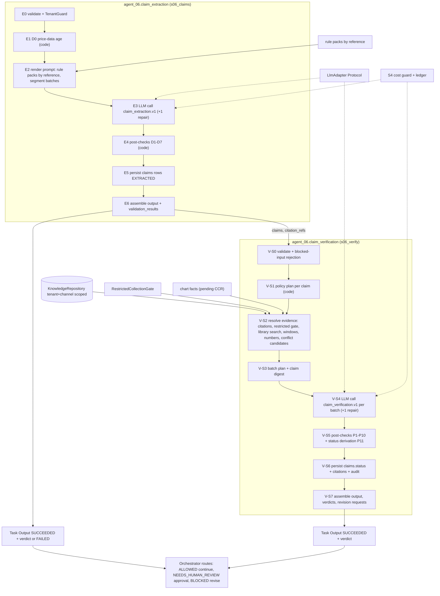
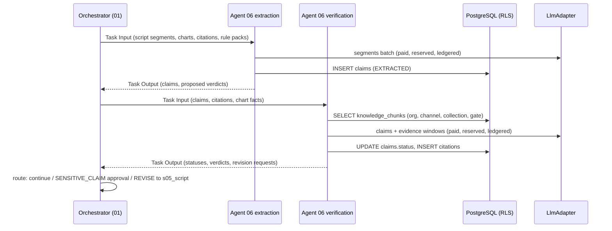

# Agent 06 — Fact Checker (blueprint)

| Field | Value |
|---|---|
| Status | Draft — documentation. Software: **Planned** (rule 6, rule 7) |
| Owner | Agent 06 Fact Checker; integration owner: Agent 01 (orchestrator) |
| Package | `agent_06_fact_checker` (27 §7.2); prompts `prompts/agent_06_fact_checker/`; evals `evals/agent_06_fact_checker/` |
| Directive sections covered | §3.1 row 06 (claim extraction, independent verification, contradiction detection, approval), §1 (SEBI and platform rules as they reach claims), §1B.2 (answer key), §1A.7 (RESEARCH_ACCURACY), §3.3 (contracts, failures, quality, observability, AI providers), §3.5 (prompt, eval, code standards), §4 (26 sections) |
| Owner decisions applied | D1 (3A production line with Agents 04–11 and the Agent 16 gates; topic owner-given; outputs are files; no upload, no OAuth; spend limits enforced by the cost ledger; keys only through the environment's secret mechanism; render never in market hours), D2 (full blueprint for 3A agents; REQUIRES REVIEW does not block 3A unless it changes a 3A design decision) |
| Binding contracts | GLOSSARY_AND_IDS.md (§6.29, 6.38–6.41, 6.51), 03_COMMUNICATION_STANDARD.md (§3–§7, §9, §11), 04_DATABASE_ARCHITECTURE.md §5.11 (`claims`, `citations`) and §5.10, 07_FAILURE_MANAGEMENT.md, 24_PRODUCTION_TYPES.md §3.2 (`agent_06.claim_extraction`, `agent_06.claim_verification`), 27_ENGINEERING_STANDARDS.md |
| Shared docs referenced by name/§ only | 18_PRODUCTION_QUALITY_STANDARD.md §9.2–§9.3, 13_COMPLIANCE_YOUTUBE_POLICY.md §1.2, §5 (finance rules, §5.12 answer key, §5.13 IN-03 cases), 09_COST_AND_BUDGET.md, 08_SECURITY.md §5.3, §8, 3A_SLICE_SPEC.md §3 (job flow), ADR-007 (LLM routing), ADR-013 (knowledge library), agent_04_research_knowledge.md (pack, citations, tiers) |
| Facts cited | RESEARCH_LOG IN-02 (30-day price-data lag), IN-03 (direction ban on named securities), IN-01 (association with regulated entities), PR-01 / PR-02 / PR-03 (models, batch and caching, API vs subscription), INF-03 / INF-04 (resource caps), INF-11 (RLS) |
| Marking | Every section states its **MVP** in the first line: 3A / 3B / 3C (owner build stages of D1) and Tier 0–3 (GLOSSARY §6.47) |
| Conventions | `(pending CCR)` = a contract item that does not exist in Wave A and is listed in the structured return for the integrator; this blueprint is written against the proposed name. `REQUIRES REVIEW (Phase 1): <need>` = unknown value; none is invented. Config key names are proposals until the registry (18 §13) exists. No book text, private method or server detail appears here. No dates or clock times appear in rules (owner rule C.4); the only time-based values are operational config. |

---

## 1 Identity and mission
**MVP: 3A (both task types, all deterministic checks) · 3B (thresholds and policy table tuned on the golden samples) · 3C (ad claims with client substantiation, fact cache, more rule packs). Tier 0 designed for Tier 1+.**

### 1.1 Mission
Agent 06 is the factual and claim-level checkpoint between the script (Agent 05) and everything that costs money after it (voice, shot plan, render). It does two jobs on one script version:

1. **Claim extraction** (`agent_06.claim_extraction`, stage `s06_claims`): break the script into atomic, checkable claims with exact quotes and offsets; classify each claim (GLOSSARY §6.39), give its time reference (§6.41), link it to the chart it describes and to the citations the script gives it; and flag every claim that breaks an active rule pack (finance rules FIN-R1…R13 for the finance channel, GLOSSARY §6.38). Code recomputes every verdict; the model's verdicts are proposals.
2. **Independent verification** (`agent_06.claim_verification`, stage `s06_verify`): check each verifiable claim against the evidence only (the cited library passages, library passages found by search, reference snapshots, and facts computed from the shown charts), independently of the writer and of the research note that fed the writer; detect claims the evidence contradicts and claims of the same script that contradict each other; and give each claim a status (GLOSSARY §6.40) with the evidence span that decides it.

It produces a **proposed** verdict. The final compliance verdict is Agent 16's (plan Q5; 13 §1.1).

### 1.2 Where it sits
Stages `s06_claims` then `s06_verify` of every production type that has a script (24 §3.1, §7; both `AI_IO`, both blocking, `on_fail REVISE → s05_script`). In 3A both run after `s05_script` and before `a_script` (optional approval), `s07_voice` and `s09_plan` (3A_SLICE_SPEC §3). Other production types reuse the stages unchanged: Shorts (`agent_06.claim_extraction` on the child script), localisation (extraction on the translation: meaning must not change into a rule violation), advertising (both tasks; every ad claim needs substantiation, 3C). Downstream: Agent 05 (revision), the orchestrator (routing, approvals), Agent 16 (`compliance_gate`, `quality_score` RESEARCH_ACCURACY).

### 1.3 Authority boundaries
| Agent 06 **decides** | Agent 06 **does not decide** (owner of the decision) |
|---|---|
| which statements of the script are claims, their type, time reference, instrument and chart link | the script's content, wording or structure (Agent 05); Agent 06 never edits the script and only suggests corrections |
| which active-rule-pack rules a claim breaks, with quoted evidence (proposal) | the final compliance verdict, any waiver, any override (Agent 16 final authority, plan Q5; human override only through a recorded approval, 13 §8) |
| whether the evidence supports, partly supports, contradicts or does not address a claim (the model proposes, code derives the status) | what counts as a reliable source, the reliability tier of a source (Agent 04, deterministic); which sources exist in the library (Agent 04) |
| claim status (`VERIFIED`, `CONTRADICTED`, `UNVERIFIABLE`, `NEEDS_SUBSTANTIATION`) and the proposed per-claim and stage verdict | whether a video is published or delivered (Agent 16 + S7 human approval) |
| whether two claims of one script contradict each other | job routing, revision loops, retries, approvals (orchestrator, 24 §3.3, 07 §9) |
| the price-data age classification used by FIN-R9 at extraction time (deterministic function, `compliance.finance_sebi_in.price_data_lag_days`, IN-02) | the rule text, rule severities and rule-pack contents (13, S2) |
It never creates tasks, never approves, never changes a budget, never calls the YouTube API (zero quota units), never uploads (D1), never browses the web, never uses the model's own knowledge as evidence, and gives the model no tools: the LLM can only return JSON that code validates.

### 1.4 Success criteria (measurable; targets are config and are set in 3B)
| ID | Criterion | Measure |
|---|---|---|
| SC-1 | No advice, return claim, referral or forward view passes extraction | Answer-key cases 4/4 and 0 false `ALLOWED` on any BLOCKED-expected case in the extraction dataset (mandatory CI threshold) |
| SC-2 | No unsupported or contradicted claim is marked `VERIFIED` | 0 false `VERIFIED` in the verification dataset (mandatory CI threshold); 0 in the golden-sample audit by the owner (3B) |
| SC-3 | Every claim of type FACTUAL, STATISTICAL or HISTORICAL_MARKET that leaves the stage is `VERIFIED` and has a citation or chart reference, or the stage verdict is not `ALLOWED` | 100 % (deterministic; this is the RESEARCH_ACCURACY deterministic criterion of 18 §9.2) |
| SC-4 | Every quote is an exact substring at the stated offsets; every evidence span lies inside its passage | 100 % (deterministic, blocking) |
| SC-5 | No cross-tenant, cross-channel or restricted-collection read | 0 occurrences in the tenancy suite and in production logs |
| SC-6 | Verdicts are code-derived, never copied from the model | 100 % (check `claims.verdict_recomputed`, `fact.verdict_recomputed`) |
| SC-7 | Cost per script stays within `resource_budget` | 0 breaches; breach ⇒ suspend (09, D1) |
| SC-8 | Replays create no duplicate claims, no duplicate citation rows and no second paid call | 1 claim set per (script version, extraction task), 1 verification per (job, iteration) |
| SC-9 | Eval datasets meet their thresholds (§26) | CI gate |
| SC-10 | Marathi and Hindi scripts: extraction and verification quality equals the English control within the margin the owner sets | **REQUIRES REVIEW (Phase 1): owner sets the margin after the first measurement (3B)** |

---

## 2 Functional requirements
**MVP: FR-1…FR-16 are 3A except where marked. Tier 0 unless marked.**

### 2.1 Task types
| Task type | Status | Purpose | Trigger | MVP |
|---|---|---|---|---|
| `agent_06.claim_extraction` | canonical (24 §3.2), prompt `agent_06/claim_extraction.v1` exists | claims + rule-pack flags + proposed verdicts for one script version | orchestrator creates it when `s06_claims` becomes ready (script `SUCCEEDED`) | 3A |
| `agent_06.claim_verification` | canonical (24 §3.2), prompt `agent_06/claim_verification.v1` | independent verification, contradiction detection, claim status | orchestrator creates it when `s06_claims` is `ALLOWED` or `NEEDS_HUMAN_REVIEW` and the job continues | 3A |
Agent 06 files no other task type. Capability use: `llm` for both. The two tasks are separate stages so that a human approval or a revision can sit between them, and so that a blocked script never pays for verification.

### 2.2 Requirements
| ID | Requirement | Why | When / trigger | Inputs | Outputs | Dependants | MVP |
|---|---|---|---|---|---|---|---|
| FR-1 | Validate the Task Input, tenant context and every reference before any work (03 §7) | rule 9; 07 `PERMANENT.*` | start of each task | Task Input | structured rejection or go | all | 3A |
| FR-2 | Extract every atomic checkable claim per segment with exact `quote`, offsets, normalised English restatement, type, time reference, instrument, chart link, citation need and the citations the script gives it | claim-level control (§3.1 row 06); 18 §9.2 | extraction | segments, charts, citations, active rule packs | claims | verification, 16, 05 | 3A |
| FR-3 | Flag rule-pack violations with rule ID, severity and quoted evidence; treat a disclaimer, a quotation mark, another language or a historical framing as irrelevant to the flag (13 §1.1, IN-03) | §1 SEBI rules, §1B.2 answer key | extraction | claims, `rp.*` rule packs injected by reference | `rule_flags` | 16, 05 | 3A |
| FR-4 | Compute price-data age (`data_age_vs_lag`) for charts deterministically; the model never does date arithmetic; the value used is never more permissive than the recomputed one | FIN-R9; IN-02 | before the extraction call | chart data range, config lag | `data_age_vs_lag`, FIN-R9 flags (D3) | 16 | 3A |
| FR-5 | Detect URLs, referral and coupon codes in a finance script (FIN-R8) and any quote that is not an exact substring (D2) | deterministic safety net behind the model | after the extraction call | model output | flags, rejection of bad quotes | 16 | 3A |
| FR-6 | Recompute every claim verdict and the overall verdict by code from flags and citation need (D6, D7) | the model proposes, code decides (27 §7.3.7) | after the extraction call | validated output | verdicts | 01, 16 | 3A |
| FR-7 | Persist claims write-once per extraction task (`claims` rows, status `EXTRACTED`, quote, offsets, flags, proposed verdict) | claim ledger (04 §5.11) | end of extraction | validated output | `claims` rows, output blob | verification, 16 | 3A |
| FR-8 | Classify each claim into a verification mode by a policy table (evidence, chart facts, skip) and refuse to verify an input whose extraction verdict is `BLOCKED` | no paid call on a script that must be rewritten; cost | start of verification | claims | plan | FR-9…FR-13 | 3A |
| FR-9 | Resolve cited references to evidence of the task's own tenant and channel, apply the restricted-collection gate, find library evidence for claims without a usable citation, cut bounded passage windows, record offsets and hashes | verification needs evidence, not memory; FIN-R12; Q26 | verification | claims, `citations_available`, knowledge repository | evidence set per claim | FR-10 | 3A |
| FR-10 | Verify each claim against its evidence only (LLM step), with exact evidence spans and typed discrepancies; independent of Agent 05's and Agent 04's wording | independent verification (§3.1 row 06) | verification | claims, evidence windows | assessments | FR-11 | 3A |
| FR-11 | Apply deterministic guards to every assessment (ids belong to the claim, spans valid, discrepancy values verbatim, number guard, injected-passage exclusion, source-tier floor, script citation present) and derive the claim status and reason codes by code | model output is never an authority (08 §5.3) | after each call | assessments | statuses | FR-12 | 3A |
| FR-12 | Detect contradictions between claims of one script (candidate pairs by code, adjudication by the model, validation by code) | contradiction detection (§3.1 row 06) | verification | claim digest, candidate pairs | `claim_conflicts` | 16, 01 | 3A |
| FR-13 | Derive proposed verdicts (per claim, combined with the extraction verdict, and for the stage), accuracy counters for 18 §9.2, and advisory revision requests (add citation, correct claim, provide evidence, resolve conflict) | routing and the RESEARCH_ACCURACY score | end of verification | statuses | verdicts, `revision_requests`, `accuracy_summary` | 01, 05, 16 | 3A |
| FR-14 | Persist claim status and citation rows (support relation per cited chunk or reference), write an audit entry per knowledge read and per gate decision | evidence trail (04 §5.11); 08 §9 | end of verification | statuses | `claims.status`, `citations`, audit | 16, owner spot check | 3A |
| FR-15 | Checkpoint after each paid call and resume without a second paid call; honour `DRAIN` between batches | 07 §10, ADR-007 §2.8 | always | — | checkpoints | 01 | 3A |
| FR-16 | Reuse a stored verification of a claim that did not change between iterations (same normalised claim, same evidence hash) instead of paying again | cost on revision loops | iteration ≥ 1 | prior verification (`PROJECT` memory) | carried statuses | 01 | 3C (3A re-verifies every claim; REQUIRES REVIEW (3B): measure whether the revision-loop cost justifies it) |

### 2.3 Out of scope (explicit)
Web search or any browsing for evidence (no search provider has a research-log entry; evidence is the owner's library and recorded references); rewriting the script (Agent 05); deciding source reliability (Agent 04); FIN-R10 disclaimer presence, FIN-R11 AI persona, YouTube policy rules other than claim-level ones (Agent 16); thumbnail and metadata claim checks (Agent 16 in 3A; Agent 12 in 3C); verifying the visual content of a rendered video; legal opinion (⚖: the owner's lawyer); verifying today's market data (a claim about the current market is a FIN-R3 issue, not a fact check); any publication or upload.

---

## 3 Non-functional requirements
**MVP: 3A unless marked. Values are config or REQUIRES REVIEW; none is invented. ESTIMATE = design value, replaced by MEASURED in 3B.**

| ID | Category | Requirement | Verification | MVP |
|---|---|---|---|---|
| NFR-1 | Isolation | Every read and write is scoped by `org_id` (and `channel_id` for the knowledge library, plus collection); RLS is the second line | tenancy suite (08 §8.2), S-01…S-09 | 3A |
| NFR-2 | Determinism | Every decision in §6.1 marked deterministic is a pure, unit-tested function; the LLM only proposes | unit tests | 3A |
| NFR-3 | Idempotency | One claim set per (script version, extraction task) and one verification per (job, iteration); LLM calls keyed by `llm.call` (03 §9.2); database effects keyed by `db.output` | replay tests I-02, I-05 | 3A |
| NFR-4 | Bounded work | Model calls ≤ `resource_budget.max_llm_calls`; segments per call, claims per call, passages per claim, digest size, repair rounds are config caps; one repair per failing batch (07 §9) | cap tests U-30, F-12 | 3A |
| NFR-5 | Cost | Every call has a reservation and a ledger row; a breach suspends (`AWAITING_BUDGET`); no automatic increase (rule 8, D1, ADR-007 §8) | breach test F-11 | 3A |
| NFR-6 | Confidentiality | Script text, claim quotes, passage text, evidence values and corrections never appear in logs, metrics, error messages, audit rows or eval run records (IDs, offsets, hashes and counts only); library text reaches only the tenant's own LLM calls | log-leak test S-05 | 3A |
| NFR-7 | Latency | End-to-end and per-step latency: **MEASURED in 3B**; no target before. The stages are blocking, so they sit on the job's critical path | performance tests P-01…P-04 | 3B |
| NFR-8 | Capacity | Script size supported on the shared VPS within the factory caps (INF-03, INF-04): segments ≤ 400 and 5,000 characters each (extraction input schema); claims ≤ 500 per script | boundary tests U-31 | 3A (schema), 3B (measured) |
| NFR-9 | Availability | Stateless between steps; all state in DB and storage; restart resumes from the latest checkpoint (07 §10); AI_IO tasks may run at any time but obey `DRAIN` | failure injection F-06 | 3A |
| NFR-10 | Languages | English, Marathi, Hindi, mixed Hinglish, with Devanagari preserved byte for byte in quotes; quote offsets are in Unicode code points of the stored text; evidence in a different language than the claim is allowed; per-language token cost MEASURED (ADR-007 §2.9) | eval cases POS-07, POS-08, EDGE-23…25 | 3A |
| NFR-11 | Auditability | Every claim set, status change, restricted-gate decision, knowledge read count and cross-tenant rejection is audited by ID | audit test S-06 | 3A |
| NFR-12 | Safety bias | Doubt resolves to `NEEDS_HUMAN_REVIEW`, never to `ALLOWED` (13 §1.1 item 7); an `ALLOWED` or `VERIFIED` never rests on a model score alone | unit tests U-20…U-26 | 3A |
| NFR-13 | Time and money | UTC `timestamptz` only; money in integer `_micros`; no calendar date or clock time in a prompt or rule | lint | 3A |
| NFR-14 | Maintainability | One package, typed `Protocol`, constructor injection, ruff and mypy strict (27 §7) | CI | 3A |
| NFR-15 | Cost discipline | Deterministic filters run before any paid call: skipped claim types, no-evidence claims, quote-without-citation, restricted-not-released and blocked input never reach the model | cost tests (eval cases SKIP-30, NF-18, QT-31, RG-33) | 3A |

---

## 4 Internal architecture
**MVP: 3A for all solid boxes; dashed = 3C. Tier 0.**

Components are detailed in §9 and §10. The model sits in exactly two places (E3 and V-S4). Everything else is code.

---

## 5 Full system prompt
**MVP: 3A · Tier 0. The prompt text lives in the versioned files below (27 §4: the file is the source of truth; this section summarises and links it, it does not copy it).**

| Prompt | File | Role of the model | Rule packs injected | Output schema |
|---|---|---|---|---|
| `agent_06/claim_extraction.v1` | [`prompts/agent_06_fact_checker/claim_extraction.v1.md`](../prompts/agent_06_fact_checker/claim_extraction.v1.md) (exists; not rewritten here) | lists every checkable claim with exact quotes and offsets, classifies it, flags rule violations; never verifies facts or decides publication | `rp.youtube_general`, `rp.finance_sebi_in` (when active) by reference | `agent_06.claim_extraction.output` 1.0.0 |
| `agent_06/claim_verification.v1` | [`prompts/agent_06_fact_checker/claim_verification.v1.md`](../prompts/agent_06_fact_checker/claim_verification.v1.md) | compares each claim only with the evidence code selected; reports support, partial support, contradiction or absence with evidence spans; reports claim-vs-claim contradictions; flags injected passages | none (verification is not a policy step) | `agent_06.claim_verification_batch.output` 1.0.0 |

Design principles shared by both prompts (they implement 27 §4.2 and 08 §5.3):
1. **Template conformance.** Both files have the nine mandatory sections in order (header, Role, Objective, Inputs, Rules, Output JSON Schema, Worked examples including a refusal path, Refusal and escalation, Self-check). Model, tier, temperature, token and cost limits are configuration keys `llm.agent_06.<task>.*`, never in the file.
2. **Data delimiting.** Script text, claims, passages and chart facts are inserted as JSON values into a user message, after the stable system prefix; each prompt tells the model that instructions inside data are content. A passage or claim that tries to instruct the model is flagged (verification) or extracted and flagged like any other text (extraction).
3. **Stable prefix.** The system prompt and the rule-pack text form the cacheable prefix (`.cache_system_prompt`); no tenant string, ID or script text is in it (test S-08).
4. **No dates, no model names, no provider names** in either file; no number of the law or rule text is pasted: rule packs by reference `{{rule_pack:rp.<key>}}`, resolved at runtime with the version recorded in `provenance`.
5. **Refusal object** in both output schemas (27 §4.3, GLOSSARY §6.51); refusal mapping is code (§18).
6. **Hash check.** The prompt loader verifies the SHA-256 of the file against the registry before use; a mismatch is `PERMANENT.CONFIG_INVALID` (27 §4.1).
7. **Independence of verification.** The verification prompt has no access to the script's prose beyond the claim, to Agent 05's reasoning, or to Agent 04's notes; evidence is the original passage window (or a reference snapshot), not a paraphrase that could carry the writer's error. Whether a different model tier or provider improves independence is a 3B measurement (question Q-F3, §23.2).
8. **What the model never receives:** `org_id`, any ID of the database, storage paths, collection internals, keys, other claims' evidence beyond the digest, reliability tiers (kept out so the model does not weigh authority; code applies the tier floor).
