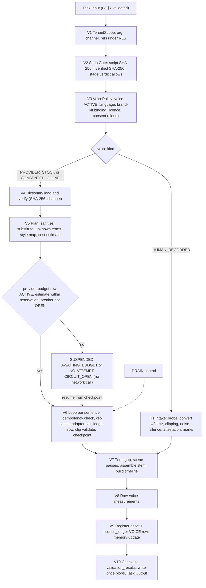
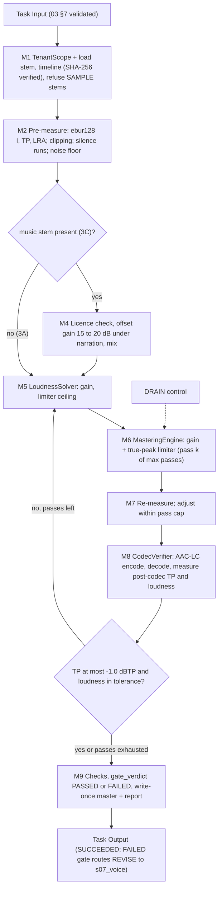

# Agent 07 — Voice Production (blueprint)

| Field | Value |
|---|---|
| Status | Draft — documentation. Software: **Planned** (rule 6, rule 7) |
| Owner | Agent 07 Voice Production; integration owner: Agent 01 (orchestrator) |
| Package | `agent_07_voice_production` (27 §7.2); prompts: **none (no LLM step, §5)**; evals `evals/agent_07_voice_production/` (deterministic golden datasets, §26) |
| Directive sections covered | §3.1 row 07 (TTS adapters, pronunciation dictionaries, audio mastering engine: loudness, clipping, silence, noise, sync), §1A.3 (voice), §1A.4 (audio delivery spec), §1A.6 and §1A.7 (the audio share of QC and score), §1B.2 (presenter: owner voice or neutral narration, no AI persona), §1C.8 (third-party use), §3.2a (provider-independent TTS adapter), §3.3 (contracts, failures, quality, observability, AI providers), §3.5 (code, test and eval standards), §4 (26 sections) |
| Owner decisions applied | D1 (3A production line with Agents 04–11 and the Agent 16 gates; topic owner-given; outputs are files; no upload, no OAuth; paid calls only inside owner-set provider limits; per-video and pilot budgets enforced by the cost ledger, stop on breach; keys only through the environment's secret mechanism; render never in market hours), D2 (full blueprint for 3A agents; REQUIRES REVIEW does not block 3A unless it changes a 3A design decision), plan Q11 (narration choice: owner recording or neutral voice; owner decides after hearing samples) |
| Binding contracts | GLOSSARY_AND_IDS.md (§2 IDs, §3 units, §6.6, §6.17–6.22, §6.27–6.28, §6.30–6.32, §6.44, §6.45, §6.52), 03_COMMUNICATION_STANDARD.md (§3–§9, §11), 04_DATABASE_ARCHITECTURE.md (§3, §5.7, §5.9, §5.10, §5.12, §5.14, §5.15), 07_FAILURE_MANAGEMENT.md (§2–§4, §8–§10), 24_PRODUCTION_TYPES.md §3.2 (`agent_07.voice_synthesis`, `agent_07.audio_master`), §5, §7.1 (`s07_voice`, `s07_master`), 27_ENGINEERING_STANDARDS.md (§3, §7, §8, §9) |
| Shared docs referenced by name/§ only | 18_PRODUCTION_QUALITY_STANDARD.md (§4 voice, §5 audio, §7 QC commands, §9.2 AUDIO_QUALITY, §11 pilot, §13 config keys), 13_COMPLIANCE_YOUTUBE_POLICY.md (§3.2 YTG-R2, §3.3 disclosure), 09_COST_AND_BUDGET.md (§3, §8, §10.1), 08_SECURITY.md (§3 secrets, §8 tenant isolation), 3A_SLICE_SPEC.md (§2.4, §3, item 3A-07, O4, R4, R16), ADR-005 (storage), ADR-008 (TTS), ADR-009 (music: none in 3A), ADR-012 (render placement, market-hours guard), agent_05_scriptwriter.md (script document), agent_06_fact_checker.md (stage verdict) |
| Facts cited | RESEARCH_LOG PR-04 (ElevenLabs plans, Marathi model list, API price, cloning consent), PR-05 (client use NOT CONFIRMED), PR-07 (Google TTS candidate, PARTIAL), INF-09 (FFmpeg `ebur128`, `silencedetect`), INF-10 (AAC-LC 48 kHz stereo 384 kbps), INF-03 / INF-04 (resource caps), INF-11 (RLS), YT-07 (cloning one's own voice needs no disclosure), YT-09 (no AI persona on finance) |
| Marking | Every section states its **MVP** in the first line: 3A / 3B / 3C (owner build stages of D1) and Tier 0–3 (GLOSSARY §6.47) |
| Conventions | `(pending CCR)` = a contract item that does not exist in Wave A and is listed in the structured return for the integrator; this blueprint is written against the proposed name. `REQUIRES REVIEW (Phase 1): <need>` = unknown value; none is invented. A figure called "design default" is an ESTIMATE of this document, not a fact. Config key names are proposals until the registry exists (18 §13). No book text, private method or server detail appears here. No dates or clock times appear in rules (owner rule C.4); the only time-based values are operational config. Agent-local check IDs use the prefix `a07.`; the `qc.*` IDs are those fixed by 18. |

---

## 1 Identity and mission
**MVP: 3A (both task types, all deterministic checks, owner-recording intake, one TTS provider) · 3B (thresholds and the dictionary tuned on the golden samples, owner listening check, voice sample) · 3C (music bed mix, second provider, dubbing track, client voices). Tier 0 designed for Tier 1+.**

### 1.1 Mission
Agent 07 turns an approved script into the narration track of the video, and turns that narration into an audio master that meets the delivery spec. It does two jobs on one script version:

1. **Voice synthesis** (`agent_07.voice_synthesis`, stage `s07_voice`): produce the narration stem, one clip per script sentence, in the one voice the owner chose — a neutral provider voice (`PROVIDER_STOCK`), a **consented** clone of the owner's own voice (`CONSENTED_CLONE`) or the owner's own recorded narration (`HUMAN_RECORDED`, intake instead of synthesis). Before any paid call it checks that the script is the verified one, that the voice is licensed and (for a clone) consented, applies the channel's **pronunciation dictionary**, passes the per-sentence pace and emotion tags to the provider where it supports them, and records cost per call. It emits the **narration timeline** (start and end of every sentence) that subtitle sync and duration checks use (18 §4).
2. **Audio master** (`agent_07.audio_master`, stage `s07_master`, blocking gate): measure the narration (and, from 3C, the music bed) and master the programme audio to **−14 LUFS integrated, ≤ −1 dBTP true peak, 48 kHz**, with a verification encode in the delivery codec (AAC-LC stereo ≥ 384 kbps; INF-10) so that the loudness and peak survive the final encode. It checks clipping, silence, noise floor and that no sample shifted (sync). It is the remedy owner for loudness and true peak (18 §7.2): `agent_10.technical_qc` only measures the final MP4.

Agent 07 contains **no LLM**. Every decision is a deterministic function; the TTS model is an external service behind an adapter (§5, §6, §11).

### 1.2 Where it sits
Stages `s07_voice` (depends on `s06_verify` and the optional `a_script` approval; class `AI_IO`) then `s07_master` (class `HEAVY_CPU`; blocking; `on_fail REVISE → s07_voice`) of every production type that has a spoken track (24 §7.1; 24 §7.2 Shorts reuses the stages on the child script). In 3A both run for `CHANNEL_LONG_FORM` (v2, pending CCR-3A-1) and for the Shorts child job where the owner asks for a 9:16 cut. In the 3A job flow (3A_SLICE_SPEC §3) `s07_master` feeds `s10_render`. Other production types: advertising and corporate types reuse the same two stages (3C); dubbing uses `svc_s03.dub_timing_fit` between them (3C). Downstream consumers: Agent 10 (render, subtitles, technical QC), Agent 09 (timeline durations), Agent 16 (`compliance_gate`, `quality_score` AUDIO_QUALITY), S4 (cost), the orchestrator (routing).

### 1.3 Authority boundaries
| Agent 07 **decides** | Agent 07 **does not decide** (owner of the decision) |
|---|---|
| whether the voice, its licence and (for a clone) its consent allow this render (`PERMISSION_DENIED` otherwise) | the script's wording, pace and emotion tags, pauses or pronunciation candidates (Agent 05); Agent 07 never edits the script and only substitutes dictionary entries |
| how the script text is turned into the text sent to the provider (dictionary substitution, sanitising) | which words go into the dictionary (a human, after listening; Agent 07 only lists unknown terms) |
| segment timing on the narration track, clip trimming and gaps from config | scene order, shot timing and the video timeline (Agent 09, Agent 10) |
| the mastering gain and limiter settings, and the gate verdict `PASSED` / `FAILED` of `s07_master` | whether the video is compliant or may be published or delivered (Agent 16 final authority, plan Q5; S7 human approval) |
| the cost record of each TTS call | budgets, limits, reservations (S4; owner sets the amounts, rule 8) |
| the proposed audio render parameters handed to Agent 10 (codec profile) | the final MP4 encode and its measurement (Agent 10, 18 §7) |
It never creates tasks, never approves, never changes a budget or a voice record, never creates or deletes a voice at the provider, never clones a voice (cloning is an operator action outside the two task types, §2.3), never calls YouTube (zero quota units), never uploads (D1), never switches provider or voice in the middle of a video (ADR-008 §2.9), and never sends anything to a provider except the sanitised sentence text and the voice reference.

### 1.4 Success criteria (measurable; targets are config and are set in 3B)
| ID | Criterion | Measure |
|---|---|---|
| SC-1 | No render with an unverified voice | 0 narration stems from a clone whose consent state is not `VERIFIED` (or is withdrawn or expired), from an expired or non-`ACTIVE` licence, or from an unverified script (mandatory test thresholds, §26) |
| SC-2 | Audio meets the delivery spec after mastering | 100 % of mastered masters have post-codec true peak ≤ −1.0 dBTP (`qc.audio.true_peak`) and sample rate 48 000 Hz; integrated loudness within `qc.loudness.tolerance_lu` of −14.0 once the tolerance is set (**REQUIRES REVIEW (Phase 1): calibrate in 3B**) |
| SC-3 | Every dictionary term of the script is rendered through its entry | 100 % (`qc.voice.dictionary_applied`, blocking) |
| SC-4 | Every sentence has a timeline entry (TTS path) | 100 % (`a07.timeline.complete`, blocking); human-narration path: see §2.2 FR-12 |
| SC-5 | No paid call without an `ACTIVE` provider budget row, an idempotency key and a ledger row | 0 violations (`a07.cost.recorded`, blocking; failure-injection tests) |
| SC-6 | Replays create no second paid call and no duplicate asset or licence row | 1 call per (task, segment, spoken-text hash, voice) |
| SC-7 | No cross-tenant read or write; no script text, consent personal data or secret in any log | 0 occurrences in the tenancy and log-leak suites |
| SC-8 | Cost per script stays within `resource_budget` | 0 breaches; breach ⇒ suspend (09, D1) |
| SC-9 | The owner's listening check on the pilot set finds no uncorrected pronunciation error | HUMAN check, 3B mandatory (18 §4); fixes go to the dictionary, not to the script |
| SC-10 | Marathi narration quality equals the owner's acceptance bar | **REQUIRES REVIEW (Phase 1): owner sets the bar after the first listening test (3B)** |

---

## 2 Functional requirements
**MVP: FR-1…FR-20 are 3A unless marked. Tier 0 unless marked.**

### 2.1 Task types
| Task type | Status | Purpose | Trigger | Class / queue / capabilities | MVP |
|---|---|---|---|---|---|
| `agent_07.voice_synthesis` | canonical (24 §3.2) | narration stem + timeline: TTS, or intake of the owner's recording | orchestrator creates it when `s07_voice` is ready (`s06_verify` `SUCCEEDED` with a passing verdict and, if enabled, `a_script` decided) | `AI_IO` / `ai` / `tts`, `media_probe` | 3A |
| `agent_07.audio_master` | canonical (24 §3.2) | loudness, true peak, clipping, silence, noise and sync master of the programme audio; gate verdict | orchestrator creates it when `s07_voice` is `SUCCEEDED` | `HEAVY_CPU` / `render` / `render_ffmpeg`, `media_probe` | 3A |
Agent 07 files no other task type. The 3B voice sample (§2.2 FR-17) is the same task type with `purpose = SAMPLE`; the optional stage and approval that carry it need a registry change (pending CCR, §15).

### 2.2 Requirements
| ID | Requirement | Why | When / trigger | Inputs | Outputs | Dependants | MVP |
|---|---|---|---|---|---|---|---|
| FR-1 | Validate the Task Input, tenant context and every reference before any work (03 §7) | rule 9; 07 `PERMANENT.*` | start of each task | Task Input | structured rejection or go | all | 3A |
| FR-2 | Refuse to synthesise a script that is not the verified one: the script blob hash equals the hash the verification stage saw, and the stage verdict is `ALLOWED` (or `NEEDS_HUMAN_REVIEW` with the linked approval `APPROVED`) | no paid audio for an unchecked or blocked script; the recording or TTS output must match what Agent 06 and 16 judged | start of `s07_voice` | script ref + SHA-256, Agent 06 output ref, approval ref | go or `PERMANENT.INPUT_INVALID` | 06, 16 | 3A |
| FR-3 | Resolve the voice under RLS; check status `ACTIVE`, the language, the binding to the channel's current brand kit, and the adapter's declared language support before any paid call | §1A.3; 18 §4 (unsupported language fails before any paid call) | start | `voice_id`, channel | `ResolvedVoice` or `PERMANENT.UNSUPPORTED_TASK` / `MISSING_DEPENDENCY` | — | 3A |
| FR-4 | Consent gate: a `CONSENTED_CLONE` voice is rendered only with a `voice_consents` row in state `VERIFIED`, not withdrawn, not expired, whose voice owner is an owner of this org (Tier 0 rule); anything else is `PERMANENT.PERMISSION_DENIED` (18 §4) | §1A.3 never clone anyone else; ADR-008 §2.5; PR-04 consent | before the first call, again before each resume | voice, consent row | go or deny | 16 | 3A |
| FR-5 | Licence gate: the voice has an `ACTIVE` licence row; `covers_monetized_youtube` is true (NULL blocks); `third_party_permission` is `PERMITTED` when the licence is platform-held and the org is not the platform owner (`UNKNOWN` blocks, PR-05, §1C.8) | licence ledger completeness (18 §2.2); 04 §5.15 | before the first call | voice, licence, org | go or deny | 16, 10 | 3A |
| FR-6 | Load the channel's pronunciation dictionary (versioned, hash-verified, channel-permitted), substitute entries by deterministic longest-match rules, log every substitution, list tokens that are candidates but not in the dictionary (unknown terms) | §1A.3; 18 §4 `qc.voice.dictionary_applied` | before synthesis | dictionary ref, segments, candidates | spoken text per segment, substitution log, unknown terms | owner (dictionary upkeep), 16 | 3A |
| FR-7 | Sanitise text for the provider: Unicode NFC, control characters removed, whitespace collapsed, markup-significant characters escaped so script text is never interpreted as provider markup | provider markup injection; deterministic text | before each call | segment text | spoken text | — | 3A |
| FR-8 | Map each sentence's `pace` and `emotion` to the adapter's style controls through the adapter's declared capabilities; record requested versus applied style per sentence; never invent a control the adapter lacks | §1A.3 sentence-level control; ADR-008 (support not yet verified) | before each call | tags, `TtsCapabilities`, style map | `TtsStyle`, `style_applied` record | 16 (`qc.voice.variation`) | 3A |
| FR-9 | Synthesise one clip per sentence through the `TtsAdapter` with an idempotency key (`tts.synthesize`), a breaker check, a budget guard before the call, a ledger row per call, bounded retries per 07, and a checkpoint every `agent_07.checkpoint_every_n` clips | 03 §9; 07 §3, §4, §10; 09 §3 | per sentence | `SegmentUnit` | clip blob, ledger row | S4 | 3A |
| FR-10 | Validate each clip (decodable, non-empty, sample rate known, duration plausible), normalise to the working format (PCM mono, 48 000 Hz), trim leading and trailing silence to the configured keep length | a provider returning silence or garbage must not become a "success" | per clip | provider audio | clip facts | — | 3A |
| FR-11 | Assemble the narration stem from the clips with the configured inter-sentence gap and the scene `deliberate_pause_ms`; emit the **narration timeline** (start, end, duration per sentence, in ms from stem start) | 18 §4 segment timeline; §7.6 subtitle sync; §7.7 duration | after all clips | clips, scene pauses | stem WAV, timeline JSON | 10, 09 | 3A |
| FR-12 | **Owner-recording intake** (`HUMAN_RECORDED`): take the owner's audio asset instead of calling a provider; probe, convert to the working format, measure clipping, noise floor, silence spans and loudness; require the owner's attestation that the recording follows the verified script; timeline from the owner's segment marks if given, else `UNALIGNED` (sync then falls to the HUMAN check of 18 §7.6) | §1A.3 owner narration; ADR-008 option 1; Q11 | start, instead of FR-6…FR-10 | asset ref, marks, attestation | stem WAV, timeline, intake report | 10, 16 | 3A |
| FR-13 | Measure the raw narration (clipping count, peak, noise floor, integrated loudness, silence runs) and report it; the blocking decision belongs to the gate in `s07_master` (except intake clipping, FR-12) | 18 §4 `qc.voice.clipping`; keeps one gate | end of `s07_voice` | stem | `voice_measurements` | master | 3A |
| FR-14 | Register the narration as an `assets` row (`AUDIO_VOICE`) and write the `licence_ledger` row (`usage_kind = VOICE`) for the job; both idempotent | 18 §4 Licence; 04 §5.15 | end of `s07_voice` | stem, licence | rows | 10, 16 | 3A |
| FR-15 | Master the audio: solve the gain, apply gain and a true-peak limiter, re-measure, repeat within a hard pass cap; never change duration | §1A.4; 18 §5 | `s07_master` | stem (3C: music stem), timeline, targets from config | master WAV | 10 | 3A |
| FR-16 | Verification encode in the delivery codec profile (AAC-LC, 48 kHz, stereo, bitrate ≥ `qc.audio.min_bitrate_bps`), decode, measure true peak and loudness again; lower the limiter ceiling by a configured step and repeat if the post-codec peak exceeds the ceiling | INF-10; the final MP4 is re-measured by Agent 10, so the peak must survive the encode | `s07_master` | master | `codec_verification` | 10 | 3A |
| FR-17 | **Voice sample** (`purpose = SAMPLE`): synthesise only the first `agent_07.sample.max_segments` sentences with a candidate voice for the owner's listening test; not licensed into a video, not mastered, not consumed by `s07_master` | Q11: owner decides after hearing samples | 3B pilot | script, candidate voice | sample clips (output refs) | owner | 3B |
| FR-18 | Mix a music bed (3C): gain the licensed music stem so its level over narration-active spans is 15–20 dB below the narration, then master the sum; refuse a music stem without a licence-ledger row. **No music in 3A** (ADR-009) | §1A.4; 18 §7.4 | 3C | music stem ref | mixed master, offset measured | 10 | 3C |
| FR-19 | Reuse an identical earlier clip inside the same tenant (same spoken-text hash, voice, model, style) without a paid call; the clip hash is verified | cost on revision loops and dictionary fixes | per sentence, 3B optimisation | clip cache | clip | S4 | 3B |
| FR-20 | Honour `DRAIN` / pause controls at segment boundaries (voice) and at pass boundaries (master): checkpoint, release, resume later | 07 §8, §10 | on control | control message | `SUSPENDED` output | orchestrator | 3A |

### 2.3 Out of scope (explicit)
- Creating, cloning or deleting a voice at the provider, and verifying consent (an operator action and a human act; the voice row arrives complete with `provider_voice_ref`, `consent_id` and the licence). Automation is a 3C change (CCR).
- Editing the script, choosing pace or emotion, choosing words for the dictionary, translating, dubbing timing fit (`svc_s03.dub_timing_fit`, 3C).
- The final MP4 encode, subtitles, technical QC of the MP4 (Agent 10), compliance and quality scoring (Agent 16).
- Automatic speech recognition to prove the owner's recording equals the script (tool **REQUIRES REVIEW (Phase 1)**; the attestation of FR-12 is the 3A control).
- Post-hoc time-stretching or pitch change to imitate a pace the provider cannot produce (not researched; quality risk).
- Any music selection, sourcing or licence purchase (Agents 08/09; ADR-009).

---

## 3 Non-functional requirements
**MVP: 3A for every row unless marked · Tier 0. Numbers are design defaults (ESTIMATE) or `REQUIRES REVIEW`; none is a measured fact.**

| ID | Requirement | Target / rule | Verified by | MVP |
|---|---|---|---|---|
| NFR-1 | Determinism | same input, same config, same adapter response ⇒ same timeline and same output payload except IDs and timestamps; the mastering step is a pure function of the stem and parameters on one pinned FFmpeg build | U-30, regression set | 3A |
| NFR-2 | Idempotency | one paid call per (task, segment, spoken-text SHA-256, voice) (03 §9.2); DLQ replay creates no second call, row or asset | F-10, failure-injection | 3A |
| NFR-3 | Cost safety | fail closed: no network call without an `ACTIVE` provider budget row (09 §8.2), without a reservation covering the worst case, or while the breaker is `OPEN` | FI-05…FI-07 | 3A |
| NFR-4 | Tenant isolation | §19; every DB access in a tenant transaction; every URI org-checked; scratch space per task | tenancy and security suites | 3A |
| NFR-5 | No secrets or content in logs | no script text, spoken text, consent person data, provider voice reference or key in any log, metric label, error, audit row or output (counts, IDs, hashes only; 27 §7.3.6) | log-leak test S-05 | 3A |
| NFR-6 | Resumability | resume after a kill from the latest checkpoint without re-calling a completed segment; no half-written file at a final path (07 §8.1) | FI-12, FI-13 | 3A |
| NFR-7 | Wall time | voice: sequential provider calls × latency + local processing; master: a few FFmpeg passes over the stem; budgets `resource_budget.max_wall_ms` set from measurement | **REQUIRES REVIEW (Phase 1): MEASURED in the 3A skeleton** | 3B |
| NFR-8 | Resource caps | `s07_master` runs under the factory slice caps (INF-03, INF-04) and only outside market hours; `s07_voice` is light CPU | acceptance 27 §9 tests 4, 6 | 3A |
| NFR-9 | Format fidelity | internal working format PCM 48 000 Hz; masters are never resampled after mastering; duration preserved to the sample | `a07.master.duration_preserved` | 3A |
| NFR-10 | Configurability | provider, model, voice reference, thresholds, gaps, steps and caps are config (rule 5); no literal in code | config lint | 3A |
| NFR-11 | Language | Marathi (`mr`) is a hard requirement of the first channel; a language the adapter does not declare fails before any paid call | Q-01 | 3A |
| NFR-12 | Provider portability | one `TtsAdapter` Protocol, fake plus recorded fixtures, a second provider addable by config and adapter only | contract test on the Protocol | 3C (second provider) |
| NFR-13 | Accessibility of reports | the QC contribution shows measured value versus threshold in numbers first (owner rule D.2); no colour-only meaning | report fixture review | 3A |

---

## 4 Internal architecture
**MVP: 3A · Tier 0. Both task types run as library code inside existing workers (SOURCE_LAYOUT): `s07_voice` in `workers/ai_worker`, `s07_master` in `workers/render_worker`.**

### 4.1 `agent_07.voice_synthesis`


### 4.2 `agent_07.audio_master`


### 4.3 Components and boundaries
| Component | Responsibility | Talks to |
|---|---|---|
| `TenantScope` | one place that checks org, channel and URI ownership; opens tenant transactions via `amw_core.tenancy` | DB, storage |
| `ScriptGate`, `VoicePolicy` (`VoiceResolver`, `ConsentChecker`, `LicenceChecker`) | deterministic gates before any paid call | DB (RLS), storage |
| `PronunciationDictionary` (`DictionaryLoader`, `DictionaryApplier`, `UnknownTermScanner`, `TextSanitiser`) | text preparation | storage |
| `SynthesisPlanner`, `CostEstimator`, `StyleMapper` | plan, cost, style | config |
| `SegmentSynthesizer` over `TtsAdapter` Protocol | paid call with idempotency, breaker, ledger | adapter, S4 cost module, breaker |
| `HumanNarrationIntake` | owner recording path | storage, `AudioProbe` |
| `AudioProbe` | FFmpeg/ffprobe runner and parsers (INF-09) | local binaries |
| `StemAssembler`, `TimelineBuilder` | stem and timeline | storage |
| `LoudnessSolver`, `MasteringEngine`, `CodecVerifier`, `MusicMixer` (3C) | mastering | `AudioProbe` |
| `VoiceChecks`, `MasterChecks` | `validation_results` | — |
| `NarrationRegistrar`, `CheckpointWriter`, `ErrorMapper` | persistence, resume, error mapping | DB, storage |
Dependency rule (27 §7.1): the package imports `amw_core` and the `TtsAdapter` Protocol only; the concrete adapter is injected by the worker. No package imports another agent.

### 4.4 Control flow guarantees
1. The orchestrator creates both tasks; Agent 07 creates none.
2. Within a task, steps run in the fixed order above; the only loops are the sentence loop (bounded by the script's segment count, ≤ `agent_07.max_segments`) and the master pass loop (bounded by `agent_07.master.max_passes`); both are hard caps (07 §9).
3. Every external effect (provider call, DB write of a licence or asset row) is preceded by its idempotency key (03 §9).

---

## 5 Full system prompt
**MVP: 3A · Tier 0. Agent 07 has NO LLM step. There is no system prompt and no prompt file; `prompts/agent_07_voice_production/` is intentionally absent (27 §4.1 applies only to LLM steps).**

### 5.1 Statement
- Neither task type calls a language model. The only AI in the path is the **TTS model**, an external service reached through the `TtsAdapter` (ADR-008). It receives sanitised sentence text, a voice reference and typed style parameters; it is not given instructions, and its output is audio that code validates.
- Consequently the 27 §3.5 prompt template, `rp.*` rule-pack injection, the refusal object (27 §4.3) and the LLM judge do not apply. §26 supplies deterministic golden datasets instead (27 §6.1: "≥ 20 cases per LLM step" is met here by ≥ 20 cases per task type for the deterministic steps, by the instruction of this assignment).
- The nearest thing to "prompt text" is the **request construction** of §6.3 (sanitise, substitute, escape, style map). It is code, covered by unit tests U-04…U-12, and contains no model instructions.

### 5.2 Why no LLM (decision record)
| Candidate LLM use | Decision | Reason |
|---|---|---|
| Propose pronunciations for unknown terms | rejected for v1 | the owner's listening check is the authority (§1A.3); Marathi pronunciation quality of a model is unproven (no research entry); a wrong silent substitution is worse than a flagged unknown term |
| Rewrite sentences to fit a duration or a provider limit | rejected | Agent 07 never edits the script (§1.3); a script change would invalidate Agent 06's verification |
| Judge audio quality | rejected | loudness, peak, clipping, silence and sync are measurable; subjective quality is the owner's HUMAN check (18 §4, §9.2) |
| Map pace/emotion tags to provider controls | rejected | a closed 3×6 enum mapped by a config table is deterministic |
Revisit trigger: the 3B listening test shows recurring pronunciation misses that the dictionary workflow cannot absorb, **and** a research entry shows an eval-able Marathi pronunciation capability. Then a proposal-only step (never auto-applied) would be added through a CCR with its own prompt file and eval set.

---

## 6 Decision engine
**MVP: 3A · Tier 0. Every decision is deterministic code (27 §7.3.7). Thresholds are config.**

### 6.1 Deterministic versus model, and why
| # | Decision | Kind | Rule | Why |
|---|---|---|---|---|
| 1 | Is the script the verified one | deterministic | `sha256(script blob) == verified hash` and stage verdict `ALLOWED`, or `NEEDS_HUMAN_REVIEW` with the linked approval `APPROVED` | paid audio must follow the checked words |
| 2 | May this voice be rendered | deterministic | table in §6.2 | compliance and licence (§1A.3, §1C.8) |
| 3 | Which text is sent | deterministic | §6.3 order | reproducible, auditable, no hidden rewrite |
| 4 | Which sentences are synthesised | deterministic | all, in script order; reuse only an identical earlier clip (FR-19) | no arbitrary selection |
| 5 | Style per sentence | deterministic | `StyleMapper` + adapter capabilities | closed enums |
| 6 | Is a provider call allowed now | deterministic | provider budget row `ACTIVE` ∧ estimate ≤ reservation ∧ breaker not `OPEN` ∧ idempotency key not `COMPLETED` | 09 §8, 07 §4, 03 §9 |
| 7 | Is a clip acceptable | deterministic | decodable ∧ non-empty ∧ duration inside the plausibility band (config) | a silent or garbage clip must not pass |
| 8 | Segment times | deterministic | cumulative sum of trimmed clip durations, gaps, pauses | exact, no estimation |
| 9 | Mastering gain and limiter | deterministic | §6.4 | pure function of measurements |
| 10 | Gate verdict | deterministic | `PASSED` iff every blocking check of §20 passes | routing must be reproducible |
| 11 | Voice sample choice, narration choice | **human** (owner) | outside the agent | Q11 |

### 6.2 Voice policy table (V3)
| `voice_kind` | Required to pass | Failure code |
|---|---|---|
| `PROVIDER_STOCK` | voice `ACTIVE`; `provider` set; licence `ACTIVE`, `source_type = TTS_PROVIDER`; `covers_monetized_youtube = true` when the job's destination is monetised; if licence `org_id` is NULL and org is not the platform owner then `third_party_permission = PERMITTED` | `PERMANENT.PERMISSION_DENIED` (licence), `PERMANENT.MISSING_DEPENDENCY` (row absent) |
| `CONSENTED_CLONE` | all of the above with `source_type = VOICE_CLONE`; `consent_id` set; consent `state = VERIFIED`; `withdrawn_at` null; `expires_at` null or later than now; `voice_owner_user_id` set and is an `ORG_OWNER` / `PLATFORM_OWNER` member of this org (Tier 0 rule; **REQUIRES REVIEW (Phase 1): Tier 1 rule for client voices, owner decision, blocked by PR-05 for ElevenLabs output**); channel in the consent's machine-readable scope (`permitted_channel_ids`, pending CCR; until applied the `scope_note` is a HUMAN check at consent verification) | `PERMANENT.PERMISSION_DENIED` |
| `HUMAN_RECORDED` | `provider` null; licence `ACTIVE`, `source_type = HUMAN_NARRATION`; narration asset in this org, kind `AUDIO_VOICE`, status `ACTIVE`, `allowed_channel_ids` null or contains the channel; attestation true | `PERMANENT.PERMISSION_DENIED`, `PERMANENT.INPUT_INVALID` |
A voice whose kind is `PROVIDER_STOCK` or `CONSENTED_CLONE` is never used on another provider; one video uses one voice (ADR-008 §2.9).

### 6.3 Request construction order (V5)
1. Take the script sentence text exactly as stored.
2. Unicode NFC; remove control characters other than ordinary space; collapse runs of whitespace.
3. Dictionary substitution (F-07, §10): entries sorted by match length descending then `entry_id`; non-overlapping, left to right; `LITERAL` anywhere, `WORD` only at word boundaries where word characters are Unicode letters, marks, digits and ZWJ/ZWNJ (Devanagari vowel signs are marks, so a boundary rule built on a plain alphanumeric class would split Marathi words).
4. Escape `<`, `>`, `&` and any provider-markup delimiter declared by the adapter; markup is never interpreted.
5. Reject an empty result (`PERMANENT.INPUT_INVALID`).
6. `spoken_text_sha256` over the UTF-8 bytes is the text hash of the `tts.synthesize` key (03 §9.2).

### 6.4 Mastering algorithm (M5–M8)
Let `T` = `qc.loudness.target_lufs` (−14.0), `C` = limiter ceiling, `P` = `agent_07.master.max_passes`.
1. Measure integrated loudness `I`, true peak `TP`, LRA with `ebur128` (INF-09, 18 §7.2). If `I` is not measurable (no content above the absolute gate), `PERMANENT.INPUT_INVALID`.
2. `gain_db = T − I`. Predicted peak `TP + gain_db`. If it exceeds `C`, the limiter must act; report `limiter_gain_reduction_db` after the pass.
3. Render pass k: linear gain, then a true-peak limiter at `C`. Re-measure. If `|I' − T| > qc.loudness.tolerance_lu` (when set) and k < P: `gain_db += (T − I')`, repeat.
4. Verification encode in the delivery profile (§7 `codec_profile`), decode, measure `TP''` and `I''`. If `TP'' > qc.true_peak.max_dbtp`: `C -= agent_07.master.codec_headroom_step_db`, repeat from 3 (counts as a pass).
5. After P passes without meeting all targets the result is `gate_verdict = FAILED` with reasons; the orchestrator routes REVISE to `s07_voice` (24 §3.3; cap `limits.max_revision_loops`).
No normalisation of a stem to a loudness it cannot hold without audible limiting: if `limiter_gain_reduction_db > agent_07.master.max_limiter_reduction_db` the check `a07.master.limiter_reduction` is `FAIL` (blocking once the value is set; **REQUIRES REVIEW (Phase 1): calibrate in 3B**). The filter implementations (a loudness normaliser, a true-peak limiter, an optional noise reducer) are PROPOSALS: **REQUIRES REVIEW (Phase 1): verify the exact filters and options against the official FFmpeg documentation and record them in RESEARCH_LOG; INF-09 verifies only `ebur128`, `silencedetect`, `blackdetect`, `freezedetect`**. The 18 §7.11 self-test is run on the pinned FFmpeg.

### 6.5 Config keys (proposals; no default is shipped where the value is not sourced)
| Key | Meaning | Value |
|---|---|---|
| `agent_07.languages_enabled` | BCP 47 tags the deployment enables | `mr-IN` first (§1B.2); others by owner |
| `agent_07.tts.provider`, `agent_07.tts.model_ref.<language>` | adapter key and model per language (never hard-coded; ADR-008) | — (set by the owner's choice) |
| `agent_07.tts.max_chars_per_request` | provider per-request limit | **REQUIRES REVIEW (Phase 1)** |
| `agent_07.tts.concurrency` | parallel provider calls | design default 1 (sequential) until limits are verified |
| `agent_07.style_map.<provider>` | table pace/emotion → provider controls | **REQUIRES REVIEW (Phase 1): ADR-008 open item** |
| `agent_07.gap_ms`, `agent_07.trim.keep_ms` | inter-sentence gap, silence kept at clip edges | — (calibrate in 3B; task fails `PERMANENT.CONFIG_INVALID` if unset) |
| `agent_07.clip.min_ms_per_char`, `.max_ms_per_char` | plausibility band of a clip | — (calibrate in 3B) |
| `agent_07.checkpoint_every_n` | clips between checkpoints | design default 10 |
| `agent_07.max_segments` | cap of sentences per task | design default 500 (07 §9 style cap) |
| `agent_07.sample.max_segments` | sentences in a voice sample | — (3B) |
| `agent_07.noise_floor.max_dbfs` | noise limit | — (18 §4: calibrate in 3B) |
| `agent_07.master.max_passes`, `.codec_headroom_step_db`, `.limiter_ceiling_dbtp`, `.max_limiter_reduction_db`, `.denoise_mode` | mastering controls | passes: design default 3; denoise default `OFF`; others — |
| `qc.loudness.target_lufs` −14.0 · `qc.loudness.tolerance_lu` — · `qc.true_peak.max_dbtp` −1.0 · `qc.audio.sample_rate_hz` 48000 · `qc.audio.min_bitrate_bps` 384000 · `qc.music_bed.min_db`/`max_db` −20.0/−15.0 · `qc.silence.max_ms` — | shared with 18 §13 | as 18 §13 |
| `evals.agent_07.*` | thresholds of §26 | design defaults in §26 |

---

## 7 Input schema
**MVP: 3A (3B adds `purpose = SAMPLE`; 3C adds `music_stem`) · Tier 0. Payload schemas are agent-owned (24 §3.2); the envelope, Task Input and `payload_object` are 03 §3.**

### 7.1 Task Input fields used
`org_id`, `job_id`, `task_id`, `project_id`, `channel_id` (required for both tasks), `agent_id = agent_07`, `source_agent = agent_01`, `context_refs` (`PRIOR_OUTPUT`: script document, Agent 06 output; `ASSET`: dictionary, owner narration; `APPROVAL` when a `NEEDS_HUMAN_REVIEW` approval applies), `resource_budget` (`max_cost_micros` worst case from §17, `max_wall_ms`; `max_llm_calls = 0`), `payload` (below), `idempotency_key` (`task.agent_07.*`, 03 §9.2), `retry_count`.

### 7.2 `agent_07.voice_synthesis.input` 1.0.0
```json
{
  "$schema": "https://json-schema.org/draft/2020-12/schema",
  "$id": "urn:amw:schema:agent_07.voice_synthesis.input:1.0.0",
  "title": "Agent 07 voice synthesis payload",
  "type": "object",
  "additionalProperties": false,
  "required": ["purpose", "script_id", "script_version", "language", "script_ref", "script_sha256",
               "verification_ref", "voice_id", "dictionary_ref", "iteration"],
  "properties": {
    "purpose": {"enum": ["PRODUCTION", "SAMPLE"]},
    "script_id": {"type": "string", "pattern": "^scr_[0-9a-f]{8}-[0-9a-f]{4}-7[0-9a-f]{3}-[89ab][0-9a-f]{3}-[0-9a-f]{12}$"},
    "script_version": {"type": "integer", "minimum": 1},
    "iteration": {"type": "integer", "minimum": 0},
    "language": {"type": "string", "pattern": "^[a-z]{2,3}(-[A-Z]{2})?$"},
    "script_ref": {"$ref": "urn:amw:schema:amw.common:1.0.0#/$defs/storage_uri"},
    "script_sha256": {"$ref": "urn:amw:schema:amw.common:1.0.0#/$defs/sha256_hex"},
    "verification_ref": {"$ref": "urn:amw:schema:amw.common:1.0.0#/$defs/storage_uri"},
    "verification_approval_id": {"oneOf": [{"type": "string", "pattern": "^apr_[0-9a-f]{8}-[0-9a-f]{4}-7[0-9a-f]{3}-[89ab][0-9a-f]{3}-[0-9a-f]{12}$"}, {"type": "null"}]},
    "voice_id": {"type": "string", "pattern": "^vce_[0-9a-f]{8}-[0-9a-f]{4}-7[0-9a-f]{3}-[89ab][0-9a-f]{3}-[0-9a-f]{12}$"},
    "dictionary_ref": {"$ref": "urn:amw:schema:amw.common:1.0.0#/$defs/storage_uri"},
    "dictionary_sha256": {"oneOf": [{"$ref": "urn:amw:schema:amw.common:1.0.0#/$defs/sha256_hex"}, {"type": "null"}]},
    "destination_monetised": {"type": "boolean", "default": true},
    "human_narration": {
      "oneOf": [{"type": "null"}, {
        "type": "object", "additionalProperties": false,
        "required": ["asset_ref", "asset_sha256", "attests_follows_verified_script"],
        "properties": {
          "asset_ref": {"$ref": "urn:amw:schema:amw.common:1.0.0#/$defs/storage_uri"},
          "asset_sha256": {"$ref": "urn:amw:schema:amw.common:1.0.0#/$defs/sha256_hex"},
          "attests_follows_verified_script": {"type": "boolean"},
          "segment_marks": {
            "type": ["array", "null"], "maxItems": 500,
            "items": {"type": "object", "additionalProperties": false,
                      "required": ["segment_id", "start_ms", "end_ms"],
                      "properties": {"segment_id": {"type": "string", "pattern": "^s[0-9]{1,4}$"},
                                     "start_ms": {"type": "integer", "minimum": 0},
                                     "end_ms": {"type": "integer", "minimum": 1}}}}
        }}]
    }
  }
}
```
Rules: `voice_id` kind decides the path (`HUMAN_RECORDED` ⇒ `human_narration` required; otherwise it must be null). `dictionary_sha256` null means "use the hash stored with the dictionary row" (the loader always verifies a hash). The script text, pace, emotion, scene pauses and pronunciation candidates are **read from the script document** (agent_05 §8.2: `segments[]`, `scenes[]`), never copied into the payload (no narration text in payloads or logs).

### 7.3 `agent_07.audio_master.input` 1.0.0
```json
{
  "$schema": "https://json-schema.org/draft/2020-12/schema",
  "$id": "urn:amw:schema:agent_07.audio_master.input:1.0.0",
  "title": "Agent 07 audio master payload",
  "type": "object",
  "additionalProperties": false,
  "required": ["narration_ref", "narration_sha256", "timeline_ref", "timeline_sha256", "iteration"],
  "properties": {
    "iteration": {"type": "integer", "minimum": 0},
    "narration_ref": {"$ref": "urn:amw:schema:amw.common:1.0.0#/$defs/storage_uri"},
    "narration_sha256": {"$ref": "urn:amw:schema:amw.common:1.0.0#/$defs/sha256_hex"},
    "timeline_ref": {"$ref": "urn:amw:schema:amw.common:1.0.0#/$defs/storage_uri"},
    "timeline_sha256": {"$ref": "urn:amw:schema:amw.common:1.0.0#/$defs/sha256_hex"},
    "music_stem": {
      "oneOf": [{"type": "null"}, {
        "type": "object", "additionalProperties": false,
        "required": ["stem_ref", "stem_sha256", "asset_ids"],
        "properties": {
          "stem_ref": {"$ref": "urn:amw:schema:amw.common:1.0.0#/$defs/storage_uri"},
          "stem_sha256": {"$ref": "urn:amw:schema:amw.common:1.0.0#/$defs/sha256_hex"},
          "asset_ids": {"type": "array", "minItems": 1, "items": {"type": "string", "pattern": "^ast_[0-9a-f]{8}-[0-9a-f]{4}-7[0-9a-f]{3}-[89ab][0-9a-f]{3}-[0-9a-f]{12}$"}}
        }}]
    },
    "deliberate_pause_spans": {
      "type": "array", "maxItems": 200, "default": [],
      "items": {"type": "object", "additionalProperties": false, "required": ["start_ms", "end_ms"],
                "properties": {"start_ms": {"type": "integer", "minimum": 0}, "end_ms": {"type": "integer", "minimum": 1}}}
    }
  }
}
```
`music_stem` must be null in 3A (ADR-009: no music bed); a non-null value while `agent_07.music_enabled` is false is `PERMANENT.INPUT_INVALID`. Targets (−14 LUFS, −1 dBTP, 48 kHz, codec profile) come from config keys, not from the payload (a payload cannot loosen the spec).

### 7.4 Pronunciation dictionary document `agent_07.pronunciation_dictionary` 1.0.0 (agent-owned blob)
Stored write-once as an `assets` row (`kind = DOCUMENT`, `source_type = OWNER_MADE`, `allowed_channel_ids` = the channel) and referenced by `voices.pronunciation_dict_ref`. A change is a **new version** (new blob, new asset row); nothing is edited in place.
```json
{
  "$schema": "https://json-schema.org/draft/2020-12/schema",
  "$id": "urn:amw:schema:agent_07.pronunciation_dictionary:1.0.0",
  "type": "object", "additionalProperties": false,
  "required": ["dictionary_key", "language", "version", "entries"],
  "properties": {
    "dictionary_key": {"type": "string", "pattern": "^[a-z0-9_.-]{3,64}$"},
    "language": {"type": "string", "pattern": "^[a-z]{2,3}(-[A-Z]{2})?$"},
    "version": {"type": "integer", "minimum": 1},
    "entries": {
      "type": "array", "maxItems": 5000,
      "items": {
        "type": "object", "additionalProperties": false,
        "required": ["entry_id", "kind", "match", "replacement"],
        "properties": {
          "entry_id": {"type": "string", "pattern": "^d[0-9]{1,5}$"},
          "kind": {"enum": ["NAME", "ENGLISH_TERM", "ACRONYM", "NUMBER", "OTHER"]},
          "match": {"type": "object", "additionalProperties": false, "required": ["type", "value"],
                    "properties": {"type": {"enum": ["LITERAL", "WORD"]},
                                   "value": {"type": "string", "minLength": 1, "maxLength": 64},
                                   "case_sensitive": {"type": "boolean", "default": true}}},
          "replacement": {"type": "object", "additionalProperties": false, "required": ["mode", "text"],
                          "properties": {"mode": {"enum": ["SPOKEN_FORM", "PHONEME"]},
                                         "text": {"type": "string", "minLength": 1, "maxLength": 128},
                                         "phoneme_alphabet": {"type": ["string", "null"], "maxLength": 32}}}
        }
      }
    }
  }
}
```
`SPOKEN_FORM` replaces the text with a respelling in the target script (always supported). `PHONEME` is used only if the adapter declares phoneme support; otherwise the entry is skipped and `a07.dict.phoneme_unsupported` is a WARN. There is no user regular expression (no ReDoS surface). Number reading rules for Marathi and Hindi beyond literal entries are **REQUIRES REVIEW (Phase 1): owner/linguistic input**; until set, numerals not covered by a `LITERAL` entry go to the provider unchanged and appear in `unknown_terms`.

---

## 8 Output schema
**MVP: 3A · Tier 0. Output envelope is `amw.task_output` 1.0.0 (03 §5); only `payload` is defined here.**

### 8.1 `agent_07.voice_synthesis.output` 1.0.0
```json
{
  "$schema": "https://json-schema.org/draft/2020-12/schema",
  "$id": "urn:amw:schema:agent_07.voice_synthesis.output:1.0.0",
  "title": "Agent 07 voice synthesis task output",
  "type": "object",
  "additionalProperties": false,
  "required": ["purpose", "script_id", "script_version", "iteration", "language", "voice", "narration",
               "timeline", "dictionary", "voice_measurements", "cost", "provenance"],
  "properties": {
    "purpose": {"enum": ["PRODUCTION", "SAMPLE"]},
    "script_id": {"type": "string"},
    "script_version": {"type": "integer"},
    "iteration": {"type": "integer"},
    "language": {"type": "string"},
    "voice": {
      "type": "object", "additionalProperties": false,
      "required": ["voice_id", "voice_kind", "licence_id", "provider", "model_ref", "consent_id", "presenter_kind"],
      "properties": {
        "voice_id": {"type": "string"},
        "voice_kind": {"enum": ["PROVIDER_STOCK", "CONSENTED_CLONE", "HUMAN_RECORDED"]},
        "licence_id": {"type": "string"},
        "provider": {"type": ["string", "null"]},
        "model_ref": {"type": ["string", "null"]},
        "consent_id": {"type": ["string", "null"]},
        "presenter_kind": {"enum": ["NEUTRAL_NARRATION", "OWNER_VOICE", "UNSET"], "description": "pending CCR (13 §3.2, 3A R4); echoed so Agent 16 can decide FIN-R11 / YTG-R2, never decided here"}
      }
    },
    "narration": {
      "type": "object", "additionalProperties": false,
      "required": ["stem_uri", "sha256", "duration_ms", "sample_rate_hz", "channels", "asset_id"],
      "properties": {
        "stem_uri": {"type": ["string", "null"]},
        "sha256": {"type": ["string", "null"]},
        "duration_ms": {"type": "integer", "minimum": 0},
        "sample_rate_hz": {"const": 48000},
        "channels": {"const": 1},
        "asset_id": {"type": ["string", "null"], "description": "null for SAMPLE"}
      }
    },
    "timeline": {
      "type": "object", "additionalProperties": false,
      "required": ["source", "timeline_uri", "timeline_sha256", "segments"],
      "properties": {
        "source": {"enum": ["PROVIDER_CLIPS", "OWNER_MARKS", "UNALIGNED"]},
        "timeline_uri": {"type": ["string", "null"]},
        "timeline_sha256": {"type": ["string", "null"]},
        "segments": {
          "type": "array", "maxItems": 500,
          "items": {
            "type": "object", "additionalProperties": false,
            "required": ["segment_id", "start_ms", "end_ms", "duration_ms", "pace_requested", "emotion_requested",
                         "pace_applied", "emotion_applied", "spoken_text_sha256", "reused_clip", "idempotency_key"],
            "properties": {
              "segment_id": {"type": "string"},
              "start_ms": {"type": ["integer", "null"]},
              "end_ms": {"type": ["integer", "null"]},
              "duration_ms": {"type": ["integer", "null"]},
              "pace_requested": {"enum": ["SLOW", "NORMAL", "FAST"]},
              "emotion_requested": {"enum": ["NEUTRAL", "CURIOUS", "SERIOUS", "WARM", "ENERGETIC", "EMPHASIS"]},
              "pace_applied": {"enum": ["SLOW", "NORMAL", "FAST", "NONE"]},
              "emotion_applied": {"enum": ["NEUTRAL", "CURIOUS", "SERIOUS", "WARM", "ENERGETIC", "EMPHASIS", "NONE"]},
              "spoken_text_sha256": {"type": ["string", "null"]},
              "reused_clip": {"type": "boolean"},
              "idempotency_key": {"type": ["string", "null"]}
            }
          }
        },
        "pauses": {"type": "array", "items": {"type": "object", "additionalProperties": false,
                   "required": ["after_segment_id", "start_ms", "end_ms", "kind"],
                   "properties": {"after_segment_id": {"type": "string"}, "start_ms": {"type": "integer"},
                                  "end_ms": {"type": "integer"}, "kind": {"enum": ["GAP", "SCENE_PAUSE"]}}}}
      }
    },
    "dictionary": {
      "type": "object", "additionalProperties": false,
      "required": ["asset_id", "version", "dictionary_sha256", "hits_total", "hits", "unknown_terms"],
      "properties": {
        "asset_id": {"type": "string"}, "version": {"type": "integer"}, "dictionary_sha256": {"type": "string"},
        "hits_total": {"type": "integer", "minimum": 0},
        "hits": {"type": "array", "items": {"type": "object", "additionalProperties": false,
                 "required": ["entry_id", "segment_id", "count", "mode"],
                 "properties": {"entry_id": {"type": "string"}, "segment_id": {"type": "string"},
                                "count": {"type": "integer", "minimum": 1}, "mode": {"enum": ["SPOKEN_FORM", "PHONEME"]}}}},
        "unknown_terms": {"type": "array", "items": {"type": "object", "additionalProperties": false,
                 "required": ["term_sha256", "segment_ids", "source"],
                 "properties": {"term_sha256": {"type": "string"}, "segment_ids": {"type": "array", "items": {"type": "string"}},
                                "source": {"enum": ["SCRIPT_CANDIDATE", "NUMERAL", "MARKUP_CHARACTER"]}}}}
      }
    },
    "voice_measurements": {
      "type": "object", "additionalProperties": false,
      "required": ["clipping_samples", "peak_dbfs", "noise_floor_dbfs", "integrated_lufs", "silence_runs"],
      "properties": {
        "clipping_samples": {"type": "integer", "minimum": 0},
        "peak_dbfs": {"type": "number"},
        "noise_floor_dbfs": {"type": ["number", "null"]},
        "integrated_lufs": {"type": ["number", "null"]},
        "silence_runs": {"type": "array", "items": {"type": "object", "additionalProperties": false,
                         "required": ["start_ms", "end_ms"], "properties": {"start_ms": {"type": "integer"}, "end_ms": {"type": "integer"}}}}
      }
    },
    "intake": {"type": ["object", "null"], "description": "HUMAN_RECORDED only: source format facts and attestation flag; no personal data"},
    "cost": {
      "type": "object", "additionalProperties": false,
      "required": ["calls", "reused_clips", "characters", "unit_kind", "figure_kind", "cost_entry_ids"],
      "properties": {
        "calls": {"type": "integer", "minimum": 0}, "reused_clips": {"type": "integer", "minimum": 0},
        "characters": {"type": "integer", "minimum": 0}, "unit_kind": {"const": "characters"},
        "figure_kind": {"const": "ESTIMATE"}, "cost_entry_ids": {"type": "array", "items": {"type": "string"}}
      }
    },
    "provenance": {
      "type": "object", "additionalProperties": false,
      "required": ["adapter", "adapter_capabilities", "config_version", "script_sha256", "dictionary_sha256"],
      "properties": {"adapter": {"type": "string"}, "adapter_capabilities": {"type": "object"},
                     "config_version": {"type": "string"}, "script_sha256": {"type": "string"}, "dictionary_sha256": {"type": "string"}}
    }
  }
}
```
There is no `refusal` property (no LLM). A refused or failed task returns `status = FAILED` / `REJECTED` with an `amw.error` and a null payload (03 §7.2). Narration and spoken text never appear in the payload; clips are referenced by `output_refs` (`kind = AUDIO`, SHA-256, size).

### 8.2 `agent_07.audio_master.output` 1.0.0
```json
{
  "$schema": "https://json-schema.org/draft/2020-12/schema",
  "$id": "urn:amw:schema:agent_07.audio_master.output:1.0.0",
  "title": "Agent 07 audio master task output",
  "type": "object",
  "additionalProperties": false,
  "required": ["gate_verdict", "gate_reasons", "iteration", "master", "measurements", "mastering", "codec_verification",
               "codec_profile", "music", "provenance"],
  "properties": {
    "gate_verdict": {"enum": ["PASSED", "FAILED"]},
    "gate_reasons": {"type": "array", "items": {"type": "object", "additionalProperties": false,
                     "required": ["check_id", "measured", "threshold"],
                     "properties": {"check_id": {"type": "string"}, "measured": {"type": ["number", "string", "null"]},
                                    "threshold": {"type": ["number", "string", "null"]}}}},
    "iteration": {"type": "integer"},
    "master": {"type": "object", "additionalProperties": false,
               "required": ["master_uri", "sha256", "duration_ms", "sample_rate_hz", "channels"],
               "properties": {"master_uri": {"type": ["string", "null"]}, "sha256": {"type": ["string", "null"]},
                              "duration_ms": {"type": "integer"}, "sample_rate_hz": {"const": 48000}, "channels": {"const": 2}}},
    "measurements": {
      "type": "object", "additionalProperties": false,
      "required": ["pre", "post", "clipping_samples", "silence_runs", "noise_floor_dbfs", "duration_delta_samples"],
      "properties": {
        "pre":  {"$ref": "#/$defs/loudness"},
        "post": {"$ref": "#/$defs/loudness"},
        "clipping_samples": {"type": "integer", "minimum": 0},
        "silence_runs": {"type": "array", "items": {"type": "object", "additionalProperties": false, "required": ["start_ms", "end_ms", "in_deliberate_pause"],
                         "properties": {"start_ms": {"type": "integer"}, "end_ms": {"type": "integer"}, "in_deliberate_pause": {"type": "boolean"}}}},
        "noise_floor_dbfs": {"type": ["number", "null"]},
        "duration_delta_samples": {"type": "integer"}
      }
    },
    "mastering": {"type": "object", "additionalProperties": false,
                  "required": ["passes", "gain_db", "limiter_ceiling_dbtp", "limiter_gain_reduction_db", "denoise_mode"],
                  "properties": {"passes": {"type": "integer", "minimum": 1}, "gain_db": {"type": "number"},
                                 "limiter_ceiling_dbtp": {"type": "number"}, "limiter_gain_reduction_db": {"type": "number"},
                                 "denoise_mode": {"enum": ["OFF", "LIGHT"]}}},
    "codec_verification": {"type": "object", "additionalProperties": false,
                           "required": ["codec", "profile", "sample_rate_hz", "channels", "bitrate_bps", "post_codec"],
                           "properties": {"codec": {"const": "aac"}, "profile": {"const": "LC"}, "sample_rate_hz": {"const": 48000},
                                          "channels": {"const": 2}, "bitrate_bps": {"type": "integer", "minimum": 384000},
                                          "post_codec": {"$ref": "#/$defs/loudness"}}},
    "codec_profile": {"type": "object", "description": "the profile Agent 10 must use for the final encode (same parameters as the verification encode)"},
    "music": {"type": ["object", "null"], "description": "3C: offset_db measured over narration-active spans, asset_ids, licence rows verified"},
    "provenance": {"type": "object"}
  },
  "$defs": {
    "loudness": {"type": "object", "additionalProperties": false, "required": ["integrated_lufs", "true_peak_dbtp", "lra_lu"],
                 "properties": {"integrated_lufs": {"type": ["number", "null"]}, "true_peak_dbtp": {"type": ["number", "null"]}, "lra_lu": {"type": ["number", "null"]}}}
  }
}
```
Both outputs: `output_refs` list every stem, clip, timeline, master and report with SHA-256 (03 §5.3.2c); `validation_results` use the check IDs of §20 and §26; `quality_score` is null (Agent 16 scores); `confidence` null; `next_action` `CONTINUE` (advisory).

---

## 9 Python package and class architecture
**MVP: 3A (3B: `ClipCache`; 3C: `MusicMixer`, second adapter) · Tier 0. Names follow 27 §7.2; no code exists in this phase.**

```text
agent_07_voice_production/            (code package; imports amw_core + TtsAdapter Protocol only)
├── __init__.py            VoiceSynthesisStage, AudioMasterStage   (typed Protocol implementations)
├── contracts.py           Pydantic models = §7/§8 schemas, payload-local enums (pace, emotion, timeline source, gate verdict)
├── config.py              AgentSevenConfig (typed view of agent_07.* and qc.* keys; fails PERMANENT.CONFIG_INVALID when a required key is unset)
├── errors.py              typed exceptions mapped 1:1 to 07 §2 codes (§18)
├── scope.py               TenantScope
├── gates.py               ScriptGate
├── voice_policy.py        VoiceResolver, ConsentChecker, LicenceChecker
├── dictionary.py          PronunciationDictionary, DictionaryLoader, DictionaryApplier, UnknownTermScanner, TextSanitiser, NumberSpeller (Protocol; no v1 implementation)
├── style.py               StyleMapper
├── plan.py                SynthesisPlanner, SegmentUnit, CostEstimator
├── synthesis.py           SegmentSynthesizer, ClipValidator, ClipCache (3B)
├── intake.py              HumanNarrationIntake
├── probe.py               AudioProbe (FFmpeg/ffprobe runner + parsers for ebur128, silencedetect, clipping, noise floor)
├── assemble.py            StemAssembler, TimelineBuilder
├── master.py              LoudnessSolver, MasteringEngine, CodecVerifier, MusicMixer (3C)
├── checks.py              VoiceChecks, MasterChecks (build validation_results)
├── registry.py            NarrationRegistrar (assets row, licence_ledger row)
├── checkpoints.py         CheckpointWriter
└── observability.py       metric and audit names (§22)
amw_adapters/tts/          TtsAdapter Protocol, TtsCapabilities, TtsRequest, TtsResult, FakeTtsAdapter (+ recorded fixtures), concrete adapter(s)
```
| Class | Responsibility | Collaborators (constructor-injected) |
|---|---|---|
| `VoiceSynthesisStage` | implements the stage Protocol for `agent_07.voice_synthesis`; orchestrates V1–V10 | all of `voice_synthesis` path, `amw_core.{tenancy,storage,cost,audit,retries,observability}` |
| `AudioMasterStage` | same for `agent_07.audio_master`; M1–M9 | `AudioProbe`, `LoudnessSolver`, `MasteringEngine`, `CodecVerifier`, `MasterChecks` |
| `TenantScope` | org/channel/URI checks, tenant transaction helper | `amw_core.tenancy`, `amw_core.storage` |
| `TtsAdapter` (Protocol) | `capabilities() -> TtsCapabilities`; `synthesize(request, idempotency_key) -> TtsResult`; `list_voices() -> list[ProviderVoice]` | concrete adapter chosen by the worker |
| `FakeTtsAdapter` | deterministic clip generator (duration = code points × configured ms per character, tone or silence PCM generated in code), fault injection (429, 5xx, timeout, garbage audio, silent clip, auth error, refusal) | tests, evals |
Design rules: pure functions for every decision (27 §7.3.7); no module reads the environment (27 §7.3.1); no module opens a DB cursor outside `amw_core.tenancy`; every external effect through an adapter that takes an idempotency key; the FFmpeg runner takes an argument list, never a shell string (no injection); the binaries are the pinned build of 18 §7.0.2.

---

## 10 Function-level specification
**MVP: 3A unless marked · Tier 0. Common to every function: logging through `amw_core.observability` with `org_id`, `correlation_id`, `job_id`, `task_id`, `attempt_id`, `actor = agent_07`; no script text, spoken text, consent person data, provider voice reference or key in any log field (counts, IDs, hashes, check IDs only); exceptions are the typed classes of `errors.py` (§18); money is integer micros; time is UTC.**

| ID | Function | Signature (types) | Side effects | Raises | Validation and logic | Tests |
|---|---|---|---|---|---|---|
| F-01 | `VoiceSynthesisStage.run` | `(task_input: TaskInput, ctx: ExecContext) -> TaskOutput` | blobs, ledger rows, assets/licence rows, checkpoints, audit, metrics | all of §18 | runs V1–V10; builds `validation_results`; `SUCCEEDED` only when every blocking check passes (03 §5.3) | U-01, IT-01 |
| F-02 | `ScriptGate.check` | `(ctx, payload) -> ScriptContext` | read script blob + Agent 06 output blob | `InputInvalid`, `CrossTenantRef`, `MissingDependency`, `CorruptedOutput` | URI org = task org; `sha256(blob) == payload.script_sha256`; Agent 06 output `script_id` and `script_version` equal the payload's; stage verdict `ALLOWED`, or `NEEDS_HUMAN_REVIEW` with `verification_approval_id` found and `APPROVED` with `subject_sha256` equal to the script hash | U-02, U-03 |
| F-03 | `VoiceResolver.resolve` | `(ctx, voice_id, channel_id, purpose) -> ResolvedVoice` | DB reads (`voices`, `channels`, `brand_kits`) | `MissingDependency`, `PermissionDenied`, `UnsupportedTask` | voice in org, `status = ACTIVE`; for `PRODUCTION` the channel's current brand kit `voice_id` equals it (voice sample: any `ACTIVE` voice of the org); `language` in `voices.languages` and in `adapter.capabilities().languages` | U-13, U-14 |
| F-04 | `ConsentChecker.check` | `(ctx, voice, channel_id, now) -> ConsentResult` | DB read (`voice_consents`, `memberships`) | `PermissionDenied` | only for `CONSENTED_CLONE`; rules of §6.2; re-run on resume and before each checkpointed batch (withdrawal mid-task stops further calls) | U-15…U-18 |
| F-05 | `LicenceChecker.check` | `(ctx, voice, destination_monetised, now) -> LicenceResult` | DB read (`licences`, `organisations`) | `PermissionDenied`, `MissingDependency` | rules of §6.2; `NULL` flags block; expiry window warning only | U-19, U-20 |
| F-06 | `DictionaryLoader.load` | `(ctx, ref, sha256, channel_id, language) -> PronunciationDictionary` | storage read | `CrossTenantRef`, `CorruptedOutput`, `InputInvalid` | URI org; SHA-256; schema 7.4; `assets.allowed_channel_ids` contains the channel; language equals the script language; duplicate `entry_id` or duplicate matches with different replacements rejected | U-04, U-05 |
| F-07 | `DictionaryApplier.apply` | `(text: str, d: PronunciationDictionary, caps: TtsCapabilities) -> AppliedText(text, hits)` | none | — | §6.3 step 3: longest match first, non-overlapping, left to right; `WORD` boundaries over letters, marks, digits, ZWJ/ZWNJ; `PHONEME` entries skipped when `caps.phoneme_support` is false (WARN); pure; idempotent on its own output only when replacements contain no match (checked at load: a replacement that matches any entry is rejected to prevent chained rewrites) | U-06…U-09 |
| F-08 | `UnknownTermScanner.scan` | `(segments, candidates, d, allow_list) -> list[UnknownTerm]` | none | — | candidates from the script scenes and Latin/numeral tokens in the sentence that no entry matches and the allow-list does not cover; markup characters found before escaping are listed with source `MARKUP_CHARACTER`; terms reported by hash and segment IDs only | U-10 |
| F-09 | `TextSanitiser.prepare` | `(text: str, caps) -> str` | none | `InputInvalid` | §6.3 steps 2, 4, 5 | U-11, U-12 |
| F-10 | `SegmentSynthesizer.synthesize` | `(ctx, unit: SegmentUnit, voice, caps) -> ClipResult` | idempotency row, paid call, ledger row, clip blob | `RateLimited`, `Timeout`, `Upstream5xx`, `AuthInvalid`, `ProviderRefusal`, `BudgetExhausted`, `CircuitOpen`, `CorruptedOutput` | key `tts.synthesize` = (`task_id`, `segment_id`, `spoken_text_sha256`, `voice_id`) (03 §9.2); `COMPLETED` same hash ⇒ return stored clip, no call; different hash ⇒ `IdempotencyConflict`; breaker `OPEN` ⇒ `CircuitOpen` before any I/O; budget guard ⇒ `BudgetExhausted` before any I/O; after the call the ledger row (`operation = tts.synthesize`, `units` = characters, `unit_kind = characters`, `figure_kind = ESTIMATE`, `price_ref`) is written in the same transaction as `COMPLETED` | U-21…U-24, FI-01…FI-08 |
| F-11 | `ClipValidator.validate` | `(audio: bytes, unit, cfg) -> ClipFacts` | none | `CorruptedOutput` | decodable; ≥ 1 sample; duration within `[min_ms_per_char, max_ms_per_char] × characters` (config); provider sample rate recorded; converted to PCM mono 48 000 Hz; trim to `trim.keep_ms` | U-25 |
| F-12 | `ClipCache.lookup/store` (3B) | `(ctx, key) -> ClipRef or None` | cache read/write | `CrossTenantRef` | key `amw:<org wire id>:tts:<sha256(spoken_text_sha256, voice_id, model_ref, style)>` built by `amw_core.tenancy.cache_key()`; hit verified by clip SHA-256; hit whose stored org differs is rejected | U-26 |
| F-13 | `HumanNarrationIntake.run` | `(ctx, human_narration, script_ctx, voice) -> IntakeResult` | storage read, converted stem write | `InputInvalid`, `CrossTenantRef`, `CorruptedOutput` | asset org, kind, status, SHA-256, channel permission; `attests_follows_verified_script` true; decodable, duration > 0; clipping samples = 0 (else `InputInvalid` with the time spans so the owner can re-record); resample to 48 kHz, down-mix to mono; marks (if given) strictly increasing, inside the duration, one per script segment, no gaps larger than config else `UNALIGNED` | U-27…U-29 |
| F-14 | `StemAssembler.assemble` | `(clips, gap_ms, scene_pauses) -> Stem` | stem blob write (temp file, atomic rename) | `ResourceDiskFull` | concatenation at sample precision; gap after every sentence except the last; scene pause after the scene's last sentence | U-30 |
| F-15 | `TimelineBuilder.build` | `(stem, clips, pauses, source) -> NarrationTimeline` | timeline blob write | — | `start_ms` of sentence *n* = end of *n−1* + gap (+ pause); `end_ms − start_ms` = trimmed clip duration; monotonic; last `end_ms` ≤ stem duration; total equals the stem duration | U-31 |
| F-16 | `AudioProbe.measure` | `(path, what: set[str]) -> AudioFacts` | runs FFmpeg/ffprobe with an argument list; stderr stored as evidence | `CorruptedOutput`, `RenderCrash` | `ebur128` with true-peak mode (18 §7.2): parses the `Summary:` block; `silencedetect` (18 §7.5 proposals); clipping = count of samples at full scale; noise floor = level in the `silencedetect` runs; non-zero exit, missing summary or unparsable output ⇒ error, never `PASS` | U-32…U-34 |
| F-17 | `VoiceChecks.evaluate` | `(facts, plan, results) -> list[ValidationResult]` | none | — | §20 voice checks | U-35 |
| F-18 | `NarrationRegistrar.register` | `(ctx, stem, voice, licence) -> Registration` | rows `assets` (`AUDIO_VOICE`, `source_type` from voice kind, `licence_id`), `licence_ledger` (`usage_kind = VOICE`) | `PermissionDenied`, `IdempotencyConflict` | lookup by `(org_id, content_sha256)` first (unique); a replay returns the existing row; the ledger insert guard trigger (04 §5.15) is the second line; not called for `SAMPLE` | U-36, FI-09 |
| F-19 | `CheckpointWriter.write` | `(ctx, step_key, state, completed_effects) -> CheckpointRef` | `checkpoints` row (`is_latest`), state blob | — | state holds IDs and hashes only (no text); `completed_effects` = idempotency keys of finished calls; resume skips them (07 §10) | U-37 |
| F-20 | `AudioMasterStage.run` | `(task_input, ctx) -> TaskOutput` | master blob, report blob, metrics | §18 | M1–M9; `gate_verdict` from `MasterChecks`; hard cap `max_passes` | U-38, IT-02 |
| F-21 | `LoudnessSolver.solve` | `(facts, target, ceiling, tolerance, pass_no) -> MasterPlan` | none | `InputInvalid` | §6.4 steps 1–3; pure | U-39 |
| F-22 | `MasteringEngine.render` | `(plan, stem, music, out_path) -> MasterFile` | temp file → atomic rename | `RenderCrash`, `ResourceDiskFull` | gain + true-peak limiter (+ optional denoise when `denoise_mode = LIGHT`); output PCM stereo 48 kHz; sample count of output equals input | U-40 |
| F-23 | `CodecVerifier.verify` | `(master, profile) -> CodecFacts` | temp encode and decode, deleted after | `RenderCrash` | AAC-LC, 48 kHz, 2 channels, bitrate ≥ `qc.audio.min_bitrate_bps`; encoder pinned in the render image (**REQUIRES REVIEW (Phase 1): choose and pin the AAC encoder; INF-10 gives the format only**); measures post-codec TP and I | U-41 |
| F-24 | `MusicMixer.mix` (3C) | `(narration, music, spans, band) -> MixPlan` | none | `PermissionDenied`, `InputInvalid` | refuses a music asset without a licence-ledger row; offset measured on stems as 18 §7.4; gain so that `qc.music_bed.min_db ≤ offset ≤ qc.music_bed.max_db`; `SKIPPED` when no active span | U-42 |
| F-25 | `MasterChecks.evaluate` | `(pre, post, codec, cfg) -> (list[ValidationResult], GateVerdict)` | none | — | §20 master checks; `PASSED` iff every blocking check passes | U-43 |
| F-26 | `StyleMapper.map` | `(pace, emotion, caps, table) -> (TtsStyle, applied)` | none | `ConfigInvalid` | table lookup; missing capability ⇒ `applied = NONE`, never a guessed control | U-44 |
| F-27 | `CostEstimator.estimate` | `(plan, price_ref) -> CostEstimate(micros, characters)` | none | `ConfigInvalid` | `characters` = Unicode code points of spoken text; micros = ceil(characters × price per 1 000 characters / 1 000) in integer arithmetic; price from the pricing config, never a literal; unit definition **REQUIRES REVIEW (Phase 1): how the provider counts characters** | U-45 |
| F-28 | `ErrorMapper.map` | `(exc) -> amw.error` | none | — | one typed exception to one 07 §2 code; `retryable` filled by the policy engine (03 §6.2) | U-46 |

---

## 11 AI provider use
**MVP: 3A (one TTS provider + owner-recording intake) · 3B (listening test chooses the model; fallback verified) · 3C (second provider) · Tier 0; Tier 1 blocked for ElevenLabs output until PR-05 is confirmed in writing (ADR-008).**

| Topic | Rule |
|---|---|
| Capability | `tts` (GLOSSARY §6.20). No `llm` capability is used. |
| Primary candidate | ElevenLabs, v3 / v4-class model only (Marathi and Hindi are listed for v4, v4 Turbo, v3 and v3 Conversational; Multilingual v2 and Flash v2.5 do not list Marathi; PR-04). The model ID is `agent_07.tts.model_ref.<language>` (config), the voice reference is `voices.provider_voice_ref`; neither is a literal. v4 versus v4 Turbo is decided by the 3B listening test, not by price alone (ADR-008 §2.2). |
| Fallback candidate | Google Cloud TTS (Gemini Flash TTS, Preview): **not configured** until Marathi support is verified and recorded and it passes the same listening test (PR-07 PARTIAL; ADR-008 §2.3). **REQUIRES REVIEW (Phase 1): Google TTS Marathi language support and preview terms.** Switching provider inside one video is forbidden; an outage suspends via the breaker. |
| Owner recording | always available: `HUMAN_RECORDED`, no provider, no spend. |
| Data sent | only the sanitised sentence text and the voice reference; never an `org_id`, script ID, channel name, consent data or secret. **REQUIRES REVIEW (Phase 1): provider retention and training terms for submitted text and for clone audio, before Tier 1.** |
| Cost | integer micros per call; PR-04 price rows (v4 / v3 / Multilingual v2: $0.08 per 1K characters; v4 Turbo / v3 Conversational / Flash: $0.04) are config inputs through `price_ref`, never hard-coded; a 10-minute Marathi script ≈ 8–10K characters ≈ $0.64–0.80 per take is an **ESTIMATE** (PR-04) until the pilot measures characters per finished minute and the retake rate. Currency conversion source: **REQUIRES REVIEW (Phase 1): 09 FX source**. |
| Spend control | `budgets` row `scope_kind = PROVIDER` for the TTS provider must be `ACTIVE` before any call (09 §8.1, pending CCR of 09); per-video and pilot budgets enforced by S4; a breach suspends with `AWAITING_BUDGET`; no top-up (rule 8). |
| Quality control of the service | the provider's output is never trusted: F-11 validates every clip; the owner's listening check (3B) is the quality authority; findings go to the dictionary. |
| Style control | ADR-008 open item: whether the chosen model supports sentence-level emotion and pace is **not recorded** in PR-04. The adapter declares `TtsCapabilities(pace_control, emotion_control, phoneme_support, languages, max_chars_per_request)`; unsupported controls are recorded as `applied = NONE` and shown as WARN (`a07.style.applied_ratio`), not faked. |
| Keys | only the AI worker process holds the TTS key, through the environment's secret mechanism (08 §3.1); the render worker holds none. |

---

## 12 External APIs
**MVP: 3A · Tier 0. Facts below are limited to RESEARCH_LOG; everything else is marked.**

### 12.1 TTS provider API (through `TtsAdapter`)
| Item | Status |
|---|---|
| Models, languages, price per 1K characters, plans, cloning consent rule | VERIFIED: PR-04 |
| Output rights for client work | NOT CONFIRMED: PR-05 → `third_party_permission = UNKNOWN` blocks any tenant other than the licence holder's own channels (GLOSSARY §6.21) |
| Authentication scheme, header name, scopes | **REQUIRES REVIEW (Phase 1): not in RESEARCH_LOG; read the official API documentation and record it before the adapter is built.** Tier 0: one platform-held key, held only by the AI worker. |
| Quotas, rate limits, concurrency limit, per-request character limit | **REQUIRES REVIEW (Phase 1)**; until known: concurrency 1, `agent_07.tts.max_chars_per_request` unset ⇒ a sentence longer than the limit, once set, is `PERMANENT.INPUT_INVALID` (Agent 07 never splits or edits a sentence) |
| Error codes and bodies | **REQUIRES REVIEW (Phase 1)**; the adapter normalises by HTTP class (below); provider-specific codes are added after verification |
| Alignment timestamps, previous/next text context | **REQUIRES REVIEW (Phase 1): not recorded.** The design does not depend on them: sentence-level calls give exact per-sentence duration. |
| Idempotency or reconciliation support at the provider | **REQUIRES REVIEW (Phase 1): not recorded.** Until verified, an unknown outcome after a lost response is re-sent once under the same key; the ledger holds one ESTIMATE row; the later `VERIFIED` reconciliation from the usage export (09) shows any difference. |

Normalisation (adapter responsibility; codes from 07 §2):
| Upstream condition | Code | Disposition |
|---|---|---|
| connection reset, DNS failure | `TEMPORARY.NETWORK` | RETRY `temporary` |
| client or provider timeout | `TEMPORARY.TIMEOUT` | RETRY |
| HTTP 429 or rate-limit body | `TEMPORARY.RATE_LIMITED` | RETRY, honour `retry_after_ms` |
| HTTP 5xx | `TEMPORARY.UPSTREAM_5XX` | RETRY |
| HTTP 401 / 403 | `PERMANENT.AUTH_INVALID` | FAIL, L3 |
| content or policy refusal (e.g. clone rejected) | `PERMANENT.PROVIDER_REFUSAL` | FAIL; no fallback provider is configured in 3A |
| response says credits or provider limit exhausted | `RESOURCE.BUDGET_EXHAUSTED` | SUSPEND `AWAITING_BUDGET`, L3 to the owner; no automatic top-up |
| unknown voice or model reference | `PERMANENT.MISSING_DEPENDENCY` | FAIL |
| other 4xx | `PERMANENT.INPUT_INVALID` | FAIL |
Breaker key `(provider, operation_class = tts.synthesize, credential_scope)` (07 §4); counted failures are the codes marked "Breaker counts: yes".

### 12.2 Local tools (not network APIs)
FFmpeg and ffprobe, pinned build in the render image (18 §7.0.2): `ebur128` with true-peak mode and `silencedetect` (INF-09); AAC-LC 48 kHz stereo at ≥ 384 kbps is the delivery profile (INF-10). Other filters: §6.4 note.

### 12.3 Not used
YouTube Data API (zero quota units), Google OAuth (D1), any web fetch.

---

## 13 Database tables
**MVP: 3A (T0 and the T0+ tables `voices`, `voice_consents`; 3A_SLICE_SPEC §2.3) · Tier 0. Only 04 tables are used; no migration is written here. Access goes through `amw_core.tenancy` as role `amw_app`; Agent 07 holds no grant beyond those listed (08 §4).**

| Table (04) | Access by Agent 07 | Use |
|---|---|---|
| `voices` (§5.12) | read | voice kind, provider, `provider_voice_ref`, languages, `consent_id`, `pronunciation_dict_ref`, `status` |
| `voice_consents` (§5.12) | read | `state`, `withdrawn_at`, `expires_at`, `voice_owner_user_id`; `voice_owner_name` is never read into a log or output |
| `brand_kits` (§5.12), `channels` (§5.1) | read | the channel's current brand kit `voice_id`; channel language and category |
| `organisations`, `memberships` (§5.1) | read | `is_platform_owner`; owner role of the consent's voice owner |
| `licences` (§5.15) | read | state, flags, `third_party_permission`, `source_type` |
| `licence_ledger` (§5.15) | insert (append-only) | `usage_kind = VOICE` row per job narration |
| `assets` (§5.15) | read dictionary and owner recording; insert the narration stem row | `AUDIO_VOICE`, `source_type` by voice kind |
| `scripts` (§5.11), `claims` (§5.11) | read | script row for status and hash cross-check; no claim text is read |
| `cost_ledger` (§5.14) | insert via `amw_core.cost` | one `ESTIMATE` row per paid call |
| `budgets`, `budget_reservations` (§5.14) | read via S4 guard | provider and per-video limits; reservation made by S4 at T03 |
| `idempotency_keys` (§5.9) | read/insert | scopes `tts.synthesize`, `db.output` |
| `checkpoints` (§5.7) | insert | resume points |
| `memory_items` (§5.10) | read/insert | §14 |
| `approvals` (§5.16) | read | the approval linked to a `NEEDS_HUMAN_REVIEW` verdict |
| `tasks`, `task_attempts`, `state_transitions`, `qc_results`, `audit_log` | through `amw_core` only | state, attempt output, persisted `validation_results`, audit |
Not touched: `renders` (Agent 10 writes `integrated_lufs` and `true_peak_dbtp` of the final MP4, 18 §7.2), `quality_scores`, `compliance_verdicts`, any YouTube table.

### 13.1 Rows Agent 07 writes
| Row | Natural key | Idempotency | Notes |
|---|---|---|---|
| `assets` (narration stem) | `(org_id, content_sha256)` | existing row returned on replay | `kind = AUDIO_VOICE`, `visual_source_tier` null, `source_type` ∈ `TTS_PROVIDER` / `VOICE_CLONE` / `HUMAN_NARRATION`, `licence_id` set (CHECK needs it), `is_realistic_synthetic` true for synthetic voices (feeds YT-07 disclosure; a clone of the owner's own voice is `NOT_REQUIRED`, decided by Agent 16, 13 §3.3), `depicts_real_person` false |
| `licence_ledger` | `(org_id, job_id, asset_id, usage_kind)` | insert guard + lookup first | `used_from_ms`/`used_to_ms` null (render positions are known only to Agent 10) |
| `cost_ledger` | key of scope `llm.call`-style per call, here the `tts.synthesize` key | `UNIQUE (org_id, idempotency_key, figure_kind, occurred_at)` | `operation = tts.synthesize`, `units`, `unit_kind = characters`, `price_ref`, `figure_kind = ESTIMATE` |
| `checkpoints` | `(org_id, task_id, seq)` | — | IDs and hashes only |
| `memory_items` | §14 | — | |

### 13.2 Items that need a contract change (pending CCR; listed in the structured return)
1. `voices.licence_id` (TFK → `licences`): today the voice-to-licence link is implicit; the blueprint reads it as `voices.licence_id (pending CCR)`.
2. `voice_consents.permitted_channel_ids uuid[]`: machine-readable counterpart of `scope_note`, so the channel scope of a clone is enforceable (pending CCR).
3. `voices.presenter_kind` or the equivalent job input of 3A_SLICE_SPEC R4 / 13 §3.2 (owned by 13's CCR); echoed in the output only.
4. `budgets.scope_kind = PROVIDER` and `period = PILOT_TOTAL`: already pending from 09 §14; used as written there.

---

## 14 Memory
**MVP: 3A (`WORKING`, `TASK`) · 3B (`CHANNEL` rows) · Tier 0. Scopes and isolation: GLOSSARY §6.30, 04 §5.10. Never stored: script or spoken text, consent person data, provider voice reference, secrets, anything from a refused or failed attempt except the failure record.**

| Scope | Key | Content | Expiry | Read by |
|---|---|---|---|---|
| `WORKING` | `voice.scratch` | local paths of decoded clips, probe results of this attempt | attempt end | same attempt |
| `TASK` | `voice.plan` | plan hash, per-segment `spoken_text_sha256`, dictionary hits, unknown-term hashes | job retention | `audio_master` of the same job; next iteration (reuse, FR-19) |
| `CHANNEL` | `voice.unknown_terms_backlog` | hashes and counts of terms seen unknown, with segment-independent first/last-seen job IDs; the owner resolves terms to dictionary entries (a human act) | `review_after` set (config) | the operator tool listing "what to add to the dictionary" (3B) |
| `CHANNEL` | `voice.measured_chars_per_minute` | MEASURED characters per finished minute and retake rate per language, `figure_kind = MEASURED` after the pilot | `review_after` | `CostEstimator` (replaces the PR-04 ESTIMATE) |
Retrieval filters `org_id` and the narrowest scope chain of the task (04 §5.10 rule 1); never another channel or project. A term hash is a SHA-256 of the normalised term; the term text is shown to the owner only by the operator tool reading the script under the owner's session, never from memory.

---

## 15 Upstream and downstream contracts
**MVP: 3A · Tier 0. Hand-offs only through the orchestrator and contracts (27 §7.1).**

### 15.1 Upstream
| From | Receives | Mapping and guard |
|---|---|---|
| Agent 05 (script document, agent_05 §8.2) | `segments[]` (`segment_id`, `text`, `pace`, `emotion`, `scene_id`), `scenes[]` (`deliberate_pause_ms`, `pronunciation_candidates`), language | one synthesis unit per segment; read by hash-verified URI, never copied into a payload |
| Agent 06 (`agent_06.claim_verification.output`, `overall` block, agent_06 §8.2) | stage verdict, script ID and version | FR-2; `ALLOWED`, or `NEEDS_HUMAN_REVIEW` plus an `APPROVED` `SENSITIVE_CLAIM` approval |
| Orchestrator | Task Input (§7), `resource_budget`, controls (`DRAIN`) | 03 §3, §4.3 |
| Operator / owner | voice choice (3A_SLICE_SPEC O4: TTS voice, consented clone or own recording), owner recording asset, dictionary versions, licence rows, consent verification | human acts; Agent 07 only reads their records |
| S4 | reservation at T03, provider budget row | 09 §3, §8 |
| Agent 09 / 08 (3C) | music stem and its asset IDs | `music_stem` input; 3C only |

### 15.2 Downstream
| To | What it receives | Mapping rule |
|---|---|---|
| Agent 10 `agent_10.render` | master WAV URI + SHA-256, `codec_profile`, narration timeline | the render muxes the master (not the raw stem) and encodes with the same codec parameters as the verification encode |
| Agent 10 `agent_10.subtitles` | narration timeline (start, end per sentence) | cue sync reference (18 §7.6); `UNALIGNED` ⇒ sync is the HUMAN check |
| Agent 10 `agent_10.technical_qc` | the pre/post measurements for cross-reference; the final MP4 is re-measured by Agent 10 | Agent 07 never writes `renders` |
| Agent 09 `agent_09.shot_plan` | per-sentence durations (from the timeline) | planned shot lengths use measured narration, replacing the estimate of agent_05 `est_duration_ms` |
| Agent 16 | `voice` block (kind, licence ID, consent ID, `presenter_kind`), `validation_results`, licence-ledger and asset rows | FIN-R11 / YTG-R2 and the disclosure decision are Agent 16's; the AUDIO_QUALITY deterministic part (7 points) reads `qc.audio.*` |
| S4 | `cost_ledger` rows | per-stage cost report (09 §12) |
| Orchestrator | `gate_verdict` of `s07_master`; advisory `next_action` | `FAILED` ⇒ REVISE → `s07_voice` (24 §7.1), capped by `limits.max_revision_loops` |
| `svc_s03.dub_timing_fit` (3C) | timeline | dubbing production type |

---

## 16 State handling and checkpoints
**MVP: 3A · Tier 0. State machine: 03 §11; Agent 07 does not transition tasks, the worker framework does.**

| Aspect | Rule |
|---|---|
| Task states used | `RUNNING` → `COMPLETED`; `CHECKPOINTED` with `wait_reason` `DRAIN` (control), `AWAITING_BUDGET` (`RESOURCE.BUDGET_EXHAUSTED`), `AWAITING_EXTERNAL` (retry-after beyond the cap); `RETRY_WAIT` for retryable codes; `FAILED` → `DEAD_LETTER` for permanent ones |
| Checkpoint step keys | `voice.plan_done`, `voice.clips_<n>` (every `agent_07.checkpoint_every_n` clips), `voice.stem_done`, `voice.registered`; `master.pass_<k>` (after each pass), `master.codec_<k>` |
| Checkpoint state | IDs, hashes, blob URIs of finished clips and passes; `completed_effects` = idempotency keys of finished provider calls |
| Resume | a new attempt loads `resume_checkpoint_id`, re-verifies the clip hashes, re-runs the consent and licence checks (a withdrawal between attempts stops the render), skips `completed_effects`, continues at the next sentence or pass |
| Atomic write unit | one clip, the stem, the master: temp file in the same storage area, flush, atomic rename to a write-once path (07 §8.1); a kill leaves no partial file at a final path |
| `DRAIN` | voice: finish the in-flight call (its result is stored), checkpoint, return `SUSPENDED` with `WAIT / DRAIN`; master: stop at the pass boundary, checkpoint, `SUSPENDED`; the master task is not admitted after the drain flag or inside market hours |
| Replays | DLQ replay re-runs the task with the same keys: provider calls skipped, rows found, outputs identical (NFR-2) |
| Revision loops | each REVISE creates new tasks with new idempotency keys (24 §3.3): a new iteration re-synthesises, except reused clips (FR-19) |
| Partial output | never returned as success (03 §5.3); a partially synthesised script is a checkpoint, not an output |

---

## 17 Resource model
**MVP: 3A (formulas) · 3B (measured values) · Tier 0. All figures are ESTIMATE until measured, or `REQUIRES REVIEW`; arithmetic on formats is labelled as arithmetic.**

| Resource | Model | Value |
|---|---|---|
| Class, queue, capability | voice: `AI_IO`, `ai`, `tts` + `media_probe`; master: `HEAVY_CPU`, `render`, `render_ffmpeg` + `media_probe` (24 §3.1; GLOSSARY §6.6, §6.20) | fixed |
| Provider calls per script | `S` = sentences (≤ `agent_07.max_segments`), minus reused clips; retries are extra calls only for unknown outcomes | cap: `resource_budget` and the 07 §9 caps; no LLM calls |
| Characters per script | Σ code points of spoken text | PR-04 ESTIMATE ≈ 8–10K for a 10-minute Marathi script; **REQUIRES REVIEW (Phase 1): MEASURED characters per finished minute in the pilot** |
| Cost per take | `characters × price per 1K / 1 000` | ESTIMATE ≈ $0.64–0.80 per 10-minute take at the $0.08 row (PR-04); owner sets `resource_budget.max_cost_micros` (worst case = estimate × `agent_07.max_takes_factor`, **REQUIRES REVIEW (Phase 1): owner sets the factor**) |
| Wall time, voice | `Σ call latency` (sequential) + local processing | **REQUIRES REVIEW (Phase 1): MEASURED** |
| Wall time, master | passes × (decode + `ebur128` + render + encode/decode check) | **REQUIRES REVIEW (Phase 1): MEASURED** under the INF-03/04 caps |
| CPU | voice: small; master: FFmpeg, single process, bounded `-threads` (config) | **REQUIRES REVIEW (Phase 1): MEASURED** |
| Memory | streams audio through FFmpeg; holds clip metadata only | **REQUIRES REVIEW (Phase 1): MEASURED**; `RESOURCE.OOM` per 07 |
| Disk (arithmetic, not measured) | PCM 48 000 Hz, 24-bit mono ≈ 144 kB per second ≈ 86 MB per 10 minutes; stereo master twice that; clips are the same total again until the stem is built (the working format is a PROPOSAL; **REQUIRES REVIEW (Phase 1): confirm in 3B**) | ≈ 0.4 GB per 10-minute video before retention (clips, stem, master, verification encode) |
| Network | outbound HTTPS to the TTS provider only (voice worker) | — |
| Concurrency | provider calls 1 (`agent_07.tts.concurrency`) until limits are verified; one task per job at a time; master concurrency limited by the render class caps (05) | design |
| Window | voice: any time (light CPU, `DRAIN` honoured); master: only outside market hours, in the development environment or the night window under ADR-012; never admitted after the drain flag | D1 |
| Retention | intermediates (clips, verification encode) are config-retained; the narration stem and master are final media and never deleted by retention (04 §7) | **REQUIRES REVIEW (Phase 1): retention values** |

---

## 18 Errors and recovery
**MVP: 3A · Tier 0. Codes are exactly the 07 §2 catalogue; none is invented. Retry decisions are the policy engine's (07 §3).**

| Situation | Code | Disposition |
|---|---|---|
| envelope or payload fails schema | `PERMANENT.SCHEMA_INVALID` / `SCHEMA_VERSION_UNSUPPORTED` | FAIL, L2 |
| wrong ID prefix, unverified or mismatched script, blocked verdict, `human_narration` with a non-human voice, sentence longer than the provider limit, intake clipping, missing attestation, silent stem, SAMPLE stem sent to master | `PERMANENT.INPUT_INVALID` (with `details.violations[]`) | FAIL, L2 |
| org IDs disagree | `PERMANENT.TENANT_MISMATCH` | FAIL, L3 security |
| URI, voice, dictionary or asset of another tenant | `PERMANENT.CROSS_TENANT_REF` | FAIL + security event, L3 |
| voice, licence, dictionary, consent or recording row absent | `PERMANENT.MISSING_DEPENDENCY` | FAIL, L2 |
| consent not `VERIFIED` / withdrawn / expired / not the owner's voice; licence not `ACTIVE`, flag NULL, `UNKNOWN` third-party permission | `PERMANENT.PERMISSION_DENIED` (18 §4) | FAIL, L3 security |
| language not declared by the adapter or voice | `PERMANENT.UNSUPPORTED_TASK` before any paid call | FAIL, L2 |
| required config key unset (gap, plausibility band, price ref, model ref) or secret unreadable | `PERMANENT.CONFIG_INVALID` | FAIL, L3 operations |
| provider key rejected | `PERMANENT.AUTH_INVALID` | FAIL, L3 |
| provider refused the content or the clone | `PERMANENT.PROVIDER_REFUSAL` | FAIL, L2→L3 if a compliance question |
| same key, different request hash | `PERMANENT.IDEMPOTENCY_CONFLICT` | FAIL, L3 |
| network, timeout, 5xx, 429 | `TEMPORARY.*` | RETRY (resume from checkpoint; completed calls skipped) |
| breaker `OPEN` | `INFRASTRUCTURE.CIRCUIT_OPEN` | NO-ATTEMPT until `open_until` |
| no `ACTIVE` provider budget row, estimate above the reservation, provider says credits exhausted | `RESOURCE.BUDGET_EXHAUSTED` | SUSPEND `AWAITING_BUDGET`; zero network calls when raised before the call |
| FFmpeg exits abnormally | `RESOURCE.RENDER_CRASH` | RETRY from the last pass checkpoint |
| out of memory, disk full | `RESOURCE.OOM` / `RESOURCE.DISK_FULL` | per 07 |
| provider audio undecodable, empty, duration implausible; hash mismatch on a stored clip, stem or master | `AGENT.CORRUPTED_OUTPUT` | RETRY (the clip is re-requested under the same key once; then L2) |
| success claimed but 03 §5.3 rule failed | `AGENT.INCOMPLETE_OUTPUT` | RETRY once |
| unhandled exception, stale heartbeat | `AGENT.CRASH` / `AGENT.HANG` | RETRY |
| any cap reached (`max_segments`, `max_passes`, attempts, revision loops) | `AGENT.LOOP_CAP_EXCEEDED` | FAIL, L3 |
| the gate failed on every allowed iteration | `AGENT.QUALITY_REPEATED_FAILURE` (orchestrator, after `limits.max_revision_loops`) | FAIL, L3 quality; job outcome per 24 §3.3 |
| host restart, worker lost, storage or DB outage | `INFRASTRUCTURE.*` | RETRY from checkpoint |
A **failed gate** (`gate_verdict = FAILED`) is a successful task whose verdict routes REVISE (see §20 note and the pending CCR of §15 on 03 §5.3.2(b)). Safe defaults: when a measurement cannot be parsed, the check is never `PASS`; when consent or licence state is unknown, deny.

---

## 19 Security and permissions
**MVP: 3A · Tier 0 (designed for Tier 1+). Controls follow 08 §8 (five layers); Agent 07 states how it enforces each.**

### 19.1 Tenant isolation — how Agent 07 enforces it
| Layer (08 §8) | Agent 07 control | Test |
|---|---|---|
| 1 App filter | every DB read and write goes through `amw_core.tenancy` (`SET LOCAL app.org_id`, `app.actor = agent_07`); queries also carry explicit `org_id` predicates; `TenantScope` asserts `org_id` of envelope = Task Input = payload refs before any step; the voice, consent, licence, dictionary, owner recording, script and verification refs are resolved only inside that transaction | `PERMANENT.TENANT_MISMATCH` tests T-01…T-03 |
| 2 RLS | Agent 07 connects as `amw_app` (no bypass); an unset context returns zero rows, so a missing tenant context fails closed as `MISSING_DEPENDENCY`, never as a read of another org | 04 §3.7 suite incl. `voices`, `voice_consents`, `assets`, `licence_ledger`, `cost_ledger` |
| 3 Storage URIs | every URI read or written is compared with `app.org_id` before resolution; paths are built by `amw_core.storage` (`<root>/<org uuid>/…`), never from payload text; SHA-256 verified on every read; blobs write-once; scratch space `<scratch>/<org uuid>/<task>/` is created per task, mode 0700, wiped at attempt end and on drain; FFmpeg is given absolute paths inside that directory only | S-03 |
| 4 Cache keys | the clip cache and any memo use `amw_core.tenancy.cache_key()` (`amw:<org wire id>:tts:<hash>`); a key without the org part is refused; a hit whose stored org differs is rejected; no cache is shared across tenants even when two tenants synthesise identical text | S-04 |
| 5 Logs and metrics | every line and metric carries `org_id`; no script or spoken text, consent person data, `provider_voice_ref` or key is ever logged; unknown terms leave only as hashes; a canary-content test proves it | S-05 |
Further controls specific to this agent:
1. **A voice, a dictionary and a recording belong to one tenant.** The shared platform provider account holds voices of several tenants (including clones): isolation is by the `voices` row (RLS) and `provider_voice_ref` never leaves that row except into the one adapter call of the owning tenant's task; it is never returned in a payload, error or log.
2. **Consent is evaluated in code, not in a prompt.** There is no model whose output could widen a permission (08 §5.3).
3. **Markup and path injection.** Script text is data: escaped for the provider (§6.3), never used in a path, shell string or SQL; FFmpeg gets argument lists; the owner recording is probed as an untrusted file (decoder errors become `INPUT_INVALID` / `CORRUPTED_OUTPUT`).
4. **Secrets.** The TTS key is injected only into the AI worker through the environment's secret mechanism (08 §3.1.4); the render worker, which runs `s07_master`, holds no provider key; a missing secret fails startup with `PERMANENT.CONFIG_INVALID`; no value, length or prefix is printed.
5. **Spend is a permission.** An agent cannot raise a budget or add a provider budget row; a missing or `DISABLED` row means no paid call (09 §8.2).
6. **Personal data.** `voice_owner_name` and consent documents stay in `voice_consents` and private storage (`consents/<vcn>/`); outputs carry only `consent_id`.
7. **Provider-side data handling** is a Tier 1 gate: **REQUIRES REVIEW (Phase 1): provider terms on retention, training and clone audio**; PR-05 also keeps client output blocked.

### 19.2 Permission matrix (agent identity `agent_07`; 08 §5.3)
| Action | Allowed |
|---|---|
| read `voices`, `voice_consents`, `licences`, `brand_kits`, `channels`, `scripts`, `assets` of its own org | yes |
| insert `assets` (narration), `licence_ledger`, `cost_ledger` (via core), `checkpoints`, `memory_items` | yes |
| update or delete a voice, consent, licence, dictionary, budget, approval | **no** |
| create tasks, approve, change controls | **no** |
| call the provider | only through the adapter, only inside its own task and reservation |

### 19.3 Abuse cases
| Case | Defence |
|---|---|
| clone of someone else's voice | consent gate (`PERMISSION_DENIED`); Tier 0 rule: voice owner must be an owner of the org; a clone is never created by Agent 07 |
| withdrawn consent mid-task | re-check on resume and per batch; further calls stop |
| cross-tenant `voice_id` | RLS returns no row ⇒ `MISSING_DEPENDENCY`; a foreign URI ⇒ `CROSS_TENANT_REF` |
| script edited after verification | hash gate (FR-2) |
| spend runaway | fail closed on budget row, reservation, breaker, cap on segments |
| injected markup in the script | escaped, listed as an unknown term |
| unlicensed music (3C) | refused (`a07.music.licensed`) |

---

## 20 Quality criteria
**MVP: 3A unless marked · 3B calibrates every "REQUIRES REVIEW: calibrate" value (18 §11) · Tier 0. Verdict mapping follows 18 §7.0.4: a sourced threshold is `PASS`/`FAIL` with `blocking: true`; an unsourced threshold records the measured value, `threshold` null, verdict `WARN`, until calibrated.**

**Gate reporting note.** Process-integrity checks (schema, tenant, consent, licence, dictionary, cost) must pass for a task to be `SUCCEEDED`. Domain-quality checks of `s07_master` are reported with `blocking: true` and their own verdict; the gate decision is the payload field `gate_verdict`, and a `FAILED` gate is a `SUCCEEDED` task that routes REVISE (24 §3.3), in the same way a `BLOCKED` compliance verdict is not a failure (03 §5.3.3). 03 §5.3.2(b) as written would classify such a task as `AGENT.INCOMPLETE_OUTPUT`; the clarification is a pending CCR (§15 return).

### 20.1 §1A rules as measurable requirements
| ID | §1A rule | Measurable requirement | check_id | Kind | Blocking | Step | MVP |
|---|---|---|---|---|---|---|---|
| Q-01 | §1A.3 multilingual TTS, Marathi hard requirement | adapter declares the script language; otherwise no paid call is made | `a07.lang.supported` | DETERMINISTIC | yes | voice | 3A |
| Q-02 | §1A.3 per-channel pronunciation dictionary | every dictionary term found in the script is rendered through its entry; hits logged; 100 % | `qc.voice.dictionary_applied` | DETERMINISTIC | yes | voice | 3A |
| Q-03 | §1A.3 dictionary upkeep | unknown candidate terms are listed (count and hashes) for the owner; never auto-added | `a07.dict.unknown_terms` | DETERMINISTIC | no (WARN if > 0) | voice | 3A |
| Q-04 | §1A.3 sentence-level pace and emotion | per-sentence tags present for 100 % of sentences; ≥ 2 distinct values in the script | `qc.voice.variation` | DETERMINISTIC | WARN until calibrated | voice | 3A |
| Q-05 | §1A.3 sentence-level control reaches the provider | share of sentences whose requested non-default style was applied (`applied ≠ NONE`) | `a07.style.applied_ratio` | DETERMINISTIC | WARN (ADR-008 open item) | voice | 3A |
| Q-06 | §1A.3 consented clone only; never clone anyone else | clone rendered only with consent `VERIFIED`, not withdrawn/expired, owner's voice (Tier 0) | `qc.voice.consent_verified` | DETERMINISTIC | yes | voice | 3A |
| Q-07 | §1A.3 owner's own recording option | intake passes decode, clipping = 0, attestation true; HUMAN attestation recorded | `a07.intake.attestation`, `a07.intake.clipping` | HUMAN, DETERMINISTIC | yes | voice | 3A |
| Q-08 | §1A.3 human listening check on the pilot set | the owner's pronunciation, pace and tone score is recorded (3 of the 10 AUDIO_QUALITY points, 18 §9.2); row is `SKIPPED` until the owner scores | `qc.voice.listening` | HUMAN | no | final approval | 3B (mandatory), then sampled (rate **REQUIRES REVIEW (Phase 1)**) |
| Q-09 | §1B.2 neutral narration or owner voice, no AI persona (FIN-R11, YT-09) | `voice_kind` and `presenter_kind` recorded in the output for Agent 16; Agent 07 does not decide | `a07.voice.kind_recorded` | DETERMINISTIC | yes | voice | 3A |
| Q-10 | §1C.8 / 18 §4 licence | `ACTIVE` licence; `licence_ledger` row `VOICE` and `assets` row written, once | `a07.licence.active`, `a07.licence.recorded` | DETERMINISTIC | yes | voice | 3A |
| Q-11 | §1A.4 integrated loudness −14 LUFS | `|I_post − (−14.0)| ≤ qc.loudness.tolerance_lu`; measured on the master and on the post-codec decode | `qc.audio.integrated_lufs` | DETERMINISTIC | WARN until the tolerance is set (**REQUIRES REVIEW (Phase 1): calibrate in 3B**; display proposal 1.0 LU, 18 §5) | master | 3A |
| Q-12 | §1A.4 true peak −1 dBTP | `TP_post_codec ≤ −1.0` dBTP | `qc.audio.true_peak` | DETERMINISTIC | yes | master | 3A |
| Q-13 | §1A.4 sample rate 48 kHz | master and verification encode `sample_rate = 48000` | `qc.audio.sample_rate` | DETERMINISTIC | yes | master | 3A |
| Q-14 | §1A.4 AAC-LC ≥ 384 kbps stereo | verification encode `codec = aac`, `profile = LC`, `channels = 2`, `bit_rate ≥ 384000` | `qc.audio.codec`, `qc.audio.channels`, `qc.audio.bitrate` | DETERMINISTIC | yes | master | 3A |
| Q-15 | §1A.4 music bed 15–20 dB under narration | `−20.0 ≤ offset ≤ −15.0` dB over narration-active spans (18 §7.4); `SKIPPED` without a music stem | `qc.audio.music_bed_offset` | DETERMINISTIC | yes | master | 3C (none in 3A, ADR-009) |
| Q-16 | §1A.4 licensed music and SFX only | each music asset has a licence-ledger row | `a07.music.licensed` | DETERMINISTIC | yes | master | 3C |
| Q-17 | §1A.6 / 18 §4 clipping | 0 samples at full scale in the stem and the master | `qc.voice.clipping`, `qc.audio.clipping` | DETERMINISTIC | yes | master (measured in voice) | 3A |
| Q-18 | §1A.2 / 18 `edit.dead_air` | no silence run ≥ `qc.silence.max_ms` outside `deliberate_pause` spans | `a07.silence.max_run` | DETERMINISTIC | WARN until calibrated | master | 3A |
| Q-19 | 18 §4 raw-voice noise | noise floor measured and recorded; limit `agent_07.noise_floor.max_dbfs` | `a07.noise.floor` | DETERMINISTIC | WARN until calibrated | voice, master | 3A |
| Q-20 | 18 §4 segment timeline for 100 % of sentences | timeline entry for every segment; monotonic; total = stem duration; `UNALIGNED` only for owner recordings without marks (reported) | `a07.timeline.complete` | DETERMINISTIC | yes (TTS path) | voice | 3A |
| Q-21 | §1A.6 A/V sync | master duration = stem duration to the sample; no resampling after mastering | `a07.master.duration_preserved` | DETERMINISTIC | yes | master | 3A |
| Q-22 | §1A.7 AUDIO_QUALITY (10 points: 7 deterministic, 3 human; 18 §9.2) | Agent 07 supplies LUFS, true peak, music offset, codec/rate/bitrate, clipping, dead air to the deterministic 7 points; the 3 human points are Q-08 | (Q-11…Q-19) | — | — | master | 3A |
| Q-23 | rule 8 / D1 cost | every paid call has a ledger row; Σ ledger ≤ reservation | `a07.cost.recorded` | DETERMINISTIC | yes | voice | 3A |
| Q-24 | rule 9 tenant isolation | all refs and rows in the task's org | `a07.tenant.scope` | DETERMINISTIC | yes | both | 3A |
| Q-25 | master loudness without audible damage | `limiter_gain_reduction_db ≤ agent_07.master.max_limiter_reduction_db` | `a07.master.limiter_reduction` | DETERMINISTIC | WARN until calibrated | master | 3B |
| Q-26 | rule 5 loops | passes ≤ `max_passes`, sentences ≤ `max_segments` | `a07.caps` | DETERMINISTIC | yes | both | 3A |

### 20.2 What Agent 07 deliberately does not score
Subjective voice quality (the owner's listening check), prosody naturalness and whether a voice "sounds like" a persona (Agent 16 for FIN-R11) are not scored by code. There is no LLM judge.

---

## 21 Tests
**MVP: 3A (all categories exist from the first ticket; no paid call in any test, 27 §8.1) · 3B adds the live smoke test and calibration · Tier 0. Coverage floor: agents ≥ 80 % line and branch (27 §3).**

| Category | ID | What is proven |
|---|---|---|
| Unit | U-01…U-12 | stage orchestration with fakes; script gate hash and verdict matrix; dictionary load schema, hash, channel permission; longest-match and non-overlap; `WORD` boundaries over Devanagari vowel signs; markup escaping; NFC; empty text rejection; no chained rewrites |
| | U-13…U-20 | voice resolver (inactive, wrong language, brand-kit mismatch, sample exception); consent matrix (`PENDING_VERIFICATION`, `VERIFIED`, `WITHDRAWN`, `EXPIRED`, `REJECTED`, not the owner's voice, out-of-scope channel); licence matrix (state, NULL flags, `UNKNOWN` permission, platform-held licence for a non-owner org) |
| | U-21…U-29 | idempotency matrix of `tts.synthesize`; budget and breaker guards before any I/O; ledger row shape; clip validation (garbage, silent, implausible duration); cache key and tenant rejection; intake (clipping, attestation, marks, resample) |
| | U-30…U-37 | stem assembly and timeline arithmetic (gap, scene pause, sum equals duration); probe parsers fed with recorded FFmpeg stderr; clipping count; checks; registrar replay; checkpoint contents without text |
| | U-38…U-46 | solver passes and cap; limiter reduction; codec verification and ceiling step-down; music offset band (3C); gate verdict truth table; style mapper; cost estimator integer arithmetic; error mapper 1:1 |
| Integration | IT-01 | `s07_voice` end to end with the fake adapter on a Postgres with RLS: rows, blobs, ledger, checkpoints, output validates |
| | IT-02 | `s07_master` on a synthetic stem with real FFmpeg (pinned build): measured values equal the expectations; the 18 §7.11 self-test passes on the same build |
| | IT-03 | `s07_voice` → `s07_master` → Agent 10 render stub: the render receives master and profile; timeline hash chain verified |
| | IT-04 | owner-recording path end to end |
| | IT-05 | admission: the queue returns no `agent_07.audio_master` row inside market hours or after the drain flag; `s07_voice` is still admitted |
| Contract | C-01…C-06 | every output validates against §8 schemas; every example of §7 validates; envelope and Task Output (03); `TtsAdapter` Protocol contract test run against the fake and, when it exists, each concrete adapter's recorded fixtures; dictionary schema |
| Regression (golden) | G-01 | the deterministic datasets of §26 (≥ 20 cases per task type), re-run on any change of code, config key or dictionary schema; thresholds §26.4 |
| Failure injection (07 §12) | FI-01…FI-14 | 429, 5xx, timeout, auth error, provider refusal, garbage audio, silent clip, breaker open, provider budget row missing, estimate over reservation, kill mid-segment (resume, one call per segment), kill mid-master (no partial file at a final path), DLQ replay (no second call, row or asset), disk full, FFmpeg crash, drain at a segment boundary, consent withdrawn between attempts |
| Performance | P-01…P-03 | wall time and CPU of mastering a 10-minute stem under the cgroup caps (INF-04); characters per finished minute and retake rate (feeds §14 `measured_chars_per_minute`); memory ceiling of FFmpeg passes. Results are MEASURED with sample counts, never asserted as thresholds before the pilot |
| Security | S-01…S-08 | cross-tenant voice, consent, dictionary, asset, script, cache and URI refs (04 §3.7, 08 §8.2); canary secret and canary script text never reach logs, errors, outputs or metric labels; markup and path injection in script text; no provider key in the render worker environment; permission matrix (§19.2); consent person data absent from every output; scratch directories removed |
| E2E | E-01 | the 3A skeleton path (27 §9): owner topic → script → voice → master → render → QC → approval → bundle, with the fake adapter in CI and one live, budget-capped smoke call per adapter by marker `live` (owner authorises the cap, 27 §8.4) |
| | E-02 | revision loop: a failed gate returns to `s07_voice`, cap reached ⇒ job outcome `BLOCKED_COMPLIANCE` path of 24 §3.3 |
| Tenancy | T-01…T-03 | org mismatch at envelope/input/context; table list of §13 inside the 04 §3.7 suite |

---

## 22 Observability
**MVP: 3A · Tier 0. All logs are structured JSON through `amw_core.observability`; all metrics carry `org_id` (and `agent_id = agent_07`); no content, secrets or person data (NFR-5).**

| Kind | Name | Labels (besides `org_id`, `agent_id`) |
|---|---|---|
| Counter | `a07_tts_calls_total` | `outcome` (`ok`, `retry`, `error`), `error_code`, `provider`, `model_ref` |
| Counter | `a07_tts_characters_total` | `provider` |
| Counter | `a07_clip_reuse_total` (3B) | — |
| Counter | `a07_dictionary_hits_total`, `a07_unknown_terms_total` | `entry_kind` / `source` |
| Counter | `a07_consent_denied_total`, `a07_licence_denied_total` | `reason` |
| Counter | `a07_budget_refusals_total` | `where` (`start_gate`, `reservation`, `provider_message`) |
| Histogram | `a07_tts_latency_ms`, `a07_segment_total_ms` | `provider` |
| Histogram | `a07_master_wall_ms`, `a07_master_passes` | — |
| Gauge (last value per job) | `a07_integrated_lufs_post`, `a07_true_peak_dbtp_post_codec`, `a07_limiter_reduction_db`, `a07_noise_floor_dbfs` | `job_id` is a log field, not a label |
| Counter | `a07_gate_verdict_total` | `verdict`, `first_failing_check` |
Log events (fields: IDs, hashes, counts, check IDs): `voice.plan`, `voice.segment` (segment ID, spoken-text hash, characters, outcome), `voice.checkpoint`, `voice.registered`, `master.pass`, `master.codec_check`, `master.gate`.

Audit actions (registered here, 08 §9.2 rule; written through `amw_core.audit`): `voice.consent.denied`, `voice.licence.denied`, `voice.synthesis.completed`, `voice.intake.completed`, `audio.master.completed`, `audio.master.gate_failed`. `details` holds IDs, hashes and numbers only.

Traces: one span per task, child spans per provider call and per FFmpeg pass. Alerts (proposed): consent or licence denial (security), breaker open > `open_ms_max` (07 §7), budget refusal (L3 finance), gate failed twice for one job (quality), `a07_unknown_terms_total` rising (owner: dictionary needs a version).
Evidence kept per master (owner rule A.12, 18 §11 evidence package): the FFmpeg stderr of each measurement (`qc_results.evidence_ref`), a loudness-over-time data series, and the pre/post table; a chart is rendered by the report tooling from that data, not by this agent.

---

## 23 Human approvals
**MVP: 3A (none inside the tasks) · 3B (voice sample, listening score, dictionary versions) · Tier 0.**

| Human act | Who | When | Kind | MVP |
|---|---|---|---|---|
| Narration choice: neutral TTS voice, consented clone of the owner's voice, or own recording (O4, Q11) | owner | before the first 3A job; recorded as a `voices` row and the brand kit's `voice_id` | operator action (audited), not an approval row | 3A |
| Consent verification (`voice_consents.state = VERIFIED`, `verified_by`) | owner / reviewer | before any clone render | operator action | 3A (only if a clone is chosen) |
| Licence verification of the TTS provider terms (`licences.state = ACTIVE`) | owner | before the first paid call | operator action | 3A |
| Owner recording and attestation that it follows the verified script | owner | at intake | input field `attests_follows_verified_script` (HUMAN check `a07.intake.attestation`) | 3A |
| Voice sample listening and choice between candidate voices or models | owner | pilot start | approval kind `VOICE_SAMPLE` (GLOSSARY §6.15) with `owner_one_tap`; carried by an optional stage in the registry (pending CCR) | 3B |
| Pronunciation, pace and tone listening check and score (3 points of AUDIO_QUALITY) | owner | at `FINAL_VIDEO` approval | HUMAN rows in `quality_scores` (18 §9.3) | 3B (mandatory), sampled after |
| New dictionary version after listening (add or correct entries) | owner or delegate | after a listening finding | operator action creating a new write-once dictionary asset and moving `voices.pronunciation_dict_ref` (audited); then a new iteration of `s07_voice` | 3A (v1 exists before the pilot, 18 §11), 3B tuning |
| Spend limits at the provider and budget rows | owner | before 3A | rule 8, D1 | 3A |
Agent 07 never approves, never records a human check itself, and never waits for a human inside a task (a suspended task holds no worker, 03 §11.6).

---

## 24 Deployment
**MVP: 3A (development environment first; VPS only per ADR-012) · 3B (VPS sizing from measurement, INF-03/INF-04) · Tier 0. No secret, host, address or port appears here (08 §11).**

### 24.1 Services
| Unit | Process | Task types | Capabilities | Window | Placement | MVP |
|---|---|---|---|---|---|---|
| Voice executor | inside `workers/ai_worker`, package `agent_07_voice_production` | `agent_07.voice_synthesis` | `tts`, `media_probe` | any time (light CPU, external API); obeys `DRAIN` | the factory Compose project | 3A |
| Master executor | inside `workers/render_worker`, same package | `agent_07.audio_master` | `render_ffmpeg`, `media_probe` | never in market hours; not admitted after the drain flag; the render worker is movable (ADR-012) | development environment or VPS night window under the §1 limits | 3A |
The package is a library; no HTTP server, no public port.

### 24.2 Configuration and environment variables (names only; values never in this repository)
| Name | Kind | Purpose | Scope |
|---|---|---|---|
| `AMW_ENV` | plain | environment label | all services |
| `AMW_DB_APP_DSN_REF` / secret `AMW_DB_APP_PASSWORD` | reference / secret | login of role `amw_app` | workers |
| `AMW_TTS_PROVIDER_KEY` | secret | TTS provider key (name proposed; the registry is pending) | `ai_worker` only |
| `AMW_STORAGE_ROOT_REF` | plain | storage backend reference (ADR-005) | workers |
| `AMW_SCRATCH_DIR_REF` | plain | per-task scratch root (one sub-directory per org and task) | workers |
| `AMW_FFMPEG_BIN_REF`, `AMW_FFPROBE_BIN_REF` | plain | references to the pinned binaries | `render_worker`, `ai_worker` (probe only) |
Config keys (not env): `agent_07.*`, `qc.*` (§6.5), `evals.agent_07.*`. Startup check: each required secret name must be readable, else `PERMANENT.CONFIG_INVALID`; no value, length or prefix is printed.

### 24.3 Health checks
| Check | Type | Passes when |
|---|---|---|
| liveness | process | the worker loop heartbeats the queue lease |
| readiness (voice) | dependency | DB reachable under `amw_app` with a probe transaction for a random org returning 0 rows; storage reachable; config keys of §6.5 that are required are set; the `TtsAdapter` loads and declares capabilities; the dictionary schema file matches the Pydantic model; the provider key name is readable; `current_user` is not a superuser or `BYPASSRLS` |
| readiness (master) | dependency | pinned FFmpeg and ffprobe present at the declared version; the 18 §7.11 self-test (synthetic tone of known loudness measured by `ebur128`; a known silence measured by `silencedetect`) passes; scratch directory writable; **no TTS key present** in the process environment |
| provider | not a worker health check | outages are handled by the breaker (07 §4) |
A failed readiness check means the worker does not claim tasks.

### 24.4 Start and stop order
Start: database (migrations only by the deploy step) → storage → orchestrator and queue functions → shared services (S4 cost guard, audit) → AI worker and render worker. Stop: stop claiming; at `DRAIN` finish the in-flight call or pass, checkpoint, release the lease; then workers → services → orchestrator → database. The service stop timeout exceeds `limits.max_atomic_write_ms` of the render worker (07 §8.3).

### 24.5 Release and rollback
No prompt files exist. Changes to the dictionary schema, mastering parameters, config keys or the style map are versioned; a change re-runs the golden datasets (G-01) before merge. Rollback is the previous package and config version; written blobs are write-once and unaffected. No migration is written in this phase; the items of §13.2 ship with RLS in one file when approved.

---

## 25 Acceptance criteria
**MVP: 3A · Tier 0. Each criterion is testable and names its test. Pass = all green in CI (no paid call) and, for the E-tests, the owner-authorised capped run.**

| ID | Criterion (rule) | Test |
|---|---|---|
| AC-01 | A clone is never rendered without a `VERIFIED`, unexpired, unwithdrawn consent of an owner of the org (§1A.3) | U-15…U-18, golden VS-12…VS-16 |
| AC-02 | An unverified, edited or blocked script produces no paid call (FR-2) | U-02, U-03, VS-03…VS-05 |
| AC-03 | Every dictionary term of the script is rendered through its entry and logged; Devanagari word boundaries are respected (§1A.3) | U-06…U-09, VS-07…VS-10 |
| AC-04 | Every sentence has a timeline entry on the TTS path; timeline arithmetic is exact (18 §4) | U-30, U-31, VS-01, VS-02 |
| AC-05 | Pace and emotion requested per sentence are passed through capabilities; unsupported ones are reported, never faked (§1A.3) | U-44, VS-11, VS-17 |
| AC-06 | The owner recording path passes intake only with attestation and no clipping; marks drive the timeline or it is `UNALIGNED` (§1A.3) | U-27…U-29, VS-18…VS-22 |
| AC-07 | Mastered audio: post-codec true peak ≤ −1.0 dBTP, 48 kHz, AAC-LC ≥ 384 kbps stereo; integrated loudness at −14 LUFS within the tolerance once set (§1A.4) | IT-02, AM-01…AM-12 |
| AC-08 | Mastering never changes duration (sync) | U-40, AM-13 |
| AC-09 | Clipped input fails the gate; silent input is `INPUT_INVALID` (§1A.6) | AM-14, AM-15 |
| AC-10 | No music in 3A; a music stem without a licence-ledger row is refused (3C) (§1A.4) | AM-16, AM-21 |
| AC-11 | One paid call per (task, segment, spoken-text hash, voice); replay creates no second call, ledger row, asset or licence row (03 §9) | U-21, FI-09, VS-23 |
| AC-12 | No paid call without an `ACTIVE` provider budget row, a covering reservation and a closed breaker; zero network calls in those cases (D1, 09 §8) | U-22, FI-05…FI-07, VS-24…VS-26 |
| AC-13 | Kill during synthesis or mastering resumes from the checkpoint with no partial file at a final path (07 §8) | FI-12, FI-13 |
| AC-14 | Master is not admitted during market hours or after the drain flag (D1, 27 §9 test 6) | IT-05, AM-24 |
| AC-15 | Cross-tenant refs of every kind are rejected with the code of §18 and a security event; nothing of another tenant is read or logged (rule 9, 08 §8.2) | S-01…S-06, VS-27…VS-29, AM-22 |
| AC-16 | No script text, spoken text, person data, provider voice reference or key in logs, errors, outputs or metric labels (NFR-5) | S-05 |
| AC-17 | The licence ledger and asset rows exist once per job narration; licence flags NULL or `UNKNOWN` block (§1C.8) | U-19, U-20, U-36, VS-30…VS-33 |
| AC-18 | Every output validates against its §8 schema; `SUCCEEDED` only when every integrity check passes (03 §5.3) | C-01…C-06 |
| AC-19 | Deterministic datasets of §26 pass at the thresholds of §26.4 | G-01 |
| AC-20 | Provider, model, voice reference, thresholds and keys appear only as config or secrets (rule 5) | config lint, S-07 |
| AC-21 | The pilot listening check is recorded for each golden sample (§1A.3, 3B) | E-01 pilot evidence, 18 §11 |

---

## 26 Prompt and evaluation pack
**MVP: 3A (datasets and checks) · 3B (thresholds calibrated; listening rubric used) · Tier 0.**

### 26.1 Statement
Agent 07 has **no LLM step**, so there is no prompt file and no LLM judge (§5). 27 §6.1 requires a golden dataset per LLM step; this agent provides, by the assignment's rule for steps without an LLM, **deterministic golden datasets** (44 cases for `voice_synthesis`, 32 for `audio_master`, each ≥ 20): an input fixture description and the expected deterministic result. The cases run against the `FakeTtsAdapter` and a generator of synthetic test signals, so they cost nothing and run in every CI build.

### 26.2 Paths
| Item | Path |
|---|---|
| Prompt files | none (`prompts/agent_07_voice_production/` is intentionally not created) |
| Voice synthesis dataset | `evals/agent_07_voice_production/voice_synthesis/` (`README.md`, `cases.jsonl`, `rubric.md`) |
| Audio master dataset | `evals/agent_07_voice_production/audio_master/` (`README.md`, `cases.jsonl`, `rubric.md`) |
`rubric.md` in these folders is **not** an LLM-judge rubric: it is the owner's human listening rubric (3B) for the HUMAN rows `qc.voice.listening`, kept next to the data so calibration of the three AUDIO_QUALITY human points is reproducible.

### 26.3 Deterministic checks and assertions
All assertions are deterministic and listed in each dataset README: output schema validity (§8), error code equality, number of network calls, ledger rows, timeline arithmetic, dictionary hits, unknown terms, validation verdicts per `check_id`, measured loudness relations, duration preservation, and admission decisions. The case `expected` object fixes the exact result; relations to unsourced thresholds (`qc.loudness.tolerance_lu`, `qc.silence.max_ms`, noise limit) are asserted as the verdict `WARN` with the measured value recorded, and become `PASS`/`FAIL` when the owner sets the value (18 §7.0.4).

### 26.4 Pass thresholds (config `evals.agent_07.*`; design defaults)
| Threshold | Value |
|---|---|
| Overall case pass rate, each dataset | **100 %** (every case is deterministic; a failing case is a defect, not noise) |
| Cases whose expected result is a denial (consent, licence, tenant, budget, script gate) returning the expected code with **zero network calls** | 100 % — mandatory |
| Any case where a paid call or a licence/asset row is created that the expectation forbids | 0 — mandatory |
| Cost and latency | recorded per case (fake adapter: zero cost); reported, no threshold |
CI fails the PR if any threshold is missed. Recording fields per case per run: `run_id`, `case_id`, `passed`, `assertions` (id → pass/fail + detail), `config_version`, `adapter` (`fake`), `ffmpeg_build` (master dataset), `started_at`, `figure_kind`.

### 26.5 Coverage summary
| Dataset | Cases | Categories |
|---|---|---|
| `voice_synthesis` | 44 | positive paths of the three voice kinds; hard negatives (look-alikes that must pass); denials (consent, licence, script gate, budget, breaker, tenant); edge cases (empty and markup text, long sentence, Devanagari boundaries, duplicate sentences, replay); voice sample |
| `audio_master` | 32 | loud, quiet and on-target stems; peaky and clipped stems; silent and mono-edge stems; codec headroom step-down; pass cap; music (3C); tenancy; admission |

### 26.6 Revisit
When a concrete adapter exists, recorded provider fixtures (redacted, 27 §8.2) are added as extra cases; when the 3B listening test changes the dictionary or style map, the affected cases are re-run; when a LLM step is ever added (§5.2), it gets a prompt file per 27 §4 and a ≥ 20-case judged dataset in this folder.
