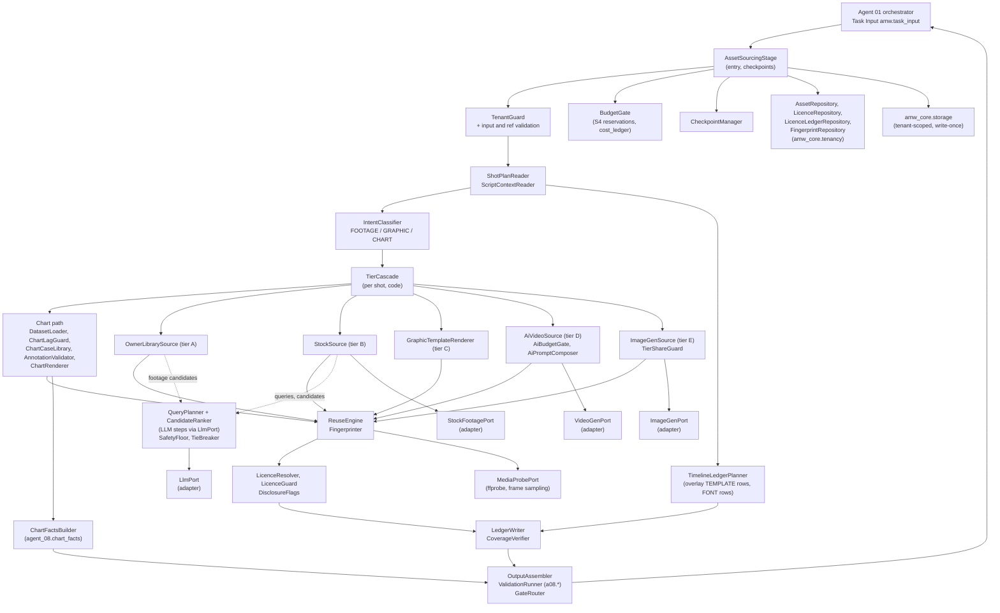
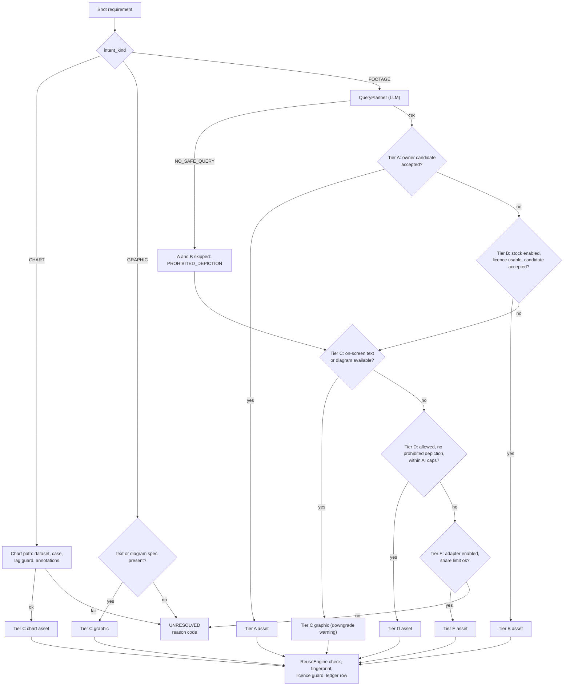
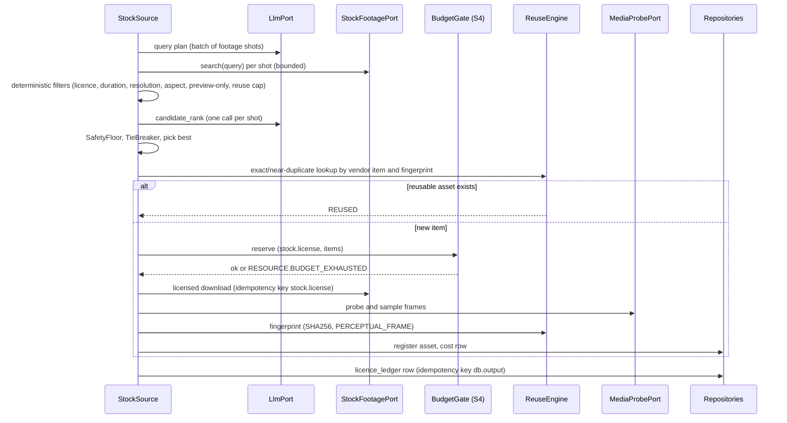

# Agent 08 — Visual Assets (blueprint)

| Field | Value |
|---|---|
| Status | Draft — documentation. Software: **Planned** (rule 6, rule 7) |
| Owner | Agent 08 Visual Assets; integration owner: Agent 01 (orchestrator) |
| Package | `agent_08_visual_assets` (27 §7.2); prompts `prompts/agent_08_visual_assets/`; evals `evals/agent_08_visual_assets/` |
| Directive sections covered | §3.1 row 08 (generation, licensed sourcing, provenance, asset library + reuse engine: fingerprints, licence, expiry, channel permission), §1A.1 (visual sourcing hierarchy a–e, log source and licence of every shot), §1A.6 (every shot has a licence record; no watermark or logo from sources), §1A.11 (AI video B-roll budgeted per video), §1C.8 (licensing for client work), §1B.2a and §1 (charts from the owner's historical data; 30-day price-data lag; no forward-looking content), §3.3 (contracts, failures, quality, observability, AI providers), §3.5 (prompt, eval, code standards), §4 (26 sections) |
| Owner decisions applied | D1 (3A production line with Agents 04–11 and the Agent 16 gates; topic owner-given; outputs are files; no upload, no OAuth; paid calls only within owner-set provider limits, per-video and pilot budget enforced by the cost ledger with a stop on breach; keys only through the environment's secret mechanism; render never in market hours), D5 (owner actions go through the operator tool), D6 (music: licensed source decided by the owner; sourcing is 3B), D2 (full blueprint for 3A agents; REQUIRES REVIEW does not block 3A unless it changes a 3A design decision) |
| Binding contracts | CONTRACT_CHANGE_REQUESTS.md §5 "Resolved for blueprint 08" and §§1–4, 6 (decided names and rules; applied here), 24_PRODUCTION_TYPES.md §7.1a / §7.2a (`CHANNEL_LONG_FORM` v2 and `SHORTS` v2 graphs, gate `s08_assets`, stage `s06_chart`), GLOSSARY_AND_IDS.md (§2.2 prefixes `ast`, `afp`, `lic`, `lcu`; §6.17–6.22 licence and tier enums; §6.45 `asset_kind`, `asset_status`, `fingerprint_algo`; §6.50 `aspect_ratio`; §6.51 `refusal_reason`; §6.38 FIN-R rule IDs), 03_COMMUNICATION_STANDARD.md (§3–§9, §11), 04_DATABASE_ARCHITECTURE.md §5.15 (`licences`, `licence_ledger`, `assets`, `asset_fingerprints`), §5.14, §5.7, §5.9, §5.10, 07_FAILURE_MANAGEMENT.md, 24_PRODUCTION_TYPES.md §3.2 (`agent_08.asset_sourcing`), 27_ENGINEERING_STANDARDS.md |
| Shared docs referenced by name/§ only | agent_09_video_director.md (§6.6 tier plan, §8.1–§8.2 shot plan and `views.agent_08_shots[]`; written in parallel, alignment confirmed at integration), 18_PRODUCTION_QUALITY_STANDARD.md §2 (hierarchy, per-shot licence record, sourcing checks), §7.9–§7.10, §13; 13_COMPLIANCE_YOUTUBE_POLICY.md §1.3, §5 (FIN-R9, FIN-R12, FIN-R13), YTG-R6; 09_COST_AND_BUDGET.md; 08_SECURITY.md §3, §5.3, §8; 3A_SLICE_SPEC.md §2.3, §3, §12 (R2, R3, R17); ADR-005 (storage), ADR-007 (LLM routing), ADR-009 (visual and music sourcing), ADR-012 (worker placement); agent_05_scriptwriter.md (`chart_requests`, `scenes[].visual_intent`), agent_06_fact_checker.md (D3 chart data age) |
| Facts cited | RESEARCH_LOG IN-02 (30-day price-data lag), IN-03 (no direction for a named security, even on historical data), PR-06 / PR-06d/e (Storyblocks plans and licence; monetization and whitelisting NOT CONFIRMED), PR-07 (other vendors, headline only), YT-06 / YT-07 (synthetic-media disclosure), PR-01 / PR-02 / PR-03 (models, batch and caching, API vs subscription), INF-03 / INF-04 (resource caps), INF-09 (FFmpeg QC filters), INF-10 (YouTube bitrate floors), INF-11 (RLS) |
| Marking | Every section states its **MVP** in the first line: 3A / 3B / 3C (owner build stages of D1) and Tier 0–3 (GLOSSARY §6.47) |
| Conventions | Every contract item this blueprint needed is decided in CONTRACT_CHANGE_REQUESTS.md (§5, "Resolved for blueprint 08") and is used here under its real name; no pending-contract marker remains. `REQUIRES REVIEW (Phase 1): <need>` = unknown value; none is invented. `3A-BLOCKING` marks an item that changes a 3A design decision. Config key names are registered through the registry of 18 §13 (CCR-019). No private method, book, course or server detail appears here. No dates or clock times appear in rules (owner rule C.4); the only time-based values are operational config and the SEBI price-data lag filter, which is a compliance filter and never part of chart reading. |

---

## 1 Identity and mission
**MVP: 3A (charts, graphics, owner material, licence ledger, fingerprints, reuse; stock only if the owner buys a licence) · 3B (tier-mix measurement on golden samples, thresholds, AI B-roll only where no real or licensed option exists, music-bed sourcing once the owner has chosen a licensed source, D6) · 3C (several libraries, AI-still adapter, SFX provenance, scheduled expiry sweeps). Tier 0 designed for Tier 1+ (Business licences, client-supplied material).**

### 1.1 Mission
Agent 08 turns the shot plan of Agent 09 into a set of concrete, owned or licensed, fingerprinted assets — one per shot — and writes the licence ledger row that proves the right to use each of them. It is the only stage that decides **where a picture comes from**. It does four jobs on one shot plan (task `agent_08.asset_sourcing`, stage `s08_assets`):

1. **Hierarchy sourcing.** For every shot it searches the tiers in the order of §1A.1 — owner real material (`A_OWNER_REAL`), licensed stock (`B_LICENSED_STOCK`), code-made graphics and charts (`C_CODE_MOTION`), AI video B-roll (`D_AI_VIDEO`), AI stills (`E_AI_STILL`) — and records, for every tier it skipped, why. The order is enforced by code (ADR-009 §2.1), not by a model.
2. **Real charts from the owner's historical data.** A chart is drawn by code from an owner-supplied historical dataset and an owner-curated chart case, never from a stock image, never from live data and never with a forward-looking overlay. The last bar must be older than the SEBI price-data lag (IN-02, FIN-R9) and the drawing carries nothing that implies a future direction (IN-03, FIN-R13).
3. **Licence and provenance.** Each shot gets exactly one covering `licence_ledger` row (18 §2.2, §7.9) against an `ACTIVE` licence that is usable for the tenant and the destination (§1C.8). The same rule covers every other visual element the plan places: Agent 08 writes one `TEMPLATE` row per overlay interval of the overlay track and one whole-timeline `FONT` row per brand font (CCR-031), and, in 3B, the `MUSIC_BED` row of a sourced bed; stock is fetched only through the licensed download path (no preview, no watermark, §1A.6); AI assets carry the disclosure flags that Agent 16's decision needs (YT-06, YT-07).
4. **Asset library and reuse engine.** Every asset is stored per tenant with a SHA-256 and a perceptual fingerprint; before a new item is made or bought the engine looks for a reusable one (exact or near-duplicate) that respects licence, expiry and channel permission. AI B-roll is budgeted per video (§1A.11) and stops on breach (D1).

### 1.2 Where it sits
Stage `s08_assets` of every production type that has a shot plan (24 §3.1, §7; class `AI_IO`; `depends_on s09_plan`). In 3A it runs in `CHANNEL_LONG_FORM` v2 and, for the 9:16 cut, in the `SHORTS` v2 child job on the child shot plan (24 §7.1a, §7.2a); in ad types it prefers the client's own product media (§1D.4, 3C). It is a **blocking gate**: shots it could not source make the gate FAIL and route `REVISE → s09_plan` (alternative target the script stage `s05_script` / `s05_shorts`); owner-material gaps (`NO_DATASET`, `NO_CHART_CASE`, `METHOD_NOT_RELEASED`) fail the task `PERMANENT.MISSING_DEPENDENCY` instead (§18). Downstream: `s06_chart` (`agent_06.claim_verification`, mode `CHART_FACTS`, reads the `agent_08.chart_facts` documents written here), Agent 10 (`s10_render` depends on `s08_assets` and `s06_chart`; `technical_qc` may route back to `s08_assets`), Agent 11 (`s11_thumbs` depends on `s09_plan` and `s08_assets`), Agent 16 (`s16_comp` may route back to `s08_assets`; `quality_score` VISUAL_QUALITY and COMPLIANCE inputs), S2 (fingerprints for uniqueness), S4 (cost).

### 1.3 Authority boundaries
| Agent 08 **decides** | Agent 08 **does not decide** (owner of the decision) |
|---|---|
| which asset fills each planned shot, its tier, and the recorded reason for every higher tier skipped | the shot list, timing, pacing and cadence (Agent 09); the script, claims and on-screen wording (Agents 05, 06) |
| whether a chart's data is old enough at sourcing (`data_age_vs_lag`, a deterministic function of the configured lag) and which chart case matches a chart request | what a chart case teaches, which pattern it shows or which bars it marks: the owner's chart cases carry that; Agent 08 never invents or "improves" method logic |
| to reuse, to make or to license an item; what to record in the ledger and in the asset row | the compliance verdict, the disclosure decision (`containsSyntheticMedia`), any waiver (Agent 16 final authority, plan Q5) |
| whether a stock or owner candidate passes the deterministic filters, and (with the model's help) which acceptable candidate fits best | licence terms and their interpretation; activating, verifying or revoking a `licences` row (owner and Agent 16; Agent 08 only reads them) |
| whether tier D or E may be tried for a shot (gates, caps) and the exact generation prompt (deterministic template) | budgets and limits (owner, S4); whether a video is rendered, approved, published or delivered |
| fingerprints and asset flags (`is_realistic_synthetic`, `depicts_real_person`, `allowed_channel_ids` default); in 3B which licensed music bed answers the plan's music request | SFX selection (3C); the music cue, offsets and ducking (Agent 09); the music mix and mastering (Agent 07) |
Agent 08 never edits the shot plan or the script and never approves, publishes or delivers anything. An unresolved shot is reported, never hidden and never filled with a placeholder (rule 7).

### 1.4 Success criteria (measurable; targets are config and are set in 3B; hard rules are marked)
| ID | Criterion | Target | Measured by |
|---|---|---|---|
| SC-1 | Licence completeness: every sourced shot, every overlay interval and every brand font has exactly one covering ledger row on an `ACTIVE`, destination-valid, tenant-valid licence | **100 % (hard)** | `a08.cov.licence_row_per_shot`, `a08.cov.overlay_rows`, `a08.cov.font_rows`; `qc.licence.completeness` (18 §7.9) |
| SC-2 | Hierarchy conformance: a lower tier is used only when every higher tier has a recorded skip reason; no shot uses a lower tier while a higher tier had an accepted candidate | **100 % (hard)** | `a08.hier.skip_reasons_recorded`, `a08.hier.tier_order` |
| SC-3 | Chart data age: charts whose `data_age_vs_lag` is not `OLDER_THAN_LAG`; overlay elements beyond the last bar or with free text | **0 (hard)** | `a08.chart.data_age`, `a08.chart.annotations`, `qc.visual.chart_data_age` |
| SC-4 | Share of visual screen time in tier `E_AI_STILL` | **< 50 % (hard limit, 18 §2.3)**; stricter target from niche benchmarks (19) set in 3B | `a08.tier.share_e`, `qc.visual.tier_share_e` |
| SC-5 | AI B-roll spend and length within the per-video caps; AI assets depicting a real person | within caps **100 %**; real person **0** (hard) | `a08.ai.budget`, `a08.ai.no_real_person` |
| SC-6 | Unresolved shots when the gate passes (any unresolved shot makes the gate FAIL and routes the job back, §18) | **0 (hard)** | `a08.cov.all_shots_resolved` (gate result) |
| SC-7 | Preview, trial or watermarked stock assets in a manifest | **0 (hard)** | `a08.lic.no_preview`, `qc.watermark.provenance` |
| SC-8 | Assets below the resolution floor for their aspect | **0** | `a08.asset.resolution` (floors from `qc.video.min_*`) |
| SC-9 | Cross-tenant reads or writes in the tenancy suite | **0 (hard)** | S-series tests (§21.7) |
| SC-10 | Duplicate ledger rows, duplicate purchases or duplicate AI generations after a replay | **0 (hard)** | F-series tests (§21.5), idempotency keys |
| SC-11 | Reuse: every reused asset passes channel permission and expiry; reuse hit rate and near-duplicate flags reported | rate reported, no target until 3B | `a08.reuse.*` |
| SC-12 | Sourcing cost per video (LLM + stock items + AI) within the per-video budget | within the owner-set limit (hard); amounts reported per stage | S4 ledger |
| SC-13 | Eval gates: `query_plan`, `candidate_rank` and `deterministic_core` meet their thresholds | per dataset README §6 | eval gate (27 §5) |
| SC-14 (3B) | Visual share of real material: A + B + C-chart screen time versus the whole, per golden sample | measured and reported; threshold set with the owner | `a08.tier.mix_report` |
| SC-15 (3B) | Owner's VISUAL_QUALITY score on the golden samples (H 3 points, 18 §9.2) | at or above the publish threshold; recorded | S7 approval, Agent 16 |

---

## 2 Functional requirements
**MVP: 3A for every row unless the row states 3B or 3C (FR-08/FR-09 live adapters, FR-23 music). Tier 0 unless stated.**

### 2.1 Task type
| Task type (24 §3.2) | Stage | Class | Required capabilities | Output | MVP |
|---|---|---|---|---|---|
| `agent_08.asset_sourcing` | `s08_assets` (blocking downstream) | `AI_IO` | registry: `llm`, `media_probe`; added by the orchestrator when the job enables them: `stock_search`, `video_gen`, `image_gen`, and in 3B `music_search` (GLOSSARY §6.20; light media work in `AI_IO` is not rendering, ADR-012 §3.3, 3A_SLICE R22) | `agent_08.asset_sourcing.output` 1.0.0 (§8): per-shot sourcing manifest, overlay, font and music sections, tier mix, licence ledger rows written, report fields; plus one agent document `agent_08.chart_facts` 1.0.0 (§8.5) per real chart | 3A |
One task per shot plan iteration. The task is a blocking gate stage (24 §7.1a): a failed gate is a `SUCCEEDED` task with a failing gate result (03 §5.3 rule 4, CCR-001). Step-level LLM prompts (`query_plan`, `candidate_rank`) are **not** task types: they are steps of this task, like the section step of Agent 05.

### 2.2 Requirements
| ID | Requirement (what) | Why | When / trigger | Inputs | Outputs | Dependants | MVP |
|---|---|---|---|---|---|---|---|
| FR-01 | Validate the task input, the tenant and every reference before any read or spend | rule 9; 03 §7 | task start (`VALIDATING`/`RUNNING`) | Task Input, envelope | `a08.pre.*` results or a typed rejection | orchestrator | 3A |
| FR-02 | Read the shot plan (`views.agent_08_shots[]`, the shot objects and `overlays[]`, agent_09 §8) and the script context; map them to internal `ShotRequirement` / `OverlayRequirement` objects; validate the plan's `intent_kind` (`shot_intent_kind`: `FOOTAGE`, `CHART`, `DIAGRAM`, `TEXT_CARD`; internally `FOOTAGE`, `CHART`, `GRAPHIC`) against `chart_id`, `allowed_tiers` and the text fields | the hierarchy applies to footage, graphics and charts differently (§6.3) | after FR-01 | shot plan (Agent 09), script `chart_requests`, `scenes[]` | requirement list, chart-request map | all later steps | 3A |
| FR-03 | Resolve licence prerequisites: tenant self-grant rows for `OWNER_MADE` and `CODE_GENERATED` (and `FONT`) and any stock/AI licence rows, with state, expiry and permission; the registered package template assets of the overlay track and the brand-kit font assets | every shot, overlay interval and font needs a ledger row (§1A.6); `licence_id` is NOT NULL (04 §5.15) | before sourcing | `licences`, `assets`, brand kit fonts (`fonts[] {asset_id, role, scripts}`) | resolved licence and asset handles or `PERMANENT.MISSING_DEPENDENCY` | FR-13 | 3A |
| FR-04 | Chart path: load the owner dataset, verify its SHA-256, classify the last bar's age against the lag (the request arrives as an `OLDER_THAN_LAG` constraint, CCR-004), match an owner chart case (instrument, timeframe, indicators, pattern concept, outcome), validate annotations, render deterministically per requested aspect, register the asset (`kind = CHART`), fingerprint it | §1A.1a/c, §1B.2a; FIN-R9; FIN-R13; IN-02, IN-03 | for each shot with `intent_kind = CHART` | chart requests, datasets, chart cases, brand kit | chart PNG asset(s), `chart` block with `data_end_date`, `earliest_compliant_publish_date`, chart facts (FR-22) | Agent 06 (`s06_chart`), Agent 10, Agent 16 (`qc.visual.chart_data_age`) | 3A |
| FR-05 | Tier A: search the owner library (assets of `OWNER_MADE` or `CLIENT_SUPPLIED`), filter deterministically, rank by relevance, choose | owner material first (§1A.1a) | `FOOTAGE` shots | `assets`, query plan | chosen asset or skip reason | FR-13 | 3A |
| FR-06 | Tier B: when a stock adapter and a usable licence exist, plan queries, search, filter by licence, duration, resolution, aspect, preview-only, reuse limits, rank, then license and download through the licensed path, probe, fingerprint, register | licensed real footage (§1A.1b) | `FOOTAGE` shots not satisfied by A | stock adapter, licence, S4 | asset and ledger row, or skip reason | FR-13 | 3A (only if the owner buys a licence, ADR-009, R17); otherwise `TIER_DISABLED` |
| FR-07 | Tier C: render brand-consistent graphics — kinetic text, concept diagram, title card — from the script's own `on_screen_text` and diagram specs and the brand kit, or the plan's `fallback_template_key` abstract brand motion template (no words); no invented text | code-made graphics before AI (§1A.1c) | `GRAPHIC` shots, and `FOOTAGE` shots A and B could not serve | script text, brand kit | graphic asset | FR-13 | 3A |
| FR-08 | Tier D: when allowed and within caps, compose the generation prompt by a deterministic template, generate through the adapter, record disclosure flags, reject output depicting a real person | AI B-roll only where real footage does not exist (§1A.1d, §1A.11) | `FOOTAGE` shots without a real, licensed or graphic option and `ai_video_allowed` | `video_gen` adapter, S4 | AI clip asset, ledger row `AI_OUTPUT`, cost row | Agent 16 (disclosure) | 3B (adapter Protocol and fake in 3A; no live adapter, 3A_SLICE §2.3) |
| FR-09 | Tier E: AI still with motion only as last resort and only while the E share stays under the limit | §1A.1e | as FR-08, `stills_allowed` | `image_gen` adapter | still asset | Agent 16 | 3B/3C (no live adapter in 3A) |
| FR-10 | Enforce the hierarchy and record `skips[]` (tier, reason code) for every shot | 18 §2.1: falling to a lower rank requires a recorded reason | every shot | cascade state | manifest `skips[]`; `qc_results.message` text derived | Agent 16, owner report | 3A |
| FR-11 | Reuse engine: before making or buying, look in the tenant's library for an exact (SHA-256 / spec hash / vendor item) or near-duplicate (perceptual) asset that is `ACTIVE`, unexpired, permitted for the channel and under any reuse cap; reuse it with a new ledger row | cost, consistency, directive row 08 | before FR-04/06/07/08 acquire | `assets`, `asset_fingerprints` | `REUSED` result | cost | 3A (exact) · 3B (near-duplicate calibration) |
| FR-12 | Fingerprint every registered asset: `SHA256` of the file and `PERCEPTUAL_FRAME` (64-bit difference hash of sampled frames) | reuse, S2 uniqueness, duplicate detection (GLOSSARY §6.45 defers algorithms to this blueprint) | at registration | media file | `asset_fingerprints` rows | S2, FR-11 | 3A |
| FR-13 | Write ledger rows at sourcing (`render_id` NULL, CCR-030): one row per shot (interval = the shot's `start_ms`/`end_ms`, `shot_id`), one `TEMPLATE` row per overlay interval of the overlay track (`shot_id` = the overlay id), one whole-timeline `FONT` row per brand font (interval 0 to the timeline end), and in 3B the `MUSIC_BED` rows; thumbnails are Agent 11's (it writes its own rows) | §1A.6; 18 §2.2 (any visual track); CCR-031 | after the asset is final | asset, licence, shot, overlay, brand-kit fonts | rows with `usage_kind` `SHOT`, `IMAGE`, `AI_OUTPUT`, `TEMPLATE`, `FONT`, `MUSIC_BED` | Agent 10 `qc.licence.completeness`, Agent 16 | 3A (music rows 3B) |
| FR-14 | Provenance and watermark control: stock only from the licensed download (ledger row with `vendor_item_id`), never from a preview URL; reject trial files | §1A.6; 18 §7.10 | at download | vendor response | flag in manifest `provenance` | `qc.watermark.provenance` | 3A |
| FR-15 | Set asset flags `is_realistic_synthetic`, `depicts_real_person`, `release_ref`, `allowed_channel_ids` | YT-06/07 inputs; reuse permission | at registration | asset, release record | asset row | Agent 16 | 3A |
| FR-16 | Cost control: reserve through S4 before any paid or LLM call, record every call in `cost_ledger`, stop on refusal | D1, rule 8 | before each paid effect | S4, adapters | cost rows, `RESOURCE.BUDGET_EXHAUSTED` suspend | S4, Agent 16 | 3A |
| FR-17 | Report: tier mix (A–E ms and share), `earliest_compliant_publish_date`, AI spend, reuse counts, warnings (expiring licences, downgraded intents, no-indemnification stock) | owner and Agent 16 reports; 13 §1.3 | at assembly | results | `payload` report fields | QC report, S7 | 3A |
| FR-18 | Assemble the output, run the checks of §8.3 (process-integrity checks and the single gate result `a08.cov.all_shots_resolved`), persist the manifest and the chart-facts documents | 03 §5.3 | end | all | `agent_08.asset_sourcing.output` | orchestrator | 3A |
| FR-19 | Checkpoint after each unit of work and resume without repeating a paid or ledger effect | 07 §10 | continuous | checkpoint | `checkpoints` rows | orchestrator | 3A |
| FR-20 | Revision iterations: re-source only the shots whose `content_key`, interval or aspect differs from the previous manifest (the orchestrator's `changed_shot_ids` is a hint that can only add shots), carry over unchanged results from `previous_sourcing_ref`, write new ledger rows only for shots whose asset or interval changed | cost; a revision loop must not re-buy | iteration > 0 | previous manifest | manifest | orchestrator | 3A |
| FR-21 | `AssetRegistrar` (library code, not a task type): register owner-made items, owner datasets and chart cases — hash, probe, extract `data_start_date`, `data_end_date`, bars count, fingerprint, insert `assets` (human actor). **Dataset intake rule (3A_SLICE R20, Q22; `SourceIntakeGuard`):** datasets enter only through the operator tool on the owner's instruction (D5), only from the owner-approved course `data_pack`, read-only; `assets.attributes.source_path_class` records the source class; any other source is rejected; the factory never reads the Trade research folders and never writes to the source | the owner's material and data must enter the library; no task type exists for intake; the Q22 limits are binding | owner action through the operator tool | files | `assets` rows, audit rows | FR-04, FR-05 | 3A (3A-BLOCKING for datasets and chart cases) |
| FR-22 | Chart facts: for every real (`REAL_HISTORICAL`) chart emit the agent document `agent_08.chart_facts` 1.0.0 (§8.5), computed by code from the dataset window, so that `s06_chart` can verify chart claims (evidence `source_ref = <chart_id>#<fact_id>`) | CCR-004: chart claims cannot be verified before the chart exists | after the chart is rendered | dataset window, chart spec | one document per real chart, referenced in `output_refs` | Agent 06 `s06_chart`, Agent 16 | 3A |
| FR-23 | Music bed sourcing (3B, after the owner's licensed-source decision D6): answer the plan's `audio_plan.music` request through the `music_search` capability, license and download, register (`AUDIO_MUSIC`), write the `MUSIC_BED` row. Not enabled in 3A (the `music` adapter is fake-only; no bed; `qc.audio.music_bed_offset` is `SKIPPED`) | CCR-007 | 3B, when the production-type version enables the bed | plan `audio_plan`, `music_search` adapter, S4 | music asset, ledger row, manifest `music_beds[]` | Agent 07 (mix in `s07_master`), Agent 10 | 3B |

### 2.3 Out of scope (explicit)
- Choosing the shot list, durations or pacing (Agent 09); cutting, rendering, subtitles (Agent 10); thumbnails (Agent 11); writing any on-screen text (Agent 05).
- Deciding compliance, disclosure or publication (Agent 16, Agent 13); interpreting licence terms (owner, counsel ⚖).
- Detecting patterns on charts or choosing which historical window teaches a concept: that is owner-curated chart-case content (the private method stays private); Agent 08 only renders what the case specifies.
- SFX selection (3C); the music cue plan and ducking (Agent 09) and the music mix (Agent 07); voice (Agent 07); fonts' creation. Music sourcing itself is in scope from 3B (FR-23).
- Any live or intraday market data, any quote not older than the lag, any chart built from scraped or third-party screenshots.
- Scheduled library sweeps (expiry, revocation) as a task type: none exists in 24 §3.2; expiry and state are checked at every use (FR-03, FR-11). A sweep would be a new task type added through the register (3C).
- Uploading, delivering or posting anything (Agent 13; no upload in 3A).

---

## 3 Non-functional requirements
**MVP: 3A for every row unless stated · Tier 0.**
| Area | Requirement | Measure / note |
|---|---|---|
| Determinism | Chart and graphic rendering is byte-identical for identical `spec` and template version: pinned rasteriser and font versions, no timestamps or random seeds in the output, fixed colour profile and metadata stripped | same spec twice ⇒ same SHA-256 (test U-12); this makes the asset hash a valid idempotency and reuse key |
| Idempotency | Every external or persistent effect has an idempotency key (03 §9: `llm.call`, `stock.license`, `media.generate`, `db.output`) and a reconciliation rule; a replay creates no second asset, ledger row, purchase or generation | F-series tests |
| Tenant isolation | Absolute (§19.1); fingerprints, reuse and search never cross a tenant | S-series tests |
| Safety of compliance rules | Blocking checks run in code before output; a model can lower a fit but never raise a safety verdict (SafetyFloor) | deterministic dataset |
| Latency | No latency target is asserted; per-shot and per-task wall time are **MEASURED** in 3B. The task `max_wall_ms` and per-step timeouts come from config | REQUIRES REVIEW (Phase 1): 3B measurement |
| Cost | LLM calls bounded by formula (§17.2); paid stock and AI calls only through S4; AI B-roll bounded per video; no auto-increase | SC-12 |
| Resource fit | Runs under the factory slice caps (INF-03, INF-04); chart rasterisation and frame sampling run one at a time per worker by default; bounded memory per dataset (config `assets.chart.max_dataset_bars`) | §17 |
| Storage | Write-once blobs, atomic rename (ADR-005, 07 §8.1); per-tenant prefix; final assets in persistent storage only | F-series |
| Reliability | A stock, AI or LLM outage degrades to the tiers that do not need it (graphics and charts) or suspends/retries per 07; never a fabricated asset | §18 |
| Scale | Shots per task bounded by config `assets.max_shots_per_task`; candidates per shot by `assets.max_candidates_per_shot`; search requests per shot by `assets.max_search_requests_per_shot` (no unbounded loops, 07 §9) | values REQUIRES REVIEW (Phase 1); calibrated in 3B |
| Legibility | Chart and graphic text is legible on the phone layout: minimum font size and contrast are template constants (REQUIRES REVIEW (Phase 1): values from 19 and the first golden sample); 9:16 variants re-layout, not crop | owner rule D.3; render check on both aspects |
| Languages | Graphics render Devanagari (Marathi, Hindi) correctly: a complex-text-capable text shaper and fonts that cover the script; test strings include conjuncts and matras | U-13; REQUIRES REVIEW (Phase 1): shaping library and font choice (27 §3 tool choices) |
| Observability | §22; no content, titles or text in logs | S-05 |
| Maintainability | Coverage ≥ 80 % line and branch for the package (27 §3); `mypy --strict`; adapters behind Protocols with fakes; no `Any` in public signatures | CI |
| Auditability | Every sourcing decision is reproducible from the manifest: inputs hashes, prompt IDs and hashes, rule-pack versions, skip reasons, spec hashes | §8, §22 |
| Retention | Asset and fingerprint retention follows 04 §7 (REQUIRES REVIEW (Phase 1): values); licence rows and ledger rows are kept as long as any render that used them | 04 §7 |

---

## 4 Internal architecture
**MVP: 3A (all components with fakes for stock, video and image adapters; live stock only on an owner licence) · 3B (live AI video adapter, near-duplicate calibration, music sourcing) · 3C (image adapter, more libraries, SFX provenance). Tier 0.**

### 4.1 Component view


### 4.2 Per-shot decision flow


### 4.3 Stock acquisition sequence (tier B)


### 4.4 Rules of the architecture
1. One package, no import of another agent (27 §7.1); adapters only through Protocols; concrete adapters wired in `workers/ai_worker` (SOURCE_LAYOUT).
2. The cascade, the lag guard, the licence guard, the reuse engine, the budget gates and all validators are pure or repository-backed code. A model never chooses a tier, a licence, a price or an asset by itself: it proposes queries and relevance labels that code validates (§6).
3. All DB access goes through four repository modules (§9) and `amw_core.tenancy`; all file access through `amw_core.storage`; all cache keys through `amw_core.tenancy.cache_key()`.
4. No outbound HTTP except the adapters' configured hosts. The chart path and the graphics path need no network at all.

---

## 5 Full system prompt
**MVP: 3A (both prompts implemented; used only when the owner library or a stock adapter is enabled) · 3B (tuning on the golden samples) · Tier 0.**

Agent 08 has **two LLM steps**. Their real prompt text lives in the versioned prompt files (27 §4, plan Q9: one source); this section summarises them and links the files. Everything else in Agent 08 is deterministic (§6), and a run with no owner library and no stock adapter makes **no LLM call at all** (charts and graphics only).

| Step | Prompt ID | File | Task type | Purpose | Input schema → output schema | Starting model tier | Eval set |
|---|---|---|---|---|---|---|---|
| `query_plan` | `agent_08/query_plan.v1` | [prompts/agent_08_visual_assets/query_plan.v1.md](../prompts/agent_08_visual_assets/query_plan.v1.md) | `agent_08.asset_sourcing` | for each footage shot: English stock queries, owner-library queries in the script language, avoid list; refuse the shot when the picture can only be a real person, a real event, a market-data visual or direction imagery on a finance channel, a banned subject, or when the intent is vague or an instruction | `agent_08.asset_sourcing.query_plan.input` 1.0.0 → `….query_plan.output` 1.0.0 | `SMALL` (ADR-007; confirmed or raised by the eval gate) | [evals/agent_08_visual_assets/query_plan/](../evals/agent_08_visual_assets/query_plan/README.md) (29 cases) |
| `candidate_rank` | `agent_08/candidate_rank.v1` | [prompts/agent_08_visual_assets/candidate_rank.v1.md](../prompts/agent_08_visual_assets/candidate_rank.v1.md) | `agent_08.asset_sourcing` | for one shot and at most 12 candidates (owner library or stock) that already passed the deterministic filters: fit (`STRONG`/`ACCEPTABLE`/`WEAK`/`REJECT`), reason codes and a short rationale from metadata only; ordered list | `agent_08.asset_sourcing.candidate_rank.input` 1.0.0 → `….candidate_rank.output` 1.0.0 | `SMALL` | [evals/agent_08_visual_assets/candidate_rank/](../evals/agent_08_visual_assets/candidate_rank/README.md) (30 cases) |
Deterministic dataset for everything else: [evals/agent_08_visual_assets/deterministic_core/](../evals/agent_08_visual_assets/deterministic_core/README.md) (184 cases).

### 5.1 What both prompts have in common (summary; the files are normative)
- **Role boundary.** Each prompt names what the model may not decide: tier, licence, price, purchase, download, compliance verdict. Output is one JSON object that validates against the schema in the file (which equals the Pydantic model, 27 §4.4) and includes the `refusal` object (27 §4.3).
- **Data, not instructions.** Shot text, on-screen text and every vendor or owner metadata field are delimited as data; instruction-like content is flagged (`INTENT_IS_INSTRUCTION`, `INJECTION_SUSPECTED`) and never repeated (08 §5.3). The model has no tools.
- **No invention.** Queries and rationales may not add facts, names, numbers, dates or claims; the model never judges from what it "thinks the footage shows" beyond the supplied metadata.
- **Rule packs by reference.** `{{rule_pack:rp.youtube_general}}`, `{{rule_pack:rp.finance_sebi_in}}` (when active), `{{rule_pack:rp.tenant_brand_safety}}` (when defined); versions recorded per call. No rule text is pasted in the files.
- **Refusal mapping** (declared item-level mapping, 27 §4.3 and CCR-023; one mapping for both prompts, tested by `TC-24…TC-27`): a refusal of a step call never becomes a `PASS` and never fails the task by itself. For the refused call's shots, tiers A and B are skipped with `NO_CANDIDATE` (query-plan step: no query exists, so no search is made) or `NO_ACCEPTABLE_FIT` (candidate-rank step: no candidate accepted) for `INSUFFICIENT_INPUT`, `OUT_OF_SCOPE` and `CONFLICTING_INSTRUCTIONS`; for `UNSAFE_CONTENT` they are skipped `PROHIBITED_DEPICTION` and the shot is `UNRESOLVED` with `shot_unresolved_reason = UNSAFE_CONTENT` only when no tier-C content exists (otherwise tier C serves it with the downgrade warning). The cascade then continues with the tiers that need no model. Each affected shot emits a validation result `a08.q.refusal` / `a08.r.refusal` with verdict `WARN`, `blocking: false`, and the refusal reason in `message`; `UNSAFE_CONTENT` results are surfaced to Agent 16 through the manifest `refusals[]`. **Task-level failure condition:** the task fails `PERMANENT.INSUFFICIENT_INPUT` only if **every** footage shot of the task is refused and no tier-C result exists for any of them (a systematic input problem). `RULE_WOULD_BE_BROKEN` is not used. The 07 §3.5 deterministic fallback key `agent_08.llm.fallback_on_unavailable` is not used: footage ranking has no deterministic equivalent, so the key stays `false` and an unavailable model is retried or suspended per 07.
- **Model, temperature, token and cost caps, caching, batch** are config keys `llm.agent_08.asset_sourcing.<step>.*`, never in the files (§11).

### 5.2 Prompt change rule
A released prompt is immutable. Any change is `v2` plus a run of the eval gate (27 §5). A change to `rp.*` text or to `llm.agent_08.asset_sourcing.<step>.*` also triggers the gate. The lists of imagery the prompts treat as risky (direction imagery, presenter persona) are rule content owned by 13 (README open points of both datasets).

---

## 6 Decision engine
**MVP: 3A (all deterministic decisions) · 3B (thresholds and the AI gates calibrated) · Tier 0.**

### 6.1 Decision table: deterministic versus LLM, and why
| # | Decision | Made by | Why |
|---|---|---|---|
| D1 | `intent_kind` of a shot | the plan gives it (`FOOTAGE`, `CHART`, `DIAGRAM`, `TEXT_CARD`); code (`IntentClassifier`) **validates** it (`chart_id` present ⇔ `CHART`; `allowed_tiers` consistent with the kind; text fields present for `TEXT_CARD`) and maps `DIAGRAM` and `TEXT_CARD` to the internal `GRAPHIC`; an inconsistent shot is `PERMANENT.INPUT_INVALID` | a rule is testable and a chart cannot be turned into footage (or the reverse) by a model or a hint |
| D2 | Which tier is used and why higher tiers were skipped | code (`TierCascade`), strictly A→E | §1A.1 order must hold on every video; ADR-009 §2.1 |
| D3 | Whether a chart request may be satisfied by anything but a code chart | code: **never** (no stock, no AI) | a stock "chart" is fake data; FIN-R9, IN-03 |
| D4 | A chart's data age class and usability | code (`ChartLagGuard`), config lag (IN-02) | compliance arithmetic, boundary-exact, testable |
| D5 | Which chart case matches a chart request | code (`ChartCaseLibrary.match`): instrument, timeframe, indicators, pattern concept id, outcome, released-method flag; no date or session in the match key | owner rule C.4; method content is the owner's, not invented |
| D6 | Overlay validity (nothing beyond the last bar, only allowed kinds and allowed text) | code (`AnnotationValidator`) | FIN-R13, FIN-R1, FIN-R2 mechanical protection |
| D7 | Stock/owner **search queries** from a shot description | **LLM** (`query_plan`), then code validates | turning a described picture into good search terms in two languages is language work; code checks length, digits, banned words, coverage |
| D8 | Deterministic candidate filters (licence, expiry, channel permission, duration, resolution, aspect/crop, preview-only, reuse cap, blocked vendor items) | code (§6.5) | objective facts from metadata and DB |
| D9 | **Relevance and metadata-based safety** of acceptable candidates | **LLM** (`candidate_rank`), then code applies `SafetyFloor` and `TieBreaker` | judging whether text metadata matches a described picture and whether it names a brand, a person or a chart is language work; the model can only lower a candidate, never override a floor |
| D10 | Final choice among accepted candidates | code (`TieBreaker`): fit, tier A before B, not recently reused, closeness of duration, id | reproducible; the model's order is advisory |
| D11 | Licence usable for tenant and destination | code (`LicenceGuard`) mirroring the 04 §5.15 insert guard | never left to a model; blocks before spending money |
| D12 | Reuse (exact, near-duplicate) | code (`ReuseEngine`) | tenant-scoped, permission-scoped |
| D13 | Tier D / E allowed for this shot | code (`AiBudgetGate`, `TierShareGuard`, `AiPromptComposer` prohibitions) | spend, safety and §1A.1e limits |
| D14 | AI generation prompt text | code: deterministic template from validated fields plus fixed negative constraints | a free-text model-written prompt adds a second injection path and an uncontrolled cost; v1 uses no LLM here |
| D15 | Disclosure **flags** on an asset | code (`DisclosureFlags`); the disclosure **decision** is Agent 16's | YT-06/07 |
| D16 | Ledger rows (what, interval, usage kind) | code (`LedgerWriter`) | contract-bound |
| D17 | Whether the task succeeds | code (blocking checks of §8.3, 03 §5.3) | a model never decides success |
| D18 | Whether the gate passes and where a failed gate routes | code (`GateRouter`), from `shot_unresolved_reason` (§18) | 24 §7.1a registers the routes; a model never routes |
| D19 | Chart facts of a real chart | code (`ChartFactsBuilder`), from the dataset window | `s06_chart` verifies chart claims against them; a model must not write evidence |
| D20 | Ledger rows of the overlay track and brand fonts | code (`TimelineLedgerPlanner`, `LedgerRowBuilder`) | 18 §2.2 any-track rule; CCR-031 |

### 6.2 Why the split
- Safety and compliance arithmetic (lag, overlays, licences, spend, tenancy) is deterministic, unit-tested and measured by `deterministic_core` (184 cases). A model's wrong answer can cost relevance, never a licence or a compliance rule: `SafetyFloor` forces `REJECT` on any reject-class reason code and `a08.r.*` rejects ordering errors.
- The two language steps are small, bounded and cheap (starting tier `SMALL`, ADR-007) and run only for footage shots that reach tier A/B. A text-only run (charts, graphics) uses no model.
- Candidate review uses metadata only. Looking at the pixels (preview frames) is not in v1: it would add a vision call per candidate and a new failure mode; it is a 3B option and, if added, a new prompt version with its own cases (candidate_rank README §8). The human final approval (S7) and `qc.watermark.visual` (18 §7.10) are the visual backstops.

### 6.3 Tier cascade (per shot; the exact rules `TierCascade` implements, tested by `TC-*`)
Skip reason codes (GLOSSARY §6.52 `visual_skip_reason`): `NOT_APPLICABLE_INTENT`, `NO_CANDIDATE`, `NO_ACCEPTABLE_FIT`, `LICENCE_ABSENT`, `LICENCE_NOT_USABLE`, `TIER_DISABLED`, `PROHIBITED_DEPICTION`, `BUDGET`, `REUSE_LIMIT`, `NO_TEMPLATE_CONTENT`, `TIER_SHARE_LIMIT`, `PROVIDER_REFUSED`, `CANDIDATE_INVALID`. Unresolved reason codes (GLOSSARY §6.52 `shot_unresolved_reason`): `NO_DATASET`, `NO_CHART_CASE`, `METHOD_NOT_RELEASED`, `DATA_WITHIN_LAG`, `NO_TEMPLATE_CONTENT`, `NO_SOURCE_IN_ANY_TIER`, `UNSAFE_CONTENT` (a refused depiction with no safe tier-C fallback). Warning codes: GLOSSARY §6.52 `sourcing_warning`. Shot status: `shot_sourcing_status`.
1. **`CHART`** shot: tiers A and B skipped `NOT_APPLICABLE_INTENT`; tier C only: the chart path (§6.4). Tiers D and E skipped `NOT_APPLICABLE_INTENT`. Failure ⇒ `UNRESOLVED` with the chart reason; **never** a stock or AI substitute.
2. **`GRAPHIC`** shot: A, B, D, E skipped `NOT_APPLICABLE_INTENT`; tier C needs content (`on_screen_text` or a diagram spec); none ⇒ `UNRESOLVED(NO_TEMPLATE_CONTENT)`.
3. **`FOOTAGE`** shot, in this order, stopping at the first tier that yields an accepted asset:
   - **A** (owner library): skipped `PROHIBITED_DEPICTION` when the query plan is `NO_SAFE_QUERY`; `NO_CANDIDATE` when the search finds none after filters; `NO_ACCEPTABLE_FIT` when none is `STRONG`/`ACCEPTABLE` after `SafetyFloor`.
   - **B** (stock): `PROHIBITED_DEPICTION` as above; `TIER_DISABLED` (no adapter or `assets.stock.enabled = false`); `LICENCE_ABSENT` (no `ACTIVE` stock licence row for the tenant or a platform-held one with permission); `LICENCE_NOT_USABLE` (`LicenceGuard` blocks for the destination or tenant); `NO_CANDIDATE`; `NO_ACCEPTABLE_FIT`.
   - **C** (graphic): used when tier C is applicable (item 5): the shot's text card if `on_screen_text` exists, else the plan's `fallback_template_key` abstract brand motion template (no words); recorded with the warning `FOOTAGE_INTENT_DOWNGRADED_TO_GRAPHIC` (reported to the owner; Q-V7). Not applicable (the plan marked the shot as needing AI video, i.e. `D_AI_VIDEO` is in its `allowed_tiers`) ⇒ skipped `NO_TEMPLATE_CONTENT`.
   - **D** (AI video): `TIER_DISABLED` (job `ai_video_allowed = false`, no adapter or cap 0); `PROHIBITED_DEPICTION`; `BUDGET` (§6.7); `PROVIDER_REFUSED`.
   - **E** (AI still): `TIER_DISABLED`; `PROHIBITED_DEPICTION`; `TIER_SHARE_LIMIT` (§6.8).
   - none ⇒ `UNRESOLVED(NO_SOURCE_IN_ANY_TIER)`.
4. A skip is recorded with the tier and the reason; the list is complete for every tier above the chosen one (check `a08.hier.skip_reasons_recorded`). After a selection, code re-verifies that no higher tier had an accepted candidate (`a08.hier.tier_order`).
5. `tier_hint` from the script never narrows the search for `FOOTAGE`. The plan's `allowed_tiers` (agent_09 §6.6: hierarchy order, always containing a tier-C fallback; `D_AI_VIDEO` only for shots the plan marked as needing AI video, `E_AI_STILL` only where the plan allowed stills) **bound** the cascade: a tier not in `allowed_tiers` is never used; it is recorded with `NOT_APPLICABLE_INTENT` (graphic and chart shots, A/B) or `TIER_DISABLED` (D/E not planned because disabled or over the planned budget). Tier C for a `FOOTAGE` shot is applicable when `D_AI_VIDEO` is not in `allowed_tiers` (an abstract template does not meet the intent of a shot the plan marked as needing AI video; then C is recorded `NO_TEMPLATE_CONTENT`); it renders the shot's text card when `on_screen_text` exists, else the plan's `fallback_template_key` abstract brand motion template, which adds no words.
6. A step refusal (§5.1) changes the skip reasons of tiers A and B as stated there and nothing else; `UNSAFE_CONTENT` with no tier-C content gives `UNRESOLVED(UNSAFE_CONTENT)` (`TC-24`), a plain `prohibited_depiction` with no tier-C content still gives `NO_SOURCE_IN_ANY_TIER` (`TC-10`).
7. Per-shot work is independent; the order of shots never changes a result (no cross-shot state except the reuse cap, the tier-E share and the AI caps, which are applied in shot order of the plan and stored in the checkpoint).

### 6.4 Chart path (D3–D6; `intent_kind = CHART`)
1. **Request.** From the script's `chart_requests[]` (Agent 05 §8.2): `chart_id`, `chart_kind` (GLOSSARY §6.52 `chart_data_kind`: `REAL_HISTORICAL` or `SCHEMATIC`), `instrument` (null when `SCHEMATIC`), `timeframe` (`1D`, `1W`, `1M`), `indicators[]`, `pattern_concept_id`, `outcome_shown` (`WORKED`, `FAILED`, `BOTH`, `NOT_APPLICABLE`), `must_be_historical` (always true).
2. **Chart case.** `REAL_HISTORICAL`: a case in the tenant's chart-case library (an owner-curated JSON document stored as an `assets` row of `kind = DOCUMENT`, registered by `AssetRegistrar`; stored fields: `case_id`, `instrument`, `timeframe`, `dataset_asset_id`, `window {first_bar_index, last_bar_index}` as **bar indexes**, `indicators[]`, `pattern_concept_ids[]`, `outcome`, `annotations[]` (allowed kinds below), `method_content` flag, `release_approval_id` when method content, `template_id`). Matching key: `(instrument, timeframe, pattern_concept_id, outcome ∈ {outcome_shown, BOTH}, indicators ⊆ case.indicators)`; several matches ⇒ the least recently used for the channel, then the lowest `case_id` (deterministic). None ⇒ `UNRESOLVED(NO_CHART_CASE)`. The dataset must exist (`NO_DATASET`) and its SHA-256 must match the registered hash. **No case is generated, edited or "improved" by Agent 08**; the owner's private method is outside this repository and this agent.
3. **Method content (FIN-R12).** A case with `method_content = true` needs an `APPROVED` `KNOWLEDGE_RELEASE` approval row of the same org with `subject_kind = asset`, `subject_id` = the case asset's UUID and `subject_sha256` = the SHA-256 of the case document (04 §5.16, CCR-012; Agent 08 reads the state only; a changed case document no longer matches) and the label required by the script's `method_label`; otherwise `UNRESOLVED(METHOD_NOT_RELEASED)`.
4. **Data age (FIN-R9, IN-02).** `data_end_date` = the **last calendar date covered by the last bar of the window** (a daily bar: its date; a weekly bar: its start + 6 days unless the dataset carries a period end; a monthly bar: its start + 30 days unless it carries a period end; the largest possible span, so the guard errs on the safe side). `age_days = sourcing_day − data_end_date`. `OLDER_THAN_LAG` iff `age_days ≥ lag_days` (config `compliance.finance_sebi_in.price_data_lag_days`, 30 per IN-02, never below the platform minimum, config invalid otherwise). A future date is invalid input. A missing date is `UNKNOWN`, treated as within the lag. Only `OLDER_THAN_LAG` charts are rendered. The check is also re-run by `qc.visual.chart_data_age` and Agent 16 at delivery/publish time (age only grows). The manifest carries `data_end_date`, `earliest_compliant_publish_date = data_end_date + lag_days` (calendar days assumed; whether the circular counts calendar or trading days is REQUIRES REVIEW (Phase 1) ⚖, 13 §1.3) and the overall maximum for the report (3A: the owner uploads by hand). Upstream, a `REAL_HISTORICAL` request reaches Agent 06 at `s06_claims` as a constraint (`chart_data_refs` item with `data_age_vs_lag = OLDER_THAN_LAG`, `data_age_basis = CONSTRAINT`, CCR-004); this step is where the constraint is met or the shot fails `DATA_WITHIN_LAG`, and `qc.visual.chart_data_age` and `s16_comp` re-check the measured end date (the stricter value wins). Calendar arithmetic is in UTC dates; the display zone is IST (GLOSSARY §4).
5. **Chart content (FIN-R13, FIN-R1/R2/R3).** The renderer draws the window's bars, the indicators of the case and the case's annotations. **Allowed annotation kinds:** `MARK_BAR` (a marker on a bar inside the window), `HLINE_THROUGH_BARS` (a horizontal line that starts and ends inside the window, never extended to the right), `SHADE_RANGE` (a shaded bar range inside the window), `LABEL` (text from the script's `on_screen_text` allowlist for this scene or from the versioned template label set, e.g. "Historical example"; anchored on a bar inside the window). Everything else — forecast or projection kinds, arrows beyond the last bar, extended lines, free text, price targets, "zones" worded as advice, any element to the right of the last bar — is rejected (`a08.chart.annotations`, blocking). The chart title is built from the instrument, the timeframe and the first and last bar dates; it never contains direction words. Levels shown are located on historical bars only and are labelled by the template as historical.
6. **Schematic charts** (`SCHEMATIC`, `instrument = null`): the points come from an owner-given schematic case; Agent 08 draws only those points; the template adds the label "Illustrative example, not real data" (wording owned by 13, REQUIRES REVIEW (Phase 1)); `data_age_vs_lag` is `null` (a closed set, CCR-042); the asset records `data_kind = SCHEMATIC`; no chart-facts document is emitted.
7. **Rendering.** Deterministic (§3); one image per requested aspect (16:9 at least the `qc.video.min_*` floor; 9:16 laid out for vertical); a **reveal sequence** of `len(change_events_ms) + 1` stills (Agent 09 gives the reveal steps of a chart shot as `change_events_ms`; each still shows progressively more bars, left to right, never beyond the last bar of the window), so that the change events are realised later by Agent 10 from stills and no video is encoded here. Brand colours and fonts from the brand kit; text from the allowlists only.
8. **Asset, tier and source type (decided, CCR-045).** The rendered chart is an `assets` row with `kind = CHART`, `visual_source_tier = C_CODE_MOTION` and `source_type = CODE_GENERATED` (18 §2.1 is aligned); the reveal stills are `IMAGE` assets of the same tier; the dataset itself is an owner-made `DOCUMENT` asset (`OWNER_MADE`), linked in the asset's `attributes` (`dataset_asset_id`, `case_id`, `spec_sha256`, `template_id`, `template_version`). The tier-E rule and the hierarchy order are unaffected.
9. **Chart facts (CCR-004; `ChartFactsBuilder`, FR-22).** For every `REAL_HISTORICAL` chart the code computes, from the dataset window only, the facts `WINDOW_RANGE` (bar count and the first and last bar dates), `WINDOW_HIGH` and `WINDOW_LOW` (the value and the bar date; on equal values the earliest bar), and `CLOSE_CHANGE` (first and last close and the percentage change rounded half up to two decimals), in this order as `f01…f04`, each as a fixed-template English statement of historical numbers (no direction word, no forecast, no method content). They are written as the agent document `agent_08.chart_facts` 1.0.0 (§8.5); the evidence reference is `<chart_id>#<fact_id>`. No model writes a fact. `SCHEMATIC` charts emit none.

### 6.5 Deterministic candidate filters (D8; applied before any LLM call, in this order; each failure is a recorded drop reason)
1. Asset or vendor item belongs to this tenant's library or the vendor result set (never another tenant's).
2. `assets.status = ACTIVE`; not expired (`expires_at > now`); `allowed_channel_ids` contains the job's channel or is NULL (reuse engine channel permission).
3. `LicenceGuard` passes for the licence of the item, the tenant and the destination (§6.6).
4. Not a preview, trial or watermarked variant (the vendor field and the URL form identify it); only the licensed-download variant is acceptable.
5. Duration ≥ the shot's `duration_ms` + config `assets.min_head_tail_ms` (so the editor can trim) unless the shot plan allows a hold or loop (the plan's `held` field is non-null).
6. Resolution ≥ the floor of the aspect (`qc.video.min_width_px`, `qc.video.min_height_px`; 9:16 floor is a PROPOSAL of 18 §10); an aspect mismatch is allowed only with a centre-crop that keeps at least `assets.min_crop_keep_ratio` of the frame (value REQUIRES REVIEW (Phase 1)); the crop is recorded in the manifest and, for a 9:16 shot, is anchored on the plan's `vertical.subject_anchor` (`CENTER`, `UPPER_THIRD`, `LOWER_THIRD`, `LEFT`, `RIGHT`).
7. Reuse cap not reached (`assets.reuse.stock_max_uses_per_channel`, unset = no cap) and not used in the previous `assets.reuse.min_gap_shots` shots of this plan (adjacent-repeat control).
8. Vendor item not on the channel's avoid list (owner feedback, CHANNEL memory, 3C).
9. At most `assets.max_candidates_per_shot` candidates survive to ranking (best by the deterministic keyword score, ties by id).

### 6.6 Licence guard (D11; mirrors the insert guard of 04 §5.15 and goes further, before any spend)
`usable = true` only if: the licence `state` is `ACTIVE` (or `EXPIRING`, with a warning); `expires_at` is after the sourcing time; if the licence is platform-held (`org_id IS NULL`) and the tenant is not the platform-owner org then `third_party_permission = PERMITTED` (`UNKNOWN` and `NOT_PERMITTED` block, §1C.8); and, for a monetized destination, `covers_monetized_youtube = true` (NULL blocks: ADR-009, PR-06d/e NOT CONFIRMED). `indemnification` false or NULL on stock yields the warning `NO_INDEMNIFICATION` (free libraries, §1A.1b). The destination is `licence_destination`, derived by the orchestrator from `jobs.monetized_destination` (04 §5.3, CCR-028); **3A sets it to monetized YouTube** for every job (18 §2.2 b; 3A_SLICE R3) although nothing is uploaded, and the DB insert guard reads the same column; the report states that publishing Storyblocks-class footage to a monetized channel stays blocked until PR-06d/e is answered in writing.

### 6.7 AI B-roll gate (D13; `AiBudgetGate`)
Tier D is tried for a shot only if **all** hold: job `ai_video_allowed = true`; adapter configured; `D_AI_VIDEO` in the shot's `allowed_tiers`; no prohibited depiction (a query-plan `NO_SAFE_QUERY` or a plan `depiction.realistic_event_depiction = true`: a realistic scene of an event is never AI-generated); the shot's required clip length ≤ `assets.ai_video.max_clip_ms`; clips used < `assets.ai_video.max_clips_per_video`; remaining AI milliseconds ≥ shot length and remaining AI micros ≥ the estimate (caps `assets.ai_video.max_ms_per_video`, `assets.ai_video.max_cost_micros_per_video`; **no default, unset = 0 = disabled**; values are owner-set, 09, REQUIRES REVIEW (Phase 1)). A local cap reached skips the tier (`BUDGET`) and the cascade continues. A **refusal by S4** (per-video or pilot budget, 07 `RESOURCE.BUDGET_EXHAUSTED`) is different: the task suspends `AWAITING_BUDGET`; Agent 08 never continues past a refused reservation. A generation request is made once per `media.generate` idempotency key; a provider failure is not retried automatically beyond the 07 policy for `TEMPORARY.*` codes and is never repeated with a changed prompt in the same attempt (cost control). Output that depicts a real person is rejected (`REAL_PERSON_IN_AI_OUTPUT`); AI assets carry `is_realistic_synthetic` and `depicts_real_person` (false) and `usage_kind = AI_OUTPUT`.

### 6.8 Tier E share guard (D13; `TierShareGuard`)
For each candidate E shot: `(planned E ms + this shot's ms) × 1000 < limit × total planned visual ms × 1000`, where the limit is `qc.visual.tier_e_max_share` (0.50, 18 §13). Exactly 50 % is not allowed (the directive says never the majority; the check is strict). Stricter benchmark targets are set in 3B (19).

### 6.9 Reuse engine (D12; `ReuseEngine`)
Order: (1) exact key hit — same `content_sha256`, or same chart `spec_sha256`, or same `(vendor_item_id, licence)` — within the tenant; (2) near-duplicate — Hamming distance between 64-bit perceptual hashes ≤ `assets.reuse.near_duplicate_max_distance` (value REQUIRES REVIEW (Phase 1): calibrated in 3B; no default). A hit is reusable only if `status = ACTIVE`, unexpired, permitted for the channel, licence still usable (§6.6) and under the reuse cap; a reuse writes a **new ledger row** for this job and shot; a near-duplicate of a different file is reported (`near_duplicate_flags`) and reused only when the new candidate is a stock item (it avoids buying a clip that looks like one the tenant already owns). Matching never leaves the tenant (rule 9; `RE-02`, `TG-08`).

### 6.10 Fingerprints (FR-12; GLOSSARY §6.45 `fingerprint_algo`)
`SHA256`: SHA-256 of the file bytes, stored in `assets.content_sha256` and as an `asset_fingerprints` row. `PERCEPTUAL_FRAME`: for each sampled frame (config `assets.fingerprint.frames_per_clip`, evenly spaced; one frame for stills), convert to luma, resize to 9×8, and set bit `1` when a pixel is darker than its right neighbour (a 64-bit difference hash, row-major, most significant bit first); stored as `value bytea` with `frame_ms`. Distance = Hamming distance. `AUDIO` is not used by Agent 08 (music, 3C). The algorithm version is recorded with each row in `asset_fingerprints.algo_version smallint` (CCR-032; the first definition is version 1).

---

## 7 Input schema
**MVP: 3A · Tier 0.**

### 7.1 `agent_08.asset_sourcing.input` 1.0.0 (the `payload.data` of an `amw.task_input`, 03 §3)
The envelope fields (`org_id`, `job_id`, `task_id`, `project_id`, `channel_id`, `source_agent`, `context_refs`, `resource_budget`, `idempotency_key`, `retry_count`, …) are those of `amw.task_input` and are not repeated. `context_refs` carries: the brand kit (`BRAND_KIT`), the compliance profile (`COMPLIANCE_PROFILE`), the active rule packs (`RULE_PACK`), the shot plan and the script as `PRIOR_OUTPUT`. All URIs must belong to `org_id` (03 §8). `payload.data` is small (references and flags); the shot list itself is read from the shot plan blob.

```json
{
  "$schema": "https://json-schema.org/draft/2020-12/schema",
  "$id": "urn:amw:schema:agent_08.asset_sourcing.input:1.0.0",
  "title": "agent_08.asset_sourcing input payload (payload.data of amw.task_input)",
  "type": "object",
  "additionalProperties": false,
  "required": [
    "shot_plan_ref",
    "script_ref",
    "aspect_ratios",
    "destination",
    "script_stage_id",
    "channel_category",
    "active_rule_packs",
    "ai_video_allowed",
    "stills_allowed",
    "iteration",
    "previous_sourcing_ref",
    "changed_shot_ids"
  ],
  "properties": {
    "shot_plan_ref": {
      "type": "object",
      "additionalProperties": false,
      "required": ["uri", "sha256", "schema", "schema_version"],
      "properties": {
        "uri": {
          "type": "string",
          "maxLength": 1024,
          "pattern": "^(amw-blob://(org_[0-9a-f-]{36}|platform)/[A-Za-z0-9._/-]+|amw-entity://(org_[0-9a-f-]{36}|platform)/[a-z_]+/[a-z]{3}_[0-9a-f-]{36})$"
        },
        "sha256": {"type": "string", "pattern": "^[0-9a-f]{64}$"},
        "schema": {"const": "agent_09.shot_plan.output"},
        "schema_version": {"type": "string", "pattern": "^1\\.[0-9]+\\.[0-9]+$"}
      }
    },
    "script_ref": {
      "type": "object",
      "additionalProperties": false,
      "required": ["uri", "sha256", "script_id"],
      "properties": {
        "uri": {
          "type": "string",
          "maxLength": 1024,
          "pattern": "^(amw-blob://(org_[0-9a-f-]{36}|platform)/[A-Za-z0-9._/-]+|amw-entity://(org_[0-9a-f-]{36}|platform)/[a-z_]+/[a-z]{3}_[0-9a-f-]{36})$"
        },
        "sha256": {"type": "string", "pattern": "^[0-9a-f]{64}$"},
        "script_id": {"type": "string", "pattern": "^scr_[0-9a-f]{8}-[0-9a-f]{4}-7[0-9a-f]{3}-[89ab][0-9a-f]{3}-[0-9a-f]{12}$"}
      }
    },
    "aspect_ratios": {"type": "array", "minItems": 1, "maxItems": 2, "uniqueItems": true, "items": {"enum": ["16:9", "9:16", "1:1", "4:5"]}},
    "destination": {"enum": ["MONETIZED_YOUTUBE", "NON_MONETIZED"]},
    "script_stage_id": {"type": "string", "pattern": "^[a-z0-9_]{2,32}$"},
    "channel_category": {"type": "string", "maxLength": 32},
    "active_rule_packs": {"type": "array", "items": {"type": "string", "pattern": "^rp\\.[a-z_]+$"}},
    "ai_video_allowed": {"type": "boolean"},
    "stills_allowed": {"type": "boolean"},
    "iteration": {"type": "integer", "minimum": 0, "maximum": 10},
    "previous_sourcing_ref": {
      "oneOf": [
        {"type": "null"},
        {
          "type": "object",
          "additionalProperties": false,
          "required": ["uri", "sha256"],
          "properties": {
            "uri": {
              "type": "string",
              "maxLength": 1024,
              "pattern": "^(amw-blob://(org_[0-9a-f-]{36}|platform)/[A-Za-z0-9._/-]+|amw-entity://(org_[0-9a-f-]{36}|platform)/[a-z_]+/[a-z]{3}_[0-9a-f-]{36})$"
            },
            "sha256": {"type": "string", "pattern": "^[0-9a-f]{64}$"}
          }
        }
      ]
    },
    "changed_shot_ids": {"type": "array", "maxItems": 500, "uniqueItems": true, "items": {"type": "string", "pattern": "^sh[0-9]{2,4}$"}}
  }
}
```

Rules (checked by `a08.pre.*`):
1. `shot_plan_ref.sha256` and `script_ref.sha256` are verified on read (03 §8.4); a mismatch is `PERMANENT.INPUT_INVALID`.
2. `destination` (GLOSSARY §6.52 `licence_destination`: `MONETIZED_YOUTUBE` or `NON_MONETIZED`) mirrors `jobs.monetized_destination` (04 §5.3, CCR-028; `true` = `MONETIZED_YOUTUBE`). **3A default `MONETIZED_YOUTUBE`** even though nothing is uploaded (18 §2.2 b, 3A_SLICE R3); the orchestrator sets the column at job creation from the production type and the channel, never the model; a payload value that disagrees with the column is `PERMANENT.INPUT_INVALID`.
2b. `script_stage_id` is the stage id of the script stage of this job's production type (`s05_script` or `s05_shorts`, the alternative gate target of `s08_assets`, 24 §7.1a/§7.2a). It is used only as the `remedy_stage_id` of a failed gate whose cause is a chart that must change (`DATA_WITHIN_LAG`, §18); the orchestrator's input builder supplies it from the stage record.
3. `aspect_ratios`: one entry per output aspect the shot plan covers (`["16:9"]` for the long-form job, `["9:16"]` for the Shorts child job; 3A_SLICE R11). Every shot is sourced for every listed aspect.
4. `ai_video_allowed` and `stills_allowed` are per-job switches set by the owner's job settings, default `false`; the amounts come from budgets (S4) and config, never from this payload.
5. `iteration > 0` requires `previous_sourcing_ref`; a shot is re-sourced when its `content_key`, interval or aspect differs from the previous manifest, or when it is listed in `changed_shot_ids` (an optional orchestrator hint; `[]` adds nothing) (FR-20).
6. The shot list and the overlay track read from the shot plan are mapped by `ShotPlanReader` into the internal `ShotRequirement` and `OverlayRequirement` models. `ShotRequirement`: `shot_id`, `scene_id`, `start_ms`, `end_ms`, `aspect_ratio`, `tier_hint`, `intent_kind`, `intent_text`, `on_screen_text[]`, `chart_id or null`, `allowed_tiers`, `fallback_template_key`, `content_key`, `allows_hold` (= `held` is non-null), `vertical_anchor`, `realistic_event_depiction`, `change_events_ms`; `OverlayRequirement`: `overlay_id`, `kind`, `start_ms`, `end_ms`, `template_ref`. **The mapper is the only code that touches Agent 09's field names (anti-corruption layer); it reads the plan's `views.agent_08_shots[]` and the shot objects defined in agent_09 §8.1–§8.2 (`shot_id`, `scene_id`, `start_ms`, `end_ms`, `duration_ms`, `intent_kind`, `intent_text`, `on_screen_text[]` resolved from `text_refs`, `allowed_tiers`, `tier_hint`, `fallback_template_key`, `chart_id`, `content_key`, `held`, `vertical {subject_anchor}`, `depiction {realistic_event_depiction, schematic}`, `change_events_ms`, `parent_shot_id`; and, from `overlays[]`, `overlay_id` (`ov01…`), `kind` (`BRAND_STING`, `LOWER_THIRD`, `CAPTION_CARD`, `CHAPTER_CARD`, `DISCLAIMER_CARD`, `END_SCREEN`), `start_ms`, `end_ms`, `template_ref`); the field list consumed here is stated in the "Agent 08" row of agent_09 §15 and checked by contract test C-02 (§15.3). Fields of Agent 05 used: `scenes[].visual_intent`, `scenes[].on_screen_text`, `scenes[].chart_id`, `scenes[].method_label`, `chart_requests[]`.

### 7.2 `agent_08.asset_sourcing.query_plan.input` 1.0.0 (LLM step 1)
Step input schema (GLOSSARY §2.4: `<task_type>.<step>.input`). The step code builds it from `ShotRequirement`s; the model never sees `org_id`, storage paths or database IDs. At most 20 shots per call, `intent_kind` always `FOOTAGE`. The same schema text is Appendix A of `prompts/agent_08_visual_assets/query_plan.v1.md`; contract test C-04 compares the two, and every case of the `query_plan` eval set validates against it.
```json
{
  "$schema": "https://json-schema.org/draft/2020-12/schema",
  "$id": "urn:amw:schema:agent_08.asset_sourcing.query_plan.input:1.0.0",
  "title": "agent_08.asset_sourcing query_plan step input",
  "type": "object",
  "additionalProperties": false,
  "required": [
    "batch_id",
    "language",
    "channel_category",
    "banned_subjects",
    "limits",
    "shots"
  ],
  "properties": {
    "batch_id": {
      "type": "string",
      "pattern": "^b[0-9]{2}$"
    },
    "language": {
      "type": "string",
      "pattern": "^[a-z]{2,3}(-[A-Z]{2})?$"
    },
    "channel_category": {
      "type": "string",
      "minLength": 1,
      "maxLength": 32
    },
    "banned_subjects": {
      "type": "array",
      "maxItems": 50,
      "items": {
        "type": "string",
        "minLength": 1,
        "maxLength": 60
      }
    },
    "limits": {
      "type": "object",
      "additionalProperties": false,
      "required": [
        "max_stock_queries",
        "max_owner_queries",
        "max_query_chars"
      ],
      "properties": {
        "max_stock_queries": {
          "type": "integer",
          "minimum": 1,
          "maximum": 8
        },
        "max_owner_queries": {
          "type": "integer",
          "minimum": 0,
          "maximum": 6
        },
        "max_query_chars": {
          "type": "integer",
          "minimum": 20,
          "maximum": 200
        }
      }
    },
    "shots": {
      "type": "array",
      "maxItems": 20,
      "items": {
        "type": "object",
        "additionalProperties": false,
        "required": [
          "shot_id",
          "intent_kind",
          "intent_text",
          "on_screen_text",
          "aspect_ratio",
          "duration_ms"
        ],
        "properties": {
          "shot_id": {
            "type": "string",
            "pattern": "^sh[0-9]{2,4}$"
          },
          "intent_kind": {
            "const": "FOOTAGE"
          },
          "intent_text": {
            "type": "string",
            "maxLength": 600
          },
          "on_screen_text": {
            "type": "array",
            "maxItems": 8,
            "items": {
              "type": "string",
              "maxLength": 200
            }
          },
          "aspect_ratio": {
            "enum": [
              "16:9",
              "9:16",
              "1:1",
              "4:5"
            ]
          },
          "duration_ms": {
            "type": "integer",
            "minimum": 1,
            "maximum": 600000
          }
        }
      }
    }
  }
}
```

### 7.3 `agent_08.asset_sourcing.candidate_rank.input` 1.0.0 (LLM step 2)
Step input schema. Candidates are metadata only: `{candidate_id, source_tier, title, tags[], description, duration_ms, aspect_ratio, release_record_present, reused_recently}` (at most 12; per-call aliases `c01…` mapped back by code). The same schema text is Appendix A of `prompts/agent_08_visual_assets/candidate_rank.v1.md`.
```json
{
  "$schema": "https://json-schema.org/draft/2020-12/schema",
  "$id": "urn:amw:schema:agent_08.asset_sourcing.candidate_rank.input:1.0.0",
  "title": "agent_08.asset_sourcing candidate_rank step input",
  "type": "object",
  "additionalProperties": false,
  "required": [
    "shot",
    "channel_category",
    "active_rule_packs",
    "avoid_subjects",
    "candidates"
  ],
  "properties": {
    "shot": {
      "type": "object",
      "additionalProperties": false,
      "required": [
        "shot_id",
        "intent_text",
        "aspect_ratio",
        "duration_ms"
      ],
      "properties": {
        "shot_id": {
          "type": "string",
          "pattern": "^sh[0-9]{2,4}$"
        },
        "intent_text": {
          "type": "string",
          "maxLength": 600
        },
        "aspect_ratio": {
          "enum": [
            "16:9",
            "9:16",
            "1:1",
            "4:5"
          ]
        },
        "duration_ms": {
          "type": "integer",
          "minimum": 1,
          "maximum": 600000
        }
      }
    },
    "channel_category": {
      "type": "string",
      "minLength": 1,
      "maxLength": 32
    },
    "active_rule_packs": {
      "type": "array",
      "maxItems": 8,
      "uniqueItems": true,
      "items": {
        "type": "string",
        "pattern": "^rp\\.[a-z_]+$"
      }
    },
    "avoid_subjects": {
      "type": "array",
      "maxItems": 6,
      "uniqueItems": true,
      "items": {
        "enum": [
          "IDENTIFIABLE_PERSON",
          "BRAND_OR_LOGO",
          "READABLE_TEXT",
          "REAL_EVENT_OR_NEWS",
          "MARKET_DATA_SCREEN",
          "MINORS"
        ]
      }
    },
    "candidates": {
      "type": "array",
      "maxItems": 12,
      "items": {
        "type": "object",
        "additionalProperties": false,
        "required": [
          "candidate_id",
          "source_tier",
          "title",
          "tags",
          "description",
          "duration_ms",
          "aspect_ratio",
          "release_record_present",
          "reused_recently"
        ],
        "properties": {
          "candidate_id": {
            "type": "string",
            "pattern": "^c[0-9]{2}$"
          },
          "source_tier": {
            "enum": [
              "A_OWNER_REAL",
              "B_LICENSED_STOCK"
            ]
          },
          "title": {
            "type": "string",
            "maxLength": 200
          },
          "tags": {
            "type": "array",
            "maxItems": 30,
            "items": {
              "type": "string",
              "maxLength": 60
            }
          },
          "description": {
            "type": "string",
            "maxLength": 1000
          },
          "duration_ms": {
            "type": "integer",
            "minimum": 1
          },
          "aspect_ratio": {
            "enum": [
              "16:9",
              "9:16",
              "1:1",
              "4:5"
            ]
          },
          "release_record_present": {
            "type": [
              "boolean",
              "null"
            ]
          },
          "reused_recently": {
            "type": "boolean"
          }
        }
      }
    }
  }
}
```

### 7.4 Validation order (every attempt)
Envelope and Task Input schema (03 §7) → `org_id` agreement across envelope, input and every URI (`PERMANENT.TENANT_MISMATCH` / `PERMANENT.CROSS_TENANT_REF`) → payload schema above → `destination` equals `jobs.monetized_destination` → hash checks → config checks (lag at or above the platform minimum; enabled adapters have a usable licence row and an S4 budget row; prompt files present with matching hashes) → self-grant licence rows, package template assets for the plan's overlays and brand-kit font assets present (FR-03) → S4 pre-check of the task's `resource_budget`.

---

## 8 Output schema
**MVP: 3A · Tier 0. The manifest is the contract with Agent 10 (render, `technical_qc`) and Agent 16 (gate, score).**

### 8.1 Envelope mapping (`amw.task_output` 1.0.0, 03 §5)
| Field | Value |
|---|---|
| `status` | `SUCCEEDED` when every process-integrity result is `PASS` (03 §5.3 rule 2) — including when the gate result `a08.cov.all_shots_resolved` is `FAIL` (gate failed, `gate_verdict = FAILED`, 03 §5.3 rule 4, CCR-001; the orchestrator then takes the `on_fail` route `REVISE → s09_plan`, alt `s05_script`/`s05_shorts`); `FAILED` with an `amw.error` otherwise (§18), notably owner-material gaps (`PERMANENT.MISSING_DEPENDENCY`); `SUSPENDED` on a budget or drain wait |
| `payload` | `payload_schema = agent_08.asset_sourcing.output`, `payload_schema_version = 1.0.0`; `data` inline when ≤ `contracts.inline_payload_max_bytes`, else `data_ref` + `data_sha256` |
| `output_refs` | the manifest blob (`kind = DATA`), each new asset file (`kind = VIDEO` or `IMAGE`, with `entity_ref` = the `amw-entity://…/assets/ast_…` URI), chart reveal sequences (`IMAGE`), one `agent_08.chart_facts` document per real chart (`kind = DATA`), the report blob (`kind = REPORT`); every entry with SHA-256 and size (`maxItems` 512: a plan with more distinct assets is split into the manifest plus an asset index blob, REQUIRES REVIEW (Phase 1): size) |
| `quality_score` | `null` (Agent 16 scores) |
| `confidence` | `null` |
| `validation_results` | §8.3; the single gate result carries `gate: true` and, when it fails, `remedy_stage_id` |
| `resource_usage` | tokens, calls, cost micros, `cost_ledger` entry IDs of every LLM, stock and AI call |
| `next_action` / `downstream_agent` | advisory: `{type: CONTINUE}`; when the gate failed, `reason = "gate FAILED: a08.cov.all_shots_resolved"` (03 §5.3 rule 4); `downstream_agent` `agent_06` (`s06_chart`) then `agent_10` render (`s10_render`); the orchestrator follows the registry graph |

### 8.2 `agent_08.asset_sourcing.output` 1.0.0
```json
{
  "$schema": "https://json-schema.org/draft/2020-12/schema",
  "$id": "urn:amw:schema:agent_08.asset_sourcing.output:1.0.0",
  "title": "agent_08.asset_sourcing output payload (payload.data of amw.task_output)",
  "type": "object",
  "additionalProperties": false,
  "required": [
    "iteration",
    "gate_verdict",
    "shots",
    "overlays",
    "fonts",
    "music_beds",
    "chart_facts",
    "tier_mix",
    "ai_broll",
    "cost_summary",
    "licence_summary",
    "reuse_summary",
    "earliest_compliant_publish_date",
    "unresolved_shot_ids",
    "provenance",
    "refusals"
  ],
  "properties": {
    "iteration": {"type": "integer", "minimum": 0},
    "gate_verdict": {"enum": ["PASSED", "FAILED"]},
    "shots": {
      "type": "array",
      "maxItems": 1000,
      "items": {
        "type": "object",
        "additionalProperties": false,
        "required": [
          "shot_id",
          "scene_id",
          "content_key",
          "start_ms",
          "end_ms",
          "aspect_ratio",
          "intent_kind",
          "status",
          "tier",
          "asset_id",
          "asset_uri",
          "source_type",
          "licence_id",
          "ledger_entry_ids",
          "usage_kind",
          "media",
          "fingerprints",
          "skips",
          "warnings",
          "unresolved_reason",
          "reuse",
          "chart",
          "disclosure",
          "cost_micros",
          "selection"
        ],
        "properties": {
          "shot_id": {"type": "string", "pattern": "^sh[0-9]{2,4}$"},
          "scene_id": {"type": "string", "maxLength": 32},
          "content_key": {"type": "string", "pattern": "^[0-9a-f]{64}$"},
          "start_ms": {"type": "integer", "minimum": 0},
          "end_ms": {"type": "integer", "minimum": 1},
          "aspect_ratio": {"enum": ["16:9", "9:16", "1:1", "4:5"]},
          "intent_kind": {"enum": ["FOOTAGE", "CHART", "DIAGRAM", "TEXT_CARD"]},
          "status": {"enum": ["SOURCED", "REUSED", "UNRESOLVED"]},
          "tier": {"oneOf": [{"type": "null"}, {"enum": ["A_OWNER_REAL", "B_LICENSED_STOCK", "C_CODE_MOTION", "D_AI_VIDEO", "E_AI_STILL"]}]},
          "asset_id": {"oneOf": [{"type": "null"}, {"type": "string", "pattern": "^ast_[0-9a-f]{8}-[0-9a-f]{4}-7[0-9a-f]{3}-[89ab][0-9a-f]{3}-[0-9a-f]{12}$"}]},
          "asset_uri": {
            "oneOf": [
              {"type": "null"},
              {
                "type": "string",
                "maxLength": 1024,
                "pattern": "^(amw-blob://(org_[0-9a-f-]{36}|platform)/[A-Za-z0-9._/-]+|amw-entity://(org_[0-9a-f-]{36}|platform)/[a-z_]+/[a-z]{3}_[0-9a-f-]{36})$"
              }
            ]
          },
          "source_type": {"oneOf": [{"type": "null"}, {"enum": ["OWNER_MADE", "CLIENT_SUPPLIED", "PAID_STOCK", "FREE_STOCK", "CODE_GENERATED", "AI_GENERATED", "FONT"]}]},
          "licence_id": {"oneOf": [{"type": "null"}, {"type": "string", "pattern": "^lic_[0-9a-f]{8}-[0-9a-f]{4}-7[0-9a-f]{3}-[89ab][0-9a-f]{3}-[0-9a-f]{12}$"}]},
          "ledger_entry_ids": {"type": "array", "maxItems": 1, "items": {"type": "string", "pattern": "^lcu_[0-9a-f]{8}-[0-9a-f]{4}-7[0-9a-f]{3}-[89ab][0-9a-f]{3}-[0-9a-f]{12}$"}},
          "usage_kind": {"oneOf": [{"type": "null"}, {"enum": ["SHOT", "IMAGE", "AI_OUTPUT", "TEMPLATE"]}]},
          "media": {
            "oneOf": [
              {"type": "null"},
              {
                "type": "object",
                "additionalProperties": false,
                "required": ["width_px", "height_px", "duration_ms", "source_in_ms", "crop"],
                "properties": {
                  "width_px": {"type": "integer", "minimum": 1},
                  "height_px": {"type": "integer", "minimum": 1},
                  "duration_ms": {"oneOf": [{"type": "null"}, {"type": "integer", "minimum": 1}]},
                  "source_in_ms": {"type": "integer", "minimum": 0},
                  "crop": {
                    "type": "object",
                    "additionalProperties": false,
                    "required": ["mode", "anchor", "keep_permille"],
                    "properties": {
                      "mode": {"enum": ["NONE", "CENTER_CROP", "ANCHOR_CROP"]},
                      "anchor": {"oneOf": [{"type": "null"}, {"enum": ["CENTER", "UPPER_THIRD", "LOWER_THIRD", "LEFT", "RIGHT"]}]},
                      "keep_permille": {"type": "integer", "minimum": 1, "maximum": 1000}
                    }
                  }
                }
              }
            ]
          },
          "fingerprints": {
            "oneOf": [
              {"type": "null"},
              {
                "type": "object",
                "additionalProperties": false,
                "required": ["sha256", "perceptual_frames", "algo_version"],
                "properties": {
                  "sha256": {"type": "string", "pattern": "^[0-9a-f]{64}$"},
                  "algo_version": {"type": "integer", "minimum": 1},
                  "perceptual_frames": {
                    "type": "array",
                    "maxItems": 64,
                    "items": {
                      "type": "object",
                      "additionalProperties": false,
                      "required": ["frame_ms", "hash_hex"],
                      "properties": {"frame_ms": {"type": "integer", "minimum": 0}, "hash_hex": {"type": "string", "pattern": "^[0-9a-f]{16}$"}}
                    }
                  }
                }
              }
            ]
          },
          "skips": {
            "type": "array",
            "maxItems": 5,
            "items": {
              "type": "object",
              "additionalProperties": false,
              "required": ["tier", "reason"],
              "properties": {
                "tier": {"enum": ["A_OWNER_REAL", "B_LICENSED_STOCK", "C_CODE_MOTION", "D_AI_VIDEO", "E_AI_STILL"]},
                "reason": {
                  "enum": [
                    "NOT_APPLICABLE_INTENT",
                    "NO_CANDIDATE",
                    "NO_ACCEPTABLE_FIT",
                    "LICENCE_ABSENT",
                    "LICENCE_NOT_USABLE",
                    "TIER_DISABLED",
                    "PROHIBITED_DEPICTION",
                    "BUDGET",
                    "REUSE_LIMIT",
                    "NO_TEMPLATE_CONTENT",
                    "TIER_SHARE_LIMIT",
                    "PROVIDER_REFUSED",
                    "CANDIDATE_INVALID"
                  ]
                }
              }
            }
          },
          "warnings": {
            "type": "array",
            "uniqueItems": true,
            "items": {
              "enum": [
                "FOOTAGE_INTENT_DOWNGRADED_TO_GRAPHIC",
                "LICENCE_EXPIRING",
                "NO_INDEMNIFICATION",
                "NEAR_DUPLICATE_OF_OWNED_ASSET",
                "CROPPED_TO_ASPECT",
                "RELEASE_RECORD_ABSENT",
                "REUSED_RECENTLY_USED_ASSET"
              ]
            }
          },
          "unresolved_reason": {
            "oneOf": [{"type": "null"}, {"enum": ["NO_DATASET", "NO_CHART_CASE", "METHOD_NOT_RELEASED", "DATA_WITHIN_LAG", "NO_TEMPLATE_CONTENT", "NO_SOURCE_IN_ANY_TIER", "UNSAFE_CONTENT"]}]
          },
          "reuse": {
            "oneOf": [
              {"type": "null"},
              {
                "type": "object",
                "additionalProperties": false,
                "required": ["kind", "source_asset_id"],
                "properties": {
                  "kind": {"enum": ["EXACT", "NEAR_DUPLICATE"]},
                  "source_asset_id": {"type": "string", "pattern": "^ast_[0-9a-f]{8}-[0-9a-f]{4}-7[0-9a-f]{3}-[89ab][0-9a-f]{3}-[0-9a-f]{12}$"}
                }
              }
            ]
          },
          "chart": {
            "oneOf": [
              {"type": "null"},
              {
                "type": "object",
                "additionalProperties": false,
                "required": [
                  "chart_id",
                  "data_kind",
                  "instrument",
                  "timeframe",
                  "data_start_date",
                  "data_end_date",
                  "data_age_vs_lag",
                  "earliest_compliant_publish_date",
                  "dataset_asset_id",
                  "dataset_sha256",
                  "case_asset_id",
                  "spec_sha256",
                  "template_id",
                  "template_version",
                  "bars_count",
                  "annotation_count",
                  "method_content"
                ],
                "properties": {
                  "chart_id": {"type": "string", "pattern": "^chart_[0-9a-z_]{1,32}$"},
                  "data_kind": {"enum": ["REAL_HISTORICAL", "SCHEMATIC"]},
                  "instrument": {"oneOf": [{"type": "null"}, {"type": "string", "pattern": "^[A-Za-z0-9_.-]{1,64}$"}]},
                  "timeframe": {"enum": ["1D", "1W", "1M"]},
                  "data_start_date": {"oneOf": [{"type": "null"}, {"type": "string", "format": "date", "pattern": "^[0-9]{4}-[0-9]{2}-[0-9]{2}$"}]},
                  "data_end_date": {"oneOf": [{"type": "null"}, {"type": "string", "format": "date", "pattern": "^[0-9]{4}-[0-9]{2}-[0-9]{2}$"}]},
                  "data_age_vs_lag": {"oneOf": [{"type": "null"}, {"enum": ["OLDER_THAN_LAG", "WITHIN_LAG", "UNKNOWN"]}]},
                  "earliest_compliant_publish_date": {"oneOf": [{"type": "null"}, {"type": "string", "format": "date", "pattern": "^[0-9]{4}-[0-9]{2}-[0-9]{2}$"}]},
                  "dataset_asset_id": {"oneOf": [{"type": "null"}, {"type": "string", "pattern": "^ast_[0-9a-f]{8}-[0-9a-f]{4}-7[0-9a-f]{3}-[89ab][0-9a-f]{3}-[0-9a-f]{12}$"}]},
                  "dataset_sha256": {"oneOf": [{"type": "null"}, {"type": "string", "pattern": "^[0-9a-f]{64}$"}]},
                  "case_asset_id": {"type": "string", "pattern": "^ast_[0-9a-f]{8}-[0-9a-f]{4}-7[0-9a-f]{3}-[89ab][0-9a-f]{3}-[0-9a-f]{12}$"},
                  "spec_sha256": {"type": "string", "pattern": "^[0-9a-f]{64}$"},
                  "template_id": {"type": "string", "maxLength": 64},
                  "template_version": {"type": "integer", "minimum": 1},
                  "bars_count": {"type": "integer", "minimum": 0},
                  "annotation_count": {"type": "integer", "minimum": 0},
                  "method_content": {"type": "boolean"}
                }
              }
            ]
          },
          "disclosure": {
            "type": "object",
            "additionalProperties": false,
            "required": ["is_realistic_synthetic", "depicts_real_person"],
            "properties": {"is_realistic_synthetic": {"type": "boolean"}, "depicts_real_person": {"type": "boolean"}}
          },
          "cost_micros": {"type": "integer", "minimum": 0},
          "selection": {
            "oneOf": [
              {"type": "null"},
              {
                "type": "object",
                "additionalProperties": false,
                "required": ["fit", "candidate_count"],
                "properties": {"fit": {"enum": ["STRONG", "ACCEPTABLE"]}, "candidate_count": {"type": "integer", "minimum": 1}}
              }
            ]
          }
        }
      }
    },
    "overlays": {
      "type": "array",
      "maxItems": 200,
      "items": {
        "type": "object",
        "additionalProperties": false,
        "required": ["overlay_id", "kind", "start_ms", "end_ms", "template_asset_id", "source_type", "licence_id", "ledger_entry_ids", "usage_kind"],
        "properties": {
          "overlay_id": {"type": "string", "pattern": "^ov[0-9]{2,4}$"},
          "kind": {"enum": ["BRAND_STING", "LOWER_THIRD", "CAPTION_CARD", "CHAPTER_CARD", "DISCLAIMER_CARD", "END_SCREEN"]},
          "start_ms": {"type": "integer", "minimum": 0},
          "end_ms": {"type": "integer", "minimum": 1},
          "template_asset_id": {"type": "string", "pattern": "^ast_[0-9a-f]{8}-[0-9a-f]{4}-7[0-9a-f]{3}-[89ab][0-9a-f]{3}-[0-9a-f]{12}$"},
          "source_type": {"enum": ["OWNER_MADE", "CODE_GENERATED"]},
          "licence_id": {"type": "string", "pattern": "^lic_[0-9a-f]{8}-[0-9a-f]{4}-7[0-9a-f]{3}-[89ab][0-9a-f]{3}-[0-9a-f]{12}$"},
          "ledger_entry_ids": {"type": "array", "minItems": 1, "maxItems": 1, "items": {"type": "string", "pattern": "^lcu_[0-9a-f]{8}-[0-9a-f]{4}-7[0-9a-f]{3}-[89ab][0-9a-f]{3}-[0-9a-f]{12}$"}},
          "usage_kind": {"const": "TEMPLATE"}
        }
      }
    },
    "fonts": {
      "type": "array",
      "maxItems": 16,
      "items": {
        "type": "object",
        "additionalProperties": false,
        "required": ["asset_id", "licence_id", "ledger_entry_ids", "usage_kind", "used_from_ms", "used_to_ms"],
        "properties": {
          "asset_id": {"type": "string", "pattern": "^ast_[0-9a-f]{8}-[0-9a-f]{4}-7[0-9a-f]{3}-[89ab][0-9a-f]{3}-[0-9a-f]{12}$"},
          "licence_id": {"type": "string", "pattern": "^lic_[0-9a-f]{8}-[0-9a-f]{4}-7[0-9a-f]{3}-[89ab][0-9a-f]{3}-[0-9a-f]{12}$"},
          "ledger_entry_ids": {"type": "array", "minItems": 1, "maxItems": 1, "items": {"type": "string", "pattern": "^lcu_[0-9a-f]{8}-[0-9a-f]{4}-7[0-9a-f]{3}-[89ab][0-9a-f]{3}-[0-9a-f]{12}$"}},
          "usage_kind": {"const": "FONT"},
          "used_from_ms": {"const": 0},
          "used_to_ms": {"type": "integer", "minimum": 1}
        }
      }
    },
    "music_beds": {
      "type": "array",
      "maxItems": 4,
      "items": {
        "type": "object",
        "additionalProperties": false,
        "required": ["asset_id", "licence_id", "ledger_entry_ids", "usage_kind", "used_from_ms", "used_to_ms"],
        "properties": {
          "asset_id": {"type": "string", "pattern": "^ast_[0-9a-f]{8}-[0-9a-f]{4}-7[0-9a-f]{3}-[89ab][0-9a-f]{3}-[0-9a-f]{12}$"},
          "licence_id": {"type": "string", "pattern": "^lic_[0-9a-f]{8}-[0-9a-f]{4}-7[0-9a-f]{3}-[89ab][0-9a-f]{3}-[0-9a-f]{12}$"},
          "ledger_entry_ids": {"type": "array", "minItems": 1, "maxItems": 1, "items": {"type": "string", "pattern": "^lcu_[0-9a-f]{8}-[0-9a-f]{4}-7[0-9a-f]{3}-[89ab][0-9a-f]{3}-[0-9a-f]{12}$"}},
          "usage_kind": {"const": "MUSIC_BED"},
          "used_from_ms": {"type": "integer", "minimum": 0},
          "used_to_ms": {"type": "integer", "minimum": 1}
        }
      }
    },
    "chart_facts": {
      "type": "array",
      "maxItems": 100,
      "items": {
        "type": "object",
        "additionalProperties": false,
        "required": ["chart_id", "document_uri", "document_sha256", "fact_count"],
        "properties": {
          "chart_id": {"type": "string", "pattern": "^chart_[0-9a-z_]{1,32}$"},
          "document_uri": {
            "type": "string",
            "maxLength": 1024,
            "pattern": "^(amw-blob://(org_[0-9a-f-]{36}|platform)/[A-Za-z0-9._/-]+|amw-entity://(org_[0-9a-f-]{36}|platform)/[a-z_]+/[a-z]{3}_[0-9a-f-]{36})$"
          },
          "document_sha256": {"type": "string", "pattern": "^[0-9a-f]{64}$"},
          "fact_count": {"type": "integer", "minimum": 1, "maximum": 20}
        }
      }
    },
    "tier_mix": {
      "type": "object",
      "additionalProperties": false,
      "required": ["total_visual_ms", "by_tier"],
      "properties": {
        "total_visual_ms": {"type": "integer", "minimum": 0},
        "by_tier": {
          "type": "object",
          "additionalProperties": false,
          "required": ["A_OWNER_REAL", "B_LICENSED_STOCK", "C_CODE_MOTION", "D_AI_VIDEO", "E_AI_STILL"],
          "properties": {
            "A_OWNER_REAL": {
              "type": "object",
              "additionalProperties": false,
              "required": ["ms", "share_permille"],
              "properties": {"ms": {"type": "integer", "minimum": 0}, "share_permille": {"type": "integer", "minimum": 0, "maximum": 1000}}
            },
            "B_LICENSED_STOCK": {
              "type": "object",
              "additionalProperties": false,
              "required": ["ms", "share_permille"],
              "properties": {"ms": {"type": "integer", "minimum": 0}, "share_permille": {"type": "integer", "minimum": 0, "maximum": 1000}}
            },
            "C_CODE_MOTION": {
              "type": "object",
              "additionalProperties": false,
              "required": ["ms", "share_permille"],
              "properties": {"ms": {"type": "integer", "minimum": 0}, "share_permille": {"type": "integer", "minimum": 0, "maximum": 1000}}
            },
            "D_AI_VIDEO": {
              "type": "object",
              "additionalProperties": false,
              "required": ["ms", "share_permille"],
              "properties": {"ms": {"type": "integer", "minimum": 0}, "share_permille": {"type": "integer", "minimum": 0, "maximum": 1000}}
            },
            "E_AI_STILL": {
              "type": "object",
              "additionalProperties": false,
              "required": ["ms", "share_permille"],
              "properties": {"ms": {"type": "integer", "minimum": 0}, "share_permille": {"type": "integer", "minimum": 0, "maximum": 1000}}
            }
          }
        }
      }
    },
    "ai_broll": {
      "type": "object",
      "additionalProperties": false,
      "required": ["clips", "total_ms", "cost_micros", "currency"],
      "properties": {
        "clips": {"type": "integer", "minimum": 0},
        "total_ms": {"type": "integer", "minimum": 0},
        "cost_micros": {"type": "integer", "minimum": 0},
        "currency": {"type": "string", "pattern": "^[A-Z]{3}$"}
      }
    },
    "cost_summary": {
      "type": "object",
      "additionalProperties": false,
      "required": ["llm_micros", "stock_micros", "ai_video_micros", "ai_still_micros", "currency", "figure_kind"],
      "properties": {
        "llm_micros": {"type": "integer", "minimum": 0},
        "stock_micros": {"type": "integer", "minimum": 0},
        "ai_video_micros": {"type": "integer", "minimum": 0},
        "ai_still_micros": {"type": "integer", "minimum": 0},
        "currency": {"type": "string", "pattern": "^[A-Z]{3}$"},
        "figure_kind": {"enum": ["ESTIMATE", "VERIFIED"]}
      }
    },
    "licence_summary": {
      "type": "object",
      "additionalProperties": false,
      "required": ["ledger_rows_written", "overlay_rows", "font_rows", "music_rows", "warnings"],
      "properties": {
        "ledger_rows_written": {"type": "integer", "minimum": 0},
        "overlay_rows": {"type": "integer", "minimum": 0},
        "font_rows": {"type": "integer", "minimum": 0},
        "music_rows": {"type": "integer", "minimum": 0},
        "warnings": {
          "type": "array",
          "items": {
            "type": "object",
            "additionalProperties": false,
            "required": ["code", "shot_id", "licence_id"],
            "properties": {
              "code": {"enum": ["LICENCE_EXPIRING", "NO_INDEMNIFICATION", "RELEASE_RECORD_ABSENT"]},
              "shot_id": {"oneOf": [{"type": "null"}, {"type": "string", "pattern": "^sh[0-9]{2,4}$"}]},
              "licence_id": {"oneOf": [{"type": "null"}, {"type": "string", "pattern": "^lic_[0-9a-f]{8}-[0-9a-f]{4}-7[0-9a-f]{3}-[89ab][0-9a-f]{3}-[0-9a-f]{12}$"}]}
            }
          }
        }
      }
    },
    "reuse_summary": {
      "type": "object",
      "additionalProperties": false,
      "required": ["reused_exact", "reused_near_duplicate", "new_assets", "near_duplicate_flags"],
      "properties": {
        "reused_exact": {"type": "integer", "minimum": 0},
        "reused_near_duplicate": {"type": "integer", "minimum": 0},
        "new_assets": {"type": "integer", "minimum": 0},
        "near_duplicate_flags": {"type": "integer", "minimum": 0}
      }
    },
    "earliest_compliant_publish_date": {"oneOf": [{"type": "null"}, {"type": "string", "format": "date", "pattern": "^[0-9]{4}-[0-9]{2}-[0-9]{2}$"}]},
    "unresolved_shot_ids": {"type": "array", "items": {"type": "string", "pattern": "^sh[0-9]{2,4}$"}},
    "provenance": {
      "type": "object",
      "additionalProperties": false,
      "required": ["prompts", "rule_pack_versions", "adapters", "config_sha256", "lag_days", "shot_plan_sha256", "script_sha256"],
      "properties": {
        "prompts": {
          "type": "array",
          "items": {
            "type": "object",
            "additionalProperties": false,
            "required": ["prompt_id", "sha256"],
            "properties": {"prompt_id": {"type": "string"}, "sha256": {"type": "string", "pattern": "^[0-9a-f]{64}$"}}
          }
        },
        "rule_pack_versions": {
          "type": "array",
          "items": {"type": "object", "additionalProperties": false, "required": ["key", "version"], "properties": {"key": {"type": "string"}, "version": {"type": "integer"}}}
        },
        "adapters": {
          "type": "array",
          "items": {
            "type": "object",
            "additionalProperties": false,
            "required": ["capability", "config_ref"],
            "properties": {"capability": {"enum": ["llm", "stock_search", "video_gen", "image_gen", "media_probe"]}, "config_ref": {"type": "string", "maxLength": 64}}
          }
        },
        "config_sha256": {"type": "string", "pattern": "^[0-9a-f]{64}$"},
        "lag_days": {"type": ["integer", "null"], "minimum": 0},
        "shot_plan_sha256": {"type": "string", "pattern": "^[0-9a-f]{64}$"},
        "script_sha256": {"type": "string", "pattern": "^[0-9a-f]{64}$"}
      }
    },
    "refusals": {
      "type": "array",
      "items": {
        "type": "object",
        "additionalProperties": false,
        "required": ["step", "batch_id", "reason"],
        "properties": {
          "step": {"enum": ["query_plan", "candidate_rank"]},
          "batch_id": {"type": "string"},
          "reason": {"enum": ["INSUFFICIENT_INPUT", "OUT_OF_SCOPE", "CONFLICTING_INSTRUCTIONS", "UNSAFE_CONTENT"]}
        }
      }
    }
  }
}
```
Notes:
1. One `shots[]` entry per (shot, aspect) in plan order. `ledger_entry_ids` has exactly one element for every `SOURCED` and `REUSED` shot and none for `UNRESOLVED`.
2. `skips[]` is ordered by tier and lists every tier above `tier` (all five when `UNRESOLVED`); `NOT_APPLICABLE_INTENT` is a recorded reason (18 §2.1).
3. `content_key` echoes the plan's `content_key` of the shot; a revision iteration re-sources a shot only when it changed (FR-20). `crop.anchor` is the plan's `vertical.subject_anchor` for 9:16 shots, else null.
3b. `fingerprints.algo_version` is the version of the perceptual-hash definition of §6.10 (`asset_fingerprints.algo_version`, CCR-032).
4. The manifest carries no title, description, narration, vendor metadata text or on-screen text; it carries IDs, hashes, enums and numbers only (it is shown to Agent 16 and to the owner's report, which look the text up by ID where they have the right). `chart.instrument` is not free text: it is the instrument key recorded in the dataset asset's `attributes.instrument` (pattern `^[A-Za-z0-9_.-]{1,64}$`), `null` for schematic charts. Value sets are the GLOSSARY §6.52 sets `visual_skip_reason`, `shot_unresolved_reason`, `shot_sourcing_status`, `sourcing_warning`, `chart_data_kind`, `shot_intent_kind`, `reuse_kind`, `crop_mode`, `subject_anchor`; `data_age_vs_lag` is `null` for schematic charts (the set stays closed).
5. `earliest_compliant_publish_date` is the largest `chart.earliest_compliant_publish_date` of the video, or `null` when no real-data chart is used (13 §1.3).
6. `gate_verdict` is `FAILED` iff `unresolved_shot_ids` is not empty (the gate result of §8.3); the manifest then still lists every shot, with `status = UNRESOLVED` for the failed ones, so the revision run and the owner's report can see what was sourced.
7. `overlays[]` has one entry per overlay of the plan, in plan order, each with exactly one `TEMPLATE` ledger row; `fonts[]` one entry per brand-kit font, each with one whole-timeline `FONT` row (`used_from_ms = 0`, `used_to_ms` = the timeline end); `music_beds[]` is empty in 3A (3B: one `MUSIC_BED` entry per sourced bed). Thumbnails are Agent 11's rows, not listed here.
8. `chart_facts[]` has one entry per real chart shot's `chart_id` (several aspects of the same chart share one document).

### 8.3 `validation_results` (check ids match `^[a-z0-9_.-]{3,96}$`; kind `DETERMINISTIC`; `blocking` as shown; `gate` is `false` for every row except the one marked gate; a `WARN` or `SKIPPED` result is always `blocking: false`, 03 §5.2)
| check_id | Criterion | Blocking |
|---|---|---|
| `a08.pre.tenant`, `a08.pre.refs`, `a08.pre.shot_plan`, `a08.pre.config`, `a08.pre.licence_rows`, `a08.pre.budget`, `a08.pre.batch_size` | preconditions of §7.4 | yes |
| `a08.cov.all_shots_resolved` | no `UNRESOLVED` shot. **The only gate result** (`gate: true`, `blocking: true`): `FAIL` makes the gate fail with `remedy_stage_id = s09_plan`, or the script stage (`script_stage_id`) when a `DATA_WITHIN_LAG` shot is present (the earliest stage that fixes every cause; 24 §3.3 rule 1). Owner-material reasons are not gate results (§18) | yes (gate) |
| `a08.cov.licence_row_per_shot` | exactly one covering ledger row per sourced shot (`CoverageVerifier`, same rule as 18 §7.9) | yes |
| `a08.cov.overlay_rows` | exactly one covering `TEMPLATE` ledger row per overlay of the plan (`TimelineLedgerPlanner`, 18 §2.2) | yes |
| `a08.cov.font_rows` | exactly one whole-timeline `FONT` ledger row per brand-kit font | yes |
| `a08.cov.interval_match` | each shot and overlay row's interval equals the element's `start_ms`/`end_ms` | yes |
| `a08.hier.skip_reasons_recorded` | every tier above the chosen one has a skip reason | yes |
| `a08.hier.tier_order` | no lower tier used while a higher tier had an accepted candidate | yes |
| `a08.chart.data_age` | every real-data chart `OLDER_THAN_LAG` | yes |
| `a08.chart.annotations` | allowed kinds, nothing beyond the last bar, text from the allowlists only | yes |
| `a08.chart.provenance` | dataset hash, case id, spec hash and template version recorded; dataset hash equals the registered hash | yes |
| `a08.chart.facts` | one `agent_08.chart_facts` document per real chart, valid against §8.5, fact ids unique, `source_ref`s resolvable; none for schematic charts | yes |
| `a08.lic.guard` | `LicenceGuard` passes for every ledger row | yes |
| `a08.lic.no_preview` | no preview, trial or watermarked variant; stock rows carry `vendor_item_id` | yes |
| `a08.lic.third_party` | platform-held licences used for another tenant have `PERMITTED` | yes |
| `a08.lic.expiry_window` | licences inside the warning window | `WARN` (`FAIL` if expired) |
| `a08.ai.budget` | AI clips ≤ caps; every AI call had an S4 reservation | yes |
| `a08.ai.no_real_person` | no AI asset with `depicts_real_person = true` | yes |
| `a08.ai.disclosure_flags` | flags present on every AI asset | yes |
| `a08.tier.share_e` | E share strictly below the limit | yes |
| `a08.tier.mix_report` | tier shares computed and written | no |
| `a08.asset.resolution` | width and height at or above the floor of the aspect | yes |
| `a08.asset.duration_cover` | footage longer than the shot (plus head/tail) unless a hold or loop is allowed | yes |
| `a08.asset.crop` | crop keeps at least the configured ratio | `WARN` below, `FAIL` below the hard floor |
| `a08.asset.fingerprint` | `SHA256` and `PERCEPTUAL_FRAME` rows exist for each new asset | yes |
| `a08.reuse.channel_permission` | every reused asset permitted for the channel and unexpired | yes |
| `a08.reuse.report` | reuse counts written | no |
| `a08.cost.within_budget` | recorded cost ≤ `resource_budget.max_cost_micros` and every paid effect has a cost row | yes |
| `a08.output.refs` | every `output_refs[]` object exists with the stated hash and size | yes |
| `a08.tenant.output_scope` | every URI and ID in the output belongs to `org_id` | yes |
| `a08.q.*`, `a08.r.*` | the LLM-step post-checks named in the two prompt files (per call) | yes (a failure follows 07 `agent_parse`) |
| `a08.q.refusal`, `a08.r.refusal` | a step call was refused; the item-level mapping of §5.1 was applied; never a `PASS` | `WARN`, `blocking: false` |

### 8.4 Example (values are examples; no real data)
```json
{
  "iteration": 0,
  "gate_verdict": "PASSED",
  "shots": [
    {
      "shot_id": "sh01",
      "scene_id": "sec1.sc1",
      "content_key": "1010101010101010101010101010101010101010101010101010101010101010",
      "start_ms": 0,
      "end_ms": 4000,
      "aspect_ratio": "16:9",
      "intent_kind": "CHART",
      "status": "SOURCED",
      "tier": "C_CODE_MOTION",
      "asset_id": "ast_0192f5a4-7c1e-7b3a-9d2e-4c5b6a7d8e0b",
      "asset_uri": "amw-blob://org_0192f5a4-7c1e-7b3a-9d2e-4c5b6a7d8e01/assets/ast_0192f5a4-7c1e-7b3a-9d2e-4c5b6a7d8e0b/chart_16x9.png",
      "source_type": "CODE_GENERATED",
      "licence_id": "lic_0192f5a4-7c1e-7b3a-9d2e-4c5b6a7d8e15",
      "ledger_entry_ids": ["lcu_0192f5a4-7c1e-7b3a-9d2e-4c5b6a7d8e1f"],
      "usage_kind": "IMAGE",
      "media": {"width_px": 1920, "height_px": 1080, "duration_ms": null, "source_in_ms": 0, "crop": {"mode": "NONE", "anchor": null, "keep_permille": 1000}},
      "fingerprints": {
        "sha256": "c3c3c3c3c3c3c3c3c3c3c3c3c3c3c3c3c3c3c3c3c3c3c3c3c3c3c3c3c3c3c3c3",
        "algo_version": 1,
        "perceptual_frames": [{"frame_ms": 0, "hash_hex": "00ff00ff00ff00ff"}]
      },
      "skips": [
        {"tier": "A_OWNER_REAL", "reason": "NOT_APPLICABLE_INTENT"},
        {"tier": "B_LICENSED_STOCK", "reason": "NOT_APPLICABLE_INTENT"},
        {"tier": "D_AI_VIDEO", "reason": "NOT_APPLICABLE_INTENT"},
        {"tier": "E_AI_STILL", "reason": "NOT_APPLICABLE_INTENT"}
      ],
      "warnings": [],
      "unresolved_reason": null,
      "reuse": null,
      "chart": {
        "chart_id": "chart_1",
        "data_kind": "REAL_HISTORICAL",
        "instrument": "EXAMPLE_INDEX",
        "timeframe": "1D",
        "data_start_date": "2000-02-01",
        "data_end_date": "2000-09-30",
        "data_age_vs_lag": "OLDER_THAN_LAG",
        "earliest_compliant_publish_date": "2000-10-30",
        "dataset_asset_id": "ast_0192f5a4-7c1e-7b3a-9d2e-4c5b6a7d8e0c",
        "dataset_sha256": "d4d4d4d4d4d4d4d4d4d4d4d4d4d4d4d4d4d4d4d4d4d4d4d4d4d4d4d4d4d4d4d4",
        "case_asset_id": "ast_0192f5a4-7c1e-7b3a-9d2e-4c5b6a7d8e0d",
        "spec_sha256": "e5e5e5e5e5e5e5e5e5e5e5e5e5e5e5e5e5e5e5e5e5e5e5e5e5e5e5e5e5e5e5e5",
        "template_id": "chart_base",
        "template_version": 1,
        "bars_count": 168,
        "annotation_count": 3,
        "method_content": false
      },
      "disclosure": {"is_realistic_synthetic": false, "depicts_real_person": false},
      "cost_micros": 0,
      "selection": null
    },
    {
      "shot_id": "sh02",
      "scene_id": "sec1.sc2",
      "content_key": "2020202020202020202020202020202020202020202020202020202020202020",
      "start_ms": 4000,
      "end_ms": 8000,
      "aspect_ratio": "16:9",
      "intent_kind": "FOOTAGE",
      "status": "SOURCED",
      "tier": "A_OWNER_REAL",
      "asset_id": "ast_0192f5a4-7c1e-7b3a-9d2e-4c5b6a7d8e0e",
      "asset_uri": "amw-blob://org_0192f5a4-7c1e-7b3a-9d2e-4c5b6a7d8e01/assets/ast_0192f5a4-7c1e-7b3a-9d2e-4c5b6a7d8e0e/field_wide.mp4",
      "source_type": "OWNER_MADE",
      "licence_id": "lic_0192f5a4-7c1e-7b3a-9d2e-4c5b6a7d8e16",
      "ledger_entry_ids": ["lcu_0192f5a4-7c1e-7b3a-9d2e-4c5b6a7d8e20"],
      "usage_kind": "SHOT",
      "media": {"width_px": 3840, "height_px": 2160, "duration_ms": 12000, "source_in_ms": 1500, "crop": {"mode": "NONE", "anchor": null, "keep_permille": 1000}},
      "fingerprints": {
        "sha256": "c3c3c3c3c3c3c3c3c3c3c3c3c3c3c3c3c3c3c3c3c3c3c3c3c3c3c3c3c3c3c3c3",
        "algo_version": 1,
        "perceptual_frames": [{"frame_ms": 0, "hash_hex": "00ff00ff00ff00ff"}]
      },
      "skips": [],
      "warnings": [],
      "unresolved_reason": null,
      "reuse": null,
      "chart": null,
      "disclosure": {"is_realistic_synthetic": false, "depicts_real_person": false},
      "cost_micros": 0,
      "selection": {"fit": "STRONG", "candidate_count": 3}
    },
    {
      "shot_id": "sh03",
      "scene_id": "sec1.sc3",
      "content_key": "3030303030303030303030303030303030303030303030303030303030303030",
      "start_ms": 8000,
      "end_ms": 12000,
      "aspect_ratio": "16:9",
      "intent_kind": "FOOTAGE",
      "status": "SOURCED",
      "tier": "C_CODE_MOTION",
      "asset_id": "ast_0192f5a4-7c1e-7b3a-9d2e-4c5b6a7d8e0f",
      "asset_uri": "amw-blob://org_0192f5a4-7c1e-7b3a-9d2e-4c5b6a7d8e01/assets/ast_0192f5a4-7c1e-7b3a-9d2e-4c5b6a7d8e0f/text_card.png",
      "source_type": "CODE_GENERATED",
      "licence_id": "lic_0192f5a4-7c1e-7b3a-9d2e-4c5b6a7d8e15",
      "ledger_entry_ids": ["lcu_0192f5a4-7c1e-7b3a-9d2e-4c5b6a7d8e21"],
      "usage_kind": "IMAGE",
      "media": {"width_px": 1920, "height_px": 1080, "duration_ms": null, "source_in_ms": 0, "crop": {"mode": "NONE", "anchor": null, "keep_permille": 1000}},
      "fingerprints": {
        "sha256": "c3c3c3c3c3c3c3c3c3c3c3c3c3c3c3c3c3c3c3c3c3c3c3c3c3c3c3c3c3c3c3c3",
        "algo_version": 1,
        "perceptual_frames": [{"frame_ms": 0, "hash_hex": "00ff00ff00ff00ff"}]
      },
      "skips": [{"tier": "A_OWNER_REAL", "reason": "NO_CANDIDATE"}, {"tier": "B_LICENSED_STOCK", "reason": "TIER_DISABLED"}],
      "warnings": ["FOOTAGE_INTENT_DOWNGRADED_TO_GRAPHIC"],
      "unresolved_reason": null,
      "reuse": null,
      "chart": null,
      "disclosure": {"is_realistic_synthetic": false, "depicts_real_person": false},
      "cost_micros": 0,
      "selection": null
    }
  ],
  "overlays": [
    {"overlay_id": "ov01", "kind": "BRAND_STING", "start_ms": 4000, "end_ms": 6000, "template_asset_id": "ast_0192f5a4-7c1e-7b3a-9d2e-4c5b6a7d8e30", "source_type": "OWNER_MADE", "licence_id": "lic_0192f5a4-7c1e-7b3a-9d2e-4c5b6a7d8e16", "ledger_entry_ids": ["lcu_0192f5a4-7c1e-7b3a-9d2e-4c5b6a7d8e22"], "usage_kind": "TEMPLATE"},
    {"overlay_id": "ov02", "kind": "END_SCREEN", "start_ms": 10000, "end_ms": 12000, "template_asset_id": "ast_0192f5a4-7c1e-7b3a-9d2e-4c5b6a7d8e31", "source_type": "CODE_GENERATED", "licence_id": "lic_0192f5a4-7c1e-7b3a-9d2e-4c5b6a7d8e15", "ledger_entry_ids": ["lcu_0192f5a4-7c1e-7b3a-9d2e-4c5b6a7d8e23"], "usage_kind": "TEMPLATE"}
  ],
  "fonts": [
    {"asset_id": "ast_0192f5a4-7c1e-7b3a-9d2e-4c5b6a7d8e32", "licence_id": "lic_0192f5a4-7c1e-7b3a-9d2e-4c5b6a7d8e17", "ledger_entry_ids": ["lcu_0192f5a4-7c1e-7b3a-9d2e-4c5b6a7d8e24"], "usage_kind": "FONT", "used_from_ms": 0, "used_to_ms": 12000}
  ],
  "music_beds": [],
  "chart_facts": [
    {"chart_id": "chart_1", "document_uri": "amw-blob://org_0192f5a4-7c1e-7b3a-9d2e-4c5b6a7d8e01/jobs/job_0192f5a4-7c1e-7b3a-9d2e-4c5b6a7d8e02/tasks/tsk_0192f5a4-7c1e-7b3a-9d2e-4c5b6a7d8e03/chart_facts_chart_1.json", "document_sha256": "f7f7f7f7f7f7f7f7f7f7f7f7f7f7f7f7f7f7f7f7f7f7f7f7f7f7f7f7f7f7f7f7", "fact_count": 4}
  ],
  "tier_mix": {
    "total_visual_ms": 12000,
    "by_tier": {
      "A_OWNER_REAL": {"ms": 4000, "share_permille": 333},
      "B_LICENSED_STOCK": {"ms": 0, "share_permille": 0},
      "C_CODE_MOTION": {"ms": 8000, "share_permille": 667},
      "D_AI_VIDEO": {"ms": 0, "share_permille": 0},
      "E_AI_STILL": {"ms": 0, "share_permille": 0}
    }
  },
  "ai_broll": {"clips": 0, "total_ms": 0, "cost_micros": 0, "currency": "INR"},
  "cost_summary": {"llm_micros": 0, "stock_micros": 0, "ai_video_micros": 0, "ai_still_micros": 0, "currency": "INR", "figure_kind": "ESTIMATE"},
  "licence_summary": {"ledger_rows_written": 6, "overlay_rows": 2, "font_rows": 1, "music_rows": 0, "warnings": []},
  "reuse_summary": {"reused_exact": 0, "reused_near_duplicate": 0, "new_assets": 3, "near_duplicate_flags": 0},
  "earliest_compliant_publish_date": "2000-10-30",
  "unresolved_shot_ids": [],
  "provenance": {
    "prompts": [{"prompt_id": "agent_08/candidate_rank.v1", "sha256": "f6f6f6f6f6f6f6f6f6f6f6f6f6f6f6f6f6f6f6f6f6f6f6f6f6f6f6f6f6f6f6f6"}],
    "rule_pack_versions": [{"key": "rp.finance_sebi_in", "version": 1}],
    "adapters": [{"capability": "llm", "config_ref": "llm.tiers.SMALL"}, {"capability": "media_probe", "config_ref": "media_probe.default"}],
    "config_sha256": "a7a7a7a7a7a7a7a7a7a7a7a7a7a7a7a7a7a7a7a7a7a7a7a7a7a7a7a7a7a7a7a7",
    "lag_days": 30,
    "shot_plan_sha256": "a1a1a1a1a1a1a1a1a1a1a1a1a1a1a1a1a1a1a1a1a1a1a1a1a1a1a1a1a1a1a1a1",
    "script_sha256": "b2b2b2b2b2b2b2b2b2b2b2b2b2b2b2b2b2b2b2b2b2b2b2b2b2b2b2b2b2b2b2b2"
  },
  "refusals": []
}
```

### 8.5 `agent_08.chart_facts` 1.0.0 (agent document, one per real chart; CCR-004)
Written by `ChartFactsBuilder` (§6.4(9)) as a blob next to the manifest and listed in `output_refs` and in the manifest `chart_facts[]`. Stage `s06_chart` (`agent_06.claim_verification`, `params.verify_mode = CHART_FACTS`) reads it as the `chart_facts[]` input of Agent 06 (`ref_id = chart_id`); the evidence reference of a fact is `source_ref = <chart_id>#<fact_id>`. The statements are fixed English templates over numbers and bar dates of the dataset window: `f01` "The window contains {n} {daily|weekly|monthly} bars from {first_date} to {last_date}."; `f02` "The highest high in the window is {value}, on the bar dated {date}."; `f03` "The lowest low in the window is {value}, on the bar dated {date}."; `f04` "The close of the last bar is {last} against {first} for the first bar, a change of {pct} percent." No direction word, no forecast, no method wording (FIN-R13). The document carries the instrument key of the dataset asset; it is not shown in logs (§22).
```json
{
  "$schema": "https://json-schema.org/draft/2020-12/schema",
  "$id": "urn:amw:schema:agent_08.chart_facts:1.0.0",
  "title": "agent_08.chart_facts agent document",
  "type": "object",
  "additionalProperties": false,
  "required": ["chart_id", "instrument", "dataset_asset_id", "dataset_sha256", "data_start_date", "data_end_date", "facts"],
  "properties": {
    "chart_id": {"type": "string", "pattern": "^chart_[0-9a-z_]{1,32}$"},
    "instrument": {"type": "string", "pattern": "^[A-Za-z0-9_.-]{1,64}$"},
    "dataset_asset_id": {"type": "string", "pattern": "^ast_[0-9a-f]{8}-[0-9a-f]{4}-7[0-9a-f]{3}-[89ab][0-9a-f]{3}-[0-9a-f]{12}$"},
    "dataset_sha256": {"type": "string", "pattern": "^[0-9a-f]{64}$"},
    "data_start_date": {"type": "string", "format": "date", "pattern": "^[0-9]{4}-[0-9]{2}-[0-9]{2}$"},
    "data_end_date": {"type": "string", "format": "date", "pattern": "^[0-9]{4}-[0-9]{2}-[0-9]{2}$"},
    "facts": {
      "type": "array",
      "minItems": 1,
      "maxItems": 20,
      "items": {
        "type": "object",
        "additionalProperties": false,
        "required": ["fact_id", "statement"],
        "properties": {
          "fact_id": {"type": "string", "pattern": "^f[0-9]{2}$"},
          "statement": {"type": "string", "minLength": 1, "maxLength": 300}
        }
      }
    }
  }
}
```
Example (values are examples): `{"chart_id": "chart_1", "instrument": "EXAMPLE_INDEX", "dataset_asset_id": "ast_0192f5a4-7c1e-7b3a-9d2e-4c5b6a7d8e0c", "dataset_sha256": "<64 hex>", "data_start_date": "2000-02-01", "data_end_date": "2000-09-30", "facts": [{"fact_id": "f01", "statement": "The window contains 168 daily bars from 2000-02-01 to 2000-09-30."}]}`.


---

## 9 Python package and class architecture
**MVP: 3A (all modules; `ai_video.py` and `image.py` with fakes only, live adapters 3B/3C) · Tier 0.**

Package `agent_08_visual_assets` under `packages/agents/` (SOURCE_LAYOUT). It imports only `amw_core` and adapter **Protocols**, never another agent (27 §7.1). Concrete adapters are wired in `workers/ai_worker` by constructor injection; no service locator, no globals.

```text
agent_08_visual_assets/
├── __init__.py
├── protocol.py                # AssetSourcingStage Protocol (stage interface)
├── models/                    # Pydantic models = the JSON Schemas of §7, §8 and the two prompt files
│   ├── task_input.py  task_output.py  shot_requirement.py  shot_result.py
│   ├── query_plan.py  candidate_rank.py  chart.py  licence.py  enums.py   # mirrors of the GLOSSARY §6.52 value sets (visual_skip_reason, shot_unresolved_reason, sourcing_warning, ...)
├── stage.py                   # AssetSourcingStage: orchestrates S0…S8 (§16), checkpoints, validation
├── plan/
│   ├── shot_plan_reader.py    # ShotPlanReader (anti-corruption mapper, Agent 09 output -> ShotRequirement)
│   ├── script_context.py      # ScriptContextReader (chart_requests, on_screen_text allowlists, method labels)
│   ├── intent.py              # IntentClassifier (D1)
│   └── revision.py            # ChangedShotSelector (FR-20)
├── cascade/
│   ├── tier_cascade.py        # TierCascade (D2), skip-reason bookkeeping, hierarchy re-check
│   ├── selection.py           # SafetyFloor, TieBreaker, CandidateFilters (D8-D10)
│   └── share.py               # TierShareGuard, TierMixReporter
├── sources/
│   ├── owner_library.py       # OwnerLibrarySource (tier A)
│   ├── stock.py               # StockSource (tier B): search, filter, license, download
│   ├── graphics.py            # GraphicTemplateRenderer (tier C: kinetic text, diagram, title card)
│   ├── ai_video.py            # AiVideoSource, AiBudgetGate, AiPromptComposer (tier D)
│   ├── image.py               # ImageGenSource (tier E)
│   └── music.py               # MusicSource (3B, capability music_search; fake only in 3A)
├── charts/
│   ├── dataset.py             # DatasetLoader (hash check, bar parsing), BarSeries
│   ├── lag.py                 # ChartLagGuard, EarliestPublishDate
│   ├── cases.py               # ChartCaseLibrary (match), ChartCase
│   ├── spec.py                # ChartSpecBuilder, ChartSpecHasher
│   ├── facts.py               # ChartFactsBuilder (agent_08.chart_facts)
│   ├── annotations.py         # AnnotationValidator
│   └── render.py              # ChartRenderer (deterministic), RevealSequence
├── llm/
│   ├── query_planner.py       # QueryPlanner (LLM step 1) + validator (a08.q.*)
│   ├── candidate_ranker.py    # CandidateRanker (LLM step 2) + validator (a08.r.*)
│   └── prompts.py             # PromptLoader/Renderer (reads prompts/…, resolves {{rule_pack:…}}, verifies sha256)
├── licence/
│   ├── resolver.py            # LicenceResolver (self-grant rows, vendor licences)
│   ├── guard.py               # LicenceGuard, LicenceWarning
│   ├── ledger.py              # LedgerRowBuilder, LedgerWriter, CoverageVerifier
│   ├── timeline.py            # TimelineLedgerPlanner (overlay TEMPLATE rows, whole-timeline FONT rows)
│   └── disclosure.py          # DisclosureFlags
├── reuse/
│   ├── fingerprint.py         # Fingerprinter, FingerprintDHash, hamming()
│   └── engine.py              # ReuseEngine, ReusePolicy
├── persistence/
│   ├── assets.py              # AssetRepository (only module that writes assets)
│   ├── licences.py            # LicenceRepository (read only)
│   ├── ledger.py              # LicenceLedgerRepository (only module that writes licence_ledger)
│   └── fingerprints.py        # FingerprintRepository
├── gate.py                    # GateRouter (gate result and remedy stage, §18)
├── registrar.py               # AssetRegistrar (library code for owner material, datasets, chart cases; called by the app, not a task) and SourceIntakeGuard (R20)
├── budget.py                  # BudgetGate (S4 reservations, cost rows)
├── checkpoint.py              # CheckpointManager
├── memory.py                  # SourcingMemory (memory_items TASK scope)
├── guards.py                  # TenantGuard
├── errors.py                  # typed exceptions mapped 1:1 to 07 §2 codes; AdapterErrorMapper
└── settings.py                # pydantic-settings sub-model `AssetSettings` (via amw_core.config)
```

### 9.1 Protocols and collaborators (constructor injection)
| Protocol | Provided by | Used by | Notes |
|---|---|---|---|
| `LlmPort` | `amw_adapters/llm` | `QueryPlanner`, `CandidateRanker` | `complete(request, idempotency_key) -> LlmResult`; cost capture and S4 reservation inside the wrapper (ADR-007) |
| `MusicPort` | `amw_adapters/music` | `MusicSource` (3B) | `search(request) -> list[MusicItem]`, `license_and_download(item_id, idempotency_key) -> DownloadResult`; capability `music_search`; fake only until the owner's licensed-source decision (D6, CCR-007) |
| `StockFootagePort` | `amw_adapters/stock_footage` | `StockSource` | `search(query, filters) -> list[VendorItem]`, `license_and_download(item_id, idempotency_key) -> DownloadResult`, `terms_snapshot() -> TermsSnapshot`; never returns a preview as a download |
| `VideoGenPort` | `amw_adapters/video_gen` | `AiVideoSource` | `generate(prompt, duration_ms, aspect, idempotency_key) -> GenResult`; fake only in 3A |
| `ImageGenPort` | `amw_adapters/image` | `ImageGenSource` | fake only in 3A/3B |
| `MediaProbePort` | worker (FFmpeg tools, INF-09) | `Fingerprinter`, `AssetRegistrar`, sources | `probe(blob) -> MediaInfo`, `sample_frames(blob, n) -> list[LumaGrid]` with timeouts, size limits and no network |
| `BlobStore` | `amw_core.storage` | all writers | write-once, tenant-scoped URIs, SHA-256 on read |
| `Clock` | `amw_core` | `ChartLagGuard`, `LicenceGuard`, `stage` | injected so that tests use day offsets |
| `RasterPort` | `agent_08` internal adapter over the pinned rasteriser and text shaper | `ChartRenderer`, `GraphicTemplateRenderer` | the only module that touches the drawing library (library choice is a 27 §3 tool decision, REQUIRES REVIEW (Phase 1)) |

### 9.2 Class responsibilities
| Class | Responsibility | Pure? |
|---|---|---|
| `AssetSourcingStage` | runs S0…S8, writes checkpoints, assembles output, never swallows an exception | no |
| `TenantGuard` | agreement of org IDs, URI org check, ID prefix check, generic cross-tenant message | yes |
| `ShotPlanReader` | reads the Agent 09 blob, verifies the hash, maps to `ShotRequirement[]` | yes |
| `ScriptContextReader` | `chart_requests`, allowlists of on-screen text per scene, `method_label` | yes |
| `IntentClassifier` | D1 (validates the plan's `intent_kind`, maps `DIAGRAM`/`TEXT_CARD` to `GRAPHIC`) | yes |
| `TierCascade` | D2/D3; calls sources through narrow interfaces; records skips; re-checks hierarchy | yes (sources injected) |
| `CandidateFilters`, `SafetyFloor`, `TieBreaker` | D8–D10 | yes |
| `TierShareGuard`, `TierMixReporter` | D13 (E share), report | yes |
| `OwnerLibrarySource`, `StockSource` | candidate retrieval; stock license/download with idempotency | no (I/O) |
| `GraphicTemplateRenderer` | deterministic graphics from allowed text and brand kit | yes (same inputs, same bytes) |
| `AiVideoSource`, `ImageGenSource` | adapter calls under gates | no |
| `AiBudgetGate` | local caps + S4 reservation outcome | yes |
| `AiPromptComposer` | deterministic generation prompt and prohibitions | yes |
| `DatasetLoader`, `ChartLagGuard`, `EarliestPublishDate` | dataset parsing and FIN-R9 arithmetic | yes |
| `ChartCaseLibrary`, `ChartSpecBuilder`, `ChartSpecHasher`, `AnnotationValidator` | case match, spec, hash, overlay rules (FIN-R13) | yes |
| `ChartRenderer` | byte-deterministic raster output and reveal sequence | yes |
| `QueryPlanner`, `CandidateRanker` | batch building, prompt rendering, model call, validation, repair | no (LLM) |
| `LicenceResolver`, `LicenceGuard`, `DisclosureFlags` | read licences, D11, YT-06/07 flags | yes (repository injected) |
| `LedgerRowBuilder`, `LedgerWriter`, `CoverageVerifier` | rows, writes (idempotent), coverage rule of 18 §7.9 | builder and verifier yes |
| `Fingerprinter`, `ReuseEngine`, `ReusePolicy` | §6.9–§6.10 | yes (hash, distance); engine reads repositories |
| `AssetRegistrar` | owner material and data intake (human actor, operator tool) | no |
| `SourceIntakeGuard` | dataset intake limits of R20: actor, operator tool, source class, read-only | yes |
| `ChartFactsBuilder` | chart facts from the dataset window (§6.4(9)) | yes |
| `TimelineLedgerPlanner` | rows for overlay intervals and whole-timeline fonts | yes |
| `GateRouter` | gate result, `gate_verdict`, remedy stage or owner-material failure (§18) | yes |
| `ChangedShotSelector` | which shots a revision iteration re-sources (FR-20) | yes |
| `MusicSource` (3B) | music bed search, licensed download, registration | no (I/O) |
| `BudgetGate` | reservation, cost rows, refusal to `RESOURCE.BUDGET_EXHAUSTED` | no |
| `CheckpointManager`, `SourcingMemory` | checkpoints and TASK memory | no |
| `AdapterErrorMapper` | provider outcome to a 07 code | yes |
| Repositories (four) | the only modules that run SQL; each method takes a `TenantContext` | no |

---

## 10 Function-level specification
**MVP: 3A (3B for `MusicSource` and the live AI adapters) · Tier 0. Each signature is the Protocol-level contract; Pydantic types come from `models/`. Exceptions are the typed errors of `errors.py` mapped to 07 §2 (§18). Every function logs through `amw_core.observability` with `org_id`, `correlation_id`, `job_id`, `task_id`, `attempt_id`, `actor = agent_08` and never logs content (§22). "Tests" cite IDs of §21 and case prefixes of the deterministic dataset.**

### 10.1 Orchestration and guards
| Function | Signature | Side effects | Exceptions | Validation | Tests |
|---|---|---|---|---|---|
| `AssetSourcingStage.run` | `run(task: TaskInput, ctx: TenantContext) -> TaskOutput` | DB writes, blob writes, adapter calls, checkpoints, cost rows, audit | any `AgentError` subclass | §7.4 first | I-01…I-12, F-*, E-01 |
| `TenantGuard.check_task` | `check_task(task, ctx, uris: Sequence[str], write: bool) -> None` | security event on violation | `TenantMismatch`, `CrossTenantRef`, `InputInvalid`, `PermissionDenied` | org IDs equal; URI org equals context or `platform` (read-only); no `..`/absolute segments; ID prefixes | S-01…S-04, `TG-*` |
| `TenantGuard.entity_not_visible` | `entity_not_visible(kind: str, wire_id: str) -> MissingDependency` | audit event with caller org only | — | message identical for foreign and missing IDs | S-03, `TG-08` |
| `GateRouter.route` | `route(unresolved: Sequence[Unresolved], script_stage_id: str) -> GateOutcome` | none | none | no unresolved shot → gate `PASS`; any owner-material reason (`NO_DATASET`, `NO_CHART_CASE`, `METHOD_NOT_RELEASED`) → task `FAILED` `PERMANENT.MISSING_DEPENDENCY` (no gate result); otherwise gate `FAIL` with `remedy_stage_id = script_stage_id` if a `DATA_WITHIN_LAG` shot is present, else `s09_plan` (§18) | `GR-01…GR-10`, I-13 |
| `CheckpointManager.save` | `save(step_key: str, state: StepState, completed_effects: Sequence[str], progress: Decimal) -> CheckpointRef` | `checkpoints` row (`is_latest`), state blob | `StorageUnavailable`, `TransientDb` | state is JSON, hashed; `seq` monotone | I-03, F-06 |
| `CheckpointManager.resume` | `resume() -> StepState or None` | none | hash verified | `CorruptedOutput` | F-06, `CR-*` |
| `BudgetGate.reserve` | `reserve(kind: Literal["llm","stock","ai_video","ai_still"], amount_micros: int, idem: IdempotencyKey) -> Reservation` | S4 reservation (`budget_reservations`) | `BudgetExhausted` -> `RESOURCE.BUDGET_EXHAUSTED` | amount ≥ 0; currency matches; checks per-video and pilot rows (D1) | I-07, F-08 |
| `BudgetGate.record` | `record(res: Reservation, actual: Cost) -> CostEntryId` | `cost_ledger` row `ESTIMATE`, reservation `CONSUMED` | `TransientDb` | amount ≥ 0 | I-07 |
| `AdapterErrorMapper.map` | `map(outcome: ProviderOutcome) -> MappedError or CandidateGone` | none | pure | `EM-01…EM-07` |

### 10.2 Plan, intent and cascade
| Function | Signature | Side effects | Exceptions | Validation | Tests |
|---|---|---|---|---|---|
| `ShotPlanReader.read` | `read(ref: BlobRef, ctx) -> list[ShotRequirement]` | blob read | `MissingDependency`, `InputInvalid` | hash; every shot has `shot_id`, `start_ms < end_ms`, monotone non-overlapping per aspect; ids unique; `views.agent_08_shots[]` equals the corresponding shot objects; `allowed_tiers` in hierarchy order and contain tier C; ids unique | U-01, C-02 |
| `ScriptContextReader.read` | `read(ref: BlobRef, ctx) -> ScriptContext` | blob read | same | `chart_id`s of shots exist in `chart_requests`; allowlist built per scene | U-02 |
| `IntentClassifier.classify` | `classify(shot: ShotRequirement, ctx: ScriptContext) -> IntentKind` | none | none | D1 rules | U-03 |
| `TierCascade.resolve_shot` | `resolve_shot(shot, state: CascadeState) -> ShotResolution` | none (sources do I/O) | none | §6.3 | `TC-01…TC-23` |
| `TierCascade.verify_hierarchy` | `verify_hierarchy(results) -> list[CheckResult]` | none | none | `a08.hier.*` | U-04 |
| `CandidateFilters.apply` | `apply(cands, shot, policy) -> FilterOutcome` | none | none | §6.5 order; drop reasons recorded | U-05 |
| `SafetyFloor.apply` | `apply(output: RankOutput) -> RankOutput` | none | none | reject-class reason forces `REJECT`; thin metadata and no-release cannot stay `STRONG`/`ACCEPTABLE` | `SF-01…SF-05` |
| `TieBreaker.order` | `order(cands: Sequence[RankedCandidate], shot_ms: int) -> list[str]` | none | none | fit, tier A before B, not recently reused, duration closeness, id | `TB-01…TB-05` |
| `TierShareGuard.allows` | `allows(e_ms: int, new_e_ms: int, total_ms: int, limit: Decimal) -> bool` | none | `InputInvalid` when `total_ms ≤ 0` | strict inequality | `TS-01…TS-05` |

### 10.3 Chart path
| Function | Signature | Side effects | Exceptions | Validation | Tests |
|---|---|---|---|---|---|
| `DatasetLoader.load` | `load(asset: AssetRef, ctx) -> BarSeries` | blob read | `MissingDependency`, `InputInvalid`, `ConfigInvalid` | SHA-256 equals `assets.content_sha256`; bars strictly increasing, decimals only, no NaN; ≤ `assets.chart.max_dataset_bars` | U-06, S-06 |
| `ChartLagGuard.classify` | `classify(series: BarSeries, window: Window, timeframe: str, lag_days: int, today: date, min_lag_days: int) -> LagResult` | none | `ConfigInvalid` (lag below minimum), `InputInvalid` (future bar, unsupported timeframe) | §6.4(4) | `CL-01…CL-12` |
| `EarliestPublishDate.compute` | `compute(ends: Sequence[date], lag_days: int) -> date or None` | none | max of end + lag | `EP-01`, `EP-02` |
| `ChartCaseLibrary.match` | `match(req: ChartRequest, repo, channel: ChannelRef, ctx) -> ChartCase or None` | asset reads | key of §6.4(2); `method_content` gate; deterministic tie rule | U-07, I-04 |
| `ChartSpecBuilder.build` | `build(case, series, brand, aspect, labels: Allowlist) -> ChartSpec` | none | `InputInvalid` | window inside data; indicators known; text only from allowlists | U-08 |
| `AnnotationValidator.validate` | `validate(spec: ChartSpec, last_bar_index: int, allow: Allowlist) -> None` | none | `AnnotationRejected` (-> shot unresolved, check `a08.chart.annotations` FAIL) | §6.4(5) | `AN-01…AN-07` |
| `ChartSpecHasher.hash` | `hash(spec: ChartSpec) -> Sha256` | none | none | canonical JSON (sorted keys, no whitespace) | `CH-01…CH-05` |
| `ChartRenderer.render` | `render(spec: ChartSpec) -> RenderedChart` | none (bytes returned) | `RenderFailed` -> `AGENT.CRASH` | deterministic; stripped metadata; text shaping for Devanagari | U-12, U-13 |
| `ChartFactsBuilder.build` | `build(chart_kind, timeframe, window: BarSeries) -> ChartFacts` | none (the stage writes the document blob) | none | facts `f01…f04` of §6.4(9); `SCHEMATIC` returns no document; decimals only, half-up rounding | `CF-01…CF-05`, U-24 |

### 10.4 Footage tiers (A, B)
| Function | Signature | Side effects | Exceptions | Validation | Tests |
|---|---|---|---|---|---|
| `QueryPlanner.plan` | `plan(shots: Sequence[ShotRequirement], ctx) -> dict[ShotId, QueryPlan]` | LLM call(s), cost rows, memory write | `InvalidJson`, `OutputSchemaInvalid`, `BudgetExhausted`, provider errors | batch ≤ `assets.llm.query_plan.batch_shots`; post-checks `a08.q.*` (coverage, limits, digits, banned, status consistency, injection scan); the code adds the mandatory avoid subjects | U-14, I-05, R-01 |
| `OwnerLibrarySource.search` | `search(plan: QueryPlan, shot, ctx) -> list[Candidate]` | DB read | `TransientDb` | tenant and channel predicates; keyword match over `assets.title` and `assets.attributes` (`tags[]`, `description`; CCR-032); §6.5 filters | U-15, S-07 |
| `StockSource.search` | `search(plan: QueryPlan, shot, ctx) -> list[Candidate]` | adapter search (bounded by `assets.max_search_requests_per_shot`), cache write | provider errors, `CircuitOpen` | queries contain no tenant data; results filtered by §6.5; preview-only dropped | U-16, F-05 |
| `CandidateRanker.rank` | `rank(shot, cands: Sequence[Candidate], ctx) -> RankResult` | LLM call, cost row | as `plan` | ≤ 12 candidates; aliases mapped; post-checks `a08.r.*`; `SafetyFloor` then `TieBreaker` | U-17, I-06, R-02 |
| `StockSource.acquire` | `acquire(item: Candidate, shot, ctx) -> AcquiredAsset` | S4 reservation, licensed download (idempotency `stock.license`), blob write, probe, fingerprints, `assets` insert, cost row (when the plan charges per item) | `BudgetExhausted`, `CandidateGone` (dropped, not an error), provider errors, `CorruptedOutput` | download only through the licensed path; size and type limits; probe success; hash recorded; no preview | I-06, F-07 |

### 10.5 Graphics and AI tiers (C, D, E)
| Function | Signature | Side effects | Exceptions | Validation | Tests |
|---|---|---|---|---|---|
| `GraphicTemplateRenderer.render` | `render(kind: Literal["KINETIC_TEXT","DIAGRAM","TITLE_CARD"], content: GraphicContent, brand, aspect) -> RenderedGraphic` | none | `InputInvalid` (text not from allowlist), `RenderFailed` | all text equals `on_screen_text` entries or template labels; fonts from the brand kit with licence rows | U-09, U-13 |
| `AiPromptComposer.compose` | `compose(shot, plan: QueryPlan, style: StyleTokens, lexicon: Lexicon) -> ComposedPrompt or Rejection` | none | `PC-01…PC-06` | `PC-*` |
| `AiBudgetGate.decide` | `decide(shot_ms, caps, usage, s4: ReservationOutcome) -> GateDecision` | none | none | §6.7 | `BG-01…BG-07` |
| `AiVideoSource.generate` | `generate(prompt: ComposedPrompt, shot, ctx) -> AcquiredAsset` | S4 reservation, adapter call (idempotency `media.generate`), blob write, probe, fingerprints, `assets` insert, cost row | `BudgetExhausted`, `ProviderRefusal` (recorded as skip `PROVIDER_REFUSED`), provider errors | output must not depict a real person (adapter flag and `DisclosureFlags`); `is_realistic_synthetic` recorded | I-08, F-09 |
| `ImageGenSource.generate` | as above for stills | as above | as above | E share guard first | I-09 |
| `DisclosureFlags.compute` | `compute(tier, style, depicts_real_person) -> Flags or Rejection` | none | `DF-01…DF-04` | `DF-*` |

### 10.6 Licence, ledger, reuse, fingerprints
| Function | Signature | Side effects | Exceptions | Validation | Tests |
|---|---|---|---|---|---|
| `LicenceResolver.resolve` | `resolve(source_type: str, ctx, vendor: str or None) -> LicenceHandle` | DB read | `MissingDependency` (names the missing standing row) | the tenant's own self-grant row for `OWNER_MADE`, `CODE_GENERATED`, `FONT`; vendor licences by key | U-18, I-10 |
| `LicenceGuard.check` | `check(lic: LicenceHandle, dest: Destination, tenant: TenantRef, now: datetime, warn_window_days: int) -> GuardResult` | none | none | §6.6 | `LG-01…LG-12` |
| `LedgerRowBuilder.build` | `build(element, asset, lic, job_id, task_id) -> LedgerRow` | none | `MissingDependency` (no licence) | `usage_kind` by tier (`SHOT`, `IMAGE`, `AI_OUTPUT`, `TEMPLATE` for an overlay interval, `FONT` whole-timeline, `MUSIC_BED` in 3B), interval from the shot or overlay (whole timeline for font and music), `shot_id` = the shot or overlay id (NULL for font and music), `render_id` NULL at sourcing; `LedgerRowBuilder.build(element, asset, lic, job_id, task_id)` | `LB-01…LB-06` |
| `LedgerWriter.write` | `write(row: LedgerRow, idem: IdempotencyKey) -> LedgerEntryId` | append-only insert (the 04 insert guard runs again in the DB), `idempotency_keys` | `GuardViolation` (DB trigger) -> `AGENT.QUALITY_REPEATED_FAILURE` after cap, `TransientDb` | key `db.output` natural key `[task_id, "licence_ledger:" + shot_id]` and the table key `UNIQUE NULLS NOT DISTINCT (org_id, task_id, asset_id, usage_kind, shot_id, used_from_ms)` (04 §5.15, CCR-030) | I-02, F-02 |
| `CoverageVerifier.verify` | `verify(elements, rows) -> CoverageResult` | none | none | one row must cover each element (shots, overlays, fonts); a row covers when `asset_id` matches, the interval covers, and `render_id = R` or (`render_id IS NULL` and `job_id = J`) (18 §7.9, CCR-030) | `CV-01…CV-05` |
| `FingerprintDHash.compute` | `compute(grid: LumaGrid9x8) -> bytes` | none | `InputInvalid` | §6.10 | `FP-01…FP-07` |
| `Fingerprinter.fingerprint` | `fingerprint(blob, kind) -> FingerprintSet` | probe and frame sampling | `RenderFailed`, `InputInvalid` | n frames from config; stills 1 | U-19 |
| `ReuseEngine.lookup` | `lookup(req: ReuseRequest, ctx) -> ReuseDecision` | DB reads | `TransientDb` | §6.9; tenant predicate always | `RE-01…RE-10`, S-08 |
| `AssetRepository.insert` | `insert(asset: NewAsset, ctx) -> AssetId` | `assets` insert (`UNIQUE (org_id, content_sha256)` makes it idempotent: a conflict returns the existing row) | `TransientDb`, `CheckViolation` -> `InputInvalid` | `visual_source_tier` set for VIDEO/IMAGE/CHART; `licence_id` set unless owner/code | I-02 |
| `AssetRegistrar.register_owner_asset` | `register_owner_asset(file: BlobRef, meta: OwnerMeta, actor: UserRef, ctx) -> AssetId` | blob, probe, fingerprints, `assets` insert (`source_type OWNER_MADE`), audit row | `InputInvalid`, `PermissionDenied` | human actor required; hash; size and type limits; people present ⇒ `release_ref` required or flagged | I-11, S-09 |
| `AssetRegistrar.register_dataset` / `register_chart_case` | `(file, meta, actor, ctx) -> AssetId` | as above, `kind = DOCUMENT`; extracts `data_start_date`, `data_end_date`, bars count and `instrument` into `assets.attributes` (CCR-032) and records `source_path_class` | `InputInvalid`, `PermissionDenied` | `SourceIntakeGuard.check` first (below); dataset schema (decimal OHLC, ISO dates, ascending); case schema (bar indexes, allowed annotation kinds); `method_content` ⇒ release approval id | I-11, I-15, U-06 |
| `SourceIntakeGuard.check` | `check(actor: ActorRef, via_operator_tool: bool, source_class: str, access: Literal["READ","WRITE"]) -> IntakeDecision` | audit row (accepted or rejected) | `PermissionDenied`, `InputInvalid` | actor is human and the call comes through the operator tool (D5); `source_class` is the owner-approved `data_pack` (Q22); access is read-only; the Trade research folders and any other class are rejected; accepted class stored in `assets.attributes.source_path_class` (3A_SLICE R20) | `SI-01…SI-06`, I-15, S-09 |
| `TimelineLedgerPlanner.plan` | `plan(overlays: Sequence[OverlayRequirement], brand_fonts: Sequence[AssetRef], timeline_end_ms: int) -> list[PlannedRow]` | none | `MissingDependency` (overlay without a registered template asset; brand kit without a font), `InputInvalid` (overlay beyond the timeline end) | rows in plan order then brand-kit font order; overlay rows `TEMPLATE` with `shot_id` = overlay id; font rows `FONT`, interval 0 to the timeline end, `shot_id` NULL (CCR-031) | `OV-01…OV-05`, I-14 |
| `ChangedShotSelector.select` | `select(previous: Sequence[ShotKey], current: Sequence[ShotKey], hint_ids: Sequence[str]) -> Selection` | none | none | a shot is re-sourced when it is new, or its `content_key`, interval or aspect differs; a hint can only add shots of the current plan | `RV-01…RV-06`, I-03 |

### 10.7 LLM wrappers, memory, assembly
| Function | Signature | Side effects | Exceptions | Validation | Tests |
|---|---|---|---|---|---|
| `PromptLoader.load` | `load(prompt_id: str) -> RenderedPrompt` | file read | `ConfigInvalid` | sha256 equals the registered hash; every `{{variable}}` declared and supplied; rule packs resolved and versions recorded | U-20 |
| `LlmOutputValidator.parse` | `parse(text: str, model: type[BaseModel]) -> BaseModel` | none | `InvalidJson`, `OutputSchemaInvalid` | Pydantic strict parse; no regex extraction (27 §7.3) | U-21 |
| `injection_scan` | `injection_scan(text: str) -> bool` | none | none | flags instruction-like patterns from the lexicon `lex_a08_injection_v1` (REQUIRES REVIEW (Phase 1): product lexicon in 08) | U-22 |
| `SourcingMemory.write` | `write(kind: str, ref: BlobRef, ctx) -> None` | `memory_items` TASK scope with `expires_at` | `TransientDb` | pointer only (`value_ref`), never content | I-03 |
| `OutputAssembler.assemble` | `assemble(results, report) -> TaskOutput` | blob write (manifest, report) | `AgentError` | schema valid; `a08.*` blocking results `PASS`; hashes | I-12, C-01 |
| `ValidationRunner.run` | `run(results, config) -> list[ValidationResult]` | none | none | §8.3 | U-23 |

---

## 11 AI provider use
**MVP: 3A (LLM through the adapter, charts and graphics need no provider; stock only on an owner licence) · 3B (live AI video adapter, tier tuning) · 3C (stills adapter, second provider). Tier 0. Models, providers and keys are configuration; none is named in code or prompts (rule 5).**

### 11.1 Capabilities and adapters (GLOSSARY §6.20; SOURCE_LAYOUT `amw_adapters/`)
| Capability | Used for | Adapter Protocol | In 3A | Candidates with recorded facts | Fake |
|---|---|---|---|---|---|
| `llm` | `query_plan`, `candidate_rank` | `LlmPort` (ADR-007) | yes, only when the owner library has material or stock is enabled | Anthropic API per ADR-007 (PR-01, PR-02, PR-03) | yes, scripted |
| `stock_search` | tier B search and licensed download | `StockFootagePort` | **only if the owner buys a licence** (ADR-009, R17); otherwise `TIER_DISABLED` | Storyblocks (PR-06 licence and plan facts; PR-06d/e NOT CONFIRMED); other libraries not evaluated (blocked hosts) | yes, with recorded fixtures |
| `video_gen` | tier D | `VideoGenPort` | no live adapter (ADR-009; 3A_SLICE §2.3): Protocol and fake only | Runway, Luma, Kling (PR-07, headline only; cost per second unknown) | yes |
| `image_gen` | tier E | `ImageGenPort` | no live adapter (18 §2) | none researched | yes |
| `music_search` | 3B: music-bed search and licensed download for the plan's music request | `MusicPort` | **no**: the `music` adapter is fake-only in 3A (D6: no 3B scoring without a licensed bed; the owner chooses the licensed source) | none researched (PR-07: headline only) | yes |
| `media_probe` | probing and frame sampling for fingerprints | `MediaProbePort` over FFmpeg tools (INF-09) | yes | FFmpeg | yes (canned `MediaInfo` and grids) |
| (none) | charts, text cards, diagrams | `RasterPort` internal | yes | pinned rasteriser and text shaper (27 §3, REQUIRES REVIEW (Phase 1)) | n/a |

### 11.2 LLM use
- **Two steps, one task type.** `llm.agent_08.asset_sourcing.query_plan.*` and `llm.agent_08.asset_sourcing.candidate_rank.*`: `model_tier`, `temperature`, `max_output_tokens`, `timeout_ms`, `cost_budget_micros`, `cache_system_prompt`, `batch_eligible` (27 §4.2; the family `llm.<task_type>.<step>.*` with `.fallback_tier` is registered, CCR-019; one step name `query_plan` is used for prompt, schema, config keys and eval keys). Starting tier `SMALL` for both (ADR-007 §2.4: classification-like, short, metadata only); a change of tier is a config change that triggers the eval gate; `MID` is tried only if the datasets fail at `SMALL`.
- **Prompt caching (CCR-025).** The cached prefix is the system text plus the PLATFORM rule packs (`rp.youtube_general`, `rp.finance_sebi_in`) only; a TENANT pack (`rp.tenant_brand_safety`) is placed after the cache breakpoint, together with the shot and candidate data; the shared prefix therefore holds no tenant data (08 §8 layer 4, rule 9).
- **Batch** off in 3A (runs are owner-triggered); the query-plan step could use it in 3C for night-window runs (ADR-007 §2.6).
- **Call bounds.** `query_plan`: `ceil(N_footage_shots / assets.llm.query_plan.batch_shots)` calls; `candidate_rank`: at most one call per footage shot that has at least one candidate after the filters; plus at most one repair call each (`agent_parse`, 07 §3.3). `resource_budget.max_llm_calls` is set to `2 × (batches + shots_with_candidates)` by the orchestrator from the shot count; breach is `AGENT.LOOP_CAP_EXCEEDED` (07 §9).
- **Outbound data.** Only `intent_text`, `on_screen_text`, candidate metadata and the rule-pack text, and only to the tenant's own calls after the owner accepted the provider terms (one decision shared with Agents 04 and 06, 3A-BLOCKING in their blueprints). No script narration, no org or channel names, no IDs.
- **Failure handling** uses existing codes: 429 → `TEMPORARY.RATE_LIMITED`; 5xx → `TEMPORARY.UPSTREAM_5XX`; timeout → `TEMPORARY.TIMEOUT`; 401/403 → `PERMANENT.AUTH_INVALID`; safety refusal → `PERMANENT.PROVIDER_REFUSAL`; parse or schema failure → `AGENT.INVALID_JSON` / `AGENT.OUTPUT_SCHEMA_INVALID` with one repair; breaker open → `INFRASTRUCTURE.CIRCUIT_OPEN`. **No non-LLM fallback exists for footage ranking** (the 07 §3.5 key `agent_08.llm.fallback_on_unavailable` therefore stays `false`; §5.1): if the LLM cannot be used for the whole attempt, footage tiers A and B are not skipped silently; the task retries or suspends per 07. A deliberate configuration `assets.llm.enabled = false` makes tiers A and B `TIER_DISABLED` (charts and graphics only), recorded in every shot's `skips`.
- **Cost capture.** Every call writes one `cost_ledger` row (`operation = llm.completion`, tokens, `billing_mode`, `figure_kind = ESTIMATE`, `price_ref`), idempotency scope `llm.call` (task, `step_key`, `call_seq`). Prices come from 09 and PR-01/PR-02; none is written here.

### 11.3 Stock, AI video and AI still use (all through S4, rule 8)
- Nothing paid starts before the owner set provider limits and the matching `budgets` row exists (D1; 09 §8): at startup, an enabled paid adapter without an `ACTIVE` provider budget row is `PERMANENT.CONFIG_INVALID`.
- **Stock**: `stock.license` idempotency (org, vendor item, licence); per-item cost row only when the plan charges per item (REQUIRES REVIEW (Phase 1): plan terms; subscriptions are allocated monthly by 09, PR-06); the licensed download is the only download.
- **AI video / stills**: `media.generate` idempotency (task, shot, prompt SHA-256); cost units `video_ms` / `images`; unit price **unknown** (PR-07: credit-to-seconds mapping not read) → REQUIRES REVIEW (Phase 1) before the first paid generation; the per-video cap is owner-set.
- **Fallback chain** (no vendor fallback is invented): stock failure → the cascade continues to tier C; AI failure or refusal → skip reason `PROVIDER_REFUSED` / provider-error handling → tier E or unresolved.
- **Provider terms for third-party use** (§1C.8): stock and AI licences must permit producing content for clients before Tier 1: PR-06 (Business licence for client work); AI plan terms REQUIRES REVIEW (Phase 1).

---

## 12 External APIs
**MVP: 3A (none required for charts and graphics; LLM adapter; stock only on an owner licence) · 3B (AI video) · 3C. Tier 0. Only RESEARCH_LOG facts are stated; everything else is REQUIRES REVIEW (Phase 1).**

| API | Auth, scopes | Quotas / limits | Error codes | Fallback | Verified facts (RESEARCH_LOG) | MVP |
|---|---|---|---|---|---|---|
| LLM provider (via `LlmPort`) | API key from the secret mechanism; no scopes | per ADR-007 / 09 | mapped in §11.2 | retry per 07; no second provider in 3A | PR-01 (models and prices), PR-02 (batch, caching), PR-03 (API billed separately) | 3A |
| Stock library API (candidate: Storyblocks, ADR-009) | **REQUIRES REVIEW (Phase 1): API existence for the purchased plan, authentication, scopes** | **REQUIRES REVIEW (Phase 1)** | **REQUIRES REVIEW (Phase 1)**; mapped generically by `AdapterErrorMapper` (429 → `TEMPORARY.RATE_LIMITED`, 5xx → `TEMPORARY.UPSTREAM_5XX`, 401/403 → `PERMANENT.AUTH_INVALID`, 404 on download → candidate dropped) | tier C graphics; owner library | PR-06: plans and prices; Individual/Small Business: $20k indemnity and 1 YouTube channel; Business: $1M indemnity, multiple channels, client work; **PR-06d/e NOT CONFIRMED**: monetized-YouTube coverage and channel whitelisting not in the licence text | 3A (only if bought) |
| Free libraries (Pexels/Pixabay-type) | n/a | n/a | n/a | n/a | **none recorded** (hosts blocked, RESEARCH_LOG RV-06 and the wave-2 blocked-host list); per-clip licence record rule of §1A.1b stands: `FREE_STOCK`, `indemnification = false`, `terms_ref` + `terms_sha256` snapshot at download | not enabled until the terms are recorded |
| Music libraries (capability `music_search`) | **REQUIRES REVIEW (Phase 1)**: owner's licensed-source decision (D6) | **REQUIRES REVIEW (Phase 1)** | **REQUIRES REVIEW (Phase 1)** | no music bed in 3A (ADR-009) | PR-07: Epidemic Sound FAQ headline only; Artlist not evaluated | 3B (after D6; fake only in 3A) |
| SFX libraries | — | — | — | no SFX | — | 3C, out of scope here |
| AI video providers (candidates Runway, Luma, Kling) | **REQUIRES REVIEW (Phase 1)** | **REQUIRES REVIEW (Phase 1)** | **REQUIRES REVIEW (Phase 1)**; refusals map to `PERMANENT.PROVIDER_REFUSAL`, handled per shot (§6.7) | tier E or unresolved | PR-07: Runway "from $12/month"; Luma Plus $30/mo (10,000 credits, "Commercial use"), Pro $90, Ultra $300; Kling price not in HTML; **unit cost per second unknown** | 3B |
| Local media tools (FFmpeg/ffprobe) | none; run in-process under limits | per-file size, duration, frame count caps in config | non-zero exit → `RenderFailed` (→ `AGENT.CRASH` retry) or candidate invalid | n/a | INF-09 (filters exist); INF-10 (YouTube bitrate floors) | 3A |
| Owner datasets and chart cases | local files registered through `AssetRegistrar` by the operator tool, from the owner-approved course `data_pack` only, read-only (3A_SLICE R20); no external API | `assets.chart.max_dataset_bars` | schema errors → `PERMANENT.INPUT_INVALID` | n/a | IN-02, IN-03 for the rules that apply | 3A |

**Adapter enablement checklist (no adapter goes live without all of it recorded in RESEARCH_LOG):** official API documentation URL and date; authentication and scopes; rate limits and quotas; error codes and their mapping; commercial-use and third-party/client-use terms of the purchased plan; monetized-YouTube coverage; indemnification; terms snapshot procedure; cost model and unit; owner-set provider spending limit and the matching `budgets` row (D1); recorded-fixture refresh procedure (27 §8.2).

---

## 13 Database tables
**MVP: 3A · Tier 0 for all `T0` tables; `T0+` tables created when Agent 08 is built (3A_SLICE §2.2). Only tables of 04 are used; every statement carries an explicit `org_id` predicate and runs inside `amw_core.tenancy` (RLS is the second line, INF-11).**

### 13.1 Access matrix
| Table (04) | Scope | Agent 08 reads | Agent 08 writes | Notes |
|---|---|---|---|---|
| `assets` (§5.15) | TENANT | candidates, reuse lookups, dataset and chart-case reads | INSERT new assets (`status ACTIVE`); UPDATE only `status`, `expires_at` (when a licence expiry copy changes) | `AssetRepository` is the only writer; `UNIQUE (org_id, content_sha256)` gives idempotent registration |
| `asset_fingerprints` (§5.15, T0+) | TENANT | near-duplicate lookup (within the tenant) | INSERT `SHA256` and `PERCEPTUAL_FRAME` rows | never queried without `org_id`; index `(org_id, algo, value)` |
| `licences` (§5.15) | SHARED-CATALOGUE | the tenant's own rows and platform-held rows | **none** | tenant self-grant and vendor rows are created and activated by the owner's onboarding and Agent 16 flows, not by Agent 08 (§13.3) |
| `licence_ledger` (§5.15) | TENANT, append-only | coverage verification, reuse counts | INSERT one row per shot, per overlay interval, per brand font and (3B) per music bed | `LicenceLedgerRepository`; DB insert guard re-checks state, third-party permission and monetized coverage |
| `cost_ledger`, `budgets`, `budget_reservations` (§5.14) | TENANT | budget state through S4 | cost rows and reservations through `amw_core.cost` | agent has no direct DML on `budgets` |
| `checkpoints` (§5.7), `idempotency_keys` (§5.9) | TENANT | resume | via `amw_core` | scopes `llm.call`, `stock.license`, `media.generate`, `db.output` |
| `memory_items` (§5.10) | TENANT | CHANNEL preferences (read), TASK memory | TASK-scope pointers | §14 |
| `brand_kits` (§5.12) | TENANT | palette, fonts, lower-third and template refs | none | |
| `scripts` (§5.11) | TENANT | `chart_requests`, scenes (through the output blob) | none | |
| `approvals` (§5.16) | TENANT | state of a `KNOWLEDGE_RELEASE` row with `subject_kind = asset` for method chart cases (`subject_id` = case asset, `subject_sha256` = case hash) | none | read-only |
| `rule_packs`, `compliance_profiles`, `compliance_profile_rule_packs` (§5.2) | SHARED / TENANT | active packs and versions | none | |
| `jobs`, `projects`, `channels`, `tasks` (§5.3, §5.1) | TENANT | job and channel context, `jobs.monetized_destination` | none (orchestrator) | |
| `audit_log` (§5.13) | TENANT | none | through `amw_core.audit` only | no direct DML |
| `renders` (§5.18) | TENANT | none | none | `render_id` is NULL at sourcing (§13.2) |
| `knowledge_*`, `claims`, `citations`, `oauth_tokens`, `approvals` writes, `budgets` writes | — | never | never | outside this agent's role |
DB role `amw_app` (`NOBYPASSRLS`, not superuser; 04 §3.1); no `TRUNCATE`, no DDL.

### 13.2 Licence ledger at sourcing time (decided, CCR-030)
`licence_ledger.render_id` is nullable (04) and no render exists when Agent 08 runs: rows are written with `render_id = NULL`, `job_id`, `task_id` (the writing task), `shot_id` (the plan shot or overlay id; NULL for font and music rows), `asset_id`, `licence_id`, `usage_kind`, `used_from_ms`/`used_to_ms` (the element's interval on the render timeline; font and music rows cover the whole timeline), `source_url`/`vendor_item_id` (stock), `expiry_at`, `client_permission_ref` (when the licence is platform-held and the tenant is another org), `recorded_by = agent_08`, inside the task's `db.output` transaction. The row key is `UNIQUE NULLS NOT DISTINCT (org_id, task_id, asset_id, usage_kind, shot_id, used_from_ms)`, so a replay writes nothing twice and a revision iteration (a new task) appends new rows without touching earlier ones. 18 §7.9 matches a row to a timeline element of render R of job J when `asset_id` matches, the interval covers the element, and `render_id = R` **or** (`render_id IS NULL` and `job_id = J`); rows of earlier iterations whose asset or interval no longer appears in the render are simply not matched. `CoverageVerifier` evaluates the same rule at sourcing and Agent 10 re-evaluates it as `qc.licence.completeness`.

### 13.3 Owner-made and code-generated items: self-grant rows (decided, CCR-031/039; 18 §2.2 note (a), ADR-009 §2.2)
`licence_ledger.licence_id` is NOT NULL and 18 §7.9's query treats a missing licence as a failure, so this blueprint uses **tenant-held standing licence rows**, not a nullable `licence_id`:
- one row per tenant for each of `source_type` `OWNER_MADE`, `CODE_GENERATED` and `FONT` (and `CLIENT_SUPPLIED` at Tier 1): `org_id = tenant`, `vendor = the tenant`, `licence_key = "self_grant.<source_type>"`, `licence_name = "self-grant"`, `covers_monetized_youtube = true`, `third_party_permission = PERMITTED`, `indemnification` NULL, `starts_at` = the onboarding time, `expires_at` NULL, `state = ACTIVE`, `terms_ref` = a fixed internal statement and `terms_sha256` = the SHA-256 of that statement, `verified_by` = the owner's user, `verified_at` = the confirmation time;
- created and activated by an **owner action** at onboarding (a human actor; an agent never certifies its own rights); Agent 08 only reads them. If a row is missing, the task fails `PERMANENT.MISSING_DEPENDENCY` naming the row class (L2; the owner confirms once);
- this resolves 18's REQUIRES REVIEW (a) in favour of self-grant rows; a nullable `licence_ledger.licence_id` is **not needed** and was rejected (CCR-039); package templates and glyph sets are registered once per tenant as `assets` (`TEMPLATE`, `CODE_GENERATED`) by the shared registry in `amw_core`, and brand fonts are `FONT` assets (OFL allowed, licence text recorded, 3A_SLICE R21) (CCR-031);
- 3A: who creates the rows (the owner through an onboarding step, a seed in the walking skeleton) is **3A-BLOCKING**: it must be decided before the first ledger row can be written.

### 13.4 Contract items (all decided; CONTRACT_CHANGE_REQUESTS.md §5 "Resolved for blueprint 08")
| # | Item | Decision |
|---|---|---|
| P1 | `assets.attributes jsonb` documented keys | APPROVED (04 §5.15; CCR-032): `tags[]`, `description`, `data_start_date`, `data_end_date`, `bars_count`, `instrument`, `timeframe`, `dataset_asset_id`, `case_id`, `spec_sha256`, `template_id`, `template_version`, `method_content`, `release_approval_id`, `prompt_sha256`, `provider_request_id`, plus `language`, `label_free`, `source_path_class` |
| P2 | `asset_fingerprints.algo_version smallint NOT NULL DEFAULT 1` | APPROVED (CCR-032) |
| P3 | `licence_ledger.task_id`, `licence_ledger.shot_id`, matching without `render_id`, replay-safe key | APPROVED (CCR-030, CCR-032) |
| P4 | config keys `llm.agent_08.asset_sourcing.query_plan.*` and `.candidate_rank.*`, `assets.*`, `memory.task_ttl_ms` | APPROVED (CCR-019); one step name `query_plan` |
| P5 | dataset and owner-material intake | 3A_SLICE_SPEC R20 (CCR-043): operator tool on the owner's instruction (D5), course `data_pack` only (Q22), read-only (FR-21) |
| P6 | self-grant rows; overlay track and fonts | APPROVED (CCR-031); `licence_id` stays NOT NULL (CCR-039 rejected) |
| P7 | `jobs.monetized_destination` | APPROVED (CCR-028) |
| P8 | chart facts; chart asset kind and tier; chart-case approval subject | APPROVED (CCR-004, CCR-045, CCR-012) |

---

## 14 Memory
**MVP: 3A (WORKING and TASK memory) · 3C (CHANNEL preferences written by owner feedback) · Tier 0. Memory retrieval always filters `org_id` and the narrowest scope chain of the task (04 §5.10).**
| Scope | What | Written by | Read by | Lifetime |
|---|---|---|---|---|
| `WORKING` | candidate lists, sampled frames, rendered bytes, prompts in flight | Agent 08 process | same attempt | the attempt; never persisted |
| `TASK` | `a08.query_plans` (validated plans per batch, pointer to a blob), `a08.rank_results` (validated rankings per shot), `a08.reuse_decisions` | Agent 08 (`SourcingMemory`) | the next attempt of the same task | `expires_at` required (config `memory.task_ttl_ms`, registered, CCR-019); lets a retry skip paid LLM calls already made |
| `PROJECT` | none | — | — | — |
| `CHANNEL` | `a08.visual_preferences` (preferred and avoided subjects), `a08.avoid_assets` (vendor items and assets the owner rejected) | the owner through the app (3C); never by Agent 08 on its own initiative | Agent 08 | `review_after` set |
| `LONG_TERM` | none (the knowledge library is Agent 04's; Agent 08 never reads `knowledge_*`) | — | — | — |
Rules: memory holds pointers and IDs, never title, description or on-screen text (`value_ref`, not content); no memory crosses a channel or a tenant; a vendor-item avoid list written by feedback is advisory input to the filters, not a licence decision. Reuse counts are derived from `licence_ledger` at query time (single source of truth), not stored in memory.

---

## 15 Upstream and downstream contracts
**MVP: 3A · Tier 0.**

### 15.1 Upstream (who feeds Agent 08)
| Source | Content | Binding | Notes |
|---|---|---|---|
| Orchestrator (Agent 01) | Task Input (§7.1) and `context_refs` | 03 §3 | creates the task after `s09_plan` (24 §7.1a/§7.2a); sets `destination` from `jobs.monetized_destination`, `script_stage_id`, aspects, switches, `resource_budget` |
| Agent 09 `agent_09.shot_plan` | `views.agent_08_shots[]`, shot objects (`shot_id`, intervals, `intent_kind`, `intent_text`, `on_screen_text[]`, `allowed_tiers`, `fallback_template_key`, `chart_id`, `content_key`, `held`, `vertical`, `depiction`, `change_events_ms`) and `overlays[]` (`overlay_id`, `kind`, `start_ms`, `end_ms`, `template_ref`); in 3B `audio_plan.music` | agent_09 §8.1–§8.2, §6.6, §15 (the consumed fields are listed in the "Agent 08" row of agent_09 §15, R08 m4) | `ShotPlanReader` is the only code touching its field names |
| Agent 05 script output | `chart_requests[]`, `scenes[]` (`visual_intent`, `on_screen_text`, `chart_id`, `method_label`) | agent_05 §8.2, §8.3 | allowlists for on-screen text; the script gives intent, Agent 08 gives sources (agent_05 §1 scope) |
| Agent 06 | at `s06_claims`: the chart-data-age constraint (`chart_data_refs` item, `data_age_vs_lag = OLDER_THAN_LAG`, `data_age_basis = CONSTRAINT`); at `s06_chart` (after this stage): reads the `agent_08.chart_facts` documents | agent_06 D3; CCR-004 | Agent 06 judged the script before Agent 08 runs; chart claims carry `CHART_PENDING` until `s06_chart` |
| Brand kit (S11 → 13) | palette, fonts, lower-third and template refs | 04 §5.12 | read-only |
| Compliance profile and rule packs | active packs and versions (`rp.youtube_general`, `rp.finance_sebi_in`, tenant packs) | 04 §5.2 | |
| Owner library, datasets, chart cases | `assets` rows registered by `AssetRegistrar` | §13 | tenant- and channel-scoped |
| S4 | budgets, reservations | 04 §5.14, 09 | per-video and pilot limits |

### 15.2 Downstream (who consumes Agent 08)
| Consumer | Uses | Contract |
|---|---|---|
| Agent 10 `render` (`s10_render`; depends on `s08_assets` and `s06_chart`) | per shot: `asset_uri`, `media` (size, duration, `source_in_ms`, crop), reveal sequences, `usage_kind`; per overlay: `template_asset_id`; licence rows | manifest §8.2; Agent 10 never re-sources and fails `PERMANENT.MISSING_DEPENDENCY` for a shot without an asset; it writes no ledger rows (CCR-031) |
| Agent 10 `technical_qc` | `qc.licence.completeness` (18 §7.9; shots, overlays and fonts), `qc.licence.expiry_window`, `qc.visual.tier_share_e`, `qc.visual.tier_mix_report`, `qc.visual.chart_data_age`, `qc.watermark.provenance` (needs `vendor_item_id` rows); its gate may route `REVISE → s10_render` with alternative target `s08_assets` | database + manifest |
| Agent 16 `compliance_gate` | licence completeness and validity (YTG-R6), disclosure inputs (`is_realistic_synthetic`, `depicts_real_person`, AI asset list), FIN-R9 / FIN-R12 / FIN-R13 evidence (per-chart dates, dataset hashes, `method_content`), presenter-persona check inputs (FIN-R11) | manifest + `assets` |
| Agent 16 `quality_score` | VISUAL_QUALITY D inputs (tier mix, resolution, charts from real data) and COMPLIANCE D input | manifest |
| Agent 06 `s06_chart` | `agent_08.chart_facts` documents (one per real chart, `output_refs`) | §8.5; evidence `source_ref = <chart_id>#<fact_id>` |
| Agent 07 `s07_master` (3B) | `music_beds[]` and the music asset for the mix; the `MUSIC_BED` row is Agent 08's | CCR-007; none in 3A |
| S2 uniqueness | `asset_fingerprints` (tenant-scoped) | 04 §5.15 |
| S4 / Agent 15 | cost rows of stock and AI | 04 §5.14 |
| Agent 11 (`s11_thumbs`, depends on `s09_plan` and `s08_assets`) | may read tenant assets (stills, chart stills, `label_free` images) for thumbnails; writes its own ledger rows (thumbnail elements, no interval); a thumbnail-only revision never re-runs Agent 08 | 04 §5.15; CCR-031 |
| S7 / report | tier mix, earliest compliant publish date, downgrade and expiry warnings, owner footage wishlist (suggestion S-2) | manifest |

### 15.3 Contract rules and decided alignments
1. Agent 08 and Agent 09 communicate only through the shot plan blob and the manifest; neither imports the other (27 §7.1).
2. Revision loops (24 §7.1a/§7.2a): the gate of `s08_assets` routes `REVISE → s09_plan` (alt `s05_script` / `s05_shorts`); `s10_qc` (alt `s08_assets`), `s16_comp` (alt `s08_assets`) and `s16_score` can also route back. The target and every dependent stage re-run as a new iteration (24 §3.3 rule 5). A new iteration of `s08_assets` receives `previous_sourcing_ref` and `changed_shot_ids` (FR-20); unchanged shots keep their asset and ledger row.
3. **Chart data age (decided, CCR-004).** At `s06_claims` a `REAL_HISTORICAL` chart request is an `OLDER_THAN_LAG` constraint; Agent 08 meets it or fails the shot `DATA_WITHIN_LAG`; `qc.visual.chart_data_age` and `s16_comp` re-check the measured end date; the stricter value wins. Claims about what a chart shows are verified at `s06_chart` from the `agent_08.chart_facts` documents (§8.5).
4. **Unresolved shots (decided, CCR-003).** Plan-fixable reasons (`NO_SOURCE_IN_ANY_TIER`, `NO_TEMPLATE_CONTENT`, `UNSAFE_CONTENT`, `DATA_WITHIN_LAG`) are reported as a failed gate result (`SUCCEEDED` task, `remedy_stage_id`, §18); owner-material reasons (`NO_DATASET`, `NO_CHART_CASE`, `METHOD_NOT_RELEASED`) fail the task `PERMANENT.MISSING_DEPENDENCY` with `details.unresolved_shots[{shot_id, reason}]` (§18). The orchestrator reads `shot_unresolved_reason` from the manifest or the error details.
5. **Tier of code-rendered real charts (decided, CCR-045).** `assets.kind = CHART`, `visual_source_tier = C_CODE_MOTION`, `source_type = CODE_GENERATED`; 18 §2.1 is aligned; the dataset is an `OWNER_MADE` `DOCUMENT` asset.
6. Field names of the shot plan and the vertical (9:16) reframing contract are Agent 09's (agent_09 §8.2); this blueprint consumes them through the `ShotRequirement` of §7.1(6). Alignment to confirm by the contract test C-02: (a) a code-rendered real chart is listed under `C_CODE_MOTION` in `allowed_tiers`; (b) the number of reveal stills equals `len(change_events_ms) + 1`; (c) the tier-C `fallback_template_key` of a footage shot renders an abstract template with no words.
7. **Overlay track, fonts and music (decided, CCR-031, CCR-007).** Agent 08 writes the `TEMPLATE` rows per overlay interval and the whole-timeline `FONT` rows at sourcing; Agent 10 writes none; Agent 07 writes the `VOICE` rows; Agent 11 writes thumbnail rows. Music sourcing and its `MUSIC_BED` rows are Agent 08's from 3B; the cue plan is Agent 09's and the mix is Agent 07's.

---

## 16 State handling and checkpoints
**MVP: 3A · Tier 0. Task states, transitions and retries belong to the orchestrator (03 §11, 07 §3); this section states what Agent 08 holds and when it writes a checkpoint (07 §10, 04 §5.7).**

### 16.1 State model
| Layer | Owner | Content | Lifetime |
|---|---|---|---|
| Task state (`RUNNING`, `CHECKPOINTED`, `RETRY_WAIT`, `COMPLETED`, `FAILED`…) | orchestrator | transitions T07–T13 | task |
| Step state (S0…S8) | Agent 08, in the checkpoint `state_ref` blob | per-shot resolutions so far; **pre-allocated IDs** (asset id, ledger entry id) per shot; query plans and rank results (hashes); AI and reuse counters; chart lag results; completed effect keys | until the task ends |
| Working memory | Agent 08 process | candidates, frames, rendered bytes | attempt only; never persisted |
Agent 08 is stateless between attempts: a new attempt reads the latest checkpoint and continues. IDs of assets and ledger rows are allocated once (UUIDv7, `amw_core.ids.new_id`) and stored in the checkpoint **before** the first write, so a resumed attempt reuses the same IDs and the same blob paths (write-once paths stay valid; an orphan blob without a row is harmless and overwritten byte-identically).

### 16.2 Checkpoint points (each writes a `checkpoints` row: `seq`, `step_key`, `state_ref`, `state_sha256`, `completed_effects`, `progress_ratio`, `is_latest`)
| Step | `step_key` | After | Effects recorded in `completed_effects` |
|---|---|---|---|
| S0 | `s0_validated` | pre-checks, shot plan mapped, IDs allocated | — |
| S1 | `s1_classified` | intents classified, chart requests matched to cases, lag results, standing licence rows resolved | — |
| S2 | `s2_charts` | each chart asset registered and its chart-facts document written (one checkpoint per chart) | `db.output:asset:<shot_id>`, `db.output:chart_facts:<chart_id>` |
| S3 | `s3_queries_<k>` | each validated query-plan batch | `llm.call:<call_seq>` |
| S4 | `s4_footage_<shot_id>` | each footage shot resolved: ranked, acquired, registered (one checkpoint per shot, so a paid license or download is never repeated) | `llm.call:…`, `stock.license:<vendor_item_id>`, `db.output:asset:<shot_id>` |
| S5 | `s5_graphics` | all tier C graphics rendered and registered | `db.output:asset:<shot_id>` |
| S6 | `s6_ai_<shot_id>` | each AI generation, before and after the paid call is reconciled | `media.generate:<shot_id>` |
| S7 | `s7_ledger` | ledger rows written (per shot, per overlay, per font; idempotent) | `db.output:ledger:<shot_id>`, `db.output:ledger:<overlay_id>`, `db.output:ledger:font:<asset_id>` |
| S8 | `s8_assembled` | manifest, report and validation results persisted | `db.output:manifest` |
`progress_ratio` = completed shots / total shots. Checkpoints are written before `SUSPENDED`/`DRAIN` returns.

### 16.3 Resume and replay rules
1. A resumed attempt skips every step whose `completed_effects` key exists and re-derives the in-memory result from the stored blob (hash verified). `CR-01…CR-03` fix the expected behaviour.
2. A paid effect (`stock.license`, `media.generate`) is never re-run when its idempotency key is `COMPLETED`; if `IN_PROGRESS` and older than `locked_until`, the **reconciliation** runs first: look up the vendor item or the generation request already made (adapter `find_by_idempotency_key`), then continue with the result (07 §11); if the vendor cannot confirm whether the earlier request went through, the shot is never retried blindly: the task fails with `AGENT.QUALITY_REPEATED_FAILURE` after the capped attempts (L3, DLQ-visible) and a human reconciles with the vendor account; there is never a blind second purchase or generation.
3. A DLQ replay (T17) reuses the same keys, so a replay creates no second ledger row, purchase or generation (SC-10).
4. `DRAIN` (night-window drain or emergency stop): finish the current external call, write the checkpoint, return `SUSPENDED` (`DRAIN`); never abandon a paid call mid-way except on host shutdown (the idempotency key makes the next attempt safe).
5. A revision iteration is a new task with `iteration + 1`, new keys and a reference to the previous manifest; it never mutates the previous manifest or ledger rows (append-only).
6. The checkpoint blob contains IDs, hashes and enums only: no titles, descriptions, on-screen text or intent text.

---

## 17 Resource model
**MVP: 3A (design caps as ESTIMATE) · 3B (MEASURED figures replace every ESTIMATE) · Tier 0. All numbers below are design caps (ESTIMATE) or REQUIRES REVIEW (Phase 1) until measured; none is a performance claim (rule 4).**

### 17.1 Resource drivers
| Resource | Driver | Cap / control (config key; value) | Class |
|---|---|---|---|
| CPU | chart and graphic rasterisation (bursts), ffprobe, frame sampling for fingerprints, hashing | concurrency 1 per worker by default (`assets.render_concurrency`); factory slice weights and caps (INF-03, INF-04; values from the audit, REQUIRES REVIEW (Phase 1)); class `AI_IO` as in 24: light media work (probes, frame sampling, chart and graphic rasterisation) is not rendering (ADR-012 §3.3, 3A_SLICE R22, CCR-056): any time in the development environment, on the VPS only in the night window; if 3B measures heavy CPU, the class is changed through the register | `AI_IO` |
| Memory | dataset bars in memory, one frame grid at a time, one rendered image | `assets.chart.max_dataset_bars`; frames sampled and discarded one at a time; no video decoded fully | — |
| Disk and storage | downloaded stock clips, owner footage references, rendered stills, reveal sequences, manifest | write-once blobs under `assets/<ast>/`; footprint per video = Σ asset bytes (**REQUIRES REVIEW (Phase 1)**: MEASURED in 3B); `RESOURCE.DISK_FULL` suspends (07) | — |
| Network | stock search and download, AI generation, LLM | host allowlists per adapter; per-shot request caps (`assets.max_search_requests_per_shot`); download size cap (`assets.max_download_bytes`) | — |
| LLM tokens | `query_plan`: input = batch of ≤ 20 shots; `candidate_rank`: input = ≤ 12 candidates' metadata | caps from §11.2; `llm.agent_08.asset_sourcing.<step>.max_output_tokens`; Devanagari token factor measured in 3B (ADR-007 §2.9) | — |
| Wall time | sum of shot work | task `max_wall_ms` from `resource_budget`; per-step `timeout_ms` | — |

### 17.2 Cost model (formulas; prices come from 09, PR-01 and the vendor facts above, none is written here)
```text
llm_cost      = Σ query_plan calls (tokens_in × p_in + tokens_out × p_out, cache/batch multipliers per PR-02)
              + Σ candidate_rank calls (same)                                   [ESTIMATE until measured]
stock_cost    = subscription share per video (09, PR-06)  +  Σ per-item charges if the plan has them   [REQUIRES REVIEW]
ai_video_cost = Σ clip_seconds × price_per_second                                [REQUIRES REVIEW: PR-07 mapping unknown]
ai_still_cost = Σ images × price_per_image                                       [REQUIRES REVIEW]
chart_cost    = 0 (own CPU)         graphics_cost = 0 (own CPU)
sourcing_cost = llm_cost + stock_cost + ai_video_cost + ai_still_cost   ≤  per-video budget (owner-set, S4)
```
A run with charts, graphics and owner footage and no LLM enabled costs **0** in provider spend. Every term is recorded per call in `cost_ledger` (`operation` `llm.completion`, `stock.license`, `video.generate`, `image.generate`: the last two are operation names inside the existing `text` column, not new enum values; unit kinds `items`, `video_ms`, `images` are existing GLOSSARY §6.52 values) and summed per stage for the owner's cost-per-stage report.

### 17.3 Behaviour under pressure
| Pressure | Behaviour |
|---|---|
| OOM / CPU saturation | `RESOURCE.OOM` / `RESOURCE.CPU_SATURATION` → retry with `assets.render_concurrency = 1` and smaller frame batches (07 `resource` policy) |
| Disk full | `RESOURCE.DISK_FULL` → suspend `OPERATOR_PAUSE`; no partial blob at a final path (atomic rename) |
| Budget refusal | `RESOURCE.BUDGET_EXHAUSTED` → suspend `AWAITING_BUDGET`; no automatic increase (rule 8) |
| Provider slow or down | breaker (07 §4); tiers that need no provider continue only after the attempt returns; the task is not silently degraded to a lower tier because a provider is down (a skip reason `NO_CANDIDATE` would hide the outage): an outage fails the call with a `TEMPORARY.*` code |
| Drain | §16.3(4) |

---

## 18 Errors and recovery
**MVP: 3A · Tier 0. Codes are exactly those of 07 §2; none is invented. Disposition and retry policy are the orchestrator's (07 §3); the column "Agent 08 action" is what this agent does before returning.**

| Situation | Typed exception | 07 code | Disposition (07) | Agent 08 action | Test |
|---|---|---|---|---|---|
| input fails schema | `InputInvalid` | `PERMANENT.SCHEMA_INVALID` | FAIL | `REJECTED`, `details.violations[]` | F-01 |
| bad ID prefix, hash mismatch of shot plan or script, unsupported timeframe, future-dated bar, URI traversal | `InputInvalid` | `PERMANENT.INPUT_INVALID` | FAIL | reject; nothing read further, nothing paid | F-01, `CL-05`, `CL-11`, `TG-06`, `TG-07` |
| org mismatch among envelope, input, refs | `TenantMismatch` | `PERMANENT.TENANT_MISMATCH` | FAIL, L3 | reject before any read; security event | S-01 |
| ID or URI of another tenant (asset, dataset, case, licence, blob) | `CrossTenantRef` | `PERMANENT.CROSS_TENANT_REF` | FAIL + security event | reject; generic message (no existence oracle); event carries the caller's org only | S-02, S-03 |
| write to a platform URI | `PermissionDenied` | `PERMANENT.PERMISSION_DENIED` | FAIL, L3 | reject, security event | S-04 |
| tenant not active | `TenantInactive` | `PERMANENT.TENANT_INACTIVE` | FAIL | reject | F-01 |
| shot plan, script, dataset, chart case, brand kit or standing licence row missing | `MissingDependency` | `PERMANENT.MISSING_DEPENDENCY` | FAIL (L2) | name the missing class in `details` (no content); owner supplies it; DLQ replay | F-14 |
| shots `UNRESOLVED` for a plan-fixable reason (`NO_SOURCE_IN_ANY_TIER`, `NO_TEMPLATE_CONTENT`, `UNSAFE_CONTENT`, `DATA_WITHIN_LAG`) and no owner-material reason | none (not an error: a failed gate result) | none; task `SUCCEEDED` (03 §5.3 rule 4, CCR-001) | gate `on_fail` `REVISE → s09_plan`, alt `s05_script` / `s05_shorts` (24 §7.1a/§7.2a, CCR-003); counted per gate per job (24 §3.3) | return the failed gate result `a08.cov.all_shots_resolved` (`gate: true`, `blocking: true`, `FAIL`, `remedy_stage_id = s09_plan`, or `script_stage_id` when a `DATA_WITHIN_LAG` shot exists), `gate_verdict = FAILED`, `next_action CONTINUE` with reason `gate FAILED: a08.cov.all_shots_resolved`; the manifest keeps every sourced shot and its ledger rows and lists the unresolved ones with their `shot_unresolved_reason` | I-13, `GR-02…GR-07` |
| one or more shots `UNRESOLVED` for an owner-material reason (`NO_DATASET`, `NO_CHART_CASE`, `METHOD_NOT_RELEASED`), alone or with other reasons | `UnresolvedShots` | `PERMANENT.MISSING_DEPENDENCY` | FAIL (L2); not a gate result (24 §7.1a) | output blob keeps the partial manifest for the report; `details.unresolved_shots[{shot_id, reason}]`; the owner supplies the material (dataset, chart case or release) and the DLQ entry is replayed | I-01, F-14, `GR-08…GR-10` |
| lag configured below the platform minimum; enabled adapter without licence row or provider budget row; prompt hash mismatch; undeclared prompt variable; adapter enabled without a recorded fixture set | `ConfigInvalid` | `PERMANENT.CONFIG_INVALID` | FAIL, L3 | fail at the start of the attempt | F-13, U-20 |
| provider key rejected | `AuthInvalid` | `PERMANENT.AUTH_INVALID` | FAIL, L3 | no retry | F-04 |
| provider 429 / 5xx / timeout / network | `RateLimited`, `Upstream5xx`, `TemporaryTimeout`, `TemporaryNetwork` | `TEMPORARY.*` | RETRY (policy) | honour `retry_after_ms`; checkpoint kept | F-05, `EM-01…EM-07` |
| breaker open | `CircuitOpen` | `INFRASTRUCTURE.CIRCUIT_OPEN` | no attempt consumed | return to `RETRY_WAIT` | F-10 |
| DB serialisation or blip; DB down; storage down | `TransientDb`, `DbUnavailable`, `StorageUnavailable` | `TEMPORARY.DB_TRANSIENT`, `INFRASTRUCTURE.DB_UNAVAILABLE`, `INFRASTRUCTURE.STORAGE_UNAVAILABLE` | RETRY | re-run the step in a new transaction; stop claiming | F-11, F-12 |
| disk full | `DiskFull` | `RESOURCE.DISK_FULL` | SUSPEND `OPERATOR_PAUSE` | checkpoint, return `SUSPENDED` | F-12 |
| S4 refuses a reservation (any paid or LLM effect) | `BudgetExhausted` | `RESOURCE.BUDGET_EXHAUSTED` | SUSPEND `AWAITING_BUDGET` | checkpoint, no paid call after the refusal | F-08, `BG-06` |
| model JSON unparseable | `InvalidJson` | `AGENT.INVALID_JSON` | RETRY once with the parse error | one repair, then DLQ | F-03 |
| parsed output fails schema, missing shot or candidate, invented candidate id, bad order | `OutputSchemaInvalid` | `AGENT.OUTPUT_SCHEMA_INVALID` | RETRY once | same | F-03 |
| provider safety refusal on text steps | `ProviderRefusal` | `PERMANENT.PROVIDER_REFUSAL` | FAIL | no fallback provider in 3A | F-03 |
| provider refusal on an AI generation for one shot | `ProviderRefusal` (caught per shot) | none (no task failure) | continue the cascade | skip reason `PROVIDER_REFUSED`; the shot ends `UNRESOLVED` only if no tier is left, which is then a gate result (§18 first rows) | F-09 |
| model refusal of a step call (`INSUFFICIENT_INPUT`, `OUT_OF_SCOPE`, `CONFLICTING_INSTRUCTIONS`, `UNSAFE_CONTENT`) | `RefusalInsufficientInput` (task-level condition only) | `PERMANENT.INSUFFICIENT_INPUT` only when **every** footage shot of the task is refused and no tier-C result exists; otherwise none | declared item-level mapping (27 §4.3, CCR-023): FAIL (orchestrator re-plans upstream, 27 §4.3) only under the task-level condition | shot-level skip reasons of §5.1 and a `WARN` result `a08.q.refusal` / `a08.r.refusal` (`blocking: false`); a refusal is never a `PASS`; `UNSAFE_CONTENT` is surfaced to Agent 16 via `refusals[]` | F-03, `TC-24…TC-27` |
| stock item gone or corrupt download or probe failure | `CandidateGone`, `CorruptedOutput` | none for a dropped candidate; `AGENT.CORRUPTED_OUTPUT` if the stored output hash mismatches | candidate dropped, next candidate (RETRY of the output only for a stored-output hash mismatch) | skip reason `CANDIDATE_INVALID`; bounded by `assets.max_candidates_per_shot` | F-07 |
| ledger insert rejected by the DB guard (state, permission, monetized coverage) | `GuardViolation` | `AGENT.QUALITY_REPEATED_FAILURE` after the capped attempts | FAIL (L3) | the shot is not marked sourced; this should not happen because `LicenceGuard` runs first | F-02 |
| a blocking `a08.*` check fails on every allowed attempt | `QualityRepeatedFailure` | `AGENT.QUALITY_REPEATED_FAILURE` | FAIL (L3) | | F-15 |
| any cap reached (LLM calls, candidates, search requests, repair attempts, AI retries) | `LoopCapExceeded` | `AGENT.LOOP_CAP_EXCEEDED` | FAIL (L3) | | F-15 |
| unhandled exception, hang | `AgentCrash` | `AGENT.CRASH` / `AGENT.HANG` | RETRY (policy) | typed, redacted traceback to `dead_letter.traceback_ref` | F-06 |
| output blob hash or size mismatch | `CorruptedOutput` | `AGENT.CORRUPTED_OUTPUT` | RETRY | rewrite from the checkpoint | F-06 |
| success claimed but 03 §5.3 fails | — | `AGENT.INCOMPLETE_OUTPUT` | RETRY once | never claimed: `OutputAssembler` refuses | C-01 |
Rules: errors carry IDs and enums, never titles, text or another tenant's data (03 §6 rule 3); `retryable` is overwritten by the policy engine; no exception is swallowed; no partial output is returned as success (27 §7.3.4). No new error code is introduced. An owner-supplied dependency gap is `PERMANENT.MISSING_DEPENDENCY` with `details.unresolved_shots`; a plan-fixable unresolved shot is a failed gate result, not an error (§15.3(4)).

---

## 19 Security and permissions
**MVP: 3A (all controls below, single tenant) · Tier 0 designed for Tier 1+; the cross-tenant suite runs from the first build (08 §8.2). Controls cite 08 §8 (five layers); this section states how Agent 08 enforces each.**

### 19.1 How Agent 08 enforces tenant isolation (rule 9, §1C.1, §1C.8)
Agent 08 handles four kinds of tenant content: the tenant's **asset library** (footage, stills, datasets, chart cases), the **shot plan and script text** it reads, **licence and ledger rows** (including which tenant a platform-held licence served), and **fingerprints**. Its isolation has two scopes: **tenant (`org_id`)** and **channel** (`allowed_channel_ids`, reuse permission).

| 08 §8 layer | Enforcement in Agent 08 | Test |
|---|---|---|
| 1 App filter | The package has **four** database modules (`AssetRepository`, `LicenceRepository`, `LicenceLedgerRepository`, `FingerprintRepository`). Every method takes a `TenantContext` produced by `TenantGuard` and runs inside `amw_core.tenancy` (`SET LOCAL app.org_id`); every SQL statement carries an explicit `org_id = :org` predicate; every library, reuse and fingerprint query also filters the channel where permission applies. Every `asset_id`, `licence_id`, dataset, case and URI in the input is checked to belong to the context org before use. The API derives the org from the membership, never from a request field | S-01…S-03, S-07, S-08 |
| 2 RLS | `assets`, `asset_fingerprints`, `licence_ledger`, `licences` (catalogue policy: own rows or platform rows), `checkpoints`, `memory_items`, `idempotency_keys` are `FORCE ROW LEVEL SECURITY`; the agent role is `amw_app` (`NOBYPASSRLS`). Unset context returns zero rows. Library, reuse and ledger tests run twice: RLS on, and RLS bypassed in a test role, to show the explicit predicates alone are sufficient (first line of defence) | S-07, INF-11 |
| 3 Storage URIs | Assets, charts, reveal sequences, manifests and checkpoints are written under `amw-blob://<org>/assets/<ast>/…` and `…/jobs/<job>/…` through `amw_core.storage`; the reader compares the URI org to the context before resolving; `..` and absolute segments are rejected; SHA-256 verified on read; blobs are write-once. **Downloaded stock is stored per tenant even if the same vendor item is used by several tenants** (no cross-tenant deduplication, no shared blob) | S-02, `TG-02`, `TG-07` |
| 4 Cache keys | Stock search results and ranking caches use `amw_core.tenancy.cache_key()` (`amw:<org>:a08:<area>:<key>`), refuse a key without org and a hit whose stored org differs. The shared prompt prefix holds the system text and PLATFORM rule packs only; a tenant rule pack (`rp.tenant_brand_safety`) sits after the cache breakpoint (CCR-025). No vendor-result cache is shared between tenants | S-08 |
| 5 Logs and metrics | Every line carries `org_id`; intent text, on-screen text, candidate titles and descriptions, instrument names, query strings and vendor metadata never appear in a log, metric label, error message, audit row, trace attribute or eval record (IDs, hashes, enums, counts only) | S-05 |

Additional Agent 08 controls:
1. **Fingerprint and reuse isolation.** `asset_fingerprints` matching, exact or near-duplicate, runs only inside one tenant (04 §5.15; S2 uses the same rule). A hash equal to another tenant's asset is invisible and never reused (`RE-02`). Reuse additionally respects `allowed_channel_ids`.
2. **Licence use per tenant (§1C.8).** `licence_ledger.org_id` is the tenant the item was used for. A platform-held licence (`org_id IS NULL`) is usable for another tenant only with `third_party_permission = PERMITTED` and the ledger row carries `client_permission_ref`; `UNKNOWN` blocks (`LG-09`). The DB insert guard repeats the check; Agent 08 checks first so that nothing is bought or generated for a tenant that cannot use the result.
3. **Self-certification is impossible.** Agent 08 never creates or activates a `licences` row (§13.3); an owner or compliance actor does. `AssetRegistrar` requires a human actor (`S-09`); an agent can never register material as `OWNER_MADE` on its own.
4. **No existence oracle.** A foreign id gets the same generic `CROSS_TENANT_REF` / missing-dependency text as a missing one (`TG-08`).
5. **Injection.** Intent text, on-screen text, vendor titles, tags and descriptions, owner metadata and dataset or case text are data (08 §5.3). The LLM steps have no tools; their outputs are parsed into Pydantic models and every effect (tier, asset, ledger row, spend) is produced by code from validated fields; a candidate id outside the supplied list is rejected; instruction-like text is flagged and the candidate is dropped (`SF-05`, `RK-10`, `QP-20`). Eval cases and security test S-10 cover it, with 08 §8.2.6.
6. **Outbound network.** Only the adapters' configured hosts; stock and download URLs returned by a vendor are validated against the adapter's host allowlist and never followed to private address ranges (SSRF, S-11); redirects are limited; downloads are capped in size and type and are probed in the worker under limits (a decompression-bomb or malformed media file is a dropped candidate, S-13).
7. **Output is not authority.** A fit, order, tier or "approved" in model output is never copied; `SafetyFloor`, `TieBreaker`, the cascade and the blocking checks recompute everything (`a08.r.safety_floor`, `a08.hier.tier_order`).
8. **Intake limits (R20).** Datasets, chart cases and owner footage enter only through `AssetRegistrar` on a human actor via the operator tool; datasets only from the owner-approved course `data_pack`, read-only; the Trade research folders and any other source class are rejected (`SourceIntakeGuard`, `SI-*`); the source class is recorded in `assets.attributes.source_path_class`; nothing is ever written to the source.
9. **Audit.** One audit row per sourcing decision batch (counts), per asset registered, per reuse, per ledger row written, per paid effect, per licence-guard block (reason code), per cross-tenant rejection and per registrar action (human actor), through `amw_core.audit`; the agent role has no direct DML on `audit_log`.

### 19.2 Permissions and identities (08 §5.3, 04 §3.3)
| Item | Value |
|---|---|
| Identity | service actor `agent_08` (`actor` in logs, `recorded_by` on ledger rows); DB role `amw_app` with the grants of §13 only |
| Reads | `assets`, `asset_fingerprints`, `licences`, `licence_ledger`, `brand_kits`, `approvals` (release check), compliance profile and rule packs, `memory_items`, shot plan and script blobs |
| Writes | `assets` (INSERT; UPDATE of `status`, `expires_at`), `asset_fingerprints`, `licence_ledger` (INSERT), `memory_items` (TASK pointers), checkpoints and cost rows through `amw_core`, storage areas of §16 |
| Never | `licences` writes, `approvals` writes, `budgets`, `oauth_tokens`, `audit_log` direct DML, `rule_packs`, `compliance_verdicts`, `knowledge_*`, other agents' tables, the YouTube API, outbound HTTP outside the adapters |
| Who may trigger | only the orchestrator creates the task; humans never call Agent 08 directly; `AssetRegistrar` is invoked by the app under the user's actor, not under `agent_08` |
| Who may read assets and manifests | users with job read permission; the owner's report; Tier 1 client guests only the approved final video (08 §5.4) |

### 19.3 Secrets and data governance
Keys are read only from the environment's secret mechanism by the adapter process (08 §3.1); never in prompts, fixtures, eval files, logs, manifests or payloads (names only in §24). The vendor licence-terms snapshot (`terms_ref`/`terms_sha256`) is stored under the tenant or platform area, never in git. Owner footage and datasets are the tenant's private content: excluded from logs and eval datasets (all dataset text is invented); the private trading-data and method sources are not read, copied or referenced by this public blueprint.

### 19.4 Threat table
| Threat | Control | Test |
|---|---|---|
| Cross-tenant asset, dataset, case or fingerprint read | layers 1–3, explicit predicates, no cross-tenant dedupe | S-02, S-03, S-07, S-08 |
| Platform-held licence used for a tenant without permission | `LicenceGuard` + DB guard + `client_permission_ref` | S-12, `LG-09` |
| Chart within the lag or with a forward overlay slips into a video | `ChartLagGuard`, `AnnotationValidator`, QC re-check | `CL-*`, `AN-*`, S-06 |
| Tampered dataset or chart case | SHA-256 verified on every read; registrar is the only writer | S-06 |
| Stock preview or watermarked file used | licensed-download-only path, `a08.lic.no_preview`, `qc.watermark.provenance` | I-06, F-07 |
| Injected instructions in vendor metadata or intent text | data delimiting, no tools, code validation, `SafetyFloor` | S-10, `RK-10`, `QP-20`, `SF-05` |
| AI asset depicting a real person or a presenter persona | `AiPromptComposer` prohibitions, `DisclosureFlags`, `a08.ai.no_real_person` | `PC-02…PC-04`, `DF-03` |
| Runaway spend (loops, replays, leaked key) | S4 reservation before every paid effect, caps, idempotency keys, provider-side limits (D1) | F-08, F-15, I-07 |
| SSRF or malicious media through vendor URLs and files | host allowlist, no private ranges, size/type caps, probe limits | S-11, S-13 |
| Agent registers material as owner-made on its own | registrar needs a human actor | S-09 |
| Content (titles, text, instruments) in logs | redaction, no-content logging, canary test | S-05 |
| Replay creating a duplicate ledger row or purchase | idempotency keys, `completed_effects` | I-02, F-06, `CR-02`, `CR-03` |
| Model marks a risky candidate acceptable | `SafetyFloor`, reject-class reasons | `SF-01…SF-05` |

---

## 20 Quality criteria
**MVP: 3A (deterministic criteria enforced from the first build) · 3B (thresholds measured and set with the owner) · Tier 0. Each criterion is measurable; those marked REQUIRES REVIEW have a defined measure and an owner-set threshold.**

### 20.1 §1A, §1B.2a, §1C.8 and platform rules owned or touched by Agent 08 (each as a measurable requirement)
| Rule | Measurable requirement | Check | Blocking | MVP |
|---|---|---|---|---|
| §1A.1 hierarchy order | for every shot, tiers are tried A→E; each skipped higher tier has a reason code; 0 violations | `a08.hier.*` | yes | 3A |
| §1A.1a owner material first | a tier-A candidate that passes filters and is `STRONG`/`ACCEPTABLE` is always chosen over B–E | `a08.hier.tier_order`, `TC-01` | yes | 3A |
| §1A.1b licensed stock | stock shots have `vendor_item_id`, a licensed-download ledger row and a licence that passes `LicenceGuard` for the destination and tenant; free-library items carry `FREE_STOCK` and a terms snapshot; `NO_INDEMNIFICATION` reported | `a08.lic.*` | yes | 3A (if enabled) |
| §1A.1c code-made visuals and charts | charts: dataset hash, case id, spec hash recorded; text only from allowlists; rendering byte-deterministic | `a08.chart.*`, U-12 | yes | 3A |
| §1A.1d AI video only where no real footage exists, never real identifiable people or fabricated real events | tier D only after A, B, C skipped with reasons; `depicts_real_person = false`; prompt composer rejects person, event and market prompts; disclosure flags set | `a08.ai.*`, `PC-*`, `DF-*` | yes | 3B |
| §1A.1e AI stills last, never the majority | E share `< qc.visual.tier_e_max_share` (0.50) of visual screen time; strict | `a08.tier.share_e`, `TS-*` | yes | 3A (guard), 3B (adapter) |
| §1A.2 retention edit rules (support) | every planned shot has an asset covering its whole duration; adjacent shots do not use the same asset or a near-duplicate within `assets.reuse.min_gap_shots` (value REQUIRES REVIEW (Phase 1)); cadence itself is Agent 09's and Agent 10's | `a08.asset.duration_cover`, `a08.reuse.report` | yes / no | 3A |
| §1A.5 video delivery spec (inputs) | assets at or above the resolution floor of their aspect (1920×1080 for 16:9; 1080×1920 for 9:16, a PROPOSAL, 18 §10); crop keeps at least the configured ratio | `a08.asset.resolution`, `a08.asset.crop` | yes | 3A |
| §1A.6 every shot has a licence record; no watermark or logo from sources | one covering ledger row per shot; no preview; fingerprints stored | `a08.cov.*`, `a08.lic.no_preview`, `a08.asset.fingerprint` | yes | 3A |
| §1A.6 / 18 §2.2 every visual element has a licence record | one covering row per overlay interval (`TEMPLATE`) and per brand font (`FONT`), written by Agent 08; matching on `render_id = R or (render_id IS NULL and job_id = J)` | `a08.cov.overlay_rows`, `a08.cov.font_rows`, `CV-06…CV-10`, `OV-*` | yes | 3A |
| §1A.11 AI video budgeted per video | AI ms and micros ≤ owner-set caps (unset = 0 = disabled); each call has an S4 reservation; breach stops paid calls | `a08.ai.budget`, `BG-*` | yes | 3B |
| §1B.2a charts from real historical data; "our method" only released | chart cases only from the owner's library; `method_content` needs an `APPROVED` `KNOWLEDGE_RELEASE`; label from the script's `method_label` | `a08.chart.provenance`, `TC-18`, `TC-19` | yes | 3A |
| FIN-R9 chart claims verified | each real chart has an `agent_08.chart_facts` document that `s06_chart` can cite (`<chart_id>#<fact_id>`) | `a08.chart.facts`, `CF-*` | yes | 3A |
| §1C.8 licensing for client work | ledger `org_id` = the tenant served; platform-held licence needs `PERMITTED`; stock for clients requires a Business-class licence (PR-06) | `LG-09`, `LG-10` | yes | 3A (Tier 1 rules enforced from day one) |
| §1C.1 tenant isolation | 0 cross-tenant reads/writes; fingerprints and reuse tenant-scoped | S-series | yes | 3A |
| rule 7 (no mock data presented as working) | no fake or placeholder asset can appear in a production manifest; fakes exist only under test wiring; an unavailable tier is `TIER_DISABLED`, never simulated | startup check; I-01 | yes | 3A |
| rule 8 (no spend without the owner) | every paid effect has an S4 reservation under owner-set limits; no default non-zero cap | `a08.cost.within_budget` | yes | 3A |
| owner rule C.4 (no date/session framing of chart reading) | chart matching key has no date or time parameter; dates appear only in the lag filter and the report | U-07 (signature test) | yes | 3A |

### 20.2 SEBI finance rules as mechanical guards (GLOSSARY §6.38; rule text and severities are 13 §5, not repeated here)
| Rule | What Agent 08 enforces (mechanical) | What it does **not** judge |
|---|---|---|
| `FIN-R9` price data older than the lag | data age class per chart; only `OLDER_THAN_LAG` is rendered; dates and earliest compliant publish date recorded; stock or owner footage showing market data is rejected (`DEPICTS_MARKET_DATA`) | the narration's price mentions (Agents 05, 06, 16) |
| `FIN-R13` no forward-looking statement about a named security | overlay kinds limited to historical marks inside the window; nothing right of the last bar; no extended lines; free text forbidden; direction imagery rejected on finance channels | what the narration says about the chart (Agents 05, 06, 16) |
| `FIN-R2` no entry, exit, stop-loss or target level for a current instrument | levels appear only as horizontal lines through historical bars of an older-than-lag window and labelled historical; no level for a current instrument can be drawn (no live data exists in the path) | narration levels |
| `FIN-R11` no AI presenter persona | `PRESENTER_OR_PERSONA` rejection for stock; AI prompt composer rejects presenter, anchor, host and similar requests; no avatar tier exists | the voice and presenter kind (Agent 07, 16) |
| `FIN-R12` "our method" only on released historical material | `method_content` charts need a released approval and the label; otherwise `UNRESOLVED(METHOD_NOT_RELEASED)` | whether material may be released (the owner) |
| `FIN-R1`, `FIN-R3` (calls, "what to do" views) | no text on any graphic that is not from the allowlists; so a graphic cannot carry a call that Agent 06 did not check | claim extraction |

### 20.3 Process and eval criteria
1. Both LLM datasets and the deterministic dataset meet their README thresholds before any prompt, tier, rule-pack or threshold change merges.
2. 3B (golden samples): the owner scores VISUAL_QUALITY; mean tier mix, share of owner and chart material, downgrade count (text-card substitutions) and near-duplicate flags are reported per sample; thresholds are set from them (Q-V6, Q-V7).
3. Mutation check: for each rule in §20.1 at least one deterministic case fails when the rule's code is removed (3B).

---

## 21 Tests
**MVP: 3A for every row unless a phase is shown · Tier 0 (the cross-tenant suite is part of Tier 1 and runs from the first build). Markers per 27 §3: `unit`, `contract`, `integration`, `e2e`, `failure_injection`, `security`, `performance`, `tenancy`. No paid calls in tests (27 §8.1): adapters are fakes with recorded fixtures; the socket guard blocks the network.**

### 21.1 Unit (marker `unit`; free; every PR)
| ID | Subject | Assertion |
|---|---|---|
| U-01 | `ShotPlanReader` | maps a valid fixture; rejects overlapping or non-monotone intervals, duplicate ids, hash mismatch |
| U-02 | `ScriptContextReader` | every shot `chart_id` exists in `chart_requests`; allowlist per scene built from `on_screen_text` only |
| U-03 | `IntentClassifier` | validates the plan's `intent_kind` against `chart_id`, `allowed_tiers` and text fields; maps `DIAGRAM`/`TEXT_CARD` to `GRAPHIC`; an inconsistent shot (e.g. a `chart_id` on a `FOOTAGE` shot) is `PERMANENT.INPUT_INVALID` |
| U-04 | `TierCascade.verify_hierarchy` | detects a lower tier used while a higher tier had an accepted candidate; detects a missing skip reason |
| U-05 | `CandidateFilters` | each filter of §6.5 drops with its reason; order of filters fixed; cap on candidates |
| U-06 | `DatasetLoader`, registrar dataset validation | hash check; strict ascending dates; decimals; NaN and gaps rejected; dataset size cap; extracts `data_end_date` |
| U-07 | `ChartCaseLibrary.match` | key of §6.4(2); deterministic tie rule; **signature test**: no date/time/session parameter; `method_content` gate |
| U-08 | `ChartSpecBuilder` | window inside data; text only from allowlists; indicators known; aspect-specific layout |
| U-09 | `GraphicTemplateRenderer` | text not from the allowlist rejected; fonts from the brand kit only; template version recorded |
| U-10 | `TierMixReporter` | shares in permille sum to 1000 ± rounding rule; zero total rejected |
| U-11 | `AssetRepository.insert` | `UNIQUE (org_id, content_sha256)` conflict returns the existing row; check constraints surface as `InputInvalid` |
| U-12 | `ChartRenderer` determinism | the same spec rendered twice, and in two processes, gives the same SHA-256; metadata and timestamps absent |
| U-13 | Devanagari rendering | Marathi and Hindi strings with conjuncts and matras render without missing glyphs (golden image hash with tolerance rule stated in the test); fonts cover the script |
| U-14 | `QueryPlanner` validators | `a08.q.*`: digits, banned words, counts, status consistency, mandatory avoid subjects added, injection scan |
| U-15 | `OwnerLibrarySource` | explicit `org_id` and channel predicates present in every statement (SQL capture test) |
| U-16 | `StockSource` filters | preview-only dropped; licence and aspect filters; search request cap |
| U-17 | `CandidateRanker` validators | `a08.r.*`: every candidate assessed once, no invented id, order consistent; `SafetyFloor` then `TieBreaker` |
| U-18 | `LicenceResolver` | finds the tenant's standing rows; missing row names its class; never inserts |
| U-19 | `Fingerprinter` | stills: one frame; clips: n frames; deterministic; `FP-*` |
| U-20 | `PromptLoader` | sha256 match; undeclared variable fails; rule packs resolved by reference with version recorded |
| U-21 | `LlmOutputValidator` | strict parse, no regex fallback |
| U-22 | `injection_scan` | flags the pattern set; a clean text passes |
| U-23 | `ValidationRunner` | every check id of §8.3 is produced exactly once with the right `blocking` and `gate` flags; `WARN`/`SKIPPED` never blocking |
| U-24 | `ChartFactsBuilder` | facts `f01…f04` for the fixture windows (`CF-*`); none for a schematic chart; statements built from the fixed templates, no direction word |
| U-25 | `GateRouter` | gate PASS / FAIL, `remedy_stage_id`, owner-material failure (`GR-*`) |
| U-26 | `SourceIntakeGuard` | human, operator tool, `data_pack`, read-only accepted; every other combination rejected with the stated code and an audit row (`SI-*`) |
| U-27 | `TimelineLedgerPlanner`, `ChangedShotSelector` | overlay and font rows, missing template or font, revision selection (`OV-*`, `RV-*`) |
| U-28 | refusal mapping | each refusal reason of each step maps to the skip reasons of §5.1 and a `WARN` result; the task-level condition fails `PERMANENT.INSUFFICIENT_INPUT` (`TC-24…TC-27`) |
Plus the whole **deterministic golden dataset** (`evals/agent_08_visual_assets/deterministic_core/`, 184 cases) run as unit tests with the LLM adapter scripted.

### 21.2 Integration (marker `integration`; real PostgreSQL with RLS, fake LLM, fake stock/AI adapters, fake blob store)
| ID | Scenario |
|---|---|
| I-01 | charts + graphics + owner footage only, **zero LLM calls**, `SUCCEEDED`; manifest and ledger rows complete; a chart request without a dataset or case fails with `PERMANENT.MISSING_DEPENDENCY` and keeps the partial manifest |
| I-02 | replay of the same task: no second asset, no second ledger row (`UNIQUE (org_id, content_sha256)` and `db.output` keys), same IDs |
| I-03 | kill after S4 of shot 5; resume; shots 1–5 not repeated; cost rows not duplicated |
| I-04 | chart case match against real rows; a dataset or case of another tenant is invisible; `method_content` case without an `APPROVED` release is unresolved |
| I-05 | query plan with a scripted LLM: batching, repair once, memory write, cost row |
| I-06 | stock path with the fake adapter: filter → rank → reserve → licensed download → probe → fingerprint → register → ledger; a preview-only item is never downloaded |
| I-07 | S4 refusal before a paid effect suspends `AWAITING_BUDGET`; no adapter call is made after the refusal |
| I-08 | AI video with the fake adapter (3B): caps, prompt composer, disclosure flags, real-person rejection, E-share guard |
| I-09 | stills path with the fake adapter (3B/3C): E share limit |
| I-10 | licence resolution against real `licences` rows: self-grant rows, platform-held with `UNKNOWN` permission blocked, expired blocked |
| I-11 | `AssetRegistrar`: a human actor registers footage, a dataset, a chart case; an agent actor is refused |
| I-12 | the output satisfies the reference query of 18 §7.9 (matching per §13.2) for every shot, overlay and font: zero rows returned |
| I-13 | a shot with no source in any tier: task `SUCCEEDED`, gate FAIL, `remedy_stage_id = s09_plan`, partial manifest and ledger rows kept; a `DATA_WITHIN_LAG` shot routes to `script_stage_id` |
| I-14 | overlay and font ledger rows are written at sourcing with the stated intervals; a replay writes none twice; a plan with an overlay lacking a registered template fails `PERMANENT.MISSING_DEPENDENCY` |
| I-15 | dataset intake through the operator tool from the `data_pack` is accepted and `source_path_class` is stored; a research-folder source, an agent actor and a write request are refused |

### 21.3 Contract (marker `contract`)
| ID | Check |
|---|---|
| C-01 | every example of §7–§8 and of both prompt files validates against its JSON Schema **and** the Pydantic model (equality both ways, 27 §4.4); an output that fails 03 §5.3 is refused |
| C-02 | the Agent 09 shot-plan fixture (shots and `overlays[]`) maps into `ShotRequirement` / `OverlayRequirement` (agent_09 §8.2 fixture; fields listed in agent_09 §15) |
| C-03 | prompt lint of both prompt files (27 §4.4): sections in order, variables declared, schemas parse and equal the Pydantic models, examples validate, no model/provider names, prices, dates or clock times |
| C-04 | `query_plan` and `candidate_rank` input and output schemas equal the Pydantic models, and the input schemas of §7.2/§7.3 equal Appendix A of the prompt files; every eval case input validates against them |
| C-05 | the manifest feeds an Agent 10 consumer fixture (assets, intervals, crop, reveal sequences) |
| C-06 | `licence_ledger` rows written validate against the 04 §5.15 columns and the insert-guard trigger fixture |
| C-07 | envelope, error object and output envelope validate (`amw.task_output`, `amw.error`) |
| C-08 | every error code used is in the 07 §2 catalogue; `error_class` equals the code prefix |
| C-09 | `agent_08.chart_facts` documents validate against §8.5 and feed the `chart_facts[]` input of `agent_06.claim_verification` |
| C-10 | the gate result of a failed gate validates against 03 §5.2 (`gate: true` with `remedy_stage_id`; `gate` required when `remedy_stage_id` is set) |

### 21.4 Regression (eval gate; marker `eval`; triggered by a prompt, model tier, rule-pack, threshold or dataset change; paid, capped by `evals.max_run_cost_micros`)
| ID | Dataset | Gate |
|---|---|---|
| R-01 | `query_plan` (29 cases) | thresholds of its README §6 |
| R-02 | `candidate_rank` (30 cases) | thresholds of its README §6 |
| R-03 | `deterministic_core` (184 cases) | 100 %, free, every PR |
The rule-content lists (direction imagery, presenter persona) are re-run when 13 changes them. The judge prompts are regression-tested on the calibration subsets.

### 21.5 Failure injection (marker `failure_injection`; one test per row of §18)
| ID | Injection | Expected |
|---|---|---|
| F-01 | invalid schema, bad prefix, hash mismatch, inactive tenant | rejected before any read or spend |
| F-02 | DB insert guard rejects a ledger row | no shot marked sourced; `AGENT.QUALITY_REPEATED_FAILURE` after the cap |
| F-03 | model returns invalid JSON, bad schema, an invented candidate id, a refusal | one repair, then DLQ; refusal mapping per §5.1 |
| F-04 | provider 401 | `PERMANENT.AUTH_INVALID`, no retry |
| F-05 | 429 with retry hint, 503, timeout, connection refused on LLM, stock and AI | `TEMPORARY.*`, backoff per 07 §3 |
| F-06 | kill the worker after each checkpoint (S0…S8) | resume from the checkpoint; one output; no duplicate effect |
| F-07 | stock item removed at download; corrupt file; probe failure; oversize file | candidate dropped (`CANDIDATE_INVALID`), next candidate; no row for the bad one |
| F-08 | S4 refuses (per-video and pilot) | suspend; no paid call after refusal; resume after budget change |
| F-09 | AI provider refuses a prompt | skip reason `PROVIDER_REFUSED`; cascade continues; no task failure unless unresolved |
| F-10 | breaker open for a provider | `INFRASTRUCTURE.CIRCUIT_OPEN`, no attempt consumed |
| F-11 | DB down, serialisation failure | retry; worker stops claiming |
| F-12 | storage unavailable, disk full | retry, suspend `OPERATOR_PAUSE`; no partial blob at a final path |
| F-13 | lag below the platform minimum; enabled adapter without a budget row or licence row | `PERMANENT.CONFIG_INVALID` at start |
| F-14 | missing dataset, chart case, shot plan, standing licence row, overlay template, brand font | `PERMANENT.MISSING_DEPENDENCY` naming the class, partial manifest kept |
| F-15 | loop caps: LLM calls, candidates, search requests, repair, AI retries | `AGENT.LOOP_CAP_EXCEEDED` |
| F-16 | `DRAIN` during a stock download and during an AI generation | checkpoint, `SUSPENDED`; on resume reconciliation by idempotency key, no second purchase |

### 21.6 Performance (marker `performance`; 3B; MEASURED, never asserted from this document)
P-01 wall time and memory of chart rendering for the maximum dataset; P-02 frame sampling and fingerprinting time per clip for a representative 1080p clip; P-03 per-shot LLM latency and tokens (`SMALL` tier), Marathi versus English control; P-04 whole-task wall time and storage per video for a golden sample; P-05 concurrency of 1 versus 2 under the factory slice caps (INF-03, INF-04). Results recorded as `MEASURED` with the date; thresholds are set from them (REQUIRES REVIEW (Phase 1)).

### 21.7 Security (markers `security`, `tenancy`; blocking CI; 08 §8.2)
| ID | Test |
|---|---|
| S-01 | org mismatch among envelope, input and refs → `PERMANENT.TENANT_MISMATCH` before any read |
| S-02 | a task in org A given a URI, asset id, dataset id or case id of org B is rejected before any read |
| S-03 | a foreign id and a missing id produce identical errors (no existence oracle) |
| S-04 | write to a platform URI refused |
| S-05 | canary secret and canary text (intent, on-screen text, candidate title, instrument name) never reach any log, metric label, error, audit row, trace attribute or eval record; another tenant's log view shows none |
| S-06 | dataset or chart-case blob modified after registration → SHA-256 mismatch → `PERMANENT.INPUT_INVALID`/`AGENT.CORRUPTED_OUTPUT`; never rendered |
| S-07 | library search, reuse lookup and ledger reads: RLS on, and RLS bypassed in a test role: results identical, explicit predicates sufficient |
| S-08 | identical content hash and near-identical fingerprints in two tenants never match; cache poisoning from org B not returned to org A |
| S-09 | `AssetRegistrar` refuses an agent actor; a human actor of another org is refused |
| S-10 | vendor metadata and owner metadata containing instructions, secrets requests or another tenant's data requests: refusal or reject, no tool call, no leak (08 §8.2.6) |
| S-11 | stock download URL pointing to a private address, a disallowed host or an excessive redirect chain is refused |
| S-12 | platform-held licence with `UNKNOWN` or `NOT_PERMITTED` for another tenant: no download, no ledger row |
| S-13 | malformed, oversize or decompression-bomb media: dropped within limits; worker stays within its caps |
| S-14 | no secret, key or full vendor URL query string in the manifest, checkpoint or cost rows |
| S-15 | grant drift: `amw_app` has no write grant on `licences`, `budgets`, `audit_log` (08 §4.1) |
| S-16 | the tenant rule pack never appears in the cached prompt prefix; the prefix is identical across tenants (CCR-025) |

### 21.8 End to end (marker `e2e`)
E-01 (3A): a fixture shot plan → manifest with a real-data chart (older than the lag), owner footage and a text card, fake LLM → Agent 10 fixture renders a placeholder timeline from the manifest → `qc.licence.completeness` PASS, `qc.visual.chart_data_age` PASS, report with earliest compliant publish date. E-02 (3A, only with a stock licence): E-01 plus a stock shot via the fake adapter. E-03: revision loop, iteration 1 re-sources one shot and writes one new ledger row. E-04 (3B): AI B-roll within a per-video cap on a golden-sample plan, owner-scored; evidence per owner rule A.12 (before/after contact sheet showing tier and licence badges).

### 21.9 Coverage floors (27 §3)
Package line + branch ≥ 80 %; `licence/`, `charts/lag.py`, `charts/annotations.py`, `cascade/`, `reuse/`, `guards.py`: every branch tested (the deterministic dataset rows count).

---

## 22 Observability
**MVP: 3A · Tier 0. Structured JSON logs through `amw_core.observability`; no content in any of them (§19.1 layer 5).**

### 22.1 Logs (fields `org_id`, `correlation_id`, `job_id`, `task_id`, `attempt_id`, `actor = agent_08`)
| Event | Level | Extra fields (IDs, enums, counts only) |
|---|---|---|
| `a08.task.start` / `a08.task.end` | INFO | task type, iteration, shot count, aspects, switches, status |
| `a08.shot.resolved` | INFO | `shot_id`, tier, status, skip reason codes, reuse kind, fit |
| `a08.chart.rendered` | INFO | `chart_id`, data kind, age class, bars count, annotation count, spec hash prefix |
| `a08.chart.rejected` | WARN | `chart_id`, reason code (lag, overlay, case, dataset) |
| `a08.llm.call` | INFO | step, batch id, tokens, cost micros, repair flag |
| `a08.stock.search` / `a08.stock.license` | INFO | request count, candidates after filters, vendor item id, cost micros |
| `a08.ai.generate` | INFO | shot id, ms, cost micros, flags |
| `a08.licence.guard_block` | WARN | licence id, reason code |
| `a08.ledger.write` | INFO | shot id, usage kind |
| `a08.gate.result` | INFO | gate verdict, unresolved shot count, reason codes (enums), `remedy_stage_id` |
| `a08.intake.decision` | INFO | actor kind, source class, result, error code |
| `a08.security.cross_tenant_ref` | ERROR | caller org only |
| `a08.checkpoint` | DEBUG | `step_key`, `seq` |
Never logged: intent text, on-screen text, titles, tags, descriptions, query strings, instrument names, dataset values, vendor URLs with query strings, prompt or model text.

### 22.2 Metrics (labels: `org_id`, `agent_id`, `task_type`; never content)
`a08_task_duration_ms`; `a08_shots_total{tier,status}`; `a08_skip_total{tier,reason}`; `a08_unresolved_total{reason}`; `a08_gate_total{verdict}`; `a08_ledger_rows_total{usage_kind}`; `a08_intake_total{result}`; `a08_chart_total{result}`; `a08_chart_lag_block_total`; `a08_annotation_reject_total`; `a08_llm_calls_total{step}`; `a08_llm_tokens_total{step,direction}`; `a08_candidates_filtered_total{reason}`; `a08_reuse_total{kind}`; `a08_near_duplicate_flags_total`; `a08_ai_clips_total`, `a08_ai_ms_total`; `a08_tier_e_share_permille`; `a08_licence_warning_total{code}`; `a08_cost_micros_total{kind}`; `a08_checkpoint_total`; `a08_repair_total{step}`.

### 22.3 Audit, cost and traces
Audit (08 §9.2): per decision batch, per asset registered, per reuse, per ledger row, per paid effect, per licence block, per registrar action, per cross-tenant rejection. Cost: one `cost_ledger` row per paid effect and LLM call; the cost-per-stage report (D1 deliverable) shows Agent 08's rows. Traces: one span per step S0…S8 and per shot with `shot_id`, tier, status. Alert conditions (to S8): any `a08.security.cross_tenant_ref`; unresolved ratio above a threshold (REQUIRES REVIEW (Phase 1)); a licence block on a platform-held licence; cost above the soft limit; E share above 40 % of the limit (early warning, value REQUIRES REVIEW (Phase 1)).

---

## 23 Human approvals
**MVP: 3A (owner onboarding actions, final video approval) · 3B (thresholds, spot check) · Tier 0 (Tier 1: client reviewer, Business licence). Agent 08 never approves, never creates an approval and never activates a licence; it reads approval state only for the method-release check.**

### 23.1 Human steps
| # | Human step | Who | Mechanism | When | Blocks | MVP |
|---|---|---|---|---|---|---|
| H-1 | **Standing self-grant licence rows** for `OWNER_MADE`, `CODE_GENERATED`, `FONT` (and `CLIENT_SUPPLIED` at Tier 1) | owner | onboarding action in the app; recorded `verified_by` | once per tenant, before the first run | every ledger row (3A-BLOCKING, §13.3) | 3A |
| H-2 | **Register owner material, historical datasets and chart cases** | owner (operator tool on the owner's instruction, D5; `AssetRegistrar`) | human actor; hashes and dates extracted; datasets only from the course `data_pack`, read-only (R20, Q22) | before a run that needs them | chart and owner-footage shots | 3A (3A-BLOCKING for datasets and cases) |
| H-3 | **Release of "our method" material** used in a chart case | owner | `KNOWLEDGE_RELEASE` (Q26, FIN-R12), requested via Agent 04's release flow; Agent 08 only reads the state | before a method chart | method chart shots | 3A |
| H-4 | **Buy a stock licence and activate its `licences` row; obtain written answers on monetized coverage and channel registration (PR-06d/e)** | owner (purchase, rule 8); counsel ⚖ for terms | owner action + recorded terms snapshot | only if stock is wanted | tier B | 3A optional |
| H-5 | **Set provider spending limits and the per-video AI B-roll cap; enable AI B-roll per video** | owner | provider console and budgets (D1); job setting `ai_video_allowed` | before any paid call | tiers B (per-item plans), D, E | 3A/3B |
| H-6 | **Disclosure decision for AI assets** (YT-06, YT-07) | Agent 16 proposes; owner confirms in the final approval | `FINAL_VIDEO` approval | per video with AI assets | publish | 3B |
| H-7 | **Final video approval** (sees tier mix, licence badges, downgrade warnings, earliest compliant publish date) | owner (`owner_one_tap`, with one recorded editorial contribution) | S7 | per video | delivery | 3A |
| H-8 | **Copyright doubt** on a stock or owner item raised by Agent 16 | owner | `COPYRIGHT_DOUBT` (`owner_sensitive`) | when the gate returns `NEEDS_HUMAN_REVIEW` | delivery | 3A |
No approval has a timeout; reminders only (03 §11.3 T16).

### 23.2 Questions logged for the owner (provisional default applied; work continues, owner rule A.9)
| ID | Question | Provisional default | Where it matters |
|---|---|---|---|
| Q-V1 | Who creates the standing self-grant licence rows, and is the owner's onboarding confirmation enough? | owner action once per tenant (§13.3) | **3A-BLOCKING**; every ledger row |
| Q-V2 | How do real chart cases reach the library: which owner-supplied dataset file format, who curates cases (pattern, window, annotations)? Without cases, real-chart requests fail `NO_CHART_CASE` (owner material) | datasets come through the operator tool from the course `data_pack` (R20); cases are curated by the owner; none ⇒ `NO_CHART_CASE` | **3A-BLOCKING**; chart shots |
| Q-V3 | Enable stock in 3A (needs a purchase and a written answer on PR-06d/e)? | off | tier B |
| Q-V4 | AI B-roll in 3B: enabled? per-video cap in seconds and money? | off, cap 0 | tier D |
| Q-V5 | Owner footage showing people: is a release record required for the owner's own channel? | yes (strict reading, `NO_RELEASE_RECORD`) | `RK-11`, `RK-12` |
| Q-V6 | Near-duplicate distance, reuse cap per channel, minimum gap between repeats | none set; reported only | `assets.reuse.*` |
| Q-V7 | May a footage intent be replaced by a text card when nothing else exists, or should the job stop? | allowed with warning and a line in the report | `FOOTAGE_INTENT_DOWNGRADED_TO_GRAPHIC` |
| Q-V8 | Music sourcing owner and licence rows | **Decided (CCR-007):** Agent 08 sources music (`music_search`, `MUSIC_BED` rows) in 3B, Agent 09 plans the cue and ducking, Agent 07 mixes; gated on the owner's licensed-source decision (D6); no bed in 3A | §2.2 FR-23 |
| Q-V9 | Calendar days or trading days for the 30-day lag? ⚖ | calendar days (13 §1.3 open) | `ChartLagGuard` |

### 23.3 Suggestions (not built; owner decision needed, owner rule D.1)
- S-1: a contact sheet in the final approval: one thumbnail per shot with tier colour (green real/owner, blue stock, grey graphic, amber AI) and a licence badge, so approving visuals is one look.
- S-2: "owner footage wishlist": the list of shots that fell to text cards or were unresolved, with the scene intent in one line, so the owner can film or record material for the next video.
- S-3: an asset library browser per channel with reuse counts, licence expiry and a one-tap "avoid this clip" (feeds the CHANNEL avoid list).
- S-4: a chart-case builder in the app that lets the owner mark a historical window and annotations visually (the cases stay the owner's content).

---

## 24 Deployment
**MVP: 3A (runs in the AI worker with media tools) · 3B (VPS sizing from measurement) · Tier 0. No secret, host or address appears here (08 §11). Compose project, slice and weights: audit Part C pending (INF-03/04).**

### 24.1 Services
| Unit | Process | Task types | Capabilities | Window | Placement | MVP |
|---|---|---|---|---|---|---|
| Asset executor | in `workers/ai_worker` (SOURCE_LAYOUT), package `agent_08_visual_assets` | `agent_08.asset_sourcing` | `llm`, `media_probe`; `stock_search`, `video_gen`, `image_gen` when enabled; `music_search` (3B) | `AI_IO`: rasterisation and probing are light media work, not rendering (ADR-012 §3.3, 3A_SLICE R22, CCR-056): any time in the development environment, on the VPS only in the night window; obeys `DRAIN` | factory Compose project, development environment first | 3A |
The package is a library imported by the worker; it has no HTTP server and no public port and no outbound HTTP other than the configured adapters. Agents never import each other (27 §7.1). The AI worker image needs the FFmpeg tools for probing (INF-09) and the pinned rasteriser and fonts (light media work in `AI_IO` is not rendering, ADR-012 §3.3).

### 24.2 Configuration and environment variables (names only; values never in this repository)
All configuration is read through `amw_core.config`; no package reads the environment directly (27 §7.3.1). Config keys are registered through the registry of 18 §13 (CCR-019); env names follow 08 §3.1.
| Name | Kind | Purpose | Scope |
|---|---|---|---|
| `AMW_ENV` | plain | environment label (dev / factory) | all services |
| `AMW_DB_APP_DSN_REF` / secret `AMW_DB_APP_PASSWORD` | reference / secret | login of role `amw_app` (08 §3.2) | workers |
| `AMW_LLM_PROVIDER_KEY` | secret | LLM provider key | `ai_worker` only |
| `AMW_STOCK_PROVIDER_KEY` | secret | stock library key (only if the owner buys a licence) | `ai_worker` only |
| `AMW_VIDEOGEN_PROVIDER_KEY`, `AMW_IMAGEGEN_PROVIDER_KEY` | secret | AI B-roll provider keys (3B/3C) | `ai_worker` only |
| `AMW_STORAGE_ROOT_REF` | plain | storage backend reference (ADR-005) | workers |
| Config keys (not env): `llm.agent_08.asset_sourcing.query_plan.*`, `llm.agent_08.asset_sourcing.candidate_rank.*`; `assets.llm.enabled`, `assets.llm.query_plan.batch_shots`; `assets.stock.enabled`, `assets.max_candidates_per_shot`, `assets.max_search_requests_per_shot`, `assets.max_download_bytes`, `assets.min_head_tail_ms`, `assets.min_crop_keep_ratio`; `assets.chart.max_dataset_bars`, `assets.render_concurrency`; `assets.fingerprint.frames_per_clip`; `assets.reuse.near_duplicate_max_distance`, `.stock_max_uses_per_channel`, `.min_gap_shots`; `assets.ai_video.max_ms_per_video`, `.max_cost_micros_per_video`, `.max_clips_per_video`, `.max_clip_ms`; `assets.max_shots_per_task`; `compliance.finance_sebi_in.price_data_lag_days` (30, IN-02) and the platform minimum; `qc.visual.tier_e_max_share`, `qc.video.min_width_px`, `qc.video.min_height_px`, `qc.licence.expiry_warning_window`; `memory.task_ttl_ms`; `evals.agent_08.*` | config | all proposals; values that are not sourced have no default (owner-set or REQUIRES REVIEW (Phase 1)) | workers |
Startup check: each required secret name must be readable for every **enabled** adapter, else `PERMANENT.CONFIG_INVALID` (08 §3.1.7); the process never prints a value, length or prefix.

### 24.3 Health checks
| Check | Type | Passes when |
|---|---|---|
| liveness | process | worker loop heartbeats the queue lease (`heartbeat_ms`, 07 §6) |
| readiness | dependency | DB reachable under `amw_app` with the tenant mechanism working (a probe transaction that sets `app.org_id` returns 0 rows for a random org), storage reachable, config valid, both prompt files present with matching sha256, rule-pack text loadable, rasteriser and fonts present (a render self-test produces the reference hash), FFmpeg tools present, lag at or above the platform minimum, every enabled paid adapter has an `ACTIVE` provider budget row |
| role safety | startup | `current_user` is not a superuser or `BYPASSRLS` (08 §4) |
| provider | not a health check | outages are handled by the breaker (07 §4) |
A failed readiness check means the worker does not claim this task type; it never returns a partial result.

### 24.4 Start and stop order
Start: database (migrations by the deploy step only) → storage → orchestrator and queue functions → shared services (S4 cost guard, audit, rule packs) → AI worker (Agents 04–08 and 11 task types). Stop: stop claiming; at `DRAIN`, finish the current external call, write a checkpoint and return `SUSPENDED`; never kill mid paid call except on host shutdown (idempotency keys make the next attempt safe).

### 24.5 Release and rollback
Prompt files, rule-pack versions, templates (`template_id`, `template_version`) and config are versioned; a prompt, tier, template or threshold change goes through the eval gate (§26) before merge. A template change changes the chart spec hash, so reuse never mixes template versions. Rollback is the previous prompt/template version (files immutable); the contract migrations of §13.4 are additive (nullable columns or defaults) and ship with RLS in the same migration, so a code rollback keeps working.

---

## 25 Acceptance criteria
**MVP: 3A (all rows marked 3A) · 3B (rows marked 3B) · Tier 0. Each is testable; the test IDs are §21.**
| ID | Criterion (given / when / then) | Rule | Test | MVP |
|---|---|---|---|---|
| AC-01 | Given a shot plan with chart, owner-footage and text shots and no stock or AI, when the task runs, then it succeeds with the gate passed, zero LLM calls, one covering ledger row per shot, per overlay interval and per brand font, and a complete manifest | §1A.1, §1A.6 | I-01, E-01 | 3A |
| AC-02 | Given a footage shot with an acceptable owner clip and an acceptable stock clip, then tier A is chosen and tier B is not searched for paid effects | §1A.1a | `TC-01`, I-06 | 3A |
| AC-03 | Given a shot for which tiers A–C had no usable item, then the result records a skip reason for each higher tier (or `UNRESOLVED`); never a placeholder | §1A.1, rule 7 | `TC-*`, U-04 | 3A |
| AC-04 | Given a real-data chart request whose last bar is 29 days old, then the shot is `UNRESOLVED(DATA_WITHIN_LAG)`; at 30 days it is rendered; at an unknown date it is unresolved | FIN-R9, IN-02 | `CL-02`, `CL-03`, `CL-06`, `TC-15`, `TC-16` | 3A |
| AC-05 | Given weekly or monthly data, the age is measured from the bar's end date | FIN-R9 | `CL-07…CL-09` | 3A |
| AC-06 | Given a chart case with an annotation beyond the last bar, an extended line, a free-text label or a projection kind, then it is rejected and nothing is rendered | FIN-R13, IN-03 | `AN-02…AN-05` | 3A |
| AC-07 | Given a `REAL_HISTORICAL` request with no matching case, then it is unresolved and no stock or AI substitute is attempted | §1B.2a | `TC-14` | 3A |
| AC-08 | Given a method-labelled chart without an `APPROVED` release, then it is unresolved | FIN-R12 | `TC-18`, I-04 | 3A |
| AC-09 | Given the same chart spec twice, then the rendered files have the same SHA-256 and the second run reuses the asset | determinism, reuse | U-12, `CH-01`, `RE-01` | 3A |
| AC-10 | Given a licence with `covers_monetized_youtube` NULL and a monetized destination, then its stock is not selected and the skip reason is `LICENCE_NOT_USABLE` | §1A.1b, ADR-009, PR-06d/e | `LG-07`, `TC-05` | 3A |
| AC-11 | Given a platform-held licence with permission `UNKNOWN` and another tenant, then nothing is bought or written | §1C.8 | `LG-09`, S-12 | 3A |
| AC-12 | Given a stock candidate whose metadata names a brand, a famous person, a market chart or direction imagery (finance), then it never reaches the timeline | §1A.6, FIN-R11/R13 | `RK-03…RK-08`, `RK-14`, `RK-29`, `SF-01` | 3A |
| AC-13 | Given a prompt-injection text in vendor metadata or intent text, then no instruction is followed or repeated | 08 §5.3 | `RK-10`, `QP-20`, S-10 | 3A |
| AC-14 | Given tier E would reach 50 % of visual time, then the shot is not made tier E | §1A.1e | `TS-03` | 3A |
| AC-15 | Given AI B-roll disabled or capped at 0, then tier D is never attempted; given a cap, then spend and length never exceed it; an S4 refusal suspends the task | §1A.11, D1 | `BG-*`, I-07, I-08 | 3B |
| AC-16 | Given an AI asset, then `usage_kind = AI_OUTPUT`, the disclosure flags are set and a real-person output is rejected | YT-06/07 | `DF-*`, `LB-04` | 3B |
| AC-17 | Given a replay or a crash at any checkpoint, then no second ledger row, asset, purchase or generation exists | SC-10 | I-02, F-06, `CR-*` | 3A |
| AC-18 | Given an asset of tenant B with the same hash as one of tenant A, then A never sees or reuses it | rule 9 | `RE-02`, S-08 | 3A |
| AC-19 | Given an asset restricted to channel X, then it is not reused for channel Y | reuse engine | `RE-05`, I-04 | 3A |
| AC-20 | Given an expired, revoked or pending licence, then its assets are not selected or reused | §1A.6 | `LG-04…LG-06`, `RE-04` | 3A |
| AC-21 | Given any run, then no title, text, query or instrument name appears in any log, metric, audit row or error | rule 9 | S-05 | 3A |
| AC-22 | Given the output of a run whose gate passed, then the 18 §7.9 reference query (matching per §13.2) returns zero rows for shots, overlays and fonts | §1A.6 | I-12 | 3A |
| AC-23 | Given a run with the owner's report, then the tier mix, earliest compliant publish date and warnings are present | 13 §1.3 | E-01 | 3A |
| AC-24 | Given the three datasets, then all thresholds of their READMEs are met | §3.5.3 | R-01…R-03 | 3A (R-01, R-02 enabled when the steps are enabled) |
| AC-25 | Given a golden sample, then the owner's VISUAL_QUALITY score is recorded and the tier-mix report is attached | §1A.10 | E-04 | 3B |
| AC-26 | Given a shot with no source in any tier, then the task succeeds with a failed gate result routed `REVISE → s09_plan`; given a chart within the lag, then the remedy is the script stage; given a missing dataset, chart case or release, then the task fails `PERMANENT.MISSING_DEPENDENCY` | 24 §7.1a, CCR-003 | I-13, `GR-*` | 3A |
| AC-27 | Given a real chart, then an `agent_08.chart_facts` document with facts `f01…f04` exists and `s06_chart` can cite `<chart_id>#<fact_id>`; given a schematic chart, then none | CCR-004, FIN-R9 | `CF-*`, C-09 | 3A |
| AC-28 | Given a plan with a brand sting, an end screen and a brand font, then Agent 08 writes `TEMPLATE` rows per overlay interval and one whole-timeline `FONT` row; an overlay without a registered template fails `PERMANENT.MISSING_DEPENDENCY` | §1A.6, 18 §2.2, CCR-031 | `OV-*`, `CV-06…CV-10`, I-14 | 3A |
| AC-29 | Given a dataset source other than the owner-approved `data_pack`, an agent actor, a call outside the operator tool or a write request, then intake is rejected and audited | R20, Q22 | `SI-*`, I-15 | 3A |
| AC-30 | Given a refused step call, then the shot's tiers A and B are skipped with the stated reasons, a `WARN` result is emitted and the task fails only under the task-level condition of §5.1 | 27 §4.3, CCR-023 | `TC-24…TC-27`, U-28 | 3A |
| AC-31 | Given a revision iteration, then only shots whose `content_key`, interval or aspect changed (or that the hint adds) are re-sourced | FR-20 | `RV-*`, E-03 | 3A |

---

## 26 Prompt and evaluation pack
**MVP: 3A (both LLM steps and the deterministic dataset written; the LLM datasets gate the steps when they are enabled) · 3B (tuning on the golden samples) · Tier 0. Standard: 27 §4, §6; formats: prompts/README.md, evals/README.md.**

### 26.1 Prompt files (versioned, immutable once released; template `prompts/_TEMPLATE.v1.md`)
| Prompt ID | Path | Status |
|---|---|---|
| `agent_08/query_plan.v1` | `prompts/agent_08_visual_assets/query_plan.v1.md` | Draft (documentation) |
| `agent_08/candidate_rank.v1` | `prompts/agent_08_visual_assets/candidate_rank.v1.md` | Draft (documentation) |
**There is no other LLM step.** AI B-roll prompts are composed by a deterministic template (§6.1 D14); chart, graphic and ledger work uses no model. If a later version adds an LLM-written generation prompt or a vision review of preview frames, it is a new prompt file with its own dataset and a CCR/ADR note.

### 26.2 Golden datasets (≥ 20 cases each, hard negatives and edge cases included)
| Dataset | Path | Cases | Composition |
|---|---|---|---|
| `query_plan` | `evals/agent_08_visual_assets/query_plan/` (`README.md`, `cases.jsonl`, `rubric.md`) | 29 | 10 positive, 8 hard negative, 9 edge, 2 refusal |
| `candidate_rank` | `evals/agent_08_visual_assets/candidate_rank/` (`README.md`, `cases.jsonl`, `rubric.md`) | 30 | 5 positive, 15 hard negative, 9 edge, 1 refusal |
| `deterministic_core` | `evals/agent_08_visual_assets/deterministic_core/` (`README.md`, `cases.jsonl`) | 184 | 55 positive, 63 hard negative, 66 edge; function-level format (27 §6.1), functions in its README §2 |
The directive has no "answer key" for Agent 08 (the §1B.2 answer key belongs to claim extraction); each dataset README states "none apply" with that reason (27 §6.1). Case-ID prefixes are component prefixes (`QP-`, `RK-` and the `<COMP>-NN` prefixes of the deterministic dataset, 27 §6.1). The datasets instead cover every rule of §20.1 with at least one deterministic or LLM case, and the FIN-R9/R13 boundary cases (`CL-02`, `CL-03`, `AN-02…AN-05`, `TC-14…TC-18`).

### 26.3 Deterministic checks (run before and after every model call; they are not the model's job)
Pre: `a08.pre.*`. Post, query plan: `a08.q.schema`, `.coverage`, `.limits`, `.no_digits`, `.banned`, `.avoid_union`, `.status_consistency`, `.injection_scan`. Post, candidate rank: `a08.r.schema`, `.coverage`, `.order_consistency`, `.safety_floor`, `.metadata_floor`, `.tiebreak`, `.injection_scan`. Whole task: `a08.cov.*`, `a08.hier.*`, `a08.chart.*`, `a08.lic.*`, `a08.ai.*`, `a08.tier.*`, `a08.asset.*`, `a08.reuse.*`, `a08.cost.*`, `a08.output.*`, `a08.tenant.*` (§8.3).

### 26.4 Judge rubrics and pass thresholds (design defaults; config `evals.agent_08.*`; recalibrated after the golden-sample pilot)
| Dataset | Judge criteria (integer 1–5) | Mandatory thresholds | Other thresholds |
|---|---|---|---|
| `query_plan` | J1 coverage and literalness, J2 query craftsmanship, J3 restraint (`rubric.md`) | leak assertions Q4, Q5, Q11 100 %; market-data and real-person intents returned `OK` = 0 | overall ≥ 0.85; false `NO_SAFE_QUERY` ≤ 1 of 11; mean J1, J3 ≥ 4.0, J2 ≥ 3.5 |
| `candidate_rank` | J1 fit accuracy, J2 reason precision, J3 rationale quality (`rubric.md`) | safety cases: a `safety_reject` candidate accepted = 0; injection cases 100 % | overall ≥ 0.85; false `REJECT` on look-alikes ≤ 1 of 6; mean J1, J2 ≥ 4.0, J3 ≥ 3.5 |
| `deterministic_core` | none | **100 %** | mutation check in 3B |
The judge prompts (`agent_08/query_plan_judge.v1`, `agent_08/candidate_rank_judge.v1`) are build-ticket items, versioned and regression-tested on human-labelled calibration subsets (≥ 10 cases, ±1 agreement ≥ 90 %). CI fails the PR if any threshold is missed. Cost and latency per case are recorded (27 §6.4); no threshold until measured.

### 26.5 Eval gate triggers and budget
A PR that changes either prompt file, a `llm.agent_08.asset_sourcing.<step>.*` key, an injected rule pack (`rp.youtube_general`, `rp.finance_sebi_in`, `rp.tenant_brand_safety`), a threshold or a dataset runs the online eval under the per-run cap `evals.max_run_cost_micros`, **owner-authorised (rule 8)**: REQUIRES REVIEW (Phase 1): owner sets the eval and live-smoke caps (27 §8.4). Deterministic assertions re-run offline on stored outputs at no cost.

### 26.6 Open points of the pack
- Direction-imagery and presenter-persona lists are rule content owned by 13 (both dataset READMEs §8).
- The judge prompts and the injection lexicon `lex_a08_injection_v1` are build-ticket items (not contract items).
- Whether a vision review of preview frames is added (3B option) is REQUIRES REVIEW (Phase 1).
