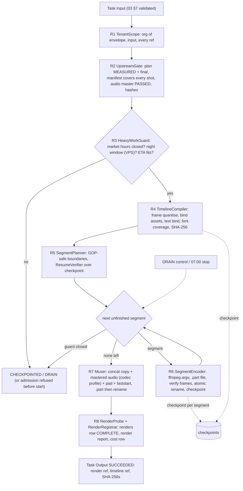

# Agent 10 — Video Editor (blueprint)

| Field | Value |
|---|---|
| Status | Draft — documentation. Software: **Planned** (rule 6, rule 7) |
| Owner | Agent 10 Video Editor; integration owner: Agent 01 (orchestrator) |
| Package | `agent_10_video_editor` (27 §7.2); worker `workers/render_worker` (SOURCE_LAYOUT; movable, ADR-012). **No LLM step: no prompt file exists** (§5, §26). Deterministic golden dataset: `evals/agent_10_video_editor/deterministic_core/` (§26) |
| Task types (24 §3.2) | `agent_10.render` (stage `s10_render`), `agent_10.subtitles` (`s10_subs`), `agent_10.technical_qc` (`s10_qc`, blocking gate); all `HEAVY_CPU` (24 §7.1) |
| Directive sections covered | §3.1 row 10 (FFmpeg render pipeline, resumable rendering, subtitles and accessibility, automated video inspection: integrity, duration, resolution, fps, aspect, black frames, missing audio, A/V and subtitle sync), §1A.4 (audio delivery), §1A.5 (video delivery), §1A.6 (automated QC), §1A.2 and §1A.8 (rendered-file side of the retention rules and formats), §1A.1 (tier mix and licence per shot, measured on the render), §1 Heavy work (FFmpeg as a separately configurable, movable worker), §3.3 (contracts, failures, checkpoints, quality, observability), §1C.1 (tenant isolation) |
| Owner decisions applied | D1 (3A production line with Agents 04–11 and the Agent 16 gates; outputs are files: MP4 16:9 (+ 9:16 where applicable), SRT, QC data for the report; no YouTube upload, no Google OAuth; paid calls only inside owner-set limits; keys only through the environment's secret mechanism; **render never in market hours**), D2 (full blueprint for 3A agents; REQUIRES REVIEW items do not block 3A unless they change a 3A design decision) |
| Binding contracts | GLOSSARY_AND_IDS.md (§2 IDs, §3 units, §6.1–6.10, §6.17–6.22, §6.27–6.28, §6.31, §6.45, §6.50–6.52), 03_COMMUNICATION_STANDARD.md (§3–§9, §11), 04_DATABASE_ARCHITECTURE.md (§3, §5.4, §5.7, §5.9, §5.10, §5.12, §5.14, §5.15, §5.17, §5.18), 07_FAILURE_MANAGEMENT.md (§2–§4, §8–§10), 24_PRODUCTION_TYPES.md (§3.2, §4, §5, §7.1), 27_ENGINEERING_STANDARDS.md (§3–§9) |
| Shared docs referenced by name/§ only | 18_PRODUCTION_QUALITY_STANDARD.md (§2.3, §3, §5, §6, §7, §8, §10, §13), 13_COMPLIANCE_YOUTUBE_POLICY.md (FIN-R rules, §3.6 licence completeness), 09_COST_AND_BUDGET.md (§5, §12), 08_SECURITY.md (§3 secrets, §5.3 identities, §8 tenant isolation), 3A_SLICE_SPEC.md (§3 flow, §4 bundle, ticket 3A-10), ADR-005 (storage), ADR-009 (visual and music sourcing), ADR-012 (render worker placement), agent blueprints 07, 08, 09 (producers of this agent's inputs), 06_NIGHT_SCHEDULING.md (owner of the market-hours and night-window configuration; not yet written) |
| Facts cited | RESEARCH_LOG INF-01 (VPS size), INF-03 / INF-04 (resource caps), INF-09 (FFmpeg `silencedetect`, `blackdetect`, `freezedetect`, `ebur128` incl. true peak), INF-10 (YouTube upload encoding), INF-11 (RLS), IN-02 / IN-03 (chart data age), YT-06 / YT-07 (synthetic-media disclosure), YT-09 (no AI persona on finance) |
| Marking | Every section states its **MVP** in the first line: 3A / 3B / 3C (owner build stages of D1) and Tier 0–3 (GLOSSARY §6.47) |
| Conventions | `(pending CCR)` = a contract item that does not exist in Wave A and is listed in the structured return for the integrator; this blueprint is written against the proposed name. `REQUIRES REVIEW (Phase 1): <need>` = unknown value; none is invented. A value called **PROPOSAL** is a design default of this document (no source, calibrated in 3B), not a fact. **ESTIMATE** = derived by arithmetic from configuration or design, not measured. Config key names are proposals until the registry exists (18 §13). Payload-local value sets (e.g. `gate_verdict`, `remedy_stage`) are defined in this document only. Field names of other agents' payloads are quoted from their blueprints, not redefined. |

---

## 1 Identity and mission
**MVP: 3A (render, subtitles, full automated QC; 9:16 only when the Shorts child job runs) · 3B (detector and tolerance calibration on three golden samples) · 3C (preview and burned-in caption variants, music-stem measurement, 1440p, ad/dubbing profiles) · Tier 0 → Tier 1 (render-only worker before the first client) → Tier 3 (dedicated workers per tenant).**

### 1.1 Mission
Agent 10 is the editor's hands and the quality inspector's eyes. It turns three finished inputs — the **shot plan** (Agent 09), the **asset manifest** (Agent 08) and the **mastered narration** (Agent 07) — into **one frame-exact, resumable FFmpeg render** that meets the delivery specification of 18 §5–§6 (H.264 High, constant frame rate, 15–25 Mbps target with the INF-10 floor, AAC-LC 48 kHz ≥ 384 kbps, MP4 faststart), writes **one accurate SRT per language**, and then **measures the finished file** with the blocking automated QC of 18 §7 (ffprobe, `ebur128`, `blackdetect`, `freezedetect`, `silencedetect`, A/V and subtitle sync, duration against the script and the timeline, no source watermark, a licence record for every shot). It decides nothing about what the video says or shows; it proves what the file contains.

It does three jobs on one worker and no others:
1. **Render** (`agent_10.render`): compile the render timeline, bind every shot to its asset, encode in checkpointed segments, mux the mastered audio, write the final MP4 once.
2. **Subtitles** (`agent_10.subtitles`): build the SRT from the approved script text and the narration timeline; validate it; never rewrite text.
3. **Technical QC** (`agent_10.technical_qc`): run the `qc.long_form` / `qc.shorts` check set on the final MP4, its stems, SRT and timeline; persist every result; return the gate verdict that routes REVISE or continues (24 §7.1).

### 1.2 Where it sits
Stages `s10_render` (depends on `s07_master`, `s08_assets`), `s10_subs` (depends on `s10_render`), `s10_qc` (depends on `s10_subs`; blocking; `on_fail REVISE → s10_render`) of `CHANNEL_LONG_FORM` and, for the 9:16 cut, of the `SHORTS` child job (24 §7.1, §7.2; 3A_SLICE_SPEC §3). Downstream: `svc_s02.uniqueness_check`, `agent_16.compliance_gate`, `agent_16.quality_score` (reads `qc_results`), the `FINAL_VIDEO` approval (bound to the render's SHA-256) and `agent_13.file_delivery` (bundle). All run as `HEAVY_CPU` on the movable render worker (ADR-012).

### 1.3 Authority boundaries
| Agent 10 decides (by code, from contracts and measurement) | Agent 10 does **not** decide |
|---|---|
| frame quantisation of the plan, segment boundaries, FFmpeg arguments, encoder parameters inside the configured profile | what is on screen, when it changes, pacing, interrupts, J/L offsets, brand sting position, chapters (Agent 09; Agent 10 renders them as given and checks them) |
| whether a render may start now (market-hours and night-window guards; defence in depth over admission) | admission itself and the schedule (queue admission, 06; ADR-012) |
| the SRT cues (text from the script by reference; timing from the narration timeline) | any subtitle wording; translation (S3, 3C); the script (Agent 05) |
| the measurements of the final MP4 and each blocking/WARN verdict of 18 §7, and the technical `gate_verdict` | the 100-point score, the compliance verdict, disclosure decisions, publication authorisation (Agent 16) |
| which failures are render-fixable and an **advisory** `remedy_stage` for each failure | the revision route (the orchestrator follows 24 §7.1; `remedy_stage` is advisory, 03 §5.3) |
| nothing about money: it spends nothing paid | budgets, provider limits (owner, S4) |
Hard limits: no network call to any AI or stock provider; no LLM; no text of its own on screen or in subtitles; no re-sourcing or substitution of assets (a shot without an asset fails `PERMANENT.MISSING_DEPENDENCY`, Agent 08 §15); no loudness or limiter change of the narration (Agent 07 owns mastering; Agent 10 encodes with Agent 07's codec profile and re-measures); no upload; no write to any tenant other than the task's.

### 1.4 Success criteria (measurable; thresholds are config, sourced where 18 sources them)
| ID | Criterion | Measure | MVP |
|---|---|---|---|
| SC-1 | The delivered MP4 meets the video and audio delivery specification | 100 % of the blocking checks of §20.1 are `PASS` on the file handed to approval | 3A |
| SC-2 | The render is exactly the timeline | `|actual_ms − timeline_ms| ≤ 1 frame`; frame count equals the compiled frame count | 3A |
| SC-3 | A killed or drained render resumes without redoing finished segments and without a corrupt file at a final path | FI-01…FI-04 | 3A |
| SC-4 | No render starts or continues inside market hours (and, on the VPS, outside the night window) | FI-08, FI-09, acceptance 27 §9 test 6 | 3A |
| SC-5 | Every shot, voice, font and template on the timeline has a usable licence record, or the QC gate fails | `qc.licence.completeness` zero gaps | 3A |
| SC-6 | Every check records its measured value; no check is silently skipped or defaulted to `PASS` | `qc_results` row per check of the profile; `SKIPPED` only in the listed cases | 3A |
| SC-7 | A failing gate tells the orchestrator and Agent 09/07/08 exactly what to fix | `failures[]` with check ID, shot IDs, measured, threshold, `remedy_stage` | 3A |
| SC-8 | Detectors and tolerances become calibrated thresholds | every "WARN until calibrated" check promoted or kept advisory by the owner (18 §11 exit criteria) | 3B |

---

## 2 Functional requirements
**MVP: 3A unless marked · Tier 0. "Why" cites the directive, 18, INF-09/INF-10 or ADR-012.**

### 2.1 Requirements
| ID | What | Why | When / trigger | Inputs | Outputs | Dependants | MVP |
|---|---|---|---|---|---|---|---|
| FR-01 | Validate Task Input, tenant scope, every ref and its SHA-256 before any media work | 03 §7; rule 9 | task start (`VALIDATING`/`RUNNING`) | Task Input, context refs | accept or `REJECTED` | all | 3A |
| FR-02 | Upstream gate: plan is `MEASURED`, has `final` timing, covers the narration; manifest has an asset for every shot; audio master is `PASSED` and covers the narration; script SHA-256 equals the verified one | §1A.6; Agents 07/08/09 contracts | after FR-01 | plan, manifest, audio master output, script ref | gate result | FR-03 | 3A |
| FR-03 | Worker-side guards: market-hours guard (every placement) and night-window guard (VPS placement) before start and before every segment | D1; ADR-012 §3.3 | before FR-06, between segments | clock via admission probe, placement, ETA | allow / drain | FR-06 | 3A |
| FR-04 | Compile the **render timeline** `$T` (frame-quantised, canonical JSON, SHA-256) from plan + manifest + audio master | 18 §3 (timeline SHA-256 = `renders.timeline_sha256`); Agent 09 §15.2 | after FR-02 | plan, manifest | `$T`, `timeline_sha256` | FR-05…FR-09, QC | 3A |
| FR-05 | Bind every on-screen text to its script string by SHA-256 and verify glyph coverage of the brand font for every code point | §1B.2; 13; Agent 09 AC-12 | FR-04 | `text_refs`, script, font asset | bound text or `INPUT_INVALID` | FR-07 | 3A |
| FR-06 | Plan **render segments** at GOP-safe shot boundaries | resumability (§1 Heavy work; 07 §10) | FR-04 | `$T` | segment list | FR-07 | 3A |
| FR-07 | Encode each segment with FFmpeg (argument list, no shell), verify, store atomically, checkpoint | 07 §8, §10; INF-10 | per segment | `$T` slice, assets | segment blob + checkpoint | FR-08 | 3A |
| FR-08 | Concatenate segments, mux the mastered audio with Agent 07's codec profile, pad audio to the video length, write MP4 faststart once | §1A.4, §1A.5; Agent 07 §15 | all segments done | segments, master WAV, `codec_profile` | final MP4 blob | FR-09 | 3A |
| FR-09 | Probe the final file and register the `renders` row (status `COMPLETE`) | 04 §5.18; 18 §6 "Metadata persisted" | FR-08 | final MP4 | `renders` row, render report | FR-10, QC | 3A |
| FR-10 | Resume: after a kill, drain or host restart continue from the latest checkpoint, re-verifying finished segments | 07 §8, §10; 27 §9 test 2 | T15 resume | checkpoint | same output as an uninterrupted run | — | 3A |
| FR-11 | Build the SRT per language from script text and narration timing; split by configured limits; one language in the MVP | §1A.5; 18 §7.6; 3A_SLICE_SPEC §4 | `agent_10.subtitles` | script, narration timeline, brand font | SRT blob, `assets` row (`SUBTITLE`) | QC, bundle | 3A |
| FR-12 | Validate the SRT format before QC (cue numbering, times, order, no overlap, UTF-8, last cue ≤ video duration) | 18 §7.6 | after FR-11 | SRT, render duration | `a10.sub.*` results | QC | 3A |
| FR-13 | Run container and stream metadata checks (ffprobe) against the preset | §1A.5; 18 §6, §7.1 | `agent_10.technical_qc` | final MP4, `$T` | `qc.video.*`, `qc.audio.*`, `qc.container.*` rows | gate | 3A |
| FR-14 | Measure loudness, true peak, LRA and (3C) music bed offset | §1A.4; INF-09; 18 §7.2, §7.4 | QC | final MP4, stems | `qc.audio.*` rows, `renders.integrated_lufs`, `.true_peak_dbtp` | gate, Agent 16 | 3A (music 3C) |
| FR-15 | Run `blackdetect`, `freezedetect`, `silencedetect`; map detections to shots and to `deliberate_*` intervals | §1A.6; INF-09; 18 §7.3, §7.5, §7.8 | QC | final MP4, `$T` | `qc.video.black_frames`, `.freeze`, `qc.audio.silence_mix`, `edit.dead_air` rows | gate | 3A |
| FR-16 | Check A/V container sync, subtitle sync and subtitle accuracy | §1A.6; 18 §7.6 | QC | probe, SRT, narration timeline | `qc.sync.*`, `qc.subtitles.*` rows | gate | 3A |
| FR-17 | Check duration against the script, the timeline and the production-type bounds | §1A.6; 18 §7.7 | QC | probe, narration timeline, `$T` | `qc.duration.*` rows | gate | 3A |
| FR-18 | Check the retention edit rules that need the timeline or the rendered file: hook window, no brand intro, cadence (+ render cross-check), interrupts, J/L, chapters, end screen | §1A.2; 18 §3 | QC | `$T`, final MP4 | `edit.*` rows | gate, Agent 16 | 3A |
| FR-19 | Check licence completeness, licence expiry window, source watermark provenance, and the visual-source checks (tier share E, tier mix, AI budget, disclosure facts, chart data age, synthetic presenter metadata) | §1A.1, §1A.6; 18 §2.3, §7.9, §7.10; FIN-R9, FIN-R11; YT-06/07/09 | QC | `$T`, manifest, DB | `qc.licence.*`, `qc.watermark.*`, `qc.visual.*` rows | gate | 3A |
| FR-20 | Decide `gate_verdict` and write `failures[]` with `remedy_stage` | 24 §3.3; 18 §7.0.4 | end of QC | all results | gate output | orchestrator | 3A |
| FR-21 | Persist every result as a `qc_results` row, update `renders.status` (`QC_PASSED` / `QC_FAILED`) and measured columns, write evidence blobs | 18 §1.4; 04 §5.17, §5.18 | end of QC | results | rows, blobs | Agent 16, bundle | 3A |
| FR-22 | Produce the evidence pack: contact sheet of sampled frames and loudness-over-time data | owner rule A.12; 18 §11 evidence package (PROPOSAL) | QC | final MP4 | `IMAGE` + `REPORT` output refs | owner review | 3A |
| FR-23 | Run the QC self-test on every FFmpeg build change (synthetic `lavfi` fixtures, expected verdicts asserted) | 18 §7.11 | readiness / CI | fixtures | self-test record | readiness | 3A |
| FR-24 | Record render time as `render_ms` cost units | 24 §6; 09 §5 | every attempt | wall time | `cost_ledger` row | S4, cost report | 3A |
| FR-25 | Render the 9:16 cut for the `SHORTS` child job with the `shorts_9x16` preset and `qc.shorts` | D1 "where applicable"; 18 §10 | child job | child plan | MP4 9:16 | bundle | 3A (only when the owner asks for the cut) |
| FR-26 | Render a low-resolution **PREVIEW** for a rough-cut approval | GLOSSARY §6.15 `ROUGH_CUT`; §6.45 `render_kind` | not in the 3A graph | plan | preview MP4 | S7 | 3C |
| FR-27 | Render the **EXPORT** variant with styled burned-in captions | §1A.5 (optional burned-in captions as a separate variant); 24 §4 | optional | SRT, caption style | MP4 variant | bundle | 3C |
| FR-28 | Measure the music bed offset on stems (narration-active spans) and clip/noise of stems | §1A.4; 18 §7.4 | when a music bed exists | stems `$V`, `$M` | `qc.audio.music_bed_offset`, `qc.audio.clipping` | gate | 3C (music); clipping on the narration stem 3A |
| FR-29 | `qc.ad_spot`, `qc.dubbing`, `qc.corporate` profiles | 18 §8 | client types | profile config | rows | — | 3C, Tier 1+ |

### 2.2 Triggers and non-triggers
| Trigger | Result |
|---|---|
| Orchestrator creates `s10_render`, `s10_subs`, `s10_qc` tasks of a job (24 §7.1) | the task is queued on queue `render`; a render worker with capabilities `render_ffmpeg` + `media_probe` claims it only when admission allows (market hours, night window, ADR-012) |
| `s10_qc` returns `gate_verdict = FAILED` | the orchestrator creates a new `s10_render` iteration (new tasks, new idempotency keys) up to `limits.max_revision_loops`; after that `AGENT.QUALITY_REPEATED_FAILURE` (07 §2) |
| `DRAIN` control or guard closing | checkpoint at the next safe point, `CHECKPOINTED / DRAIN`, resume next window (T09, T15) |
| Replay from the DLQ | same Task Input and idempotency key; finished segments and the final blob are reused after verification (03 §9) |
| Not triggers | upload or publication (Agent 13, 3C); any change of script, plan or assets; any call to a provider |

### 2.3 Dependants (who reads what Agent 10 writes)
`renders` row and final MP4 → Agent 16 (score, authorisation), S7 (approval subject `content_sha256`), Agent 13 (bundle). `qc_results` → Agent 16 (`qc.*` evidence for scores: AUDIO_QUALITY, EDITING_QUALITY, VISUAL_QUALITY deterministic parts, COMPLIANCE licence line), S4 (cost report). SRT → bundle. Evidence pack → owner review (3B pilot). `failures[]` → Agent 09 (`revision_feedback`), Agent 07, Agent 08 through the orchestrator.

---

## 3 Non-functional requirements
**MVP: 3A (targets set from measurement in 3B) · Tier 0. No figure below is measured; every number is a design default (PROPOSAL) or `REQUIRES REVIEW (Phase 1)`.**

| ID | Requirement | Target | Status / how verified |
|---|---|---|---|
| NFR-1 | **Render speed**: encode wall time per minute of output | not stated; **REQUIRES REVIEW (Phase 1): MEASURED on the walking skeleton in the development environment and on the VPS (24 §6 `render_ms`)** | metric `a10_render_wall_ms_per_output_s`; P-01 |
| NFR-2 | **Lost work after a kill** | at most one segment (+ the drain-finish window) | FI-01, FI-02 |
| NFR-3 | **Segment length** (checkpoint granularity vs overhead) | `agent_10.render.segment_target_ms` = 60 000 (PROPOSAL; calibrate in 3B) | P-02 |
| NFR-4 | **Determinism of the plan-to-timeline step**: same inputs give the same `$T` bytes and SHA-256 | exact | U-17…U-26, R-01 |
| NFR-5 | **Frame exactness**: output frame count = compiled frame count; CFR | exact | `qc.duration.vs_timeline`, `qc.video.cfr` |
| NFR-6 | **Atomic finals**: no partially written file exists at a final path; blobs are write-once | exact | 07 §8; FI-03 |
| NFR-7 | **Idempotency**: replay creates no second render row, no second final blob | exact | FI-05; 03 §9 `render.master` |
| NFR-8 | **No network and no paid call** from any Agent 10 code path | zero outbound connections except DB and storage; `max_llm_calls = 0`; `resource_budget.max_cost_micros = 0` | S-09 (socket guard), U-102 |
| NFR-9 | **Tenant isolation** (rule 9) | five layers, §19.1 | S-01…S-08 |
| NFR-10 | **Reproducibility**: one pinned FFmpeg build; build ID recorded with every render and every QC run | pinned value **REQUIRES REVIEW (Phase 1): 18 §7.0.2** | readiness check §24.3; QC self-test §21 R-02 |
| NFR-11 | **Portability**: placement by configuration only; same image everywhere | no code change to move (§1 Heavy work; ADR-012 §3.1) | IT-07 |
| NFR-12 | **Memory and disk bounded**: scratch directory per task, cleaned on completion and at worker start; segments streamed, never whole-video in memory | limits from systemd slice and Compose limits (INF-03, INF-04); values from measurement (05) | P-03, P-04 |
| NFR-13 | **Observability**: every log line/metric has `org_id`; no script text, subtitle text, asset titles or keys in logs | canary test | S-05 |
| NFR-14 | **Safe failure**: an unparseable or missing measurement is never `PASS` (18 §7.0.3) | exact | U-61…U-70 |
| NFR-15 | **Accessibility**: one accurate SRT per language, UTF-8 | 18 §7.6 | `qc.subtitles.*` |
| NFR-16 | **QC cost**: full-decode passes minimised; cheap checks first; optional single-pass mode proven equal to the reference passes before use | `agent_10.qc.single_pass` default off in 3A | R-02 fixture equality |

---

## 4 Internal architecture
**MVP: 3A · Tier 0. The package is library code run by `workers/render_worker`; no HTTP server, no public port. FFmpeg and ffprobe are local binaries called through `FfmpegRunner` (argument list, never a shell string).**

### 4.1 `agent_10.render` task flow


### 4.2 `agent_10.subtitles` and `agent_10.technical_qc` flows

```mermaid
flowchart TD
  subgraph SUBS["agent_10.subtitles"]
    S1["S1 TenantScope + gate: script SHA-256, narration timeline source not UNALIGNED"] --> S2["S2 CueBuilder: script text by segment id, split by limits, timing from narration timeline"]
    S2 --> S3["S3 SrtWriter: UTF-8, LF, numbered cues"] --> S4["S4 SrtValidator (format, order, overlap, last cue <= video duration)"]
    S4 --> S5["S5 write-once blob + assets row SUBTITLE + output ref"]
  end
  subgraph QC["agent_10.technical_qc"]
    Q0["Q0 TenantScope + load render, timeline, SRT, stems, manifest, plan"] --> Q1["Q1 QcPlan: profile checks, cheap first"]
    Q1 --> Q2["Q2 ffprobe + CFR packet test + MP4 atom order"]
    Q2 --> Q3["Q3 audio passes: ebur128 (true peak), silencedetect final mix + narration stem"]
    Q3 --> Q4["Q4 video passes: blackdetect, freezedetect, scene cadence"]
    Q4 --> Q5["Q5 timeline and DB checks: edit.*, licence, sourcing, watermark provenance"]
    Q5 --> Q6["Q6 sync, subtitles, duration"]
    Q6 --> Q7["Q7 GateAggregator: gate_verdict, failures with remedy_stage"]
    Q7 --> Q8["Q8 persist qc_results, renders status + measures, evidence pack, report blob"]
  end
```


### 4.3 Interaction with neighbours (one stage, one direction of data)
```mermaid
sequenceDiagram
  participant O as Orchestrator (01)
  participant W as Render worker (Agent 10)
  participant C as amw_core (tenancy, storage, cost, audit, retries)
  participant F as FFmpeg / ffprobe (local)
  participant N as Agents 16 / 13, S7
  O->>W: s10_render Task Input (plan, manifest, audio master refs)
  W->>C: open tenant transaction, verify refs and SHA-256
  W->>W: gates, timeline compile, segment plan (pure code)
  loop per segment
    W->>F: encode segment (argv list, protocol whitelist)
    W->>C: store blob atomically, write checkpoint
  end
  W->>F: concat + mux + faststart
  W->>C: renders row, report blob, cost row, audit
  W-->>O: SUCCEEDED
  O->>W: s10_subs then s10_qc
  W->>F: ffprobe and detector passes on the final MP4
  W->>C: qc_results, renders.status, evidence
  W-->>O: gate_verdict (PASSED or FAILED with failures)
  O->>N: s02u, s16_comp, s16_score read qc_results; FINAL_VIDEO approval binds the render SHA-256
```

### 4.4 Components and boundaries
| Component | Responsibility | Talks to |
|---|---|---|
| `TenantScope` | the one place that checks org, channel and URI ownership; opens tenant transactions via `amw_core.tenancy` | DB, storage |
| `UpstreamGate`, `HeavyWorkGuard` | deterministic gates before any media work | DB (RLS), storage, admission probe |
| `TimelineCompiler`, `FrameQuantiser`, `TimelineHasher`, `TextBinder`, `FontCoverage` | plan → canonical frame-quantised timeline; text binding; glyph check | storage |
| `SegmentPlanner`, `ResumeVerifier`, `CheckpointWriter` | segment boundaries, resume decision, durable progress | storage, `checkpoints` |
| `ArgvBuilder`, `FfmpegRunner`, `SegmentEncoder`, `Muxer`, `RenderProbe` | FFmpeg invocation and verification | local binaries, scratch dir |
| `CueBuilder`, `SrtWriter`, `SrtParser`, `SrtValidator` | subtitles | storage |
| `QcPlan`, parsers, `*Checks`, `GateAggregator`, `EvidenceWriter`, `QcPersister` | technical QC | DB, storage, local binaries |
| `RenderRegistrar`, `CostRecorder`, `ErrorMapper` | persistence, cost, error mapping | DB, `amw_core` |
Dependency rule (27 §7.1): the package imports `amw_core` and the `FfmpegRunner` / `AdmissionProbe` Protocols only; concrete implementations are injected by the worker. No package imports another agent; hand-offs are contracts only.

---
