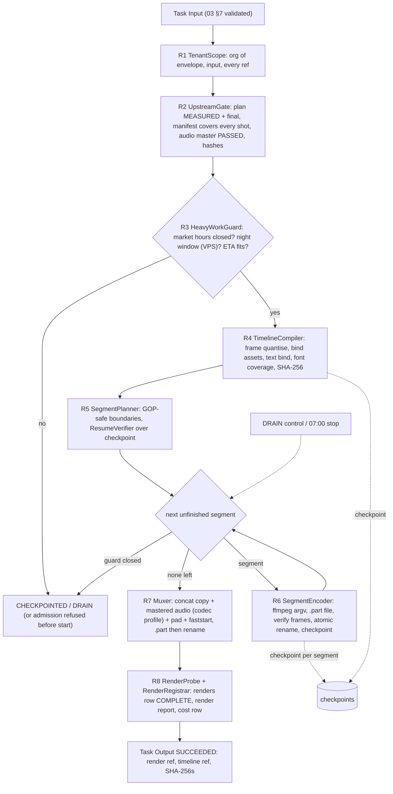
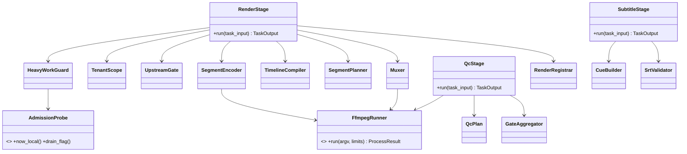

# Agent 10 — Video Editor (blueprint)

| Field | Value |
|---|---|
| Status | Draft — documentation. Software: **Planned** (rule 6, rule 7) |
| Owner | Agent 10 Video Editor; integration owner: Agent 01 (orchestrator) |
| Package | `agent_10_video_editor` (27 §7.2); worker `workers/render_worker` (SOURCE_LAYOUT; movable, ADR-012). **No LLM step: no prompt file exists** (§5, §26). Deterministic golden dataset: `evals/agent_10_video_editor/deterministic_core/` (§26) |
| Task types (24 §3.2) | `agent_10.render` (stage `s10_render`), `agent_10.subtitles` (`s10_subs`), `agent_10.technical_qc` (`s10_qc`, blocking gate); all `HEAVY_CPU` (24 §7.1) |
| Directive sections covered | §3.1 row 10 (FFmpeg render pipeline, resumable rendering, subtitles and accessibility, automated video inspection: integrity, duration, resolution, fps, aspect, black frames, missing audio, A/V and subtitle sync), §1A.4 (audio delivery), §1A.5 (video delivery), §1A.6 (automated QC), §1A.2 and §1A.8 (rendered-file side of the retention rules and formats), §1A.1 (tier mix and licence per shot, measured on the render), §1 Heavy work (FFmpeg as a separately configurable, movable worker), §3.3 (contracts, failures, checkpoints, quality, observability), §1C.1 (tenant isolation) |
| Owner decisions applied | D1 (3A production line with Agents 04–11 and the Agent 16 gates; outputs are files: MP4 16:9 (+ 9:16 where applicable), SRT, QC data for the report; no YouTube upload, no Google OAuth; paid calls only inside owner-set limits; keys only through the environment's secret mechanism; **render never in market hours**), D2 (full blueprint for 3A agents; REQUIRES REVIEW items do not block 3A unless they change a 3A design decision) |
| Binding contracts | GLOSSARY_AND_IDS.md (§2 IDs, §3 units, §6.1–6.10, §6.17–6.22, §6.27–6.28, §6.31, §6.45, §6.50–6.52), 03_COMMUNICATION_STANDARD.md (§3–§9, §11), 04_DATABASE_ARCHITECTURE.md (§3, §5.4, §5.7, §5.9, §5.10, §5.12, §5.14, §5.15, §5.17, §5.18), 07_FAILURE_MANAGEMENT.md (§2–§4, §8–§10), 24_PRODUCTION_TYPES.md (§3.2, §4, §5, §7.1), 27_ENGINEERING_STANDARDS.md (§3–§9) |
| Shared docs referenced by name/§ only | 18_PRODUCTION_QUALITY_STANDARD.md (§2.3, §3, §5, §6, §7, §8, §10, §13), 13_COMPLIANCE_YOUTUBE_POLICY.md (FIN-R rules, §3.6 licence completeness), 09_COST_AND_BUDGET.md (§5, §12), 08_SECURITY.md (§3 secrets, §5.3 identities, §8 tenant isolation), 3A_SLICE_SPEC.md (§3 flow, §4 bundle, ticket 3A-10), ADR-005 (storage), ADR-009 (visual and music sourcing), ADR-012 (render worker placement), agent blueprints 07, 08, 09 (producers of this agent's inputs), 06_NIGHT_SCHEDULING.md (owner of the market-hours and night-window configuration; not yet written) |
| Facts cited | RESEARCH_LOG INF-01 (VPS size), INF-03 / INF-04 (resource caps), INF-09 (FFmpeg `silencedetect`, `blackdetect`, `freezedetect`, `ebur128` incl. true peak), INF-10 (YouTube upload encoding), INF-11 (RLS), IN-02 / IN-03 (chart data age), YT-06 / YT-07 (synthetic-media disclosure), YT-09 (no AI persona on finance) |
| Marking | Every section states its **MVP** in the first line: 3A / 3B / 3C (owner build stages of D1) and Tier 0–3 (GLOSSARY §6.47) |
| Conventions | `(pending CCR)` = a contract item that does not exist in Wave A and is listed in the structured return for the integrator; this blueprint is written against the proposed name. `REQUIRES REVIEW (Phase 1): <need>` = unknown value; none is invented. A value called **PROPOSAL** is a design default of this document (no source, calibrated in 3B), not a fact. **ESTIMATE** = derived by arithmetic from configuration or design, not measured. Config key names are proposals until the registry exists (18 §13). Payload-local value sets (e.g. `gate_verdict`, `remedy_stage`) are defined in this document only. Field names of other agents' payloads are quoted from their blueprints, not redefined. |

---

## 1 Identity and mission
**MVP: 3A (render, subtitles, full automated QC; 9:16 only when the Shorts child job runs) · 3B (detector and tolerance calibration on three golden samples) · 3C (preview and burned-in caption variants, music-stem measurement, 1440p, ad/dubbing profiles) · Tier 0 → Tier 1 (render-only worker before the first client) → Tier 3 (dedicated workers per tenant).**

### 1.1 Mission
Agent 10 is the editor's hands and the quality inspector's eyes. It turns three finished inputs — the **shot plan** (Agent 09), the **asset manifest** (Agent 08) and the **mastered narration** (Agent 07) — into **one frame-exact, resumable FFmpeg render** that meets the delivery specification of 18 §5–§6 (H.264 High, constant frame rate, 15–25 Mbps target with the INF-10 floor, AAC-LC 48 kHz ≥ 384 kbps, MP4 faststart), writes **one accurate SRT per language**, and then **measures the finished file** with the blocking automated QC of 18 §7 (ffprobe, `ebur128`, `blackdetect`, `freezedetect`, `silencedetect`, A/V and subtitle sync, duration against the script and the timeline, no source watermark, a licence record for every shot). It decides nothing about what the video says or shows; it proves what the file contains.

It does three jobs on one worker and no others:
1. **Render** (`agent_10.render`): compile the render timeline, bind every shot to its asset, encode in checkpointed segments, mux the mastered audio, write the final MP4 once.
2. **Subtitles** (`agent_10.subtitles`): build the SRT from the approved script text and the narration timeline; validate it; never rewrite text.
3. **Technical QC** (`agent_10.technical_qc`): run the `qc.long_form` / `qc.shorts` check set on the final MP4, its stems, SRT and timeline; persist every result; return the gate verdict that routes REVISE or continues (24 §7.1).

### 1.2 Where it sits
Stages `s10_render` (depends on `s07_master`, `s08_assets`), `s10_subs` (depends on `s10_render`), `s10_qc` (depends on `s10_subs`; blocking; `on_fail REVISE → s10_render`) of `CHANNEL_LONG_FORM` and, for the 9:16 cut, of the `SHORTS` child job (24 §7.1, §7.2; 3A_SLICE_SPEC §3). Downstream: `svc_s02.uniqueness_check`, `agent_16.compliance_gate`, `agent_16.quality_score` (reads `qc_results`), the `FINAL_VIDEO` approval (bound to the render's SHA-256) and `agent_13.file_delivery` (bundle). All run as `HEAVY_CPU` on the movable render worker (ADR-012).

### 1.3 Authority boundaries
| Agent 10 decides (by code, from contracts and measurement) | Agent 10 does **not** decide |
|---|---|
| frame quantisation of the plan, segment boundaries, FFmpeg arguments, encoder parameters inside the configured profile | what is on screen, when it changes, pacing, interrupts, J/L offsets, brand sting position, chapters (Agent 09; Agent 10 renders them as given and checks them) |
| whether a render may start now (market-hours and night-window guards; defence in depth over admission) | admission itself and the schedule (queue admission, 06; ADR-012) |
| the SRT cues (text from the script by reference; timing from the narration timeline) | any subtitle wording; translation (S3, 3C); the script (Agent 05) |
| the measurements of the final MP4 and each blocking/WARN verdict of 18 §7, and the technical `gate_verdict` | the 100-point score, the compliance verdict, disclosure decisions, publication authorisation (Agent 16) |
| which failures are render-fixable and an **advisory** `remedy_stage` for each failure | the revision route (the orchestrator follows 24 §7.1; `remedy_stage` is advisory, 03 §5.3) |
| nothing about money: it spends nothing paid | budgets, provider limits (owner, S4) |
Hard limits: no network call to any AI or stock provider; no LLM; no text of its own on screen or in subtitles; no re-sourcing or substitution of assets (a shot without an asset fails `PERMANENT.MISSING_DEPENDENCY`, Agent 08 §15); no loudness or limiter change of the narration (Agent 07 owns mastering; Agent 10 encodes with Agent 07's codec profile and re-measures); no upload; no write to any tenant other than the task's.

### 1.4 Success criteria (measurable; thresholds are config, sourced where 18 sources them)
| ID | Criterion | Measure | MVP |
|---|---|---|---|
| SC-1 | The delivered MP4 meets the video and audio delivery specification | 100 % of the blocking checks of §20.1 are `PASS` on the file handed to approval | 3A |
| SC-2 | The render is exactly the timeline | `|actual_ms − timeline_ms| ≤ 1 frame`; frame count equals the compiled frame count | 3A |
| SC-3 | A killed or drained render resumes without redoing finished segments and without a corrupt file at a final path | FI-01…FI-04 | 3A |
| SC-4 | No render starts or continues inside market hours (and, on the VPS, outside the night window) | FI-08, FI-09, acceptance 27 §9 test 6 | 3A |
| SC-5 | Every shot, voice, font and template on the timeline has a usable licence record, or the QC gate fails | `qc.licence.completeness` zero gaps | 3A |
| SC-6 | Every check records its measured value; no check is silently skipped or defaulted to `PASS` | `qc_results` row per check of the profile; `SKIPPED` only in the listed cases | 3A |
| SC-7 | A failing gate tells the orchestrator and Agent 09/07/08 exactly what to fix | `failures[]` with check ID, shot IDs, measured, threshold, `remedy_stage` | 3A |
| SC-8 | Detectors and tolerances become calibrated thresholds | every "WARN until calibrated" check promoted or kept advisory by the owner (18 §11 exit criteria) | 3B |

---

## 2 Functional requirements
**MVP: 3A unless marked · Tier 0. "Why" cites the directive, 18, INF-09/INF-10 or ADR-012.**

### 2.1 Requirements
| ID | What | Why | When / trigger | Inputs | Outputs | Dependants | MVP |
|---|---|---|---|---|---|---|---|
| FR-01 | Validate Task Input, tenant scope, every ref and its SHA-256 before any media work | 03 §7; rule 9 | task start (`VALIDATING`/`RUNNING`) | Task Input, context refs | accept or `REJECTED` | all | 3A |
| FR-02 | Upstream gate: plan is `MEASURED`, has `final` timing, covers the narration; manifest has an asset for every shot; audio master is `PASSED` and covers the narration; script SHA-256 equals the verified one | §1A.6; Agents 07/08/09 contracts | after FR-01 | plan, manifest, audio master output, script ref | gate result | FR-03 | 3A |
| FR-03 | Worker-side guards: market-hours guard (every placement) and night-window guard (VPS placement) before start and before every segment | D1; ADR-012 §3.3 | before FR-06, between segments | clock via admission probe, placement, ETA | allow / drain | FR-06 | 3A |
| FR-04 | Compile the **render timeline** `$T` (frame-quantised, canonical JSON, SHA-256) from plan + manifest + audio master | 18 §3 (timeline SHA-256 = `renders.timeline_sha256`); Agent 09 §15.2 | after FR-02 | plan, manifest | `$T`, `timeline_sha256` | FR-05…FR-09, QC | 3A |
| FR-05 | Bind every on-screen text to its script string by SHA-256 and verify glyph coverage of the brand font for every code point | §1B.2; 13; Agent 09 AC-12 | FR-04 | `text_refs`, script, font asset | bound text or `INPUT_INVALID` | FR-07 | 3A |
| FR-06 | Plan **render segments** at GOP-safe shot boundaries | resumability (§1 Heavy work; 07 §10) | FR-04 | `$T` | segment list | FR-07 | 3A |
| FR-07 | Encode each segment with FFmpeg (argument list, no shell), verify, store atomically, checkpoint | 07 §8, §10; INF-10 | per segment | `$T` slice, assets | segment blob + checkpoint | FR-08 | 3A |
| FR-08 | Concatenate segments, mux the mastered audio with Agent 07's codec profile, pad audio to the video length, write MP4 faststart once | §1A.4, §1A.5; Agent 07 §15 | all segments done | segments, master WAV, `codec_profile` | final MP4 blob | FR-09 | 3A |
| FR-09 | Probe the final file and register the `renders` row (status `COMPLETE`) | 04 §5.18; 18 §6 "Metadata persisted" | FR-08 | final MP4 | `renders` row, render report | FR-10, QC | 3A |
| FR-10 | Resume: after a kill, drain or host restart continue from the latest checkpoint, re-verifying finished segments | 07 §8, §10; 27 §9 test 2 | T15 resume | checkpoint | same output as an uninterrupted run | — | 3A |
| FR-11 | Build the SRT per language from script text and narration timing; split by configured limits; one language in the MVP | §1A.5; 18 §7.6; 3A_SLICE_SPEC §4 | `agent_10.subtitles` | script, narration timeline, brand font | SRT blob, `assets` row (`SUBTITLE`) | QC, bundle | 3A |
| FR-12 | Validate the SRT format before QC (cue numbering, times, order, no overlap, UTF-8, last cue ≤ video duration) | 18 §7.6 | after FR-11 | SRT, render duration | `a10.sub.*` results | QC | 3A |
| FR-13 | Run container and stream metadata checks (ffprobe) against the preset | §1A.5; 18 §6, §7.1 | `agent_10.technical_qc` | final MP4, `$T` | `qc.video.*`, `qc.audio.*`, `qc.container.*` rows | gate | 3A |
| FR-14 | Measure loudness, true peak, LRA and (3C) music bed offset | §1A.4; INF-09; 18 §7.2, §7.4 | QC | final MP4, stems | `qc.audio.*` rows, `renders.integrated_lufs`, `.true_peak_dbtp` | gate, Agent 16 | 3A (music 3C) |
| FR-15 | Run `blackdetect`, `freezedetect`, `silencedetect`; map detections to shots and to `deliberate_*` intervals | §1A.6; INF-09; 18 §7.3, §7.5, §7.8 | QC | final MP4, `$T` | `qc.video.black_frames`, `.freeze`, `qc.audio.silence_mix`, `edit.dead_air` rows | gate | 3A |
| FR-16 | Check A/V container sync, subtitle sync and subtitle accuracy | §1A.6; 18 §7.6 | QC | probe, SRT, narration timeline | `qc.sync.*`, `qc.subtitles.*` rows | gate | 3A |
| FR-17 | Check duration against the script, the timeline and the production-type bounds | §1A.6; 18 §7.7 | QC | probe, narration timeline, `$T` | `qc.duration.*` rows | gate | 3A |
| FR-18 | Check the retention edit rules that need the timeline or the rendered file: hook window, no brand intro, cadence (+ render cross-check), interrupts, J/L, chapters, end screen | §1A.2; 18 §3 | QC | `$T`, final MP4 | `edit.*` rows | gate, Agent 16 | 3A |
| FR-19 | Check licence completeness, licence expiry window, source watermark provenance, and the visual-source checks (tier share E, tier mix, AI budget, disclosure facts, chart data age, synthetic presenter metadata) | §1A.1, §1A.6; 18 §2.3, §7.9, §7.10; FIN-R9, FIN-R11; YT-06/07/09 | QC | `$T`, manifest, DB | `qc.licence.*`, `qc.watermark.*`, `qc.visual.*` rows | gate | 3A |
| FR-20 | Decide `gate_verdict` and write `failures[]` with `remedy_stage` | 24 §3.3; 18 §7.0.4 | end of QC | all results | gate output | orchestrator | 3A |
| FR-21 | Persist every result as a `qc_results` row, update `renders.status` (`QC_PASSED` / `QC_FAILED`) and measured columns, write evidence blobs | 18 §1.4; 04 §5.17, §5.18 | end of QC | results | rows, blobs | Agent 16, bundle | 3A |
| FR-22 | Produce the evidence pack: contact sheet of sampled frames and loudness-over-time data | owner rule A.12; 18 §11 evidence package (PROPOSAL) | QC | final MP4 | `IMAGE` + `REPORT` output refs | owner review | 3A |
| FR-23 | Run the QC self-test on every FFmpeg build change (synthetic `lavfi` fixtures, expected verdicts asserted) | 18 §7.11 | readiness / CI | fixtures | self-test record | readiness | 3A |
| FR-24 | Record render time as `render_ms` cost units | 24 §6; 09 §5 | every attempt | wall time | `cost_ledger` row | S4, cost report | 3A |
| FR-25 | Render the 9:16 cut for the `SHORTS` child job with the `shorts_9x16` preset and `qc.shorts` | D1 "where applicable"; 18 §10 | child job | child plan | MP4 9:16 | bundle | 3A (only when the owner asks for the cut) |
| FR-26 | Render a low-resolution **PREVIEW** for a rough-cut approval | GLOSSARY §6.15 `ROUGH_CUT`; §6.45 `render_kind` | not in the 3A graph | plan | preview MP4 | S7 | 3C |
| FR-27 | Render the **EXPORT** variant with styled burned-in captions | §1A.5 (optional burned-in captions as a separate variant); 24 §4 | optional | SRT, caption style | MP4 variant | bundle | 3C |
| FR-28 | Measure the music bed offset on stems (narration-active spans) and clip/noise of stems | §1A.4; 18 §7.4 | when a music bed exists | stems `$V`, `$M` | `qc.audio.music_bed_offset`, `qc.audio.clipping` | gate | 3C (music); clipping on the narration stem 3A |
| FR-29 | `qc.ad_spot`, `qc.dubbing`, `qc.corporate` profiles | 18 §8 | client types | profile config | rows | — | 3C, Tier 1+ |

### 2.2 Triggers and non-triggers
| Trigger | Result |
|---|---|
| Orchestrator creates `s10_render`, `s10_subs`, `s10_qc` tasks of a job (24 §7.1) | the task is queued on queue `render`; a render worker with capabilities `render_ffmpeg` + `media_probe` claims it only when admission allows (market hours, night window, ADR-012) |
| `s10_qc` returns `gate_verdict = FAILED` | the orchestrator creates a new `s10_render` iteration (new tasks, new idempotency keys) up to `limits.max_revision_loops`; after that `AGENT.QUALITY_REPEATED_FAILURE` (07 §2) |
| `DRAIN` control or guard closing | checkpoint at the next safe point, `CHECKPOINTED / DRAIN`, resume next window (T09, T15) |
| Replay from the DLQ | same Task Input and idempotency key; finished segments and the final blob are reused after verification (03 §9) |
| Not triggers | upload or publication (Agent 13, 3C); any change of script, plan or assets; any call to a provider |

### 2.3 Dependants (who reads what Agent 10 writes)
`renders` row and final MP4 → Agent 16 (score, authorisation), S7 (approval subject `content_sha256`), Agent 13 (bundle). `qc_results` → Agent 16 (`qc.*` evidence for scores: AUDIO_QUALITY, EDITING_QUALITY, VISUAL_QUALITY deterministic parts, COMPLIANCE licence line), S4 (cost report). SRT → bundle. Evidence pack → owner review (3B pilot). `failures[]` → Agent 09 (`revision_feedback`), Agent 07, Agent 08 through the orchestrator.

---

## 3 Non-functional requirements
**MVP: 3A (targets set from measurement in 3B) · Tier 0. No figure below is measured; every number is a design default (PROPOSAL) or `REQUIRES REVIEW (Phase 1)`.**

| ID | Requirement | Target | Status / how verified |
|---|---|---|---|
| NFR-1 | **Render speed**: encode wall time per minute of output | not stated; **REQUIRES REVIEW (Phase 1): MEASURED on the walking skeleton in the development environment and on the VPS (24 §6 `render_ms`)** | metric `a10_render_wall_ms_per_output_s`; P-01 |
| NFR-2 | **Lost work after a kill** | at most one segment (+ the drain-finish window) | FI-01, FI-02 |
| NFR-3 | **Segment length** (checkpoint granularity vs overhead) | `agent_10.render.segment_target_ms` = 60 000 (PROPOSAL; calibrate in 3B) | P-02 |
| NFR-4 | **Determinism of the plan-to-timeline step**: same inputs give the same `$T` bytes and SHA-256 | exact | U-17…U-26, R-01 |
| NFR-5 | **Frame exactness**: output frame count = compiled frame count; CFR | exact | `qc.duration.vs_timeline`, `qc.video.cfr` |
| NFR-6 | **Atomic finals**: no partially written file exists at a final path; blobs are write-once | exact | 07 §8; FI-03 |
| NFR-7 | **Idempotency**: replay creates no second render row, no second final blob | exact | FI-05; 03 §9 `render.master` |
| NFR-8 | **No network and no paid call** from any Agent 10 code path | zero outbound connections except DB and storage; `max_llm_calls = 0`; `resource_budget.max_cost_micros = 0` | S-09 (socket guard), U-102 |
| NFR-9 | **Tenant isolation** (rule 9) | five layers, §19.1 | S-01…S-08 |
| NFR-10 | **Reproducibility**: one pinned FFmpeg build; build ID recorded with every render and every QC run | pinned value **REQUIRES REVIEW (Phase 1): 18 §7.0.2** | readiness check §24.3; QC self-test §21 R-02 |
| NFR-11 | **Portability**: placement by configuration only; same image everywhere | no code change to move (§1 Heavy work; ADR-012 §3.1) | IT-07 |
| NFR-12 | **Memory and disk bounded**: scratch directory per task, cleaned on completion and at worker start; segments streamed, never whole-video in memory | limits from systemd slice and Compose limits (INF-03, INF-04); values from measurement (05) | P-03, P-04 |
| NFR-13 | **Observability**: every log line/metric has `org_id`; no script text, subtitle text, asset titles or keys in logs | canary test | S-05 |
| NFR-14 | **Safe failure**: an unparseable or missing measurement is never `PASS` (18 §7.0.3) | exact | U-61…U-70 |
| NFR-15 | **Accessibility**: one accurate SRT per language, UTF-8 | 18 §7.6 | `qc.subtitles.*` |
| NFR-16 | **QC cost**: full-decode passes minimised; cheap checks first; optional single-pass mode proven equal to the reference passes before use | `agent_10.qc.single_pass` default off in 3A | R-02 fixture equality |

---

## 4 Internal architecture
**MVP: 3A · Tier 0. The package is library code run by `workers/render_worker`; no HTTP server, no public port. FFmpeg and ffprobe are local binaries called through `FfmpegRunner` (argument list, never a shell string).**

### 4.1 `agent_10.render` task flow


### 4.2 `agent_10.subtitles` and `agent_10.technical_qc` flows

```mermaid
flowchart TD
  subgraph SUBS["agent_10.subtitles"]
    S1["S1 TenantScope + gate: script SHA-256, narration timeline source not UNALIGNED"] --> S2["S2 CueBuilder: script text by segment id, split by limits, timing from narration timeline"]
    S2 --> S3["S3 SrtWriter: UTF-8, LF, numbered cues"] --> S4["S4 SrtValidator (format, order, overlap, last cue <= video duration)"]
    S4 --> S5["S5 write-once blob + assets row SUBTITLE + output ref"]
  end
  subgraph QC["agent_10.technical_qc"]
    Q0["Q0 TenantScope + load render, timeline, SRT, stems, manifest, plan"] --> Q1["Q1 QcPlan: profile checks, cheap first"]
    Q1 --> Q2["Q2 ffprobe + CFR packet test + MP4 atom order"]
    Q2 --> Q3["Q3 audio passes: ebur128 (true peak), silencedetect final mix + narration stem"]
    Q3 --> Q4["Q4 video passes: blackdetect, freezedetect, scene cadence"]
    Q4 --> Q5["Q5 timeline and DB checks: edit.*, licence, sourcing, watermark provenance"]
    Q5 --> Q6["Q6 sync, subtitles, duration"]
    Q6 --> Q7["Q7 GateAggregator: gate_verdict, failures with remedy_stage"]
    Q7 --> Q8["Q8 persist qc_results, renders status + measures, evidence pack, report blob"]
  end
```


### 4.3 Interaction with neighbours (one stage, one direction of data)
```mermaid
sequenceDiagram
  participant O as Orchestrator (01)
  participant W as Render worker (Agent 10)
  participant C as amw_core (tenancy, storage, cost, audit, retries)
  participant F as FFmpeg / ffprobe (local)
  participant N as Agents 16 / 13, S7
  O->>W: s10_render Task Input (plan, manifest, audio master refs)
  W->>C: open tenant transaction, verify refs and SHA-256
  W->>W: gates, timeline compile, segment plan (pure code)
  loop per segment
    W->>F: encode segment (argv list, protocol whitelist)
    W->>C: store blob atomically, write checkpoint
  end
  W->>F: concat + mux + faststart
  W->>C: renders row, report blob, cost row, audit
  W-->>O: SUCCEEDED
  O->>W: s10_subs then s10_qc
  W->>F: ffprobe and detector passes on the final MP4
  W->>C: qc_results, renders.status, evidence
  W-->>O: gate_verdict (PASSED or FAILED with failures)
  O->>N: s02u, s16_comp, s16_score read qc_results; FINAL_VIDEO approval binds the render SHA-256
```

### 4.4 Components and boundaries
| Component | Responsibility | Talks to |
|---|---|---|
| `TenantScope` | the one place that checks org, channel and URI ownership; opens tenant transactions via `amw_core.tenancy` | DB, storage |
| `UpstreamGate`, `HeavyWorkGuard` | deterministic gates before any media work | DB (RLS), storage, admission probe |
| `TimelineCompiler`, `FrameQuantiser`, `TimelineHasher`, `TextBinder`, `FontCoverage` | plan → canonical frame-quantised timeline; text binding; glyph check | storage |
| `SegmentPlanner`, `ResumeVerifier`, `CheckpointWriter` | segment boundaries, resume decision, durable progress | storage, `checkpoints` |
| `ArgvBuilder`, `FfmpegRunner`, `SegmentEncoder`, `Muxer`, `RenderProbe` | FFmpeg invocation and verification | local binaries, scratch dir |
| `CueBuilder`, `SrtWriter`, `SrtParser`, `SrtValidator` | subtitles | storage |
| `QcPlan`, parsers, `*Checks`, `GateAggregator`, `EvidenceWriter`, `QcPersister` | technical QC | DB, storage, local binaries |
| `RenderRegistrar`, `CostRecorder`, `ErrorMapper` | persistence, cost, error mapping | DB, `amw_core` |
Dependency rule (27 §7.1): the package imports `amw_core` and the `FfmpegRunner` / `AdmissionProbe` Protocols only; concrete implementations are injected by the worker. No package imports another agent; hand-offs are contracts only.

---

## 5 Full system prompt
**MVP: 3A (statement only) · Tier 0. Agent 10 has no LLM step, so there is no system prompt, no prompt file under `prompts/agent_10_video_editor/` and no LLM adapter in its package. This section states why and what replaces the prompt.**

### 5.1 Statement
| Item | Statement |
|---|---|
| LLM steps | **none**. `max_llm_calls = 0` and `max_cost_micros = 0` are written into every Agent 10 Task Input by the orchestrator (03 §3.1 `resource_budget`); a nonzero value is `PERMANENT.INPUT_INVALID` (§7.4). |
| Prompt file | none exists. 27 §4 (prompt standard) and the prompt lint have nothing to check for this agent; CI asserts that `prompts/agent_10_video_editor/` contains no prompt file and that the package imports no LLM adapter (test S-09, §21). |
| Why no model | every Agent 10 decision is arithmetic on a plan, a manifest and measured tool output, or a measurement of a file (§6). A model would add cost, variance and an injection surface, and no 18 check that Agent 10 owns needs judgement of meaning. Deterministic checks run first (24 §3.3.4); nothing here replaces them. |
| What replaces the prompt | (a) the typed contracts of §7–§8; (b) the decision rules of §6, written so a test can recompute them; (c) the deterministic golden dataset `evals/agent_10_video_editor/deterministic_core/` (96 cases, §26); (d) the lavfi self-test fixtures of 18 §7.11 (§21 R-02). |
| Judged checks that touch this agent's files | `qc.watermark.visual`, `qc.visual.no_synthetic_presenter` (frame-sampling judge) and `edit.promise_alignment` are judged by **Agent 16** (it holds the LLM key and the rubric). Agent 10 supplies the evidence only: sampled frames of the final MP4 as `IMAGE` output refs with SHA-256 and the deterministic fallback result of 18 §7.10. Agent 10 records the judged part of those checks as `SKIPPED` with message `JUDGED_BY_AGENT_16`, never as `PASS`. `qc.subtitles.accuracy`: the SRT text is the script string by reference, so the deterministic word-overlap is 100 % by construction and the judge remainder is empty; the human spot check stays at final approval (18 §7.6). |
| Prompt-injection surface | none from a model. Untrusted text (script strings, asset metadata, filenames, tool stderr) is data: never placed on a command line, never evaluated, never logged (§19.3). |

### 5.2 If an LLM step is ever proposed
A change request (CHANGE_REQUESTS.md) is required, with the justification that no deterministic rule can decide the item; the step would then get a prompt file from `prompts/_TEMPLATE.v1.md`, a judged dataset of at least 20 cases and a new LLM key on the render worker, which today holds none (§19). None is proposed.

---

## 6 Decision engine
**MVP: 3A (all rules) · 3B (calibration of every value marked PROPOSAL or REQUIRES REVIEW) · Tier 0. Every decision of Agent 10 is deterministic code; this section fixes the rules so that tests (and the golden dataset) can recompute them.**

### 6.1 Deterministic vs LLM, and why
| Decision | Kind | Why |
|---|---|---|
| tenant and reference validation, hash checks | deterministic | exact equality; a model must never decide a tenancy question (08 §5.3) |
| upstream gate (plan MEASURED and final, manifest covers every shot, audio master `PASSED`, script hash) | deterministic | contract fields |
| market-hours and night-window guard | deterministic | operational rule of D1 and ADR-012; clock and configuration only |
| frame quantisation, timeline compile, segment plan, segment key | deterministic | exact arithmetic; the render must be reproducible (NFR-4) |
| FFmpeg arguments | deterministic | built from a closed set of templates by `ArgvBuilder`; no text from inputs reaches an argument |
| SRT cues | deterministic | text by reference, timing from the narration timeline; wording is never touched |
| every QC measurement and verdict | deterministic | FFmpeg filters of INF-09 plus arithmetic; thresholds from configuration |
| gate verdict and advisory `remedy_stage` | deterministic | table of §6.5; the orchestrator decides the route |
| judging frames for watermark or synthetic presenter | **not Agent 10** (Agent 16, LLM judge on Agent 10's evidence frames) | needs meaning; Agent 10 has no model |

### 6.2 Frame quantisation and the render timeline
Project frame rate `fps_num/fps_den` comes from configuration (`agent_10.render.fps_num`, `.fps_den`); it has **no default**: **REQUIRES REVIEW (Phase 1): owner footage and screen-recording frame rate (18 §6)**; an unset value is `PERMANENT.CONFIG_INVALID`.
1. `frame(t_ms) = (t_ms × fps_num + 500 × fps_den) // (1000 × fps_den)` (round half up, integers only).
2. Every shot boundary of the plan is quantised; durations are derived (`end_frame − start_frame`), so the tiling of the plan is preserved and `Σ frames = total_frames`. A shot that quantises to zero frames is `PERMANENT.INPUT_INVALID` (`ZERO_FRAME_SHOT`); a gap or overlap in the plan is `INPUT_INVALID` (`TILING_GAP`, `TILING_OVERLAP`): Agent 10 never repairs a plan.
3. `total_frames = frame(total_duration_ms)`; the expected render duration is `frames_to_ms(total_frames) = round_half_up(total_frames × 1000 × fps_den / fps_num)`; `qc.duration.vs_timeline` passes when `|actual_ms × fps_num − total_frames × 1000 × fps_den| ≤ 1000 × fps_den` (one frame).
4. Overlays (`BRAND_STING`, `LOWER_THIRD`, `CAPTION_CARD`, `CHAPTER_CARD`, `DISCLAIMER_CARD`, `END_SCREEN`) are quantised the same way and composited on the V2 track; they never change the length of V1.
5. A transition (`transition_in.duration_ms > 0`) is rendered inside the first frames of the incoming shot; the outgoing shot's last frame is held for the blend (no extra source material is read). **REQUIRES REVIEW (Phase 1): owner look check in 3B**; the plan's own `no fade to black` rule (agent_09 TE-33) is not changed here.
6. The **timeline `$T`** is canonical JSON (sorted keys, no insignificant whitespace, integers and strings only): fps, total frames, per shot `{shot_id, start_frame, end_frame, plan_start_ms, plan_end_ms, asset_id, asset_sha256, asset_uri, source_in_ms, crop, motion, transition_in, tier}`, per overlay `{overlay_id, kind, start_frame, end_frame, template_asset_id, text_sha256s[]}`, `audio {master_sha256, duration_ms, codec_profile_sha256}`, `preset_key`, `render_kind`. Plan milliseconds are kept next to the frames because licence matching uses plan milliseconds (18 §7.9). `timeline_sha256 = SHA-256(canonical JSON)`; it is `renders.timeline_sha256` and the natural key of `render.master` (03 §9.2).

### 6.3 Segments, keys and resume
1. **Segment plan** (`SegmentPlanner.plan`): iterate shots in order; a segment closes at the first shot end where its accumulated frames are `>= target_frames` (`target_frames = ceil(agent_10.render.segment_target_ms × fps_num / (1000 × fps_den))`); shots are never split, so every segment starts on a shot boundary (**GOP-safe**: the encoder is forced to start each segment with an IDR frame and closed GOP); the last segment takes the remainder. Cases DC-14…DC-18.
2. **Segment key** = SHA-256 of canonical JSON `{slice_sha256, asset_sha256s[], args_sha256, ffmpeg_build_id}`; the segment blob is `jobs/<job>/renders/segments/<key>.mp4` (write-once, content-addressed, tenant-prefixed). The same key means the same bytes, so a finished segment is reused after a kill, a drain, a DLQ replay **and** across revision iterations when only other shots changed (cases DC-19, DC-20). Reuse always re-verifies size, SHA-256 and frame count.
3. **Resume** (`ResumeVerifier.verify`): for each planned segment in order: blob present and SHA-256 equal to the checkpoint state → skip; blob present but no checkpoint entry (killed between rename and checkpoint) → recompute SHA-256 and frame count with ffprobe, accept if the frame count equals the plan, then write the checkpoint; otherwise encode. The first unverified segment ends the skip run; nothing after it is trusted without verification.
4. **Drain**: before each segment `HeavyWorkGuard.may_start_segment` runs (§6.4). A segment in flight at a `DRAIN` control is finished when its estimated end is before `act_by`; otherwise FFmpeg receives SIGTERM, the `.part` file in scratch is discarded and the task checkpoints (lost work at most one segment, NFR-2).

### 6.4 Heavy-work guard (D1; ADR-012 §3.3; defence in depth over admission)
`may_start_segment(now_local, est_segment_ms, placement, drain_flag, market_windows, night_window)` returns `(allowed, reason)`; reason order: `DRAIN` → `MARKET_HOURS` (the interval `[now, now + est]` intersects a market window; **every placement**) → `OUTSIDE_NIGHT_WINDOW` (`VPS` only: `now` not inside 00:00–07:00) → `NIGHT_WINDOW_END` (`VPS` only: `now + est > 07:00 − drain.grace`). `est` is rounded up to whole minutes. On `VPS` an unset ETA calibration (`agent_10.render.eta_ms_per_output_s`) is `PERMANENT.CONFIG_INVALID` (fail closed); on the development placement the ETA is only used for the market-hours intersection with the segment's own estimate, and an unset estimate uses the segment length × 1.0 (**ESTIMATE until NFR-1 is measured**). The market-hours calendar and the night-window values are operational configuration owned by 06_NIGHT_SCHEDULING.md (not yet written); **REQUIRES REVIEW (Phase 1): RESEARCH_LOG entry for the official exchange sessions and holidays**. The guard runs at task start, before every segment and before the mux; the mux is short and runs only if the guard allows its estimate. Cases DC-86…DC-94.

### 6.5 QC verdict mapping, gate and advisory remedy
1. **Verdict mapping** (18 §7.0.4): a sourced threshold gives `PASS` / `FAIL` with `blocking = true`; an unsourced one gives the measured value, `threshold = null`, `WARN`, `blocking = false`. A check turns from WARN to blocking only when its configuration key is set (`qc.*`, 18 §13); no verdict logic changes.
2. **Safe failure** (NFR-14): a missing or unparseable measurement raises `MeasurementUnavailable` (mapped to `AGENT.CRASH`, or `RESOURCE.RENDER_CRASH` if the process died abnormally, 18 §7.0.3); it is never `PASS`, never defaulted.
3. **Gate** (`GateAggregator.decide`): `gate_verdict = FAILED` if any check of the profile (`qc.long_form` or `qc.shorts`, 18 §7.12) has no result, or has `verdict = FAIL` with `blocking = true`; otherwise `PASSED`. `WARN` and `SKIPPED` never block. `failures[]` lists the failed checks in profile order (cases DC-83…DC-85).
4. **Advisory `remedy_stage`** (payload-local enum `s07_voice` · `s08_assets` · `s09_plan` · `s10_render`; the orchestrator follows 24 §7.1 and may ignore it, 03 §5.3.1):
| Check family | `remedy_stage` | Reason |
|---|---|---|
| `qc.video.resolution/codec_profile/pix_fmt/bitrate/cfr/fps_matches_project`, `qc.container.faststart`, `qc.audio.codec/sample_rate/channels/bitrate`, `qc.sync.*`, `qc.duration.vs_timeline`, `qc.subtitles.format/languages/sync`, `a10.q.*` | `s10_render` | encoder or mux settings, the render itself |
| `qc.audio.true_peak`, `integrated_lufs`, `clipping`, `music_bed_offset`, `qc.audio.silence_mix`, `edit.dead_air`, `qc.duration.vs_script` (render shorter than narration) | `s07_voice` | narration and mastering (18 §7.2) |
| `qc.video.black_frames` | `s08_assets` | a black or empty asset on a listed shot |
| `qc.video.freeze`, `edit.*` (hook, cadence, interrupts, J/L, chapters, end screen), `qc.visual.tier_share_e`, `qc.visual.ai_video_budget` | `s09_plan` | plan structure and tier plan |
| `qc.licence.*`, `qc.watermark.*`, `qc.visual.ai_disclosure_recorded`, `chart_data_age`, `no_synthetic_presenter` | `s08_assets` | sourcing and licence records |
The routes `s07_voice`, `s08_assets`, `s09_plan` are **not** `on_fail` targets of `s10_qc` in 24 §7.1 (only `s10_render` is): **3A-BLOCKING contract request 1** (§15.3). Until applied, a failure that re-rendering cannot fix repeats until `AGENT.QUALITY_REPEATED_FAILURE`.

### 6.6 Revision behaviour
A new iteration is a new set of tasks (24 §3.3.1). Agent 10 reads `previous_render_ref` only to reuse content-addressed segments; it carries no judgement from the last iteration. `failures[]` of the last gate reach Agent 09/07/08 through the orchestrator (`revision_feedback`, agent_09 FR-17), not through Agent 10.

### 6.7 What Agent 10 never decides
Pacing, cuts, interrupts, tier choices, subtitle wording, loudness targets, whether to publish, whether a licence is acceptable (it only checks the records), whether a failed gate repeats (orchestrator).

---

## 7 Input schema
**MVP: 3A (render, subtitles, QC) · 3B (`music_bed` stays null until the owner decision D6) · 3C (`render_kind` PREVIEW/EXPORT, caption style, `qc.ad_spot`, `qc.dubbing`) · Tier 0. Payload names are `agent_10.render.input`, `agent_10.subtitles.input`, `agent_10.technical_qc.input` 1.0.0 (pending CCR: registration in 03 §2.1). All three travel in the 03 §3 Task Input.**

### 7.1 Task Input mapping (03 §3.1)
| Field | Rule for Agent 10 |
|---|---|
| `org_id`, `job_id`, `task_id`, `project_id`, `channel_id` | must equal envelope and DB context; `project_id` and `channel_id` not null for `CHANNEL_LONG_FORM` and `SHORTS` |
| `agent_id` | `agent_10` |
| `source_agent` | `agent_01` |
| `priority` | as set by the orchestrator |
| `deadline` | optional; a render that cannot finish before it is not started (`PERMANENT.DEADLINE_EXCEEDED`) |
| `context_refs` | the upstream outputs, each `purpose = PRIOR_OUTPUT` with `schema` naming the producer payload: `agent_09.shot_plan.output` (plan blob), `agent_08.asset_sourcing.output` (manifest), `agent_07.audio_master.output`, `agent_07.voice_synthesis.output` (narration timeline), and the script (`purpose = PRIOR_OUTPUT`, `schema = agent_05.script_draft.output`); `BRAND_KIT` (fonts, overlay templates, brand sting); `TEMPLATE`; each with `sha256`. Exactly one ref per schema; zero or two is `INPUT_INVALID`. QC and subtitles add the render output and the SRT output refs |
| `resource_budget` | `max_cost_micros = 0`, `max_llm_calls = 0`, `max_wall_ms` set from the ETA calibration (**REQUIRES REVIEW (Phase 1): NFR-1**), `max_render_ms` = same as wall |
| `idempotency_key` | scope `task.<task_type>` (03 §9.2); inside the task `render.master` for the final file |
| `schema_version` | `1.x.y` |

### 7.2 Payload `agent_10.render.input` 1.0.0
```json
{
  "$schema": "https://json-schema.org/draft/2020-12/schema",
  "$id": "urn:amw:schema:agent_10.render.input:1.0.0",
  "title": "agent_10.render input payload (payload.data of amw.task_input)",
  "type": "object",
  "additionalProperties": false,
  "required": ["render_kind", "preset_key", "aspect_ratio", "language", "iteration", "verified_script_sha256",
               "previous_render_ref", "music_bed"],
  "properties": {
    "render_kind": { "enum": ["MASTER"], "description": "3A: MASTER only (GLOSSARY §6.45); PREVIEW and EXPORT are 3C" },
    "preset_key": { "enum": ["yt_master_1080p", "yt_master_1440p", "shorts_9x16"] },
    "aspect_ratio": { "enum": ["16:9", "9:16"] },
    "language": { "type": "string", "pattern": "^[a-z]{2,3}(-[A-Za-z0-9]{2,8})*$", "description": "BCP 47; one language in the MVP" },
    "iteration": { "type": "integer", "minimum": 0 },
    "verified_script_sha256": { "type": "string", "pattern": "^[0-9a-f]{64}$", "description": "the hash Agent 06 verified; must equal the script ref hash" },
    "previous_render_ref": { "oneOf": [ { "type": "null" }, { "type": "object", "additionalProperties": false, "required": ["uri", "sha256"],
        "properties": { "uri": { "type": "string" }, "sha256": { "type": "string", "pattern": "^[0-9a-f]{64}$" } } } ],
        "description": "only for content-addressed segment reuse (§6.3); never a source of decisions" },
    "music_bed": { "oneOf": [ { "type": "null" }, { "$ref": "#/$defs/music_bed" } ],
        "description": "adapter input, §7.5. Null in 3A and 3B until owner decision D6; non-null while agent_10.music_enabled is false is PERMANENT.INPUT_INVALID" }
  },
  "$defs": {
    "music_bed": {
      "type": "object", "additionalProperties": false,
      "required": ["asset_id", "licence_id", "ledger_entry_ids", "music_stem", "voice_stem"],
      "properties": {
        "asset_id": { "type": "string", "pattern": "^ast_[0-9a-f-]{36}$" },
        "licence_id": { "type": "string", "pattern": "^lic_[0-9a-f-]{36}$" },
        "ledger_entry_ids": { "type": "array", "minItems": 1, "items": { "type": "string", "pattern": "^lcu_[0-9a-f-]{36}$" } },
        "music_stem": { "$ref": "#/$defs/blob_ref" },
        "voice_stem": { "$ref": "#/$defs/blob_ref" }
      }
    },
    "blob_ref": { "type": "object", "additionalProperties": false, "required": ["uri", "sha256"],
      "properties": { "uri": { "type": "string", "maxLength": 1024 }, "sha256": { "type": "string", "pattern": "^[0-9a-f]{64}$" } } }
  }
}
```
Targets (−14 LUFS, −1 dBTP, 48 kHz, music band −20…−15 dB, bitrate floors) are **configuration keys**, never payload fields (as for Agent 07).

### 7.3 Payloads `agent_10.subtitles.input` and `agent_10.technical_qc.input` 1.0.0
| Payload | Field | Type | Meaning |
|---|---|---|---|
| `agent_10.subtitles.input` | `render_id` | `rnd_…` | the render the cues must fit (duration for the last-cue rule) |
| | `language` | BCP 47 | one language in the MVP |
| | `iteration` | int | |
| | `verified_script_sha256` | hex | as above |
| | `caption_style` | null | 3C (burned-in variant); must be null in 3A |
| `agent_10.technical_qc.input` | `render_id` | `rnd_…` | subject; its `content_sha256` must equal the render ref hash |
| | `qc_profile` | `qc.long_form` / `qc.shorts` | 18 §8; a tenant may only be stricter (24 §2) |
| | `iteration` | int | |
| | `music_bed` | null or §7.2 `music_bed` | stems for `qc.audio.music_bed_offset` (3C) |
| | `destination_assumption` | `MONETIZED_YOUTUBE` | constant in 3A: licence checks assume the destination is monetised YouTube (18 §2.2 note b; **REQUIRES REVIEW (Phase 1): owner to confirm**) |
Context refs of the QC task: render output, subtitles output, timeline blob, plan, manifest, audio master output, narration timeline, script.

### 7.4 Validation order (03 §7) and Agent 10 specifics
After the generic order (envelope, receipts, tenant transaction, refs and hashes, schema, tenant equality, context visibility, state, idempotency): (a) `resource_budget.max_cost_micros = 0` and `max_llm_calls = 0` else `INPUT_INVALID`; (b) exactly one context ref per required schema; (c) `verified_script_sha256` equals the script ref's SHA-256 (`SCRIPT_HASH_MISMATCH`); (d) `preset_key` ↔ `aspect_ratio` consistent; (e) `language` equals the plan's and the narration timeline's language; (f) configuration complete for this preset (fps, segment target, encoder, bitrate keys) else `CONFIG_INVALID`. Every rejection is a structured rejection (03 §7.2) with violations by JSON Pointer.

### 7.5 `music_bed` as an adapter input (owner decision D6 pending)
The music bed is **not** sourced, mixed or mastered by Agent 10. Music sourcing sits behind the `music` adapter Protocol (`amw_adapters/music/`, ADR-009 §7; capability not yet defined, owner of the sourcing step: open question Q-V8 of agent_08) and the mix and loudness mastering sit in Agent 07 (`MusicMixer`, 3C; agent_07 F-24). What Agent 10 consumes is an **evidence-bearing input**: the licensed track's `asset_id`, its `licence_id`, the `licence_ledger` rows (`usage_kind = MUSIC_BED`, `licence_source_type = MUSIC_LIBRARY`) and the two stems from the same timeline, so that (a) `qc.licence.completeness` treats the music as a timeline element (18 §2.2 note c), (b) `qc.audio.music_bed_offset` measures `L_music − L_narration` over narration-active spans within −20…−15 dB (18 §5, §7.4: the ducking specification), and (c) the render muxes Agent 07's master (which already contains the mix) unchanged. A render without a music bed is allowed (ADR-009: no music bed rather than unlicensed music). **Owner decision item for D6 (to be added by the integrator to IMPLEMENTATION_PROGRESS.md; the file is not edited here):** choose a licensed music source for the owner's own channel first and client use later; candidates with a recorded fact: PR-07 (Epidemic Sound, headline FAQ only; plan price and client-use terms not read); Artlist cannot be evaluated (blocked host, ADR-009). **No purchase without the owner (rule 8). 3B golden samples must not be judged without a music bed, so they are blocked until the owner chooses a source (3B-BLOCKING, not 3A-BLOCKING).**

---

## 8 Output schema
**MVP: 3A · Tier 0. Task Output is the 03 §5 envelope. All three tasks return `quality_score = null` (Agent 16 scores), `confidence = null`, `next_action` advisory, `resource_usage.llm_calls = 0`, `tokens_* = 0`, `provider_calls = 0`, `render_ms` set. Payload names `agent_10.render.output`, `agent_10.subtitles.output`, `agent_10.technical_qc.output` 1.0.0 (pending CCR: registration).**

### 8.1 `agent_10.render.output`
| Field | Type | Meaning |
|---|---|---|
| `render_id` | `rnd_…` | pre-allocated before the first segment and stored in the first checkpoint, so a resumed attempt reuses it |
| `render_ref` | `{uri, sha256, size_bytes}` | final MP4 (`kind = VIDEO`, `media_type = video/mp4`), area `jobs/<job>/renders/rnd_<id>.mp4` (03 §8, GLOSSARY §5) |
| `timeline_ref` | `{uri, sha256}` | `$T` blob (`kind = DATA`); `sha256` = `renders.timeline_sha256` |
| `fps` | `{num, den}` | |
| `frame_count`, `duration_ms` | integers | expected frames, probed duration |
| `segments` | `{planned, encoded, reused, resumed_from_checkpoint: bool}` | numbers first |
| `encoder` | `{ffmpeg_build_id, video_encoder, args_sha256, preset_key}` | the build ID recorded with every render (NFR-10) |
| `probe` | `{width_px, height_px, video_codec, audio_codec, video_bitrate_bps, audio_bitrate_bps, audio_sample_rate_hz, channels}` | from ffprobe of the final file (`renders` columns) |
| `render_ms` | integer | measured wall time of the attempt (cost unit `render_ms`) |
| `guards` | `{market_hours_checks, night_window_checks, drained: bool}` | counts only |
| `provenance` | `{config_keys_family: "agent_10.*", ffmpeg_version_string_sha256}` | not part of any determinism hash |
`output_refs`: final MP4, `$T` blob, per-segment blobs are **not** listed individually (they are internal and content-addressed; one `DATA` ref lists their keys and hashes), render report (`REPORT`). `validation_results`: the `a10.q.*` checks of §20. Status mapping: all process checks pass → `SUCCEEDED`; a guard that closed → `SUSPENDED` with `next_action = WAIT / DRAIN`; any process-integrity failure → `FAILED` with the §18 code.

### 8.2 `agent_10.subtitles.output`
| Field | Type | Meaning |
|---|---|---|
| `srt` | array of `{language, uri, sha256, size_bytes, cue_count, asset_id, last_cue_end_ms}` | one entry per language (one in the MVP); `kind = SUBTITLE`, `media_type = application/x-subrip`; an `assets` row of `kind = SUBTITLE` is registered |
| `warnings` | array of `OVERLONG_TOKEN:<segment_id>`, `CUE_SHORTER_THAN_MIN:<n>` | information |
| `timeline_source` | `PROVIDER_CLIPS` / `OWNER_MARKS` | `UNALIGNED` is refused (§18) |
`validation_results`: `a10.sub.format`, `a10.sub.coverage`, `a10.sub.text_from_script` (§20). `SUCCEEDED` only if all blocking ones pass.

### 8.3 `agent_10.technical_qc.output`
| Field | Type | Meaning |
|---|---|---|
| `gate_verdict` | `PASSED` / `FAILED` (payload-local) | §6.5.3 |
| `failures` | array of `{check_id, shot_ids[], measured, threshold, unit, remedy_stage, message}` | empty when `PASSED`; shot IDs from the interval maps; `message` has no script text |
| `render_id`, `render_sha256`, `profile`, `iteration` | | identity |
| `counts` | `{pass, fail, warn, skipped}` | |
| `measurements` | `{integrated_lufs, true_peak_dbtp, lra_lu, video_bitrate_bps, audio_bitrate_bps, duration_ms, expected_ms, black_runs, freeze_runs, silence_runs, scene_events}` | numbers; also persisted to `renders` (`integrated_lufs`, `true_peak_dbtp`, …) |
| `tier_mix` | `{A_OWNER_REAL, B_LICENSED_STOCK, C_CODE_MOTION, D_AI_VIDEO, E_AI_STILL}` in permille of visual frames, plus `ai_video_ms` | `qc.visual.tier_mix_report` |
| `evidence` | `{contact_sheet_ref, sample_frames_ref[], loudness_series_ref, report_ref}` | §22; frame refs are what Agent 16's judge reads |
| `selftest` | `{ffmpeg_build_id, selftest_ref, passed: bool}` | the self-test record for this build (§21 R-02) |
Task status: `SUCCEEDED` with `gate_verdict = FAILED` routes REVISE (24 §3.3). Process-integrity checks (`a10.q.*`: schema, tenant, tool completeness, hashes) must pass for `SUCCEEDED`; domain checks are reported with `blocking: true` and their own verdict, exactly as agent_07 §20 does (**pending CCR on 03 §5.3.2(b)**, the same item agent_07 raised). The `renders.status` becomes `QC_PASSED` or `QC_FAILED`.

### 8.4 Result mapping
| Situation | Task result |
|---|---|
| render complete and verified | `SUCCEEDED`, `renders.status = COMPLETE` |
| guard closed or `DRAIN` | `SUSPENDED`, `CHECKPOINTED / DRAIN` (T09) |
| upstream gate failed | `FAILED` / `REJECTED` per 03 §7, code from §18 |
| FFmpeg crash, OOM, disk full | `FAILED` with the §18 code, retried or suspended per 07 §2 |
| QC gate fails | `SUCCEEDED`, `gate_verdict = FAILED`, `failures[]` |

---

## 9 Python package and class architecture
**MVP: 3A (3B: calibration flags; 3C: caption variants, `MusicBedPort` active) · Tier 0. Names follow 27 §7.2. No code exists in this phase; this is the structure the build ticket 3A-10 implements. The package imports `amw_core` and two Protocols only; `workers/render_worker` wires the concrete runner and probe.**

```text
agent_10_video_editor/                (code package; imports amw_core + FfmpegRunner/AdmissionProbe Protocols only)
├── __init__.py            RenderStage, SubtitleStage, QcStage   (typed Protocol implementations of the three task types)
├── contracts.py           Pydantic models = §7/§8 schemas; payload-local enums (gate_verdict, remedy_stage, guard_reason)
├── config.py              AgentTenConfig (typed view of agent_10.* and qc.* keys; PERMANENT.CONFIG_INVALID when a required key is unset)
├── errors.py              typed exceptions mapped 1:1 to 07 §2 codes (§18)
├── scope.py               TenantScope, ScratchDir
├── gates.py               UpstreamGate, HeavyWorkGuard
├── timeline.py            FrameQuantiser, TimelineCompiler, TimelineHasher, TextBinder, FontCoverage
├── segments.py            SegmentPlanner, SegmentKey, ResumeVerifier, CheckpointWriter
├── ffmpeg.py              ArgvBuilder, FfmpegRunner (Protocol), ProcessFfmpegRunner (concrete, injected by the worker)
├── encode.py              SegmentEncoder, Muxer
├── probe.py               ProbeParser, Ebur128Parser, BlackdetectParser, SilencedetectParser, FreezedetectParser, SceneParser, CfrAnalyser, AtomOrderChecker, RenderProbe
├── registrar.py           RenderRegistrar, CostRecorder
├── subtitles.py           CueBuilder, SrtWriter, SrtParser, SrtValidator
├── qc/
│   ├── plan.py            QcPlan (profile → ordered check list, cheap first)
│   ├── checks_metadata.py checks_audio.py checks_video.py checks_timeline.py checks_licence.py checks_sync.py   (pure evaluators + runners)
│   ├── gate.py            GateAggregator, RemedyMapper
│   ├── evidence.py        EvidenceWriter (contact sheet, sample frames, loudness series)
│   ├── persist.py         QcPersister
│   └── selftest.py        QcSelfTest (lavfi fixtures)
├── music.py               MusicBedPort (validation of the §7.5 adapter input; 3C active)
├── readiness.py           ReadinessProbe
└── observability.py       metric and log event names (§22)
```

Rules: no module reads environment variables or the clock directly (`amw_core.config`, `AdmissionProbe`); pure functions (quantiser, planner, cue builder, parsers, evaluators, aggregator, guard) have no I/O so the golden dataset can drive them; the only process spawn is `ProcessFfmpegRunner` (argument list, never a shell, §19).

---

## 10 Function-level specification
**MVP: 3A unless marked · Tier 0. Signatures are typed; "exceptions" are the typed errors of `errors.py` with their 07 §2 code. Every function logs through `amw_core.observability` with `org_id`, `correlation_id`, `job_id`, `task_id`, `attempt_id`, `actor = agent_10` and **never** script text, subtitle text, asset titles, paths of other tenants or keys. "Tests" lists the unit IDs of §21; the golden cases (DC-nn) drive the table-driven ones.**

| ID | Function | Signature (types) | Side effects | Exceptions (code) | Validation / rule | Tests |
|---|---|---|---|---|---|---|
| F-01 | `TenantScope.assert_consistent` | `(envelope_org, input_org, refs: list[Uri], payload_refs) -> None` | none | `TenantMismatch` (`PERMANENT.TENANT_MISMATCH`), `CrossTenantRef` (`PERMANENT.CROSS_TENANT_REF`, security event) | org of envelope, Task Input, every `context_refs[]` and payload ref equal; `platform` allowed read-only | U-01…U-04 |
| F-02 | `TenantScope.read_blob` | `(uri: Uri, sha256: str) -> bytes \| Path` | read via `amw_core.storage` into scratch | `CrossTenantRef`, `MissingDependency`, `CorruptedOutput` (`AGENT.CORRUPTED_OUTPUT`) | URI org = `app.org_id`; SHA-256 and size verified on every read; `..` and absolute segments rejected | U-05 |
| F-03 | `UpstreamGate.check_render` | `(plan, manifest, audio_master, timeline, script_ref, verified_sha) -> None` | none | `InputInvalid` (`PERMANENT.INPUT_INVALID`: `PLAN_NOT_MEASURED`, `PLAN_NOT_FINAL`, `SCRIPT_HASH_MISMATCH`, `AUDIO_COVERAGE`), `MissingDependency` (`NO_ASSET:<shot>`, `AUDIO_MASTER_NOT_PASSED`) | plan `timing_basis = MEASURED` and final; every plan shot has a manifest shot with `status ∈ {SOURCED, REUSED}` and an `asset_uri`; `unresolved_shot_ids` empty; audio master `gate_verdict = PASSED`, 48 kHz stereo, duration ≥ narration end; manifest and plan `shot_id`/`start_ms`/`end_ms` equal; narration timeline `source ≠ UNALIGNED` for subtitles | U-06…U-10 |
| F-04 | `HeavyWorkGuard.may_start_segment` | `(now_local, est_segment_ms: int, placement: Placement, drain_flag: bool, windows, night) -> GuardResult(allowed, reason)` | none (pure) | `ConfigInvalid` (VPS without ETA calibration) | order and rounding of §6.4; cases DC-86…DC-94 | U-11…U-16 |
| F-05 | `FrameQuantiser.to_frame` | `(t_ms: int, fps_num: int, fps_den: int) -> int` | none | `InputInvalid` (negative, non-positive fps) | §6.2 formula | U-17, U-18 (DC-01…DC-05) |
| F-06 | `FrameQuantiser.frames_to_ms` | `(frames: int, fps_num: int, fps_den: int) -> int` | none | `InputInvalid` | `round_half_up(frames×1000×fps_den/fps_num)` | U-19 (DC-06) |
| F-07 | `TimelineCompiler.compile` | `(plan, manifest, audio, cfg) -> Timeline` | none (pure) | `InputInvalid` (`ZERO_FRAME_SHOT`, `TILING_GAP`, `TILING_OVERLAP`), `MissingDependency` (`NO_ASSET`) | quantises boundaries (not durations); binds asset ID, SHA-256, URI, `source_in_ms`, crop; keeps plan ms; overlays quantised; total frames = `frame(total_duration_ms)` | U-20…U-24 (DC-07…DC-11) |
| F-08 | `TimelineHasher.canonical_json` / `.sha256` | `(timeline) -> bytes` / `-> str` | none | `InputInvalid` (float in the structure) | sorted keys, no whitespace, integers and strings only (03 §9.1 form) | U-25, U-26 (DC-12, DC-13) |
| F-09 | `TextBinder.bind` | `(overlays, script_strings) -> list[BoundText]` | none | `InputInvalid` (`TEXT_HASH_MISMATCH`, `TEXT_REF_MISSING`) | every `text_refs` entry resolves to a script string whose SHA-256 equals the plan's; no free text accepted | U-27…U-30 |
| F-10 | `FontCoverage.check` | `(font_asset, code_points: set[int]) -> None` | reads the font file | `InputInvalid` (`GLYPH_MISSING:<U+XXXX>`) | every code point of every bound text is in the brand font's cmap (Devanagari included); shaping availability is checked at readiness (§24.3) | U-31…U-33 |
| F-11 | `SegmentPlanner.plan` | `(shots: list[ShotFrames], target_frames: int) -> list[Segment]` | none | `ConfigInvalid` (`SEGMENT_TARGET_NOT_POSITIVE`) | §6.3.1 | U-34…U-38 (DC-14…DC-18) |
| F-12 | `SegmentKey.compute` | `(slice_sha, asset_shas, args_sha, build_id) -> str` | none | — | §6.3.2 | U-39, U-40 (DC-19, DC-20) |
| F-13 | `ResumeVerifier.verify` | `(segments, checkpoint, storage, probe) -> ResumePlan` | reads blobs, may call ffprobe, may write a checkpoint entry | `CorruptedOutput` is **not** raised: a bad blob is simply re-encoded | §6.3.3 | U-41…U-45 |
| F-14 | `CheckpointWriter.write` | `(task, attempt, step_key, state, completed_effects, progress) -> CheckpointId` | insert `checkpoints` row, `is_latest` flip, state blob write-once | `StorageUnavailable` (`INFRASTRUCTURE.STORAGE_UNAVAILABLE`), `DbTransient` | state holds IDs, keys, hashes, URIs only (§16) | U-46, U-47 |
| F-15 | `ArgvBuilder.segment_argv` | `(segment, timeline, cfg, paths) -> list[str]` | none | `InputInvalid` | argument list from fixed templates; inputs via staged scratch file names `in_<n>.<ext>`; `-protocol_whitelist file`; `-fps_mode cfr`; forced IDR at start, closed GOP; text via `textfile=` never inline; no value from payload text | U-48…U-52 |
| F-16 | `ArgvBuilder.mux_argv` | `(concat_list, master_wav, codec_profile, duration_ms, cfg) -> list[str]` | none | `InputInvalid` | video `-c copy`; audio encoded with Agent 07's `codec_profile` parameters; pad audio to video length; `-movflags +faststart`; duration cap `-t` | U-53…U-56 |
| F-17 | `ProcessFfmpegRunner.run` | `(argv: list[str], limits: RunLimits) -> ProcessResult(exit, stderr_ref, wall_ms, killed_by)` | spawns one process (no shell), streams stderr to a scratch file, enforces timeout and rlimits | `RenderCrash` (`RESOURCE.RENDER_CRASH`), `Oom` (`RESOURCE.OOM`), `DiskFull` (`RESOURCE.DISK_FULL`), `Hang` (`AGENT.HANG`) | exit-code and signal mapping (§18); stderr stored as evidence, never logged | U-57…U-60 |
| F-18 | `ProbeParser.parse` | `(json_text) -> ProbeResult` | none | `MeasurementUnavailable` | required keys present; `r_frame_rate` and `avg_frame_rate` parsed as rationals; missing `bit_rate` falls back to `size×8/duration` | U-61 |
| F-19 | `Ebur128Parser.parse` | `(stderr) -> {integrated_lufs, lra_lu, true_peak_dbtp}` | none | `MeasurementUnavailable` | Summary block only (DC-33…DC-35) | U-62…U-64 |
| F-20 | `BlackdetectParser.parse` | `(stderr) -> list[Interval]` | none | `MeasurementUnavailable` (unparseable line) | decimal seconds to integer ms (DC-36) | U-65 |
| F-21 | `SilencedetectParser.parse` | `(stderr, stream_end_ms) -> list[Interval]` | none | `MeasurementUnavailable` | an unclosed run ends at the stream end (DC-37) | U-66 |
| F-22 | `FreezedetectParser.parse` | `(stderr, stream_end_ms) -> list[Interval]` | none | `MeasurementUnavailable` | start/duration/end triple; open freeze runs to the end (DC-38, DC-39) | U-67, U-68 |
| F-23 | `SceneParser.parse` | `(stderr) -> list[int]` | none | `MeasurementUnavailable` | `pts_time:` of each `showinfo` line to ms | U-69 |
| F-24 | `CfrAnalyser.evaluate` / `AtomOrderChecker.check` | `(interval_histogram, fps, tol) -> CheckResult` / `(file) -> CheckResult` | reads the head of the file | `MeasurementUnavailable` | CFR: every interval within `tol` of `1/fps` (DC-81, DC-82); faststart: `moov` precedes `mdat` in the box list (method **REQUIRES REVIEW (Phase 1): 18 §7.1**; the mux argument is the guarantee, this is the check) | U-70 |
| F-25 | `SegmentEncoder.encode` | `(segment, timeline, argv_builder, runner, storage) -> SegmentResult` | writes `.part` in scratch, ffprobes it, `amw_core.storage` atomic put at the content-addressed path | `RenderCrash`, `Oom`, `DiskFull`, `Hang`, `InputInvalid` (an input asset fails ffprobe: `ASSET_UNREADABLE:<asset_id>`) | frame count of the segment equals the plan, CFR, first frame is IDR; otherwise the `.part` is discarded | U-71…U-74 |
| F-26 | `Muxer.mux` | `(segment_blobs, master, codec_profile, ...) -> MuxResult` | scratch concat list, final `.part`, atomic put to `rnd_<id>.mp4` | as F-25 | final duration within one frame of the timeline; audio stream parameters equal the codec profile; atomic | U-75…U-78 |
| F-27 | `RenderProbe.verify` | `(final_blob, timeline, cfg) -> ProbeResult` | ffprobe | `RenderCrash`, `MeasurementUnavailable` | stream facts for the `renders` columns | U-79, U-80 |
| F-28 | `RenderRegistrar.register` | `(tenant_tx, probe, refs, timeline_sha, job, script_id, worker_id) -> RenderId` | insert `renders` (`COMPLETE`), mark earlier renders of the same job/kind/preset `SUPERSEDED`, audit `render.completed` | `IdempotencyConflict` (`PERMANENT.IDEMPOTENCY_CONFLICT`), `DbTransient` | idempotent on `render.master` (job, timeline SHA-256, preset): an existing `COMPLETE` row with the same content SHA-256 is returned (replay) | U-81…U-83 |
| F-29 | `CueBuilder.build` | `(segment, limits) -> list[Cue]` | none | `InputInvalid` (`CUE_TOO_SHORT`) | §10.1 below (DC-24…DC-28) | U-84…U-88 |
| F-30 | `SrtWriter.format_time` / `.write` | `(ms) -> str` / `(cues) -> bytes` | none | — | `HH:MM:SS,mmm`; UTF-8 without BOM; LF; numbered cues (DC-21…DC-23) | U-89…U-91 |
| F-31 | `SrtParser.parse` | `(bytes) -> list[Cue]` | none | `InputInvalid` | strict parse used by the validator and the round-trip test | U-96 |
| F-32 | `SrtValidator.validate` | `(cues, video_duration_ms) -> list[str]` | none | — | reports **all** errors in cue order: numbering, empty text, non-positive duration, overlap, last cue after video end (DC-29…DC-32) | U-92…U-95 |
| F-33 | `SubtitleStage.run` | `(task_input) -> TaskOutput` | blob + `assets` row (`SUBTITLE`, `CODE_GENERATED`), cost row, audit | `MissingDependency` (UNALIGNED timeline), `InputInvalid` | one cue list per narration segment; text from the script by `segment_id`; sync reference = narration timeline | U-84…U-96, IT-02 |
| F-34 | `QcPlan.build` | `(profile, cfg, manifest_flags) -> list[CheckSpec]` | none | `ConfigInvalid` (profile unknown) | cheap checks first: ffprobe, parsers on existing files, DB checks, audio passes, then video decode passes; `SKIPPED` only for the listed cases (§20.1) | U-97 |
| F-35 | `QcStage.run` | `(task_input) -> TaskOutput` | runs the plan, writes `qc_results`, `renders.status`, evidence blobs, cost row, audit | `RenderCrash`, `Crash` (`AGENT.CRASH`) on unavailable measurements | §4.2 flow; never `PASS` for a missing measurement | IT-03, FI-06 |
| F-36 | check evaluators | `evaluate_<check>(measured, cfg, context) -> CheckResult(verdict, blocking, measured, threshold, unit, offending, remedy_stage)` | none (pure) | `MeasurementUnavailable` | one function per check of §20.1; cases DC-40…DC-85, DC-95, DC-96 | U-110…U-225 |
| F-37 | `GateAggregator.decide` | `(results, profile_check_ids) -> GateResult` | none | — | §6.5.3 (DC-83…DC-85) | U-98…U-100 |
| F-38 | `RemedyMapper.map` | `(check_id) -> RemedyStage` | none | `ConfigInvalid` (unmapped ID) | table of §6.5.4; every `check_id` of §20.1 mapped (test enumerates) | U-101 |
| F-39 | `EvidenceWriter.write` | `(final_blob, timeline, results) -> EvidenceRefs` | contact sheet (`tile` filter), sample frames, loudness series, report blobs | `RenderCrash` | sampling count **REQUIRES REVIEW (Phase 1)**; frames sampled at shot midpoints and hook window | U-101 (with F-38), IT-03 |
| F-40 | `QcPersister.persist` | `(tx, results, render_id) -> None` | insert `qc_results` rows, update `renders` (`status`, `integrated_lufs`, `true_peak_dbtp`) | `DbTransient` | one row per result; idempotent on (task, check_id) | U-101 |
| F-41 | `CostRecorder.record` | `(tx, attempt, render_ms) -> CostEntryId` | insert `cost_ledger` (`unit_kind = render_ms`, `amount_micros = 0`) | `DbTransient` | no provider spend; units = measured wall time | U-102 |
| F-42 | `ErrorMapper.map` | `(exception) -> AmwError` | none | — | one mapping per §18 row | U-103…U-109 |
| F-43 | `QcSelfTest.run` | `(runner) -> SelfTestRecord` | lavfi fixtures in scratch; writes the record blob | `RenderCrash` | each fixture's expected verdicts asserted (18 §7.11) | R-02 |
| F-44 | `ScratchDir.open` / `.clean` | `(org, task) -> Path` | creates `<scratch_root>/<org uuid>/<task>/`; cleans on completion and at worker start | `DiskFull` | path built by core, no payload text | S-03 |
| F-45 | `MusicBedPort.validate` | `(music_bed, ledger_rows, licences, cfg) -> MusicBedEvidence` | none | `InputInvalid` (non-null while `agent_10.music_enabled` false), `PermissionDenied` | licence row of `MUSIC_LIBRARY` type, `ACTIVE`, `covers_monetized_youtube` true, stems same length and rate | U-226 (3C) |
| F-46 | `ReadinessProbe.run` | `() -> ReadinessReport` | DB probe, storage probe, ffmpeg build check, shaping fixture | — | §24.3 | IT-06 |

### 10.1 `CueBuilder.build` (algorithm; cases DC-24…DC-28)
1. Input: one narration segment `{segment_id, start_ms, end_ms}` and its script text (by reference), limits `max_chars_per_cue` (**REQUIRES REVIEW (Phase 1): readability limits are not sourced, 18 §7.6; calibrate in 3B**; unset is `CONFIG_INVALID`).
2. Tokens: whitespace-separated words. Greedy fill: add a token to the current cue if `len(current) + 1 + len(token) ≤ max_chars_per_cue` (lengths in Unicode code points; grapheme-cluster counting for Devanagari is **REQUIRES REVIEW (Phase 1)**); a token longer than the limit forms its own cue and adds warning `OVERLONG_TOKEN`.
3. Timing: weights = code points of each cue; boundary `b_i = start_ms + round_half_up(duration × cum_i / total)`; first cue starts at the segment start, last cue ends at the segment end. A cue of zero or negative length is `INPUT_INVALID (CUE_TOO_SHORT)`; the builder never merges or drops silently.
4. One SRT per language; cue text is the script string itself; no case change, no punctuation change, no translation (3C `svc_s03`).

---

## 11 AI provider use
**MVP: 3A (none) · Tier 0.**
| Provider class | Used by Agent 10 | Notes |
|---|---|---|
| LLM (`llm` capability) | **no** | no key on the render worker; `max_llm_calls = 0` (§5) |
| TTS, image, video generation, stock search | **no** | assets and narration arrive as finished, hash-verified inputs; no re-sourcing (§1.3) |
| Music adapter | **no call**; consumes the evidence of a licensed music bed through the `music_bed` input (§7.5) | sourcing and mixing belong elsewhere; D6 pending |
| Vision judge for frames | **no**; Agent 16 judges the evidence frames Agent 10 writes | §5.1 |
Fallback providers, model routing (ADR-007), prompt caching, token and cost estimation: not applicable. Cost of this agent is `render_ms` of local worker time only (24 §6; 09 §5): `cost_ledger` rows with `unit_kind = render_ms`, `amount_micros = 0` (no per-call vendor fee, 09), so the per-video and pilot budgets of D1 are never reduced by Agent 10 and no budget reservation is needed (`resource_budget.max_cost_micros = 0`).

---

## 12 External APIs
**MVP: 3A · Tier 0. Agent 10 calls no network API. Its external dependencies are two local executables and the platform's database and storage.**

| Dependency | Use | Auth / scopes | Quota | Error signals and mapping | Fallback | Verified |
|---|---|---|---|---|---|---|
| FFmpeg (`ffmpeg`) | segment encode, mux, detector passes, contact sheet | none (local process, no credential) | none; CPU and memory under the worker's cgroup (INF-03, INF-04) | exit code, signal, stderr patterns → §18 | none; the pinned build is part of the image; a build change re-runs the self-test (18 §7.11) | INF-09 (filters `silencedetect`, `blackdetect`, `freezedetect`, `ebur128` incl. true peak), INF-10 (delivery encoding facts) |
| ffprobe | stream and container facts, packet timestamps | none | none | `-v error`; non-zero exit or unparseable JSON → `MeasurementUnavailable` | none | INF-09 (same documentation set; ffprobe options syntax-checked locally on FFmpeg 6.1.1 per 18 §7.0.2, **not a RESEARCH_LOG entry**) |
| `amw_core.storage`, `amw_core.tenancy` | blobs, DB | `amw_app` role, RLS (INF-11) | — | `INFRASTRUCTURE.STORAGE_UNAVAILABLE`, `TEMPORARY.DB_TRANSIENT`, `INFRASTRUCTURE.DB_UNAVAILABLE` | retries per 07 §3 | INF-11 |
| Network | **forbidden**: the worker's network policy allows DB and storage only; FFmpeg runs with `-protocol_whitelist file` and no `http`, `tcp`, `rtmp` input | — | — | a connection attempt is a test failure (S-09) | — | — |

Facts the design relies on, with their log status: H.264 High, closed GOP, AAC-LC 48 kHz stereo 384 kbps, 8 Mbps floor at 1080p SDR, same frame rate as recorded: INF-10. Filter existence and true-peak mode: INF-09. **Not in RESEARCH_LOG (all `REQUIRES REVIEW (Phase 1)`, to be added before 3A-10):** the pinned FFmpeg build and version (18 §7.0.2); the encoder and its licence terms for the pinned build (a GPL-licensed encoder in the image changes redistribution duties; no redistribution happens in 3A); availability of `drawtext` text shaping (needed for Devanagari conjuncts) and `-protocol_whitelist` on the pinned build; official YouTube confirmation of MP4 `faststart`, closed-GOP verification, colour tagging (18 §6); `astats` for independent clipping counts. A claim above that is not marked INF-nn is a design choice, not a fact.

---

## 13 DB tables
**MVP: 3A · Tier 0. Only tables of 04 are used; no table, column, enum or index is invented. All access through `amw_core.tenancy` under role `amw_app` (04 §3).**

### 13.1 Tables used
| Table (04 §) | Access | What Agent 10 does |
|---|---|---|
| `jobs`, `projects`, `channels` (5.3, 5.1) | read | identity, production type, preset, parent job for `SHORTS` |
| `tasks`, `task_attempts`, `task_queue`, `workers` (5.3, 5.4) | via worker framework only | state transitions, lease, heartbeat, worker registration (`render_ffmpeg`, `media_probe`, `HEAVY_CPU`); Agent 10 code writes none directly |
| `checkpoints` (5.7) | insert; read latest | resume points (§16) |
| `idempotency_keys` (5.9) | via `amw_core` | scopes `task.<type>`, `render.master`, `render.segment` (pending CCR) |
| `scripts` (5.11) | read | script strings by `segment_id` for subtitles and overlay text; script SHA-256 |
| `brand_kits` (5.12) | read | font asset, overlay templates, brand sting (`intro_ref`, `lower_third_template_ref`, `outro_ref`, agent_09 §15.1) |
| `assets` (5.15) | read; insert one `SUBTITLE` row per SRT | tier, source type, licence, dimensions, `expires_at`; SRT row: `kind = SUBTITLE`, `source_type = CODE_GENERATED`, `visual_source_tier` null (CHECK applies to VIDEO/IMAGE/CHART only) |
| `licences`, `licence_ledger` (5.15) | **read only** | `qc.licence.*`, `qc.watermark.provenance`; rows are written by Agent 08 (shots, templates, fonts) and Agent 07 (voice) before the render exists |
| `renders` (5.18) | insert; update `status` and measured columns | one `COMPLETE` row per final file; `QC_PASSED` / `QC_FAILED` and `integrated_lufs`, `true_peak_dbtp` after QC; earlier renders of the same job/kind/preset → `SUPERSEDED` |
| `qc_results` (5.17) | insert | one row per check result, `render_id` set |
| `cost_ledger` (5.14) | insert (via core) | `render_ms` rows, `amount_micros = 0` |
| `audit_log` (5.13) | insert (via core) | §22 audit actions |
| `memory_items` (5.10) | none | §14 |
Not touched: `approvals`, `quality_scores`, `compliance_verdicts`, `publications`, `budgets` (no spend), `oauth_tokens`, every YouTube table.

### 13.2 Row-level details
- **`renders`** (04 §5.18): `kind = MASTER`, `preset_key`, `version` = previous count for (job, kind, preset) + 1, `timeline_sha256`, `width_px`, `height_px`, `fps_num`, `fps_den`, `video_codec`, `audio_codec`, `video_bitrate_bps`, `audio_bitrate_bps`, `audio_sample_rate_hz`, `duration_ms`, `size_bytes`, `storage_ref`, `content_sha256`, `status`, `worker_id`, `script_id`. `integrated_lufs` and `true_peak_dbtp` are null at `COMPLETE` and filled by QC (they are measured on the final file). `UNIQUE (org_id, content_sha256)`: a replay that produces the same bytes finds the existing row.
- **`qc_results`**: columns of 04 §5.17; numbers go to `measured_num` / `threshold_num`, strings to the `_text` columns, `rule_id` is set for FIN-R checks (`FIN-R9` chart age, `FIN-R11` presenter), `evidence_ref` points to the stderr or evidence blob.

### 13.3 Gaps (all pending CCR; nothing is invented here)
1. `renders.status = RENDERING` cannot be written during the render because `duration_ms`, `size_bytes`, `storage_ref`, `content_sha256` are NOT NULL; progress lives in `checkpoints`, the row is inserted at `COMPLETE`. Request: none needed unless the owner wants a visible in-progress row (then relax the constraints for `RENDERING`).
2. SRT language has no column: request `assets.attributes` key `language` (agent_08 P1 already asks for the `attributes` column).
3. `licence_ledger` rows exist before `render_id` (agent_08 P3): QC matches on job, asset and interval with `render_id` null or equal (§15.3 item 2).
4. `cost_figure_kind` has `ESTIMATE` and `VERIFIED` only; 24 §6 and 09 call render time MEASURED. `render_ms` rows are written `ESTIMATE` with measured units until the owner decides (REQUIRES REVIEW).

---

## 14 Memory
**MVP: 3A (none) · 3B (calibration lives in configuration) · Tier 0.**
| Scope (GLOSSARY §6.30) | Use by Agent 10 |
|---|---|
| `WORKING` | process memory of one attempt: parsed tool output, timeline, interval maps; never persisted |
| `TASK` | the checkpoint state blob (§16) only; no `memory_items` row |
| `PROJECT`, `CHANNEL`, `LONG_TERM` | **not read, not written.** The render is a function of the plan, manifest, master and configuration, so a remembered preference could change the bytes without appearing in the timeline hash. Learned thresholds and tolerances from the 3B pilot are configuration values (versioned snapshot, 18 §11 step 8), not memory |
Segment blobs are a content-addressed cache inside the tenant's own storage prefix (§6.3), not memory; they are deleted with the job's retention (04 §7). No vector index, no knowledge access, no cross-tenant cache.

---

## 15 Upstream and downstream contracts
**MVP: 3A · Tier 0. Contracts are 03 (envelopes), 24 (task graph) and the neighbours' blueprints (read for task-type names and §15 only); nothing here redefines them.**

### 15.1 Upstream (what Agent 10 receives)
| From | What | Mapping rule |
|---|---|---|
| Agent 09 `agent_09.shot_plan` (s09_plan) | plan blob: `shots[]`, `overlays[]`, `audio_plan` (`deliberate_pauses`, music `NONE` in 3A), `chapters[]`, `jl_cuts`, `interrupts`, `hook`, `timing_basis`, `total_duration_ms`, `narration_timeline_sha256`, `tier_budget` | quoted field names of agent_09 §8.1–8.2; `timing_basis = MEASURED` required (**depends on agent_09 CCR-1**: `s09_plan` after `s07_voice`); Agent 10 compiles `$T` and owns frame quantisation (agent_09 §15.2) |
| Agent 08 `agent_08.asset_sourcing` (s08_assets) | manifest `shots[]` with `shot_id`, `asset_id`, `asset_uri`, `media {width_px, height_px, duration_ms, source_in_ms, crop}`, `tier`, `source_type`, `licence_id`, `ledger_entry_ids`, `usage_kind`, `status`, `chart`, `disclosure`; `unresolved_shot_ids` | a shot without an asset is `PERMANENT.MISSING_DEPENDENCY` (agent_08 §15.2); chart data end date from `chart` / `assets.attributes` |
| Agent 07 `agent_07.audio_master` (s07_master) | `master {master_uri, sha256, duration_ms, sample_rate_hz = 48000, channels = 2}`, `codec_profile`, `measurements`, `gate_verdict`, `music` (null in 3A) | the master WAV is muxed (not the raw stem); audio is encoded with `codec_profile` (agent_07 §15.2); `PASSED` required |
| Agent 07 `agent_07.voice_synthesis` | narration timeline: `timeline.source`, per sentence `segment_id`, `start_ms`, `end_ms`, `deliberate pauses`; stems | subtitle timing and `qc.duration.vs_script`; `UNALIGNED` blocks subtitles (§18) |
| Agent 05 (script) via Agent 06 | script strings by `segment_id`, `scene_id` and index; chapters; verified script SHA-256 | text by reference only; hash gate |
| Brand kit (S11 → 13, 04 §5.12) | font asset, overlay templates, brand sting | read-only; template format **REQUIRES REVIEW (Phase 1): PROPOSAL: image plus geometry file; brand-kit format pending** |
| Orchestrator | Task Input, controls (`DRAIN`, `CANCEL`, `PAUSE`, `RESUME`) | 03 §4.3 |
| Worker framework | `AdmissionProbe` (clock, drain flag, placement) | injected (§9) |

### 15.2 Downstream (what Agent 10 produces and who reads it)
| To | What it receives | Mapping rule |
|---|---|---|
| Orchestrator | Task Outputs; `gate_verdict`, `failures[]`, advisory `remedy_stage` | routes REVISE per 24 §7.1 (`s10_qc` → `s10_render`; wider routes pending, §15.3 item 1) |
| `svc_s02.uniqueness_check` (s02u_unique, after `s10_qc`) | final render ref and SHA-256 | reads the file |
| Agent 16 `compliance_gate`, `quality_score` | `renders` row, `qc_results` (licence line, AUDIO_QUALITY, EDITING_QUALITY and VISUAL_QUALITY deterministic parts), evidence frames for the judged checks | Agent 16 reads `qc_results` by `render_id` |
| S7 `FINAL_VIDEO` approval | subject = render `content_sha256` | the approval binds the file QC passed; a re-render creates a new subject |
| Agent 13 `file_delivery` (bundle) | final MP4 (16:9 and, if produced, 9:16), SRT | bundle items 1, 2, 4 (3A_SLICE_SPEC §4); QC report is built from `qc_results` (pending CCR-3A-2) |
| Agent 09 / 07 / 08 (via orchestrator) | `failures[]` as revision feedback | agent_09 FR-17 |
| S4 | `render_ms` cost rows | 09 §12 per-stage report |
| Owner review (3B) | evidence pack (§22) | 18 §11 |

### 15.3 Contract items this blueprint asks for (listed in the structured return; none is applied here)
1. **3A-BLOCKING: `s10_qc` revision targets.** 24 §7.1 gives `s10_qc` only `on_fail REVISE → s10_render`, but audio failures are fixed in `s07_voice` (18 §7.2), cadence and tier failures in `s09_plan`, licence failures in `s08_assets`. Proposal: the gate's `on_fail` allows the targets `s10_render`, `s07_voice`, `s08_assets`, `s09_plan`, and the orchestrator picks the earliest stage named in `failures[].remedy_stage`, still bounded by `limits.max_revision_loops`.
2. **3A-BLOCKING: licence matching without `render_id`** (same as agent_08 P3). 18 §7.9 joins on `l.render_id = :render_id`, but ledger rows are written at sourcing with `render_id` null. Proposal: match on job, asset and interval with `render_id IS NULL OR render_id = :render_id`.
3. Register payload schemas `agent_10.render.input/output`, `agent_10.subtitles.input/output`, `agent_10.technical_qc.input/output` 1.0.0 (03 §2.1).
4. Register config-key family `agent_10.*` and the new `qc.*` keys of §24.2, and the check-ID registry shared with 11 (18 §13 contract request 1); register the `a10.*` check IDs.
5. Idempotency scope `render.segment` (natural key job, timeline SHA-256, preset, segment ordinal, segment key) in 03 §9.2, used for `completed_effects`.
6. 03 §5.3.2(b): allow gate-domain `blocking: true` results with `verdict = FAIL` in a `SUCCEEDED` task (same as agent_07's pending CCR).
7. `assets.attributes` key `language` (with agent_08 P1).
8. `cost_figure_kind` `MEASURED` (or a decision that `ESTIMATE` stands for worker-measured time).
9. **Owner decision D6 (3B-BLOCKING): licensed music source**, own channel first, client use later; a `music` capability and a named owner for music sourcing and ledger rows (agent_08 Q-V8). No purchase without the owner.

---

## 16 State handling and checkpoints
**MVP: 3A · Tier 0. State machine: 03 §11; Agent 10 does not transition tasks, the worker framework does. Checkpoint rows: 04 §5.7. Resume rules: 07 §8, §10.**

### 16.1 State model
| Layer | Owner | Content | Lifetime |
|---|---|---|---|
| Task state (`RUNNING`, `CHECKPOINTED`, `RETRY_WAIT`, `COMPLETED`, `FAILED`…) | orchestrator and worker framework | T07–T15 | task |
| Step state | Agent 10, in the checkpoint `state_ref` blob | pre-allocated `render_id` and output blob paths; `timeline_sha256`; segment list with content-addressed keys, sizes, SHA-256 and frame counts of finished segments; guard counters; for QC: the results of finished groups | until the task ends |
| Working memory | Agent 10 process | parsed outputs, scratch files | attempt only |
Agent 10 is stateless between attempts. The `render_id`, the final blob path and every segment path are fixed **before** the first write and stored in the first checkpoint, so a resumed attempt writes to the same write-once paths (an orphan blob without a row is harmless and byte-identical on re-creation).

### 16.2 Checkpoints
| Task | Step keys (`checkpoints.step_key`) | `completed_effects` | Written |
|---|---|---|---|
| `agent_10.render` | `render.gated` (gates and IDs allocated), `render.timeline` (timeline blob written), `render.seg_<ordinal>` (one per finished segment), `render.mux` (final blob stored), `render.registered` (`renders` row, cost row) | `render.segment` effect keys (pending CCR), then `render.master` | after each atomic unit; `progress_ratio` = finished frames / total frames |
| `agent_10.subtitles` | `subs.cues` (cue list hash), `subs.registered` | `db.output` | after each |
| `agent_10.technical_qc` | `qc.probe`, `qc.audio`, `qc.video`, `qc.db`, `qc.persisted` | `db.output` | after each group, so a kill after the decode passes does not repeat them |

### 16.3 Atomic write unit and drain
| Aspect | Rule |
|---|---|
| Atomic unit | one segment blob, the timeline blob, the final MP4, one evidence blob, one DB transaction: written to a temporary file in the same storage area, flushed, atomically renamed to the write-once path (07 §8.1). A kill leaves no partial file at a final path (FI-03) |
| What is not atomic | the FFmpeg encode of a segment; it works in scratch and can be abandoned and redone (at most one segment lost, NFR-2) |
| `DRAIN` / guard closed | between segments: checkpoint, `SUSPENDED` with `WAIT / DRAIN`, lease released. Mid-segment: finish if the estimated end is before `act_by`, else SIGTERM, discard `.part`, checkpoint (§6.3.4) |
| Resume | a new attempt loads the latest checkpoint, re-checks tenant and upstream gates (a changed plan hash stops it as `INPUT_INVALID`), re-verifies every finished segment (§6.3.3), re-runs the guard, continues at the first unverified segment |
| Replay from DLQ | same Task Input and key (07 §5.2): finished segments and the final blob are reused after verification; `renders` row found by `render.master`; no second render, no second cost row for work already recorded |
| Max atomic-write time | config `limits.max_atomic_write_ms` for the render worker: **REQUIRES REVIEW (Phase 1): measured on the final-MP4 rename and the largest segment**; the service stop timeout (§24) must exceed it |
| Cancel | `CANCEL` control: abandon at the next safe point, delete scratch, keep finished content-addressed blobs (they are reusable and tenant-owned) |

---

## 17 Resource model
**MVP: 3A (formulas and limits) · 3B (measured values replace every ESTIMATE) · Tier 0 → Tier 1 (own render server) → Tier 3 (dedicated workers per tenant). Every figure below is an ESTIMATE derived by arithmetic from configuration or design, or `REQUIRES REVIEW (Phase 1)`. Nothing here is measured: the VPS audit is pending (A1) and no render has been run.**

| Resource | Rule or formula | Value |
|---|---|---|
| CPU | FFmpeg threads capped by config `agent_10.render.threads` and by the worker's cgroup (INF-03, INF-04); one render task per worker (`max_concurrency = 1`, ADR-012) | threads: **REQUIRES REVIEW (Phase 1): from the skeleton measurement** |
| Wall time per output minute | `a10_render_wall_ms_per_output_s` (NFR-1) | **REQUIRES REVIEW (Phase 1): MEASURED on the walking skeleton, dev environment and VPS** |
| Final file size | `bitrate × duration / 8`, video target 15–25 Mbps (18 §6) plus AAC 384 kbps | 1 minute of output: 15 Mb/s × 60 s / 8 = 112.5 MB … 25 Mb/s × 60 s / 8 = 187.5 MB (video only); a 10-minute video: about 1.1–1.9 GB (ESTIMATE, arithmetic; durations of real videos are **REQUIRES REVIEW (19)**) |
| Storage per render | segments (about 1× final) + final (1×) + SRT + evidence; segments are kept until job retention for reuse | about 2× final per iteration (ESTIMATE); each revision adds only changed segments |
| Scratch disk (peak) | one segment `.part` + one decoded input staging + mux staging + QC temp (no file larger than the final) | about 1× final + 2 segments (ESTIMATE) |
| Memory | segments are streamed; Python holds plans and parsed outputs only | **REQUIRES REVIEW (Phase 1)**; `MemoryHigh` / `MemoryMax` from the slice (INF-03) |
| QC decode passes | reference mode: ffprobe (no decode), packet scan (no decode), `ebur128` (audio), `silencedetect` ×2 (audio), blackdetect, freezedetect, scene (3 full video decodes); `agent_10.qc.single_pass` (default off) merges the three video passes into one filter chain, enabled only after R-02 proves equal results | video decodes: 3 (reference) or 1 (single-pass) |
| Detector ETA | QC wall time ≈ decodes × (video duration / decode speed) | decode speed **REQUIRES REVIEW (Phase 1)** |
| Segment length | `agent_10.render.segment_target_ms` = 60 000 (PROPOSAL; trades lost-work bound against per-segment overhead) | calibrate in 3B (P-02) |
| Retries | `resource` policy: 3 attempts, base 60 s, cap 30 min (07 §3.3); each retry resumes at the next unfinished segment | — |
| Cost | `render_ms` units, `amount_micros = 0` | no per-call fee |
| Window | never in market hours (D1); on the VPS only 00:00–07:00 IST, drain 06:30, stop 07:00 | guards §6.4 |
| Tier scaling | Tier 0 one worker; Tier 1 a render-only server before the first client (§1C.14, ADR-012); Tier 3 `workers.dedicated_org_id` | no code change to move (NFR-11) |
The ETA used by the guard is `remaining_output_s × a10_render_wall_ms_per_output_s`; until it is measured, VPS placement refuses to start (§6.4), and only the development environment renders.

---

## 18 Errors and recovery
**MVP: 3A · Tier 0. Codes are the 07 §2 catalogue; none is added. Mapping lives in `ErrorMapper` (F-42; tests U-103…U-109).**

| Situation | Code | Disposition (07 §2) | Recovery |
|---|---|---|---|
| input fails schema | `PERMANENT.SCHEMA_INVALID` | FAIL, structured rejection | upstream fix |
| org mismatch across envelope, input, refs | `PERMANENT.TENANT_MISMATCH` | FAIL, L3 security | — |
| a ref of another tenant | `PERMANENT.CROSS_TENANT_REF` | FAIL + security event | — |
| plan `ESTIMATED` or not final, script hash mismatch, tiling gap or overlap, zero-frame shot, glyph missing, text hash mismatch, nonzero LLM or cost budget, `music_bed` while disabled | `PERMANENT.INPUT_INVALID` | FAIL | revision upstream (the violation list names the shot or segment) |
| shot without asset, unresolved shot in the manifest, audio master not `PASSED`, narration timeline `UNALIGNED` for subtitles, missing blob or row | `PERMANENT.MISSING_DEPENDENCY` | FAIL | upstream; `UNALIGNED` needs a forced-alignment tool (**REQUIRES REVIEW (Phase 1): 18 §7.6**) |
| required configuration unset (fps, segment target, encoder, ETA on VPS, limits) | `PERMANENT.CONFIG_INVALID` | FAIL, L3 operations | set configuration |
| input blob hash or size differs | `AGENT.CORRUPTED_OUTPUT` | RETRY (`agent`) | re-read; persistent mismatch escalates |
| same idempotency key, different request hash | `PERMANENT.IDEMPOTENCY_CONFLICT` | FAIL, L3 | — |
| deadline cannot be met | `PERMANENT.DEADLINE_EXCEEDED` | FAIL | — |
| FFmpeg killed by SIGKILL / OOM | `RESOURCE.OOM` | RETRY from checkpoint, reduced threads (`resource`) | next attempt halves `agent_10.render.threads` (floor 1) |
| FFmpeg abnormal exit, or segment frame count / CFR / IDR verification fails | `RESOURCE.RENDER_CRASH` | RETRY from checkpoint (`resource`) | the bad `.part` is discarded; finished segments kept |
| an input asset fails ffprobe or decode on its own | `PERMANENT.INPUT_INVALID` (`ASSET_UNREADABLE:<asset_id>`) | FAIL | `remedy_stage = s08_assets` in the message |
| no space left | `RESOURCE.DISK_FULL` | SUSPEND `OPERATOR_PAUSE`, heavy admission paused (L3) | operator frees space |
| process exceeds its wall budget or heartbeat stale | `AGENT.HANG` | RETRY (`agent`) | resume |
| unparseable or missing measurement in QC | `AGENT.CRASH` (process ran) or `RESOURCE.RENDER_CRASH` (process died) | RETRY (`agent` / `resource`) | never `PASS` (18 §7.0.3) |
| host restart or worker lost mid-render | `INFRASTRUCTURE.HOST_RESTART`, `INFRASTRUCTURE.WORKER_LOST` | RETRY from checkpoint (`infra`) | reaper (07 §6) |
| storage or DB unavailable | `INFRASTRUCTURE.STORAGE_UNAVAILABLE`, `INFRASTRUCTURE.DB_UNAVAILABLE`, `TEMPORARY.DB_TRANSIENT` | RETRY | — |
| guard closed after claim (race with admission) or `DRAIN` | no error | `CHECKPOINTED / DRAIN` (T09) | resume next window (T15) |
| success claimed but 03 §5.3 rule fails | `AGENT.INCOMPLETE_OUTPUT` | RETRY once | — |
| the gate failed on every allowed iteration | `AGENT.QUALITY_REPEATED_FAILURE` (orchestrator) | FAIL, L3 quality | owner decides (job outcome per 24 §3.3) |
| any hard cap of 07 §9 | `AGENT.LOOP_CAP_EXCEEDED` | FAIL | — |
Rules: no code path retries a `PERMANENT` error; a gate `FAILED` verdict is not an error (task `SUCCEEDED`); an error object never carries script text, subtitle text, asset titles, paths or stderr (the stderr blob is referenced by `evidence_ref` only); every retry resumes at the smallest unit (one segment, one QC group); no infinite loop exists (segment loop is bounded by the segment list, retries by 07 §9). Tracebacks go to `dead_letter.traceback_ref`, redacted.

---

## 19 Security and permissions
**MVP: 3A · Tier 0 (designed for Tier 1+). Controls follow 08 §8 (five layers); this section states how Agent 10 enforces each.**

### 19.1 Tenant isolation — how Agent 10 enforces it
| Layer (08 §8) | Agent 10 control | Test |
|---|---|---|
| 1 App filter | every DB read and write goes through `amw_core.tenancy` (`SET LOCAL app.org_id`, `app.actor = agent_10`) with explicit `org_id` predicates; `TenantScope.assert_consistent` compares the `org_id` of envelope, Task Input, every context ref and every payload ref **before** any file is staged; plan, manifest, master, script, brand kit, checkpoints are resolved only inside that org; the worker never processes two tenants in one task and never batches tasks of different orgs in one FFmpeg run | S-01 |
| 2 RLS | connects as `amw_app` (no bypass, not table owner); unset tenant context returns zero rows, which fails closed as `MISSING_DEPENDENCY`; `FORCE RLS` on `renders`, `qc_results`, `checkpoints`, `assets`, `licence_ledger`, `cost_ledger` (INF-11) | 04 §3.7 suite; S-02 |
| 3 Storage URIs | every URI is compared with `app.org_id` before resolution (`platform` read-only: templates, fonts, brand sting); paths are built by `amw_core.storage` (`<root>/<org uuid>/…`) and never from payload, script or asset text; SHA-256 verified on every read; blobs write-once; segment cache and scratch are tenant-prefixed (`<scratch_root>/<org uuid>/<task>/`) and **never shared across tenants** (a content-addressed hit is looked up only under the tenant's own prefix) | S-03 |
| 4 Cache keys | no in-process or external cache holds tenant media across tasks; the segment cache is storage under the org prefix; any memo uses `amw_core.tenancy.cache_key()` (`amw:<org wire id>:a10:<hash>`), a key without the org part is refused | S-04 |
| 5 Logs and metrics | every line and metric carries `org_id`; no script text, subtitle text, asset titles, URIs of other tenants, stderr, keys or paths appear in logs; stderr is a blob under the tenant prefix referenced by hash | S-05 |
Further controls specific to this agent:
1. **No shell, no string commands.** FFmpeg is started with an argument list built from fixed templates by `ArgvBuilder`; inputs are staged under neutral names (`in_<n>.<ext>`, `seg_<nnn>.mp4`); overlay text goes through `textfile=` files (UTF-8 content, never inline); no payload, script or metadata string is ever an argument, a filter expression or a file name (S-06, injection fixtures).
2. **Untrusted media.** Every asset is probed before use; FFmpeg runs with `-protocol_whitelist file`, no network, as a non-root user in the worker container, with a timeout and rlimits; a decoder crash maps to `RENDER_CRASH`/`INPUT_INVALID`, never to a skipped shot.
3. **No network egress** beyond DB and storage; no LLM, TTS, stock or YouTube credential exists on the render worker (08 §3.2 inventory): only the DB login of `amw_app`, through the environment's secret mechanism (§24.2). Google OAuth does not exist in 3A (D1).
4. **Hash chain.** The final MP4's SHA-256 is the `FINAL_VIDEO` approval subject; the QC task refuses a render whose hash differs from `renders.content_sha256` (`a10.q.hash_chain`); nothing is overwritten.
5. **No personal data.** Agent 10 handles media and IDs; a clone-voice or person-bearing asset is Agent 16's compliance matter; Agent 10 only records `assets.depicts_real_person`/`is_realistic_synthetic` facts in the evidence.
6. **Spend is a permission.** Agent 10 cannot raise a budget, add a provider or make a paid call.
7. **Provenance and watermarks of sources** are verified from the ledger (`qc.watermark.provenance`), never by trusting asset names.

### 19.2 Permission matrix (agent identity `agent_10`; 08 §5.3)
| Action | Allowed |
|---|---|
| read `scripts`, `brand_kits`, `channels`, `jobs`, `assets`, `licences`, `licence_ledger`, `renders` of its own org; read plan, manifest, audio blobs of its own task chain | yes |
| insert `checkpoints`, `renders`, `qc_results`, one `assets` row of `kind = SUBTITLE`, `cost_ledger`, `audit_log` (via core), blobs under `jobs/<job>/renders/…` and its attempt path | yes |
| update `renders` (`status`, measured columns, `SUPERSEDED` of its own earlier rows) | yes |
| insert or update `licence_ledger`, `licences`, any other `assets`; update `quality_scores`, `compliance_verdicts`, `approvals`, `budgets`, `memory_items`; delete any row | **no** |
| create tasks, approve, change controls, publish, call providers | **no** |

### 19.3 Abuse cases
| Case | Defence |
|---|---|
| script or on-screen text containing shell or filter syntax (`'`, `:`, `%{…}`) | text only via `textfile=`; filter strings are fixed templates; fixture in S-06 |
| asset file crafted to make FFmpeg open a network or local path (playlist/concat tricks) | `-protocol_whitelist file`, staged neutral names, no user-supplied concat lists, probe before use |
| foreign `plan_ref` or asset URI | `CROSS_TENANT_REF`, security event, no read |
| plan edited after verification | script hash gate and plan SHA-256 verified on read |
| a render replaced after QC | write-once blobs; approval bound to SHA-256; `a10.q.hash_chain` |
| forged licence status | licence read through RLS at QC time; `ACTIVE`, monetisation, expiry evaluated on the current row, not on the manifest copy |
| disk-fill by a huge asset | declared size and duration checked against limits before staging; `DISK_FULL` suspends, never deletes other data |
| secret in stderr or logs | stderr stored as a blob and never logged; canary test S-05 |
| cross-tenant segment reuse | cache lookup only under the task's org prefix (S-04) |
| attempt to render in market hours by replay or manual claim | worker-side guard independent of admission (FI-08) |

---

## 20 Quality criteria
**MVP: 3A (every check; WARN-until-set ones are non-blocking) · 3B (calibrated thresholds, owner scores) · 3C (music, burned-in captions, other profiles) · Tier 0. Every relevant §1A rule is a measurable requirement below. Each check is deterministic, appears in `validation_results` (and, for QC checks, in `qc_results`) with measured value and threshold, and has one pass and one fail fixture: row n has unit tests U-(108+2n) (pass) and U-(109+2n) (fail). "Blocking" is the default of the `qc.long_form` profile; a value marked "WARN until set" becomes blocking only when its configuration key is set (§6.5.1). Thresholds come from 18 §5–§7 and are configuration keys (§24.2), not literals.**

### 20.1 Checks owned by Agent 10
| # | check_id | §1A rule | Measurable criterion | Blocking | MVP |
|---|---|---|---|---|---|
| 1 | `a10.q.schema` | §3.3 | every output validates against its payload schema (§8) | yes | 3A |
| 2 | `a10.q.tenant` | rule 9 | org of envelope, input, every ref, every row read and written equal | yes | 3A |
| 3 | `a10.q.upstream` | §1A.6 | plan `MEASURED` and final; manifest covers every shot; audio master `PASSED`; script hash equals the verified one | yes | 3A |
| 4 | `a10.q.timeline_frames` | §1A.5 CFR | video packet count of the final file equals `total_frames` of `$T` | yes | 3A |
| 5 | `a10.q.segments_verified` | §3.3 | every segment verified (size, SHA-256, frame count, first frame IDR) before concat | yes | 3A |
| 6 | `a10.q.no_provider_call` | rule 8 | zero provider calls, `llm_calls = 0`, `cost_estimate_micros = 0`, no outbound connection | yes | 3A |
| 7 | `a10.q.hash_chain` | §1A.7 (approval binds the file) | every `output_refs` object exists with the stated SHA-256 and size; final blob SHA-256 equals `renders.content_sha256` | yes | 3A |
| 8 | `a10.sub.format` | §1A.5 SRT | UTF-8 (no BOM), numbered cues, `HH:MM:SS,mmm`, `start < end`, ordered, non-overlapping, no empty text, last cue ≤ video duration | yes | 3A |
| 9 | `a10.sub.coverage` | §1A.5 accessibility | every narration segment with text has at least one cue; cue count > 0 | yes | 3A |
| 10 | `a10.sub.text_from_script` | §1B.2 (no invented text) | concatenated cue text of each segment equals the script string of that `segment_id` (whitespace-normalised, byte-exact otherwise) | yes | 3A |
| 11 | `qc.video.resolution` | §1A.5 | 16:9: `width ≥ 1920` and `height ≥ 1080` (keys `qc.video.min_width_px`, `.min_height_px`); 9:16: per preset (1080×1920 PROPOSAL; official spec REQUIRES REVIEW → WARN) | yes | 3A |
| 12 | `qc.video.codec_profile` | §1A.5 | `codec_name = h264`, `profile = High`, `field_order = progressive` | yes | 3A |
| 13 | `qc.video.pix_fmt` | §1A.5 | `pix_fmt = yuv420p` (SDR) | yes | 3A |
| 14 | `qc.video.bitrate` | §1A.5, INF-10 | 15–25 Mbps PASS; 8–15 or above 25 WARN; below 8 FAIL (DC-40…DC-44) | FAIL band only | 3A |
| 15 | `qc.video.cfr` | §1A.5 | `r_frame_rate = avg_frame_rate` and all packet intervals within the tick tolerance of `1/fps` (DC-81, DC-82; tolerance REQUIRES REVIEW) | yes | 3A |
| 16 | `qc.video.fps_matches_project` | §1A.5, INF-10 | `r_frame_rate` equals `fps_num/fps_den` of `$T` | yes | 3A |
| 17 | `qc.container.faststart` | §1A.5 | `moov` before `mdat` | WARN until method confirmed | 3A |
| 18 | `qc.audio.codec` | §1A.4 | `aac`, profile `LC` | yes | 3A |
| 19 | `qc.audio.sample_rate` | §1A.4 | 48 000 Hz | yes | 3A |
| 20 | `qc.audio.channels` | §1A.4 | 2 | yes | 3A |
| 21 | `qc.audio.bitrate` | §1A.4, INF-10 | `audio_bitrate_bps ≥ 384 000` | yes | 3A |
| 22 | `qc.audio.true_peak` | §1A.4 | `true_peak_dbtp ≤ −1.0` (`ebur128=peak=true`; DC-33, DC-45, DC-46) | yes | 3A |
| 23 | `qc.audio.integrated_lufs` | §1A.4 | `|I − (−14.0)| ≤ qc.loudness.tolerance_lu` (DC-47…DC-49) | WARN until tolerance set | 3A |
| 24 | `qc.audio.lra_report` | §1A.4 | LRA recorded (information) | no | 3A |
| 25 | `qc.audio.clipping` | §1A.4 | 3A: Agent 07's recorded `clipping_samples = 0` for the master is cross-checked; independent count (`astats`, REQUIRES REVIEW) in 3C | yes | 3A (cross-check) · 3C |
| 26 | `qc.audio.music_bed_offset` | §1A.4 | `−20.0 ≤ L_music − L_narration ≤ −15.0` dB over narration-active spans (DC-69…DC-72); `SKIPPED` without a music stem | yes | 3C (SKIPPED in 3A) |
| 27 | `qc.audio.silence_mix` | §1A.6 dead air | no silence run ≥ `qc.silence.max_ms` outside `deliberate_pause`; none at file start or end (DC-59…DC-62) | WARN until calibrated | 3A |
| 28 | `qc.audio.speech_spans` | §1A.6 | narration-active spans produced for the music and sync checks | no | 3A |
| 29 | `qc.video.black_frames` | §1A.6 | no `blackdetect` run outside `deliberate_black`; none at first or last frame (DC-55…DC-58) | WARN until `d` calibrated | 3A |
| 30 | `qc.video.freeze` | §1A.6 | no `freezedetect` run outside `deliberate_hold` intervals | WARN until calibrated | 3A |
| 31 | `qc.sync.av_container` | §1A.6 | `|start_video − start_audio| ≤ tol_start`, `|duration_video − duration_audio| ≤ tol_dur`; any difference over one frame is recorded | WARN until set | 3A |
| 32 | `qc.subtitles.format` | §1A.5 | as row 8, re-run on the stored file with `ffmpeg -v error -i $S -f null -` and the strict parser (cue counts equal) | yes | 3A |
| 33 | `qc.subtitles.languages` | §1A.5 | one SRT per language of the job | yes | 3A |
| 34 | `qc.subtitles.sync` | §1A.6 | per cue `|cue_start − segment_start| ≤ tol_sub_ms` and same for the end, against the narration timeline | WARN until calibrated | 3A |
| 35 | `qc.subtitles.accuracy` | §1A.6 | deterministic overlap with the script text = 100 % (by construction); judge not needed; human spot check at final approval | no | 3A |
| 36 | `qc.duration.vs_script` | §1A.6 | `|actual − expected| ≤ tol_dur_ms` (`expected = narration end + planned end-screen length`); a render shorter than the narration FAILs regardless | shorter-than-narration FAIL; else WARN until set | 3A |
| 37 | `qc.duration.vs_timeline` | §1A.6 | `|actual_ms × fps_num − total_frames × 1000 × fps_den| ≤ 1000 × fps_den` (DC-50…DC-52) | yes | 3A |
| 38 | `qc.duration.in_bounds` | §1A.6 | within the production type's `duration_targets_ms` | `SKIPPED` until set (19) | 3A |
| 39 | `qc.licence.completeness` | §1A.1, §1A.6 | every timeline element (shots, overlays' templates, font, voice, music) has a ledger row covering its plan interval whose licence is `ACTIVE`, `covers_monetized_youtube = true`, unexpired, third-party permission not `UNKNOWN` for a non-holder (DC-63…DC-68, DC-95, DC-96) | yes | 3A |
| 40 | `qc.licence.expiry_window` | §1A.6 | no licence expires inside `qc.licence.expiry_warning_window`; an expired licence FAILs | expired FAIL; window WARN | 3A |
| 41 | `qc.watermark.provenance` | §1A.1, §1A.6 | every stock asset has a ledger row with `vendor_item_id` and an `ACTIVE` licence; no preview or trial item | yes | 3A |
| 42 | `qc.watermark.visual` | §1A.6 | deterministic fallback of 18 §7.10 (corner patch identical across ≥ 3 shots and absent from `$T`'s overlay list); the judged part is Agent 16's (`SKIPPED`, `JUDGED_BY_AGENT_16`) | WARN until method chosen | 3A |
| 43 | `qc.visual.tier_share_e` | §1A.1e | share of `E_AI_STILL` visual frames `< 50 %` (DC-53, DC-54) | yes | 3A |
| 44 | `qc.visual.tier_mix_report` | §1A.1 | shares of tiers A–E written to the report | no | 3A |
| 45 | `qc.visual.ai_video_budget` | §1A.11 | `D_AI_VIDEO` seconds ≤ the per-video AI B-roll limit of the manifest (`ai_broll`); a limit unset with `D` seconds > 0 FAILs (fail closed) | yes | 3A |
| 46 | `qc.visual.ai_disclosure_recorded` | YT-06/07 | every `D`/`E` asset marked `is_realistic_synthetic` has a `disclosure` record in the manifest (Agent 08); the final decision is Agent 16's, made after this stage (see requires-review list) | yes | 3A |
| 47 | `qc.visual.chart_data_age` | FIN-R9, IN-02 | every chart asset's `data_end_date` is older than `compliance.finance_sebi_in.price_data_lag_days` at check time | yes (finance channel) | 3A |
| 48 | `qc.visual.no_synthetic_presenter` | FIN-R11, YT-09 | metadata part: no `D`/`E` asset with `depicts_real_person = true` on a finance channel; frame-sample judge is Agent 16's | yes (finance channel) | 3A |
| 49 | `edit.hook.window` | §1A.2 | `hook.end_ms ≤ 30 000` and `hook.first_payoff_ms ≤ 30 000` (`qc.hook.window_ms`) | yes | 3A |
| 50 | `edit.hook.no_brand_intro` | §1A.2, §1A.8 | no `BRAND_STING` or logo overlay starts before the hook ends (DC-79, DC-80) | yes | 3A |
| 51 | `edit.visual.cadence` | §1A.2 | in every explanatory stretch the gap between change events (stretch ends included) ≤ 5 000 ms (DC-73…DC-76) | WARN until calibrated | 3A |
| 52 | `edit.visual.cadence_render_crosscheck` | §1A.2 | scene events of the rendered file agree with the timeline within a tolerance (threshold 0.3 PROPOSAL; REQUIRES REVIEW) | no | 3A |
| 53 | `edit.interrupt.first_dropoff` | §1A.2 | ≥ 1 interrupt element inside the configured first-drop-off window | WARN until set | 3A |
| 54 | `edit.interrupt.midpoint` | §1A.2 | ≥ 1 interrupt element within the window centred on 50 % of the duration | WARN until set | 3A |
| 55 | `edit.cuts.j_l` | §1A.2 | count of J and L cuts on the timeline ≥ the configured minimum rate | WARN until set | 3A |
| 56 | `edit.chapters` | §1A.2 | first chapter at 0, strictly increasing, each within ±1 000 ms of the section start (DC-77, DC-78) | yes | 3A |
| 57 | `edit.end_screen` | §1A.2 | the timeline ends with the reserved end-screen segment of the configured length and no other content in it | WARN until set | 3A |
| 58 | `edit.dead_air` | §1A.2 | as row 27 for the final mix | WARN until calibrated | 3A |
Profile `qc.shorts` (3A only when the 9:16 cut is produced, else 3C): the same set on the vertical preset; values `REQUIRES REVIEW (Phase 1)` (18 §10). Profiles `qc.ad_spot`, `qc.dubbing`, `qc.corporate`: 3C, Tier 1+ (18 §8).

### 20.2 Checks of 18 that Agent 10 does not run (owner named, to avoid double ownership)
`edit.hook.options`, `edit.hook.selection_valid`, `edit.hook.beats`, `edit.hook.beat_content` read the script payload: Agent 05 (`a05.*`; agent_05 S1) and Agent 16 (judge). `edit.promise_alignment`: Agent 16 (judge). `edit.editorial_contribution`: S7 and the publish guard. The score of 18 §9 and the compliance verdict: Agent 16. **REQUIRES REVIEW (Phase 1): confirm in agent_05 and agent_16 that each of these has a named owner.**

### 20.3 §1A rule → requirement map
| §1A rule | Where it is a measurable requirement |
|---|---|
| §1A.1 visual hierarchy, licence per shot | rows 39–48; tier mix report; E share < 50 % |
| §1A.2 hook, cadence, interrupts, J/L, chapters, end screen | rows 49–58 |
| §1A.4 audio delivery (−14 LUFS, −1 dBTP, 48 kHz, AAC-LC ≥ 384 kbps, music 15–20 dB under) | rows 18–26 |
| §1A.5 video delivery and SRT | rows 8–17, 32, 33 |
| §1A.6 automated QC | rows 4, 22–38 and the gate (§6.5) |
| §1A.7 100-point score, human approval | not Agent 10; row 7 binds the approved file to its hash |
| §1A.8 formats 16:9 / 9:16 | rows 11, 16; `shorts_9x16` values pending (18 §10) |
| §1A.10 golden samples | 3B: calibration of every WARN-until-set value (SC-8) |
| D1 render window, no upload, no OAuth | guard (§6.4), FI-08, FI-09; no upload or OAuth code exists in the package |

---

## 21 Tests
**MVP: 3A (all categories) · 3B (calibration runs, the single owner-authorised live smoke is not needed: no provider) · Tier 0. No paid call exists in any Agent 10 test (27 §8). Media tests use `lavfi` synthetic sources and generated assets only; no real or tenant media.**

| Category | IDs | What |
|---|---|---|
| Unit | U-01…U-109, U-110…U-225, U-226 | one group per function of §10 (ranges in its "Tests" column). Table-driven from `evals/agent_10_video_editor/deterministic_core/cases.jsonl` (R-01): U-11…U-16 (DC-86…DC-94), U-17…U-26 (DC-01…DC-13), U-34…U-40 (DC-14…DC-20), U-62…U-68 (DC-33…DC-39), U-84…U-96 (DC-21…DC-32), U-98…U-100 (DC-83…DC-85), and the check evaluators U-110…U-225 (DC-40…DC-82, DC-95, DC-96). U-103…U-109: one test per row of the §18 mapping (exception → code, class, disposition). U-102: `CostRecorder` writes `unit_kind = render_ms`, `amount_micros = 0`, and the task input with `max_cost_micros ≠ 0` is rejected |
| Integration | IT-01 whole render on a synthetic plan (generated shots from `lavfi` colour/test sources, generated master, fake `AdmissionProbe`): output frames = timeline, final file passes `qc.long_form`; IT-02 subtitles on a fixture script and timeline; IT-03 QC on IT-01's file: every check of §20.1 has a result and the evidence pack exists; IT-04 revision iteration reuses unchanged segments (`segments.reused` > 0, byte-identical keys); IT-05 `SHORTS` 9:16 render and `qc.shorts`; IT-06 `ReadinessProbe` passes and fails on each missing dependency; IT-07 the same worker image started with a different configuration (placement, DB, storage) renders the same SHA-256 (movability, NFR-11) |
| Contract | C-01 input schemas; C-02 output schemas (JSON Schema ⇄ Pydantic equality); C-03 Task Output envelope and success rule (03 §5); C-04 plan fields consumed vs agent_09 §8.2; C-05 manifest fields vs agent_08 §8.2; C-06 audio master and narration timeline vs agent_07 §8; C-07 `qc_results` and `renders` columns vs 04; C-08 every `check_id` matches `^[a-z0-9_.-]{3,96}$` and has a `RemedyMapper` entry |
| Regression (eval) | R-01 `deterministic_core` (96 cases, 100 % required, §26); R-02 QC self-test of 18 §7.11 on the pinned FFmpeg build: lavfi fixtures (clean file passes every sourced check; true peak above −1 dBTP; black segment; frozen segment; silence run; 1-frame A/V start offset; SRT overlap; 12 Mbps) each with its asserted verdict, plus single-pass equals reference passes |
| Failure injection | FI-01 kill FFmpeg mid-segment → resume re-encodes only that segment, final SHA-256 equals an uninterrupted run; FI-02 kill the worker between segment rename and checkpoint → resume verifies the orphan blob and continues; FI-03 kill during the mux and during the final rename → no file at a final path other than a complete one; FI-04 `DRAIN` mid-render → `CHECKPOINTED / DRAIN`, resume completes; FI-05 DLQ replay of a completed render → no second row, no second cost row, same SHA-256; FI-06 a detector output truncated or missing its summary → never `PASS`, `AGENT.CRASH`; FI-07 disk full → `RESOURCE.DISK_FULL`, `OPERATOR_PAUSE`, no deletion of other data; FI-08 claim attempted inside market hours (every placement) → no segment starts; FI-09 VPS placement at the drain time and after 07:00 → no new segment, graceful checkpoint; FI-10 OOM signal → retry with halved threads; FI-11 corrupt segment blob (flipped byte) → detected by SHA-256, re-encoded; FI-12 input asset corrupt → `INPUT_INVALID ASSET_UNREADABLE`, no skipped shot |
| Performance | P-01 render wall time per output minute on a synthetic 1080p project (records NFR-1; bound **REQUIRES REVIEW (Phase 1)** set from the skeleton); P-02 segment length vs total time and lost work (calibrates `segment_target_ms`); P-03 peak memory of the worker process and FFmpeg; P-04 scratch and storage footprint per output minute vs §17; P-05 QC wall time, reference vs single-pass |
| Security | S-01 cross-tenant refs of every kind rejected with the §18 code before any file is staged; S-02 RLS: unset context yields zero rows; the role has no bypass; S-03 storage and scratch paths only from core, `..` and absolute segments rejected; S-04 segment cache lookup only under the task's org; keys carry the org; S-05 log-leak canary: script text, subtitle text, asset titles, stderr, paths never appear in any log or metric; S-06 command-injection fixtures: script text and metadata containing quotes, `:`, `%{…}`, newlines and shell syntax never reach an argument; S-07 untrusted media: a crafted playlist or `concat` file and a network-protocol input are refused by the whitelist and the probe; S-08 permission matrix (§19.2): one test per cell, denied cells included; S-09 socket guard (no outbound connection except DB and storage), no LLM adapter import, no prompt file in `prompts/agent_10_video_editor/` |
| End to end | E-01 the 3A walking-skeleton path (27 §9): fake adapters upstream, real FFmpeg on lavfi sources, kill-and-resume (27 §9 test 2), no render in market hours (test 6), QC report from `qc_results`; E-02 the 3B pilot: the three golden-sample renders on the owner's topics with the real upstream adapters (no paid call by Agent 10 itself), evidence pack reviewed by the owner (blocked for music-bed samples until D6) |
Coverage floor and CI gates: 27 §5 (ruff, mypy strict, pytest with coverage floor, eval gate on `deterministic_core` always, because the dataset is free and offline).

---

## 22 Observability
**MVP: 3A · Tier 0. Structured JSON logs through `amw_core.observability`; every metric carries `org_id` and `agent_id = agent_10`; no content, secrets or paths (NFR-13).**

| Kind | Name | Labels (besides `org_id`, `agent_id`) |
|---|---|---|
| Counter | `a10_segments_total` | `outcome` (`encoded`, `reused`, `discarded`) |
| Counter | `a10_guard_checks_total` | `result` (`allowed`, `denied`), `reason` (`DRAIN`, `MARKET_HOURS`, `OUTSIDE_NIGHT_WINDOW`, `NIGHT_WINDOW_END`) |
| Counter | `a10_ffmpeg_runs_total` | `kind` (`segment`, `mux`, `probe`, `detector`, `evidence`), `outcome`, `error_code` |
| Counter | `a10_check_results_total` | `check_id`, `verdict` |
| Counter | `a10_gate_total` | `profile`, `gate_verdict`, `remedy_stage` |
| Counter | `a10_resume_total` | `reason` (`kill`, `drain`, `replay`, `host_restart`) |
| Histogram | `a10_segment_wall_ms`, `a10_mux_wall_ms`, `a10_qc_wall_ms`, `a10_render_wall_ms_per_output_s` | `preset_key` |
| Gauge (last value per job; `job_id` is a log field) | `a10_total_frames`, `a10_final_size_bytes`, `a10_integrated_lufs`, `a10_true_peak_dbtp`, `a10_video_bitrate_bps`, `a10_e_share_permille`, `a10_black_runs`, `a10_freeze_runs`, `a10_silence_runs` | — |
Log events (IDs, hashes, counts, check IDs only): `render.start`, `render.tenant_ok`, `render.upstream_ok`, `render.guard`, `render.timeline`, `render.segment_plan`, `render.segment_done`, `render.resume`, `render.drain`, `render.mux`, `render.registered`, `subs.cues`, `subs.validated`, `qc.start`, `qc.group_done`, `qc.check`, `qc.gate`, `qc.evidence`, `qc.persisted`, `selftest.result`.
Audit actions (registered here, 08 §9.2 rule; written through `amw_core.audit`): `render.started`, `render.completed`, `render.superseded`, `render.guard_refused`, `subtitles.completed`, `qc.completed`, `qc.gate_failed`. `details` hold IDs, hashes and numbers only.
Traces: one span per task, child spans per segment, per detector pass and per check group. Alerts (proposed): guard denial on the development placement during market hours with a task claimed (should never occur; L3 operations), render crash rate rising, `AGENT.QUALITY_REPEATED_FAILURE` (L3 quality), disk full (L3 operations), self-test failure after a build change (blocks readiness).
**Evidence kept per render (owner rule A.12; 18 §11 evidence package):** contact sheet of sampled frames (FFmpeg `tile`), the sampled frames themselves (for Agent 16's judged checks), loudness-over-time series from an extra `ebur128` pass with frame logging (downsampled to 1 Hz), tier-mix shares, the check table (measured vs threshold, PASS / WARN / FAIL / SKIPPED), detector run lists mapped to shot IDs, render and QC wall time. Agent 10 writes data and sample images only; the report tooling draws the charts from that data. The owner sees before-and-after evidence for every revision (the iteration's check table side by side).

---

## 23 Human approvals
**MVP: 3A (none inside the tasks) · 3B (owner scores and listening/viewing check) · Tier 0.**
| Human act | Who | When | Kind | MVP |
|---|---|---|---|---|
| `FINAL_VIDEO` approval of the exact file Agent 10 rendered, with ≥ 1 editorial contribution | owner | after `s16_score` | `FINAL_VIDEO` / `owner_one_tap` (24 §3.4); subject = render `content_sha256` | 3A |
| Owner scores of audio, editing and visual quality on the pilot renders (18 §9.2 human rows) and review of the evidence pack | owner | pilot review | HUMAN rows in `quality_scores` (Agent 16 / S7 record them; Agent 10 never does) | 3B (mandatory), sampled after |
| Setting the calibrated thresholds (detector parameters, tolerances, cadence and interrupt values, segment target, readability limits) | owner, on the evidence | end of pilot | configuration change (audited), then R-01 and R-02 re-run | 3B |
| Choice of the licensed music source (D6) | owner | before 3B music-bed samples | owner decision recorded in IMPLEMENTATION_PROGRESS; no purchase without the owner | 3B |
| Operator pause or resume of heavy admission, disk-full recovery | operator | on alert | `OPERATOR_PAUSE` wait reason | 3A |
| Approval channel on the owner's phone | owner | any | decisions, scores and editorial contributions recorded verbatim by the operator tool run by the assistant on his behalf (no CLI work by the owner); owned by S7 and the integrator, not by Agent 10 | 3A |
Agent 10 never approves, never records a human check, never waits for a human inside a task (a suspended task holds no worker, 03 §11.6).

---

## 24 Deployment
**MVP: 3A (development environment first; VPS only per ADR-012) · 3B (VPS sizing from measurement, INF-03 / INF-04) · Tier 0. No secret, host, address or port appears here (08 §11).**

### 24.1 Services
| Unit | Process | Task types | Capabilities | Window | Placement | MVP |
|---|---|---|---|---|---|---|
| Render worker | `workers/render_worker`, package `agent_10_video_editor` | `agent_10.render`, `agent_10.subtitles`, `agent_10.technical_qc` | `render_ffmpeg`, `media_probe` (GLOSSARY §6.20); resource class `HEAVY_CPU`; `max_concurrency = 1` (design default) | never in market hours; on the VPS 00:00–07:00 IST, drain 06:30, stop 07:00 | development environment (default 3A); shared VPS night window only after the headroom rule (ADR-012 §1.1); render-only server if it fails; same image everywhere | 3A |
The package is a library; no HTTP server, no public port; FFmpeg and ffprobe are local binaries of the same image, pinned (18 §7.0.2).

### 24.2 Configuration and environment variables (names only; values never in this repository)
| Name | Kind | Purpose | Scope |
|---|---|---|---|
| `AMW_ENV` | plain | environment label | all services |
| `AMW_DB_APP_DSN_REF` / secret `AMW_DB_APP_PASSWORD` | reference / secret | login of role `amw_app` | workers |
| `AMW_STORAGE_ROOT_REF` | plain | storage backend reference (ADR-005) | workers |
| `AMW_SCRATCH_ROOT_REF` | plain | scratch directory reference (per-org subdirectories, cleaned at start) | render worker |
| `AMW_WORKER_LOGICAL_NAME`, `AMW_PLACEMENT` | plain | worker registration name (no host names) and placement (`DEV` / `VPS`), used by the guard | render worker |
No LLM, TTS, stock or YouTube key exists on this worker.
Config keys (proposals; registration pending CCR, §15.3 item 4), **required** at startup unless marked optional: `agent_10.render.fps_num`, `.fps_den` (no default), `.preset_key`, `.video_encoder`, `.video_bitrate_bps` (inside 15–25 Mbps, PROPOSAL midpoint 20 000 000), `.video_maxrate_bps`, `.gop_frames` (**REQUIRES REVIEW**), `.segment_target_ms` (60 000), `.threads`, `.eta_ms_per_output_s` (required on `VPS`), `.drain_finish_max_ms`; `agent_10.sub.max_chars_per_cue`, `.min_cue_ms` (optional); `agent_10.qc.single_pass` (false), `agent_10.qc.sample_frames_per_min`, `agent_10.qc.profile`; `agent_10.music_enabled` (false); `qc.*` of 18 §13 plus the new keys `qc.detect.black.{d,pic_th,pix_th,calibrated}`, `qc.detect.freeze.{n_db,d}`, `qc.detect.silence.{n_db,d}`, `qc.detect.scene_threshold`, `qc.cfr.tolerance_s`, `qc.sync.tol_start_ms`, `.tol_dur_ms`, `.tol_sub_ms`, `qc.duration.tol_ms`, `qc.hook.first_payoff_ms`; `ops.market_windows`, `ops.night_window`, `drain.grace_ms` (owner: 06_NIGHT_SCHEDULING.md); `limits.max_atomic_write_ms` for the render worker. Unset required key → `PERMANENT.CONFIG_INVALID`, the worker does not claim.

### 24.3 Health checks
| Check | Type | Passes when |
|---|---|---|
| liveness | process | the worker loop heartbeats the queue lease |
| readiness | dependency | DB reachable under `amw_app` with a probe transaction for a random org returning 0 rows; storage reachable; scratch writable and cleaned; `ffmpeg` and `ffprobe` present, the build ID equals the pinned one, required filters exist (`blackdetect`, `freezedetect`, `silencedetect`, `ebur128`, `select`, `showinfo`, `tile`, `drawtext` with text shaping); the self-test record for this build ID exists and passed (R-02); the Devanagari shaping fixture renders; required config keys set; `AdmissionProbe` answers; the worker's cgroup limits are present (INF-03, INF-04, proved by test 27 §9 on the VPS) |
| provider | not applicable | no provider |
A failed readiness check means the worker does not claim Agent 10 tasks.

### 24.4 Start and stop order
Start: database (migrations only by the deploy step) → storage → orchestrator and queue functions → shared services (S4 cost guard, audit) → render worker. Stop: stop claiming; finish the current atomic unit; checkpoint; release the lease; exit; then workers → services → orchestrator → database. The service stop timeout must exceed `limits.max_atomic_write_ms` (07 §8.3); on the VPS the stop signal arrives at 07:00 and the worker has already drained from 06:30.

### 24.5 Release and rollback
The FFmpeg build is part of the image; a build change re-runs R-02 and is part of the release (segment keys include the build ID, so no stale segment is reused across builds, DC-20). An engine or configuration change re-runs R-01. Rollback is the previous image and configuration; blobs are write-once and unaffected; a rolled-back worker refuses segments of an unknown build ID only by key mismatch (they are simply not reused).

---

## 25 Acceptance criteria
**MVP: 3A · Tier 0. Each criterion is testable and names its test. Pass = all green in CI (no paid call) and, for E-tests, the owner-authorised pilot.**

| # | Criterion | Test |
|---|---|---|
| A-01 | the final MP4 of a synthetic project passes the checks of §20.1 rows 11–22 and 37 (1920×1080 High 4:2:0, CFR equal to the project rate, bitrate band, AAC-LC 48 kHz stereo ≥ 384 kbps, true peak ≤ −1 dBTP, duration within one frame) | IT-01, IT-03, R-02 |
| A-02 | output frame count equals the compiled frame count; the same inputs give the same timeline bytes and SHA-256 | U-17…U-26, a10.q.timeline_frames, R-01 |
| A-03 | killing FFmpeg or the worker mid-render and resuming yields a file byte-identical to an uninterrupted run, with only the interrupted segment re-encoded | FI-01, FI-02, FI-03 |
| A-04 | a drained render resumes in the next window without redoing finished segments | FI-04 |
| A-05 | a replay creates no second `renders` row, no second final blob, no second cost row | FI-05 |
| A-06 | no segment starts inside a market window on any placement; on the VPS none outside 00:00–07:00 or after the drain point; no new segment after the drain flag | FI-08, FI-09, U-11…U-16, 27 §9 test 6 |
| A-07 | a missing or unparseable measurement is never `PASS` | U-62…U-70, FI-06 |
| A-08 | every check of the profile has a persisted `qc_results` row; a profile check without a result makes the gate `FAILED` | IT-03, U-98…U-100 |
| A-09 | each blocking check fails on its fail fixture and passes on its pass fixture; each fixture of the self-test yields its asserted verdict | U-110…U-225, R-02 |
| A-10 | a shot without an asset, an element without a covering active licence, an expired licence and an unknown monetisation field each fail the gate with the shot ID in `failures[]` | U-186, U-187 (row 39 fixtures), DC-63…DC-68, DC-95, DC-96, IT-03 |
| A-11 | tier E at exactly 50 % of visual frames fails; below passes | DC-53, DC-54 |
| A-12 | the SRT is UTF-8, numbered, ordered, non-overlapping, its text equals the script, and its last cue ends no later than the video | U-84…U-96, `a10.sub.*` |
| A-13 | the 9:16 cut renders with the `shorts_9x16` preset and `qc.shorts` when requested | IT-05 |
| A-14 | no outbound connection, no LLM call, no provider cost, no secret on the worker | S-09, U-102 |
| A-15 | tenant isolation: all five layers (§19.1) and the permission matrix | S-01…S-08 |
| A-16 | no render, QC or log line contains script text, subtitle text or paths | S-05 |
| A-17 | a failed gate returns `failures[]` with check ID, shot IDs, measured, threshold and `remedy_stage` | IT-03, U-101 |
| A-18 | movability: the same image on another placement renders the same SHA-256 | IT-07 |
| A-19 | every function of §10 has the listed tests and every `check_id` of §20.1 has a `RemedyMapper` entry | C-08, coverage report |

---

## 26 Prompt and evaluation pack
**MVP: 3A · 3B (thresholds recalibrated on the golden samples) · Tier 0.**

### 26.1 Statement
Agent 10 has **no LLM step** (§5). It therefore has **no prompt file** (nothing is created under `prompts/agent_10_video_editor/`) and **no judged dataset or judge rubric**. As the engineering standard allows (27 §6, and as `agent_09.timeline_engine` does for its deterministic part), the evaluation pack is a **deterministic golden dataset**: input fixture description plus exact expected result, run by the eval gate at no cost.

### 26.2 Paths
| Item | Path |
|---|---|
| Prompt files | none |
| Deterministic golden dataset | `docs/v4/evals/agent_10_video_editor/deterministic_core/` — `README.md` (scope, reference rules, assertions T1–T6, thresholds), `cases.jsonl` (96 cases: POSITIVE 30, HARD_NEGATIVE 38, EDGE 28), `rubric.md` (statement: no judge) |
| Media-level self-test | lavfi fixtures of 18 §7.11, specified in §21 R-02 (generated at test time, no stored media) |
| Judged datasets for checks that touch Agent 10's files | Agent 16's pack (`qc.watermark.visual`, `qc.visual.no_synthetic_presenter`, `edit.promise_alignment`) |

### 26.3 Deterministic checks and assertions
T1 exact equality of every expected value; T2 tiling invariant; T3 zero FFmpeg, network and LLM calls on error cases; T4 determinism (same input twice, same output); T5 no text or paths in outputs beyond the case's own fixtures; T6 a missing or unparseable measurement is never `PASS` (README §4). Check evaluators are the same functions as production (F-36), so a case failing is a defect of the function.

### 26.4 Pass thresholds (config `evals.agent_10.deterministic_core.*`)
| Threshold | Value |
|---|---|
| Overall case pass rate | 100 % |
| Error cases returning the expected code with zero tool calls | 100 % |
| R-02 self-test fixtures returning their asserted verdicts on the pinned build | 100 % |
| Cost and latency | no model, no media process for R-01; recorded latency only |
CI fails the PR if any threshold is missed.

### 26.5 Coverage summary
| Area | Cases |
|---|---|
| Frame grid, timeline, hash | DC-01…DC-13 (13) |
| Segments and keys | DC-14…DC-20 (7) |
| Subtitles | DC-21…DC-32 (12) |
| Parsers | DC-33…DC-39 (7) |
| Check evaluators and gate | DC-40…DC-85, DC-95, DC-96 (48) |
| Heavy-work guard | DC-86…DC-94 (9) |
Hard negatives cover each safety rule: no render in market hours, no silent default for missing measurements, no unlicensed or unknown-licence shot, no repair of a bad plan, no merging of a too-short cue, no reuse of a segment across FFmpeg builds.

### 26.6 Revisit
After the 3B pilot: replace test values by the calibrated configuration in the cases that use `calibrated`/tolerance fields (the cases state them explicitly, so only expected values at boundaries change), add one case per detector parameter promoted from WARN to blocking, and add the music-bed cases for D6 once a source exists. Any change of a decision rule in §6 changes the dataset in the same PR.
