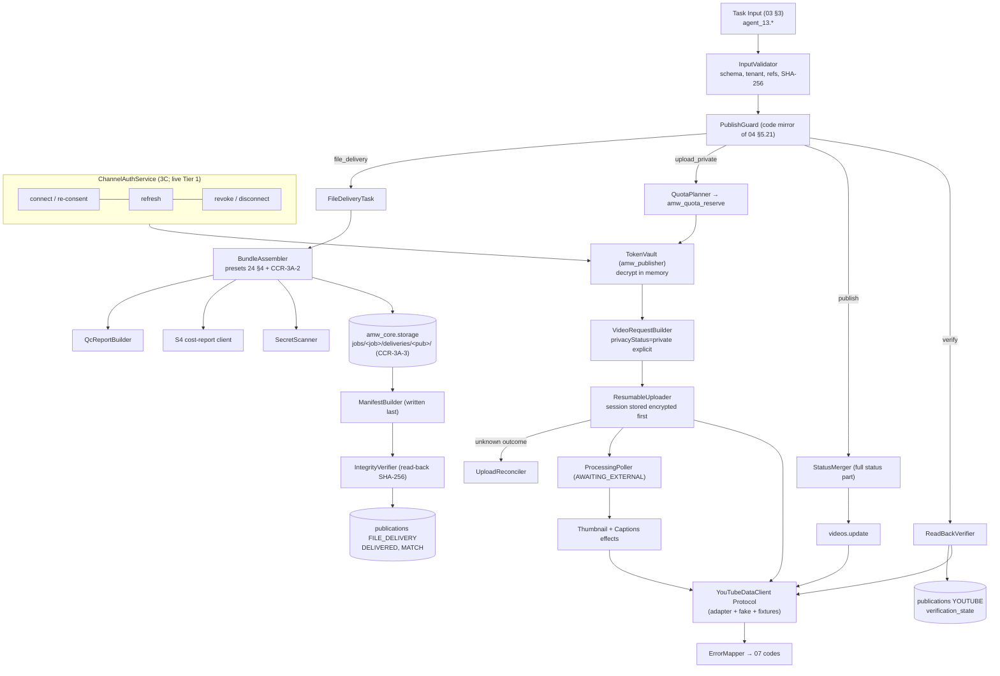

# Agent 13 — Publishing & Delivery (blueprint)

| Field | Value |
|---|---|
| Status | Draft — documentation. Software: **Planned** (rule 6, rule 7) |
| Owner | Agent 13 Publishing & Delivery; integration owner: Agent 01 (orchestrator) |
| Package | `agent_13_publishing_delivery` (27 §7.2); adapter `amw_adapters/destinations/youtube/` (SOURCE_LAYOUT §1); prompts: **none** (no LLM step, §5); evals `evals/agent_13_publishing_delivery/` (deterministic datasets, §26) |
| Directive sections covered | §3.1 row 13 (destination adapters, client file delivery with masters + platform exports, OAuth, resumable upload private first, approval gate, scheduling, duplicate prevention, publish verification, synthetic-media disclosure per destination), §1 YouTube bullets (quota, private first, `containsSyntheticMedia`, PT reset), §1C.3 (per-tenant OAuth, minimal scopes, no service accounts, verification and audit, client-owned GCP project), §1D.1 (delivery of masters, platform exports, captions, AI-disclosure label; usage-rights record), §3.3, §3.5, §4 (26 sections) |
| Owner decisions applied | **D1**: in 3A only `agent_13.file_delivery` (downloadable files: MP4 16:9 (+9:16), thumbnail options, SRT, QC report with the 100-point score, cost per stage); **no YouTube upload and no Google OAuth in 3A**; spend only within owner-set limits; keys only via the environment secret mechanism; no render in market hours (Agent 13 renders nothing). **D2**: blueprint written in Wave B-2; approved before its own build |
| Binding contracts | GLOSSARY_AND_IDS.md (§2, §4, §6.3, §6.13, §6.20, §6.23–6.26, §6.42–6.44), 03_COMMUNICATION_STANDARD.md (§3, §5, §6, §8, §9, §11), 04_DATABASE_ARCHITECTURE.md (§3.1, §3.6, §5.1, §5.7, §5.9, §5.19–5.21), 07_FAILURE_MANAGEMENT.md (§2, §3, §10, §11), 24_PRODUCTION_TYPES.md (§3.2, §4, §7.1), 27_ENGINEERING_STANDARDS.md |
| Shared docs referenced by § only | 3A_SLICE_SPEC.md §3–§4, §9, §13; 13_COMPLIANCE_YOUTUBE_POLICY.md §3.3, §3.7, §3.8, §5.5, §9; 18_PRODUCTION_QUALITY_STANDARD.md; 09_COST_AND_BUDGET.md §12; 08_SECURITY.md §3, §5, §6, §8, §9; 06_NIGHT_SCHEDULING.md §10; 05_RESOURCE_MANAGEMENT.md §6; 20_MULTI_TENANCY_AND_ENTERPRISE.md §5; 16_COMMAND_CENTER.md R9; 11_TESTING_STRATEGY.md; ADR-001, ADR-005, ADR-012 |
| Facts cited | RESEARCH_LOG YT-01…YT-08, YT-11…YT-13; new official-page facts **A13-F1…A13-F10** (§12.1; verified 2026-11-18 on developers.google.com, page "last updated" dates given; proposed to the integrator for RESEARCH_LOG) |
| Marking | Every section's first line carries **MVP** (3A / 3B / 3C) and the enterprise tier (Tier 0–3, GLOSSARY §6.47) |
| Conventions | `(pending CCR)` = contract item not in Wave A, filed in the structured return. `REQUIRES REVIEW (Phase 1): <need>` = unknown value, none invented. No secrets, server details, account IDs or private material in this document |

---

## 1 Identity and mission
**MVP: 3A (`file_delivery`) · 3C (YouTube path) · Tier 0; client OAuth live at Tier 1; client-owned GCP project Tier 3 option.**

### 1.1 Mission
Agent 13 is the **only** component that moves a finished, approved and authorised deliverable out of the factory. It does two things:
1. **File delivery (3A):** assemble the job's downloadable bundle (masters, thumbnail options, SRT, QC report, cost-per-stage report, manifest), write it once under the tenant prefix, verify every byte by SHA-256 and record one `publications` row per file.
2. **Destination publishing (3C):** upload the approved master to the tenant's own YouTube channel **as private**, set the thumbnail and captions, change privacy or schedule only after authorisation, and verify by read-back that YouTube holds exactly what was approved. It also owns the per-channel OAuth connection lifecycle (connect, refresh, revoke, re-consent) and the YouTube quota ledger writes.

### 1.2 Where it sits
- 3A: stage `s13_deliver` → `agent_13.file_delivery` after `s16_auth` (3A_SLICE_SPEC §3; stage name and `FILE_DELIVERY` destination in `CHANNEL_LONG_FORM` v2 are **pending CCR-3A-1**). The SHORTS child job has its own `s13_deliver` (its 9:16 bundle is linked by `parent_job_id`).
- 3C: `s13_upload` (`agent_13.upload_private`, `PUBLISH`) → `s13_publish` (`agent_13.publish`, `PUBLISH`) → `s13_verify` (`agent_13.verify_publication`, `LIGHT`, blocking, on_fail STOP L3) (24 §7.1).
- Upstream: Agent 10 (renders, SRT), Agent 11 (thumbnail variants), Agent 12 (approved metadata, 3C), Agent 16 (disclosure decision, final authorisation), S7 (approvals, editorial contribution), S4 (cost report content, budgets), Agent 01 (task creation, admission). Downstream: Agent 01 (job outcome J07), Agent 14 (analytics on published videos, 3C), S8 (state display), S13 (comment fetch through Agent 13's adapter, 3C).

### 1.3 Authority boundaries
| Agent 13 **decides** | Agent 13 **does not decide** (owner of the decision) |
|---|---|
| bundle layout, file names, manifest content inside the presets | whether the video may be delivered or published (Agent 16 final authorisation, plan Q5; human approval S7) |
| the exact API request bodies, always with `privacyStatus` set explicitly (YT-04) | the disclosure decision (Agent 16, 13 §3.3); Agent 13 **copies** it to `contains_synthetic_media`, never recomputes it |
| upload mechanics: session, resume, reconciliation, retries inside 07 policies | title, description, tags, chapters (Agent 12 + human METADATA choice); thumbnail choice (human; A/B test is a Studio step, YT-08) |
| the quota plan per publication and its reservation (06 §10.2–10.3) | the publish time (the approver / calendar; 06 §10.5); made-for-kids (a human decision, 13 §3.7) |
| whether a read-back matches (`MATCH`/`MISMATCH`) | what to do after a mismatch (human, L3) |
| when a channel token is unusable (`NEEDS_REAUTH`) | granting or revoking consent (the channel owner, permission `secret.manage`, 08 §5.2) |
It never creates tasks, never approves, never changes budgets or controls, never calls an LLM, never deletes a YouTube video (no `videos.delete` in its adapter's method allow-list), and never publishes when `org_controls.publishing_enabled` is off (16 R9).

### 1.4 Success criteria (measurable; targets are config, confirmed in 3B/3C)
| ID | Criterion | Measure | Scope |
|---|---|---|---|
| SC-1 | Nothing leaves the factory without an `APPROVED` approval and a final `ALLOWED` verdict bound to the same `render_sha256` | 0 violations (code guard + DB trigger 04 §5.21) | 3A, 3C |
| SC-2 | Every delivered file verifies by SHA-256 after write | 100 % | 3A |
| SC-3 | A replay never creates a second bundle or a second video | 0 duplicates (idempotency `delivery.file`, `upload.youtube`) | 3A, 3C |
| SC-4 | Every upload request carries `privacyStatus=private` explicitly | 100 % (request-builder assertion + fixture test) | 3C |
| SC-5 | Every YouTube publication's `contains_synthetic_media` equals Agent 16's decision | 100 % (read-back `MATCH`) | 3C |
| SC-6 | Bundle contains no secret, token, account ID, server address or prompt text | 0 scanner hits | 3A |
| SC-7 | No cross-tenant read of renders, tokens or bundles | 0 in tenancy suite and logs | 3A, 3C |
| SC-8 | Quota never exceeded by the factory's own accounting | 0 `quotaExceeded` responses not predicted by the ledger | 3C |
| SC-9 | Delivery latency for a complete bundle | p95 measured in 3A; target **REQUIRES REVIEW (Phase 1): set from the first 3A measurement** | 3A |

---

## 2 Functional requirements
**MVP: 3A FR-1…FR-9 · 3C FR-10…FR-24 · Tier 0 (FR-20, FR-22 live at Tier 1; FR-23 Tier 3).**

### 2.1 Task types (24 §3.2, used unchanged)
| Task type | Stage | Class / queue | Capability | Trigger | Scope |
|---|---|---|---|---|---|
| `agent_13.file_delivery` | `s13_deliver` (pending CCR-3A-1) | `LIGHT` / `light` (05 §6.1; pending CCR-3A-1) | `file_delivery` | `s16_auth` `COMPLETED` with final `ALLOWED` | **3A** |
| `agent_13.upload_private` | `s13_upload` | `PUBLISH` / `publish` | `publish_youtube` | `s16_auth` `COMPLETED` | 3C |
| `agent_13.publish` | `s13_publish` | `PUBLISH` / `publish` | `publish_youtube` | `s13_upload` `COMPLETED` and the publication `READY_PRIVATE` | 3C |
| `agent_13.verify_publication` | `s13_verify` | `LIGHT` / `light` | `publish_youtube` | `s13_publish` `COMPLETED` | 3C |

### 2.2 Requirements
| ID | What | Why | Inputs → outputs | Dependants | Scope |
|---|---|---|---|---|---|
| FR-1 | Re-check the publish guard in code before any write (§6.2 G1–G7) | rule 5; defence in depth over the 04 §5.21 trigger | approval, verdicts, contributions → pass / `PUBLISHING.NOT_AUTHORISED` | 01 | 3A |
| FR-2 | Resolve every source file by tenant URI and verify its SHA-256 | 03 §8 rules 3–4 | refs → verified streams | — | 3A |
| FR-3 | Build the bundle: files 1–7 of 3A_SLICE_SPEC §4 | D1 | renders, SRT, thumbnails, QC data, S4 report → files | owner download tool | 3A |
| FR-4 | Generate the QC report (presentation of `qc_results`, `quality_scores`, `compliance_verdicts`, including the disclosure decision and the plain-words Studio note of 13 §3.3 / §9 rule 2) | D1, 18 §7/§9 | rows → `qc_report` (pending CCR-3A-2) | owner | 3A |
| FR-5 | Obtain the cost-per-stage report content from S4 at bundle time | 09 §12 | ledger → `cost_per_stage_report` (pending CCR-3A-2) | owner | 3A |
| FR-6 | Write the manifest last (file list, SHA-256, sizes, job ID, production type version, config version, metadata present — 13 §9 rule 3) | integrity; 13 §9 | file records → `delivery_manifest` (pending CCR-3A-2) | owner, auditor | 3A |
| FR-7 | One `publications` row per file, `FILE_DELIVERY`, `DRAFT → UPLOADING → DELIVERED`, `verification_state` from read-back | 3A_SLICE §4 | → rows | 01 (J07 `DELIVERED`), S8 | 3A |
| FR-8 | Scan text files of the bundle for secrets and server details before release | 3A_SLICE §4; 09 §12.3.5 | files → pass/fail | — | 3A |
| FR-9 | Idempotent replay: a DLQ replay returns the stored bundle (T04 path) | 27 §9 test 3 | key → stored result | 01 | 3A |
| FR-10 | Compute and reserve the whole quota plan before the first API call | 06 §10.3 step 4 | plan → `amw_quota_reserve` ok / exhausted | 01 scheduler | 3C |
| FR-11 | Resumable upload with explicit `privacyStatus=private`, `containsSyntheticMedia`, `selfDeclaredMadeForKids` (pending CCR) | YT-04, YT-06, 13 §3.7–3.8 | render + metadata → `external_video_id` | 14 | 3C |
| FR-12 | Store the session URI encrypted before the first byte; resume on interruption | 07 §11 steps 2–3; A13-F1 | → `upload_session_ct` | — | 3C |
| FR-13 | Reconcile an unknown outcome before any new session (§6.5) | 07 §11 step 4 | channel uploads → FOUND / NOT_FOUND / INCONCLUSIVE | — | 3C |
| FR-14 | Wait for processing without holding a worker (`AWAITING_EXTERNAL`) | 03 §11.3 T09/T15 | status polls → `READY_PRIVATE` | — | 3C |
| FR-15 | Set the human-chosen thumbnail and the caption tracks while private | 24 §7.1 deliverables; YT-02 | refs → `thumbnail.set`, `captions.insert` effects | — | 3C |
| FR-16 | Publish: change privacy to `public` or schedule with `publishAt`, sending the **complete** `status` part (A13-F4) | 07 §11 step 5 | publication + target → `PUBLISHED` / `SCHEDULED` | 14 | 3C |
| FR-17 | Refuse a publish time earlier than the authorisation's `evaluated_publish_date` (13 §5.5) | FIN-R9 timing | dates → pass / `PUBLISHING.NOT_AUTHORISED` | 16 re-run | 3C |
| FR-18 | Verify by read-back: privacy, `publishAt`, title, `containsSyntheticMedia`, `selfDeclaredMadeForKids` (pending CCR) | 20 §5.1 rule 7; 13 §3.8 | `videos.list` → `MATCH` / `MISMATCH` | 01 (J07 `PUBLISHED`) | 3C |
| FR-19 | Duplicate prevention: idempotency keys + partial unique index + reconciliation | 07 §11; 04 §5.21 | — | — | 3C |
| FR-20 | Channel connect / refresh / revoke / re-consent flows with granted-scope check (A13-F7, A13-F8) | §1C.3; 20 §5.1 rule 6 | consent → `oauth_tokens`, `channel_status` | S8, S9 | 3C T0 design; live T1 |
| FR-21 | Quota ledger writes per PT day; per-tenant attribution rows in `cost_ledger` | 04 §5.20; 06 §10.1 | calls → `quota_usage`, ledger rows | S4, 01 | 3C |
| FR-22 | Client file delivery for client production types (masters + platform exports, captions, AI-disclosure statement; usage-rights record present) | §1D.1 | same as FR-3 with client presets | client | 3C · Tier 1 |
| FR-23 | Client-owned GCP project: use that project's OAuth client and quota ledger | §1C.3; 20 §5.1 rule 5 | `gcp_projects.ownership = CLIENT_OWNED` | — | 3C · Tier 3 option |
| FR-24 | Comment read/post adapter methods for S13 (token holder only; posting only after human approval) | 14 §3.13 | — | S13 | 3C (pending S13 CCR) |

### 2.3 Out of scope (explicit)
Thumbnail/title A/B tests (human in Studio, YT-08); metadata writing (Agent 12); multi-language audio tracks (YT-15 API support NOT CONFIRMED, 24 §4); video deletion; other platforms (destination kinds added by CCR, Tier 2+); `unlisted` as a target (not stated by the owner; A.5).

---

## 3 Non-functional requirements
**MVP: 3A NFR-1…NFR-7 · 3C NFR-8…NFR-12 · Tier 0.**

| ID | Requirement | Value / rule | Scope |
|---|---|---|---|
| NFR-1 | Determinism | Every Agent 13 decision is a pure function or an adapter call; no model | 3A |
| NFR-2 | Idempotency | Every external effect behind an `idempotency_keys` row (03 §9.1); keys of `upload.*`/`publish.*` never expire | 3A/3C |
| NFR-3 | Integrity | Write-once blobs; SHA-256 verified on read and after write (03 §8) | 3A |
| NFR-4 | Memory | Files are streamed, never loaded whole into memory; peak RSS **ESTIMATE ≤ 256 MiB** per task until measured (§17) | 3A |
| NFR-5 | Tenancy | Five layers of 08 §8; this agent's controls in §19 | 3A |
| NFR-6 | No secrets in outputs, logs, checkpoints, bundles | scanner + log-leak test (08 §8.2 items 5) | 3A |
| NFR-7 | Observability | metrics and logs of §22, every line with `org_id` | 3A |
| NFR-8 | Quota safety | whole-plan reservation; PT-day accounting (YT-03, GLOSSARY §4) | 3C |
| NFR-9 | Bounded retries | only 07 §3 policies; `publish_resume` for uploads; no loop outside 07 §9 caps | 3C |
| NFR-10 | Token confidentiality | plaintext only in memory of the publish worker; `amw_publisher` role only (08 §6.3) | 3C |
| NFR-11 | Time | UTC storage; `publishAt` sent in ISO 8601 UTC (A13-F3); quota by `America/Los_Angeles` date | 3C |
| NFR-12 | Placement | `PUBLISH` work only when 06 admits it (night window on the shared VPS, 06 §9–§10); Agent 13 has no `HEAVY_CPU` task, so the market-hours render guard (D1) never applies to it | 3C |

---

## 4 Internal architecture
**MVP: 3A (left branch) · 3C (right branch) · Tier 0.**



Hand-offs leave only through the Task Output and DB rows (03 §5; 27 §7.1). The adapter is the only code that talks to Google; the agent package holds no HTTP client.

---

## 5 Full system prompt
**MVP: 3A · 3C · Tier 0 — not applicable: Agent 13 has no LLM step.**

Every Agent 13 decision is either a contract check (guard, idempotency, hashes), a mapping (disclosure decision → boolean, provider error → 07 code), a comparison (read-back) or an API call with a fixed body. None of these benefits from a language model, and each would become less safe with one: a model could not be allowed to choose privacy, disclosure, schedule or retries (rule 5, plan Q5). Therefore there is **no prompt file** under `prompts/agent_13_publishing_delivery/` and no `llm.agent_13.*` config key. The 27 §3.5 prompt template does not apply; its evaluation purpose is served by the deterministic golden datasets of §26. If a future version adds an LLM step (for example drafting a client delivery note), it needs a new task type by CCR, a prompt file per `prompts/_TEMPLATE.v1.md` and an eval set first.

---

## 6 Decision engine
**MVP: 3A §6.1–6.3 · 3C §6.4–6.8 · Tier 0.**

### 6.1 Decision table (all deterministic)
| Decision | Kind | Why deterministic |
|---|---|---|
| May this deliverable leave? | guard G1–G7 (§6.2) | rule 5; same predicate as the DB trigger |
| Which files form the bundle | preset list from the production type (24 §4; CCR-3A-2) | contract-bound |
| `contains_synthetic_media` | map §6.3 | copy of Agent 16's decision (13 §3.3) |
| Quota plan | arithmetic over YT-02 costs (§6.4) | official prices |
| Retry / suspend / fail | ErrorMapper (§18) → 07 dispositions | 07 is binding |
| Reconciliation outcome | §6.5 rules | "only a definite not found permits a new session" (07 §11.4) |
| Publish body | StatusMerger (§6.6) | A13-F4 reverting behaviour |
| Verification | field equality (§6.7) | no judgement involved |

### 6.2 Publish guard (code mirror of 04 §5.21; runs on every task, before any write or call)
| ID | Check | Failure |
|---|---|---|
| G1 | `approvals.state = APPROVED`, kind `FINAL_VIDEO` or `PUBLISH`, `subject_sha256 = render_sha256` | `PUBLISHING.NOT_AUTHORISED` |
| G2 | ≥ 1 `editorial_contributions` row for the job | `PUBLISHING.NOT_AUTHORISED` |
| G3 | authorisation verdict: `is_final = true`, `verdict = ALLOWED`, `subject_sha256 = render_sha256` | `PUBLISHING.NOT_AUTHORISED` |
| G4 | disclosure verdict exists with `disclosure_decision ∈ {REQUIRED, NOT_REQUIRED}` (never `NEEDS_HUMAN_REVIEW` at this point) | `PUBLISHING.NOT_AUTHORISED` |
| G5 | master render `status = QC_PASSED` and `content_sha256 = render_sha256` | `PUBLISHING.NOT_AUTHORISED` |
| G6 | all IDs and URIs belong to `org_id` of the envelope | `PERMANENT.TENANT_MISMATCH` / `PERMANENT.CROSS_TENANT_REF` |
| G7 (3C) | `org_controls.publishing_enabled = true`; channel `status = CONNECTED`; token `ACTIVE` with the required scopes (§12.3) | held: task returns `SUSPENDED` `OPERATOR_PAUSE` when publishing is off (16 §308); `PUBLISHING.OAUTH_REVOKED` when the channel needs re-auth |
`publishing_enabled` does not gate file delivery (16 §308: delivery is a separate non-publishing path).

### 6.3 Disclosure mapping (YT-06, YT-07; 13 §3.3, §9)
| `disclosure_decision` | YouTube `status.containsSyntheticMedia` | File delivery (QC report, manifest) |
|---|---|---|
| `REQUIRED` | `true` | plain-words statement: the video contains realistic synthetic content and must be declared when published elsewhere (13 §9 rule 2) |
| `NOT_REQUIRED` | `false` | statement: no declaration required, with Agent 16's rationale |
| `NEEDS_HUMAN_REVIEW` | — (guard G4 fails) | — (guard G4 fails) |
3A note: no API field is set; the QC report says that the owner applies the label by hand in Studio (13 §3.3).

### 6.4 Quota plan (YT-01, YT-02; 06 §10.2)
`VIDEO_UPLOADS`: 1 (`videos.insert`). `DEFAULT`: `thumbnails.set` 50 + `captions.insert` 400 × tracks + `videos.update` 50 (publish) + `playlistItems.insert` 50 × playlists (only if enabled, pending CCR-A13-2) + read-backs `videos.list` 1 × `publish.verify.max_polls` + processing polls `videos.list` 1 × `upload.processing.max_polls`. Every request, including an invalid one, costs at least one unit and every extra page costs again (A13-F6), so polls are capped by config. Example (ESTIMATE, derived from YT-02): one caption track, no playlist, 10 polls in total → 1 `VIDEO_UPLOADS` + 510 `DEFAULT` units. The default 10,000 `DEFAULT` units/day (YT-02) therefore limits a shared project to about 19 such publications per PT day before the 100-upload bucket is reached (ESTIMATE; the Cloud Console value is the authority, A4 pending).

### 6.5 Reconciliation (07 §11 step 4; resolves its REQUIRES REVIEW as far as official pages allow)
Run when an `upload.youtube` key is `IN_PROGRESS` past `locked_until`, or the stored session returns 404 (expired, A13-F1), or a transfer ended with no response.
1. If the stored session still answers the status query (`PUT` with `Content-Range: bytes */<size>`): 308 → resume from the returned `Range` (A13-F1); 201/200 with a video resource → **FOUND** (take the ID).
2. Else list the channel's uploads: `channels.list part=contentDetails mine=true` (1 unit) → `contentDetails.relatedPlaylists.uploads` → `playlistItems.list` pages (1 unit each, A13-F6, A13-F10), newest first, bounded by `reconcile.max_pages`; candidates are items added after the session open time (as returned in the item snippet; exact field **REQUIRES REVIEW (Phase 1)** on the playlistItems resource page).
3. For candidates, `videos.list part=fileDetails,status,snippet` (1 unit per call of up to 50 IDs); match the marker: the upload's file name equals the publication wire ID (`pub_…`) sent as the file name of the upload. `fileDetails` is owner-only and present only when `processingDetails.fileAvailability = available` (A13-F3).
4. Outcomes: **FOUND** (exactly one match) → link `external_video_id`, `PUBLISHING.DUPLICATE_DETECTED` handled as success if the video's status matches the request, else FAIL L3. **NOT_FOUND** (uploads list complete back to the session open time, no match, every candidate's `fileDetails` available) → a new session under the same key. **INCONCLUSIVE** (anything else) → **no new upload**; `CHECKPOINTED` `AWAITING_EXTERNAL`, re-run after `reconcile.retry_after_ms`, L3 after `reconcile.max_rounds` with a request to check Studio by hand.
- **REQUIRES REVIEW (Phase 1):** (a) whether private videos appear in the uploads playlist for the owner's token, (b) whether the resumable upload's file name (`Slug` header, A13-F5 lists `invalidFilename` for it) is the value returned in `fileDetails.fileName`. Both are tested on a test channel in the first 3C ticket (27 §9 D1 note); until both are proven, every reconciliation is INCONCLUSIVE (safe: no duplicate, human check).

### 6.6 Status merger for `videos.update` (A13-F4)
`videos.update` replaces every mutable property of the parts named in `part`; an omitted `privacyStatus` reverts to the default, which is `public` on insert (A13-F3, YT-04). The merger therefore: (1) reads the current `status` (`videos.list`, 1 unit); (2) builds the full `status` object: `privacyStatus` (target), `publishAt` (only for scheduling, with `privacyStatus = private`, only if never published, A13-F3), `embeddable`, `license`, `publicStatsViewable` copied from the read-back, `containsSyntheticMedia` and `selfDeclaredMadeForKids` set explicitly from the records; (3) sends `part=status` only (snippet untouched). A body without `privacyStatus` is rejected by an assertion before the call.

### 6.7 Verification rules
| Field | Expected | After `PUBLISH_NOW` | After `SCHEDULE` |
|---|---|---|---|
| `status.privacyStatus` | target | `public` | `private` until `publishAt`, then `public` |
| `status.publishAt` | scheduled time | absent | equals `scheduled_publish_at` (UTC, second precision) |
| `snippet.title` | approved title | equal (exact string) | equal |
| `status.containsSyntheticMedia` | §6.3 | equal | equal |
| `status.selfDeclaredMadeForKids` | recorded decision (pending CCR-A13-1) | equal | equal |
| `status.uploadStatus` | `processed` (A13-F3) | required | required |
A scheduled publication is verified twice: once right after scheduling (`SCHEDULED`, `MATCH` of the private state), and after `publishAt + publish.verify.grace_ms` (`PUBLISHED`, then `VERIFIED`). Between the two, the task is `CHECKPOINTED` with `AWAITING_EXTERNAL`. Any difference → `MISMATCH`, `PUBLISHING.VERIFICATION_MISMATCH`, L3; never silently accepted (20 §5.1 rule 7).

### 6.8 Publish-time precondition (13 §5.5)
If `scheduled_publish_at` (or now, for `PUBLISH_NOW`) is earlier than the authorisation's stored `evaluated_publish_date`, the task fails `PUBLISHING.NOT_AUTHORISED` and the orchestrator re-runs `agent_16.publication_authorisation`; Agent 13 never evaluates FIN-R9 itself.

---

## 7 Input schema
**MVP: 3A `file_delivery.input` · 3C the three YouTube inputs · Tier 0.**
Envelope and Task Input are 03 §3–§4 unchanged. `channel_id` is null for file delivery of production types without a channel (03 §3.1). Payload schemas below are this blueprint's (CCR rules §2.3); `$id` `urn:amw:schema:<task_type>.input:1.0.0`. Wire IDs follow GLOSSARY §2.2; hashes are 64 lowercase hex.

### 7.1 `agent_13.file_delivery.input` 1.0.0 [3A]
```json
{
  "$schema": "https://json-schema.org/draft/2020-12/schema",
  "$id": "urn:amw:schema:agent_13.file_delivery.input:1.0.0",
  "type": "object", "additionalProperties": false,
  "required": ["production_type_key", "production_type_version", "master", "approval_id", "authorisation_verdict_id", "disclosure_verdict_id", "items", "reports"],
  "properties": {
    "production_type_key": { "type": "string", "pattern": "^[A-Z][A-Z0-9_]+$" },
    "production_type_version": { "type": "integer", "minimum": 1 },
    "master": { "$ref": "#/$defs/render_ref" },
    "approval_id": { "type": "string", "pattern": "^apr_" },
    "authorisation_verdict_id": { "type": "string", "pattern": "^cvd_" },
    "disclosure_verdict_id": { "type": "string", "pattern": "^cvd_" },
    "items": { "type": "array", "minItems": 1, "maxItems": 64, "items": { "$ref": "#/$defs/item" } },
    "reports": { "type": "object", "additionalProperties": false, "required": ["qc_report", "cost_per_stage_report"],
      "properties": { "qc_report": { "const": true }, "cost_per_stage_report": { "const": true } } },
    "usage_rights_ref": { "type": ["string", "null"], "description": "required for AD_SPOT / client types (§1D.1); null in 3A" }
  },
  "$defs": {
    "render_ref": { "type": "object", "additionalProperties": false, "required": ["render_id", "render_sha256", "preset_key"],
      "properties": { "render_id": { "type": "string", "pattern": "^rnd_" }, "render_sha256": { "type": "string", "pattern": "^[0-9a-f]{64}$" }, "preset_key": { "type": "string" } } },
    "item": { "type": "object", "additionalProperties": false, "required": ["preset_key", "source_ref", "sha256", "size_bytes"],
      "properties": {
        "preset_key": { "enum": ["yt_master_1080p", "yt_master_1440p", "shorts_9x16", "thumbnail_set", "srt_per_language"] },
        "source_ref": { "type": "string", "pattern": "^amw-blob://org_" },
        "sha256": { "type": "string", "pattern": "^[0-9a-f]{64}$" },
        "size_bytes": { "type": "integer", "minimum": 1 },
        "language": { "type": ["string", "null"] },
        "variant_index": { "type": ["integer", "null"], "minimum": 1, "maximum": 3 } } }
  }
}
```
Validation beyond the schema: `language` required for `srt_per_language` (BCP 47); `variant_index` required and unique for `thumbnail_set` (≤ 3, YT-08); exactly one master item whose `sha256 = master.render_sha256`; `shorts_9x16` only in a SHORTS job; client presets (`ad_master_*`, `client_master_mezzanine`, 24 §4) are added to the enum in a minor version when FR-22 is built (Tier 1).

### 7.2 `agent_13.upload_private.input` 1.0.0 [3C]
| Field | Type | Rule |
|---|---|---|
| `publication_target` | object `{channel_id: chn_…, gcp_project_id: uuid wire}` | channel `CONNECTED`; equals Task Input `channel_id` |
| `master` | `render_ref` (§7.1) | `QC_PASSED` |
| `approval_id`, `authorisation_verdict_id`, `disclosure_verdict_id` | as §7.1 | G1–G4 |
| `metadata_ref` | `amw-entity://org_…/…` | the human-chosen output of `agent_12.metadata` (field names owned by the agent_12 blueprint); `title` ≤ 100 characters is re-checked |
| `thumbnail` | `{source_ref, sha256, variant_index}` or null | the variant chosen by the human (THUMBNAIL approval if enabled) |
| `captions` | array `{language, source_ref, sha256}`, ≤ `upload.max_caption_tracks` | each track costs 400 units (YT-02) |
| `made_for_kids_decision` | `{decision: boolean, decided_by: usr_…}` | **pending CCR-A13-1**; required (13 §3.7: human decision only) |
| `playlist_ids` | array of strings, default empty | **pending CCR-A13-2**; empty until the owner enables it |

### 7.3 `agent_13.publish.input` 1.0.0 [3C]
| Field | Type | Rule |
|---|---|---|
| `publication_id` | `pub_…` | state `READY_PRIVATE`, same job |
| `mode` | `PUBLISH_NOW` \| `SCHEDULE` (payload-local) | from the approval / calendar entry; never chosen by Agent 13 |
| `scheduled_publish_at` | UTC date-time or null | required for `SCHEDULE`; ≥ now + `publish.min_lead_ms`; §6.8 |
| `publish_approval_id` | `apr_…` or null | when the workflow has a separate `PUBLISH` approval |

### 7.4 `agent_13.verify_publication.input` 1.0.0 [3C]
| Field | Type | Rule |
|---|---|---|
| `publication_id` | `pub_…` | state `SCHEDULED` or `PUBLISHED` |
| `phase` | `AFTER_PUBLISH` \| `AFTER_SCHEDULE` \| `AFTER_GO_LIVE` (payload-local) | `AFTER_GO_LIVE` only for `SCHEDULE` |

---

## 8 Output schema
**MVP: 3A `file_delivery.output` · 3C others · Tier 0.**
Task Output is 03 §5 unchanged: `output_refs` carry every persisted file with SHA-256 (`output_ref_kind`: `VIDEO`, `IMAGE`, `SUBTITLE`, `REPORT`, `DATA`); `quality_score` and `confidence` are null (Agent 13 does not score); `validation_results` lists the guard and checks of §6/§20 with `check_kind = DETERMINISTIC`.

### 8.1 `agent_13.file_delivery.output` 1.0.0 [3A]
```json
{
  "$schema": "https://json-schema.org/draft/2020-12/schema",
  "$id": "urn:amw:schema:agent_13.file_delivery.output:1.0.0",
  "type": "object", "additionalProperties": false,
  "required": ["bundle_ref", "manifest", "files", "disclosure_decision", "secret_scan"],
  "properties": {
    "bundle_ref": { "type": "string", "pattern": "^amw-blob://org_[^/]+/jobs/job_[^/]+/deliveries/" },
    "manifest": { "type": "object", "additionalProperties": false, "required": ["ref", "sha256", "size_bytes"],
      "properties": { "ref": { "type": "string" }, "sha256": { "type": "string", "pattern": "^[0-9a-f]{64}$" }, "size_bytes": { "type": "integer" } } },
    "files": { "type": "array", "minItems": 5, "items": { "type": "object", "additionalProperties": false,
      "required": ["publication_id", "preset_key", "file_name", "storage_ref", "sha256", "size_bytes", "publish_state", "verification_state"],
      "properties": {
        "publication_id": { "type": "string", "pattern": "^pub_" },
        "preset_key": { "type": "string" },
        "file_name": { "type": "string", "pattern": "^[a-z0-9_.-]{1,120}$" },
        "storage_ref": { "type": "string" },
        "sha256": { "type": "string", "pattern": "^[0-9a-f]{64}$" },
        "size_bytes": { "type": "integer", "minimum": 1 },
        "publish_state": { "const": "DELIVERED" },
        "verification_state": { "const": "MATCH" } } } },
    "disclosure_decision": { "enum": ["REQUIRED", "NOT_REQUIRED"] },
    "secret_scan": { "type": "object", "additionalProperties": false, "required": ["files_scanned", "hits"],
      "properties": { "files_scanned": { "type": "integer" }, "hits": { "const": 0 } } }
  }
}
```
`files` always contains the master, ≥ 1 SRT, the thumbnail options, the QC report and the cost-per-stage report (the manifest is `manifest`, not a `files` entry, because it lists the others; it still gets its own `publications` row). File names are derived (`<preset>[_<lang>|_v<n>].<ext>`) and contain no account ID, server path or personal data. QC/cost report file format: provisional default **JSON plus a phone-readable HTML rendering** (owner question Q-A13-1, §25).

### 8.2 `agent_13.upload_private.output` 1.0.0 [3C]
`publication_id`, `external_video_id`, `privacy_status` (`const: "private"`), `upload_status` (`uploaded`/`processed`, A13-F3), `processing_status`, `reconciliation` (`NOT_NEEDED` \| `FOUND` \| `NOT_FOUND`, payload-local), `thumbnail_set` (bool), `captions` (array `{language, external_caption_id}`), `quota_used` (object per `quota_bucket`), `publish_state` (`READY_PRIVATE`).

### 8.3 `agent_13.publish.output` 1.0.0 [3C]
`publication_id`, `mode`, `publish_state` (`PUBLISHED` \| `SCHEDULED`), `privacy_status`, `scheduled_publish_at`, `published_at` (null when scheduled), `status_sent` (the full status object sent, §6.6; no token), `quota_used`.

### 8.4 `agent_13.verify_publication.output` 1.0.0 [3C]
`publication_id`, `phase`, `verification_state` (`MATCH` \| `MISMATCH`), `compared` (array `{field, expected, actual, equal}`), `publish_state` after the step (`SCHEDULED`, `PUBLISHED` or `VERIFIED`), `next_check_at` (only for `AFTER_SCHEDULE`). A `MISMATCH` is returned with Task Output `status = FAILED` and `PUBLISHING.VERIFICATION_MISMATCH` (03 §5.3: never success with a mismatch).

---

## 9 Python package and class architecture
**MVP: 3A `delivery/`, `guards/`, `models/file_delivery.py` · 3C `youtube/`, `auth/` · Tier 0.**

```text
packages/agents/agent_13_publishing_delivery/
├── __init__.py              # exports PublishingDeliveryStage
├── protocol.py              # PublishingDeliveryStage Protocol: run(task_input) -> TaskOutput
├── models/                  # Pydantic payload models = §7/§8 schemas (generated JSON Schema checked in CI)
│   ├── file_delivery.py  upload_private.py  publish.py  verify_publication.py
├── guards/
│   ├── publish_guard.py     # PublishGuard (§6.2)
│   └── disclosure.py        # DisclosureMapper (§6.3)
├── delivery/                # 3A
│   ├── file_delivery_task.py  bundle_assembler.py  qc_report.py  manifest.py
│   ├── secret_scanner.py    integrity.py
├── youtube/                 # 3C
│   ├── upload_task.py  publish_task.py  verify_task.py
│   ├── quota_planner.py  request_builder.py  status_merger.py
│   ├── resumable_uploader.py  reconciler.py  processing_poller.py
├── auth/                    # 3C (live Tier 1)
│   ├── channel_auth_service.py   # connect, refresh, revoke, re-consent
│   └── token_vault.py            # decrypt via amw_core crypto helper, amw_publisher connection
├── errors.py                # ErrorMapper: adapter errors -> amw_core.retries exceptions (07 §2)
└── checkpoints.py           # step keys and state models (§16)
packages/amw_adapters/destinations/youtube/
├── protocol.py   # YouTubeDataClient, GoogleOAuthClient Protocols; method allow-list (no delete)
├── http_client.py  fake.py  fixtures/   # recorded, redacted fixtures (27 §8.2)
```

### 9.1 Protocols (constructor injection; wired only in `workers/publish_worker`)
| Protocol | Methods | Implementations |
|---|---|---|
| `YouTubeDataClient` | `open_resumable_session`, `send_media`, `query_upload_status`, `videos_list`, `videos_update`, `thumbnails_set`, `captions_insert`, `channels_list_mine`, `playlist_items_list`, `playlist_items_insert` (pending CCR-A13-2) | http client, `FakeYouTube` (stateful, injects every error of §18) |
| `GoogleOAuthClient` | `authorization_url`, `exchange_code`, `refresh`, `revoke` | http client, `FakeOAuth` |
| `BlobStore` | `amw_core.storage` (read verified, write-once) | local disk (ADR-005), fake |
| `TenantDb` | `amw_core.tenancy` sessions; a second session factory for `amw_publisher` (tokens only) | Postgres, test DB |
| `CostReportSource` | S4 report builder (09 §12) | S4 service, fake |
| `Clock` | `now()` UTC | system, frozen |

### 9.2 Class responsibilities
`FileDeliveryTask` orchestrates §10.1; `BundleAssembler` maps items to file names and writes them; `QcReportBuilder` renders rows (no scoring); `ManifestBuilder` writes last; `IntegrityVerifier` re-reads; `SecretScanner` applies the 27 §5 scanner rules to text files; `UploadTask`, `PublishTask`, `VerifyTask` orchestrate the 3C steps; `QuotaPlanner` is pure; `VideoRequestBuilder` asserts explicit privacy; `StatusMerger` is pure; `ResumableUploader` owns the session lifecycle; `UploadReconciler` implements §6.5; `ProcessingPoller` returns `SUSPENDED` between polls; `ChannelAuthService` and `TokenVault` own tokens; `ErrorMapper` is pure.

---

## 10 Function-level specification
**MVP: 3A §10.1–10.3 · 3C §10.4–10.7 · Tier 0.** Every function: typed, mypy strict; raises only `amw_core.retries` exceptions that map 1:1 to 07 codes (27 §7.3.4); logs through `amw_core.observability` with `org_id`, `correlation_id`, `job_id`, `task_id`, `attempt_id`, `actor = agent_13` and never a token, session URI or file content.

### 10.1 File delivery
| Function | Signature | Side effects | Exceptions | Validation / logging | Tests |
|---|---|---|---|---|---|
| `FileDeliveryTask.run` | `(ti: TaskInput[FileDeliveryInput]) -> TaskOutput[FileDeliveryOutput]` | via callees | all below | logs `delivery.started/completed` with counts only | E2E-1, FI-1 |
| `PublishGuard.check` | `(ctx: TenantCtx, job_id, render: RenderRef, approval_id, auth_id, disclosure_id, destination: DestinationKind) -> GuardResult` | reads only | `PublishingNotAuthorised`, `TenantMismatch`, `CrossTenantRef` | G1–G7; result in `validation_results` | U-1…U-9 |
| `BundleAssembler.plan` | `(inp: FileDeliveryInput, pt: ProductionTypeRecord) -> list[PlannedFile]` | none (pure) | `InputInvalid`, `MissingDependency` | required presets present; names unique | U-10…U-14 |
| `BundleAssembler.write` | `(ctx, planned: list[PlannedFile], publication_ids) -> list[WrittenFile]` | `publications` insert `DRAFT` → `UPLOADING`; blob writes under `deliveries/<pub>/` | `StorageUnavailable`, `DiskFull`, `CorruptedOutput` | per file: key `delivery.file` (job, preset, sha) checked first (03 §9.1) | I-1, FI-2 |
| `QcReportBuilder.build` | `(ctx, job_id) -> ReportFiles` | read `qc_results`, `quality_scores`, `compliance_verdicts` | `MissingDependency` | unknown values print "REQUIRES REVIEW", never zero (3A_SLICE §4 row 6 rule applies too) | U-15 |
| `CostReportSource.build` | `(ctx, job_id) -> ReportFiles` | S4 reads ledger | `MissingDependency` | content owned by 09 §12 | C-3 |
| `SecretScanner.scan` | `(files: list[TextFile]) -> ScanResult` | none | `InputInvalid` + security event on a hit | patterns from the CI scanner config | U-16, S-4 |
| `ManifestBuilder.write` | `(ctx, written: list[WrittenFile], meta: ManifestMeta) -> WrittenFile` | one blob + `publications` row | as `write` | manifest lists every file; written last | U-17 |
| `IntegrityVerifier.verify` | `(ctx, written) -> list[Verification]` | re-read; set `DELIVERED`, `verification_state = MATCH`, `verified_at` | `CorruptedOutput` (retry `agent`) | SHA-256 and size equality | I-2 |

### 10.2 Idempotency helper (shared pattern, `amw_core`)
`effect(ctx, scope, natural_key, request_sha256, fn) -> Result`: no row → insert `IN_PROGRESS`; run; `COMPLETED` with `result_ref`. Same key + same hash `COMPLETED` → stored result. Different hash → `IdempotencyConflict`. Stale `IN_PROGRESS` → the scope's reconciler (file delivery: check that the blob exists and verifies; YouTube: §6.5).

### 10.3 Publication rows
`PublicationRepo.insert_draft(ctx, …) -> PublicationId`; `transition(ctx, pub_id, from_state, to_state, **fields)` with optimistic `state_version` (03 §11.4); the DB trigger re-checks the guard on `UPLOADING`/`SCHEDULED`/`PUBLISHED`.

### 10.4 Upload (3C)
| Function | Signature | Side effects | Exceptions | Notes | Tests |
|---|---|---|---|---|---|
| `QuotaPlanner.plan` | `(inp: UploadPrivateInput, cfg) -> dict[QuotaBucket, int]` | none | — | §6.4 | U-20 |
| `QuotaLedger.reserve` | `(gcp_project_id, plan) -> Literal["ok","exhausted"]` | `amw_quota_reserve` per bucket in one transaction | `QuotaExhausted` (SUSPEND) | release on failure paths | I-10 |
| `TokenVault.access_token` | `(ctx, channel_id, required_scopes) -> SecretStr` | may refresh (`GoogleOAuthClient.refresh`), update `expires_at`, `last_refreshed_at` | `OAuthRevoked`, `OAuthRefreshFailed` | plaintext never leaves memory | U-21, S-5 |
| `VideoRequestBuilder.insert_body` | `(meta, disclosure: bool, made_for_kids: bool, marker: PublicationId) -> InsertBody` | none | `InputInvalid` | asserts `status.privacyStatus == "private"`, both booleans present | U-22 |
| `ResumableUploader.open` | `(ctx, pub_id, body, size) -> SessionHandle` | session URI encrypted into `upload_session_ct` **before** any media byte; `UPLOADING` | `UploadRejected`, `DestinationUnavailable` | A13-F1 | I-11 |
| `ResumableUploader.send` | `(handle, stream, offset) -> UploadResult` | checkpoint per confirmed offset | `UploadInterrupted` | streaming; optional chunks multiple of 256 KB (A13-F1) | FI-10 |
| `UploadReconciler.run` | `(ctx, pub_id) -> Literal["FOUND","NOT_FOUND","INCONCLUSIVE"]` | read calls (quota counted) | `DuplicateDetected` (inconsistent) | §6.5 | FI-11…13 |
| `ProcessingPoller.poll` | `(ctx, pub_id) -> PollResult` | `PROCESSING` → `READY_PRIVATE` | `ProcessingFailed` | returns `SUSPENDED` `AWAITING_EXTERNAL` between polls | U-23 |
| `UploadTask.set_thumbnail` / `.insert_captions` | `(ctx, pub_id, ref) -> EffectResult` | keys `thumbnail.set`, `captions.insert` | `UploadRejected` | only while private | I-12 |

### 10.5 Publish and verify (3C)
| Function | Signature | Side effects | Exceptions | Tests |
|---|---|---|---|---|
| `StatusMerger.merge` | `(current: VideoStatus, target: PublishTarget, disclosure: bool, kids: bool) -> VideoStatus` | none (pure) | `InputInvalid` (e.g. `publishAt` on a once-published video) | U-30…U-36 |
| `PublishTask.run` | `(ti) -> TaskOutput[PublishOutput]` | key `publish.youtube` (pub, target privacy); `videos.update part=status`; `SCHEDULED` or `PUBLISHED`; `scheduled_publish_at`/`published_at` | `PublishingNotAuthorised`, `UploadRejected`, `DestinationUnavailable` | I-20 |
| `VerifyTask.run` | `(ti) -> TaskOutput[VerifyOutput]` | `verification_state`, `verification_details`, `verified_at`; `VERIFIED` on full match after go-live | `VerificationMismatch` | U-40…U-46 |

### 10.6 Channel authorisation (3C; live Tier 1)
| Function | Behaviour | State change |
|---|---|---|
| `ChannelAuthService.start_connect(actor, channel_id) -> AuthUrl` | permission `secret.manage` (08 §5.2); compliance profile attached; `state` value bound to org, channel and actor, single use, expiring (A13-F8); `access_type=offline`, `include_granted_scopes=true` | none until callback |
| `complete_connect(state, code)` | verify `state`; exchange code; **check granted scopes** (users may grant only part, A13-F8); missing a required scope → no publishing, channel stays `DRAFT`/`NEEDS_REAUTH` with a message; store ciphertext with the tenant DEK (08 §6) | token `ACTIVE`; channel `CONNECTED`; audit `channel.credential.connected` |
| `refresh(ctx, channel_id)` | on `invalid_grant` (revoked, unused 6 months, testing-mode expiry, session policy; A13-F7) → `PUBLISHING.OAUTH_REVOKED`; network/5xx → `PUBLISHING.OAUTH_REFRESH_FAILED` (retry `temporary`) | `REVOKED` or `REFRESH_FAILED`; channel `NEEDS_REAUTH` |
| `revoke(actor, channel_id)` | revoke at Google (A13-F8), wipe ciphertext, cancel queued publish tasks with reason | token `REVOKED`; channel `DISCONNECTED` |
| `reconsent(actor, channel_id)` | same as connect; old ciphertext wiped | `NEEDS_REAUTH` → `CONNECTED` |

### 10.7 Error mapping
`ErrorMapper.map(response_or_exception) -> AmwError` per the table in §18.1 (pure; unit-tested per row).

---

## 11 AI provider use
**MVP: 3A · 3C · Tier 0 — none.**
Agent 13 makes **no** LLM, TTS, image or video-generation call and has no `llm.agent_13.*` config key (§5). Its only paid or metered external calls are the YouTube Data API (quota units, not money; `cost_ledger` rows with `operation = 'youtube.quota'`, `unit_kind = 'quota_units'`, `amount_micros = 0`, 06 §10.1) and the Google OAuth endpoints (no charge stated on the pages read). File delivery costs only storage. S4 budget reservation for Agent 13 tasks is therefore zero money; budget breach rules (D1) never block delivery of already-paid work, but `emergency_stop` does (admission).

---

## 12 External APIs
**MVP: 3A none (D1) · 3C YouTube Data API v3 + Google OAuth 2.0 · Tier 0 design; client channels Tier 1; client-owned project Tier 3.**

### 12.1 Facts used (official pages read 2026-11-18; proposed RESEARCH_LOG entries)
| ID | Fact | Source (page "last updated") |
|---|---|---|
| A13-F1 | Resumable upload: `POST …/upload/youtube/v3/videos?uploadType=resumable&part=…`; the session URI comes in `Location`; success `201`; resumable after a lost connection or `500`, `502`, `503`, `504` with exponential backoff; session URIs have a finite lifetime and an expired one returns `404` (start a new upload); status check = empty `PUT` with `Content-Range: bytes */<size>` → `308` with `Range`; chunks optional, multiple of 256 KB, "discouraged"; maximum file size 256 GB | [resumable uploads](https://developers.google.com/youtube/v3/guides/using_resumable_upload_protocol) (2026-11-12); [videos.insert](https://developers.google.com/youtube/v3/docs/videos/insert) (2026-11-12) |
| A13-F2 | Scopes accepted: `videos.insert` youtube.upload / youtube / youtubepartner / youtube.force-ssl; `videos.update` youtubepartner / youtube / youtube.force-ssl; `thumbnails.set` youtubepartner / youtube.upload / youtube / youtube.force-ssl; `captions.insert` youtube.force-ssl / youtubepartner. Descriptions: `youtube.upload` "Manage your YouTube videos"; `youtube.force-ssl` "See, edit, and permanently delete your YouTube videos, ratings, comments and captions"; `youtube` "Manage your YouTube account" | method pages (2026-11-12); [OAuth scopes](https://developers.google.com/identity/protocols/oauth2/scopes) (2026-09-14) |
| A13-F3 | `status.privacyStatus` values `private`, `public`, `unlisted`; unset on insert → `public`; `publishAt` only when private and never published; a past `publishAt` publishes at once; `selfDeclaredMadeForKids` writable on insert/update, returned only to the owner; `uploadStatus` deleted/failed/processed/rejected/uploaded; `rejectionReason` includes `duplicate`; `processingDetails.processingStatus` failed/processing/succeeded/terminated; `fileDetails` owner-only and returned only when `fileAvailability = available` | [videos resource](https://developers.google.com/youtube/v3/docs/videos) (2026-11-17) |
| A13-F4 | `videos.update` overrides all mutable properties of the named parts; if privacy is not specified it is removed and reverts to the default; unspecified properties are deleted except `selfDeclaredMadeForKids` and `containsSyntheticMedia` | [videos.update](https://developers.google.com/youtube/v3/docs/videos/update) (2026-11-12) |
| A13-F5 | `videos.insert` errors: badRequest `invalidTitle`, `invalidDescription`, `invalidTags`, `invalidCategoryId`, `invalidPublishAt`, `invalidFilename` (Slug header), `invalidVideoMetadata`, `mediaBodyRequired`, `defaultLanguageNotSet`, `uploadLimitExceeded`; forbidden `forbidden`, `forbiddenLicenseSetting`, `forbiddenPrivacySetting`. Common: `quotaExceeded` (403), `insufficientPermissions`, `rateLimitExceeded`. `thumbnails.set`: forbidden (no custom-thumbnail permission), `videoNotFound` (404), `uploadRateLimitExceeded` (429) | videos.insert; [errors](https://developers.google.com/youtube/v3/docs/errors) (2026-11-16) |
| A13-F6 | Costs: `channels.list` 1, `playlistItems.list` 1, `playlistItems.insert` 50, `captions.insert` 400, `captions.update` 450; every request, including invalid ones, costs ≥ 1; every extra page costs again | [quota costs](https://developers.google.com/youtube/v3/determine_quota_cost) (2026-11-12); others YT-02 |
| A13-F7 | A refresh token can stop working: user revoked access; unused six months; password change with Gmail scopes; too many live tokens (100 per account per client ID; oldest invalidated without warning); time-based access expired; admin restriction (`admin_policy_enforced`); session-control policy (`invalid_grant`, subtype e.g. `invalid_rapt`). A project whose consent screen is external and in **"Testing"** gets refresh tokens that **expire in 7 days** | [OAuth 2.0 overview](https://developers.google.com/identity/protocols/oauth2) (2026-10-29) |
| A13-F8 | Web-server flow: `access_type=offline`, `include_granted_scopes=true`, `state` against CSRF; users may grant only some scopes and the app must check granted scopes; revoke with `POST https://oauth2.googleapis.com/revoke` with the token | [web-server flow](https://developers.google.com/identity/protocols/oauth2/web-server) (2026-11-16) |
| A13-F9 | `search.list forMine=true` needs an authorised request and `type=video` | [search.list](https://developers.google.com/youtube/v3/docs/search/list) (2026-11-12) |
| A13-F10 | The channel's uploads playlist is `channels.contentDetails.relatedPlaylists.uploads`, listed with `playlistItems.list` (official sample) | [playlistItems.list](https://developers.google.com/youtube/v3/docs/playlistItems/list) (2026-11-12) |

### 12.2 Calls used
| Call | Bucket / units | Task | Scope set | Scope |
|---|---|---|---|---|
| `videos.insert` (resumable) | `VIDEO_UPLOADS` 1 (YT-01) | upload_private | youtube.upload | 3C |
| `videos.list part=status,processingDetails,snippet[,fileDetails]` | `DEFAULT` 1 (YT-02) | poll, reconcile, verify | owner token | 3C |
| `thumbnails.set` | `DEFAULT` 50 | upload_private | youtube.upload | 3C |
| `captions.insert` | `DEFAULT` 400 per track | upload_private | youtube.force-ssl | 3C |
| `videos.update part=status` | `DEFAULT` 50 | publish | youtube.force-ssl | 3C |
| `channels.list mine=true`, `playlistItems.list` | `DEFAULT` 1 each | reconcile | owner token | 3C |
| `playlistItems.insert` | `DEFAULT` 50 | upload_private (pending CCR-A13-2) | youtube.force-ssl (A13-F2 lists of that method not read: **REQUIRES REVIEW (Phase 1)**) | 3C |
| OAuth token, refresh, revoke | — | auth | — | 3C |

### 12.3 Minimum scopes (resolves 20 §5.1 rule 1 as far as the pages allow)
Requested set for publishing: **`youtube.upload` + `youtube.force-ssl`**. `youtube.upload` alone cannot change privacy (`videos.update` does not accept it, A13-F2) or insert captions; `youtube.force-ssl` is needed for both and is narrower in wording than `youtube` ("Manage your YouTube account"). Because a token carries all its granted scopes, the adapter enforces least use in code: a method allow-list with no delete calls. `yt-analytics.readonly` is added by incremental consent (A13-F8) only when Agent 14 is built (3C). Classification as sensitive/restricted stays **NOT CONFIRMED (YT-12)**; verification effort is assumed (conservative). Read scope for `videos.list` of a private video with `youtube.upload` alone: **REQUIRES REVIEW (Phase 1)** (the list page shows no scope table); the requested set includes `youtube.force-ssl`, which the description says can "see" videos.

### 12.4 Quotas, scheduling, fallback
- Quota day = US Pacific (YT-03; GLOSSARY §4); whole-plan reservation (06 §10.3); suspended tasks resume at the next admissible window after the reset (06 §10.4).
- Shared platform project: 100 uploads/day and 10,000 other units (YT-01, YT-02, default; Console value is the authority, A4). Quota above default needs the audit (YT-11) — no design depends on it (06 §10.6).
- **Client-owned GCP project (Tier 3 option, 20 §5.1 rule 5):** `gcp_projects.ownership = CLIENT_OWNED`; the client's OAuth client credentials are tenant secrets (08 §6.7); quota ledger and breaker `credential_scope` are per project, so one client's outage or quota never affects another tenant.
- **Testing-mode expiry (A13-F7):** on a project in "Testing", refresh tokens expire after 7 days. For the owner's channel (Tier 0) the provisional default is to set the owner's consent screen to production status; until then `ChannelAuthService` schedules a re-consent reminder before day 7 (Q-A13-3). Whether production status without verification shows warnings or limits users: **REQUIRES REVIEW (Phase 1): official consent-screen publishing-status page**.
- Fallback: there is no second destination. When YouTube is unavailable the task waits (breaker, 07 §4); the file bundle of the same job can still be produced (3A path) and the owner may upload by hand in Studio (a human step, recorded).

---

## 13 Database tables
**MVP: 3A `publications` (FILE_DELIVERY), `idempotency_keys`, `checkpoints` · 3C `oauth_tokens`, `gcp_projects`, `quota_usage`, `channels` (status) · Tier 0.**

| Table (04 §) | Access | Columns written / read by Agent 13 | Scope |
|---|---|---|---|
| `publications` (5.21) | owner (R/W) | all columns of 5.21; `state` per GLOSSARY §6.23; `idempotency_key` scopes `delivery.file` / `upload.youtube` | 3A / 3C |
| `idempotency_keys` (5.9) | R/W | scopes `delivery.file`, `upload.youtube`, `publish.youtube`, `thumbnail.set`, `captions.insert` (03 §9.2) | 3A / 3C |
| `checkpoints` (5.7) | write | step keys of §16; `completed_effects` | 3A / 3C |
| `renders` (5.18), `qc_results`, `quality_scores`, `compliance_verdicts` (5.17), `approvals` (5.16), `editorial_contributions` (5.16) | read | guard and report inputs | 3A |
| `cost_ledger` (5.14) | read (via S4) / insert quota rows (3C) | `operation = 'youtube.quota'` | 3A / 3C |
| `org_controls` (5.1) | read | `publishing_enabled` | 3C |
| `channels` (5.1) | R/W (shared owner S9 / 13) | `status`, `connected_at`, `external_channel_id`, `gcp_project_id` | 3C |
| `oauth_tokens` (5.19) | owner; ciphertext only via `amw_publisher` | all; never logged | 3C |
| `tenant_data_keys` (5.19) | read wrapped DEK (unwrap via KEK reference) | — | 3C |
| `gcp_projects` (5.19) | owner (R/W metadata) | `oauth_verification_status`, `api_audit_status`, `quota_limits` | 3C |
| `quota_usage` (5.20) | only via `amw_quota_reserve/release` (04 §3.6) | — | 3C |
| `audit_log` (5.13) | append via `amw_core.audit` | events §22 | 3A |
Pending contract items (filed): `publications.self_declared_made_for_kids` (CCR-A13-1); idempotency scope `playlist_item.insert` (CCR-A13-2); storage area `jobs/<job>/deliveries/<publication>/` (CCR-3A-3, already filed); presets `qc_report`, `cost_per_stage_report`, `delivery_manifest` (CCR-3A-2, already filed).

---

## 14 Memory
**MVP: 3A · 3C · Tier 0.**
Agent 13 uses no `memory_items` (GLOSSARY §6.30): publishing must not depend on learned state. `WORKING` state lives only inside an attempt (stream offsets, in-memory token). `TASK` state is the checkpoint (§16). Channel-level facts it needs (connected scopes, quota usage, last publication) are DB rows of §13, not memory. Agent 14 owns post-publish learning data.

---

## 15 Upstream and downstream contracts
**MVP: 3A rows marked 3A · 3C others · Tier 0.**

| Partner | Agent 13 receives / gives | Contract | Scope |
|---|---|---|---|
| Agent 01 | Task Input; returns Task Output; J07 outcome `DELIVERED` / `PUBLISHED` | 03 §3, §5, §11.5 | 3A |
| Agent 16 | final authorisation verdict, disclosure verdict (`cvd_` IDs); re-run when §6.8 fails | 04 §5.17; 13 §3.3, §5.5 | 3A |
| S7 | `FINAL_VIDEO` / `PUBLISH` approval, editorial contribution | 04 §5.16; 24 §3.4 | 3A |
| Agent 10 | master and 9:16 renders (`QC_PASSED`), SRT per language | 04 §5.18; 24 §4 | 3A |
| Agent 11 | 3 thumbnail variants; human-chosen variant for 3C | 24 §4 `thumbnail_set`; YT-08 | 3A |
| S4 | cost-per-stage report content | 09 §12 | 3A |
| Agent 12 | approved metadata (title, description, tags, category, language, chapters) | `agent_12.metadata` output (agent_12 blueprint) | 3C |
| Agent 14 | `publications` rows with `external_video_id`, `published_at` | 04 §5.21 | 3C |
| S8 | state display; `publishing_enabled`; re-authorise action | 16 R9, §284 | 3C |
| S13 | comment fetch / approved reply post through Agent 13's adapter; S13 never sees a token | 14 §3.13 (pending S13 CCR) | 3C |
| Client (Tier 1+) | client file bundle; client acknowledgement → `VERIFIED` | GLOSSARY §6.23; §1D.1 | 3C · Tier 1 |

---

## 16 State handling and checkpoints
**MVP: 3A FD-steps · 3C UP/PB/VF-steps · Tier 0.**
Task states and transitions are 03 §11 unchanged; `publish_state` per GLOSSARY §6.23. Step keys (`checkpoints.step_key`) and `completed_effects`:

| Task | Step keys in order | Resume rule |
|---|---|---|
| file_delivery | `fd.guard` → `fd.plan` → `fd.file.<n>` (one per file; effect key `delivery.file`) → `fd.reports` → `fd.manifest` → `fd.verify` | skip files whose key is `COMPLETED`; a stale `IN_PROGRESS` file is re-verified by hash, re-written only if absent |
| upload_private | `up.guard` → `up.quota_reserved` → `up.session_stored` → `up.bytes:<offset>` → `up.inserted` (video ID) → `up.processing` (`AWAITING_EXTERNAL`) → `up.thumbnail` → `up.caption.<lang>` → `up.playlist.<id>` (pending CCR) | never a new session without §6.5 `NOT_FOUND` |
| publish | `pb.guard` → `pb.read_status` → `pb.update` (key `publish.youtube`) | the key makes a replay a no-op |
| verify_publication | `vf.read` → (`AFTER_SCHEDULE`: `CHECKPOINTED` `AWAITING_EXTERNAL` until `next_check_at`) → `vf.go_live` | reads only; idempotent |
Drain (06 §8; 07 §8): on `DRAIN`, an upload stops at the next confirmed offset, keeps the encrypted session, and returns `SUSPENDED` `DRAIN`; resumption uses the stored session while it lives (A13-F1), else §6.5. File delivery is short and finishes its current file before stopping. Publication state changes are single DB transactions with the effect's key update.

---

## 17 Resource model
**MVP: 3A · 3C · Tier 0. All values ESTIMATE until measured in 3A/3C (05 sizing rule).**

| Task | CPU | Memory (RSS) | Disk | Network | Wall time |
|---|---|---|---|---|---|
| file_delivery | low (hashing ≈ one pass over each file) | ESTIMATE ≤ 256 MiB (streamed) | bundle size (≈ master + 9:16 + small files) written once; source files already on disk | none (local storage, ADR-005) | ESTIMATE minutes for a multi-GB master; **REQUIRES REVIEW (Phase 1): measure in 3A** |
| upload_private | low | ESTIMATE ≤ 256 MiB | none extra (reads the master) | upload of the master size | bound by uplink; measure in 3C |
| publish / verify | negligible | ESTIMATE ≤ 128 MiB | none | a few KB | seconds plus waits (checkpointed) |
Container limits are set in 10/05 from these measurements; no worker slot is held during waits (`CHECKPOINTED`).

---

## 18 Errors and recovery
**MVP: 3A §18.2 · 3C §18.1 · Tier 0.** Codes, dispositions and policies are 07 §2–§3 unchanged.

### 18.1 Provider response → 07 code (ErrorMapper)
| Situation (A13-F1, F5, F7) | 07 code | Disposition |
|---|---|---|
| Connection lost during media transfer; `500/502/503/504` on the upload session | `PUBLISHING.UPLOAD_INTERRUPTED` | resume stored session (`publish_resume`) |
| Session URI `404` (expired) or no response at completion | — | reconciliation §6.5 first |
| `5xx` on non-upload calls | `PUBLISHING.DESTINATION_UNAVAILABLE` | retry `temporary`; breaker |
| `429` / `rateLimitExceeded` / `uploadRateLimitExceeded` | `TEMPORARY.RATE_LIMITED` | retry `rate_limited` |
| `quotaExceeded` (403) | `PUBLISHING.QUOTA_EXHAUSTED` | SUSPEND `AWAITING_QUOTA`; ledger set to the limit for the PT day (our accounting was wrong: L2 notice) |
| `badRequest` `invalid*`, `mediaBodyRequired`, `defaultLanguageNotSet`, `uploadLimitExceeded`; `forbiddenPrivacySetting`, `forbiddenLicenseSetting`; thumbnail `forbidden` | `PUBLISHING.UPLOAD_REJECTED` | FAIL, L3 |
| `insufficientPermissions` | `PERMANENT.AUTH_INVALID` | FAIL, L3; channel `NEEDS_REAUTH` (scope missing) |
| `invalid_grant` / `admin_policy_enforced` on refresh | `PUBLISHING.OAUTH_REVOKED` | FAIL; token `REVOKED`; channel `NEEDS_REAUTH` |
| token endpoint network / 5xx | `PUBLISHING.OAUTH_REFRESH_FAILED` | retry `temporary`; after cap `NEEDS_REAUTH` |
| `uploadStatus` `failed`/`rejected`, `processingStatus` `failed`, or processing wait timeout | `PUBLISHING.PROCESSING_FAILED` | FAIL, L3 (`rejectionReason = duplicate` noted) |
| read-back differs | `PUBLISHING.VERIFICATION_MISMATCH` | FAIL, L3 |
| reconciliation FOUND, consistent / inconsistent | `PUBLISHING.DUPLICATE_DETECTED` | success / FAIL L3 |
| guard G1–G5 or §6.8 | `PUBLISHING.NOT_AUTHORISED` | FAIL, L3 |

### 18.2 Delivery errors (3A)
`PERMANENT.MISSING_DEPENDENCY` (source absent), `AGENT.CORRUPTED_OUTPUT` (hash mismatch on read or read-back; retry `agent`), `INFRASTRUCTURE.STORAGE_UNAVAILABLE` (retry `infra`), `RESOURCE.DISK_FULL` (SUSPEND `OPERATOR_PAUSE`), `PERMANENT.INPUT_INVALID` (missing preset, secret-scan hit + security event), `PERMANENT.IDEMPOTENCY_CONFLICT`, `PERMANENT.TENANT_MISMATCH` / `CROSS_TENANT_REF`.
Recovery: DLQ replay of a publishing task needs a `DLQ_REPLAY` approval (03 T17); every replay goes through the idempotency keys and §6.5, so it cannot duplicate (07 §11). Note: 20 §5.1 rule 6 and 08 §6.5 name `PERMANENT.AUTH_INVALID` for refresh failure; this blueprint follows 07's `PUBLISHING.OAUTH_*` codes (CCR-A13-5 asks to align the wording).

---

## 19 Security and permissions
**MVP: 3A tenant isolation, guard, scanner · 3C tokens, scopes · Tier 0; client channels Tier 1; client-owned project Tier 3.**

### 19.1 How Agent 13 enforces tenant isolation (rule 9; 08 §8 five layers)
1. **App filter:** every query runs in an `amw_core.tenancy` transaction with `SET LOCAL app.org_id` from the envelope, and every statement also carries `org_id = :org` explicitly; the task refuses unless envelope, Task Input and every referenced row agree (G6 → `PERMANENT.TENANT_MISMATCH`).
2. **RLS:** `publications`, `oauth_tokens`, `channels`, `idempotency_keys`, `checkpoints` are TENANT tables with FORCE RLS; the `amw_publisher` role is `NOBYPASSRLS` and only adds `SELECT` on ciphertext columns; `quota_usage`/`gcp_projects` are reached only through `amw_sysfn` functions that return identifiers (04 §3.6).
3. **Storage:** every source URI's org segment must equal `app.org_id` before resolution (03 §8 rule 3; mismatch → `PERMANENT.CROSS_TENANT_REF` + security event, L3); the bundle is written only under `amw-blob://<org>/jobs/<job>/deliveries/…`; SHA-256 verified on every read.
4. **Tokens and crypto:** tokens are AEAD-encrypted with the tenant's DEK, with org ID and column name as associated data, so a ciphertext moved to another tenant fails to decrypt (08 §6.2); one token per `(org_id, channel_id)` active; a client-owned project's credentials are that tenant's secrets.
5. **Logs, metrics, cache:** every log line and metric carries `org_id`; no token, session URI, file content or personal data is logged; Agent 13 uses no cache.
6. **Quota fairness:** per-tenant attribution in `cost_ledger`; Tier 2 share limits (06 §10.6) so one tenant cannot consume another's uploads.

### 19.2 Permissions and secrets
- Agent identity `agent_13` holds capabilities `file_delivery`, `publish_youtube` only (08 §5.3); it cannot approve, change controls or budgets.
- Human actions it serves: channel connect / revoke / re-consent need `secret.manage` (PLATFORM_OWNER, ORG_OWNER, ORG_ADMIN; 08 §5.2); download of a bundle needs `content.read`; a client guest sees only assigned items.
- Secrets (names only, 08 §3.2): Google OAuth client credentials (3C only), KEK reference; DB credentials for `amw_app` and `amw_publisher`. All from the environment secret mechanism (D1); none in fixtures, bundles or logs.
- Adapter method allow-list excludes deletion and any call not in §12.2. A model output can never reach the adapter (no LLM).

---

## 20 Quality criteria
**MVP: 3A Q-1…Q-6 · 3C Q-7…Q-12 · Tier 0.**

| ID | Criterion | Threshold | Check |
|---|---|---|---|
| Q-1 | Guard evaluated before any write | 100 % of tasks (`validation_results` contains G1–G6) | unit + contract |
| Q-2 | Bundle completeness per production type | 100 % of required presets | U-10…14 |
| Q-3 | SHA-256 read-back match | 100 % | I-2 |
| Q-4 | Secret-scan hits in released bundles | 0 | S-4 |
| Q-5 | Duplicate bundles after replay | 0 | FI-1 |
| Q-6 | QC report shows every check and the disclosure statement | 100 % (template test against 18 §9 fields) | U-15 |
| Q-7 | Upload requests with explicit `privacyStatus=private` | 100 % | U-22, fixture assertion |
| Q-8 | Read-back `MATCH` rate | 100 % expected; every mismatch escalated | U-40…46 |
| Q-9 | Duplicate videos | 0 | FI-10…13 |
| Q-10 | Quota predicted vs used per publication | ledger ≥ actual; difference reported | I-10 |
| Q-11 | Publications without `contains_synthetic_media` | 0 (DB CHECK + guard) | C-5 |
| Q-12 | Tokens/session URIs in logs or outputs | 0 | S-5 |

---

## 21 Tests
**MVP: 3A tests marked 3A · 3C others · Tier 0; Tier 1 tenancy with a real second tenant (11 §Tier 1).** No paid or live calls (27 §8); the YouTube and OAuth adapters run against `FakeYouTube` / `FakeOAuth` and recorded fixtures; one opt-in `live` smoke test (private upload to a test channel, first 3C ticket) with an owner-set cap.

| Category | Tests | Scope |
|---|---|---|
| Unit | U-1…U-9 guard (each G row pass/fail); U-10…U-17 bundle plan, names, report builder, scanner, manifest; U-20…U-23 quota plan, token vault, request builder, poller; U-30…U-36 status merger (incl. omitted field reverting, `publishAt` rules); U-40…U-46 verification | 3A / 3C |
| Integration | I-1/I-2 write + read-back on local storage; I-10 quota reserve/release on a test DB; I-11/I-12 upload and effects against the fake; I-20 publish | 3A / 3C |
| Contract | C-1 payload schemas = Pydantic models; C-2 Task Output success rule (03 §5.3); C-3 S4 report contract; C-4 J07 outcome; C-5 DB guard trigger blocks a row the code guard would block | 3A |
| Regression (deterministic eval) | the four datasets of §26, 100 % pass in CI | 3A (file_delivery) / 3C |
| Failure injection | FI-1 kill during delivery → replay makes no second bundle (11 F8; 27 §9 test 3); FI-2 disk full; FI-10 kill mid-upload → resume, one video; FI-11 session 404 → reconcile FOUND; FI-12 NOT_FOUND → new session, one video; FI-13 INCONCLUSIVE → no upload, L3; FI-14 quota exhausted mid-plan → no partial publication; FI-15 refresh `invalid_grant`; FI-16 read-back mismatch; one test per 07 code used in §18 | 3A / 3C |
| Performance | streaming memory stays under the ESTIMATE for a multi-GB synthetic file; hashing throughput measured | 3A |
| Security | 08 §8.2 items 2, 3, 5, 7 for Agent 13 tables and URIs; token ciphertext unreadable by `amw_app`; ciphertext from org A fails to decrypt as org B; scanner canary; no delete method reachable; 11 S13: no upload/OAuth task can be created in 3A | 3A / 3C |
| E2E | E2E-1 3A walking skeleton bundle (27 §9 test 1); E2E-2 3C: approved job → private upload → schedule → verify on the fake; live smoke on a test channel (manual) | 3A / 3C |

---

## 22 Observability
**MVP: 3A · 3C · Tier 0.** Structured logs, metrics and audit through `amw_core` (27 §7.3.6); every item labelled `org_id`, `agent_id = agent_13`.

| Kind | Name | Labels / fields | Scope |
|---|---|---|---|
| Metric | `agent13_deliveries_total` | `outcome` | 3A |
| Metric | `agent13_delivery_bytes_total`, `agent13_delivery_duration_ms` (histogram) | `preset_key` | 3A |
| Metric | `agent13_guard_denials_total` | `guard_id` | 3A |
| Metric | `agent13_uploads_total`, `agent13_upload_resumes_total`, `agent13_reconciliations_total` | `outcome` | 3C |
| Metric | `agent13_quota_units_used` | `gcp_project`, `bucket`, `pt_date` | 3C |
| Metric | `agent13_verification_total` | `result` | 3C |
| Metric | `agent13_oauth_events_total` | `event` (connect, refresh_ok, refresh_failed, revoked) | 3C |
| Audit | `publication.created`, `publication.state_changed`, `delivery.bundle_released`, `publication.verified`, `publication.mismatch`, `channel.credential.connected/revoked/reconsented` | actor, authority, target (08 §9.2) | 3A / 3C |
| Alert | any `NOT_AUTHORISED`, `VERIFICATION_MISMATCH`, `DUPLICATE_DETECTED` (inconsistent), `CROSS_TENANT_REF` → L3 notification (S7 notifications) | — | 3A / 3C |
S8 shows per channel: publications by `publish_state`, privacy, PT-day quota used, disclosure decision (16 §281).

---

## 23 Human approvals
**MVP: 3A `FINAL_VIDEO` · 3C `PUBLISH`, `THUMBNAIL`, `METADATA`, `DLQ_REPLAY` · Tier 0; `client_two_step` Tier 1.**
Agent 13 **requests** no approval itself (only the orchestrator/S7 do) and **consumes**: `FINAL_VIDEO` (mandatory, with ≥ 1 editorial contribution) for delivery and upload; `PUBLISH` when the workflow separates it; the human choice of title (`METADATA`) and thumbnail (`THUMBNAIL`) where enabled; the made-for-kids decision (human only, 13 §3.7; pending CCR-A13-1); `DLQ_REPLAY` for any replay of a publishing task (03 T17). The owner's channel connect is itself a human act (`secret.manage`). A `MISMATCH` or INCONCLUSIVE reconciliation creates an L3 human task; Agent 13 never resolves it alone. Client deliveries (Tier 1+) follow `client_two_step` and the client's final approval before delivery (§1D.1).

---

## 24 Deployment
**MVP: 3A publish worker with `file_delivery` only · 3C adds `publish_youtube` · Tier 0.**

| Item | Value |
|---|---|
| Process | `workers/publish_worker` (SOURCE_LAYOUT §1). 3A: registers capability `file_delivery`, claims `LIGHT` tasks of `agent_13.file_delivery` (05 §6.1; pending CCR-3A-1). 3C: adds `publish_youtube`, claims `PUBLISH` and `LIGHT` (`verify_publication`) |
| DB roles | `amw_app` for all work; `amw_publisher` connection only inside `TokenVault` (3C) |
| Env var names only (values via the secret mechanism, D1) | `AMW_DB_APP_DSN`, `AMW_DB_PUBLISHER_DSN` (3C), `AMW_STORAGE_ROOT`, `AMW_GOOGLE_OAUTH_CLIENT_ID` (3C), `AMW_GOOGLE_OAUTH_CLIENT_SECRET` (3C), `AMW_GOOGLE_OAUTH_REDIRECT_URI` (3C), `AMW_KEK_REF` (3C). Names follow `deploy/env.example`; the final list is owned by 10 |
| Config keys (non-secret, `amw_core.config`) | `delivery.max_items`, `upload.max_caption_tracks`, `upload.chunk_bytes` (0 = single stream), `upload.processing.poll_ms`, `upload.processing.max_polls`, `upload.processing.timeout_ms`, `reconcile.max_pages`, `reconcile.retry_after_ms`, `reconcile.max_rounds`, `publish.min_lead_ms`, `publish.verify.grace_ms`, `publish.verify.max_polls`, `quota.max_wait_days` (07) |
| Health checks | liveness: process heartbeat in `workers`; readiness: DB reachable as `amw_app`, storage root writable (test blob in the platform health area), and in 3C the publisher DSN connects and the OAuth client config is present (not its value) |
| Start order | DB → migrations → storage → orchestrator/scheduler → publish worker |
| Stop order | `DRAIN` honoured (§16) → worker stops → scheduler; never killed mid-write (07 §8) |
| Placement | development environment in 3A (ADR-012); on the shared VPS `PUBLISH` work only inside the night window under slice limits (06; INF-03/04) |

---

## 25 Acceptance criteria
**MVP: 3A AC-1…AC-7 · 3C AC-8…AC-16 · Tier 0; AC-17 Tier 1; AC-18 Tier 3.**

| ID | Criterion | Blocking |
|---|---|---|
| AC-1 | An approved, authorised 3A job yields one bundle with files 1–7 of 3A_SLICE §4, all `DELIVERED` / `MATCH` | yes |
| AC-2 | A job without `APPROVED` `FINAL_VIDEO`, without an editorial contribution, or with a non-final / non-`ALLOWED` verdict produces no file (code guard and DB trigger both proven) | yes |
| AC-3 | DLQ replay of `file_delivery` creates no second bundle (27 §9 test 3; 11 F8) | yes |
| AC-4 | Secret scanner blocks a bundle with a canary key | yes |
| AC-5 | Tenant B cannot read tenant A's bundle, publication rows or logs | yes |
| AC-6 | `file_delivery` dataset (§26) 100 % | yes |
| AC-7 | No `upload_private`/`publish`/`verify_publication` task and no OAuth path is reachable in the 3A registry (11 S13) | yes |
| AC-8 | Private upload to a test channel; read-back shows `private` and the disclosure flag (first 3C ticket) | yes |
| AC-9 | Kill mid-upload → one video after resume | yes |
| AC-10 | Unknown outcome never produces a second video (FOUND / NOT_FOUND / INCONCLUSIVE paths) | yes |
| AC-11 | Publish sends the full status; an omitted-field fixture is rejected before the call | yes |
| AC-12 | Scheduled publication verified at schedule and after go-live; job `PUBLISHED` only after `VERIFIED` | yes |
| AC-13 | Quota exhausted → `AWAITING_QUOTA`, resumed after the PT-day reset at the next window; no partial publication | yes |
| AC-14 | Revoked token → `NEEDS_REAUTH`, no publish attempt; re-consent restores | yes |
| AC-15 | Granted-scope check refuses a connection missing `youtube.force-ssl` | yes |
| AC-16 | 3C datasets (§26) 100 % | yes |
| AC-17 | Client channel publishing only after OAuth verification and API audit `PASSED` (YT-11, YT-12; 20 §5.1 rule 2) | yes (Tier 1) |
| AC-18 | Client-owned project: quota and breaker isolated per project | yes (Tier 3) |

Owner questions (logged with provisional defaults; A.9): **Q-A13-1** QC/cost report format — default JSON + phone-readable HTML. **Q-A13-2** default publish mode — default `SCHEDULE` at the time on the approval; Agent 13 never picks a time. **Q-A13-3** owner GCP consent screen in "Testing" (7-day tokens, A13-F7) — default: move to production status before 3C; else weekly re-consent reminder. **Q-A13-4** made-for-kids for the trading channel — default: owner records "not made for kids" at channel setup; sent explicitly as `false`. **Q-A13-5** playlists — default off until the owner names them. **Q-A13-6** captions by API (400 units each) — default: API, one track per language.

---

## 26 Prompt and evaluation pack
**MVP: 3A `file_delivery` dataset · 3C the three YouTube datasets · Tier 0.**

| Item | Value |
|---|---|
| Prompt files | **None.** Agent 13 has no LLM step (§5); no `prompts/agent_13_publishing_delivery/` directory is created. |
| Judge rubric | None (no subjective output). |
| Golden datasets (deterministic) | `evals/agent_13_publishing_delivery/file_delivery/` (3A) · `…/upload_private/` · `…/publish/` · `…/verify_publication/` (3C). Each has `README.md` and `cases.jsonl` (≥ 20 cases: positives, hard negatives, edge cases, answer-key cases from the directive and D1) |
| Case format | evals/README §2 with `input = {component, fixture}` (as the Agent 01 deterministic datasets); `judge_min = null` |
| Deterministic checks | equality on every `expected` key: `result`, `error_code` (07 §2), `publish_state`, `files`/`status_sent`/`compared` fields as listed per dataset README |
| Pass threshold | **100 %**; any failure blocks the PR (27 §5). Answer-key cases (never publish unapproved; always explicit private; disclosure copied; no duplicate; quota by PT day) are mandatory |
| CI trigger | any change in `agent_13_publishing_delivery`, `amw_adapters/destinations/youtube`, 03/04/07 contracts used here, or the datasets |
| Cost / latency | no paid calls; run time recorded per case (27 §6.4 fields that apply: `case_id`, `passed`, `assertions`, `latency_ms`, `started_at`) |
