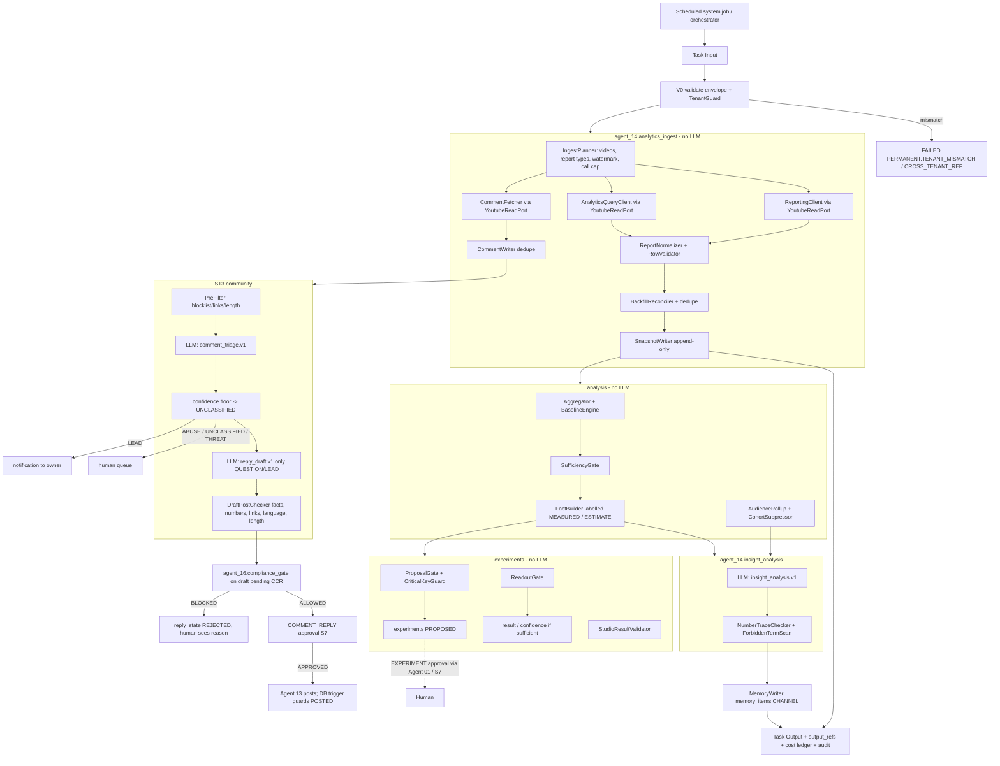

# Agent 14 — Analytics (blueprint)

| Field | Value |
|---|---|
| Status | Draft — documentation. Software: **Planned** (rule 6, rule 7) |
| Owner | Agent 14 Analytics (also owner of services S1 Audience Intelligence and S13 Community & Comments); integration owner: Agent 01 (orchestrator) |
| Package | `agent_14_analytics` (27 §7.2); prompts `prompts/agent_14_analytics/`; evals `evals/agent_14_analytics/` |
| Directive sections covered | §3.1 row 14 (ingestion, retention/CTR/watch-time analysis, retention intelligence, attribution, autonomous learning loop data), §3.2 S1 and S13, §3.3 Learning loop, §3.3 (contracts, failures, quality, memory, observability, AI providers, security), §3.5 (prompt, eval, code standards), §4 (26 sections) |
| Owner decisions applied | D1 (build order: 3A production line, 3B golden samples, 3C everything else; **Agent 14 is 3C**; no YouTube upload and no Google OAuth in 3A; paid calls only within owner-set limits with per-video and pilot budgets; keys only via the environment secret mechanism; render never in market hours), D2 (fast-track without lowering quality) |
| Binding contracts | GLOSSARY_AND_IDS.md (IDs, enums, FIN-R1…R13), 03_COMMUNICATION_STANDARD.md (task input/output, state machine), 04_DATABASE_ARCHITECTURE.md §5.22–5.23 and §5.10, 07_FAILURE_MANAGEMENT.md, 24_PRODUCTION_TYPES.md §3.2 (`agent_14.analytics_ingest`), 27_ENGINEERING_STANDARDS.md |
| Shared docs referenced by name or § only | 15_LEARNING_LOOP.md, 14_SHARED_SERVICES.md §3.1 and §3.13, 13_COMPLIANCE_YOUTUBE_POLICY.md §3, §5, 08_SECURITY.md §5.3 and §8, 09_COST_AND_BUDGET.md, 22_DATA_PROTECTION.md, 06_NIGHT_SCHEDULING.md §12, 10_DEPLOYMENT_AND_MIGRATION.md §5 and §9, ADR-001, ADR-007, 3A_SLICE_SPEC.md §2.4 |
| Facts cited | RESEARCH_LOG YT-02, YT-03, YT-05, YT-08, YT-12, YT-14, IN-02, IN-03, IN-07, PR-01, PR-02, PR-03, INF-03, INF-04, INF-11. Six further facts were verified on the official Google pages on 2026-11-18 and are **not yet in RESEARCH_LOG** (marked **[OFFICIAL 2026-11-18]**; entry requested in the structured return): date dimensions use the Pacific day; reports are available for 60 days (30 for historical); backfill reports; reach report names and metrics; comment-thread call cost and the channel-wide restriction; the audience-retention report needs one video |
| Marking | Every section's first line states **MVP: 3A / 3B / 3C** (owner stages of D1) and the enterprise tier **Tier 0–3** (GLOSSARY §6.47). Agent 14 is **3C, Tier 0** in every section unless a row says otherwise |
| Conventions | `(pending CCR)` = a contract item that does not exist in Wave A / B-1; it is listed in the structured return and this blueprint is written against the proposed name. `REQUIRES REVIEW (Phase 1): <need>` = a value or fact that is not known; none is invented. ESTIMATE / MEASURED / PROJECTION labels per rule 3. No book text, private method, server detail or secret appears in this document. |

---

## 1 Identity and mission
**MVP: 3C · Tier 0.** Nothing of Agent 14 is built in 3A or 3B (3A_SLICE_SPEC §2.4: no `agent_14.*` task types in 3A, because 3A has no upload; 3B scores three golden samples by hand). Tier 1+ rows are marked.

### 1.1 Mission
After videos are published (Agent 13 path, 3C), Agent 14 **brings the numbers home and turns them into honest knowledge**:
1. **Ingest** aggregate performance data through two official paths (YT-14): retention from the YouTube Analytics API and impressions / click-through rate from the YouTube Reporting API reach reports; write it append-only to `analytics_snapshots`.
2. **Analyse** it with deterministic arithmetic (descriptive statistics, segment comparison, data-sufficiency gate) and **word** insights from computed numbers only (S1 audience intelligence, aggregate data only).
3. **Run the bookkeeping of the learning loop** (directive §3.3): propose controlled experiments, read them out, validate the human-entered result of a YouTube Studio title / thumbnail test (YT-08). It never changes a prompt, template, rule pack or setting itself.
4. **Triage comments** (S13): classify into question / spam / abuse / lead, **draft** replies for human approval, never post. The finance rule pack applies to every draft.

### 1.2 Where it sits
Scheduled system jobs (`NO_DELIVERABLE`, 24 §3.2 note after the graph; the scheduled-job gap is 02 open item 3, pending CCR). It is not a stage of any production graph. Upstream: Agent 13 (publications, YouTube read access), Agent 15 (cost per video, read only), Agent 16 (quality scores and compliance verdicts, read only). Downstream: Agent 03 and 12 and 05 (through `memory_items` and approved experiments), Agent 01 / S7 (proposals and approvals), S8 (dashboard shows stored narratives), Agent 15 (economics may read `analytics_snapshots`).

### 1.3 Authority boundaries
| Agent 14 may | Agent 14 may **not** |
|---|---|
| Read `analytics_snapshots`, `publications`, `channels`, `cost_ledger`, `quality_scores`, `compliance_verdicts` of its own tenant | Read or hold any Google credential. Tokens stay with Agent 13 (04 §3.1: only `amw_publisher` reads `oauth_tokens`); Agent 14 gets responses through a read-only port |
| Append snapshot rows; write `community_comments` fetch, triage and draft fields; write `memory_items` (scope `CHANNEL`, `LONG_TERM`) with provenance | Post, edit, hide, report or delete any comment; send any message to a viewer; call any YouTube write method |
| Create `experiments` rows in `PROPOSED`, compute readouts, record `result` and `confidence` when sufficiency holds | Set `APPROVED_TO_RUN` or `APPLIED`, approve anything, change a prompt, template, rule pack, budget, threshold, schedule or model tier (15 §5) |
| Propose an experiment through Agent 01 / S7 | Make a causal claim from observational data, or a significance claim without sufficient data (directive §3.3) |
| Narrate numbers that code computed | Compute a number in the model, forecast views or income, or comment on a market, a price or a named security (IN-03, FIN-R1…R3, R13) |
| Report aggregate groups of viewers | Profile, re-identify or make a claim about an individual viewer or commenter (§3.2 S1; 22 P8) |
| Draft a reply that a human may approve | Treat any model output as an instruction or an approval; mark any reply `APPROVED` or `POSTED` |
| Read revenue-free metrics (scope `yt-analytics.readonly`) | Request monetary metrics or the monetary scope (revenue belongs to Agent 15; YT-12 names scopes only, the official page lists the monetary scope separately) |

### 1.4 Success criteria (measurable; targets are configuration, set after the 3C pilot; the design defaults are ESTIMATE)
| # | Criterion | Measure | Target |
|---|---|---|---|
| S1 | Traceability | share of figures in insights and dashboards that trace to an `analytics_snapshots` row | 100 % (blocking) |
| S2 | No fabrication | rows with a value not present in the source report | 0 (blocking) |
| S3 | Completeness | days with a published video and a published-video report available, but no ingested row, after `analytics.ingest_max_lag_ms` | 0 gaps unexplained (every gap has a recorded reason: `REPORT_EXPIRED_GAP`, `EMPTY_REPORT`, `UNMAPPED_VIDEO`) |
| S4 | Isolation | cross-tenant reads or writes in the isolation suite (04 §3.7) | 0 (blocking) |
| S5 | Honest language | insights with a causal claim, a forecast, a market view or an individual claim | 0 (blocking; eval A3, A6) |
| S6 | Comment safety | comments `POSTED` without an `APPROVED` approval | 0 (DB trigger, blocking) |
| S7 | Draft quality | drafts that give a buy/sell/hold view, a level, a forecast, a performance figure or a broker recommendation | 0 in eval and in production samples (blocking) |
| S8 | Cost | LLM cost per 100 comments triaged, per insight run (`MEASURED` in the 3C pilot); within the per-job `resource_budget` | recorded; no breach |
| S9 | Learning loop | experiments reaching a readout with sufficient data / experiments proposed | recorded; no target (a new channel has none) |

---

## 2 Functional requirements
**MVP: 3C · Tier 0.** Each row: what, why, when, trigger, inputs, outputs, dependants. Rows marked T1+ are Tier 1+ (before the first external client).

### 2.1 Task types
| Task type | Status | Executor | Resource class | Purpose |
|---|---|---|---|---|
| `agent_14.analytics_ingest` | **exists** (24 §3.2) | Agent 14 | `LIGHT` (no model call) | ingestion of the two report paths and of comments |
| `agent_14.insight_analysis` | pending CCR (15 §14 item 2) | Agent 14 | `AI_IO` | analysis, optional wording step (`agent_14/insight_analysis.v1`) also used for S1 aggregate wording |
| `agent_14.experiment_proposal` | pending CCR (15 §14 item 2) | Agent 14 | `LIGHT` | deterministic proposal gate and `experiments` row `PROPOSED` |
| `agent_14.experiment_readout` | pending CCR (15 §14 item 2) | Agent 14 | `LIGHT` | deterministic sufficiency, result recording, Studio-result validation |
| `svc_s01.audience_rollup` | pending CCR (14 §3.1) | Agent 14 (S1) | `LIGHT` | aggregate rollup with cohort suppression |
| `svc_s13.comment_triage` | pending CCR (14 §3.13) | Agent 14 (S13) | `AI_IO` | triage of already-fetched comments (`agent_14/comment_triage.v1`) |
| `svc_s13.reply_draft` | pending CCR (14 §3.13) | Agent 14 (S13) | `AI_IO` | one draft per `QUESTION` / `LEAD` (`agent_14/reply_draft.v1`) |
Posting an approved reply is **Agent 13's** task (pending CCR, `agent_13.comment_post`); Agent 14 never calls a write method.

### 2.2 Requirements
| ID | What | Why | When / trigger | Inputs | Outputs | Dependants | MVP |
|---|---|---|---|---|---|---|---|
| FR-01 | Create and keep one Reporting API job per channel and reach report type (`channel_reach_basic_a1`, `channel_reach_combined_a1`), list new reports by `createdAfter`, download each CSV once | impressions and CTR exist only in these reports (YT-14); a job must exist before data is generated **[OFFICIAL 2026-11-18]** | scheduled, in the organisation's window (06 §12.1); also on `BACKFILL` request | channel, report types, watermark | raw report blobs, `analytics_snapshots` rows (`source = REPORTING_API`) | FR-10…FR-14, Agent 15 | 3C · T0 |
| FR-02 | Query the Analytics API audience-retention report for each published video (`elapsedVideoTimeRatio` with `audienceWatchRatio`, `relativeRetentionPerformance`), one query per video | retention curve per video (YT-14); the report needs a single `video` filter **[OFFICIAL 2026-11-18]** | scheduled after publication, then on the configured cadence | publications of the channel | one `analytics_snapshots` row per video and window (`source = ANALYTICS_API`) | FR-10, S1 | 3C · T0 |
| FR-03 | Normalise, validate and write rows append-only, exactly as returned; reject invalid rows; never interpolate, convert or back-fill | rule 4; 04 §5.22 | inside FR-01/02 | raw report | rows, flags, rejected-row count | all analysis | 3C · T0 |
| FR-04 | Handle **backfill**: a new report with the same period replaces earlier data at the source; store the new rows (append-only) and mark the older report superseded in the run summary; readers use the latest `fetched_at` per natural key | official Reporting API behaviour **[OFFICIAL 2026-11-18]** vs append-only table | inside FR-01 | report metadata, processed reports | rows, `supersedes_report_ids` | analysis ("effective view") | 3C · T0 |
| FR-05 | Record **gaps** (report expired after 60 days, empty report, unmapped video) as explicit run results; never silently skip | rule 4; 07 principle "no silently dropped jobs" | inside FR-01/02 | API outcome | gap list in the output, audit entry | S8 | 3C · T0 |
| FR-06 | Map `video_id` to `publications.external_video_id` of the same channel only; rows for other videos are skipped and counted | isolation; only factory publications are analysed | inside FR-03 | publications | mapping, `UNMAPPED_VIDEO` flag | — | 3C · T0 |
| FR-07 | Fetch comment threads per published video (YouTube Data API `commentThreads.list` by `videoId`, 1 quota unit per call **[OFFICIAL 2026-11-18]**), dedupe by `external_comment_id`, write `community_comments` rows not yet triaged | S13 input; the channel-wide `allThreadsRelatedToChannelId` form is restricted to approved projects **[OFFICIAL 2026-11-18]**, so the design uses per-video calls | scheduled; only when `fetch_comments = true` and the channel has comment read access | publications | rows (`triage_confidence` NULL = not yet triaged) | FR-40 | 3C · T0+ |
| FR-10 | Compute descriptive statistics, segment comparisons and baselines from the **effective** snapshots; run the data-sufficiency gate | 15 stage 2; no significance claim without sufficient data | after ingest, scheduled | snapshots, `cost_ledger`, `quality_scores` | computed facts (blob, `MEASURED`/`ESTIMATE`) | FR-11, FR-20 | 3C · T0 |
| FR-11 | Word insights from computed facts only, with evidence IDs, label, limitations and "does not show"; number-trace and forbidden-wording checks; store as `memory_items` (scope `CHANNEL`) with `provenance_ref`, `confidence`, `review_after` | 15 stage 3; S1 | after FR-10 (task `agent_14.insight_analysis`) | facts, sufficiency | `insight` payload, memory rows | Agent 03, 12, 05 via memory | 3C · T0 |
| FR-12 | Aggregate audience rollup (`svc_s01.audience_rollup`) with cohort-size suppression: a cell below `s01.min_cohort` is dropped, never reported | §3.2 S1 aggregate only; platform dimension anonymisation also exists **[OFFICIAL 2026-11-18]** | weekly or on request | snapshots with audience dimensions | rollup blob, memory keys | FR-11 | 3C · T0 |
| FR-20 | Propose an experiment (`PROPOSED`): hypothesis from a template, baseline, one factor, one primary metric, pre-registered sample and duration; reject critical keys, conflicts, multiple factors, small channels | 15 §4–§6 | after an insight suggests a testable factor | insight, config | `experiments` row, approval request via Agent 01 (`EXPERIMENT`) | S7, owner | 3C · T0 |
| FR-21 | Read out a running experiment: sufficiency check, partial label `MEASURED (partial)` before sufficiency, `result`, `confidence` only when sufficient | 15 §4, §7 | scheduled while `RUNNING` | experiment, observations | `result`, state `COMPLETED` / `INCONCLUSIVE` | human decision | 3C · T0 |
| FR-22 | Validate a human-entered YouTube Studio test result for `TITLE_THUMBNAIL_STUDIO_TEST` (variant names, shares sum, human actor); record as reported, compute no confidence | YT-08: the test is a human Studio step | on owner entry | entry | `result`, `decision = NONE` or recommendation | owner | 3C · T0 |
| FR-40 | Triage comments into `comment_triage_class` with `triage_confidence`; below `s13.triage_min_confidence` the class is `UNCLASSIFIED`, always visible to a human | S13 | after FR-07 | comment batches (one channel per call) | class, signals, `asks_for_trade_advice`, injection flag | FR-41, owner | 3C · T0+ |
| FR-41 | Draft a reply for `QUESTION` and `LEAD` only; routes: `ANSWER`, `DECLINE_ADVICE`, `NO_REPLY_RECOMMENDED`; then request `agent_16.compliance_gate` on the draft (subject kind `comment_reply`, pending CCR) and, if `ALLOWED`, a `COMMENT_REPLY` approval | S13; FIN-R1, R2, R3, R6, R8 | after FR-40 | triaged comment, allowed facts | `reply_draft`, `reply_state = DRAFTED`, verdict id | S7, Agent 13 (posts only when `APPROVED`) | 3C · T0+ |
| FR-42 | Route `ABUSE`, `THREAT` and `UNCLASSIFIED` to a human queue; record a `LEAD` and notify the owner; **never** action abuse (hide, report, ban are human acts) | S13 | after FR-40 | triaged rows | notification rows | owner | 3C · T0+ |
| FR-43 | Refresh or purge stored comment data on the configured schedule | the Reporting API page states that clients must delete or refresh stored API resource metadata after 30 days (Developer Policies III.E.4.b–d) **[OFFICIAL 2026-11-18]**; whether this covers comment text is **REQUIRES REVIEW (Phase 1) ⚖** | scheduled housekeeping | `community_comments` | refreshed or erased rows, audit entry | 22 retention | 3C · T0+ |

### 2.3 Out of scope (explicit)
YouTube upload, privacy change, thumbnails, captions (Agent 13); revenue, cost, ROI computation (Agent 15; Agent 14 only reads the ledger); automatic application of any learned change (15 §5, stage 8 is a human, versioned release); cross-tenant or cross-channel "benchmark" products (14 §3.1 "out of scope"); real-time analytics and live-stream metrics; competitor channel analytics (Agent 02); ad performance reports and monetary metrics; per-viewer analytics of any kind; auto-moderation or auto-reply; direct messages; any use of the analytics to rank people.

---

## 3 Non-functional requirements
**MVP: 3C · Tier 0.** All numeric values are configuration keys with design defaults labelled ESTIMATE; none is measured yet (rule 3).
| Area | Requirement | Config key / source |
|---|---|---|
| Correctness | no fabricated, converted or interpolated value; arithmetic only in code | rule 4; 04 §5.22 |
| Idempotency | re-running a report or a task writes nothing twice (idempotency scope `analytics.report_ingest`, pending CCR; natural key `(channel_id, report_id)`; DB-level partial unique keys for comments) | 03 §9 |
| Latency | ingest is batch; no interactive deadline. Wall budget per task `resource_budget.max_wall_ms`; value REQUIRES REVIEW until the 3C pilot measures report sizes | 03 §3.1 |
| Availability | tolerates provider outages through retry and wait (`TEMPORARY.*`, `INFRASTRUCTURE.CIRCUIT_OPEN`); a missed daily run is recovered by the next run as long as the 60-day availability window of reports holds **[OFFICIAL 2026-11-18]**; beyond it a recorded gap | 07 §3–§4 |
| Throughput | bounded by the YouTube read quota and by one query per video for retention; planned calls per run are computed and capped before any call (`resource_budget.max_api_calls`, `AGENT.LOOP_CAP_EXCEEDED`) | 07 §9 |
| Cost | model calls only in three steps; each call reserved against `resource_budget.max_cost_micros`, per-video / pilot budgets of D1 and 09; Batch-eligible overnight work (PR-02, 09 §"non-urgent") | 09 |
| Isolation | section 19; RLS forced (INF-11); no cross-tenant or cross-channel retrieval | rule 9 |
| Data protection | aggregate data only; commenter display names are personal data (22 P5; IN-07), not sent to the model, retention per 22 | 22 |
| Security | no Google credential in Agent 14; secrets via the environment's secret mechanism; comments are untrusted input | 08 §5.3 |
| Observability | every run, every rejected row and every gap is visible (section 22) | 27 |
| Maintainability | prompts are files, thresholds are configuration, no model or provider name in code | 27 §4 |
| Scale | Tier 0: one owner, a handful of channels. Tier 1+: per-tenant cadence and per-tenant draft rate limits so one channel cannot starve others (05 §7) | config |
| Compliance | every comment draft passes the finance pack (S13); insights never contain a market view | 13 |

---

## 4 Internal architecture
**MVP: 3C · Tier 0** (all boxes). Dashed boxes are Tier 1+.



Component responsibilities are in section 9; decisions in section 6.

---

## 5 Full system prompt
**MVP: 3C (all three prompts v1, status Draft until the 3C eval gate passes) · Tier 0 (S13 steps Tier 0+).**

Per plan Q9 the prompt files are the single source; this section links them (27 §4, prompts/README §1). Agent 14 has **three** LLM steps; every other function is deterministic code (section 6).

| Step | Prompt ID | File | What it does (summary) | Model tier start (ADR-007 §2.4) | Rule packs by reference |
|---|---|---|---|---|---|
| Insight wording (`agent_14.insight_analysis`; also S1 aggregate wording) | `agent_14/insight_analysis.v1` | [prompts/agent_14_analytics/insight_analysis.v1.md](../prompts/agent_14_analytics/insight_analysis.v1.md) | words at most `max_insights` statements from computed facts; copies numbers unchanged; descriptive or "associated with"; always says what the data does not show; returns "not enough data" when the code's sufficiency flag is false | `MID` (try `SMALL`; the gate decides) | none (descriptive statistics; a deterministic forbidden-term scan runs after) |
| Comment triage (`svc_s13.comment_triage`) | `agent_14/comment_triage.v1` | [prompts/agent_14_analytics/comment_triage.v1.md](../prompts/agent_14_analytics/comment_triage.v1.md) | one item per comment: class (QUESTION / SPAM / ABUSE / LEAD / UNCLASSIFIED), confidence, signals, `asks_for_trade_advice`, injection flag; never replies or moderates | `SMALL` | none (classification only) |
| Reply draft (`svc_s13.reply_draft`) | `agent_14/reply_draft.v1` | [prompts/agent_14_analytics/reply_draft.v1.md](../prompts/agent_14_analytics/reply_draft.v1.md) | one draft per `QUESTION` / `LEAD`: `ANSWER`, `DECLINE_ADVICE`, or `NO_REPLY_RECOMMENDED`, using only supplied facts; never a call, level, forecast, performance figure, broker or link that is not in a used fact | `MID` | `rp.youtube_general`, `rp.finance_sebi_in` (finance channels) |

Key properties the prompts enforce (full text in the files):
- Comment text and fact labels are **data**; instructions inside them are never followed (08 §5.3). The model has no tools and no memory of other tenants.
- Numbers in insights are copied from facts; the model never computes (checked by the number trace, section 10).
- The model never sets a state, an approval, a class threshold, a significance or a compliance verdict; code does.
- Refusal object per 27 §4.3, with the mapping in section 18. Model, temperature, tokens, timeout, budget, caching and batch flag are config keys `llm.agent_14.insight_analysis.*`, `llm.svc_s13.comment_triage.*`, `llm.svc_s13.reply_draft.*` (pending CCR: step-level key registration), never in the files or the code.
- Prompt lint (27 §4.4) and the eval gate (27 §5) apply to every change; the shared prompt prefix holds no tenant data (08 §8 layer 4).

Not an LLM step, therefore no prompt: ingestion, normalisation, validation, backfill reconciliation, aggregation, baselines, sufficiency, cohort suppression, experiment proposal gating, critical-key refusal, experiment readout, Studio-result validation, comment fetch, dedupe, pre-filter, confidence floor, reply post-checks, reply state handling, retention, housekeeping. Their golden datasets are deterministic (section 26).

---

## 6 Decision engine
**MVP: 3C · Tier 0.**

### 6.1 Decision table
| Decision | Deterministic (code) | LLM | Why |
|---|---|---|---|
| Which reports, videos, ranges to fetch | **yes** (`IngestPlanner`: watermark, publications, call cap) | no | bounded cost and calls; 07 §9 hard caps |
| Normalise, validate, dedupe, map video to publication | **yes** | no | "only values returned by the API; never fabricated" (04 §5.22; rule 4) |
| Backfill supersession | **yes** (same period + new report id) | no | official behaviour of the Reporting API **[OFFICIAL 2026-11-18]** |
| Descriptive statistics, baselines, comparisons | **yes** | no | arithmetic is never the model's job; reproducible |
| Is there enough data to say anything | **yes** (`SufficiencyGate`, thresholds in config) | no | 15 §4: "deterministic code, not an LLM" |
| Cohort suppression | **yes** (`s01.min_cohort`) | no | S1: aggregate only; the model never sees a small cell |
| Wording an insight | no | **yes** (`insight_analysis`) | plain-language statements from numbers; safe because every number is traced and forbidden wording is scanned afterwards |
| Is a number in a statement legitimate | **yes** (`NumberTraceChecker`) | no | defence against model error |
| Propose an experiment, critical-key refusal, one factor, conflicts | **yes** (`ProposalGate`; hypothesis from a template) | no | 15 §5, §6: critical policies never change by loop; no LLM judgement on safety |
| Readout, sufficiency, confidence method | **yes** | no | method is a configuration choice (REQUIRES REVIEW, 15 §4) |
| Validate a Studio result | **yes** | no | YT-08: human-entered; arithmetic check only |
| Comment fetch, dedupe, blocklist, link, length pre-filter | **yes** | no | cheap, reliable, protects the model from obvious spam |
| Triage class and signals | no (after the pre-filter) | **yes** (`comment_triage`) | language understanding across English, Marathi, Hindi, mixed text |
| Confidence floor → `UNCLASSIFIED` | **yes** (`s13.triage_min_confidence`) | no | nothing is dropped; a doubtful label goes to a human |
| Routing (`ABUSE`, `THREAT`, `LEAD`, `UNCLASSIFIED`) | **yes** | no | human acts; no auto-moderation |
| Reply draft text | no | **yes** (`reply_draft`) | natural language in the channel voice |
| Reply post-checks (facts subset, numbers, links, language, length, forbidden patterns) | **yes** | no | model self-reports are not trusted |
| Is the draft compliant | **`agent_16.compliance_gate`** (deterministic pre-filter + judge by Agent 16) | not this agent | one gate for all text; Agent 14 never self-certifies |
| Approve or post a reply | **human** (`COMMENT_REPLY`) | never | rule 5; DB trigger guards `POSTED` |

### 6.2 Why the split
Every numeric or policy decision is code with a unit test; the model only turns computed numbers into sentences, classifies short text, and drafts a reply that a gate and a human then judge. The model's output is checked by code before it is stored and is never an authority (08 §5.3).

### 6.3 Insight classes (payload-local; not Wave A enums)
`relation`: `DESCRIPTIVE` (a figure or a supplied comparison) or `ASSOCIATED_WITH` (supplied group comparison). A causal relation does not exist in the vocabulary. A causal statement is possible only from an experiment that reached sufficiency (15 §6.3), and even then only as the stored `result` of that experiment, not as an insight.

### 6.4 Sufficiency gate (15 §4; thresholds configuration, values REQUIRES REVIEW)
Inputs: number of videos, number of impressions, window length, per-fact `n_videos`. Output `{passed, n_videos, n_impressions, failed_checks[]}` with failed-check labels `MIN_VIDEOS`, `MIN_IMPRESSIONS`, `MIN_WINDOW`, `MIN_GROUP_SIZE` (payload-local). Config keys `learning.min_videos`, `learning.min_impressions`, `learning.min_window_days`, `learning.min_group_size`, `learning.min_sample_size.<kind>`, `learning.min_duration_ms.<kind>` — **no value is proposed** (REQUIRES REVIEW (Phase 1): chosen with a statistician-level source and the owner). An unset key fails closed (`PERMANENT.CONFIG_INVALID`), never a default.

### 6.5 Effective view of snapshots
Snapshots are append-only. The **effective** value of a natural key `(channel_id, publication_id, source, report_type, metric_date, dimensions)` is the row with the greatest `fetched_at` whose report is not superseded. A SQL view `v_analytics_effective` is defined with the migration (a view, not a table; 04 §5.22 unchanged). All analysis reads the effective view only.

---

## 7 Input schema
**MVP: 3C · Tier 0.** Payload schemas live inside `payload` of Task Input (03 §3.2). `org_id`, `channel_id`, `job_id`, `task_id`, `idempotency_key` are envelope fields and are not repeated unless the payload needs them (03 §3.1). `project_id` is NULL for these system jobs (03 §3.1).

### 7.1 `agent_14.analytics_ingest.input` 1.0.0
```json
{
  "$schema": "https://json-schema.org/draft/2020-12/schema",
  "$id": "urn:amw:schema:agent_14.analytics_ingest.input:1.0.0",
  "type": "object",
  "additionalProperties": false,
  "required": ["mode", "sources"],
  "properties": {
    "mode": { "enum": ["SCHEDULED", "BACKFILL"], "description": "SCHEDULED: from the stored watermark. BACKFILL: an explicit range, used to fill a recorded gap." },
    "sources": {
      "type": "array", "minItems": 1, "uniqueItems": true,
      "items": { "enum": ["ANALYTICS_API", "REPORTING_API"] },
      "description": "GLOSSARY analytics_source (YT-14): retention via the Analytics API, impressions/CTR via the Reporting API."
    },
    "reporting_report_types": {
      "type": "array", "uniqueItems": true,
      "items": { "enum": ["channel_reach_basic_a1", "channel_reach_combined_a1"] },
      "description": "Report type ids as named on the official channel reports page [OFFICIAL 2026-11-18]. Default: both."
    },
    "publication_ids": {
      "type": "array", "uniqueItems": true,
      "items": { "type": "string", "pattern": "^pub_[0-9a-f]{8}-[0-9a-f]{4}-7[0-9a-f]{3}-[89ab][0-9a-f]{3}-[0-9a-f]{12}$" },
      "description": "Limit retention queries to these publications. Default: all PUBLISHED publications of the channel."
    },
    "range": {
      "type": "object", "additionalProperties": false, "required": ["start_date", "end_date"],
      "properties": {
        "start_date": { "type": "string", "format": "date" },
        "end_date": { "type": "string", "format": "date" }
      },
      "description": "Dates are days in the API's own day definition (Pacific time, see section 12). Required for BACKFILL, forbidden for SCHEDULED."
    },
    "fetch_comments": { "type": "boolean", "default": false, "description": "Also fetch comment threads per published video through the read port (S13, FR-07)." }
  },
  "allOf": [
    { "if": { "properties": { "mode": { "const": "BACKFILL" } } }, "then": { "required": ["range"] }, "else": { "not": { "required": ["range"] } } }
  ]
}
```
Rules enforced by the step (not by the schema): `channel_id` (envelope) belongs to `org_id` and has an active YouTube connection (else `PERMANENT.MISSING_DEPENDENCY`); every `publication_id` belongs to the channel; `range` not in the future and not longer than `analytics.max_backfill_days` (config); a monetary metric is never requestable (there is no field for it).

### 7.2 Other payload inputs (pending CCR; written against the proposed names)
| Schema | Fields (summary) | Used by |
|---|---|---|
| `agent_14.insight_analysis.input` 1.0.0 | `insight_source` (`CONTENT_PERFORMANCE`/`AUDIENCE_AGGREGATE`), `window_days`, `output_language`, `max_insights` — the fact set itself is built by the step from the effective view (`context_refs` of purpose `PRIOR_OUTPUT` to the analysis blob). The model-facing view is the prompt's `facts` and `sufficiency` variables | FR-10, FR-11 |
| `agent_14.experiment_proposal.input` 1.0.0 | `kind` (`experiment_kind`), `target_key`, `changed_factors[]`, `primary_metric`, `insight_memory_id` (`mem_…`), `variants[]` (version references) | FR-20 |
| `agent_14.experiment_readout.input` 1.0.0 | `experiment_id` (`exp_…`), `entry` (optional human Studio entry: `{source, entered_by_actor, shares{}, declared_winner}`), `planned_end_reached` | FR-21, FR-22 |
| `svc_s01.audience_rollup.input` 1.0.0 | `channel_id`, `window_days`, `report_types[]` (14 §3.1) | FR-12 |
| `svc_s13.comment_triage.input` 1.0.0 | `channel_id`, `publication_ids[]` or `comment_ids[]` (`cmt_…`) to triage (rows already fetched by the ingest task), `max_batch` | FR-40 |
| `svc_s13.reply_draft.input` 1.0.0 | `comment_ids[]` (`cmt_…`) with `triage_class` ∈ {`QUESTION`,`LEAD`}; the step assembles `allowed_facts` | FR-41 |
Step-level inputs (the model-facing variables) are in the prompt files (§Inputs of each).

---

## 8 Output schema
**MVP: 3C · Tier 0.**

### 8.1 `agent_14.analytics_ingest.output` 1.0.0
Output envelope is `amw.task_output` (03 §5); `payload` below. `output_refs` carry every raw report blob (`DATA`, SHA-256, write-once per 03 §8) and the run summary (`REPORT`). `quality_score` is null (the step does not score).
```json
{
  "$schema": "https://json-schema.org/draft/2020-12/schema",
  "$id": "urn:amw:schema:agent_14.analytics_ingest.output:1.0.0",
  "type": "object",
  "additionalProperties": false,
  "required": ["reports", "rows_written_total", "rows_rejected_total", "gaps", "comments", "api_calls_made", "watermark_after"],
  "properties": {
    "reports": {
      "type": "array",
      "items": {
        "type": "object", "additionalProperties": false,
        "required": ["source", "report_type", "report_key", "status", "rows_written", "rows_rejected", "flags", "supersedes_report_ids"],
        "properties": {
          "source": { "enum": ["ANALYTICS_API", "REPORTING_API"] },
          "report_type": { "type": "string" },
          "report_key": { "type": "string", "description": "Reporting API report id, or for the Analytics API the query key (publication id + window)." },
          "status": { "enum": ["WRITTEN", "SKIPPED", "FAILED"] },
          "rows_written": { "type": "integer", "minimum": 0 },
          "rows_rejected": { "type": "integer", "minimum": 0 },
          "flags": { "type": "array", "uniqueItems": true, "items": { "enum": ["DUPLICATE_REPORT", "IDENTICAL_BACKFILL", "EMPTY_REPORT", "DUPLICATE_ROW", "UNMAPPED_VIDEO", "REJECTED_ROWS", "INCOMPLETE_CURVE", "REPORT_EXPIRED_GAP", "FORBIDDEN_METRIC"] } },
          "supersedes_report_ids": { "type": "array", "items": { "type": "string" } },
          "raw_ref": { "type": ["string", "null"], "description": "amw-blob:// URI of the raw report, org segment first (03 §8)." }
        }
      }
    },
    "rows_written_total": { "type": "integer", "minimum": 0 },
    "rows_rejected_total": { "type": "integer", "minimum": 0 },
    "gaps": {
      "type": "array",
      "items": {
        "type": "object", "additionalProperties": false, "required": ["source", "report_type", "reason"],
        "properties": {
          "source": { "enum": ["ANALYTICS_API", "REPORTING_API"] },
          "report_type": { "type": "string" },
          "start_date": { "type": ["string", "null"], "format": "date" },
          "end_date": { "type": ["string", "null"], "format": "date" },
          "reason": { "enum": ["REPORT_EXPIRED", "NO_DATA", "UNMAPPED_VIDEO", "PROVIDER_REFUSED"] }
        }
      }
    },
    "comments": {
      "type": "object", "additionalProperties": false, "required": ["fetched", "new"],
      "properties": { "fetched": { "type": "integer", "minimum": 0 }, "new": { "type": "integer", "minimum": 0 } }
    },
    "api_calls_made": { "type": "integer", "minimum": 0 },
    "quota_units_estimated": { "type": ["integer", "null"], "minimum": 0, "description": "ESTIMATE from call counts and the documented unit costs; the quota ledger of Agent 13 is authoritative." },
    "watermark_after": {
      "type": "object", "additionalProperties": false,
      "properties": { "reporting_created_after": { "type": ["string", "null"], "format": "date-time" }, "retention_last_window_end": { "type": ["string", "null"], "format": "date" } }
    }
  }
}
```
Success rule (03 §5.3): `SUCCEEDED` requires the payload to validate, every raw blob to exist with its hash, and no `FAILED` entry in `reports` that is not a recorded gap.

### 8.2 Other payload outputs (summary; step outputs of the LLM steps are the JSON Schemas in the prompt files)
| Schema | Content | Stored as |
|---|---|---|
| `agent_14.insight_analysis.output` 1.0.0 | `insights[]` (statement, evidence_fact_ids, label, relation, limitations, does_not_show), `not_enough_data`, `refusal`; plus step fields set by code: `facts_ref`, `sufficiency`, `dropped_insights[]` (those removed by the number trace or the term scan, with reason) | blob (`REPORT`) + `memory_items` `CHANNEL` rows (key `insight.<metric>.<window>`, `provenance_ref` → analysis blob, `confidence` NULL for descriptive, `review_after`) |
| `agent_14.experiment_proposal.output` 1.0.0 | `accepted`, `reason`, `experiment_id`, `approval_required = EXPERIMENT` | `experiments` row `PROPOSED` |
| `agent_14.experiment_readout.output` 1.0.0 | `ready`, `label`, `result`, `confidence` (only if sufficient), `final_state`, `decision_recommendation` (advisory) | `experiments.result`, `confidence`, `state` |
| `svc_s01.audience_rollup.output` 1.0.0 | rollup blob URI, `suppressed_cells_count` (a count, never the cells), memory keys written, `insufficient_data` | blob + `memory_items` |
| `svc_s13.comment_triage.output` 1.0.0 | per comment: class, confidence, signals, flags (the prompt schema) plus `routed_to` (`HUMAN_QUEUE`/`NOTIFY_OWNER`/`DRAFT`) | `community_comments` |
| `svc_s13.reply_draft.output` 1.0.0 | the prompt schema plus `verdict_id` (`cvd_…`) after the gate, `reply_state` | `community_comments.reply_draft`, `reply_state = DRAFTED` |

---

## 9 Python package and class architecture
**MVP: 3C · Tier 0.** Package `agent_14_analytics` imports only `amw_core` and adapter Protocols (27 §7.1); it imports no other agent. Concrete adapters are wired only in `workers/*`.

```text
agent_14_analytics/
  __init__.py
  stage.py            # AnalyticsStage: routes a Task Input to the task-type handler (stage Protocol of 27 §7.1)
  config.py           # typed, validated view of analytics.*, learning.*, s01.*, s13.*, llm.* keys (fail closed)
  ports.py            # Protocols: YoutubeReadPort, LlmAdapter (amw_core), Clock, BlobStore (amw_core)
  models/             # Pydantic models = payload schemas (ingest, insight, experiment, comment) and prompt step schemas
  ingest/
    planner.py        # IngestPlanner
    reporting.py      # ReportingClient (jobs, list, download) over YoutubeReadPort
    analytics_query.py# RetentionQueryClient over YoutubeReadPort
    normalizer.py     # ReportNormalizer (pure)
    validator.py      # RowValidator (pure)
    reconcile.py      # BackfillReconciler (pure)
    writer.py         # SnapshotWriter (append-only, tenant-scoped)
    watermark.py      # WatermarkStore (memory_items CHANNEL)
    comments.py       # CommentFetcher, CommentWriter
  analysis/
    aggregate.py      # Aggregator, BaselineEngine (pure)
    sufficiency.py    # SufficiencyGate (pure)
    facts.py          # FactBuilder (labels, provenance)
    insight_step.py   # InsightStep (LLM) + number_trace.py NumberTraceChecker + terms.py ForbiddenTermScan
    audience.py       # AudienceRollup, CohortSuppressor
  experiments/
    proposal.py       # ProposalGate, HypothesisTemplate
    critical_keys.py  # CriticalKeyGuard
    readout.py        # ReadoutGate
    studio.py         # StudioResultValidator
  community/
    prefilter.py      # PreFilter (pure)
    triage_step.py    # TriageStep (LLM) + ConfidenceFloor
    reply_step.py     # ReplyStep (LLM) + DraftPostChecker
    router.py         # CommentRouter (queue / notify / draft)
    repository.py     # CommentRepository (tenant-scoped)
    housekeeping.py   # RefreshOrPurge
```

### 9.1 Protocols and collaborators (constructor injection; no globals, no service locator)
| Protocol | Provided by | Methods (typed) |
|---|---|---|
| `YoutubeReadPort` | Agent 13's read adapter, wired in `workers/*`; holds the token, never exposes it | `reporting_ensure_job(channel_id, report_type) -> JobRef`; `reporting_list_reports(channel_id, job, created_after) -> list[ReportMeta]`; `reporting_download(channel_id, report) -> bytes`; `analytics_query(channel_id, video_external_id, window) -> RetentionResponse`; `comments_list(channel_id, video_external_id, page_token) -> CommentPage`. Every method takes `channel_id` and returns data of that channel only; every call is quota-reserved and cost-ledgered by the adapter |
| `LlmAdapter` (amw_core) | worker | `complete(prompt_id, variables, output_model, step_key, call_seq) -> StepResult` (reservation, cost row, one parse retry inside) |
| `Clock` | amw_core | `now() -> datetime` (tests inject a fixed clock) |

### 9.2 Class responsibilities
| Class | Responsibility | Pure? |
|---|---|---|
| `AnalyticsStage` | validate envelope and `TenantGuard`, dispatch by `task_type`, assemble Task Output, write audit | no |
| `IngestPlanner` | compute the list of calls (report types, videos, ranges) from the watermark and publications; refuse above `max_api_calls` | yes |
| `ReportingClient` / `RetentionQueryClient` | call the port, map HTTP and provider errors to 07 codes | no |
| `ReportNormalizer` | CSV or JSON response → typed rows (date offsets resolved to Pacific dates) | yes |
| `RowValidator` | per-row checks (numeric, non-negative counts, date in range, channel matches, not future, required columns); counts rejected rows | yes |
| `BackfillReconciler` | decide `DUPLICATE_REPORT`, `IDENTICAL_BACKFILL`, supersession from processed report metadata | yes |
| `SnapshotWriter` | insert rows append-only inside the tenant transaction with an idempotency key; one transaction per report | no |
| `WatermarkStore` | read and write the cross-run watermark as `memory_items` (scope `CHANNEL`, key `analytics.watermark.<report_type>`, superseding rows) | no |
| `CommentFetcher` / `CommentWriter` | per-video `commentThreads.list` pages; dedupe on `UNIQUE (org_id, external_comment_id)`; insert not-yet-triaged rows | no |
| `Aggregator`, `BaselineEngine`, `SufficiencyGate`, `FactBuilder` | the arithmetic and gates of FR-10; facts carry label and provenance row IDs | yes |
| `InsightStep` | build variables, call the model, run `NumberTraceChecker` and `ForbiddenTermScan`, drop failing insights, write memory | no |
| `AudienceRollup`, `CohortSuppressor` | S1 aggregate and suppression | yes |
| `ProposalGate`, `CriticalKeyGuard`, `HypothesisTemplate`, `ReadoutGate`, `StudioResultValidator` | learning-loop rules of 15 §4–§8 | yes |
| `PreFilter`, `ConfidenceFloor`, `DraftPostChecker`, `CommentRouter` | S13 rules | yes |
| `TriageStep`, `ReplyStep` | prompt calls with tenant-scoped batches | no |
| `CommentRepository`, `SnapshotRepository`, `ExperimentRepository`, `MemoryRepository` | the only objects that touch the DB; every method takes a `TenantContext` and every SQL has `org_id` (and `channel_id` where applicable) | no |
| `RefreshOrPurge` | housekeeping for stored comment data | no |

---

## 10 Function-level specification
**MVP: 3C · Tier 0.** Common rules for all functions: typed (27 §7.3), docstring states side effects; errors are `amw_core` exceptions carrying a 07 code (never bare `Exception`); logs are structured JSON with `org_id`, `channel_id`, `task_id`, `correlation_id` and **no content, no comment text, no token** (08 §3.1, §10); every function has a unit test, side-effecting ones also an integration test (section 21).

| # | Function | Signature | Side effects | Exceptions (07) | Validation | Logging | Tests |
|---|---|---|---|---|---|---|---|
| 1 | `AnalyticsStage.run` | `async run(task: TaskInput) -> TaskOutput` | writes audit, cost rows via collaborators, output blobs | any step exception is mapped; unknown task type → `PERMANENT.UNSUPPORTED_TASK` | envelope schema; `org_id` equal in envelope, input, context else `PERMANENT.TENANT_MISMATCH`; payload schema and version | start, end, duration, status | unit (routing), contract, security |
| 2 | `TenantGuard.assert_channel` | `assert_channel(ctx: TenantContext, channel_id: ChannelId) -> Channel` | none | `PERMANENT.MISSING_DEPENDENCY` (no such channel in this org), `PERMANENT.CROSS_TENANT_REF` (channel of another org: security event) | channel row read under RLS with `org_id` | security event on cross-tenant | unit, security |
| 3 | `IngestPlanner.plan` | `plan(inp: IngestInput, pubs: list[Publication], wm: Watermark, cfg: IngestConfig) -> IngestPlan` | none | `AGENT.LOOP_CAP_EXCEEDED` if planned calls > `resource_budget.max_api_calls`; `PERMANENT.INPUT_INVALID` for a range in the future or longer than `max_backfill_days` | publications belong to channel; `BACKFILL` has range; call count = reporting calls + one retention query per selected video + comment pages bound | plan size | unit, property (call count monotone) |
| 4 | `ReportingClient.ensure_job` | `async ensure_job(ch, report_type) -> JobRef` | creates a Reporting API job once per channel and type through the port; stores `JobRef` in `memory_items` | maps provider errors: 401/403 → `PERMANENT.AUTH_INVALID` (or `PUBLISHING.OAUTH_REVOKED` passed through from the adapter); 429 → `TEMPORARY.RATE_LIMITED`; 5xx → `TEMPORARY.UPSTREAM_5XX`; timeout → `TEMPORARY.TIMEOUT`; breaker open → `INFRASTRUCTURE.CIRCUIT_OPEN` | report type in the allowed set | call outcome, duration, quota units | integration with fake port |
| 5 | `ReportingClient.list_new` | `async list_new(ch, job, created_after) -> list[ReportMeta]` | none | as 4 | `createdAfter` from the watermark; skip ids already processed (03 §9 key) | counts | unit, integration |
| 6 | `ReportingClient.download` | `async download(ch, meta) -> RawReport` | writes the raw CSV to tenant blob storage (write-once, SHA-256) | as 4; `INFRASTRUCTURE.STORAGE_UNAVAILABLE`; a report older than the availability window → recorded as `REPORT_EXPIRED_GAP`, not an error | size ≤ `analytics.max_report_bytes` (config, REQUIRES REVIEW) else `PERMANENT.INPUT_INVALID` | bytes, sha256 | integration |
| 7 | `RetentionQueryClient.query` | `async query(ch, pub, window) -> RawReport` | blob write as 6 | as 4 | one video per call (official report constraint); metrics only `audienceWatchRatio`, `relativeRetentionPerformance`; dimension `elapsedVideoTimeRatio`; a monetary metric in a request → `PERMANENT.INPUT_INVALID` before the call | as 6 | unit (request builder), integration |
| 8 | `ReportNormalizer.normalize` | `normalize(raw: RawReport, ctx: NormalizeContext) -> list[Row]` | none | `PERMANENT.SCHEMA_INVALID` (unparseable, missing required columns) | column set per report type; date → Pacific date; no unit conversion; values kept as returned | none | unit, golden (`evals/.../analytics_ingest`) |
| 9 | `RowValidator.validate` | `validate(rows, ctx) -> ValidationResult(rows_ok, rejected, flags)` | none | `PERMANENT.SCHEMA_INVALID` if rejected ratio > `analytics.max_rejected_row_ratio`; `PERMANENT.CROSS_TENANT_REF` if a row's channel id is not the task's channel (security event) | numeric, non-negative counts, date within the report range and not after today, `video_id` mapped or empty, duplicate rows collapsed, retention curve has the configured number of ordered points (`INCOMPLETE_CURVE` flag, never interpolated) | rejected counts by reason (no values) | unit, golden, property (no value created) |
| 10 | `BackfillReconciler.decide` | `decide(meta, processed: Mapping[str, ProcessedReport]) -> ReconcileDecision` | none | none | same id → `DUPLICATE_REPORT`; same period + type, new id, same content hash → `IDENTICAL_BACKFILL`; new content → append + `supersedes` | decision | unit, golden |
| 11 | `SnapshotWriter.write` | `async write(ctx, rows, report_ref, idk) -> WriteResult` | one transaction: idempotency row (scope `analytics.report_ingest`, pending CCR), batch insert into `analytics_snapshots`, audit | `PERMANENT.IDEMPOTENCY_CONFLICT`; `TEMPORARY.DB_TRANSIENT`; `INFRASTRUCTURE.DB_UNAVAILABLE` | every row `org_id` = context; append-only grants | rows written | integration, security |
| 12 | `WatermarkStore.advance` | `async advance(ctx, key, value) -> None` | supersedes the previous `memory_items` row | `TEMPORARY.LOCK_CONFLICT` re-read | value never moves backwards | advance | unit |
| 13 | `CommentFetcher.fetch_video` | `async fetch_video(ch, pub, page_budget) -> list[RawComment]` | none | as 4; per-video call only (the channel-wide form is not used) | page budget; stop at `analytics.max_comment_pages` | pages, count | integration |
| 14 | `CommentWriter.insert_new` | `async insert_new(ctx, comments) -> int` | inserts `community_comments` (`triage_confidence` NULL, `reply_state = NONE`) | `TEMPORARY.DB_TRANSIENT` | `UNIQUE (org_id, external_comment_id)` ⇒ conflict ignored | new count | integration, security |
| 15 | `Aggregator.compute` | `compute(rows: EffectiveRows, spec: AggSpec) -> list[Stat]` | none | `PERMANENT.INPUT_INVALID` for an unsupported metric | uses the effective view only | none | unit, property (sum/mean equals reference) |
| 16 | `SufficiencyGate.check` | `check(stats, cfg: LearningConfig) -> Sufficiency` | none | `PERMANENT.CONFIG_INVALID` when a threshold is unset | thresholds from config only | result | unit, golden |
| 17 | `FactBuilder.build` | `build(stats, sufficiency) -> list[Fact]` | writes the analysis blob (`REPORT`) | none | each fact carries `label` (`MEASURED` with window, or `ESTIMATE`), `n_videos`, provenance row IDs; a cell below `s01.min_cohort` is absent | counts | unit |
| 18 | `InsightStep.run` | `async run(ctx, facts, suff, cfg) -> InsightResult` | one model call (`llm.call` ledger row), memory writes | `AGENT.INVALID_JSON` / `AGENT.OUTPUT_SCHEMA_INVALID` (one retry with the error); `RESOURCE.BUDGET_EXHAUSTED`; `PERMANENT.INSUFFICIENT_INPUT` on refusal; when `suff.passed` is false the model is **not called** and the result is "not enough data" | prompt variables only from the declared set; no tenant data other than own facts | tokens, cost, dropped count | unit (fake LLM), eval A1–A11 |
| 19 | `NumberTraceChecker.check` | `check(insight, facts) -> TraceResult` | none | none (returns failures) | every numeric token (Devanagari digits normalised) equals a value / baseline / delta / `n_videos` / `window_days` of a cited fact, sign ignored; unknown fact ids fail | failure reason | unit, mutation (seeded wrong number rejected, blocking) |
| 20 | `ForbiddenTermScan.scan` | `scan(text, lang) -> list[Match]` | none | none | versioned pattern lists per language for `CAUSAL`, `FORECAST`, `MARKET_VIEW`, `INDEX_OR_STOCK_NAME`, `RECOMMENDATION`, `PER_PERSON` | match class only | unit, golden |
| 21 | `CohortSuppressor.apply` | `apply(cells, min_cohort) -> (kept, suppressed_count)` | none | `PERMANENT.CONFIG_INVALID` if `s01.min_cohort` unset | cell < min dropped; also drops cells that would reveal a dropped cell by subtraction (complementary suppression) | count only | unit, property |
| 22 | `ProposalGate.evaluate` | `evaluate(proposal, running, channel_data, cfg) -> GateResult` | on accept: insert `experiments` (`PROPOSED`) and request `EXPERIMENT` through Agent 01 | `PERMANENT.CONFIG_INVALID` if gates unset | `CriticalKeyGuard`; one `changed_factor`; one `primary_metric`; hypothesis names the metric; `sample_size_target` ≥ `learning.min_sample_size.<kind>`; no running experiment on the same factor and channel; small channel → observational only | decision and reason code | unit, golden |
| 23 | `CriticalKeyGuard.is_critical` | `is_critical(target_key, patterns) -> bool` | none | none | prefix pattern match against `learning.critical_key_patterns` (list owned by 15 §5); empty list → `PERMANENT.CONFIG_INVALID` (fail closed) | key class | unit, golden, mutation |
| 24 | `ReadoutGate.evaluate` | `evaluate(exp, observed, cfg) -> Readout` | on ready: write `result`, `confidence` only when method configured and sufficiency holds; state `COMPLETED` / `INCONCLUSIVE` | `PERMANENT.INVALID_TRANSITION`; `PERMANENT.CONFIG_INVALID` | sufficiency: sample ≥ target and elapsed ≥ target, or `ABORTED`; partial → label `MEASURED (partial)`, no confidence, no decision | decision | unit, golden |
| 25 | `StudioResultValidator.validate` | `validate(exp, entry) -> StudioResult` | records `result` as reported | `PERMANENT.INPUT_INVALID` | actor is a human; variant names ∈ experiment; shares sum exactly to 100; winner ∈ variants or `NONE`; no confidence computed | outcome | unit, golden |
| 26 | `PreFilter.apply` | `apply(comment) -> PrefilterResult(flags, skip_model: bool)` | none | none | blocklist, link patterns, `REPEATED_TEXT`, emoji-only, length cap with `text_truncated` | flags | unit |
| 27 | `TriageStep.run` | `async run(ctx, batch: list[Comment]) -> list[Triage]` | one model call per batch (single channel), updates `community_comments` class fields, notifications for `LEAD`, human-queue marks | `AGENT.*` as 18; `PERMANENT.CROSS_TENANT_REF` if a batch row has another `org_id` or `channel_id` | author names removed before the call; batch ≤ `s13.triage_batch_max` | counts by class | unit, eval, security |
| 28 | `ConfidenceFloor.apply` | `apply(triage, floor) -> Triage` | none | `PERMANENT.CONFIG_INVALID` if floor unset | below floor → `UNCLASSIFIED`; model-reported injection flag logs a security event | event | unit |
| 29 | `ReplyStep.run` | `async run(ctx, comment, facts, voice) -> Draft` | one model call; sets `reply_draft`, `reply_state = DRAFTED`; requests the gate | `AGENT.*`; a draft over the rate limit is not an error: the comment stays `reply_state = NONE` and is reported as `deferred` (next run picks it up) | only `QUESTION` / `LEAD` above the floor; per-tenant and per-channel draft rate limit; `allowed_facts` assembled from own published content and owner-approved policy/offer text only | tokens, cost | unit, eval, security |
| 30 | `DraftPostChecker.check` | `check(draft, comment, facts, cfg) -> CheckResult` | none | none (returns failures; failing draft is discarded and logged, one retry with the failure list, then `NO_REPLY_RECOMMENDED` to a human) | `facts_used` ⊆ supplied; every URL, number and capitalised name in the text is in a used fact or the comment; language; length; forbidden patterns (BUY_SELL_HOLD, LEVEL, FORECAST, PERFORMANCE, BROKER, LINK, PRIVATE_MESSAGE, PHONE) | failure class | unit, golden, mutation |
| 31 | `CommentRouter.route` | `route(triage) -> Route` | notifications (idempotency scope `notify.send`), human-queue flag | none | `ABUSE`, `THREAT`, `UNCLASSIFIED` → human; `LEAD` → notify owner and optionally draft; no moderation action exists in the code | route | unit |
| 32 | `RefreshOrPurge.run` | `async run(ctx, cfg) -> HousekeepingResult` | re-fetch via the port or erase comment text older than `comments.refresh_after_ms`; audit | `TEMPORARY.*`; `PERMANENT.CONFIG_INVALID` if unset | value must not exceed the period required by the YouTube Developer Policies (REQUIRES REVIEW ⚖) | counts | integration |
| 33 | `SnapshotRepository.effective` | `effective(ctx, spec) -> EffectiveRows` | none | `TEMPORARY.DB_TRANSIENT` | SQL always `WHERE org_id = :org AND channel_id = :ch`; reads the effective view | none | integration, security |
Property tests (hypothesis) cover: no-fabrication (output values ⊆ input values), idempotence of the writer, monotone watermark, number-trace soundness (a statement with only trace-valid numbers passes), cohort suppression never leaks a suppressed cell.

---

## 11 AI provider use
**MVP: 3C (Anthropic API via the adapter, ADR-007; Batch for overnight work) · 3B: none · Tier 0.**
| Item | Design (ADR-007; PR-01, PR-02, PR-03) |
|---|---|
| Adapter | `LlmAdapter` Protocol only; first provider the Anthropic API; key from the environment's secret mechanism (D1). A Claude subscription is not API access (PR-03). No model or provider name in code or prompt files; IDs resolve from `llm.tiers.<tier>.model` (pending CCR, ADR-007) |
| Steps and calls | `insight_analysis`: 1 call per insight run (+ 1 repair); `comment_triage`: ⌈comments ÷ `s13.triage_batch_max`⌉ calls per channel (+ 1 repair per call); `reply_draft`: 1 call per draft (+ 1 repair). Upper bound `resource_budget.max_llm_calls`; exceeding it ⇒ `AGENT.LOOP_CAP_EXCEEDED`. Cap values: REQUIRES REVIEW (3C pilot) |
| Tier | start `SMALL` for triage, `MID` for drafts and insights (ADR-007 §2.4); the eval gate runs each set one tier cheaper and moves down only when every threshold passes |
| Output | JSON constrained and parsed to Pydantic; one retry with the validation error; then DLQ (27 §7.3.2, 07 `agent_parse`) |
| Caching | stable prefix = system prompt + rule-pack text (no tenant data); the per-call variables follow it; `.cache_system_prompt` per step; TTL class is config (PR-02) |
| Batch | `insight_analysis`, `comment_triage` and `reply_draft` are non-urgent and eligible for Batch (50 percent discount, PR-02; 09: "bulk or post-hoc work (3C analytics …)"). `batch_eligible` is a config flag, default on after the eval gate shows equal results; a Batch result is processed by the same post-checks |
| Budget | reservation before every call from `resource_budget.max_cost_micros` and the per-video / pilot budgets of D1 (09); breach ⇒ `RESOURCE.BUDGET_EXHAUSTED` ⇒ `CHECKPOINTED/AWAITING_BUDGET`; each call writes one `cost_ledger` row (`llm.call`). Prices are applied by 09 from PR-01; no price is written here |
| Language cost | tokens recorded per call; Marathi / Hindi comments are measured against an English control in the 3C pilot (ADR-007 §2.9); labelled `MEASURED` |
| Fallback | none by default (`llm.<step>.fallback_tier` unset); provider outage retries per 07 §3 then waits |
| Data governance | Comment text (untrusted, may contain personal data) is sent to the provider without author names or identifiers. **REQUIRES REVIEW (Phase 1) ⚖: the provider's data-retention and training terms for API inputs are not in RESEARCH_LOG (PR-03 covers billing separation only); the owner (and counsel) must accept sending commenter text to the provider before the first real call.** Aggregate numbers (insights) contain no personal data |
| No tool use | the model cannot call tools, browse or write; permission checks are in code (08 §5.3) |

---

## 12 External APIs
**MVP: 3C · Tier 0.** Nothing here is called in 3A or 3B. Access is **only through `YoutubeReadPort`** (Agent 13's adapter): Agent 14 holds no token (section 19). Quota accounting and the circuit breaker (`breaker.<provider>.<operation_class>`, 07 §4) belong to the adapter; Agent 14 only maps outcomes. Facts marked **[OFFICIAL 2026-11-18]** were read on the official Google pages on that date and are requested as new RESEARCH_LOG entries.

| # | Service | Auth and scopes | Quotas and limits | Error mapping (07 §2) | Fallback | Verification | MVP |
|---|---|---|---|---|---|---|---|
| 1 | YouTube Reporting API: reach reports `channel_reach_basic_a1` (dimensions `date`, `channel_id`, `video_id`; metrics `video_thumbnail_impressions`, `video_thumbnail_impressions_ctr`) and `channel_reach_combined_a1` (adds `traffic_source_type`, `traffic_source_detail`, `operating_system`, `device_type`); jobs, report listing with `createdAfter`, CSV download | OAuth 2.0 per channel, scope `https://www.googleapis.com/auth/yt-analytics.readonly` (monetary scope not used). Scope names: YT-12; scope table **[OFFICIAL 2026-11-18]**. Sensitive-scope classification **NOT CONFIRMED** (YT-12): verification before external clients | Reports cover one 24-hour day, updated daily, **available 60 days** from generation (30 days for historical data of a new job); an empty day produces a header-only report; **backfill** reports replace earlier data under a new report id; some dimensions are anonymised below a threshold **[OFFICIAL 2026-11-18]**. Reach reports added 2026-01-15 (YT-14). **Quota cost of Reporting API calls, per-project limits, and data latency of reach reports: REQUIRES REVIEW (Phase 1): not on the fetched pages; read from the Cloud console at build (A4)** | 401/403 → `PERMANENT.AUTH_INVALID`; revoked token → `PUBLISHING.OAUTH_REVOKED` (adapter; channel → `NEEDS_REAUTH`); 429 → `TEMPORARY.RATE_LIMITED`; 5xx → `TEMPORARY.UPSTREAM_5XX`; timeout → `TEMPORARY.TIMEOUT`; 404 for an aged-out report → recorded gap `REPORT_EXPIRED_GAP` | none; a failed day is retried on the next run while the 60-day window holds | YT-14 VERIFIED; names, availability and backfill **[OFFICIAL 2026-11-18]** | 3C |
| 2 | YouTube Analytics API `reports.query`, audience-retention report: dimension `elapsedVideoTimeRatio` (required); metrics `audienceWatchRatio`, `relativeRetentionPerformance` (YT-14); filter `video` is **required and takes a single video id** | same scope `yt-analytics.readonly` | each request counts as 1 unit of the API usage quota; limits are shown in the Cloud console Quotas panel **[OFFICIAL 2026-11-18]**; the default limit is **REQUIRES REVIEW (Phase 1)** (YT-02 gives defaults for Data API endpoints, not for this API). The `relativeRetentionPerformance` value is 0–1 and compares with videos of similar length (official metric definition) | as row 1 | none | YT-14 VERIFIED; request constraints **[OFFICIAL 2026-11-18]** | 3C |
| 3 | Date definition for both Analytics paths | — | The `date`/`day` dimension is the period from 12:00 a.m. Pacific time to 11:59 p.m. Pacific time, UTC−7 or UTC−8 by season; a date can be 23 or 25 hours long **[OFFICIAL 2026-11-18]** (Reporting API reports page; Analytics API revision history). `metric_date` is therefore stored **as the Pacific date returned**, never converted. This resolves the open item in GLOSSARY §4; GLOSSARY and RESEARCH_LOG updates are requested | — | — | **[OFFICIAL 2026-11-18]**; the owner's IST display is a view-layer conversion only | 3C |
| 4 | YouTube Data API `commentThreads.list` (read) | OAuth per channel; the exact scope for reading comments: **REQUIRES REVIEW (Phase 1)** (YT-12 confirms scope names only: `youtube`, `youtube.force-ssl`, `youtube.upload`, `yt-analytics.readonly`; the method page names no scope in the fetched text) | 1 unit per call (official quota table, same page as YT-02 **[OFFICIAL 2026-11-18]**); parameter `videoId` is the supported form; `allThreadsRelatedToChannelId` is **available only to approved Google Cloud projects** **[OFFICIAL 2026-11-18]**, so per-video calls are used; `maxResults` and paging apply (REQUIRES REVIEW: limits) | 403 insufficient permissions → `PERMANENT.AUTH_INVALID`; 403 quota → `PUBLISHING.QUOTA_EXHAUSTED` (adapter; wait to the next Pacific day, YT-03); others as row 1 | comments of a video whose comments are disabled → empty, recorded | partly VERIFIED; scope REQUIRES REVIEW | 3C · T0+ |
| 5 | YouTube Data API comment write (`comments.insert`, 50 units **[OFFICIAL 2026-11-18]**) | — | — | — | — | **Not called by Agent 14.** Agent 13 posts an `APPROVED` reply only | — |
| 6 | LLM provider via `LlmAdapter` | API key from the secret mechanism, no OAuth | rate limits: **REQUIRES REVIEW (Phase 1): not in RESEARCH_LOG**; spend limits are set by the owner at the provider (D1) | 429 → `TEMPORARY.RATE_LIMITED`; 5xx → `TEMPORARY.UPSTREAM_5XX`; 401/403 → `PERMANENT.AUTH_INVALID`; refusal → `PERMANENT.PROVIDER_REFUSAL` | none by default | PR-01, PR-02, PR-03 | 3C |
| 7 | Aggregate audience dimensions (age group, gender, geography, device, traffic source) for S1 | same scope | Dimensions exist in the Analytics API and Reporting API; `ageGroup` includes viewers YouTube estimates to be under 18 (Analytics API revision history **[OFFICIAL 2026-11-18]**); anonymisation values (for example `ZZ`) appear below thresholds. **Which audience dimensions S1 may use, cohort limits and the policy on aggregate audience data: REQUIRES REVIEW (Phase 1)** (14 §3.1). Until reviewed, S1 uses only content-performance dimensions and device / traffic-source aggregates | — | — | NOT CONFIRMED | 3C |

Reporting API data are also covered by the YouTube Developer Policies: stored API resource metadata must be deleted or refreshed after 30 days (III.E.4.b–d, quoted on the Reporting API reports page **[OFFICIAL 2026-11-18]**). Whether this reaches the numeric values in `analytics_snapshots` (append-only) or the comment rows: **REQUIRES REVIEW (Phase 1) ⚖**; design consequence in section 19.

---

## 13 Database tables
**MVP: 3C · Tier 0. Every row carries `org_id`, RLS forced (04 §3, INF-11). Only tables of 04 are used.**
| Table (04 §) | Agent 14 access | What | Notes |
|---|---|---|---|
| `analytics_snapshots` (5.22) | **owner**, INSERT only | append-only report rows (`source`, `report_type`, `metric_date`, `dimensions`, `metrics`, `report_ref`, `fetched_at`) | no UPDATE/DELETE grants and a rejecting trigger (04 §3); partitioned monthly; `metrics` jsonb holds only returned values; retention curves are one row per video and window (arrays in `dimensions`/`metrics`) |
| `experiments` (5.22) | owner with 15; INSERT `PROPOSED`; UPDATE `result`, `confidence`, `state` only along the allowed transitions | learning-loop record | `APPROVED_TO_RUN`, `APPLIED` are set only by the approval path; trigger-guarded |
| `community_comments` (5.23) | owner with S13; INSERT, UPDATE class / draft fields; **never** `reply_state` beyond `DRAFTED` or `REJECTED` | S13 | trigger: `POSTED` requires an `APPROVED` approval; Agent 14's DB grant excludes setting `APPROVED` or `POSTED` (column-level) |
| `memory_items` (5.10) | INSERT, supersede own rows | insights (`CHANNEL`), rollups (`LONG_TERM` only when promoted by a human, section 14), watermark, job refs | `provenance_ref` required; `review_after` set; never another channel |
| `publications`, `channels` (5.21, 5.1) | SELECT | mapping `external_video_id` ↔ publication | |
| `cost_ledger` (5.14) | SELECT; INSERT own `llm.call` rows through `amw_core` | cost per video read for insights | ledger is append-only |
| `quality_scores`, `compliance_verdicts` (5.17) | SELECT | read for context; the gate verdict on drafts is written by Agent 16 | |
| `approvals` (5.16) | SELECT; creation only through Agent 01 / S7 | `EXPERIMENT`, `COMMENT_REPLY` | Agent 14 never inserts or decides |
| `notifications` (5.23) | INSERT through `amw_core.notify` | `LEAD` and queue alerts, idempotent | |
| `idempotency_keys` (5.9), `audit_log` (5.13), `checkpoints` (5.7) | via `amw_core` | | |
| `quota_usage` (5.20) | none (adapter) | | |

### 13.1 Pending contract items (filed in the structured return; this blueprint is written against the proposed names)
1. Task types `agent_14.insight_analysis`, `agent_14.experiment_proposal`, `agent_14.experiment_readout`, `svc_s01.audience_rollup`, `svc_s13.comment_triage`, `svc_s13.reply_draft`, and Agent 13's `agent_13.comment_post` (24 §3.2); step-level `llm.*` config keys; the scheduled system-job mechanism (02 open item 3).
2. The read-only YouTube access port of Agent 13: capability, scope set per channel (`yt-analytics.readonly` and the comment-read scope), `analytics_ingest` on the publish worker (10 §5.1), error pass-through.
3. `analytics_snapshots`: columns `report_id`, `report_created_at`, `supersedes_report_id` (interim: encoded in `report_ref`, parsed by the effective view); GLOSSARY §4 time zone resolved as Pacific; RESEARCH_LOG entries for the **[OFFICIAL 2026-11-18]** facts.
4. `community_comments`: `triage_signals`, `asks_for_trade_advice`, `prefilter_flags`, `parent_external_comment_id`, `external_published_at`, `last_refreshed_at`, `reply_draft_kind`; and `comment_triage_class` value `NEUTRAL` (interim: `UNCLASSIFIED` + signal `NO_ACTION_NEEDED`; "not yet triaged" = `triage_confidence` NULL).
5. Idempotency scope `analytics.report_ingest` (natural key `channel_id`, `report_id`) in 03 §9.2.
6. `compliance_verdicts` subject kind `comment_reply` and acceptance of a reply draft by `agent_16.compliance_gate` (14 §3.13).
7. The `experiments` gaps already filed by 15 §14 (insight link, applied-change reference, transitions).

---

## 14 Memory
**MVP: 3C · Tier 0.** Scopes per GLOSSARY §6.30 and 04 §5.10; retrieval always filters `org_id` and the narrowest chain of the requesting task (rule 1 of 04 §5.10).
| Scope | Content | Writer | Retention / review |
|---|---|---|---|
| `WORKING` | per-attempt scratch (current batch, partial facts) | Agent 14 | expires at attempt end |
| `TASK` | run plan, processed report ids of this task | Agent 14 | with job retention |
| `CHANNEL` | insights (`insight.<metric>.<window>`), watermark (`analytics.watermark.<type>`), Reporting API job refs (`analytics.reporting_job.<type>`), audience rollup headlines | Agent 14 | `review_after` set (config `memory.insight_review_after_ms`); superseded by newer runs; **channel-only, never carried to another channel or tenant** (15 §3 rule 7) |
| `LONG_TERM` | an insight the owner has **promoted** after seeing the evidence | S7 action by a human; Agent 14 only proposes | `review_after`; still channel-bound in `channel_id` |
| `PROJECT` | not used (these jobs have no project) | — | — |
Rules: (1) an insight memory item without `provenance_ref` is rejected by the writer (acceptance test, blocking); (2) the item stores the label (`MEASURED` with window, or `ESTIMATE`) and the **does-not-show** text with the evidence ids; (3) Agent 03, 05 and 12 read these items through `context_refs` of purpose `MEMORY`; they treat them as observational hints, not as rules (15 §3 rule 6); (4) nothing from `community_comments` (author names, comment text) is ever written to memory; (5) the model sees no memory item, only facts built in the same run.

---

## 15 Upstream and downstream contracts
**MVP: 3C · Tier 0.** All hand-offs use Task Input, Task Output, Envelope, Error (03). Agent 14 never calls another agent directly; the orchestrator routes (directive §2).
| Direction | Counterparty | Contract | Content | MVP |
|---|---|---|---|---|
| Upstream | Agent 01 orchestrator / scheduled-job mechanism (pending CCR) | Task Input `agent_14.*` / `svc_*` payloads (section 7) | trigger of every task; admission by the organisation's window (06 §12.1) | 3C |
| Upstream | Agent 13 | `YoutubeReadPort` (section 9.1; pending CCR); `publications` rows (`external_video_id`, `state = PUBLISHED`) | read-only access to Reporting API, Analytics API and comment threads; the mapping of videos to publications | 3C |
| Upstream | Agent 15 | `cost_ledger` rows with `figure_kind` | cost per video for insights; label carried (`ESTIMATE` / `VERIFIED`) | 3C |
| Upstream | Agent 16 | `quality_scores`, `compliance_verdicts` | quality score per video as an analysis dimension; verdict on a reply draft (pending CCR subject kind) | 3C |
| Upstream | S7 | `approvals` (`EXPERIMENT`, `COMMENT_REPLY`) | decisions; Agent 14 only waits | 3C |
| Downstream | Agent 03, 05, 12 | `memory_items` scope `CHANNEL` read through `context_refs` purpose `MEMORY` | observational insights with provenance and limits | 3C |
| Downstream | Agent 01 / S7 | `agent_14.experiment_proposal` output | proposal with `approval_required = EXPERIMENT`; Agent 01 inserts the approval step | 3C |
| Downstream | Agent 13 | `community_comments` rows with `reply_state = APPROVED` (set by S7) | Agent 13 posts; the DB trigger guards `POSTED` | 3C · T0+ |
| Downstream | Agent 15 | `analytics_snapshots` effective view | views, watch time for economics | 3C |
| Downstream | S8 dashboard | stored narratives and run summaries | shows stored text with its labels; no new narrative is generated by S8 (14 §3.8) | 3C |
| Downstream | owner | `notifications` (e.g. `LEAD`, queue alerts) | email first (§1C.6) | 3C |
Versioning: payload schemas follow 03 §2.2 (additive = MINOR). The ingest payload accepts `1.x`; an unknown `1.y` field is rejected (`additionalProperties: false`), unknown MAJOR is `PERMANENT.SCHEMA_VERSION_UNSUPPORTED`.

---

## 16 State handling and checkpoints
**MVP: 3C · Tier 0.**
### 16.1 Task states (03 §11)
Agent 14 tasks use the shared state machine unchanged. Waits: `CHECKPOINTED` with `wait_reason` `AWAITING_QUOTA` (adapter reports the read quota bucket used up for the Pacific day, YT-03), `AWAITING_BUDGET` (`RESOURCE.BUDGET_EXHAUSTED`), `DRAIN` (window end, 07 §8), `AWAITING_EXTERNAL` (provider outage after retries). `AWAITING_APPROVAL` is not used by Agent 14 tasks: approvals attach to the experiment or the comment, and the task that proposed them has already finished (`SUCCEEDED`).
### 16.2 Checkpoints (`CHECKPOINT_STATE`, 03 §5.2)
The ingest task checkpoints after **every report** (unit of work): `{plan_sha256, done: [report_key…], next_index, watermark_candidate}`. A resume replays the plan, skips `done` keys, and relies on the idempotency scope `analytics.report_ingest` (pending CCR) so a crash between "rows written" and "checkpoint written" repeats nothing: the writer sees `COMPLETED` with the same request hash and returns the stored result. The watermark advances only after the report's rows are committed. LLM tasks checkpoint after each model call (`llm.call` idempotency key `task_id, step_key, call_seq`), so a restart never pays twice for the same call.
### 16.3 Other state machines
| Machine | Agent 14's part |
|---|---|
| `reply_state` (`NONE` → `DRAFTED` → `APPROVED` / `REJECTED` → `POSTED`) | Agent 14 sets `NONE → DRAFTED` and `DRAFTED → REJECTED` (own post-check or gate `BLOCKED`); `APPROVED` is set by S7 on the human decision; `POSTED` by Agent 13, only after `APPROVED` (DB trigger) |
| `experiment_state` (15 §7 design proposal, pending CCR) | Agent 14: (new) → `PROPOSED`; `RUNNING` → `COMPLETED` / `INCONCLUSIVE` by the sufficiency check; `RUNNING` → `ABORTED` on a data-source failure or on the orchestrator's signal; `INCONCLUSIVE` → a **new** `PROPOSED` row when a human decides `EXTEND`. Human or approval path: `APPROVED_TO_RUN`, `VALIDATED`, `REJECTED`, `APPLIED` |
| comment triage state | `triage_confidence IS NULL` = not yet triaged (interim, section 13.1); a triaged row never returns to null |
### 16.4 Restart-only-the-failed-component
A failed report does not fail the run: it is recorded, the run continues with the other reports, and the task ends `SUCCEEDED` only if every failure is a recorded gap (section 8.1 success rule); otherwise `FAILED` with the first non-gap code and the checkpoint intact for retry (07 §10).

---

## 17 Resource model (ESTIMATE until measured)
**MVP: 3C · Tier 0. Every figure here is an ESTIMATE or a design cap, to be replaced by MEASURED values in the 3C pilot (05 §8); nothing was measured (the VPS audit Part C is pending).**
| Item | Design | Label |
|---|---|---|
| Resource class | `LIGHT` for ingest, analysis, experiment tasks (no model, I/O-bound, light CPU); `AI_IO` for the three LLM steps (05 §6) | design |
| Workers | the ingest and the YouTube-adapter-dependent steps run in the process that wires Agent 13's read adapter (3C `publish_worker` with capability `analytics_ingest`, GLOSSARY §6.20; 10 §5.1 update pending CCR); LLM steps run in `ai_worker` | design (pending CCR) |
| CPU | negligible; CSV parsing of one report at a time, streaming | ESTIMATE |
| Memory | one raw report in memory at a time; design cap per task from `resource_budget` (value from the cgroup measurements, INF-03/INF-04) | ESTIMATE; **no number proposed** |
| Disk | raw reports stored write-once in tenant blob storage; size per report unknown: REQUIRES REVIEW (Phase 1): first real report sizes | REQUIRES REVIEW |
| Network | outbound HTTPS to Google APIs and the LLM provider only | design |
| API calls per run | `calls = R + V + C` where R = list/download calls for the reach reports (a few per report type), V = published videos in the retention scope (one query each, official constraint), C = comment pages. Example PROJECTION: 50 published videos → about 50 retention queries plus R plus C; each Analytics API request counts as 1 unit (official page) | PROJECTION (formula; counts depend on config) |
| LLM tokens | per insight run: facts (tens of items) + prompt; per triage call: batch of up to `s13.triage_batch_max` comments + prompt; per draft: comment + facts + prompt. Cached prefix saves input cost (PR-02). Exact token counts: to be measured, Devanagari separately (ADR-007 §2.9) | ESTIMATE |
| Wall time | `resource_budget.max_wall_ms` per task type (REQUIRES REVIEW until measured); the hard caps of 07 §9 apply | design |
| Concurrency | one ingest task per channel at a time (`UNIQUE` guard on the running task per channel, via admission); LLM steps per tenant fair share (05 §7) | design |
| Cost | per run: tokens × price (09, PR-01) + quota units (not money); reservation before each call | formula |
| Night window | scheduled inside the organisation's window (06 §12.1); not a render, so the market-hours render prohibition is not at stake; comment drafts are not time-critical | D1 |

---

## 18 Errors and recovery
**MVP: 3C · Tier 0.** Codes are 07 §2 only; Agent 14 defines no new code.
| Situation | Code | Disposition (07) | Notes |
|---|---|---|---|
| Envelope, input or context org ids disagree | `PERMANENT.TENANT_MISMATCH` | FAIL, L3 security | security event |
| Channel not found in the org | `PERMANENT.MISSING_DEPENDENCY` | FAIL, L2 | |
| Report or row of another channel / tenant | `PERMANENT.CROSS_TENANT_REF` | FAIL + security event, L3 | row is not written |
| Payload or report fails schema; too many rejected rows | `PERMANENT.SCHEMA_INVALID` | FAIL | rejected ratio from `analytics.max_rejected_row_ratio` |
| Invalid range / forbidden metric requested | `PERMANENT.INPUT_INVALID` | FAIL | |
| Unset configuration value (threshold, floor, patterns) | `PERMANENT.CONFIG_INVALID` | FAIL, L3 operations | fail closed; no default |
| Provider credential rejected | `PERMANENT.AUTH_INVALID` | FAIL, L3 | channel may need re-auth |
| Token revoked (adapter) | `PUBLISHING.OAUTH_REVOKED` | FAIL; channel → `NEEDS_REAUTH` (Agent 13) | passed through |
| Rate limit, 5xx, timeout, network | `TEMPORARY.RATE_LIMITED`, `TEMPORARY.UPSTREAM_5XX`, `TEMPORARY.TIMEOUT`, `TEMPORARY.NETWORK` | RETRY per policy | honour `retry_after_ms` |
| Read quota used up | `PUBLISHING.QUOTA_EXHAUSTED` (adapter) | SUSPEND `AWAITING_QUOTA` until the Pacific reset (YT-03) | |
| Breaker open | `INFRASTRUCTURE.CIRCUIT_OPEN` | NO-ATTEMPT until `open_until` | |
| Report aged out (60 days) | — (not an error) | recorded gap `REPORT_EXPIRED_GAP` | cannot be recovered; visible on the dashboard |
| DB / storage unavailable | `INFRASTRUCTURE.DB_UNAVAILABLE`, `INFRASTRUCTURE.STORAGE_UNAVAILABLE`, `TEMPORARY.DB_TRANSIENT` | RETRY | |
| Duplicate / replay | — | `DUPLICATE_REPORT`, stored result returned | 03 §9 |
| Model output not parseable / schema-invalid | `AGENT.INVALID_JSON`, `AGENT.OUTPUT_SCHEMA_INVALID` | RETRY once with the error; then L2 | |
| Model refusal `INSUFFICIENT_INPUT` | `PERMANENT.INSUFFICIENT_INPUT` | FAIL, L2 | |
| Model refusal `RULE_WOULD_BE_BROKEN` (reply) | none | `SUCCEEDED` with the draft absent and the human queue informed (27 §4.3 mapping) | no draft is created |
| Model refusal `OUT_OF_SCOPE`, `CONFLICTING_INSTRUCTIONS` | `PERMANENT.INPUT_INVALID` | FAIL, L2 for the item; the batch continues | per-item failure never blocks the others |
| Model refusal `UNSAFE_CONTENT` | none | `SUCCEEDED`, `NEEDS_HUMAN_REVIEW`, L3 via S7 | threat comments |
| Budget refused | `RESOURCE.BUDGET_EXHAUSTED` | SUSPEND `AWAITING_BUDGET` | no automatic increase (rule 8) |
| Post-check failed on every allowed attempt (number trace, draft check) | `AGENT.QUALITY_REPEATED_FAILURE` | FAIL for the item; a draft becomes `NO_REPLY_RECOMMENDED`, an insight is dropped with a "not enough data" or partial result | |
| Planned calls above the cap | `AGENT.LOOP_CAP_EXCEEDED` | FAIL before any call | 07 §9 |
| Lost worker, crash | `INFRASTRUCTURE.WORKER_LOST`, `AGENT.CRASH` | RETRY from checkpoint | |
Hard caps (07 §9, no uncontrolled loops): API calls per run, model calls per task, repair attempts (one), comment pages, backfill range (`analytics.max_backfill_days`), drafts per tenant per period. DLQ and manual replay follow 07 §5; a replay of an ingest task is idempotent (section 16).

---

## 19 Security and permissions
**MVP: 3C · Tier 0** (rows marked T1+ apply before the first external client).

### 19.1 How Agent 14 enforces tenant isolation (absolute, rule 9)
1. **Context check first.** `AnalyticsStage.run` compares `org_id` of the envelope, the input and the transaction context before anything else (03 §7.1); a mismatch is `PERMANENT.TENANT_MISMATCH` with a security event. `TenantGuard.assert_channel` then reads the channel under RLS: a channel of another org is `PERMANENT.CROSS_TENANT_REF`.
2. **RLS is the second line.** All DB access uses `amw_app` (`NOBYPASSRLS`, forced RLS, INF-11) with `SET LOCAL app.org_id` from the validated context at the start of each transaction (04 §3.2). Agent 14 has no `BYPASSRLS` path and never calls an `amw_sysfn` function.
3. **No unscoped query exists in the code.** The only DB-touching objects are the repositories of section 9; every method takes a `TenantContext` and its SQL includes `org_id`, and `channel_id` wherever the table has it. A static test greps the package for raw SQL outside the repositories (blocking).
4. **Channel binding of external data.** The read port is called per channel; every response carries the channel it belongs to; `RowValidator` rejects any row or report whose channel identifier is not the task channel's external id (`PERMANENT.CROSS_TENANT_REF`, security event, nothing written). Videos are mapped only to `publications` of the same channel; others are skipped, never invented.
5. **Blob URIs.** Every blob path starts with the org segment (03 §8); a reader verifies the URI's org equals the transaction org before reading (`PERMANENT.CROSS_TENANT_REF` on mismatch).
6. **No credential in Agent 14.** Tokens are readable only by `amw_publisher` (04 §3.1); Agent 14 reaches Google only through `YoutubeReadPort`, which returns response bodies and never a token. A static test forbids imports of token models and the `amw_publisher` role in the package (blocking).
7. **LLM isolation.** Each model call contains the data of **one channel of one tenant**; a triage batch is built per channel; the cached prompt prefix holds no tenant data (08 §8 layer 4); no memory item or comment of another tenant can enter a prompt because retrieval filters `org_id` first. Model output is stored under the same `org_id` as its input; the batch never mixes tenants (test T-ISO-3).
8. **Memory and insights.** `memory_items` are written with `channel_id`; reads use the narrowest chain (04 §5.10 rule 1). An insight is never carried to another channel or tenant, never used to tune anything for another tenant, and a cross-tenant benchmark is out of scope (14 §3.1).
9. **Per-tenant limits.** Draft rate limits, API-call caps and LLM budgets are per tenant and per channel (05 §7, 09), so one tenant cannot starve another.
10. **Logs and metrics.** Logs carry `org_id` and ids, never comment text, author names or tokens (08 §3.1, §10); metric labels never contain content.
11. **Platform-owner view.** Cross-tenant summaries (Tier 1+) are built only by `amw_sysfn` functions with aggregate counts (04 §3.6); Agent 14 contributes counts, not content.
12. **Isolation test suite (blocking, 04 §3.7):** run every task type for org A and org B in parallel; assert zero rows of A visible to B (snapshots, comments, memory, experiments), zero blobs, zero prompts containing the other tenant's strings (seeded canaries), and that a forged cross-tenant report or channel id fails with the stated code.

### 19.2 Permissions (capabilities and DB grants)
| Item | Grant |
|---|---|
| Worker capabilities | `analytics_ingest` (ingest, analysis, experiments, rollup), `llm` (three LLM steps) (GLOSSARY §6.20) |
| DB role | `amw_app` only. Table grants: INSERT on `analytics_snapshots`, `community_comments`, `experiments`, `memory_items`, `notifications`; UPDATE on `experiments` (`result`, `confidence`, `state`), `community_comments` (class and draft columns; **not** `reply_state` beyond `DRAFTED`/`REJECTED`, column-level and trigger-enforced), `memory_items` (`superseded_by`); SELECT on the tables of section 13. No DELETE anywhere except comment purge by `RefreshOrPurge` through a `SECURITY DEFINER` function owned for that purpose (pending CCR if the owner prefers) |
| OAuth scopes | `yt-analytics.readonly` only for analytics (no monetary scope); the comment-read scope: REQUIRES REVIEW. A comment-write scope is held by Agent 13 only. YT-12: sensitivity of scopes NOT CONFIRMED; verification is a Tier 1 gate |
| Human roles | owner or `REVIEWER_APPROVER` decides `EXPERIMENT` and `COMMENT_REPLY`; Agent 14 is an agent actor and never approves (08 §5.3) |

### 19.3 Threats and controls
| Threat | Control |
|---|---|
| Prompt injection in a comment (08 §5.3) | comment text is quoted data; no tools; the model's flag `contains_model_instruction` is logged as a security event; classes and drafts are re-validated in code; injection cases are in both eval sets (E-01, E-02, E-15; E-01, REF-05) |
| A draft becomes investment advice | triage flag `asks_for_trade_advice` → `DECLINE_ADVICE`; post-checks; `agent_16.compliance_gate` with `rp.finance_sebi_in` on every draft; human approval; finance claim → `owner_sensitive` (24 §3.4); DB trigger on `POSTED` |
| Insight misleads (cause, forecast, market view) | number trace, forbidden-term scan, descriptive vocabulary only, sufficiency gate; human reads the evidence; nothing is applied automatically |
| Re-identification | aggregate only; cohort suppression with complementary suppression; no author names to the model; no memory of commenters |
| Children's data | the Analytics API age group includes viewers estimated under 18 **[OFFICIAL 2026-11-18]**: S1 never targets, profiles or reports on an age group below the cohort limit, and the finance channel's content rules (education only) are unaffected; legal review of audience dimensions: REQUIRES REVIEW ⚖ |
| Stored-data policy (30-day refresh/delete) | `RefreshOrPurge` for comments; for numeric snapshots the answer is REQUIRES REVIEW ⚖ (append-only table; retention by partition drop is the candidate, 04 §7) |
| Secret leakage | no secret in code, config files, prompts or logs; provider keys via the environment's secret mechanism (D1) |
| Quota exhaustion starving publishing | read calls go through the adapter's quota reservation (04 §5.20); Agent 13's publishing has priority (config) |
| Tampering | snapshots, audit and cost ledger are append-only with triggers; raw reports are write-once with SHA-256 |

---

## 20 Quality criteria (measurable)
**MVP: 3C · Tier 0.** Thresholds are configuration (design defaults, recalibrated after the 3C pilot).
| # | Criterion | Measure | Threshold | Blocking |
|---|---|---|---|---|
| Q1 | Ingest golden set | `evals/agent_14_analytics/analytics_ingest` | 28 / 28 | yes |
| Q2 | No fabricated value | property test: output values ⊆ input values | 0 violations | yes |
| Q3 | Number trace | every number in an insight traces to a cited fact | 100 %; a seeded wrong number is rejected | yes |
| Q4 | Insight eval | `evals/.../insight_analysis` | answer key 5/5; overall ≥ 0.90; zero `CAUSAL`/`FORECAST`/`MARKET_VIEW`/`INDEX_OR_STOCK_NAME`/`PER_PERSON` matches | yes |
| Q5 | Triage eval | `evals/.../comment_triage` | answer key 4/4; injection 3/3; zero missed advice flags; overall ≥ 0.90 | yes |
| Q6 | Reply eval | `evals/.../reply_draft` | answer key 4/4; zero `BUY_SELL_HOLD`/`LEVEL`/`FORECAST`/`PERFORMANCE`/`BROKER` matches; overall ≥ 0.90 | yes |
| Q7 | Experiment gates | `evals/.../experiment_readout` | 32 / 32; all critical-key cases refused | yes |
| Q8 | Sufficiency honesty | cases with `sufficiency.passed = false` that produce an insight | 0 | yes |
| Q9 | Cohort suppression | suppressed cells appearing in any output or log | 0 | yes |
| Q10 | Reply guard | comments `POSTED` without `APPROVED` | 0 (DB trigger test) | yes |
| Q11 | Triage visibility | comments dropped without a class or a route | 0 (every comment has a class, confidence and route) | yes |
| Q12 | Isolation | isolation suite (section 19.1 item 12) | 0 leaks | yes |
| Q13 | Gap transparency | gaps without a recorded reason | 0 | yes |
| Q14 | Judge scores | mean J-scores per eval README | per README | no (CI fails on miss) |
| Q15 | Cost per run | recorded per task type | no threshold until measured | no |

---

## 21 Tests
**MVP: 3C · Tier 0.** No paid calls in tests (§3.5.4): LLM and YouTube adapters have fakes and recorded fixtures; the online eval gate runs only under the owner-authorised per-run budget (evals/README §3).
| Type | Content | Examples |
|---|---|---|
| Unit | every function of section 10 with a fake `Clock`, fake port, fake LLM | normaliser per report type; row validator per rule; backfill decision; sufficiency; number trace (valid, wrong number, rounded number, Devanagari digits); forbidden terms per language; cohort suppression incl. complementary; critical-key patterns; Studio validator; pre-filter; confidence floor; draft post-checks |
| Property | hypothesis | no fabrication; idempotent writer; watermark monotone; suppression never leaks; number trace sound; call plan ≤ cap |
| Integration | real PostgreSQL (RLS on), fake port with recorded Google responses, fake LLM | full ingest of recorded reach and retention fixtures; crash between rows and checkpoint then resume; backfill sequence; comment dedupe under concurrency; reply guard trigger; append-only trigger rejects UPDATE/DELETE |
| Contract | payload schemas ↔ Pydantic models (JSON Schema equality); prompt Output JSON Schema ↔ model (27 §4.4); Task Output validates against `amw.task_output`; error objects against `amw.error`; `YoutubeReadPort` contract tests run against the fake and against Agent 13's adapter fixtures | |
| Regression | every bug or production incident adds a case; eval sets are the regression suite for the three prompts | seeded: a past backfill, a past injection comment |
| Failure injection | provider 403/429/503; timeout mid-download; DB serialization failure; storage unavailable; worker kill after write before checkpoint; report aged out; breaker open; budget exhausted mid-run; model returns invalid JSON twice | each maps to the code of section 18 and leaves no partial state |
| Performance | measured, not guessed: parse a large report within the memory cap; planned calls vs cap; triage of N comments within cost reservation | thresholds from the 3C measurement (INF-03/INF-04 caps) |
| Security | isolation suite (19.1 item 12); static import and SQL tests; token never in logs (canary token in the fake port, grep the log capture); injection set; seeded canary strings of tenant B absent from tenant A prompts; reply `POSTED` trigger bypass attempts; column-level grant test (Agent 14 cannot set `APPROVED`/`POSTED`) | |
| E2E | (3C) a published video in a test channel (fixtures) → ingest → analysis → insight → experiment proposal → human approval (simulated) → readout; a comment → triage → draft → gate → approval → Agent 13 stub posts. No real Google or provider call in CI; one owner-authorised real-account smoke test before enabling production (rule 5) | |
| Mutation | removing the channel check, the dedupe, the number trace, the critical-key list or the floor makes a named test fail (27 §8) | |

---

## 22 Observability
**MVP: 3C · Tier 0** (metrics endpoint and JSON logs; ADR-006 monitoring agent is 3C).
| Signal | Names / fields |
|---|---|
| Logs (JSON) | `org_id`, `channel_id`, `task_id`, `job_id`, `correlation_id`, `agent_id`, `step`, `report_key`, `rows_written`, `rows_rejected`, `flags`, `error_code`, `duration_ms`; **no content** |
| Metrics (counters, histograms) | `amw_agent14_ingest_reports_total{source,status}`, `…_rows_written_total`, `…_rows_rejected_total{reason}`, `…_gaps_total{reason}`, `…_api_calls_total{api}`, `…_ingest_lag_seconds` (age of the newest ingested day), `…_insights_total{outcome}`, `…_insight_dropped_total{reason}` (number trace, term scan), `…_comments_total{class}`, `…_drafts_total{kind,outcome}`, `…_experiments_total{state}`, `…_llm_cost_micros_total{step}`, `…_llm_tokens_total{step,kind}`, `…_isolation_violations_total` (must stay 0) |
| Traces | one span per report and per model call, `correlation_id` propagated (03 §10) |
| Audit (append-only) | run start/end, proposals, state changes of experiments, draft creation, rejection, security events (`CROSS_TENANT_REF`, injection flag) |
| Alerts (S5 / S6) | `isolation_violations_total > 0` (page); no successful ingest for `analytics.ingest_alert_ms` (config); rejected-row ratio rising; `REPORT_EXPIRED_GAP` created (data permanently lost); read quota near limit; comment drafts blocked by the gate above a ratio; injection flags rising; cost per run above reservation |
| Dashboard (S8, stored data only) | per channel: last ingest day, gaps, effective-view row counts, latest insights with their labels and "does not show", experiments by state, comment queue (class counts, drafts awaiting approval), cost of Agent 14 per period (`ESTIMATE`/`VERIFIED` label) |
| Evidence | each eval run stores the 27 §6.4 record; the isolation suite output is attached to the release |

---
