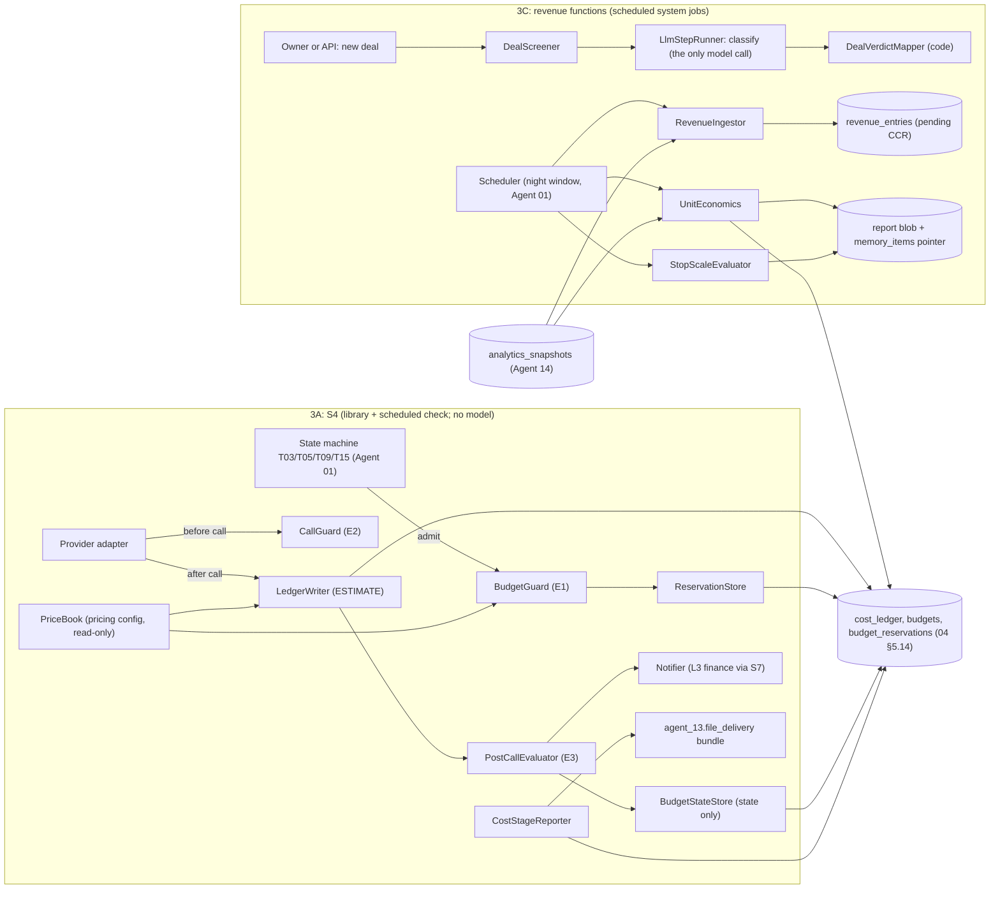
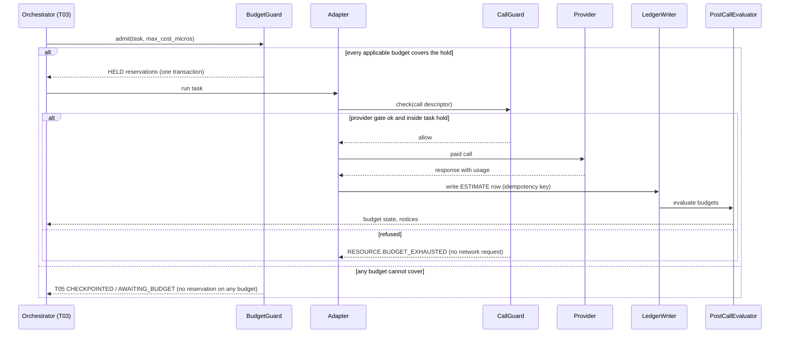

# Agent 15 — Growth & Revenue (blueprint)

| Field | Value |
|---|---|
| Status | Draft — documentation. Software: **Planned** (rule 6, rule 7) |
| Owner | Agent 15 Growth & Revenue; owns services **S4 Financial Controller + Budget Guard** (3A) and **S10 Billing, Metering & Plans** (3C, Tier 2). Integration owner: Agent 01 (orchestrator) |
| Package | `agent_15_growth_revenue` (27 §7.2); services `s04_financial_controller`, `s10_billing_metering`; shared library `amw_core.cost` (SOURCE_LAYOUT). Prompts `prompts/agent_15_growth_revenue/`; evals `evals/agent_15_growth_revenue/` |
| Directive sections covered | §3.1 row 15 (revenue intelligence, production economics, sponsorship/affiliate tracking, channel profitability), §1B.3 (revenue streams in order), §1B.4 (YPP eligibility), §1B.5 (financial model, unit economics, break-even, payback, stop/scale rules), §2 S4 (Financial Controller + Budget Guard), §2 S10 (Billing, Metering & Plans, Tier 2), §1B.1 (niche scoring is co-owned with Agent 02: Agent 15 supplies cost and revenue evidence only), §1C.9 |
| Owner decisions applied | D1 (3A: only the **cost ledger, budgets and the cost-per-stage file**; paid calls only within owner-set provider limits; per-video and pilot budgets enforced and stop on breach; keys only via the secret mechanism; render never in market hours; no upload, no OAuth in 3A), D2 (full blueprint for a non-critical-path agent in parallel; approved before its own build) |
| Binding contracts | GLOSSARY_AND_IDS.md (§2 IDs and actor refs, §3 units, §6.29 `compliance_verdict`, §6.38 FIN-R1…R13, §6.43 `disclosure_decision`, §6.45 `budget_*`, `cost_figure_kind`, `billing_mode`, `usage_meter`, §6.46 `figure_label`, §6.47 `tier`, §6.51 `refusal_reason`, §6.52), 03_COMMUNICATION_STANDARD.md (§3 input, §5 output, §6 error, §7 validation, §9 idempotency, §11 state machine T03/T05/T09/T15), 04_DATABASE_ARCHITECTURE.md (§3 tenancy, §5.14 cost and budgets, §5.22 analytics, §5.25 billing), 07_FAILURE_MANAGEMENT.md, 24_PRODUCTION_TYPES.md §3.2 and §7.1, 27_ENGINEERING_STANDARDS.md |
| Shared docs referenced by name/§ only | 09_COST_AND_BUDGET.md (the S4 specification; not repeated here), 17_BUSINESS_PLAN.md §6, §8, §9, §10, 14_SHARED_SERVICES.md §3.4 and §3.10, 20_MULTI_TENANCY_AND_ENTERPRISE.md §11 (S10), 21_PRICING_AND_PACKAGING.md, 13_COMPLIANCE_YOUTUBE_POLICY.md §5.9, 08_SECURITY.md §5 and §8, 3A_SLICE_SPEC.md §4 and §5, 06_NIGHT_SCHEDULING.md, ADR-007, ADR-010, agents/agent_14_analytics (planned), agents/agent_13_publishing_delivery (planned) |
| Facts cited | RESEARCH_LOG: IN-01 (no association of regulated entities with unregistered persons), IN-05 (ASCI influencer rules, BFSI), YT-09 (inauthentic content, channel level), YT-10 (YPP thresholds, 2027 increase for new creators), YT-11/YT-12 (API audit, scope sensitivity not confirmed), YT-14 (analytics data paths), PR-01/PR-02/PR-03 (models, batch and caching, API is not a subscription), INF-01 (server prices), INF-11 (RLS). New facts verified on 2026-11-18 from official pages and listed in §12.2 as F-15-1 to F-15-3 (proposed RESEARCH_LOG rows; not yet in the log) |
| Marking | Every section starts with its **MVP** line (3A / 3B / 3C, GLOSSARY §6.47 tier 0–3). 3A, 3B, 3C are the owner's build stages of D1. **In 3A Agent 15 is the S4 library only (no task type, no model call, no revenue function). Everything about revenue, deals, unit economics and stop/scale is 3C. S10 is 3C, Tier 2.** |
| Conventions | `(pending CCR)` = a contract item that does not exist in Wave A/B-1 and is listed in the structured return; this blueprint is written against the proposed name. `REQUIRES REVIEW (Phase 1): <need>` = unknown value, none is invented. IDs like `dl_`, `rv_` are not used; entities use GLOSSARY §2.2 prefixes or `(pending CCR)` ones. Money is integer minor units or micros, never floats (27 §7.3). No book title, course content, private method, server detail, key or real person/company name appears here; company names in examples are invented. |

---

## 1 Identity and mission
**MVP: 3A (S4 only) · 3C (everything else) · Tier 0 for the owner's own tenant; Tier 1+ for client tenants; S10 Tier 2.**

### 1.1 Mission
Agent 15 answers the money questions of the factory with arithmetic, not opinion.
1. **S4 (3A):** what will this work cost (ESTIMATE), what did it cost (ESTIMATE, later VERIFIED), may it start or continue (budget guard), and what is the cost per stage of a finished video (the file in the 3A delivery bundle). The full S4 specification is `09_COST_AND_BUDGET.md`; this blueprint states how Agent 15 realises it, not a second version of it.
2. **Revenue intelligence and production economics (3C):** record ACTUAL revenue per stream (own course/app funnel, sponsorship, affiliate where allowed, AdSense after YPP, memberships; directive §1B.3), compute profit per video and per channel, cost per 1,000 views, break-even views, payback, ROI, MRR, and the status of the stop/scale rules of 17 §10. Every number carries its label (ESTIMATE, MEASURED, PROJECTION, ACTUAL; GLOSSARY §6.46).
3. **Sponsorship and affiliate tracking (3C):** keep a register of commercial deals, screen each proposed deal against the channel's compliance rules (no broker affiliate or paid association with a SEBI-regulated entity while the owner is unregistered: FIN-R8, IN-01, IN-05), and report deal revenue. The only model call of the agent is the deal **classification** (`prompts/agent_15_growth_revenue/deal_classify.v1.md`); rules and verdicts are code.
4. **S10 (3C, Tier 2):** meter usage from the cost ledger and enforce plan limits at admission for client tenants (14 §3.10). Fully deterministic.

### 1.2 Where it sits
| Place | Detail |
|---|---|
| Stage | None of the 24 §7.1 production stages. S4 is called **by** the state machine (T03 admission) and **by** provider adapters (per call); the cost report is built for `agent_13.file_delivery`. Revenue and economics jobs are scheduled system jobs with `job_outcome = NO_DELIVERABLE` (24 §7.1 note; GLOSSARY §6.4) |
| Task types | none in 24 §3.2. Pending CCR: `agent_15.unit_economics_report` (also requested by 17 §15 #5), `agent_15.revenue_ingest`, `agent_15.sponsorship_screen` (all 3C). S4 has no task type (09 §2, 14 §3.4) |
| Upstream | Agent 01 (state machine T03/T05/T09/T15, scheduler), provider adapters (ledger rows), Agent 14 (`analytics_snapshots`, 3C), Agent 13 (`publications`, delivery), Agent 16 (`quality_scores`, compliance verdicts), the owner (limits, manual revenue entries, deal proposals, thresholds) |
| Downstream | Agent 13 (cost report file), S8 (cost and business panels), S7 (spend, deal and stop/scale approvals), Agent 03 (reads economics, 3C), Agent 02 (evidence for niche scoring, 3C), S10 consumers (admission), the owner |

### 1.3 Authority boundaries
| Agent 15 may | Agent 15 may never |
|---|---|
| write `cost_ledger` rows (append-only), reservations at T03, and the **state** of a budget it finds exceeded (`ACTIVE` to `SUSPENDED_EXCEEDED`) | create, raise, lower or release a limit (`limit_minor`), re-enable a suspended budget, or change `DISABLED` (human, `budget.write`, audited; 09 §13) |
| refuse or suspend paid work (`RESOURCE.BUDGET_EXHAUSTED`, `AWAITING_BUDGET`) | delete or alter completed work, artifacts, ledger rows or checkpoints (09 B3), or "fix" a breach by changing a model tier (09 §10.1) |
| report, recommend, flag, screen | spend money, top up a provider, change a price, publish, send an invoice outside S10 rules, or act on a stop/scale recommendation (the owner decides; 17 §10.1) |
| classify deal text with a model | let a model decide a verdict, compute or explain an amount, or approve a deal (human, S7); Agent 16 remains the final compliance authority for videos |
| read `analytics_snapshots` and `publications` | fetch from YouTube itself, hold an OAuth token, or read another tenant's rows |
| compute with owner-provided assumptions | invent a revenue figure, a forecast, an RPM, a conversion rate or a price; shown scenarios are labelled PROJECTION and built only from the channel's own MEASURED data (17 §8.3) |

### 1.4 Success criteria (measurable; thresholds are config, set from measured data)
| ID | Criterion | MVP |
|---|---|---|
| SC-1 | No paid call starts without an `ACTIVE` provider budget row and `ACTIVE` per-video and pilot budgets with sufficient remaining (zero exceptions in the failure-injection suite) | 3A |
| SC-2 | Cost report total equals the SQL sum of the ledger rows of the job to the micro; every figure carries its `figure_kind` | 3A |
| SC-3 | A budget breach leaves the job in `CHECKPOINTED` / `AWAITING_BUDGET` with durable progress and no further paid call (27 §9 test 4) | 3A |
| SC-4 | Replaying any S4 or revenue write with the same idempotency key changes nothing | 3A / 3C |
| SC-5 | ESTIMATE-to-VERIFIED variance per provider reported; leaks flagged | 3B |
| SC-6 | Every revenue, profit and break-even figure shown has a label and a stated input window; no PROJECTION is drawn as ACTUAL | 3C |
| SC-7 | Deal screening: 0 false `ALLOWED` on the blocked answer-key cases; the model never sets a verdict (eval gate, §26) | 3C |
| SC-8 | Cross-tenant suite for every table the agent reads or writes passes (04 §3.7; §19) | 3A / 3C |

---

## 2 Functional requirements
**MVP: 3A (FR-01…FR-06, FR-10 measurement) · 3B (FR-07, FR-08) · 3C (the rest). Tier 0 unless stated.**

### 2.1 Requirements
| ID | What | Why | When / trigger | Inputs | Outputs | Dependants | MVP · Tier |
|---|---|---|---|---|---|---|---|
| FR-01 | **Admission reservation (E1).** At T03 reserve `resource_budget.max_cost_micros` on every applicable budget, all-or-nothing; refuse with T05 when impossible | stop spend before it starts (09 §2, §3.4) | state machine T03 for every paid task | task envelope, applicable budgets, held reservations, ledger | `budget_reservations` HELD, or T05 `AWAITING_BUDGET` + `task.suspended` | Agent 01, S8, S7 | 3A · 0 |
| FR-02 | **Per-call check (E2).** Before each paid call: provider gate, remaining task hold (`max_cost_micros`, tokens, calls) | a running task must not overspend its own hold (09 B2) | adapter, before each paid call | adapter call descriptor | allow, or `RESOURCE.BUDGET_EXHAUSTED` before any network request | adapters (`amw_adapters`) | 3A · 0 |
| FR-03 | **Cost capture.** One `cost_ledger` ESTIMATE row per paid call, idempotent, from the provider's usage block and the pricing config (09 §5) | every spend is visible and attributable | after each paid call | provider usage, `price_ref` | ledger row | reports, budgets, S8, S10 | 3A · 0 |
| FR-04 | **Post-call breach handling (E3).** After a ledger write, mark a budget `SUSPENDED_EXCEEDED` when consumed reaches its limit; raise soft-limit notices | stop new admissions at once (09 B1, B7) | ledger write | budget, ledger | state change, `notifications` (L3 finance for breach) | Agent 01, S7, S8 | 3A · 0 |
| FR-05 | **Provider-limit gate.** A paid adapter is usable only if its provider has an `ACTIVE` provider budget row (the owner's acknowledgement of the console limit) | D1: no paid call before owner-set limits | startup check and E1/E2 | `budgets` (`PROVIDER`, pending CCR) | refusal before the first call | adapters, 3A-01 ticket | 3A · 0 |
| FR-06 | **Cost-per-stage report.** Build the content of 09 §12 (header, per-stage table, term split, figure summary, budget status per limit, human review minutes separate) for a job | D1: cost per stage is a downloadable file in every run | called by `agent_13.file_delivery` at bundle time | `job_id` | `cost_per_stage_report` JSON and a human-readable view (pending CCR-3A-2 for the bundle kind) | Agent 13, owner | 3A · 0 |
| FR-07 | **Reconciliation.** Write VERIFIED rows from provider usage exports or invoices; compute variance; flag leaks and pricing drift (09 §6) | ESTIMATE must be checked against the provider | scheduled system job (3B) | provider export, ledger | VERIFIED rows, variance report | Finance, owner | 3B · 0 |
| FR-08 | **Daily/monthly budgets and soft limits.** Period roll-over in the tenant time zone | caps beyond per-video and pilot | scheduled | `budgets` | state back to `ACTIVE` at roll-over, notices | Agent 01 | 3B · 0 |
| FR-09 | **Per-channel and per-production-type budgets; critical class** (09 §3.1, §14 #3) | client and multi-channel use | admission | `budgets` | as FR-01 | Agent 01 | 3C · 0–1 |
| FR-10 | **Devanagari token measurement table** (09 §11 M1–M7) in the pilot report | sizes `max_tokens_*` and reservations from MEASURED data | 3A skeleton run, 3B golden samples | ledger token columns, artifact character counts | measurement table (MEASURED with sample count) | Agent 01 (caps), owner | 3A/3B · 0 |
| FR-11 | **Revenue ingest.** Record ACTUAL revenue per stream (manual entry, CSV import, and ESTIMATE rows derived from analytics snapshots after YPP) | actual economics need actual revenue; no table exists in Wave A (pending CCR `revenue_entries`) | owner entry / scheduled | owner input, CSV, `analytics_snapshots` | `revenue_entries` rows (append-only) | FR-13, FR-14, S8 | 3C · 0 |
| FR-12 | **Commercial deal register and screen.** Register a proposed sponsorship or affiliate deal; classify (LLM) and map (code) to `compliance_verdict`, rule flags and `disclosure_decision`; route to the owner | directive §3.1 row 15, FIN-R8, IN-01, IN-05 | owner or API creates a deal (`PROPOSED`) | deal text, link signals, channel compliance profile | screen result, `approval_needed` for the owner decision | S7, S8, Agent 16 (video-level checks stay there) | 3C · 0 |
| FR-13 | **Unit economics.** Per video and per channel-month: revenue, cost, profit, cost per 1,000 views, break-even views and badge, MRR, ROI, payback (17 §8.2, §9) | the financial model of §1B.5 | scheduled after analytics ingest; on demand | `cost_ledger`, `revenue_entries`, `analytics_snapshots`, owner inputs | report blob + `memory_items` pointer | S8, Agent 03, owner | 3C · 0 |
| FR-14 | **Stop/scale evaluation.** Evaluate S1–S4 and P1–P4 of 17 §10 per channel and recommend (never act) | §1B.5 stop/scale rules | scheduled weekly, on demand | per-video metrics, thresholds (`business.*`, pending CCR) | recommendation + evidence; `approval_needed` for scale | owner, S7 | 3C · 0 |
| FR-15 | **Funnel inputs.** Accept course clicks, sales and ATP attributions as owner/CSV inputs with the attribution window as a setting | `ctr_course`, `conv_course` have no tracking method yet (17 §8.1) | with FR-11 | owner data | `revenue_entries` + attribution fields | FR-13 | 3C · 0 |
| FR-16 | **YPP progress panel data.** watch_hours_12m and subscribers against YT-10 thresholds; `months_to_YPP` as PROJECTION | directive §1B.4 | scheduled | `analytics_snapshots` | numbers + labels | S8 | 3C · 0 |
| FR-17 | **Evidence for niche scoring.** Provide measured production cost per video and monetisation-path evidence to Agent 02's scoring; never a score | §1B.1 co-ownership | on request | ledger, `revenue_entries` | evidence rows in the economics report | Agent 02 | 3C · 0 |
| FR-18 | **Re-price review item.** When measured cost per video of a tier moves beyond configured window and percentage, raise a review item for the owner (21 §5, re-price trigger) | pricing follows measured cost | scheduled | `C_video` history, config | notification only; never a price change | owner | 3C · 1 |
| FR-19 | **Usage rollup and plan-limit check (S10).** `svc_s10.usage_rollup` (pending CCR in 14 §3.10) turns ledger rows into `usage_events` idempotently; admission asks the plan-limit function | client billing and quotas (§1C.9) | scheduled; at admission | `cost_ledger`, `plans`, `subscriptions` | `usage_events`, limit decisions | Agent 01, S11 | 3C · 2 |
| FR-20 | **Invoices and dunning (S10).** Invoice rows with GST, gateway adapter (ADR-010), dunning states | §1C.9 | scheduled / events | `usage_events`, `subscriptions` | `invoices` | clients | 3C · 2 (not specified further here: 20 and 21 own the design; GST rules REQUIRES REVIEW ⚖) |

### 2.2 Task types and modes (pending CCR; 3C)
| Task type | Mode | Class (24 §3.1) | Notes |
|---|---|---|---|
| `agent_15.revenue_ingest` | `MANUAL_ENTRY`, `CSV_IMPORT`, `SNAPSHOT_DERIVE` | `LIGHT` | idempotent; no model |
| `agent_15.unit_economics_report` | `VIDEO`, `CHANNEL_MONTH`, `STOP_SCALE`, `PAYBACK` | `LIGHT` | no model; outcome `NO_DELIVERABLE` |
| `agent_15.sponsorship_screen` | `SCREEN_DEAL` | `AI_IO` (one LLM step `classify`, then deterministic mapping) | the only model use |
Resource classes are those of GLOSSARY §6.6 (`LIGHT` = DB/logic only, `AI_IO` = waits on an external AI API).

### 2.3 Out of scope (explicit)
No YouTube or AdSense API calls by this agent, no upload, no OAuth (Agent 13/14 own them; D1 keeps them out of 3A). No tax, GST filing, accounting or legal advice (owner's adviser ⚖, 17 §13). No pricing decisions (21 PROPOSAL until the owner approves). No niche score (Agent 02). No audience claims about individuals (S1). No forecast of this project's own revenue from other channels' benchmarks (17 §8.3, 19 §6). No automatic spend increase, top-up or card-on-file (09 §8.6).

---

## 3 Non-functional requirements
**MVP: applies from 3A for S4; the revenue items from 3C. All numbers below are design targets (ESTIMATE), config, to be replaced by measurement in the skeleton; none is a measured result.**
| ID | Requirement | Measure / rule | MVP |
|---|---|---|---|
| NF-1 | **Fail closed.** Missing price, FX, budget or provider row never allows a paid call | `PERMANENT.CONFIG_INVALID` or `RESOURCE.BUDGET_EXHAUSTED`; failure-injection test | 3A |
| NF-2 | **Integer money.** `_micros`, `_minor`, basis points; no float anywhere in a money path | lint rule + property test (27 §7.3 rule 9) | 3A |
| NF-3 | **Determinism.** Same inputs, same outputs; every decision in §6 is a pure function over its inputs | golden datasets at 100 % (§26) | 3A / 3C |
| NF-4 | **Idempotent and replay-safe.** Ledger, VERIFIED, revenue and reservation writes carry idempotency keys (03 §9) | duplicate-write test | 3A / 3C |
| NF-5 | **Admission cost.** E1 is one transaction over the applicable budgets; E2 is in-process arithmetic plus one indexed read. Design targets only: E1 and E2 are small compared with a provider call; the numeric target (`finance.perf.*`) REQUIRES REVIEW (Phase 1): set after the skeleton measures | performance test (§21) | 3A |
| NF-6 | **Append-only history.** `cost_ledger` has no UPDATE/DELETE (04 rule 7); corrections are VERIFIED or compensating rows | schema test | 3A |
| NF-7 | **Auditability.** Every limit change, state change, deal decision and stop/scale decision is audited with before/after and actor | audit chain test (08 §9) | 3A / 3C |
| NF-8 | **Tenancy.** `org_id` on every table; RLS second line; no cross-tenant read or aggregate except `amw_platform_ops_summary()` | §19 | 3A |
| NF-9 | **No model in the money path.** No LLM computes, rounds, converts or explains an amount (14 §3.10; 20 S10 rules) | code review rule + test that no money function imports an LLM client | 3A / 3C |
| NF-10 | **Report readability.** Numbers first, tables, explanations behind details, green/red by meaning with text as well as colour, phone layout checked (owner rules D.2, D.3) | screenshot review of the report view | 3A / 3C |
| NF-11 | **Time zones.** DAY/MONTH periods in the tenant zone; timestamps UTC (GLOSSARY §4; 27 §7.3 rule 8) | unit test across a zone boundary | 3B |
| NF-12 | **Footprint.** S4 and the 3C jobs run inside existing processes (orchestrator and `ai_worker`); no new container, no inbound port (§24) | deployment check | 3A / 3C |
| NF-13 | **Privacy.** Revenue and deal data are tenant business data: never in logs, prompts (other than the deal text of that tenant), metrics labels or the public repo | log-leak canary test (08 §8 layer 5) | 3C |

---

## 4 Internal architecture
**MVP: 3A for the left half (S4); 3C for the right half. Tier 0.**

### 4.1 Component view


### 4.2 Enforcement sequence (3A)


### 4.3 Where the code runs
S4 is a library plus a scheduled check inside the existing process model (09 §2): E1 inside the orchestrator's T03 transaction, E2/E3 inside adapter calls in `ai_worker`/`render_worker`. The 3C jobs run as scheduled system jobs on the `ai_worker` queue; the mechanism for scheduled system jobs without a canonical task type is an open item of the registry (O-12). No daemon of its own.

---

## 5 Full system prompt
**MVP: 3C · Tier 0. Agent 15 has exactly one LLM step. In 3A and 3B it has no prompt.**
The real prompt text lives only in the prompt file (27 §4): [prompts/agent_15_growth_revenue/deal_classify.v1.md](../prompts/agent_15_growth_revenue/deal_classify.v1.md), written to `prompts/_TEMPLATE.v1.md` (27 §4.2: header table, Role, Objective, Inputs, Rules, Output JSON Schema, Worked examples, Refusal and escalation, Self-check). Summary:
| Item | Content |
|---|---|
| Role | classification step inside Growth & Revenue; classifies counterparty, promoted item and payment flow of a proposed deal in a fixed vocabulary; decides nothing, applies no rule, drafts nothing |
| Output | `agent_15.deal_classify.output` 1.0.0: four enumerations, verbatim evidence quotes, ambiguities, refusal object (27 §4.3) |
| Rule packs | `rp.finance_sebi_in` by reference (definition of a regulated entity kind), only when active |
| Untrusted text | the deal fields are data; instructions inside them are never followed (refusal `CONFLICTING_INSTRUCTIONS`) |
| Cache | the stable prefix (role, rules, schema, examples) is cacheable (`llm.agent_15.sponsorship_screen.cache_system_prompt`); the deal text is always after it; the prefix holds no tenant data (08 §8 layer 4) |
| Not in the prompt | model name, provider, prices, dates, thresholds, any revenue number, any other deal or tenant |
No judge prompt is shipped now: `agent_15/deal_classify_judge.v1` is written at build time with its calibration set (§26).

---

## 6 Decision engine
**MVP: 3A for 6.2 and 6.6; 3C for 6.3–6.5. Tier 0.**

### 6.1 Decision table
| Decision | Deterministic or LLM | Why |
|---|---|---|
| May a paid task start / a call proceed / a budget suspend | **Deterministic** (6.2) | money and rule 8: must be reproducible and testable; a model could be argued or injected |
| Consumed amount, remaining, shares, totals, terms | **Deterministic** | arithmetic; integer micros |
| Cost-per-stage report content | **Deterministic** (6.6) | totals must equal the SQL sum |
| ESTIMATE vs VERIFIED matching, variance, leak flags | **Deterministic** | audit trail |
| Revenue, profit, cost per 1,000 views, break-even, ROI, payback | **Deterministic** (6.4) | formulas fixed by 17 §8.2, §9 |
| Stop/scale status and recommendation | **Deterministic** (6.5) | thresholds are the owner's config; no judgement of the model |
| Deal verdict, rule flags, disclosure decision | **Deterministic mapper** (6.3) over the model's classification | compliance verdicts are never a model's alone (24 §3.3 item 4; 02 §3.3 rows) |
| What kind of business a counterparty is, what is promoted, how it is paid (free text in Marathi, Hindi, English) | **LLM classification** (`deal_classify`) | free text understanding that rules cannot do; output is a closed vocabulary with verbatim evidence, then code decides |
| Explanation text in reports | **Deterministic templates** keyed by check IDs | owner rule D.2 (minimal prose; explanations behind details) and rule A.3 (nothing from the model's own mind); no narrative LLM step exists |

### 6.2 Budget guard (E1, E2, E3) — the executable form of 09 §2–§4, §8
Definitions (09 §3.3): `effective_consumed(budget)` = sum over ledger rows in scope and period, per call the VERIFIED row if one exists (linked by `estimate_entry_id`) else the ESTIMATE row; `committed = effective_consumed + Σ HELD reservations`; `remaining = limit − committed`. Currency conversion only with the row's recorded `fx_rate`; a missing rate is a refusal.

**E1 `admit(task, paid, requested)`** (all-or-nothing, one transaction). If the task is not paid: `ADMIT` (B4). Otherwise evaluate in this order and stop at the first failure:
1. every provider in `required_providers` has an `ACTIVE` `PROVIDER` budget row (pending CCR) else `SUSPEND`, reason `PROVIDER_GATE_MISSING`;
2. every period in config `finance.admission.required_budget_periods` has a non-provider budget that is `ACTIVE` or `SUSPENDED_EXCEEDED` (a `DISABLED` or missing row does not count). 3A value is `PER_VIDEO` and `PILOT_TOTAL` (D1; 3A_SLICE_SPEC §5). Else `NO_ACTIVE_BUDGET`;
3. any applicable budget `SUSPENDED_EXCEEDED` with `non_critical_suspend = true`: `BUDGET_SUSPENDED` (in 3A every paid task is non-critical, 09 §3.2);
4. any `ACTIVE` budget with `remaining < requested`: `INSUFFICIENT_REMAINING` (all such budget IDs listed);
5. else reserve `requested` on every `ACTIVE` applicable budget (`HELD`) and return `ADMIT`; list in `warnings` each budget where `(committed + requested) × 10000 ≥ limit × soft_limit_ratio_bp` (B7: warning only).
A `SUSPEND` returns error code `RESOURCE.BUDGET_EXHAUSTED` and transition T05 (`CHECKPOINTED`, `wait_reason = AWAITING_BUDGET`). A budget with `limit 0` can never satisfy step 4 for a paid task, which is how "no owner-set limit means no paid call" (09 §3.1) is realised.

**E2 `check_call(call)`**: refuse with `PROVIDER_GATE_MISSING` if the call's provider has no `ACTIVE` provider row; refuse with `TASK_CAP_EXCEEDED` if `call_micros > task_hold_remaining`; otherwise `CALL_OK`. Token and call-count caps of `resource_budget` are checked in the same function. A budget already `SUSPENDED_EXCEEDED` does **not** stop a running task that is inside its own hold (B2); E1 stops the next one.

**E3 `evaluate_post_call(budgets)`**: for each `ACTIVE` budget, if `effective_consumed ≥ limit` set `SUSPENDED_EXCEEDED` and raise an L3 finance notice (B5); else if `effective_consumed × 10000 ≥ limit × soft_limit_ratio_bp` raise a soft-limit notice (B7). Suspended and `DISABLED` budgets are not touched again. Held reservations are enforced at E1 only; counting them at E3 would suspend a budget because of its own reservation. 09 §3.2 words it "consumed + held ≥ limit"; this blueprint implements ledger-consumed at E3 and asks 09's owner to confirm (O-2).

Resume is never automatic (B6): a human action or a period roll-over, then T15 re-runs E1.

### 6.3 Deal verdict mapper (code, after the model)
Inputs: the four classification fields, code-computed `link_signals`, `active_rule_packs`, owner registration status. `finance_active` = `rp.finance_sebi_in` active **and** owner `UNREGISTERED` (the only supported value in v1). Paid set = `{COMMISSION_OR_REFERRAL, MONEY, MONEY_WORTH}`.
| Rule | Condition (`finance_active` unless stated) | Result | Flag |
|---|---|---|---|
| M1 | any link `in_regulated_list` | `BLOCKED` | FIN-R8 |
| M2 | category `REGULATED_FINANCIAL_ENTITY` and payment in paid set | `BLOCKED` | FIN-R8 |
| M3 | promoted item `STOCK_OR_INVESTMENT_PRODUCT` or `TRADING_SERVICE_OR_SIGNALS` and payment in paid set | `BLOCKED` | FIN-R8 (IN-05, 13 §5.9) |
| M4 | any link with a referral parameter, not on the regulated list, category not `NON_FINANCIAL` | `NEEDS_HUMAN_REVIEW` | FIN-R8 (13 §5.9: unknown domain with referral parameter) |
| M4b | category `UNREGULATED_FINANCE_ADJACENT` and payment `COMMISSION_OR_REFERRAL` | `NEEDS_HUMAN_REVIEW` | FIN-R8 (17 §6: affiliate only for non-financial tools) |
| M5 | category `UNKNOWN`, or payment `UNCLEAR`, or (finance) promoted item `UNCLEAR` | `NEEDS_HUMAN_REVIEW` | none |
| M6 | category `REGULATED_FINANCIAL_ENTITY` and payment `NONE` | `NEEDS_HUMAN_REVIEW` | FIN-R8 |
| otherwise | | `ALLOWED` | none |
`BLOCKED` beats `NEEDS_HUMAN_REVIEW` beats `ALLOWED`. `disclosure_decision`: payment in paid set → `REQUIRED`; `NONE` → `NOT_REQUIRED`; `UNCLEAR` → `NEEDS_HUMAN_REVIEW` (IN-05: disclosure labels for paid promotion; the label wording and placement belong to 13 and 25). Without `rp.finance_sebi_in` no `FIN-*` flag is ever produced. `ALLOWED` is never a deal approval: the owner approves every deal (§23), and a deal that appears in a video is checked again by Agent 06/16.

### 6.4 Unit economics (integer form of 17 §8.2, §9.2, §9.3)
All amounts in minor units of one currency per report; ratios in basis points; no floats.
```
ad_minor        = floor(views × rpm_net_minor × (10000 − wht_bp) / 10_000_000)            # rpm_net_minor per 1,000 views
funnel_minor    = course_sales × margin_course_minor
revenue_minor   = ad_minor + funnel_minor + atp_attributed × margin_atp_minor + sponsor_net_minor
fixed_share     = ceil(c_fixed_month_minor / videos_month)                                  # cost is never understated
cost_minor      = c_video_minor + fixed_share
profit_minor    = revenue_minor − cost_minor                                                # may be negative
cost_per_1000   = ceil(cost_minor × 1000 / views)           (null when views = 0)
contrib_per_1000= floor(rpm_net_minor × (10000 − wht_bp) / 10000) + floor(funnel_minor × 1000 / views)
need            = max(0, cost_minor − sponsor_net_minor)
bev_views       = 0 if need = 0; "UNDEFINED" if contrib_per_1000 = 0; else ceil(need × 1000 / contrib_per_1000)
badge           = none if UNDEFINED; ABOVE_BEV if views ≥ bev_views else BELOW_BEV
channel month   : revenue_month = Σ revenue_v; cost_month = Σ c_video + c_fixed_month;
                  roi_bp = floor((revenue_month − cost_month) × 10000 / cost_month) (null if cost_month = 0); mrr = Σ recurring items only
payback         : the newest k months must all be ACTUAL, else INSUFFICIENT_DATA; avg = floor(Σ profit / k);
                  avg ≤ 0 → NO_PAYBACK_YET; else payback_months_tenths = ceil(build_cost × 10 / avg)
label           : ACTUAL only if every input is ACTUAL; PROJECTION if any input is PROJECTION; else ESTIMATE
```
Clarifications that are not new formulas: `need = 0` gives break-even 0 (nothing left to cover); 17 §9.2 says break-even is "undefined" when the contribution is 0, which is applied only when something remains to cover. The ATP term is in revenue (17 §8.2) but not in the break-even contribution (17 §9.2 as written; O-6). Before YPP `rpm_net_minor = 0` (17 §9.2). Scenarios (17 §8.3) change inputs, never formulas, and carry PROJECTION.

### 6.5 Stop/scale (17 §10)
Thresholds (`n_consecutive`, `min_relative_retention_bp`, `max_cost_revenue_ratio_bp`, `m_weeks`, weekly review budget) are owner config (`business.*`, pending CCR); none ships. Over the newest N published videos:
| Check | PASS when | INSUFFICIENT_DATA when |
|---|---|---|
| S1 retention | every `relative_retention_bp` ≥ min (`relativeRetentionPerformance`, YT-14) | fewer than N videos or any value null |
| S2 cost/revenue | every `cost × 10000 / revenue` ≤ max (ACTUAL revenue incl. funnel); revenue 0 with cost > 0 is FAIL | fewer than N videos or revenue or cost null (never FAIL for unmeasured) |
| S3 quality | every video `qc_score ≥ 85` (fixed by §1A.7, config `quality.publish_min_score`) and all compliance checks passed | any value null |
| S4 review time | owner review minutes per week ≤ owner's weekly budget (input A6) | either value unknown |
`scale_eligible` = all four PASS. Triggers: P1 = the newest consecutive weeks with `missed = true` reach `m_weeks` (a null week breaks the run: an unknown never triggers a pause); P2 = compliance incident after publishing, a policy strike or a regulator notice; P3 = budget breach (S4 has already stopped paid calls; the flag only reports it); P4 = inauthentic-content signal (YT-09). Recommendation precedence: `STOP_IMMEDIATE` (P2) > `STOP_AND_REVIEW` (P4) > `PAUSE_RECOMMENDED` (P1) > `SCALE_ELIGIBLE` > `INSUFFICIENT_DATA` (all four unknown) > `HOLD`. The agent recommends; scale actions and stop actions are owner decisions (§23).

### 6.6 Cost-per-stage report (09 §12)
1. Link each VERIFIED row to its ESTIMATE by `estimate_entry_id`; the pair is one **call** whose effective cost is the VERIFIED amount; tokens always come from the ESTIMATE row (provider usage block). Two VERIFIED rows for one ESTIMATE refuse the report with `PERMANENT.INPUT_INVALID` (O-5).
2. A VERIFIED row with no ESTIMATE goes to the line `UNATTRIBUTED`, counts in `leak_rows` and is flagged to Finance (09 §6.3).
3. Group calls by `stage_id` (task type to stage through the production type graph, 24 §7.1); a task type with no stage is shown under its task type, alphabetical after the mapped stages; the production-type order is kept.
4. Per stage: calls, token sums, cost, `figure_kind` (ESTIMATE, VERIFIED, MIXED), `share_bp = round_half_up(cost × 10000 / total)`, revision loops (distinct iterations), wasted cost (attempts whose output a gate discarded).
5. Terms of 09 §9 by operation prefix through config `finance.term_map` (`llm.`, `tts.`, `stock.`, `music.`, `video_gen.`, `render.`); anything else is `OTHER` and is shown, never dropped (image generation has no term in 09 §9: O-4).
6. `figure_summary` = `ESTIMATE`, `VERIFIED`, or `partly verified (n of m rows)`; unknown human review minutes print `REQUIRES REVIEW (Phase 1): human review minutes not recorded`, never 0; a foreign-currency row without a recorded rate fails with `PERMANENT.CONFIG_INVALID`.
7. Invariant: total = SQL sum of the rows used; the report states its query scope (`job_id`). No key, account ID, server address or prompt text (09 §12.3).

### 6.7 Why the split
Money, limits and compliance verdicts must be reproducible, auditable and immune to prompt injection, so they are code. The one place free text needs understanding (what a counterparty is) is isolated behind a closed vocabulary with verbatim evidence checked by code; the code then applies the rules. A model can never turn a code-detected regulated domain (M1) into `ALLOWED`, and unknown values always route to a human. A confident wrong classification can still produce a wrong `ALLOWED`; this is why `ALLOWED` is never an approval, every deal needs the owner's decision (§23), and the eval gate has a zero-false-`ALLOWED` threshold on blocked cases (§26).

---

## 7 Input schema
**MVP: 7.1 is 3A; 7.2 and 7.3 are 3C. Tier 0; the same schemas serve later tiers.**

### 7.1 S4 library interfaces (3A; Pydantic models in `s04_financial_controller` and `amw_core.cost`; not Task Inputs, because S4 has no task type)
| Model | Fields (types) | Called by |
|---|---|---|
| `AdmissionRequest` | `ctx: TenantCtx` (org from the transaction, never from a field), `task_id`, `job_id`, `channel_id \| None`, `production_type_key`, `paid: bool`, `max_cost_micros: int ≥ 0`, `currency: str(3)`, `required_providers: list[str]`, `idempotency_key` | state machine T03 |
| `CallDescriptor` | `task_id`, `attempt_id`, `provider`, `operation`, `max_call_cost_micros`, `max_tokens_in/out`, `idempotency_key` (`llm.call` etc., 03 §9.2) | adapter, before a paid call |
| `LedgerWrite` | `task_id`, `attempt_id`, `agent_id`, `provider`, `model`, `operation`, `billing_mode`, tokens or `units` + `unit_kind`, `price_ref`, `occurred_at`, `idempotency_key` (amount is computed by `PriceBook`, not passed in) | adapter, after a paid call |
| `VerifiedWrite` (3B) | `provider`, `export_row_ref`, `amount_micros`, `currency`, `estimate_entry_id \| None`, `verification_ref`, `idempotency_key` (scope `cost.verify`, pending CCR) | reconciliation job |
| `CostReportRequest` | `job_id` (org from context) | `agent_13.file_delivery` |

### 7.2 Task inputs (3C; pending CCR task types)
Envelope: Task Input `amw.task_input` 1.0.0 (03 §3.3), `agent_id = agent_15`. Fields relied on: `org_id`, `job_id`, `task_id`, `project_id` (null for system jobs), `channel_id` (required for deal screening, revenue and stop/scale; null only for an org-level month report), `priority`, `resource_budget` (`max_cost_micros` is 0 for `LIGHT` modes and the classification cap for `SCREEN_DEAL`), `correlation_id`, `idempotency_key` (`task.<task_type>`: job, task type, iteration), `retry_count`. `context_refs`: the channel `COMPLIANCE_PROFILE`, `RULE_PACK` refs (`SCREEN_DEAL`), owner assumptions as `MEMORY` refs (`amw-entity://<org>/memory_item/mem_…`, with `sha256`).

**`agent_15.sponsorship_screen.input` 1.0.0** (`SponsorshipScreenInput`)
| Field | Type / constraint |
|---|---|
| `mode` | `SCREEN_DEAL` |
| `deal_id` | commercial deal entity ID (pending CCR prefix); must exist, same org and channel, status `PROPOSED` |
| `deal_text_ref` | storage URI of the deal text blob (same org) with SHA-256; the code loads and sanitises it |
| `rescreen_reason` | enum `NEW_DEAL`, `TERMS_CHANGED`, `RULE_PACK_UPDATED` |

**`agent_15.revenue_ingest.input` 1.0.0** (`RevenueIngestInput`)
| Field | Type / constraint |
|---|---|
| `mode` | `MANUAL_ENTRY`, `CSV_IMPORT`, `SNAPSHOT_DERIVE` |
| `entries[]` (`MANUAL_ENTRY`) | `stream` (pending enum), `amount_minor` int ≥ 0, `currency`, `period_start`, `period_end` (dates, no time of day), `publication_id` or null, `deal_id` or null, `figure_label` (`ACTUAL` or `ESTIMATE`), `source_ref` text, `attribution` (`course_sales`, `course_clicks`, `atp_attributed`, optional ints) |
| `csv_ref` (`CSV_IMPORT`) | storage URI + SHA-256; column map in config `finance.csv_map.<source>` |
| `snapshot_window` (`SNAPSHOT_DERIVE`) | `channel_id`, `metric_date_from`, `metric_date_to` (relative window kind, not stored dates) |

**`agent_15.unit_economics_report.input` 1.0.0** (`UnitEconomicsInput`)
| Field | Type / constraint |
|---|---|
| `mode` | `VIDEO`, `CHANNEL_MONTH`, `STOP_SCALE`, `PAYBACK` |
| `subject` | `VIDEO`: `publication_id`; `CHANNEL_MONTH`: `month_ref` (relative: `LAST_CLOSED_MONTH` or a month key); `STOP_SCALE` and `PAYBACK`: none |
| `assumption_refs[]` | memory items for owner inputs (`videos_month`, `margin_course_minor`, `margin_atp_minor`, `wht_bp`, `attribution_window`, `build_cost_minor`); a missing assumption makes the dependent figure `REQUIRES REVIEW`, never zero |
| `scenario` | optional `CONSERVATIVE`/`MODERATE`/`AGGRESSIVE`: inputs are percentile picks of the channel's own MEASURED videos (17 §8.3); output labelled PROJECTION |

### 7.3 Internal step input `agent_15.deal_classify.input` 1.0.0
The variables table of the prompt (`channel_category`, `owner_sebi_registration`, `active_rule_packs`, `counterparty_name`, `counterparty_description`, `product_description`, `deliverable_text`, `payment_terms_text`, `link_signals[]`). `link_signals` are computed by `LinkSignalExtractor` from the URLs: domain, `in_regulated_list` (platform list in the `rp.finance_sebi_in` resource; upkeep REQUIRES REVIEW, 13 §5.9, O-8) and `has_referral_param`. The model never sees a raw query string.

---

## 8 Output schema
**MVP: 8.1 is 3A; 8.2 to 8.4 are 3C. Tier 0.**

### 8.1 Cost-per-stage report (3A) — content schema `agent_15.cost_stage_report` 1.0.0 (`CostStageReport`)
The file is produced by S4 and placed in the bundle by Agent 13 (kind `cost_per_stage_report`, pending CCR-3A-2). JSON and a human-readable view; unknown values are strings starting `REQUIRES REVIEW (Phase 1):`.
```json
{
  "schema": "agent_15.cost_stage_report", "version": "1.0.0",
  "header": { "job_id": "job_…", "production_type": {"key": "CHANNEL_LONG_FORM", "version": 2}, "currency": "INR",
              "budget": { "per_video": {"limit_micros": 0, "committed_micros": 0, "remaining_micros": 0, "state": "ACTIVE"},
                          "pilot": {"limit_micros": 0, "committed_micros": 0, "remaining_micros": 0, "state": "ACTIVE"} },
              "figure_summary": "ESTIMATE | VERIFIED | partly verified (n of m rows)", "price_refs": ["…"], "generated_by": "svc_s04", "run_mode": "DEV | VPS_NIGHT_WINDOW", "query_scope": "job_id" },
  "stages": [ { "stage": "s05_script", "task_type": "agent_05.script_draft", "provider_models": ["…"], "calls": 0,
                "tokens_in": 0, "tokens_out": 0, "tokens_cached_in": 0, "units": [{"unit_kind": "characters", "units": 0}],
                "cost_micros": 0, "figure_kind": "ESTIMATE | VERIFIED | MIXED", "share_bp": 0, "revision_loops": 0, "wasted_micros": 0 } ],
  "total_micros": 0,
  "terms": { "LLM": 0, "TTS": 0, "footage": 0, "music": 0, "ai_broll": 0, "infra": 0, "OTHER": 0 },
  "allocated": [ { "label": "stock subscription share", "amount_micros": 0, "figure_kind": "ESTIMATE" } ],
  "leak_rows": 0,
  "human_review_minutes": "integer | REQUIRES REVIEW (Phase 1): …",
  "budget_status": [ { "budget": "per_video", "status": "WITHIN | SOFT_EXCEEDED | BREACHED", "text": "…" } ]
}
```
Header numbers are shown beside text status, never colour alone (owner rule D.2/D.3). Allocated lines (subscriptions, infrastructure share) are separate from per-call rows (09 §12.3 rule 2). The key set is the 09 §12.1–§12.2 content; nothing is added.

### 8.2 Task output mapping (3C)
Task Output `amw.task_output` 1.0.0 (03 §5.2): `payload` = the task type's output schema (inline when within `contracts.inline_payload_max_bytes`, else `data_ref` + `data_sha256`); `output_refs` = report blobs (`kind: REPORT` or `DATA`, SHA-256, size); `quality_score` null; `confidence` null (no figure is invented); `downstream_agent` null; `next_action` `CONTINUE`, or `WAIT` with `AWAITING_APPROVAL` for a deal or a stop/scale recommendation that needs a human (hint; the orchestrator decides, 03 §5.3).

### 8.3 Payloads (3C)
| Schema | Fields |
|---|---|
| `agent_15.sponsorship_screen.output` 1.0.0 | `deal_id`, `classification` (the four model fields + `evidence[]` + `ambiguities[]`), `link_signals[]`, `verdict` (`compliance_verdict`), `rule_flags[]` (`rule_id`, `severity`, `evidence_ref`), `disclosure_decision`, `mapper_rules_fired[]` (`M1`…`M6`), `approval_needed` (`kind: COMMERCIAL_DEAL`, pending CCR; subject SHA-256), `warnings[]`, `prompt_id`, `prompt_sha256`, `rule_pack_versions` |
| `agent_15.revenue_ingest.output` 1.0.0 | `created[]` (entry IDs), `duplicates_skipped`, `rejected[]` (`row_ref`, reason code), `totals_by_stream` (minor units, label), `warnings[]` |
| `agent_15.unit_economics_report.output` 1.0.0 | `mode`, `label`, `currency`, `window` (relative kind + the period it resolved to), `figures` (exactly the §6.4 or §6.5 result objects), `inputs_used[]` (ID, label, source), `missing_inputs[]` (`REQUIRES REVIEW (Phase 1): …`), `status_badges`, `approval_needed` (stop/scale only: `POLICY_CHANGE`, subject kind pending CCR) |

### 8.4 Refusal and failure mapping (27 §4.3, 07 §2)
| Model refusal / situation | Step code does |
|---|---|
| `INSUFFICIENT_INPUT` | `FAILED` `PERMANENT.INSUFFICIENT_INPUT`; the deal stays `PROPOSED`; the owner is told which fields are empty |
| `OUT_OF_SCOPE`, `CONFLICTING_INSTRUCTIONS` | `FAILED` `PERMANENT.INPUT_INVALID` (L2); deal stays `PROPOSED` |
| `UNSAFE_CONTENT` | `SUCCEEDED` with verdict `NEEDS_HUMAN_REVIEW` via S7 (L3); audit event; no classification stored |
| `RULE_WOULD_BE_BROKEN` | never returned by this prompt; if returned it is treated as a schema-valid but out-of-contract answer: one repair round, then `AGENT.QUALITY_REPEATED_FAILURE` |
| invalid JSON / schema failure | `AGENT.INVALID_JSON` / `AGENT.OUTPUT_SCHEMA_INVALID`, one repair round, then 07 caps |
| missing price, FX or limit input | `PERMANENT.CONFIG_INVALID` (fail closed) |

### 8.5 `validation_results` (check IDs match `^[a-z0-9_.-]{3,96}$`)
| check_id | kind | blocking | Pass condition |
|---|---|---|---|
| `econ.schema` | DETERMINISTIC | yes | payload validates |
| `econ.tenant_scope` | DETERMINISTIC | yes | every ID, URI and row belongs to the task's org and channel |
| `econ.integer_money` | DETERMINISTIC | yes | no float in any money field; ledger and report totals equal |
| `econ.labels_present` | DETERMINISTIC | yes | every figure has a label; PROJECTION never mixed into an ACTUAL total |
| `econ.inputs_known` | DETERMINISTIC | yes | no unknown input rendered as 0 |
| `deal.evidence_substring` | DETERMINISTIC | yes | every quote is a verbatim substring of its field |
| `deal.evidence_for_values` | DETERMINISTIC | yes | prompt checks S3 |
| `deal.mapper_applied` | DETERMINISTIC | yes | verdict equals the recomputed mapper result |
| `deal.regulated_domain` | DETERMINISTIC | yes | a regulated-list domain in a finance-pack channel yields `BLOCKED` |
| `deal.judge` | LLM_JUDGE | no | not run in production; eval gate only |

---

## 9 Python package and class architecture
**MVP: 3A for `amw_core.cost` and `s04_financial_controller`; 3C for `agent_15_growth_revenue` and `s10_billing_metering`. Tier 0 (S10 Tier 2).**
```text
packages/amw_core/cost/                 # 3A: shared by adapters and S4 (SOURCE_LAYOUT: "per-call cost capture, budget checks")
  money.py          Micros, Minor, BasisPoints, round_half_up, ceil_div (integer only)
  pricebook.py      PriceBook (reads pricing config; price_ref; raises CONFIG_INVALID)
  ledger.py         LedgerWriter, LedgerReader (append-only)
  guard.py          BudgetGuard (E1), CallGuard (E2), PostCallEvaluator (E3), pure decision functions
packages/services/s04_financial_controller/   # 3A report, 3B reconcile/roll-over
  reporter.py       CostStageReporter, TermMap
  reconcile.py      Reconciler (3B), VarianceReport
  periods.py        PeriodRoller (3B), SoftLimitNotifier
  measurement.py    TokenMeasurementTable (09 §11)
packages/agents/agent_15_growth_revenue/      # 3C
  stage.py          Agent15Stage (registered for the three task types)
  revenue.py        RevenueIngestor, CsvMapper, SnapshotDeriver
  economics.py      UnitEconomics (video, channel_month, payback)
  stopscale.py      StopScaleEvaluator
  deals.py          DealRegister, DealScreener, LinkSignalExtractor, DealVerdictMapper
  llm_step.py       LlmStepRunner (classify only)
  guards.py         TenantGuard (uses amw_core.tenancy)
  models.py         Pydantic input/output models
packages/services/s10_billing_metering/       # 3C, Tier 2
  rollup.py         UsageRollup (idempotent), PlanLimitChecker, InvoiceBuilder (design only here)
```
Dependency rule (SOURCE_LAYOUT §2): agents and services import `amw_core` and adapter Protocols only, and never each other. Pure shared arithmetic (money, price book, guard functions, cost terms) therefore lives in `amw_core.cost`; the final placement of a function between `amw_core.cost` and a service is a build-ticket detail but never creates an import between packages.

### 9.1 Protocols (constructor injection)
`Clock`, `PriceBookReader`, `BudgetRepository`, `ReservationRepository`, `LedgerRepository`, `RevenueRepository` (pending CCR table), `DealRepository` (pending CCR table), `AnalyticsReader` (reads `analytics_snapshots` through `amw_core.tenancy`), `Notifier` (S7), `LlmClient` (adapter Protocol with fake and recorded fixtures), `AuditWriter`, `ConfigReader`.

### 9.2 Class responsibilities
| Class | Responsibility |
|---|---|
| `BudgetGuard` | E1: evaluates §6.2 over repositories, writes reservations in one transaction, returns decision |
| `CallGuard` | E2: pure check with in-process counters of the task hold |
| `PostCallEvaluator` | E3: state changes and notices after a ledger write |
| `LedgerWriter` | one ESTIMATE row per paid call, idempotent, same transaction as the artifact record or retried by key |
| `PriceBook` | the only reader of the pricing config; `price_ref`; missing price raises |
| `CostStageReporter` | §6.6, produces `CostStageReport` |
| `Reconciler` (3B) | writes VERIFIED rows, variance, leaks |
| `RevenueIngestor` | validates and writes `revenue_entries`; correction = compensating row |
| `UnitEconomics`, `StopScaleEvaluator` | pure functions of §6.4, §6.5 |
| `DealScreener` | loads deal, builds step input, runs `classify`, validates, maps |
| `DealVerdictMapper` | §6.3, pure |
| `LinkSignalExtractor` | domain and referral-parameter extraction, regulated-list lookup |
| `Agent15Stage` | task entry point: S0 validation (03 §7.1), `TenantGuard`, mode dispatch, checkpoints, output assembly |

---

## 10 Function-level specification
**MVP: rows 1–13 are 3A, 14–15 are 3B, the rest 3C. Every function logs with `org_id`, `job_id`, `task_id`, `correlation_id` (and `channel_id` when known); none logs deal text, revenue amounts, prices, prompts or model output (08 §8 layer 5). Every mutating function takes the idempotency key and asserts tenant context first.**
| # | Function | Signature (abbreviated) | Side effects | Exceptions (→ 07 code) | Validation | Tests |
|---|---|---|---|---|---|---|
| 1 | `BudgetGuard.admit` | `(ctx, req: AdmissionRequest) -> AdmissionDecision` | transaction: reads budgets, writes HELD reservations all-or-nothing, audit event on suspend | `PERMANENT.CONFIG_INVALID`, `TEMPORARY.DB_TRANSIENT`; refusals are decisions, not exceptions | §6.2 steps 1–5 in order; currency and fx known | unit, golden `budget_guard`, property (order independence), failure-injection |
| 2 | `CallGuard.check` | `(ctx, call: CallDescriptor, hold: TaskHold) -> CallDecision` | none (in-process) | `RESOURCE.BUDGET_EXHAUSTED` when refused | provider gate, hold, token and call caps | unit, golden |
| 3 | `PriceBook.price` | `(provider, model_or_op, unit_kind, at) -> Price` | read | `PERMANENT.CONFIG_INVALID` if absent | effective date, currency | unit |
| 4 | `LedgerWriter.write_estimate` | `(ctx, w: LedgerWrite) -> CostEntryId` | insert one row (idempotent by key) | `TEMPORARY.DB_TRANSIENT`; persistent failure fails the task before further paid calls | non-negative amount; units match `unit_kind`; unique key | unit, integration, failure-injection |
| 5 | `PostCallEvaluator.evaluate` | `(ctx, scope) -> list[BudgetChange]` | state update on `budgets`, `notifications`, audit | `TEMPORARY.DB_TRANSIENT` | §6.2 E3 only moves `ACTIVE` to `SUSPENDED_EXCEEDED` | unit, golden |
| 6 | `ReservationStore.settle` | `(ctx, task_id, outcome) -> None` | `HELD` to `CONSUMED` or `RELEASED` | `PERMANENT.INVALID_TRANSITION` | status graph of 09 §3.4; retries reuse the hold | unit |
| 7 | `ProviderGate.assert_ready` | `(ctx, providers) -> None` | none | `RESOURCE.BUDGET_EXHAUSTED` | every enabled paid adapter has an `ACTIVE` provider row | unit, startup check |
| 8 | `effective_consumed` | `(rows) -> Micros` | none | none | VERIFIED replaces ESTIMATE; leak VERIFIED counts | golden, property |
| 9 | `CostStageReporter.build` | `(ctx, job_id) -> CostStageReport` | read only | `PERMANENT.MISSING_DEPENDENCY`, `PERMANENT.INPUT_INVALID` (duplicate VERIFIED), `PERMANENT.CONFIG_INVALID` (fx) | totals equal SQL sum; invariants of README of `cost_stage_report` | golden `cost_stage_report`, contract |
| 10 | `CostStageReporter.render_view` | `(report) -> HtmlOrText` | none | none | numbers first; text status beside colour; no secret | snapshot, phone-layout review |
| 11 | `TermMap.term_of` | `(operation) -> Term` | none | none | config prefix map; unknown → `OTHER` | unit |
| 12 | `TokenMeasurementTable.build` | `(ctx, run_ids) -> Table` | read | none | MEASURED label with sample count (09 §11 M3) | unit |
| 13 | `BudgetConfigValidator.check` | `(ctx) -> list[Finding]` | read | none | no non-zero default; internal limits ≤ provider rows (09 §8.3) | unit |
| 14 | `Reconciler.apply` | `(ctx, export_rows) -> VarianceReport` | inserts VERIFIED rows (scope `cost.verify`) | `TEMPORARY.*`; `PERMANENT.INPUT_INVALID` for a malformed export | match by export row to estimate; leaks flagged; never edits | unit, integration |
| 15 | `PeriodRoller.roll` | `(ctx, now) -> list[BudgetChange]` | state `SUSPENDED_EXCEEDED` to `ACTIVE` only for DAY/MONTH at roll-over | none | tenant time zone; owner-raised limit is not this function's job | unit (zone boundary) |
| 16 | `TenantGuard.assert_scope` | `(ctx, ids) -> None` | none | `PERMANENT.TENANT_MISMATCH`, `PERMANENT.CROSS_TENANT_REF` | org, channel, workspace of envelope, input, refs and rows | security, property |
| 17 | `RevenueIngestor.ingest` | `(ctx, inp) -> IngestResult` | inserts `revenue_entries` (append-only), audit | `PERMANENT.INPUT_INVALID`, `TEMPORARY.DB_TRANSIENT`, `PERMANENT.IDEMPOTENCY_CONFLICT` | integer amounts ≥ 0; label in {ACTUAL, ESTIMATE}; period well-formed; channel belongs to org | unit, integration, failure-injection |
| 18 | `SnapshotDeriver.derive` | `(ctx, window) -> list[Entry]` | read snapshots; ESTIMATE rows (never ACTUAL) | `PERMANENT.MISSING_DEPENDENCY` | only metrics the API returned; currency as returned; month-end adjustment noted (F-15-2) | unit |
| 19 | `UnitEconomics.video` | `(inp) -> VideoEconomics` | none | `PERMANENT.INPUT_INVALID` | §6.4 exact | golden `unit_economics`, property (no float) |
| 20 | `UnitEconomics.channel_month` / `.payback` | `(inp) -> MonthEconomics` / `PaybackResult` | none | same | §6.4 exact | golden |
| 21 | `StopScaleEvaluator.evaluate` | `(inp) -> StopScaleResult` | none | `PERMANENT.INPUT_INVALID` for missing config | §6.5 exact; unknown never FAIL | golden `stop_scale` |
| 22 | `DealRegister.create` | `(ctx, deal) -> DealId` | insert `commercial_deals` (pending CCR), audit | `PERMANENT.INPUT_INVALID` | channel in org; text length caps | unit, integration |
| 23 | `LinkSignalExtractor.extract` | `(urls, list) -> list[LinkSignal]` | none | none | normalises domain; referral parameter names from config; no query string leaves this function | unit |
| 24 | `LlmStepRunner.classify` | `(vars) -> DealClassification` | cost reservation (E2), ledger entry, one repair round | `AGENT.INVALID_JSON`, `AGENT.OUTPUT_SCHEMA_INVALID`, `RESOURCE.BUDGET_EXHAUSTED`, `TEMPORARY.*`, `PERMANENT.PROVIDER_REFUSAL` | only declared variables rendered; unknown placeholder fails at render; pre P1–P4, post S1–S5 | unit (fake), golden `deal_classify` |
| 25 | `DealVerdictMapper.map` | `(cls, links, packs, owner_status) -> ScreenResult` | none | none | §6.3 exact | golden `deal_classify` (mapper assertions) |
| 26 | `DealScreener.screen` | `(ctx, inp) -> ScreenOutput` | updates deal status `PROPOSED` to `SCREENED` with verdict, audit | as rows 22, 24 | one classification per `rescreen_reason`; no verdict without mapper | integration, E2E |
| 27 | `UsageRollup.run` | `(ctx, range) -> list[UsageEvent]` | inserts `usage_events` idempotently (Tier 2) | `PERMANENT.IDEMPOTENCY_CONFLICT` | sum of meter equals ledger consumed (20 §11 acceptance) | reconciliation test |
| 28 | `PlanLimitChecker.check` | `(ctx, org, request) -> LimitDecision` | none | none | `plans.limits` single source; held at admission with a reason, not failed silently | unit (Tier 2) |
| 29 | `Agent15Stage.execute` | `(inp: TaskInput) -> TaskOutput` | all above in order; checkpoints; audit | any error mapped to `amw.error` | S0 (03 §7.1) | contract, E2E |
| 30 | `OutputAssembler.assemble` | `(parts) -> TaskOutput` | none | `AGENT.INCOMPLETE_OUTPUT` if 03 §5.3 fails | refs exist, hashes match | unit, contract |

---

## 11 AI provider use
**MVP: 3C · Tier 0. One call type. 3A and 3B make no model call from this agent (09 §2: S4 makes no model call).**
| Item | Specification |
|---|---|
| Step | `classify` of `agent_15.sponsorship_screen`; prompt `agent_15/deal_classify.v1`; one call per deal screen (plus at most one repair round, 27 §7.3 rule 2) |
| Tier | starting hypothesis: the small tier, like other classification checks (09 §10.1 names classification and QA checks as small-tier); confirmed or changed only by the eval gate (§26) through config `llm.agent_15.sponsorship_screen.model_tier`; model IDs come from config and PR-01, never from this document |
| Config keys | `llm.agent_15.sponsorship_screen.model_tier`, `.temperature`, `.max_output_tokens`, `.timeout_ms`, `.cost_budget_micros`, `.cache_system_prompt`, `.batch_eligible`. Values: **REQUIRES REVIEW (Phase 1): set from the 3C pilot eval run** |
| Routing and fallback | through the LLM adapter and its breaker (ADR-007, 07 §4); a fallback provider inside the attempt only if config lists one; no fallback changes the prompt or relaxes S1–S5 |
| Cost control | E1 reservation for the call, E2 check before it, ledger ESTIMATE row after it, like any paid call; screening is not batch-eligible by default (interactive, the owner waits) |
| Caching | stable prefix cacheable (PR-02); the deal text follows it; no tenant data in the prefix |
| What is never sent | other deals, other channels or tenants, revenue figures, keys, the owner's registration number or contact data; only the deal fields of §7.3 and `owner_sebi_registration` as an enum |
| Subscription vs API | a Claude subscription is not API access (PR-03); the call needs the separately billed API account (owner input A7; not needed in this phase) |
| Prompt injection | deal text is untrusted data; the mapper and checks are code; injection cases are in the eval pack |
| Determinism aids | `temperature` from config (design hypothesis: lowest the provider allows for classification; value REQUIRES REVIEW), structured output validated by Pydantic, quotes verified by code |

---

## 12 External APIs
**MVP: none in 3A. 3B: provider usage exports (12.3). 3C: 12.2, 12.4. Tier 2: 12.5. Agent 15 itself holds no OAuth token and calls no YouTube endpoint in any phase.**

### 12.1 Summary
| Source | Owner of the call | Phase | Purpose here |
|---|---|---|---|
| YouTube Analytics API (estimated revenue metrics) | Agent 14 ingests into `analytics_snapshots` | 3C, after YPP | AdSense ESTIMATE rows |
| Provider usage exports / invoices | adapter layer / owner file | 3B | VERIFIED ledger rows |
| Course platform sales, sponsor invoices | owner (manual or CSV) | 3C | ACTUAL revenue |
| Payment gateway (ADR-010) | S10 adapter | Tier 2 | charges, webhooks |

### 12.2 YouTube Analytics API — monetary metrics (read through Agent 14)
| Aspect | Verified fact (source, checked 2026-11-18) |
|---|---|
| Scope | **F-15-1** `https://www.googleapis.com/auth/yt-analytics-monetary.readonly`: "View YouTube Analytics monetary reports for your YouTube content. This scope provides access to user activity metrics and to estimated revenue and ad performance metrics." Source: [Analytics API reference](https://developers.google.com/youtube/analytics/reference). This is a different scope from `yt-analytics.readonly` (YT-12 lists the non-monetary names). Whether the monetary scope is classed sensitive or restricted: NOT CONFIRMED (same status as YT-12; assume verification is required before external clients, YT-11) |
| Metrics | **F-15-2** `estimatedRevenue` is "the total estimated net revenue from all Google-sold advertising sources as well as from non-advertising sources"; the estimated revenue metrics "are subject to month-end adjustment and don't include partner-sold and partner-served advertising"; a `currency` parameter exists for some revenue and ad metrics. Source: [Analytics metrics](https://developers.google.com/youtube/analytics/metrics). Consequence: figures from this API are **ESTIMATE**, never ACTUAL; ACTUAL needs the owner's payment or statement entry (FR-11) |
| Quota | **F-15-3** "Each API request that you make counts as one unit of your API usage quota"; limits are shown in the Cloud console quotas panel. Source: [Analytics data model](https://developers.google.com/youtube/analytics/data_model). The numeric default for Analytics requests: **REQUIRES REVIEW (Phase 1): read from the owner's Cloud console (input A4)** |
| Data path | YT-14: retention via the Analytics API, impressions and CTR via the Reporting API reach reports. Agent 14 owns both ingestions; Agent 15 reads only `analytics_snapshots` |
| Availability before YPP | **REQUIRES REVIEW (Phase 1): whether revenue metrics return data, or an error, for a channel not yet in the Partner Program (not stated on the pages read)**. Design: before YPP the AdSense stream is `0` by rule (17 §9.2), no call is needed |
| Errors and mapping | 401/403 (missing scope, revoked) → Agent 14's `PERMANENT.AUTH_INVALID` / `PUBLISHING.OAUTH_REVOKED` handling; 429 → `TEMPORARY.RATE_LIMITED` honouring `retry_after`; 5xx → `TEMPORARY.NETWORK`. Agent 15 sees only a missing snapshot: `PERMANENT.MISSING_DEPENDENCY` for `SNAPSHOT_DERIVE`, never a guessed value |
| Fallback | the owner enters the monthly revenue from the YouTube Studio report by hand (`MANUAL_ENTRY`); the figure is then ACTUAL only if it is the paid amount, else ESTIMATE |
| Share and tax | the creator's revenue share (cited as BIZ-01 in 17 §6) and US-viewer withholding (BIZ-02) are **not in RESEARCH_LOG at the time of writing**; no share or rate appears in any formula here: `rpm_net_minor` and `wht_bp` are measured or owner-supplied inputs, tax treatment is the owner's adviser's ⚖ |

### 12.3 Provider usage exports (3B)
Per provider (LLM, TTS, stock, any AI B-roll): the usage export or invoice line that VERIFIED rows are written from (09 §6). Which provider offers which export, its format and any API: **REQUIRES REVIEW (Phase 1): per provider, ADR-007 and ADR-008/009**. Until known, the owner uploads the export file (`CSV_IMPORT`-style, hash-verified) and `Reconciler` matches rows; no provider credential is needed by Agent 15. Fallback if no export exists: ESTIMATE stays, labelled, and the report says "partly verified (n of m rows)".

### 12.4 Course platform and other owner revenue sources (3C)
The owner's course platform and its export or API are not named in the repository: **REQUIRES REVIEW (Phase 1): owner input (A6 course platform, click-tracking method, attribution window; 17 §8.1)**. Until then: `MANUAL_ENTRY` and `CSV_IMPORT` with the column map in config. No scraping, no credentials for third-party sites.

### 12.5 Payment gateway (S10, Tier 2)
Adapter behind an interface, provider chosen in ADR-010 (Indian gateway first); `billing.charge` idempotency scope (03 §9.2); webhook signature verification and secrets per 08; GST, dunning timings and invoice content REQUIRES REVIEW ⚖ (20 §11). Not designed further here.

---

## 13 Database tables
**MVP: 3A for the S4 tables; 3C for the rest; S10 tables Tier 2 (not created before Tier 2, 04 §5.25). Only 04 tables are used; the two proposed tables are marked (pending CCR).**
| Table (04) | Access by Agent 15 | MVP · Tier | Notes |
|---|---|---|---|
| `cost_ledger` (5.14) | INSERT (ESTIMATE, VERIFIED); SELECT | 3A · 0 | append-only; unique `(org_id, idempotency_key, figure_kind, occurred_at)` |
| `budgets` (5.14) | SELECT; UPDATE of `state` only, by `svc_s04` (E3, roll-over); no limit write | 3A · 0 | limit and `DISABLED` changes are human (`budget.write`); the DML grant form is open (O-14) |
| `budget_reservations` (5.14) | INSERT, UPDATE `status` and `released_at` | 3A · 0 | per 09 §3.4 |
| `idempotency_keys` (5.9) | INSERT/SELECT | 3A · 0 | scopes `llm.call`, `db.output`; `cost.verify`, `revenue.entry` (pending CCR) |
| `jobs`, `tasks`, `task_attempts` (5.3) | SELECT; grouping rows to stages | 3A · 0 | |
| `channels`, `projects`, `workspaces` (5.1/5.3) | SELECT | 3A/3C | channel and workspace checks |
| `publications` (5.21) | SELECT | 3C · 0 | per-video economics key |
| `analytics_snapshots` (5.22) | SELECT | 3C · 0 | written by Agent 14 only |
| `quality_scores`, `compliance_verdicts` (5.17) | SELECT | 3C · 0 | S3 of stop/scale |
| `approvals` (5.16) | SELECT | 3C · 0 | approval status; agents cannot decide |
| `memory_items` (5.10) | INSERT, SELECT (§14) | 3C · 0 | report pointers, assumptions |
| `notifications` (5.23) | INSERT | 3A · 0 | breach and soft-limit notices (through S7) |
| `audit_log` (5.13) | INSERT through `amw_core.audit` | 3A · 0 | |
| `org_controls` (5.1) | SELECT | 3A · 0 | `agent_enabled.agent_15`, emergency stop |
| `plans` (5.25, GLOBAL), `subscriptions`, `usage_events`, `invoices` | S10 reads/writes per 20 §11 | 3C · 2 | not created before Tier 2 |
| `revenue_entries` (pending CCR) | INSERT, SELECT | 3C · 0 | see 13.1 |
| `commercial_deals` (pending CCR) | INSERT, SELECT, UPDATE of status and screen fields | 3C · 0 | see 13.1 |
No new column is added to a 04 table. DB roles: `amw_app` DML only on the grants above; reads for reports may use `amw_readonly`; the agent never uses `amw_publisher`, `amw_auth` or `amw_sysfn` directly.

### 13.1 Pending contract items (also in the structured return)
| # | Needed | Proposed |
|---|---|---|
| 1 | task types for 3C | `agent_15.unit_economics_report` (also 17 §15 #5), `agent_15.revenue_ingest`, `agent_15.sponsorship_screen` in 24 §3.2 |
| 2 | ACTUAL revenue storage (extends 17 §15 #3) | table `revenue_entries` (TENANT, append-only): `channel_id`, `publication_id NULL`, `deal_id NULL`, `stream enum(revenue_stream)` = `DIGITAL_PRODUCT`, `AFFILIATE`, `SPONSORSHIP`, `ADSENSE`, `MEMBERSHIP` (17 §6 order), `amount_minor bigint ≥ 0`, `currency`, `period_start date`, `period_end date`, `figure_label` (`ESTIMATE`/`ACTUAL`, GLOSSARY §6.46), `source_kind` (`MANUAL`, `CSV`, `ANALYTICS_API`), `source_ref`, `attribution jsonb NULL`, `corrects_entry_id NULL`, `idempotency_key`; prefix `rev` |
| 3 | deal register | table `commercial_deals` (TENANT): `channel_id`, `publication_id NULL`, `kind enum(deal_kind)` = `SPONSORSHIP`, `AFFILIATE`, `status enum(deal_status)` = `PROPOSED`, `SCREENED`, `APPROVED`, `ACTIVE`, `COMPLETED`, `REJECTED`, `counterparty_name`, `text_ref`, `screen_verdict` (`compliance_verdict`), `rule_flags jsonb`, `disclosure_decision`, `approval_id NULL`, `agreed_amount_minor NULL`, `currency NULL`; prefix `cdl` |
| 4 | approvals | `approval_kind` `COMMERCIAL_DEAL`; `subject_kind` values `commercial_deal`, `stop_scale_decision` |
| 5 | idempotency scopes | `revenue.entry`, `cost.verify`, `deal.register` in 03 §9.2 |
| 6 | permission keys | `revenue.read`, `revenue.write`, `deal.write`, `economics.read` in 08 §5.2 (roles Finance, Owner, Org Admin as 08 decides) |
| 7 | config namespaces | `business.*` (17 §15 #4) and the `finance.*` keys of this blueprint (§24) |
| 8 | OAuth scope for revenue metrics | add `yt-analytics-monetary.readonly` to the scope set of the channel connection (Agent 13/14, 08 §6, 20) and a revenue `report_type` for `analytics_snapshots` |
Relied on and not repeated: 09 §14 #1 `PILOT_TOTAL`, #2 `PROVIDER`, #3 task criticality; CCR-3A-2 report bundle kinds; 14 §3.10 `svc_s10.usage_rollup`.

---

## 14 Memory
**MVP: 3C (3A uses no memory: S4 state is the budget and ledger tables). Tier 0.**
Memory is `memory_items` (04 §5.10), always filtered by `org_id` and the narrowest scope chain of the task; never another channel or project (04 rule 1). Nothing about limits, prices or credentials is stored in memory.
| Key | Scope | Value | Written by | Review / expiry |
|---|---|---|---|---|
| `agent_15.assumption.<name>` (`videos_month`, `margin_course_minor`, `margin_atp_minor`, `wht_bp`, `attribution_window`, `build_cost_minor`, `review_budget_minutes_week`) | `CHANNEL` | integer or enum, with unit | a human through S8 (actor `usr_…`), never the agent | `review_after` set by the owner; a stale assumption is shown as such and the dependent figure is marked `REQUIRES REVIEW` |
| `agent_15.report.<mode>.<period_kind>` | `LONG_TERM` | `value_ref` to the report blob (write-once, SHA-256), `provenance_ref` = the task output | Agent 15 | superseded by the next report through `superseded_by`; older versions stay readable |
| `agent_15.stop_scale.state` | `CHANNEL` | last result, last owner decision and its approval ID | Agent 15 (result), approval decision recorded by S7 | superseded per evaluation |
Retrieval for an economics task: assumptions of the channel, the previous report pointer; nothing is sent to a model. The model step receives no memory.

---

## 15 Upstream and downstream contracts
**MVP: 15.1 3A, 15.2 3C. Tier 0.**
### 15.1 3A (S4)
| Counterparty | Contract | Direction | Notes |
|---|---|---|---|
| Agent 01 state machine | T03 calls `BudgetGuard.admit` inside its transaction; T05 on suspension; T09 resume; T15 re-run of E1 after human action (03 §11.3) | in / out | one reservation per task; retries reuse it (09 §3.4) |
| Provider adapters (`amw_adapters`) | `CallGuard.check` before, `LedgerWriter.write_estimate` after, with the call's idempotency key (`llm.call`, `tts.synthesize`, `media.generate`, `stock.license`) | in | adapters never call a provider when the guard refuses; they never hold a key outside the secret mechanism |
| Agent 13 | `CostStageReporter.build(job_id)` at bundle time; the file is listed in `delivery_manifest` (pending CCR-3A-2) | out | S4 defines content, Agent 13 places the file (09 §12) |
| S7 | breach and soft-limit notices (L3 finance for breach); budget increases only as `SPEND` approvals decided by a human | out / in | S4 never raises a limit |
| S8 | read-only cost, usage and budget views; the cost cockpit layout is S8's | out | |
| S6 | audit of every limit and state change | out | 08 §9 |
| Owner | sets limits and currency (rule 8; open item O-1) | in | no non-zero default |
### 15.2 3C
| Counterparty | Contract | Direction | Notes |
|---|---|---|---|
| Agent 14 | reads `analytics_snapshots` (`analytics_source` `ANALYTICS_API` / `REPORTING_API`); revenue `report_type` and scope pending CCR #8 | in | Agent 15 never calls YouTube |
| Agent 13 | reads `publications`; publication identifies the video for economics | in | |
| Agent 16 | reads `quality_scores` and `compliance_verdicts` for S3; never overrides them; deals that reach a video are re-checked by 06/16 | in | |
| Agent 03 | publishes cost-per-video and retention-per-cost facts as report pointers; Agent 03 never reads other tenants | out | advisory |
| Agent 02 | evidence rows for niche scoring (17 §2), no score | out | |
| Agent 01 | task dispatch of scheduled system jobs; `approval_needed` hints; `NO_DELIVERABLE` outcome | in / out | mechanism O-12 |
| S10 consumers | `PlanLimitChecker.check` at admission (05 §7.1); `usage_events` for S8 and S11 | out | Tier 2 |
| Owner | revenue entries, deal proposals, thresholds, approvals | in | |

---

## 16 State handling and checkpoints
**MVP: 3A for 16.1 · 3C for 16.2. Tier 0.**
### 16.1 S4 state (3A)
Durable state is only rows: `budget_reservations.status` (`HELD` to `CONSUMED` or `RELEASED`), `budgets.state` (`ACTIVE` to `SUSPENDED_EXCEEDED`; back only by a human or a roll-over), ledger rows. A task suspended for budget is `CHECKPOINTED` with `wait_reason = AWAITING_BUDGET`; it holds no worker and consumes no attempt (07 §3.4). On `DRAIN` or restart nothing is lost: the reservation stays valid across drain (06 §, resume rule on completed effects), and the idempotent ledger write is re-driven by its key. A replayed T03 finds its reservation by task and does not create a second one. The ledger write and the artifact record share a transaction, or the write is retried by the idempotency key (09 §5 rule 1); a lost row is repaired by reconciliation (3B).
### 16.2 3C task state
| Mode | Steps (checkpoint after each) | Effect keys (derived from the task idempotency key) |
|---|---|---|
| `SCREEN_DEAL` | `loaded` (deal, sanitised text, link signals) → `classified` (validated model output, ledger row) → `mapped` (verdict) → `persisted` (deal row update, output blob, audit) | `llm.call` for the classification; `db.output` for persistence |
| `MANUAL_ENTRY`, `CSV_IMPORT`, `SNAPSHOT_DERIVE` | `validated` → `inserted` (per row, `revenue.entry` key = channel, stream, period, source ref) → `summarised` | per-row key; a replay inserts nothing twice |
| `VIDEO`, `CHANNEL_MONTH`, `STOP_SCALE`, `PAYBACK` | `inputs_loaded` → `computed` → `persisted` (blob, memory pointer) | `db.output` |
The smallest failed unit is one attempt of one task from its last checkpoint (03 §9.2 item 5). A `COMPLETED` idempotency row returns the stored result. Reports are immutable blobs; "rollback" is pointing memory at the previous version. A stop/scale result is a recommendation record; it changes nothing until a human decides.

---

## 17 Resource model
**MVP: 3A (S4) · 3C (rest). Every figure below is an ESTIMATE (design reasoning) until measured in the skeleton and pilot; no measured value exists yet.**
| Resource | Estimate and reasoning | Measured by |
|---|---|---|
| CPU / RAM | negligible next to rendering and provider waits: integer arithmetic and a few indexed queries; no model runs locally (INF-01 server is shared; 05 owns limits). Class `LIGHT` for S4 and economics, `AI_IO` for `SCREEN_DEAL` | skeleton run, 05 sampling |
| DB rows | `cost_ledger` gets one row per paid call, plus one VERIFIED row later; the number of calls per video is **unknown (REQUIRES REVIEW (Phase 1): measured per stage in the skeleton)**; the table is partitioned monthly (04 §6). Reservations: one per paid task | 3A skeleton |
| DB contention | E1 locks the applicable budget rows in a fixed order (by budget ID) inside one short transaction to avoid deadlocks; E2 does no DB write | concurrency test (§21) |
| Network | only the classification call (3C); none for S4 | |
| Disk | report blobs are small text/JSON, write-once, tenant prefix `amw-blob://<org>/…`; retention per 04 §7 | |
| Wall time | E1 and E2 must be small beside a provider call; the numeric targets `finance.perf.admit_p95_ms`, `finance.perf.check_p95_us` are **REQUIRES REVIEW (Phase 1)**, set after measurement | performance test |
| LLM tokens | one classification per deal: input is the deal text (caps of §7.3: at most 8,200 characters plus the stable prefix), output is a small JSON; Devanagari text tokenises heavier (09 §11). `max_tokens_*` and `cost_budget_micros` come from the measured first run | 3C pilot |
| Concurrency | no cap of its own; follows the queue's per-class caps; revenue and economics jobs run in the night window or when idle, never in a way that competes with rendering (06) | |
| Cost of the agent itself | S4 and S10 add no per-call vendor cost; the single model call per deal is paid and metered like any other | ledger |

---

## 18 Errors and recovery
**MVP: 3A for rows 1–7 · 3C for the rest. Codes are 07 §2; no new code is requested.**
| # | Situation | Code and disposition | Recovery |
|---|---|---|---|
| 1 | a budget cannot cover the hold, a provider row is missing, a budget is suspended, no per-video/pilot budget | `RESOURCE.BUDGET_EXHAUSTED`: SUSPEND `AWAITING_BUDGET`, no retry, L3 finance | human action (owner/Finance raises or releases a limit, `SPEND` approval) or period roll-over, then T15; nothing deleted (09 B3, B6) |
| 2 | price, FX rate or required config missing | `PERMANENT.CONFIG_INVALID`: FAIL, L3 operations; no paid call | fix config; replay |
| 3 | ledger write fails after a paid call | `TEMPORARY.DB_TRANSIENT`: retried by idempotency key; persistent failure fails the task before any further paid call | reconciliation finds a leak (3B) |
| 4 | DB unavailable | `INFRASTRUCTURE.DB_UNAVAILABLE`: RETRY; admission refuses (fail closed) | automatic when DB returns |
| 5 | optimistic-lock conflict on a budget or reservation | `TEMPORARY.LOCK_CONFLICT`: NO-ATTEMPT re-read and re-evaluate | automatic |
| 6 | same idempotency key, different request | `PERMANENT.IDEMPOTENCY_CONFLICT`: FAIL, L3 | investigate; never overwritten |
| 7 | report cannot be built (missing job, duplicate VERIFIED, no fx) | `PERMANENT.MISSING_DEPENDENCY`, `PERMANENT.INPUT_INVALID`, `PERMANENT.CONFIG_INVALID` | the 3A bundle still ships the other files; the cost file is marked missing with the reason (never a zero report) |
| 8 | org suspended or offboarding | `PERMANENT.TENANT_INACTIVE` | none |
| 9 | org or ID mismatch, foreign URI | `PERMANENT.TENANT_MISMATCH`, `PERMANENT.CROSS_TENANT_REF` (+ security event) | L3 security |
| 10 | revenue row invalid (negative, bad period, foreign channel) | `PERMANENT.INPUT_INVALID`; the row is listed in `rejected[]`, other rows proceed only if the import is configured as partial (default: all-or-nothing) | correct and re-import (same keys, no duplicates) |
| 11 | analytics snapshot missing for a derive or economics input | `PERMANENT.MISSING_DEPENDENCY`; figures that need it print `REQUIRES REVIEW`, never 0 | Agent 14 re-ingests |
| 12 | model output invalid JSON or schema | `AGENT.INVALID_JSON` / `AGENT.OUTPUT_SCHEMA_INVALID`, one repair round, then DLQ | replay after fix |
| 13 | model refusal | per §8.4 | |
| 14 | provider refusal, rate limit, timeout, breaker open | `PERMANENT.PROVIDER_REFUSAL`, `TEMPORARY.RATE_LIMITED`, `TEMPORARY.TIMEOUT`, `INFRASTRUCTURE.CIRCUIT_OPEN` per 07 | retry or wait; deal stays `PROPOSED` |
| 15 | hard caps of 07 §9 | `AGENT.LOOP_CAP_EXCEEDED` | none; no loops are designed (no model-to-model or retry loops) |
| 16 | deadline passed | `PERMANENT.DEADLINE_EXCEEDED` | reschedule |
No infinite retry, no silent drop, no agent loop (rule 5). A job whose economics cannot be computed completes with the missing inputs listed; it never reports success with an invented figure (03 §5.3).

---

## 19 Security and permissions
**MVP: 3A for T1–T8, T10 and 19.2 (S4) · 3C for T9 and the revenue-specific items. Tier 0; client tenants Tier 1+.**

### 19.1 How this agent enforces tenant isolation (rule 9)
| # | Control | Where |
|---|---|---|
| T1 | `org_id` is taken from the task envelope or the T03 transaction, never from payload or deal text; `TenantGuard` compares envelope, input, every `context_refs[].uri`, `deal_text_ref`, `csv_ref`, every loaded row and blob; any mismatch fails before work (`PERMANENT.TENANT_MISMATCH` / `PERMANENT.CROSS_TENANT_REF`) | S0 (03 §7.1), row 16 of §10 |
| T2 | every DB access goes through `amw_core.tenancy` (`SET LOCAL app.org_id`, explicit `org_id` predicates); `ENABLE` + `FORCE` RLS on `cost_ledger`, `budgets`, `budget_reservations`, `revenue_entries`, `commercial_deals`; unset context returns zero rows (04 §3, INF-11) | 08 §8 layers 1–2 |
| T3 | **a budget never spans tenants** and a reservation is checked only against the budgets of the task's own org; limits and pilot totals are per tenant; the owner's own tenant is the only tenant in 3A | `BudgetRepository` |
| T4 | **scheduled jobs never loop over tenants inside one transaction.** The scheduler enqueues one task per `(org_id, channel_id)`; each runs in its own tenant transaction. The only cross-tenant read is the platform aggregate function `amw_platform_ops_summary()` (04 §3.6): identifiers and counts, no revenue or deal content; calls are audited | scheduler, `amw_sysfn` |
| T5 | **channel isolation inside a tenant:** economics, revenue, deals and stop/scale filter `channel_id`; a report for one channel never contains another channel's figures; org-level month reports aggregate only after per-channel authorisation of the requesting role | repositories, `UnitEconomics` inputs |
| T6 | storage URIs `amw-blob://<org>/…` and `amw-entity://<org>/…`: org compared to the context before any read; report blobs write-once with SHA-256 verified on read (08 §8 layer 3); CSV imports are read only from the same org's prefix | `amw_core.storage` |
| T7 | cache keys `amw:<org>:<area>:<key>` via `amw_core.tenancy.cache_key()`; the shared prompt prefix holds no tenant data; each model call carries one deal of one channel (08 §8 layer 4) | `LlmStepRunner` |
| T8 | logs, metrics and audit carry `org_id` (and `channel_id`); no deal text, revenue amount, price or model output in logs (canary test, 08 §8 layer 5) | observability |
| T9 | **platform owner is not a tenant super-user** (08 §5.2 rule 2): in a client tenant the platform owner sees only platform-level aggregates; the per-video margin view of a client's video is an owner-of-that-tenant view and, where it concerns the platform's own price versus cost, an owner-only platform view never shown to the client (21) | S8/S10 views |
| T10 | the model sees no other tenant's or channel's data by construction (the §7.3 variable list); a request in deal text for other tenants' data is an eval refusal case (`UNSAFE_CONTENT`, REF-27) | §26 |
| T11 | the regulated-entity domain list is a platform catalogue (shared, read-only for tenants, `org_id IS NULL`, 04 §3.5); it contains no tenant data | rule pack resource |
| T12 | a channel whose status is `DISCONNECTED`, or an org that is not `ACTIVE`, is refused for revenue and deal modes; S4 enforcement continues for any running paid task | S0 |

### 19.2 Other controls
- **Least privilege:** `amw_app` grants of §13 only. Agent 15 cannot approve (08 §5.3), cannot write `limit_minor`, cannot read OAuth tokens or provider keys. Identity `agent_15` for revenue functions and `svc_s04` / `svc_s10` for the services in every audit event.
- **Permissions (08 §5.2):** `cost.read` (Owner, Org Admin, Finance, Viewer), `budget.write` (Owner, Finance); new keys `revenue.read`, `revenue.write`, `deal.write`, `economics.read` (pending CCR #6). Server-side checks only; separation of duty: the requester of a spend increase cannot be its only approver (08 §5.2 rule 3).
- **No agent switch for the guard:** `org_controls` key `agent_enabled.agent_15` disables only the 3C functions. The S4 guard cannot be switched off by a control; only an `ACTIVE`/`DISABLED` budget row, set by a human, changes enforcement, and `DISABLED` is not allowed for a paid task (09 §3.2).
- **Secrets:** no key in this agent. Provider keys sit in adapters through the environment's secret mechanism (08 §3, D1); the ledger, reports and logs hold provider names, not credentials or account identifiers (09 §8.4).
- **Prompt injection:** deal text is untrusted; output is validated by code; quotes are checked; the mapper is code; injection cases are in the eval pack.
- **Financial and personal data:** deal counterparties are businesses; if a deal text contains a person's contact data it is not copied into logs or other fields. DPDP posture per 22.
- **Public repository:** no real counterparty, price, revenue, limit or account figure in this repo or in eval fixtures.
- **Required security tests:** 08 §8.2 items 1–8, plus §21 security row.

---

## 20 Quality criteria
**MVP as marked. Thresholds are config; values from the golden-sample pilot.**
| ID | Criterion (measurable) | Threshold | MVP |
|---|---|---|---|
| Q-1 | cost report total equals the SQL sum of the ledger rows of the job | exact, 100 % of runs | 3A |
| Q-2 | every figure in a report carries a label (`ESTIMATE`/`VERIFIED`/`MEASURED`/`PROJECTION`/`ACTUAL`) | 100 % | 3A / 3C |
| Q-3 | budget guard golden dataset | 100 % (36 cases) | 3A |
| Q-4 | cost-stage golden dataset | 100 % (23 cases) | 3A |
| Q-5 | paid calls without a ledger row, found by reconciliation | 0 (leaks flagged and counted) | 3B |
| Q-6 | variance \|VERIFIED − ESTIMATE\| per provider and month | reported; alert above `finance.variance_alert_ratio` (value REQUIRES REVIEW, owner/Finance) | 3B |
| Q-7 | unit economics and stop/scale golden datasets | 100 % (25 and 24 cases) | 3C |
| Q-8 | deal classification eval: answer key 4/4; false `ALLOWED` on blocked cases 0; injection leaks 0; overall ≥ 0.90; judge J1 ≥ 4.0 | as README of `deal_classify` | 3C |
| Q-9 | no float in a money path (static check and property test) | 0 occurrences | 3A |
| Q-10 | no unknown input rendered as zero | 0 occurrences (test over all report fields) | 3A / 3C |
| Q-11 | report view readable on a phone: no overflow, contrast, cut-off text (owner rule D.3), reviewed by screenshot before/after | pass | 3A / 3C |
| Q-12 | idempotent replay: second run of any write leaves row counts and sums unchanged | 100 % | 3A / 3C |
| Q-13 | unit and contract test coverage | floors of 27 §3 | 3A / 3C |

---

## 21 Tests
**MVP: 3A rows for S4; 3C rows for the rest. No paid call in any test (27 §8; fakes and recorded fixtures only). Markers per 27 §8.**
| Type | Tests |
|---|---|
| Unit | pure functions of §6 (`admit`, `check_call`, `evaluate_post_call`, `effective_consumed`, report, term map, unit economics, stop/scale, mapper); integer arithmetic and rounding rules; `PriceBook` errors; link-signal extraction |
| Integration | T03 admission with real tables (fake clock, fake adapter); ledger write and artifact in one transaction; reservation lifecycle HELD → CONSUMED/RELEASED; report from a seeded ledger; revenue import with duplicates; deal screen with the fake LLM client |
| Contract | `amw.task_input`/`amw.task_output` for the three task types (once accepted); `CostStageReport` schema; ledger and budget columns equal 04 §5.14 (no extra column); prompt schema equals Pydantic model (27 §4.4); every worked example of the prompt validates |
| Regression | the golden datasets of §26 on every PR touching `amw_core.cost`, S4, the agent or the prompt; the answer-key cases never regress |
| Failure-injection (07 §12 plus) | DB blip between reservation and first call; ledger write fails after a paid call (task fails before the next call); duplicate T03 delivery (one reservation); two tasks race for the last remaining micros (exactly one admitted, no deadlock, lock order by budget ID); provider row disabled mid-run (next call refused, running call completes); price config removed (fail closed); worker killed after provider response and before ledger write (replay by key writes one row, reconciliation finds none missing); VERIFIED arrives twice (idempotent); model returns invalid JSON (one repair, then DLQ) |
| Performance | E1/E2 timing under concurrent tasks against `finance.perf.*` targets (values after measurement); report build on a large seeded ledger; no N+1 queries in the report |
| Security | 08 §8.2 items 1–8 on every table the agent touches; a task of org A given org B's deal, CSV or blob URI is rejected before any read; budget of org B is never evaluated for a task of org A; log canary for deal text and amounts; the agent cannot UPDATE `limit_minor` (permission test with the `amw_app` role); the agent cannot approve; prompt-injection eval cases; the platform aggregate function returns no content columns |
| E2E | 27 §9 test 4: a budget breach stops further paid calls and the job shows `AWAITING_BUDGET` (3A, blocking); the 3A bundle contains the cost-per-stage file whose total equals the ledger; owner-gated flow: deal proposed, screened, approved or rejected, with the verdict recorded (3C); stop/scale weekly run on a seeded channel (3C) |

---

## 22 Observability
**MVP: 3A for S4 signals · 3C for the rest. Common rules: directive §3.3 observability; 08 §8 layer 5.**
| Signal | Names (design) |
|---|---|
| Metrics (labels `org_id`, `channel_id` where known) | `s04_admissions_total{decision,reason}`, `s04_call_checks_total{decision,reason}`, `s04_budget_breaches_total{period}`, `s04_soft_limit_notices_total`, `s04_ledger_writes_total{figure_kind}`, `s04_ledger_write_failures_total`, `s04_committed_micros{budget}` (gauge), `s04_variance_ratio{provider}` (3B), `s04_leak_rows_total`, `agent15_tasks_total{task_type,mode,outcome}`, `agent15_task_duration_ms`, `agent15_llm_calls_total{step,tier}`, `agent15_llm_tokens_total{dir}`, `agent15_cost_micros_total{step}`, `agent15_deal_verdict_total{verdict}`, `agent15_mapper_rule_total{rule}`, `agent15_missing_inputs_total`, `agent15_stop_scale_recommendation_total{recommendation}` |
| Logs (structured) | `org_id`, `channel_id`, `job_id`, `task_id`, `correlation_id`, `mode`, `step`, `budget_id`, `decision`, `reason`, `check_id`, `error_code`; no amounts of revenue, no deal text, no prices, no model output |
| Audit events (`amw_core.audit`, actor `svc_s04` / `agent_15`) | `s04.admission.suspended`, `s04.budget.suspended_exceeded`, `s04.budget.soft_limit`, `s04.reservation.released`, `s04.report.built`, `s04.reconcile.leak`, `agent15.deal.screened`, `agent15.deal.blocked`, `agent15.revenue.recorded`, `agent15.economics.reported`, `agent15.stop_scale.recommended`. Human actions on limits and approvals are audited by their owners (08 §9) |
| Traces | one span per step (`load`, `guard`, `ledger`, `classify`, `map`, `compute`, `persist`), linked by `correlation_id` |
| Cost | every model call writes a ledger entry (ESTIMATE until reconciled) with step, tier, tokens in/out/cached and `billing_mode` |
| Alerts (to S8/S5) | budget `SUSPENDED_EXCEEDED` (L3 finance); soft limit; provider gate missing at start; ledger write failure rate; leak rows found; variance above threshold; cross-tenant rejection (security); deal `BLOCKED` by M1 against a model's contrary reading (quality signal); stop/scale `STOP_IMMEDIATE` (L3 owner) |
| Dashboards (S8) | job: cost so far, per-stage table, budget remaining; channel: revenue by stream (label), cost, profit, MRR, ROI, YPP progress, stop/scale status (17 §8.4); numbers first, green up / red down with text |

---

## 23 Human approvals
**MVP: 3A for the spend rows · 3C for the rest. Approvals are created by the orchestrator/S7; Agent 15 returns `approval_needed` only. Decisions bind to the subject SHA-256.**
| Decision | `approval_kind` | Workflow (24 §3.4) | When | Default |
|---|---|---|---|---|
| raise or release a limit (budget increase, resume after breach) | `SPEND` | `owner_one_tap` (or Finance role at Tier 1+) | after a breach or on request; never automatic | mandatory; no automatic spend increase (rule 8, 09 B6) |
| setting provider-limit acknowledgement rows and per-video/pilot limits | direct owner/Finance action with `budget.write`, audited | — | before the first paid call (D1, O-1) | mandatory |
| a commercial deal (accept, reject) | `COMMERCIAL_DEAL` (pending CCR #4; subject `commercial_deal`) | `owner_one_tap` | after `SCREEN_DEAL`, for every deal; `BLOCKED` deals can be rejected only | mandatory for every deal, whatever the verdict |
| scale action, pause, stop, new channel | `POLICY_CHANGE` (subject `stop_scale_decision`, pending CCR #4); `NEW_CHANNEL` for a new channel | `owner_one_tap` | after a recommendation | mandatory; the agent never executes |
| plan or price change (S10) | `POLICY_CHANGE` by the platform org's `ORG_OWNER` | `owner_sensitive` | when proposed (21) | mandatory; Tier 2 |
| credits or refunds (S10) | `SPEND` | `owner_sensitive` | per case | mandatory; Tier 2 |
| thresholds and assumptions (`business.*`, assumptions in memory) | config or memory change by a human, audited | — | any time | not an approval; a change is audited with before/after |
Editorial approval of each video (`FINAL_VIDEO`) is unaffected by anything here.

---

## 24 Deployment
**MVP: 3A for the S4 library and checks · 3C for the agent. Deployment unit and order: 10 §8–§9; no deployment action happens in the documentation phase.**
| Item | Value |
|---|---|
| Service | S4 library code runs inside the orchestrator process (E1 at T03) and inside every worker that calls a paid provider (E2/E3 via the adapter layer); the 3C jobs run in the `ai_worker` of the factory's Compose project (queue `ai`, class `LIGHT` or `AI_IO`); no separate container, no inbound port |
| Package / entry | `amw_core.cost`, `s04_financial_controller`, `agent_15_growth_revenue` (`Agent15Stage` registered for the three task types once accepted), `s10_billing_metering` (Tier 2) |
| Configuration (names only; read only by `amw_core.config`; values in config files or the environment, never in code) | `finance.*`: `finance.admission.required_budget_periods`, `finance.term_map`, `finance.variance_alert_ratio`, `finance.devanagari_token_factor`, `finance.perf.*`, `finance.csv_map.<source>`, `finance.referral_param_names`, pricing config (ADR-007); `business.*` (pending CCR): `business.scale.n_consecutive`, `business.scale.min_relative_retention`, `business.scale.max_cost_revenue_ratio`, `business.pause.m_weeks`, `business.payback.k_months`; `llm.agent_15.sponsorship_screen.*`; `evals.agent_15.<dataset>.*`; `quality.publish_min_score` (read). **No value ships; budget and limit values are the owner's** |
| Environment variable names | `AMW_FINANCE__*`, `AMW_BUSINESS__*`, `AMW_LLM__AGENT_15__*` (pydantic-settings nested naming; exact convention pending `deploy/env.example`, 10 §8). Secrets (database login for `amw_app`, the LLM provider key held by the adapter) come only through the environment's secret mechanism (08 §3.2); this agent holds no key |
| Control | `org_controls` key `agent_enabled.agent_15` switches the 3C functions only; emergency stop respected for 3C (07 §8); the S4 guard is not switchable (§19.2) |
| Health | startup check: pricing config readable; for every enabled paid adapter an `ACTIVE` provider budget row exists (else the adapter reports not-ready, the factory still starts); budgets table readable; canary admission on fixtures with the fake adapter; 3C: canary `SCREEN_DEAL` with the fake LLM client |
| Start order | after `postgres`, `migrate`, seed data (production types, rule packs), then `orchestrator` (E1), then `ai_worker` (10 §9.1); S4 must be ready before any paid adapter is enabled |
| Stop order | drain: stop claiming `ai` tasks, finish the current atomic write unit (a ledger write is never left half-done), checkpoint, exit (10 §9.2, 07 §8); reservations stay valid |
| Night window | S4 enforcement runs at any hour (09 §13); 3C jobs run in the window or when idle; never triggered by market events; render is never started by this agent (D1) |
| Migration | no table of its own in 3A (04 tables exist from the core ticket); `revenue_entries` and `commercial_deals` arrive with their CCRs; S10 tables only at Tier 2; document schemas versioned by semver (03 §2) |
| Rollback | reports and reservations are immutable or settled by status; "rollback" of a report is a new pointer row; prompts roll back by version (27 §4.1) |

---

## 25 Acceptance criteria
**MVP as marked. "Blocking" = the milestone cannot pass without it.**
### 25.1 3A (S4)
| ID | Criterion | Blocking |
|---|---|---|
| AC-1 | With no owner-set limit (limit 0 or no row), no paid call starts; zero exceptions (golden AK-02, failure-injection) | Yes |
| AC-2 | A provider with no `ACTIVE` provider row is refused before any network request (AK-03) | Yes |
| AC-3 | Per-video and pilot breach: no further paid call, job `CHECKPOINTED`/`AWAITING_BUDGET`, completed work kept (27 §9 test 4) | Yes |
| AC-4 | A task with non-zero `resource_budget` cannot leave `VALIDATING` for `QUEUED` without a reservation on every applicable budget (14 §3.4) | Yes |
| AC-5 | Every paid call has exactly one ESTIMATE ledger row; replay writes none; the ledger has no UPDATE/DELETE path | Yes |
| AC-6 | The 3A bundle contains the cost-per-stage file; its total equals the ledger sum; labels present; unknown values print `REQUIRES REVIEW` | Yes |
| AC-7 | Golden datasets `budget_guard` and `cost_stage_report` at 100 % | Yes |
| AC-8 | Cross-tenant suite passes for `cost_ledger`, `budgets`, `budget_reservations`; a task of org A never reads or reserves against org B | Yes |
| AC-9 | No key, account ID, server address or prompt text in the report, ledger, logs or audit export | Yes |
| AC-10 | Phone-layout review of the report view passes (owner rule D.3) | No (advisory in 3A, blocking before the owner reviews 3B) |
### 25.2 3B and 3C
| ID | Criterion | Blocking | MVP |
|---|---|---|---|
| AC-11 | Reconciliation writes VERIFIED rows idempotently; leaks flagged; variance reported per provider | Yes | 3B |
| AC-12 | The first measured `C_video` and the Devanagari token table are produced from the pilot ledger with sample counts (MEASURED) | Yes | 3B |
| AC-13 | Revenue ingest is idempotent; corrections are compensating rows; an unknown input never renders as zero | Yes | 3C |
| AC-14 | `unit_economics` and `stop_scale` golden datasets at 100 %; no float in any money path | Yes | 3C |
| AC-15 | `deal_classify` eval thresholds of its README met (answer key 4/4, zero false `ALLOWED` on blocked cases, zero injection leaks) | Yes | 3C |
| AC-16 | A regulated-list domain in a finance-pack channel can never yield `ALLOWED` (mapper test with an adversarial model output) | Yes | 3C |
| AC-17 | Every deal needs an owner decision before status `APPROVED`; `BLOCKED` cannot be approved | Yes | 3C |
| AC-18 | Stop/scale produces a recommendation only; no function pauses, publishes or spends | Yes | 3C |
| AC-19 | S10 rollup is idempotent and the sum of a meter equals the ledger consumed amount (20 §11) | Yes | 3C · Tier 2 |
| AC-20 | Cross-tenant suite for `revenue_entries`, `commercial_deals`, `usage_events`, `invoices` | Yes | 3C |

### 25.3 Open items (all REQUIRES REVIEW (Phase 1) unless a decision is named)
| ID | Need | Needed for | Phase |
|---|---|---|---|
| O-1 | Owner sets per-video, pilot, (daily, monthly) limits, the currency, and the provider caps at each provider (09 §15) | AC-1, AC-3 | before the first paid call (3A) |
| O-2 | 09 §3.2 "consumed + held >= limit" vs E3 here "consumed >= limit": confirm with the 09 owner (cases POST-30, POST-32) | §6.2 | 3A |
| O-3 | Creator revenue share and US-viewer withholding (cited as BIZ-01/BIZ-02 in 17, not in RESEARCH_LOG at time of writing); availability of revenue metrics before YPP; whether the monetary scope is sensitive | §12.2 | 3C |
| O-4 | No cost term for image generation in 09 §9 (thumbnails, AI stills) | §6.6 | 3A |
| O-5 | Uniqueness rule for VERIFIED rows per ESTIMATE (04, 09 §6) | §6.6 | 3B |
| O-6 | ATP margin in revenue (17 §8.2) but not in break-even (17 §9.2) | §6.4 | 3C |
| O-7 | Owner's course platform, click-tracking method, attribution window (17 §8.1; A6) | FR-11, FR-15 | 3C |
| O-8 | Source and upkeep of the regulated-entity domain list (13 §5.9) | §6.3 M1 | 3C |
| O-9 | Default Analytics API quota in the owner's Cloud console (A4) | §12.2 | 3C |
| O-10 | GST, tax and withholding treatment (owner's adviser ⚖, 17 §13) | S10, reports | Tier 2 / 3C |
| O-11 | Owner's stop/scale thresholds N, M, retention and ratio targets, weekly review budget (A6) | §6.5 | 3C |
| O-12 | Mechanism for scheduled system jobs without a canonical task type (02 registry open item 3) | §4.3 | 3C |
| O-13 | Per-task-type `max_cost_micros`, token caps, Devanagari factor, eval and live-smoke caps (09 §15) | AC-3 | 3A skeleton |
| O-14 | DML grant form for `svc_s04` to update only `budgets.state` while agents cannot write `budgets` (09 §13, 04 §3/§4) | §13 | 3A |

---

## 26 Prompt and evaluation pack
**MVP: 3A deterministic datasets (26.2 rows 1–2) · 3C everything else. Standard: 27 §4–§6; format: evals/README.md; reference set: evals/agent_06_fact_checker/claim_extraction/.**

### 26.1 LLM steps (prompt files and golden datasets)
| Step | Prompt file | Golden dataset | Cases | Categories |
|---|---|---|---|---|
| `classify` (task `agent_15.sponsorship_screen`) — **the only LLM step of Agent 15** | [prompts/agent_15_growth_revenue/deal_classify.v1.md](../prompts/agent_15_growth_revenue/deal_classify.v1.md) | [evals/agent_15_growth_revenue/deal_classify/](../evals/agent_15_growth_revenue/deal_classify/) | 27 | answer key 4, hard negative 5, edge 14, refusal 4 |
No other step of this agent has a prompt; S4 and S10 make no model call (09 §2, 14 §3.10), and no narrative or commentary step exists (explanations are code-generated templates, §6.1).

### 26.2 Non-LLM steps (deterministic golden datasets, no prompt, no judge)
| # | Step | Dataset | Cases | Checks | MVP |
|---|---|---|---|---|---|
| 1 | budget guard E1/E2/E3 (`BudgetGuard`, `CallGuard`, `PostCallEvaluator`) | [evals/agent_15_growth_revenue/budget_guard/](../evals/agent_15_growth_revenue/budget_guard/) | 36 | exact decision, reason, budget IDs, warnings, state changes; order independence | 3A |
| 2 | cost-per-stage report (`CostStageReporter`) | [evals/agent_15_growth_revenue/cost_stage_report/](../evals/agent_15_growth_revenue/cost_stage_report/) | 23 | exact stages, shares, terms, figure summary, leaks, errors; totals invariants | 3A |
| 3 | unit economics and payback (`UnitEconomics`) | [evals/agent_15_growth_revenue/unit_economics/](../evals/agent_15_growth_revenue/unit_economics/) | 25 | exact integers, labels, errors | 3C |
| 4 | stop/scale (`StopScaleEvaluator`) | [evals/agent_15_growth_revenue/stop_scale/](../evals/agent_15_growth_revenue/stop_scale/) | 24 | exact S1–S4, triggers, recommendation, precedence | 3C |
Limits, thresholds, prices and weights are carried inside each case, so these datasets stay valid when configuration changes. The deterministic mapper of §6.3 is tested inside `deal_classify` (assertions A5–A7, A12).

### 26.3 Deterministic checks (first), judge (second)
- **First:** schema validity, refusal reason, verbatim evidence substrings, classification sets, mapper verdict and flags, disclosure decision, canary absence, exact equality for the four deterministic datasets, no-float and totals invariants.
- **Second (subjective quality only):** judge rubric `rubric.md` of `deal_classify` (J1 evidence quality, J2 ambiguity quality, J3 caution; integers 1–5). Judge prompt `agent_15/deal_classify_judge.v1` is written at build time, versioned and regression-tested on a human-labelled calibration subset (at least 10 cases; agreement within 1 point on at least 90 %, design default). The judge never decides a verdict, a flag or a refusal.
- A case passes only if every deterministic assertion passes and the judge minimum is met (27 §6.2).

### 26.4 Pass thresholds (config `evals.agent_15.<dataset>.*`; design defaults, recalibrated after the 3C pilot)
| Dataset | Mandatory (100 %) | Other |
|---|---|---|
| `deal_classify` | answer-key cases; zero false `ALLOWED` on blocked cases; zero injection leaks; HN-09 routed to review | overall >= 0.90; zero false `BLOCKED` on HN-05..HN-08; judge J1 >= 4.0, J2 and J3 >= 3.5 |
| `budget_guard`, `cost_stage_report`, `unit_economics`, `stop_scale` | 100 % of cases | — |
CI fails a pull request that changes a prompt, model tier, rule pack, the mapper, the price/term config semantics or an algorithm of §6 and misses any threshold. Cost and latency per case are recorded for the LLM dataset (run record fields: evals/README, 27 §6.4); no cost or latency threshold until measured (ESTIMATE).

### 26.5 Run procedure
1. Fakes and recorded fixtures for every PR (no paid call); the four deterministic datasets and the mapper assertions of `deal_classify` run free on every PR. 2. A paid eval run of `deal_classify` happens only with the owner's provider limits set and within `evals.max_run_cost_micros` (09 §8.7), charged to the pilot budget. 3. Results are stored as eval artefacts with prompt SHA-256, rule-pack versions and config key. 4. A human decision wins over any machine score on conflict (§1A.7).
