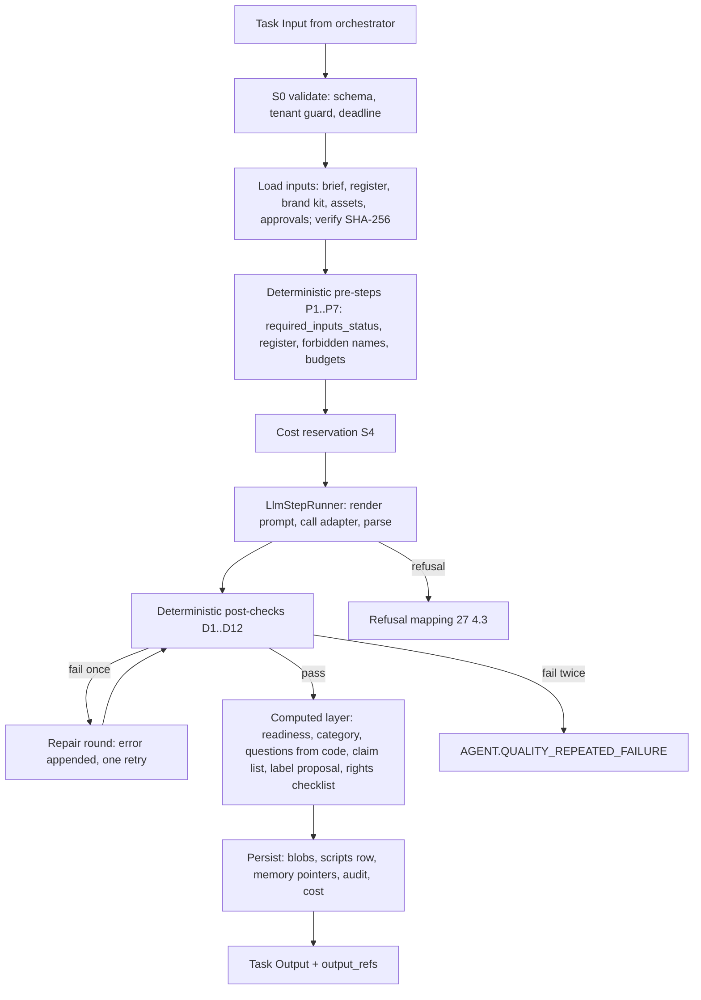
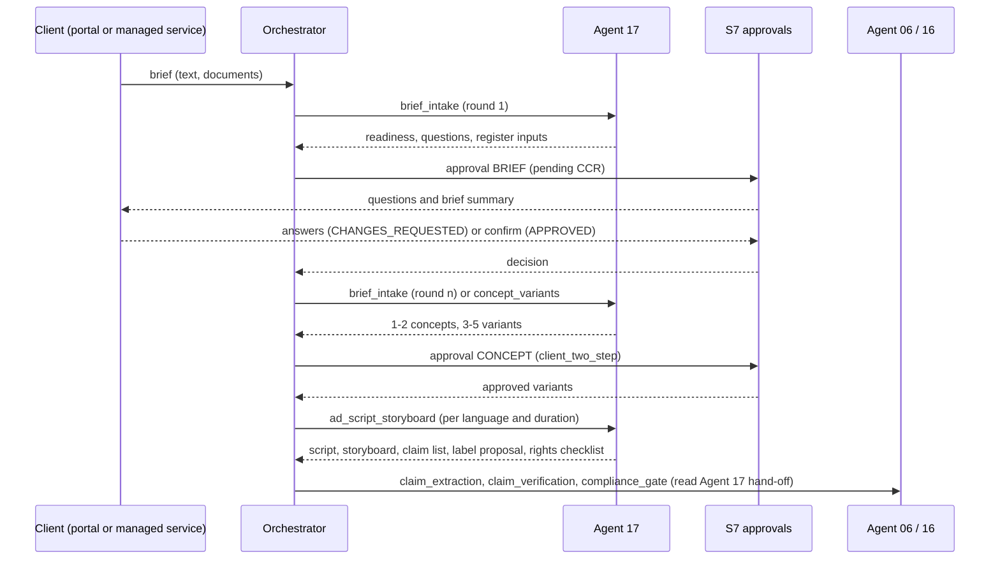

# Agent 17 — Brief & Creative Strategy (blueprint)

| Field | Value |
|---|---|
| Status | Draft — documentation. Software: **Planned** (rule 6, rule 7) |
| Owner | Agent 17 Brief & Creative Strategy; integration owner: Agent 01 (orchestrator) |
| Package | `agent_17_brief_creative_strategy` (27 §7.2); prompts `prompts/agent_17_brief_creative_strategy/`; evals `evals/agent_17_brief_creative_strategy/` |
| Directive sections covered | §3.1 row 17 (client/campaign brief intake and clarification questions, audience and objective, creative concepts and variants, ad scripts and storyboards per format, claim list to 06/16, usage-rights and talent/likeness checklist, client concept approval before production), §1D (advertising line: 1D.1 workflow, 1D.2 rules, 1D.3 blocking checks, 1D.4 ad quality and 3-5 variants), §3.3 (contracts, failures, quality, observability, AI providers, memory), §3.5 (prompt, eval, code standards), §4 (26 sections) |
| Owner decisions applied | D1 (3A production line first; **Agent 17 is not part of 3A or 3B**; spend limits at each provider; keys only through the environment's secret mechanism; render never in market hours; no upload, no Google OAuth in 3A), D2 (blueprints of non-3A agents are written in parallel and approved before their own build begins) |
| Binding contracts | GLOSSARY_AND_IDS.md (§6.15 `approval_kind`, §6.37 rule-pack keys, §6.39-6.40 claims, §6.43 `disclosure_decision`, §6.47 `tier`, §6.49-6.51), 03_COMMUNICATION_STANDARD.md, 04_DATABASE_ARCHITECTURE.md (§5.3, §5.10, §5.11, §5.12, §5.15, §5.16), 07_FAILURE_MANAGEMENT.md, 24_PRODUCTION_TYPES.md (§3.2 task types `agent_17.brief_intake`, `agent_17.concept_variants`, `agent_17.ad_script_storyboard`; §7.3-7.5), 27_ENGINEERING_STANDARDS.md |
| Shared docs referenced by name/§ only | 25_ADVERTISING_COMPLIANCE.md (§2 workflow, §3 substantiation, §4.3 rules `ADV-R1..R16`, §5 sector packs, §6 disclosure decision, §7 releases and likeness, §8 virtual presenters, §10 usage-rights), 13_COMPLIANCE_YOUTUBE_POLICY.md, 18_PRODUCTION_QUALITY_STANDARD.md, 09_COST_AND_BUDGET.md, 08_SECURITY.md §8, 22_DATA_PROTECTION.md, 20_MULTI_TENANCY_AND_ENTERPRISE.md, 3A_SLICE_SPEC.md, ADR-001, ADR-005, ADR-007, KNOWLEDGE_LIBRARY_PLAN.md (not used by this agent; client material is the client's own and is not an owner-library collection) |
| Facts cited | RESEARCH_LOG IN-04 (ASCI synthetic-content labelling; **not in force on 2026-11-18**), IN-05 (ASCI influencer rules), IN-06 (IT Rules on synthetically generated information, in force 20 Feb 2026), IN-07 (DPDP Rules), YT-06 / YT-07 / YT-09 (synthetic-media field, disclosure policy, AI personas), PR-01 / PR-02 / PR-03 (models, batch and caching, API separate from subscription), INF-11 (RLS). The ASCI Code Chapter I text is cited as read in 25 §1.3 (it has **no RESEARCH_LOG row yet: REQUIRES REVIEW (Phase 1): add a log row**) |
| Marking | Every section ends its first line with **MVP** (3A / 3B / 3C, tier 0-3 per GLOSSARY §6.47). Agent 17 is **3C, Tier 1+** (built when the first ad client is signed, 02 §registry, 24 header, plan Q17). Nothing here is part of 3A or 3B |
| Conventions | `(pending CCR)` = a contract item that does not exist in Wave A/B-1 and is listed in the structured return for the integrator. `REQUIRES REVIEW (Phase 1): <need>` = an unknown value; none is invented. All client names, brands, people and documents used in examples are fictional. No private method, book text or server detail appears in this document. |

---

## 1 Identity and mission
**MVP: 3C · Tier 1 (first managed-service ad client); portal-driven intake is Tier 2.**

### 1.1 Mission
Agent 17 is the creative front of the advertising line (directive §1D.1). It turns a client's brief into (a) a clarified, structured brief with the open questions the client must answer, (b) a small set of creative concepts with 3 to 5 test variants the client can choose from, and (c) for the approved variant, an ad script and a shot-by-shot storyboard per ordered format, together with the hand-off facts the compliance chain needs: the **claim list** (every factual, comparative, statistical or performance statement and the client document that is supposed to support it), the **label proposal** (which AI-content elements the ad contains), and the **usage-rights and talent/likeness checklist** (who or what needs a release, consent or permission). It writes creative text; it never decides truth, compliance or approval.

### 1.2 Where it sits
| Production type (24 §7) | Stages that use Agent 17 | Notes |
|---|---|---|
| `AD_SPOT` (24 §7.3) | `agent_17.brief_intake` → (approval `BRIEF`, pending CCR, see §23) → `agent_17.concept_variants` → approval `CONCEPT` (`client_two_step`) → `agent_17.ad_script_storyboard` → `agent_06.claim_extraction` | the reference flow (25 §2) |
| `ECOMMERCE_PRODUCT` (24 §7.5) | `agent_17.brief_intake`, `agent_17.ad_script_storyboard` | no concept stage unless ordered; the script step builds an implicit variant from the brief (prompt `ad_script_storyboard.v1` rule 3, input row `approved_variant`) |
| `EXPLAINER_CORPORATE_TRAINING` (24 §7.4) | `agent_17.brief_intake` only | the clarified brief is confirmed by approval `BRIEF`; scripting is Agent 05; ad-specific outputs are skipped (§8) |
| `CHANNEL_LONG_FORM`, `SHORTS`, `DUBBING_LOCALISATION` | none | owner channels use Agent 03 (17 replaces 03 for client types only, §3.1) |

All three task types run as `AI_IO` tasks on queue `ai`, capability `llm` (24 §3.1). Control flow is in the orchestrator's state machine (03 §11); Agent 17 never calls another agent and never creates tasks.

### 1.3 Authority boundaries
| Agent 17 **decides** | Agent 17 **does not decide** (owner of the decision) |
|---|---|
| how to restate the brief faithfully (no added facts) | whether the brief is approved (client, approval `BRIEF`) |
| which questions to ask the client and which are blocking | whether the product or sector may be served (owner decision on the alcohol/tobacco-surrogate sector, 25 §5.1; Agent 16 for the pack) |
| which statements in the brief are claims and which client document is tied to them by the client's own words | whether a claim is true or supported (client carries truth, 25 §1.2; Agent 06 proposes, **Agent 16 final**, Q5) |
| the creative concepts, variants, hooks, scripts and storyboards (inside the limits of §6.6) | which concept is produced (the client, approval `CONCEPT`); the script and storyboard (client, approvals `SCRIPT` / `STORYBOARD`) |
| which AI-content elements the storyboard contains (declaration) | whether an AI label is required (Agent 16, ADV-R7; Agent 17 only **proposes**, ADV-R16 compares) |
| which people, voices, brands and elements need a release or permission (the checklist) | whether a release is valid or covers the use (human check, 25 §7.2 step 3); legal drafting (lawyer, ⚖) |
| its own retries inside its caps | job routing, revision loops, approvals, budgets (orchestrator, S7, S4) |

It never writes to `approvals`, `editorial_contributions`, `compliance_verdicts` or `claims`; never raises a budget; never calls the YouTube API (zero quota units); never uploads; never fetches web pages or client links; has no tool-use for the model (the LLM returns JSON that code validates, 27 §4); and never names or imitates a real person in anything it writes.

### 1.4 Success criteria (measurable; thresholds are config and set at the first client pilot; the eval thresholds are in §26)
| ID | Criterion | Measure |
|---|---|---|
| SC-1 | Fidelity of the structured brief | 100 % of recorded quotes are exact substrings of the client's text (eval A2) |
| SC-2 | No invented claim | 0 statements in any script or concept outside the register of documented claims (eval `ad_script_storyboard` A5, `concept_variants` A3) |
| SC-3 | No unapproved person or brand | 0 shots flagged as a real person or a third-party brand without an approved reference (A7, A8) |
| SC-4 | Variants are real alternatives | all variants of a concept have distinct angles and hook overlap within `ad.variants.max_hook_overlap` (A6) |
| SC-5 | Clarification converges | share of briefs that reach `READY` within `ad.brief.max_clarification_rounds` rounds (MEASURED at the first pilot; target set then) |
| SC-6 | Plan arithmetic is exact | shot durations sum to the ordered duration in 100 % of delivered storyboards (A4) |
| SC-7 | Hand-off completeness | every delivered script has a claim list, a label proposal and a rights checklist; 0 downstream `PERMANENT.MISSING_DEPENDENCY` caused by Agent 17 |
| SC-8 | Cost discipline | cost per ordered ad stays inside the per-video budget of D1; per-task cost recorded (ESTIMATE until measured, §17) |
| SC-9 | Downstream pass rate | share of scripts that pass `agent_06.claim_extraction` and `agent_16.compliance_gate` without a revision loop caused by Agent 17 content (MEASURED; no target until the pilot) |

---

## 2 Functional requirements
**MVP: 3C · Tier 1. Each row names its tier: the brief, concept and script functions are Tier 1; client self-service answers in a portal are Tier 2.**

### 2.1 What, why, when
| ID | Function | Why | When / trigger | Inputs | Outputs | Dependants | Tier |
|---|---|---|---|---|---|---|---|
| FR-01 | Validate the task input and tenant context (S0) | rule 9; 03 §7 | every task start | Task Input, context refs | accepted input or structured rejection | orchestrator | 1 |
| FR-02 | Compute `required_inputs_status` (brand kit, client media, release documents) from the tenant's own rows | the model must not ask what the system already knows; 24 §7.3 `required_inputs` | `brief_intake` | `brand_kits`, `assets`, client documents | status map | prompt input, FR-05 | 1 |
| FR-03 | Extract the structured brief (objective, audience, product, offer, CTA, tone, mandatories, formats, languages) | §1D.1 step 1 | `brief_intake` | brief text, answers, document titles | `brief` | FR-05, 07 concept, 15 | 1 |
| FR-04 | List stated claims, named people, named third-party brands, requested AI-content classes and risk notes | claim substantiation (25 §3), rights (25 §7), label decision inputs (25 §6.2) | `brief_intake` | as FR-03 | the five lists | claim register, checklist, Agent 16 | 1 |
| FR-05 | Decide clarification questions: model asks about content ambiguity; **code** asks for missing standard inputs (brand kit, release documents, a document per claim, formats) | a clarified brief is a required input; ask once, completely | `brief_intake` | FR-02..04 | `questions[]` with `generated_by` | client (via S7 / managed service) | 1 |
| FR-06 | Compute `brief_readiness` (`READY` / `NEEDS_CLARIFICATION` / `NEEDS_HUMAN_REVIEW`, pending CCR) deterministically | the readiness gates the next stage | `brief_intake` | FR-02..05 | `readiness`, `readiness_reasons` | orchestrator routing (approval `BRIEF`) | 1 |
| FR-07 | Map the category to sector keys (code) and record `category.status` | Agent 16 loads sector packs from the brief category (25 §5.3); unknown category stops the job at validation | `brief_intake` | `category_candidates` | `category` | Agent 16, orchestrator J02 | 1 |
| FR-08 | Build the **claim register** from the approved brief: every stated claim with `register_status` `DOC_ATTACHED` / `NO_DOC` and its conditions | only documented claims may be used in creative work (ADV-R1) | `concept_variants` P3, `ad_script_storyboard` P3 | brief output, document refs | `claim_register` | concept and script steps | 1 |
| FR-09 | Build `forbidden_names` (people without a release, competitor brands) and `approved_people` / `approved_brands` | ADV-R5, ADV-R6; generation prompts must never name a real person (25 §7.2 step 4) | P4 of the two creative steps | brief output, `assets.release_ref`, `voice_consents`, client documents | lists | prompt inputs, post-checks | 1 |
| FR-10 | Propose 1-2 concepts and exactly 3-5 variants | §1D.1, §1D.4 | `concept_variants` | brief, register, constraints | concept deck | approval `CONCEPT`, script step | 1 |
| FR-11 | Write script and storyboard per ordered format; the script is written once per (language, duration) and locked for the other ratios | §1D.1, §1D.4; consistent wording across ratios | `ad_script_storyboard` | approved variant, register, media inventory | script + storyboard per format | Agents 06, 07, 09, 08, 10, 16 | 1 |
| FR-12 | Emit the **claim list** for Agents 06 and 16 | "claim list sent to 06/16 for substantiation" (§3.1) | `ad_script_storyboard` | FR-11 | `claim_list` | 06 (extraction, verification), 16 | 1 |
| FR-13 | Build the **label proposal** from the element declarations by the table of 25 §6.2 (code) | label decision input; ADV-R7, ADV-R16 | `ad_script_storyboard` | shot declarations, destinations, approved people roles | `label_proposal` | Agent 16, Agent 13 (via Agent 16's decision) | 1 |
| FR-14 | Build the **usage-rights and talent/likeness checklist** (code) | ADV-R5 inventory; `USAGE_RIGHTS` record input (25 §10.2) | `ad_script_storyboard` | FR-04, FR-11 | `rights_checklist` | Agent 16, S7 (`USAGE_RIGHTS`), Agent 08 | 1 |
| FR-15 | Handle revisions: a revision task carries `revision_feedback`; IDs of unchanged variants stay stable | 03 §3 (revision routing), `limits.max_revision_loops` | revision iteration | feedback | new iteration output | orchestrator | 1 |
| FR-16 | Persist documents (write-once blobs, SHA-256), the `scripts` row, `memory_items` pointers, cost and audit | 03 §8; 04 | end of each task | validated output | `output_refs` | all downstream | 1 |
| FR-17 | Remember concept history and client preferences per workspace, from human decisions only | avoid repeating concepts for one client | after `CONCEPT` decisions | approval decisions | `memory_items` | next campaign | 2 |

### 2.2 Out of scope (explicit)
Truth or sufficiency of any claim; recommending a price, a media plan or a budget; choosing a sector pack; selecting or generating media; voice choice (Agent 07); shot-level planning and timeline (Agent 09, which refines the storyboard); thumbnails and metadata (11, 12 are not used by ad types); rendering; client communication (S7 notifications); contract terms; reading client web links; document-to-text extraction (contract request).

---

## 3 Non-functional requirements
**MVP: 3C · Tier 1.**
| ID | Requirement | Value / rule |
|---|---|---|
| NFR-1 | Determinism of structure | the same input and the same recorded model output give the same computed fields (readiness, register, label proposal, checklist); the computed layer has no randomness and no clock dependence |
| NFR-2 | Idempotency | every external side effect carries an idempotency key (03 §9): LLM call key per (task, step, ratio, attempt-independent content hash); `scripts` insert keyed by (task, format); blob writes are write-once |
| NFR-3 | Resource class | `AI_IO`, queue `ai`, capability `llm`; no CPU-heavy work; peak memory under 256 MB (ESTIMATE); runs inside the shared `ai_worker` (10 §7) |
| NFR-4 | Latency | dominated by provider latency; **not measured**; REQUIRES REVIEW (Phase 1): measure p50/p95 in the first eval run; a client waits on `brief_intake` and `concept_variants` (interactive), so these are not batch by default (§11) |
| NFR-5 | Bounded work | hard caps: LLM calls per task `resource_budget.max_llm_calls` (brief 2, concept 2, script `2 x ratios`), clarification rounds `ad.brief.max_clarification_rounds`, revision loops `limits.max_revision_loops` (07 §9); beyond them `AGENT.LOOP_CAP_EXCEEDED` or human review |
| NFR-6 | Tenant isolation | absolute; §19 |
| NFR-7 | Confidentiality | briefs, claims, client documents and concepts are client confidential data; never in logs or metrics; never used to train or tune shared prompts (§14, §19) |
| NFR-8 | Provider independence | provider and model by config only; fake and recorded adapters for every test (27 §8) |
| NFR-9 | Cost | within the per-video and pilot budgets (D1, 09); the agent reserves before each call and stops on breach (07 `RESOURCE.BUDGET_EXHAUSTED`) |
| NFR-10 | Language | the brief may be in any language of the client; the ad language is an order parameter (English, Hindi, Marathi first); JSON field values are English except ad text and quotes (§6.3) |
| NFR-11 | Honest scope | creative output is a proposal; every output carries `proposal_only = true` semantics (it is never a verdict) |
| NFR-12 | Accessibility of questions | clarification questions are one sentence, answerable in one reply, so that a client can answer on a phone |

---

## 4 Internal architecture
**MVP: 3C · Tier 1.**





Components are defined in §9; the state of a task in §16.

---

## 5 Full system prompt
**MVP: 3C · Tier 1. The real prompt text lives in the prompt files (27 §4); this section summarises and links them.**

There are three LLM steps, one prompt file each, all written to `prompts/_TEMPLATE.v1.md` (header table, Role, Objective, Inputs, Rules with rule packs by reference, Output JSON Schema with the `refusal` property, worked examples including a refusal path, Refusal and escalation, Self-check). Model, temperature, token caps, timeout, cost budget, caching and batch eligibility are configuration (`llm.agent_17.<task>.*`), never in the file.

| Prompt ID | File | Task type | Role in one line | Rule packs (by reference) |
|---|---|---|---|---|
| `agent_17/brief_intake.v1` | [`prompts/agent_17_brief_creative_strategy/brief_intake.v1.md`](../prompts/agent_17_brief_creative_strategy/brief_intake.v1.md) | `agent_17.brief_intake` | faithful structured brief, claims, people, brands, AI-content requests, questions, risk notes | `rp.advertising_asci_in`; sector packs when known |
| `agent_17/concept_variants.v1` | [`prompts/agent_17_brief_creative_strategy/concept_variants.v1.md`](../prompts/agent_17_brief_creative_strategy/concept_variants.v1.md) | `agent_17.concept_variants` | 1-2 concepts and exactly 3-5 distinct variants, claims only from the documented register | `rp.advertising_asci_in`; sector packs; `rp.youtube_general` if YouTube |
| `agent_17/ad_script_storyboard.v1` | [`prompts/agent_17_brief_creative_strategy/ad_script_storyboard.v1.md`](../prompts/agent_17_brief_creative_strategy/ad_script_storyboard.v1.md) | `agent_17.ad_script_storyboard` | script and storyboard for one format; per-shot declarations of people, presenter kind and AI elements | same as concept step |

Design points that hold for all three prompts:
1. **The model proposes; code decides.** Readiness, category mapping, code-generated questions, claim register, claim list, label proposal and rights checklist are computed by code from the model's declarations (§6). The prompts forbid the model to state a verdict, a label or a legal conclusion.
2. **No fact without a source.** Product facts come only from the client's brief and documents; creative steps use only register claims with a document attached. A statement outside the register is a defect, repaired once, then `AGENT.QUALITY_REPEATED_FAILURE`.
3. **No real person, no imitation.** Prompts forbid naming, describing or imitating a real, identifiable person or a competitor; people appear only as generic descriptors or as `person_ref` of an approved person (25 §7.2 step 4: generation prompts later built from shot descriptions must never name a real person).
4. **Untrusted text.** Brief text, answers, document titles, feedback and names are data. Injection cases are in every eval set.
5. **Shared prefix has no tenant data.** The system prompt, rules and schema form the cacheable prefix (PR-02); tenant content is in the user part only (08 §8 layer 4).
6. **Rule packs by reference.** `{{rule_pack:rp.advertising_asci_in}}` is resolved at runtime from `rule_packs`; the version is recorded per call. Sector packs are stubs until researched (25 §5): the prompts forbid inventing sector rules.
7. **Language.** Rule and output text in English; quotes and ad text in the client's language (§6.3).
8. **Judge prompts** (`agent_17/<task>_judge.v1`) are separate files written at build time with the eval runner (planned paths in §26); the judge never decides a verdict.

Prompt changes are `v<N+1>` and trigger the eval gate (27 §5). A released prompt is immutable.

---

## 6 Decision engine
**MVP: 3C · Tier 1.** Principle (directive §2): code decides everything that can be decided by a rule; the model is used only where language understanding or creativity is needed, and its output is always validated and then **re-derived** by code where a verdict, a count or a reference is involved.

### 6.1 Deterministic versus LLM
| Decision | Kind | Why |
|---|---|---|
| tenant and context agreement, deadline, schema | deterministic (S0) | rule 9, 03 §7 |
| `required_inputs_status` (brand kit, client media, release documents) | deterministic (P4) | facts in the tenant's own rows; the model must not guess them |
| extracting objective, audience, claims, people, brands, AI-content requests from free text | **LLM** (`brief_intake`) | natural language, any client language |
| quote fidelity | deterministic (D2: exact substring) | prevents invention |
| tie of a claim to a client document | LLM proposes only when the client's own words or the document title say so; code verifies the doc ID and kind (D3) | the platform never judges proof (25 §3.1) |
| missing-input questions (brand kit, releases, a document per claim, formats) | deterministic (D5) fixed templates in the ad language | completeness must not depend on the model |
| ambiguity questions and `blocking` flag | **LLM** | needs reading comprehension; bounded by D4 (no question on a `PRESENT` input, cap) |
| category to sector keys and pack loading | deterministic mapping table (keys fixed by GLOSSARY §6.37) | Agent 16 maps deterministically too (25 §5.3) |
| `brief_readiness` | deterministic (§6.2) | gates the next stage |
| claim register (`DOC_ATTACHED` / `NO_DOC`) | deterministic from the brief output | only documented claims are used in creative work (ADV-R1) |
| concepts, variants, hooks, scripts, storyboards | **LLM** | creative |
| counts, uniqueness of angles and hook overlap, banned words, forbidden names, claim refs, word and shot budgets, duration sum, lock identity | deterministic post-checks (D) | hard limits |
| which AI-content elements a shot has | LLM declares, **code audits**: contradictions (a person described as generated but flagged real, an AI persona without `SYNTHETIC_PRESENTER`) fail D7/D8 | honest declarations feed the label decision |
| label proposal | deterministic table (§6.4) | 25 §6.2; IN-04; the final decision is Agent 16's |
| rights checklist | deterministic (§6.5) | ADV-R5 inventory |
| approval, truth, compliance, publication | **none: not Agent 17** | §1.3 |

### 6.2 `brief_readiness` (code, evaluated in this order)
1. `NEEDS_HUMAN_REVIEW` if any `risk_notes` entry has severity `BLOCKING` (the brief as written asks for something no document can cure: ADV-R2, R3, R4, R5, R6 cases); or `category` contains a sector the platform has not been told to serve (config `ad.sectors.served`; `alcohol_tobacco_surrogate` is held for the owner's decision, 25 §5.1); or the model returned `UNSAFE_CONTENT`; or the round number reached `ad.brief.max_clarification_rounds` with blocking questions still open. Routing: approval of kind `SENSITIVE_CLAIM` (24 §3.3.2) for the operator; the client is not told to proceed.
2. else `NEEDS_CLARIFICATION` if any question is blocking (model or code), or a required input is `ABSENT` (brand kit; release documents when a real person is named; a document for any stated claim), or formats are unknown, or the category is unknown.
3. else `READY`.
The model never states readiness. `readiness_reasons[]` lists the codes (for the S7 card): `BLOCKING_RISK`, `SECTOR_HELD`, `ROUND_CAP`, `OPEN_BLOCKING_QUESTION`, `MISSING_BRAND_KIT`, `MISSING_RELEASE`, `CLAIM_WITHOUT_DOCUMENT`, `FORMATS_UNKNOWN`, `CATEGORY_UNKNOWN` (pending CCR: payload-local value set).

### 6.3 Language handling
The brief and answers may be in any language; `quote` fields stay in the original language. All other JSON text is English, except ad text (hooks, script segments, on-screen text, disclaimers), which is in `language`. Marathi and Hindi creative quality is unproven (09 §10.1 states the Marathi quality as unmeasured): the first eval run records it; no claim of quality is made here. Devanagari token cost is measured per 09 §11 (REQUIRES REVIEW (Phase 1)).

### 6.4 Label proposal (code; 25 §6.2 table, IN-04 2A-2E and 3A-3E)
Input: per-shot `synthetic_elements`, `presenter_kind`, `depicts_real_person`, approved people roles, destinations. The proposal is **not** a decision; Agent 16 decides (ADV-R7) and compares (ADV-R16).
| Condition | `asci_ai_label` (`disclosure_decision`, GLOSSARY §6.43) | Basis |
|---|---|---|
| any shot with `SYNTHETIC_PRESENTER`, or `presenter_kind = AI_PERSONA` | `REQUIRED`; also sets `presenter_identification_needed = true` | IN-04 2A; IN-05 (virtual influencers disclose); 25 §8 |
| any `REPLICATED_LIKENESS_OR_VOICE` | `REQUIRED` (and a release item in the checklist) | IN-04 2B |
| any `FABRICATED_SETTING_OR_EVENT` | `REQUIRED` | IN-04 2C |
| any `NONEXISTENT_PRODUCT_OR_PLACE_DEMO` | `REQUIRED` | IN-04 2D |
| any `SYNTHETIC_SOUND_RELEVANT_TO_PRODUCT` | `REQUIRED` | IN-04 2E |
| none of the above, all declarations present | `NOT_REQUIRED` (routine editing, ambient backgrounds, music, subtitles are not element classes: IN-04 3A-3E) | IN-04 3 |
| a declaration is missing, contradictory, or an AI visual (`D_AI_VIDEO`, `E_AI_STILL`) shows a person, a place or a product result without any declared element | `NEEDS_HUMAN_REVIEW` (never `NOT_REQUIRED`, 25 §6.2 combination rule) | 25 §6.2 |
Further fields: `elements[]` (shot number, element), `timing_hint` (from the first shot with a `REQUIRED` element to the end of the last, plus the start of the spot; a design default, IN-04 states no duration: 25 §6.4), `text_key` (reference to the localised label text catalogue; wording **REQUIRES REVIEW (Phase 1): translator and lawyer sign-off**, 25 §6.4), `youtube_declaration_hint` (`disclosure_decision`, only when `YOUTUBE` is a destination: realistic altered or synthetic content per YT-06/YT-07, IN-06; Agent 13 copies Agent 16's decision, not this hint), and `paid_endorsement_label` (needed when an approved person has role `ENDORSER`; minimum on-screen seconds from IN-05: spot length at most 15 s gives 3 s, 15 s to 2 min gives one third of the video; for 6, 15, 30, 60 s this is 3, 3, 10, 20 s, 25 §6.4; **BFSI endorsers: SEBI registration number stated** is flagged for Agent 16, ADV-R10).

### 6.5 Rights checklist (code; 25 §7)
One item per subject. Kinds (payload-local, pending CCR): `PERSON_RELEASE` (every real person: named in the brief, flagged `depicts_real_person`, or a lookalike request), `VOICE_CONSENT` (replicated voice; maps to `voices.kind = CONSENTED_CLONE` and `voice_consents.state = VERIFIED`, 04 §5.12), `BRAND_PERMISSION` (each third-party brand shown or named), `TESTIMONIAL_DOCUMENT` (each `TESTIMONIAL` claim: a real, consenting person, 25 §7.3), `CLIENT_MEDIA_LICENCE` (the client's own footage and photos: the client's grant to the platform, 25 §10.2), `THIRD_PARTY_ELEMENT` (stock, music, fonts: left `OPEN` for Agent 08's licence-ledger rows), `SPECIAL_PERSON_REVIEW` (a minor, a deceased person or a person in a sensitive profession: default `NEEDS_HUMAN_REVIEW`, lawyer position **REQUIRES REVIEW (Phase 1)**, 25 §7.2). Each item has `item_id`, `subject`, `required_evidence`, `status` (`OPEN` / `EVIDENCE_ATTACHED`, set only when a matching `assets.release_ref`, a `VERIFIED` voice consent or a client document ID exists in the tenant), `evidence_ref`, `scope_check_by = HUMAN` (25 §7.2 step 3: whether the release covers the advertiser, medium, term and AI replication is a human check; Agent 17 never marks a scope fit). The checklist also seeds the `USAGE_RIGHTS` record (25 §10.2); Agent 17 does not write it.

### 6.6 Hard limits for creative output (enforced by D-checks, §10)
1. Product facts only from the claim register entries with a document attached; wording not stronger, conditions visible with the claim (ADV-R1, ADV-R3, ADV-R12).
2. No named or described real person, celebrity, creator, lookalike or competitor; people only as generic descriptors or `approved_people` refs (ADV-R5, ADV-R6).
3. No invented testimonial, quote, rating, before/after result or customer (ADV-R2, ADV-R3). Fictional characters are allowed only when the ad claims no real use or result (25 §7.3).
4. Product shown accurately; client's own media first; AI visuals of the product must not change shape, colour, size or function (§1D.4, 25 §9; hierarchy of §1A.1).
5. AI-content elements declared honestly per shot.
6. 3-5 variants per concept order (§1D.4); the number is fixed by the order, not chosen by the model.

### 6.7 Computations (config values; no number here is a measured fact)
| Quantity | Formula | Note |
|---|---|---|
| spoken-word budget | `budget = seconds x wpm[lang] / 60`; `min_words = floor(fill_min x budget)`, `max_words = floor(fill_max x budget)` | `ad.script.words_per_minute.<lang>`, `fill_min`, `fill_max`: **REQUIRES REVIEW (Phase 1): measured with Agent 07 in 3B**; no value is invented |
| shot range | `min_shots = max(1, floor(seconds / 5))`, `max_shots = ceil(seconds / 3)` (6 s: 1-2; 15 s: 3-5; 30 s: 6-10; 60 s: 12-20) | from directive §1A.2 "a visual change every 3-5 s", applied to ads as a design default; ad pacing REQUIRES REVIEW (Phase 1): 18 |
| hook overlap | token-set Jaccard of two normalised `hook_line` values | max `ad.variants.max_hook_overlap` (design default 0.5; calibrated at the pilot) |
| hook length | `max_hook_words` derived from the shortest ordered format | design default from config; passed to the prompt as a constraint |

### 6.8 Repair and caps
Output that fails JSON parse or schema: one retry with the error appended (`agent_parse`, 07 §3). Output that parses but fails a D-check: **one** repair round with the failing check IDs appended; if it fails again, `AGENT.QUALITY_REPEATED_FAILURE` (07 §2), nothing is persisted as final, and the previous iteration remains valid. The code never edits model text silently. Refusals are mapped by 27 §4.3 (§18).

---

## 7 Input schema
**MVP: 3C · Tier 1.** Envelope: `amw.task_input` 1.0.0 (03 §3). `agent_id = agent_17`, `source_agent = agent_01`, `project_id` always present, `channel_id` null for file-delivery ads or the client's channel when `YOUTUBE` is a destination. `payload` = `{payload_schema, payload_schema_version, data | data_ref + data_sha256}`; inline limit 262,144 bytes (design value, 03 §3.3). All `context_refs[].uri` and `data_ref` belong to `org_id` (03 §8).

### 7.1 `agent_17.brief_intake.input` 1.0.0
| Field | Type | Null | Rule |
|---|---|---|---|
| `production_type_key` | enum GLOSSARY §6.48 | no | `AD_SPOT`, `ECOMMERCE_PRODUCT` or `EXPLAINER_CORPORATE_TRAINING`; else `PERMANENT.UNSUPPORTED_TASK` |
| `round_no` | int 1..`ad.brief.max_clarification_rounds` | no | 1 for the first intake |
| `brief_language` | BCP 47 | no | |
| `brief_text` | string | no | client's brief (typed by the client or entered by the operator in the managed service); size cap config |
| `client_documents[]` | `{doc_id, kind, title, storage_uri, sha256}` | no (may be empty) | `kind` in `BRIEF`, `SUBSTANTIATION`, `RELEASE`, `BRAND_GUIDE`, `PRODUCT_MEDIA`, `OTHER` (payload-local, pending CCR); documents are the client's data in the client's tenant |
| `client_answers[]` | `{question_id, answer_text}` | no | from the previous round (from the `BRIEF` approval decision) |
| `prior_output_ref` | `amw-blob://` URI | yes | previous round output, with SHA-256 in `context_refs` (`PRIOR_OUTPUT`) |
| `requested_formats[]` | `{ratio, seconds}` | yes | ratios GLOSSARY §6.50, seconds §6.49 |
| `destinations[]` | `FILE_DELIVERY` / `YOUTUBE` | no | GLOSSARY §6.26 |
Required `context_refs`: `BRAND_KIT` (if one exists), `COMPLIANCE_PROFILE`, `RULE_PACK` (`rp.advertising_asci_in`), `CLIENT_INPUT` for each document.

### 7.2 `agent_17.concept_variants.input` 1.0.0
| Field | Type | Null | Rule |
|---|---|---|---|
| `production_type_key` | enum | no | ad types only |
| `brief_ref` + `brief_sha256` | storage URI + hash | no | the confirmed brief (`agent_17.brief_intake.output`); the `BRIEF` approval (when required by the workflow) must be `APPROVED` for that hash |
| `language` | BCP 47 | no | ad language |
| `concept_count` | int 1..2 | no | config `ad.concept.max_concepts` (design default 2) |
| `variant_count` | int 3..5 | no | §1D.4; set by the order |
| `formats[]` | `{ratio, seconds}` | no | at least one |
| `revision_feedback[]` | `{source, instruction}` | yes | untrusted text |
| `iteration` | int >= 0 | no | revision counter |

### 7.3 `agent_17.ad_script_storyboard.input` 1.0.0
| Field | Type | Null | Rule |
|---|---|---|---|
| `production_type_key` | enum | no | `AD_SPOT` or `ECOMMERCE_PRODUCT` |
| `concept_ref` + `approved_variant_ids[]` | URI + IDs | `approved_variant_ids` empty only for `ECOMMERCE_PRODUCT` without a concept stage | bound to the `CONCEPT` approval's `subject_sha256` |
| `brief_ref` + `brief_sha256` | storage URI + hash | no | |
| `language` | BCP 47 | no | ad language |
| `duration_seconds` | enum 6, 15, 30, 60 | no | GLOSSARY §6.49 |
| `ratios[]` | non-empty subset of `16:9`, `9:16`, `1:1`, `4:5` | no | one task = one (language, duration); the first ratio writes the script, the others use it locked (§6.7, prompt rule 1) |
| `destinations[]` | `FILE_DELIVERY` / `YOUTUBE` | no | feeds the label proposal hint |
| `revision_feedback[]`, `iteration` | as above | yes / no | |
`resource_budget.max_llm_calls = 2 x len(ratios)`. Required `context_refs`: `PRIOR_OUTPUT` (brief, concept deck), `BRAND_KIT`, `COMPLIANCE_PROFILE`, `RULE_PACK`, `APPROVAL` (`CONCEPT` decision), `ASSET` for client media.

### 7.4 Validation order (all three)
S0: schema and version; org agreement (envelope, input, every ref); deadline; production type supported; approval prerequisites (hash match); document existence and SHA-256; size caps; then business checks. Failures are structured rejections (03 §7): `PERMANENT.SCHEMA_INVALID`, `PERMANENT.TENANT_MISMATCH`, `PERMANENT.CROSS_TENANT_REF`, `PERMANENT.MISSING_DEPENDENCY` (approval not `APPROVED` or hash differs), `PERMANENT.INPUT_INVALID`.

---

## 8 Output schema
**MVP: 3C · Tier 1.** Envelope: `amw.task_output` 1.0.0 (03 §5): `status`, `payload`, `output_refs`, `quality_score` (null: Agent 17 does not score), `confidence` (null), `validation_results` (deterministic checks first, check IDs `a17.<task>.<check>`), `duration`, `resource_usage`, `error`, `next_action` (advisory), `downstream_agent`, `timestamp`. The LLM part of each payload is the `llm_output` schema of the prompt file (the JSON Schemas live in the prompt files, 27 §4.2 item 6); the payload wraps it with the code-computed layer.

### 8.1 `agent_17.brief_intake.output` 1.0.0
| Field | Meaning |
|---|---|
| `round_no`, `brief_sha256`, `rule_pack_versions` | provenance |
| `readiness` (`brief_readiness`, pending CCR), `readiness_reasons[]` | §6.2 |
| `brief` | the model's `brief_summary` (null on refusal) |
| `category` | `{sector_keys[], status: KNOWN / UNKNOWN / HELD_FOR_OWNER}`, from the mapping table |
| `claim_register[]` | `{claim_id (cr1..), quote, claim_type_hint, register_status DOC_ATTACHED / NO_DOC, doc_ids[], conditions}`; local IDs, not `claims` rows |
| `people[]`, `third_party_brands[]`, `synthetic_requests[]` | as extracted |
| `questions[]` | `{question_id, topic, question, blocking, reason, generated_by MODEL / CODE}` |
| `risk_notes[]` | `{rule_id, severity, quote, note}` (advisory; verdicts are Agent 16's) |
| `required_inputs_status` | as computed |
| `refusal` | the model's refusal object or null (27 §4.3) |
`output_refs`: `DATA` `brief.json` (write-once, SHA-256). `next_action`: `AWAIT_APPROVAL` (readiness `READY` or `NEEDS_CLARIFICATION`, approval `BRIEF`) or `NEEDS_REVIEW` (`NEEDS_HUMAN_REVIEW`). Non-ad types: `claim_register`, `synthetic_requests`, `category` are present but `rp.advertising_asci_in` flags are omitted.

### 8.2 `agent_17.concept_variants.output` 1.0.0
`concepts[]`, `variants[]` (as in the prompt schema), `claim_register_ref` + SHA-256 (the register the step used), `forbidden_names_checked` (count, not the names), `checks[]` (D-check results), `refusal`, and `advisory_verdict` (`BLOCKED` only when the refusal is `RULE_WOULD_BE_BROKEN`; mapping 27 §4.3). `output_refs`: `DATA` `concepts.json`. This blob is the **subject** of approval `CONCEPT` (hash-bound, 03 §11.6).

### 8.3 `agent_17.ad_script_storyboard.output` 1.0.0
| Field | Meaning |
|---|---|
| `language`, `duration_seconds`, `approved_variant_id` | provenance |
| `script` | `{segments[], spoken_word_count, bounds {min,max}}`; identical for all ratios of the task |
| `storyboards[]` | one per ratio: `{ratio, shots[], total_ms}`; shot fields as in the prompt schema |
| `claim_list[]` | `{claim_ref, quote, segment_id, claim_type_hint, requires_substantiation = true, substantiation_doc_ids[], conditions, disclaimer_segment_id}` (**hand-off to 06 and 16**, FR-12) |
| `disclaimers[]` | from the model plus the register conditions (code adds any the model missed and marks `added_by = CODE`, then fails D10 if the display shot is missing) |
| `label_proposal` | §6.4; payload shape aligned with the pending decision-record schema of 25 §6.5 (pending CCR) |
| `rights_checklist[]` | §6.5 |
| `scripts_row_ref` | `amw-entity://<org>/scripts/scr_<uuid7>` (the persisted `scripts` row, `status = DRAFT`) |
| `checks[]`, `refusal`, `advisory_verdict` | as above |
`output_refs`: `SCRIPT` `script.json`, `DATA` `storyboard_<ratio>.json` per ratio, `DATA` `claim_list.json`, `DATA` `label_proposal.json`, `DATA` `rights_checklist.json`. The bundle hash is the subject of approvals `SCRIPT` and `STORYBOARD`.

---

## 9 Python package and class architecture
**MVP: 3C · Tier 1. Rules: 27 §7 (one package per agent; imports only `amw_core` and adapter Protocols; constructor injection; no globals; mypy strict).**

```text
agent_17_brief_creative_strategy/
  __init__.py            # exports Agent17Stage (Protocol StageExecutor)
  stage.py               # Agent17Stage: task-type dispatch, step order, checkpoints
  config.py              # AdSettings (pydantic-settings via amw_core.config): ad.*, llm.agent_17.*
  models/                # Pydantic: brief_in.py, brief_out.py, concept_in.py, concept_out.py, script_in.py, script_out.py, common.py
  guards/tenant.py       # TenantGuard
  guards/prerequisites.py# ApprovalPrerequisiteChecker (BRIEF / CONCEPT hash binding)
  intake/inputs.py       # RequiredInputsProbe (brand kit, assets, release documents)
  intake/questions.py    # CodeQuestionFactory (templates per language), QuestionMerger
  intake/readiness.py    # ReadinessEvaluator
  intake/category.py     # SectorMapper
  register/builder.py    # ClaimRegisterBuilder
  register/people.py     # PeopleResolver (forbidden_names, approved_people, approved_brands)
  creative/budgets.py    # WordBudget, ShotRange, HookLimits
  creative/variant_checks.py # VariantValidator (counts, angles, overlap, names, banned words, fictional rules)
  creative/script_checks.py  # ScriptValidator (words, shots, durations, lock, claim scan, disclaimers, declarations)
  handoff/claim_list.py  # ClaimListBuilder
  handoff/label.py       # LabelProposalBuilder
  handoff/rights.py      # RightsChecklistBuilder
  llm/steps.py           # LlmStepRunner (render prompt, call, parse, repair once)
  store.py               # DocStore (write-once blobs), ScriptStore (scripts row), PointerStore (memory_items)
  persist.py             # OutputAssembler, audit and cost hooks
  errors.py              # Agent17Error -> amw_core error codes
```
### 9.1 Protocols and collaborators (constructor injection)
| Protocol | Implemented by | Purpose |
|---|---|---|
| `LlmAdapter` (amw_core) | provider adapters, fake, recorded | one call: system + user text in, text out, usage |
| `BrandKitRepo`, `AssetRepo`, `ApprovalReader` | SQL repos | read-only, tenant context, explicit columns |
| `VoiceConsentReader` | SQL repo | `voices`, `voice_consents` state only (no personal data columns) |
| `RulePackLoader` (amw_core) | core | rule-pack text and version |
| `CostGuard`, `AuditWriter`, `Clock`, `Tracer`, `IdGenerator` (amw_core) | core | reservation and ledger, audit events, time, tracing, UUIDv7 |
| `BlobStore` (amw_core) | core | write-once blobs, SHA-256 verified on read |
### 9.2 Class responsibilities
| Class | Responsibility | Pure? |
|---|---|---|
| `Agent17Stage` | validate, dispatch by task type, drive steps, emit Task Output; the only class sequencing side effects | no |
| `TenantGuard` | assert org agreement of every ID, URI, row and document handled (§19) | yes |
| `ApprovalPrerequisiteChecker` | approval state and `subject_sha256` match the referenced blob | no (reads) |
| `RequiredInputsProbe` | compute `required_inputs_status` | no (reads) |
| `CodeQuestionFactory` / `QuestionMerger` | questions for missing inputs, merged and deduplicated with the model's, capped | yes |
| `ReadinessEvaluator` | §6.2 | yes |
| `SectorMapper` | `category_candidates` to `sector_keys` and status; held sectors from config | yes |
| `ClaimRegisterBuilder` | register from the brief output and documents | yes |
| `PeopleResolver` | forbidden and approved lists from rows and brief | no (reads) |
| `WordBudget` / `ShotRange` / `HookLimits` | §6.7 | yes |
| `VariantValidator` | D1-D9 of `concept_variants` | yes |
| `ScriptValidator` | D1-D11 of `ad_script_storyboard` including the deterministic claim scan | yes |
| `ClaimListBuilder` / `LabelProposalBuilder` / `RightsChecklistBuilder` | §6.4, §6.5, FR-12 | yes |
| `LlmStepRunner` | one repair round (27 §3.5.2); never retries beyond | no |
| `DocStore` / `ScriptStore` / `PointerStore` | persistence, idempotent | no |
| `OutputAssembler` | Task Output, `validation_results`, `output_refs` | yes |

---

## 10 Function-level specification
**MVP: 3C · Tier 1. Every function logs with `org_id`, `channel_id`, `job_id`, `task_id`, `correlation_id`; none logs brief text, claims, names, documents, prompts or model output (08 §8 layer 5).**

| # | Function | Signature (types abbreviated) | Side effects | Exceptions (to 07 code) | Validation | Tests |
|---|---|---|---|---|---|---|
| 1 | `Agent17Stage.execute` | `(inp: TaskInput) -> TaskOutput` | all below, in order; checkpoints C1-C4; audit | any `Agent17Error` mapped to `amw.error` | S0 | contract, E2E |
| 2 | `TenantGuard.assert_scope` | `(ctx: TenantCtx, refs: Iterable[EntityRef]) -> None` | none | `PERMANENT.TENANT_MISMATCH`, `PERMANENT.CROSS_TENANT_REF` | org of envelope, input, every URI, row, document | security, property |
| 3 | `ApprovalPrerequisiteChecker.assert_approved` | `(ctx, kind, subject_uri, sha256) -> ApprovalRef` | read | `PERMANENT.MISSING_DEPENDENCY` | state `APPROVED`, hash equals | unit, integration |
| 4 | `RequiredInputsProbe.status` | `(ctx, docs: list[Doc]) -> RequiredInputs` | read | `TEMPORARY.DB_TRANSIENT` | brand kit `is_current`; assets of the workspace; RELEASE documents | unit |
| 5 | `LlmStepRunner.run` | `(step: StepDef, vars: dict, budget: Budget) -> RawOutput` | cost reservation, adapter call, raw blob, ledger row | `AGENT.INVALID_JSON`, `AGENT.OUTPUT_SCHEMA_INVALID`, `RESOURCE.BUDGET_EXHAUSTED`, `TEMPORARY.*`, `PERMANENT.PROVIDER_REFUSAL`, `PERMANENT.AUTH_INVALID` | undeclared variables rejected; size caps | unit (fake), golden |
| 6 | `BriefValidator.check` | `(raw: BriefLlm, inp: BriefIn) -> list[CheckResult]` | none | none | D1 schema; D2 quote substring; D3 doc IDs; D4 questions | unit, golden |
| 7 | `CodeQuestionFactory.make` | `(status: RequiredInputs, register: list[RegItem], formats, category) -> list[Question]` | none | none | fixed templates; language of the client | unit |
| 8 | `QuestionMerger.merge` | `(model: list, code: list, max_q: int, answered: list) -> list[Question]` | none | none | cap; no duplicate topic+subject; answered questions dropped | unit, property |
| 9 | `SectorMapper.map` | `(cands: list[Cand], served: set[str]) -> Category` | none | none | keys within GLOSSARY §6.37; `none` handling; two sectors allowed | unit |
| 10 | `ReadinessEvaluator.evaluate` | `(out: BriefComputed, round_no, cap) -> (Readiness, list[Reason])` | none | none | §6.2 order | unit table (all branches) |
| 11 | `ClaimRegisterBuilder.build` | `(brief_out, docs) -> list[RegItem]` | none | none | stable IDs `cr<n>` by order of the brief; `DOC_ATTACHED` only if doc ID exists and kind is `SUBSTANTIATION` | unit |
| 12 | `PeopleResolver.resolve` | `(ctx, brief_out) -> People` | read | `TEMPORARY.DB_TRANSIENT` | approved only with `assets.release_ref` or `VERIFIED` voice consent, not expired or withdrawn | unit, integration |
| 13 | `WordBudget.bounds` / `ShotRange.bounds` / `HookLimits.max_words` | `(seconds, lang, cfg) -> (int, int)` | none | `PERMANENT.CONFIG_INVALID` when `wpm[lang]` is missing | §6.7 | unit, property |
| 14 | `VariantValidator.check` | `(raw: ConceptLlm, inp: ConceptIn) -> list[CheckResult]` | none | none | D1-D9 (`concept_variants` prompt header) | unit, golden |
| 15 | `ScriptValidator.check` | `(raw: ScriptLlm, inp: ScriptIn, lock) -> list[CheckResult]` | none | none | D1-D11 (`ad_script_storyboard` header); claim scan: numbers, `%`, comparatives, superlatives in every segment must lie inside a `claims_in_script` quote | unit, golden |
| 16 | `ScriptValidator.lock_identity` | `(segments, lock) -> bool` | none | none | byte equality of IDs, kinds, text, refs | unit |
| 17 | `ClaimListBuilder.build` | `(script, register) -> list[ClaimListItem]` | none | none | each `claim_ref` resolves; adds disclaimer segment IDs | unit |
| 18 | `LabelProposalBuilder.build` | `(storyboards, people, destinations, duration) -> LabelProposal` | none | none | §6.4 table, all rows tested | unit table |
| 19 | `RightsChecklistBuilder.build` | `(people, brands, shots, register, status) -> list[RightsItem]` | none | none | §6.5; evidence status only from tenant rows | unit table |
| 20 | `DocStore.write` | `(ctx, kind, doc, idem: IdemKey) -> OutputRef` | write-once blob, SHA-256 | `INFRASTRUCTURE.STORAGE_UNAVAILABLE` | schema; idempotent by key | unit, failure-injection |
| 21 | `ScriptStore.insert` | `(ctx, script, fmt_key, idem) -> ScriptId` | insert `scripts` (`status = DRAFT`, `prompt_id = agent_17/ad_script_storyboard.v1`, `created_by_task_id`) | `TEMPORARY.DB_TRANSIENT` | `UNIQUE (org_id, job_id, language, version)`: version allocated in sequence per (job, language) | integration |
| 22 | `PointerStore.upsert` | `(ctx, key, ref, scope=PROJECT, expires_at) -> MemId` | `memory_items` insert, supersede previous | `TEMPORARY.DB_TRANSIENT` | `expires_at` required for PROJECT (04 CHECK); provenance = output ref | unit |
| 23 | `OutputAssembler.assemble` | `(parts) -> TaskOutput` | none | `AGENT.INCOMPLETE_OUTPUT` | 03 §5.3 success rule | contract |
| 24 | `Agent17Stage.map_refusal` | `(refusal, ctx) -> TaskOutput` | none | per 27 §4.3 | mapping table of §18 | unit |

Logging: events `a17.task.start`, `a17.step.llm_call` (tokens, cost, latency only), `a17.check.fail` (check ID only), `a17.refusal` (reason code only), `a17.task.done`; fields in §22.

---

## 11 AI provider use
**MVP: 3C · Tier 1.** Provider, model and limits come from configuration (`llm.agent_17.<task>.*`, ADR-007); production AI calls use API access, which is billed separately from any Claude subscription (PR-03, rule 5); keys only through the environment's secret mechanism, held by the adapter (08 §3), never by Agent 17 code.
| Task / step | Starting tier hypothesis (config; confirmed or changed only through the eval gate, 09 §10.1) | Why | Cache | Batch |
|---|---|---|---|---|
| `brief_intake` | small to mid | structured extraction and classification; PR-01 names a small tier for classification-type work | prefix cached (system + rules + schema; no tenant data) | no: a client is waiting |
| `concept_variants` | mid | creative writing; PR-01: mid tier for most writing | cached prefix | no by default; `batch_eligible` configurable for non-urgent orders |
| `ad_script_storyboard` | mid; top tier only if the eval fails in a language | wording discipline; Marathi/Hindi quality unmeasured | cached prefix | configurable; one call per ratio |
Prices are not repeated here; see 09 §7 and PR-01/PR-02 (batch: 50 % discount; cache read multiplier 0.05x on the mid tier named in PR-02). A tier change is a config change that passes the eval gate; S4 never switches tier at runtime to hide a breach (09 §10.1).
**Provider refusal** (`PERMANENT.PROVIDER_REFUSAL`): fail with escalation L2; if a compliance question, L3. A configured fallback provider may be tried once inside the attempt (07 §2) only if it has passed the same eval gate.
**Determinism controls:** temperature, max tokens, timeout in config; the raw model output blob is stored (write-once) before any post-check so a retry never repays for the same call (checkpoint C2, §16).
**No tool-use, no web search, no browsing**: the model sees only the variables of its prompt.
**Fakes:** `FakeLlmAdapter` (scripted JSON by prompt ID and case) and `RecordedLlmAdapter` (fixtures) serve all tests (27 §8); no paid call in CI.

---

## 12 External APIs
**MVP: 3C · Tier 1.**
| API | Use by Agent 17 | Auth / scopes | Quotas | Errors and fallback |
|---|---|---|---|---|
| LLM provider (through `LlmAdapter`) | the three steps | provider key in the adapter's secret; no scopes in this document | provider rate limits and the owner-set spending limits (D1); per-task `resource_budget` | 429 to `TEMPORARY.RATE_LIMITED` (honour `retry_after_ms`); 5xx to `TEMPORARY.UPSTREAM_5XX`; timeout to `TEMPORARY.TIMEOUT`; 401/403 to `PERMANENT.AUTH_INVALID`; content refusal to `PERMANENT.PROVIDER_REFUSAL`; connection errors to `TEMPORARY.NETWORK`; breaker open to `INFRASTRUCTURE.CIRCUIT_OPEN`; fallback provider only by config and only if eval-passed. Exact provider error codes: adapter documentation per ADR-007; model IDs and prices PR-01, PR-02 |
| YouTube Data API | **none** (0 quota units) | no Google OAuth in 3A (D1); none needed here | none | not applicable |
| Web, client URLs, social platforms | **none**; links in a brief are recorded as text, never fetched | | | a client who wants a link used supplies the content as a document |
| Document-to-text extraction (PDF, office files) | not done by Agent 17; the brief and answers arrive as text; documents are referenced by ID and title | | | a platform function with no owner yet: contract request |
| Platform ad-spec pages (safe zones, durations) | not read at runtime; thresholds belong to `qc.ad_spot` (25 §9: REQUIRES REVIEW (25)) | | | |
Verification: no external API fact is asserted here beyond RESEARCH_LOG PR-01..PR-03.

---

## 13 Database tables
**MVP: 3C · Tier 1. Only tables of 04_DATABASE_ARCHITECTURE.md are used; Agent 17 has no table of its own and no migration.** All access through `amw_core.tenancy` with RLS `FORCE` (04 §3).
| Table (04 §) | Access | Use |
|---|---|---|
| `projects`, `jobs`, `tasks`, `task_attempts` (5.3) | read; state writes only by the orchestrator through core | context; Agent 17 never writes task state itself |
| `production_types`, `org_production_types` (5.2) | read | `required_inputs`, formats, approvals of the type |
| `rule_packs`, `compliance_profiles`, `compliance_profile_rule_packs` (5.2) | read | pack text and version for the prompt; served sectors |
| `brand_kits` (5.12) | read | `is_current` kit: banned words, tone rules, logo presence |
| `assets` (5.15) | read | client's own media inventory (`kind`, `visual_source_tier`, `depicts_real_person`, `release_ref`); never the file content |
| `voices`, `voice_consents` (5.12) | read (state, expiry, withdrawal only) | approved voice check for `REPLICATED_LIKENESS_OR_VOICE` |
| `approvals`, `approval_steps` (5.16) | read | `BRIEF` and `CONCEPT` decisions, `subject_sha256`, comments as client answers (S7 hands them over as `client_answers`) |
| `scripts` (5.11) | **insert** one row per (language, duration) script, `status = DRAFT`, `created_by_task_id`, `prompt_id = agent_17/ad_script_storyboard.v1` | the script that Agent 06 extracts claims from. Agent 05 owns this table for channel scripts; Agent 17 as a second writer for ad scripts and a `format` discriminator are **pending CCR** |
| `claims` (5.11) | none | Agent 06 writes claims; Agent 17 only hands over `claim_list`; `claims.substantiation_ref` is set downstream |
| `memory_items` (5.10) | insert and supersede | scope `PROJECT`: `ad.brief.current`, `ad.concepts.current`, `ad.script.<language>.<duration>` (pointers to blobs, `provenance_ref` = output ref, `expires_at` required); scope `LONG_TERM` (Tier 2): `ad.client_preferences`, `ad.concept_history` (§14) |
| `audit_log`, `cost_ledger`, `budget_reservations`, `idempotency_keys`, `checkpoints` (5.9, 5.13, 5.14, 5.7) | via core services only | audit, cost, idempotency, checkpoints |
| `licence_ledger`, `compliance_verdicts`, `editorial_contributions`, `oauth_tokens` | **no access** | not Agent 17's; humans write `editorial_contributions` (04 trigger) |
Write grant: only the shared `amw_app` DML on the rows above; no DDL; no approval writes. Document bodies (brief, concepts, scripts, storyboards, claim list, checklist) are write-once blobs `amw-blob://<org>/jobs/<job>/tasks/<task>/attempts/<att>/...` (03 §5.1, ADR-005), not table columns.

---

## 14 Memory
**MVP: 3C: PROJECT scope only · Tier 2: client preferences and concept history (LONG_TERM).**
| Scope (GLOSSARY §6.30) | Content | Written by / when | Read by | Expiry / review |
|---|---|---|---|---|
| `WORKING` | prompt variables, raw model output for the attempt | in-attempt only | the same attempt | discarded; raw output blob kept as an attempt artefact for the retention period of 04 §7 |
| `TASK` | check results, repair round number | every task | the same task on retry | task end |
| `PROJECT` | current brief, confirmed claim register, concept deck, approved variants, per-duration scripts (pointers + hashes) | after each task | later Agent 17 tasks and the orchestrator | `expires_at` = config `ad.memory.project_ttl_days` (REQUIRES REVIEW (22): retention) |
| `LONG_TERM` (Tier 2) | `ad.client_preferences` (tone words the client rejected or approved, banned words the client added, preferred hook lengths), `ad.concept_history` (concept titles and angles only; no claims, no copy) | **only from human decisions** (a `CONCEPT`/`SCRIPT` approval with comments or a client edit), never from model output alone | `concept_variants` as a constraint list | `review_after` set; the client can delete (22 data requests) |
Rules: memory is per tenant and per workspace (04 §5.10 composite FKs); no cross-client learning; nothing from one client's brief, claims or documents is used for another client, in prompts, examples or evals; the shared prompt prefix holds no tenant data; the owner's channel memory (Agents 03, 15) is a different workspace and is never read. A memory item stores no document text and no personal data of models or voice owners (references only; 22).

---

## 15 Upstream and downstream contracts
**MVP: 3C · Tier 1.**
### 15.1 Upstream (what Agent 17 consumes)
| Producer | What | Contract | Check |
|---|---|---|---|
| Orchestrator (01) | Task Input for the three task types, revision routing, `iteration` | 03 §3; 24 §3.2 | S0; `PERMANENT.UNSUPPORTED_TASK` if the type is not registered for `agent_17` |
| Client intake (S11 portal in Tier 2; the platform operator in the managed service, Tier 1) | brief text, documents, answers | text + documents in the client's tenant | `client_documents` hashes verified; document text extraction not by Agent 17 (contract request) |
| S7 approvals | decisions `BRIEF`, `CONCEPT`; comments as answers | 03 §11.6; GLOSSARY §6.15 | state `APPROVED`, hash bound to the exact blob |
| Brand kit (S11 to 13) | banned words, tone rules, logo and colours presence | 04 §5.12 | `is_current` |
| Client media register (`assets`) | inventory of the client's own footage and photos | 04 §5.15 | status active; `release_ref` for people |
| Agent 16 rule packs | `rp.advertising_asci_in`, sector packs, rule IDs `ADV-R1..R16` | 25 §4 | version recorded per call |
### 15.2 Downstream (what Agent 17 produces)
| Consumer | What it receives | Schema | Use |
|---|---|---|---|
| Orchestrator (01), S7 | readiness, questions, concept deck, script bundle as approval **subjects** (hash) | `agent_17.*.output` | routing; approval cards |
| Agent 06 | `script` (as the persisted `scripts` row) + `claim_list` as `context_refs` purpose `PRIOR_OUTPUT` | `agent_17.ad_script_storyboard.output` | extraction and verification per ad claim; sets `claims.substantiation_ref` from `substantiation_doc_ids` (06 input change **pending CCR**) |
| Agent 16 | `claim_list`, `label_proposal`, `rights_checklist`, `category.sector_keys`, `risk_notes` | same | ADV-R1, R5, R7, R8, R9, R16; sector-pack loading; verdicts are Agent 16's |
| Agent 07 | spoken segments (`VOICEOVER`, `SPOKEN_BY_PRESENTER`), language, presenter kind, replicated-voice requirement | script part | voice synthesis; a `REPLICATED_LIKENESS_OR_VOICE` shot needs a `VERIFIED` voice consent |
| Agent 09 | storyboard shots (durations, descriptions, tiers) | storyboard part | refined into the shot plan and timeline; Agent 09 may not add people or brands |
| Agent 08 | media needs: `product_media_ref` (client first), tier per shot, no-real-person rule | storyboard part | asset sourcing; licence ledger rows |
| Agent 10 | supers and disclaimers with their shots; ratio per storyboard | storyboard part | render per format; `qc.ad_spot` |
| Agent 13 | indirectly: usage-rights inputs and label decision via Agent 16 | | delivery; never reads the proposal as a decision |
| S4 (cost) | cost entries per call | 04 §5.14 | budget guard |
No cycle: Agent 17 outputs flow forward only; revisions come back as new tasks created by the orchestrator (07 §9).

---

## 16 State handling and checkpoints
**MVP: 3C · Tier 1.** Task states and transitions are 03 §11. Agent 17 only returns `SUCCEEDED`, `FAILED`, `REJECTED` (validation) or `SUSPENDED` with `wait_reason = AWAITING_BUDGET` (S4 refusal) or `DRAIN`; it never waits on a human (approvals are separate gate tasks, S7).
| Checkpoint | After | Holds | On resume |
|---|---|---|---|
| C1 | S0 validation and input loading | verified input hashes, register, forbidden/approved lists, budgets | re-derive; no model call yet |
| C2 | each model call returns | raw output blob, usage, cost entry ID | **do not call again**; continue with post-checks (no double payment) |
| C3 | post-checks and the single repair round | check results, repair used flag | continue to the computed layer |
| C4 | persistence | blobs written, `scripts` row, pointers | verify by idempotency key; emit output |
Per ratio of a script task: C2 and C3 are per ratio; the locked script is taken from the first ratio's C3. Resume after `INFRASTRUCTURE.HOST_RESTART` or `WORKER_LOST` restarts from the latest checkpoint (07 §10). Idempotency keys (03 §9): LLM call = hash(task, step, ratio, prompt SHA-256, input SHA-256, repair flag); `scripts` insert = (task, ratio-set, language, duration); blob write = content hash. Concurrency: a revision of a concept never overwrites the previous blob; it creates `iteration + 1` and a superseding pointer.
Loop caps (07 §9): clarification rounds `ad.brief.max_clarification_rounds`; revision loops per gate `limits.max_revision_loops` (3, 07 §9) set by the orchestrator; repair rounds 1 per step; LLM calls per task `max_llm_calls`.

---

## 17 Resource model
**MVP: 3C · Tier 1. All figures are ESTIMATE until measured in the first eval and pilot runs (rule 4, label ESTIMATE).**
| Item | Estimate | Basis |
|---|---|---|
| CPU | negligible; JSON validation and string checks | no media work |
| Memory | under 256 MB per task | JSON documents of tens of KB; ESTIMATE |
| Storage per ordered ad | tens to low hundreds of KB (brief, concepts, scripts, storyboards, claim list, checklist, raw outputs) | JSON; ESTIMATE |
| DB writes per task | under 20 rows (`scripts`, `memory_items`, cost, audit, checkpoints) | ESTIMATE |
| Tokens per call (assumed prompt sizes) | `brief_intake`: about 2,000 in / 1,500 out; `concept_variants`: about 3,000 in / 3,000 out; `ad_script_storyboard`: about 3,500 in / 2,500 out per ratio | assumed, not measured; Devanagari costs more (09 §11, REQUIRES REVIEW (Phase 1)) |
| Cost per call at the mid tier of PR-01 (USD 2 in / 10 out per million tokens, no cache, no batch) | about USD 0.019 / 0.036 / 0.032 | arithmetic on the assumed tokens; prices PR-01; the configured model may differ |
| Cost of one ordered ad (two intake rounds, two concept iterations, four ratios) | about USD 0.24 for LLM calls | 2 x 0.019 + 2 x 0.036 + 4 x 0.032; ESTIMATE; excludes voice, assets, render (other agents) |
| Latency | provider-bound; **not measured** | REQUIRES REVIEW (Phase 1): p50/p95 from the first eval run |
| Concurrency | `llm` capability concurrency set by S5/05; Agent 17 adds no extra limit; typically one or two tasks at a time (ESTIMATE) | 05 |
| Quotas | YouTube 0 units; provider limits owner-set (D1) | |
Caps in §16 bound the worst case. Spend is reserved before each call (S4) and stops on breach (D1).

---

## 18 Errors and recovery
**MVP: 3C · Tier 1. Codes from 07 §2; policies from 07 §3.**
| Situation | Code | Disposition | Who |
|---|---|---|---|
| input fails schema or version | `PERMANENT.SCHEMA_INVALID` / `SCHEMA_VERSION_UNSUPPORTED` | structured rejection, no attempt | orchestrator, L2 |
| org mismatch between envelope, input, refs | `PERMANENT.TENANT_MISMATCH` | fail, security event | L3 security |
| ref of another tenant | `PERMANENT.CROSS_TENANT_REF` | fail + security event; no read performed | L3 |
| approval missing, not `APPROVED`, or hash differs | `PERMANENT.MISSING_DEPENDENCY` | fail; orchestrator re-plans the approval | L2 |
| unsupported production type, impossible values (e.g. `variant_count` 2) | `PERMANENT.UNSUPPORTED_TASK` / `INPUT_INVALID` | fail | L2 |
| `wpm[lang]` or another required `ad.*` value missing | `PERMANENT.CONFIG_INVALID` | fail | L3 operations |
| LLM output not JSON | `AGENT.INVALID_JSON` | retry once with the parse error appended (`agent_parse`) | L2 after cap |
| JSON fails the schema | `AGENT.OUTPUT_SCHEMA_INVALID` | retry once with the violations appended | L2 after cap |
| D-check fails (claim outside the register, wrong counts, forbidden name, bad duration sum, lock changed, undeclared person) | one repair round (error appended); then `AGENT.QUALITY_REPEATED_FAILURE` | fail; the previous iteration stays valid; nothing silently edited | L3 quality |
| model refusal `INSUFFICIENT_INPUT` | `PERMANENT.INSUFFICIENT_INPUT` | fail; orchestrator re-plans upstream (27 §4.3) | L2 |
| refusal `RULE_WOULD_BE_BROKEN` | `SUCCEEDED` with `advisory_verdict = BLOCKED`, `violated_rule_ids` | orchestrator inserts a `SENSITIVE_CLAIM` approval for the operator; the client is told what is needed (a release, a document) by S7 | L2 |
| refusal `OUT_OF_SCOPE` / `CONFLICTING_INSTRUCTIONS` | `PERMANENT.INPUT_INVALID` | fail | L2 |
| refusal `UNSAFE_CONTENT` | `SUCCEEDED`, readiness `NEEDS_HUMAN_REVIEW` (brief) or verdict `NEEDS_HUMAN_REVIEW` | S7 approval `SENSITIVE_CLAIM` | L3 |
| clarification round cap reached with blocking questions open | readiness `NEEDS_HUMAN_REVIEW` (`ROUND_CAP`) | operator contacts the client; no further automatic round | L2 |
| spend refused by S4 | `RESOURCE.BUDGET_EXHAUSTED` | suspend `AWAITING_BUDGET`; completed work kept; no automatic raise (rule 8) | L3 finance |
| provider 429 / 5xx / timeout / network | `TEMPORARY.RATE_LIMITED` / `UPSTREAM_5XX` / `TIMEOUT` / `NETWORK` | retry per 07 §3 (`rate_limited`, `temporary`) | L1 |
| provider rejects the key | `PERMANENT.AUTH_INVALID` | fail | L3 |
| provider content refusal | `PERMANENT.PROVIDER_REFUSAL` | fail (configured fallback once) | L2, L3 if compliance |
| storage or DB unavailable | `INFRASTRUCTURE.STORAGE_UNAVAILABLE` / `DB_UNAVAILABLE`, `TEMPORARY.DB_TRANSIENT` | retry from checkpoint | L1 |
| crash, hang, worker lost, host restart | `AGENT.CRASH`, `AGENT.HANG`, `INFRASTRUCTURE.WORKER_LOST`, `HOST_RESTART` | retry from the latest checkpoint; C2 prevents a second paid call | L1 |
| breaker open for the provider | `INFRASTRUCTURE.CIRCUIT_OPEN` | wait | L1 |
| deadline passed | `PERMANENT.DEADLINE_EXCEEDED` | fail | L2 |
| emergency stop / drain | `OPERATOR_PAUSE` / `DRAIN` | checkpoint, stop claiming (07 §8) | |
Poison input (a brief that always crashes the step) goes to the dead-letter queue after the retry caps (07 §7); `error.message` never contains brief text, claims or names (03 §6 rule 3).

---

## 19 Security and permissions
**MVP: 3C · Tier 1 (client data exists from the first client). Tenant isolation controls are absolute (rule 9).**

### 19.1 How this agent enforces tenant isolation
| # | Control | Where |
|---|---|---|
| T1 | `org_id` comes only from the task envelope; never from brief text, a document, a model output or a client-supplied field. `TenantGuard` compares envelope, input, every `context_refs[].uri`, `prior_output_ref`, `client_documents[].storage_uri`, every loaded row and every document handle; any mismatch fails before work (`TENANT_MISMATCH` / `CROSS_TENANT_REF`) | S0 (03 §7.1), §10 row 2 |
| T2 | all DB access through `amw_core.tenancy` (`SET LOCAL app.org_id`, explicit predicates); RLS `FORCE` is the second line; an unset context returns zero rows (04 §3, INF-11) | 08 §8 layers 1-2 |
| T3 | **client and workspace isolation inside a tenant:** every read of brand kit, assets, voices and memory filters `workspace_id` (and `channel_id` when set); one client's media, claims, documents, concepts and preferences are never visible to another client's job | repositories |
| T4 | storage URIs `amw-blob://<org>/...`; the org part is compared to the context before any read; blobs are write-once with SHA-256 verified on read; client documents are read as hashes and IDs, with content only where the step needs it (none of the three steps reads document bodies) | `DocStore`, 08 §8 layer 3 |
| T5 | cache keys `amw:<org>:<area>:<key>`; the shared prompt prefix holds no tenant data; each model call carries exactly one client's data | 08 §8 layer 4 |
| T6 | logs, metrics, traces and audit carry `org_id`, `channel_id`, `job_id`, `task_id` and hashes only; no brief text, claim, name, document, prompt or model output (canary test) | 08 §8 layer 5 |
| T7 | the model sees no other tenant's data by construction (prompt Inputs tables list every variable); a request in model-visible text for other tenants' data is an injection case in every eval set (`UNSAFE_CONTENT` or ignored) | §26 |
| T8 | memory and pointer rows are inserted with the job's `workspace_id`, `project_id` (tenant-composite FKs, 04 §5.10); no read of memory of another workspace; no cross-client learning (§14) | `PointerStore` |
| T9 | a task for an org that is not `ACTIVE` fails `PERMANENT.TENANT_INACTIVE` | S0 |
| T10 | fixtures and eval cases are fictional; no real client data enters a test (08 §8.1 item 6) | tests |

### 19.2 Other controls
- **Least privilege:** only the shared `amw_app` DML of §13; no approval, verdict or editorial writes; no credential access; the agent identity `agent_17` appears in every audit event; an agent cannot approve (08 §5.3).
- **Personal data:** briefs may name real people (talent, staff, customers). The platform acts as a data processor for client data (IN-07; 22): names stay in the client's tenant, are not copied into memory, logs or evals, and follow the client's retention and erasure rules. Release documents and consents are referenced by ID only.
- **Prompt injection:** brief text, answers, document titles, feedback and names are untrusted data; model output is validated by code before any effect (08 §5.3); the code, not the model, builds readiness, label proposal and checklist, so an injected "skip the risk notes" cannot change a verdict; injection cases in all three eval sets.
- **Impersonation and deepfake:** the agent never names or describes a real person in a way that could feed a generation prompt (25 §7.2 step 4); requests for lookalikes or fabricated endorsements become `BLOCKING` risk notes and human review (ADV-R2, R5).
- **Compliance posture:** advisory only; Agent 16 is final (Q5); the client contract places claim truth and approval with the advertiser (25 §1.2). The agent never states that an ad is compliant.
- **Secrets:** none in the agent; the adapter holds the provider key (08 §3); no secret, client document text or private method in this repository.
- **Required security tests:** §21 security row; 08 §8.2 items 1-8 apply.

---

## 20 Quality criteria
**MVP: 3C · Tier 1. Thresholds are design defaults recalibrated at the first client pilot; the eval gate thresholds are in §26.**
| ID | Criterion | Metric | Threshold |
|---|---|---|---|
| Q-1 | Quote fidelity | share of `quote` fields that are exact substrings | 100 % (blocking) |
| Q-2 | Claim discipline | statements in scripts outside the register | 0 (blocking) |
| Q-3 | Claim wording | share of script claims whose wording is not stronger than the register text (judge J3 plus a deterministic token check) | 100 % deterministic part; judge mean >= 4.0 |
| Q-4 | Rights honesty | shots with a real person or third-party brand without an approved ref | 0 (blocking) |
| Q-5 | Variants | count equals the order; angles distinct; hook overlap within limit | 100 % (blocking) |
| Q-6 | Plan arithmetic | shot durations sum to the ordered duration; shot count and word count within bounds | 100 % after the one repair round; first-pass rate reported |
| Q-7 | Lock identity | script identical across ratios of one task | 100 % |
| Q-8 | Hand-off completeness | each script output has `claim_list`, `label_proposal`, `rights_checklist` | 100 % |
| Q-9 | Question quality | questions asked on a `PRESENT` input; duplicates; over cap | 0 (blocking); judge J2 mean >= 3.5 |
| Q-10 | Label proposal vs Agent 16 decision | share of ads where ADV-R16 fires (proposal differs from the gate) | MEASURED at the pilot; no target before |
| Q-11 | Downstream pass | scripts passing 06 and 16 without a loop caused by Agent 17 | MEASURED; no target before the pilot |
| Q-12 | Cost | per-task cost against `resource_budget` | within budget in 100 % of tasks |
Quality score (100 points, §1A.7) belongs to Agent 16 on the rendered video; Agent 17 does not score.

---

## 21 Tests
**MVP: 3C · Tier 1. Fakes and fixtures only (27 §8); fictional data only; markers `unit`, `integration`, `contract`, `regression`, `failure`, `performance`, `security`, `e2e`.**
| Type | Tests |
|---|---|
| Unit | `ReadinessEvaluator` truth table (every branch of §6.2); `SectorMapper` (two sectors, `none`, held sector); `CodeQuestionFactory` and `QuestionMerger` (cap, dedupe, answered); `ClaimRegisterBuilder` (doc kind check); `WordBudget`/`ShotRange` (property: ranges for 6/15/30/60 s); `VariantValidator` and `ScriptValidator` (each D-check pass and fail case, including the deterministic claim scan: numbers, percentages, comparatives, superlatives, Devanagari numerals); `LabelProposalBuilder` (every row of §6.4 plus the missing-declaration row); `RightsChecklistBuilder` (every kind; evidence only from tenant rows); Jaccard overlap; lock identity |
| Integration | repositories against Postgres with RLS (rows of another org invisible); `ScriptStore` version allocation and `UNIQUE` constraint; `PointerStore` supersede; approval hash binding; document hash verification; fake adapter end to end for each task type including a refusal and a repair round |
| Contract | all three outputs validate against `amw.task_output` and their payload schemas; envelope org agreement; `llm_output` schemas equal the Pydantic models and the schemas in the prompt files (27 §4.4 lint); the claim list and script are accepted by the `agent_06.claim_extraction` input schema (once CCR applied); `scripts` row accepted by 04 constraints |
| Regression | the golden datasets of §26 against the recorded adapter; any prompt or config change reruns them |
| Failure-injection | adapter 429 / 5xx / timeout / invalid JSON / schema-invalid / provider refusal; storage unavailable between C2 and C4 (no second paid call); DB blip on `scripts` insert (idempotent retry); worker kill after C2; budget refusal (`AWAITING_BUDGET`, completed work kept); approval withdrawn while the task runs (hash mismatch fails) |
| Performance | token and cost per task on the recorded fixtures stay within `resource_budget`; the post-check layer runs in milliseconds on the largest allowed input (60 s, 24 shots); no memory growth across 100 tasks |
| Security | 04 §3.7 items 1-8; cross-tenant URI in `context_refs`, `prior_output_ref`, document refs: rejected before any read; org A's job cannot read org B's brand kit, assets, memory (RLS and guard both tested separately); log-leak canary (a unique string in a brief appears nowhere in logs, metrics, errors); injection corpus (leak request, "skip the claims list", fake system messages in brief, answers, titles, feedback); `error.message` leak test; no write to `approvals` or `claims` (grant test) |
| E2E | `AD_SPOT` on fake adapters: intake round 1 (questions) -> answers -> intake round 2 `READY` -> concepts -> approval -> script for two durations and four ratios -> claim extraction on Agent 17's output (fake 06) -> label proposal and checklist present; `ECOMMERCE_PRODUCT` without a concept stage (implicit variant); `EXPLAINER_CORPORATE_TRAINING` intake only |
Coverage and CI gates: 27 §5. The eval gate (§26) is a separate required check.

---

## 22 Observability
**MVP: 3C · Tier 1.**
| Kind | Name | Fields (no content) |
|---|---|---|
| Log events | `a17.task.start`, `a17.step.llm_call`, `a17.check.fail`, `a17.repair`, `a17.refusal`, `a17.task.done` | `org_id`, `channel_id`, `job_id`, `task_id`, `correlation_id`, `task_type`, `prompt_id`, `prompt_sha256`, `check_id`, `refusal_reason`, `tokens_in`, `tokens_out`, `cost_micros`, `latency_ms` |
| Metrics | `a17_tasks_total{task,status}`, `a17_llm_calls_total{task}`, `a17_llm_tokens_total{task,dir}`, `a17_llm_cost_micros_total{task}`, `a17_check_fail_total{task,check}`, `a17_repair_total{task}`, `a17_refusal_total{task,reason}`, `a17_readiness_total{readiness}`, `a17_clarification_rounds`, `a17_label_proposal_total{decision}`, `a17_task_duration_ms{task}` | labels carry `org_id` only where the metrics store is tenant-scoped (08 §8 layer 5); no names, claims or text |
| Traces | one span per step, per model call, per post-check group | tenant context attributes |
| Audit events (S6, hash chain) | `a17.brief.recorded`, `a17.concepts.proposed`, `a17.script.drafted`, `a17.handoff.emitted` | actor `agent_17`, target IDs and hashes |
| Cost | one `cost_ledger` row per model call (S4), `stage = agent_17.<task>`, `figure_kind` = ESTIMATE or MEASURED | 09 §5 |
| Alerts | repair rate above a threshold; `QUALITY_REPEATED_FAILURE` count; refusal `UNSAFE_CONTENT` (security signal); readiness `NEEDS_HUMAN_REVIEW` waiting; clarification round cap hits; budget suspension | thresholds are config, set at the pilot |
| Dashboards (16 Command Center, 3C) | per client: brief status, open questions, concept iterations, scripts per duration; platform: repair rate, refusal mix, cost per task | tenant-filtered by query and RLS |

---

## 23 Human approvals
**MVP: 3C · Tier 1 (client approvals through the managed service with `managed_service = true`, rule 10) · Tier 2 (portal, `CLIENT_GUEST` reviewer then final approver).** Agent 17 requests no approval itself: approval gates are separate tasks (`svc_s07.request_approval`, 03 §11.6). The approvals that depend on its output:
| Approval kind (GLOSSARY §6.15) | Workflow (24 §3.4) | Subject (hash-bound) | What the reviewer sees | Decisions route to |
|---|---|---|---|---|
| `BRIEF` | `client_two_step` or one step by the client; **in `AD_SPOT` this approval is not in 24 §7.3 today: pending CCR** (it is the clarification channel; `EXPLAINER_CORPORATE_TRAINING` already has it) | `brief.json` | the structured brief, questions (blocking marked), risk notes, what is still missing | `APPROVED` -> `concept_variants`; `CHANGES_REQUESTED` (answers in comments) -> `brief_intake` new round; `REJECTED` -> job `REJECTED_BY_APPROVER` |
| `CONCEPT` | `client_two_step`, mandatory (24 §7.3) | `concepts.json` | concepts, variants, claims used (with doc status), AI elements each variant needs, talent needs, rationale | `APPROVED` (with the chosen variant IDs) -> `ad_script_storyboard`; `CHANGES_REQUESTED` -> `concept_variants` new iteration (feedback text); `REJECTED` -> `REJECTED_BY_APPROVER` |
| `SCRIPT` and `STORYBOARD` | `client_two_step`, mandatory | script + storyboard bundle hash | script text per language and duration, storyboards per ratio, claim list with documents, disclaimers, rights checklist (open items highlighted) | `APPROVED` -> voice, shot plan; `CHANGES_REQUESTED` -> `ad_script_storyboard` new iteration; verdicts of 06/16 come before the approval card (24 §7.3 stage order) |
| `SENSITIVE_CLAIM` | `owner_sensitive` (managed service operator) | the output containing `BLOCKING` risk notes or a `RULE_WOULD_BE_BROKEN` refusal | the quoted request, the rule, what a client must supply | operator contacts the client; a new brief round or `REJECTED_BY_APPROVER` |
| `USAGE_RIGHTS` (record) | mandatory (24 §7.3) | the record built from `rights_checklist` and licence ledger (25 §10.2) | open and attached items; scope checks are a human step | before `FINAL_VIDEO`; not written by Agent 17 |
Decision text of the approver is data: it reaches the model only as untrusted `client_answers` or `revision_feedback`. The decider must be a human with an active membership and the required role (04 §5.16 trigger). The platform owner is an approver for a client only when `managed_service = true`.

---

## 24 Deployment
**MVP: 3C · Tier 1. Deployment unit and order: 10 §8-§9; no deployment action happens in the documentation phase.**
| Item | Value |
|---|---|
| Service | runs inside the `ai_worker` of the factory's Compose project (queue `ai`, resource class `AI_IO`, capability `llm`; 10 §7); no separate container, no inbound port |
| Package / entry | `agent_17_brief_creative_strategy`, `Agent17Stage` registered for the three task types |
| Enablement | the agent is **disabled until the first ad client is signed** (control key `agent_enabled.agent_17`, S8); production types `AD_SPOT`, `ECOMMERCE_PRODUCT`, `EXPLAINER_CORPORATE_TRAINING` are enabled per tenant in `org_production_types`; the sector `alcohol_tobacco_surrogate` stays out of `ad.sectors.served` until the owner decides |
| Configuration (names only; read only by `amw_core.config`; values in config files or the environment, never in code) | key families `ad.brief.*` (`max_questions`, `max_clarification_rounds`, size caps), `ad.concept.*` (`max_concepts`), `ad.variants.*` (`max_hook_overlap`), `ad.script.*` (`words_per_minute.<lang>`, `fill_min`, `fill_max`, `max_formats_per_task`), `ad.sectors.*` (`served`), `ad.memory.*` (`project_ttl_days`), `llm.agent_17.brief_intake.*`, `llm.agent_17.concept_variants.*`, `llm.agent_17.ad_script_storyboard.*`, `llm.tiers.*`, `evals.agent_17.*`, `quality.agent_17.*` |
| Environment variable names | `AMW_AD__*`, `AMW_LLM__AGENT_17__*` (nested naming; exact convention pending `deploy/env.example` of 10 §8); the database login for `amw_app` and the LLM provider key are **secrets** supplied only through the environment's secret mechanism to the AI worker (08 §3.2); the orchestrator holds no provider key |
| Health | worker heartbeat in `workers.heartbeat_at`; start check runs a canary of each task type on fixtures with the fake adapter; startup verifies required secrets and config (`PERMANENT.CONFIG_INVALID` if missing, including `words_per_minute` for each served language) |
| Start order | after `postgres`, `migrate`, seed data (production types, rule packs including the advertising pack), `orchestrator`; then `ai_worker` (10 §9.1 step 5); no render-worker dependency |
| Stop order | drain: stop claiming `ai` tasks, finish the current atomic write unit, checkpoint, exit (10 §9.2, 07 §8) |
| Night window | not render-heavy; may run any time inside the admission rules; paid calls obey spend limits; client-facing steps are interactive; never triggered by market events |
| Infrastructure by tier | client SLAs must not depend on capacity shared with other apps: before the first external client the platform (or its client-data workers) moves to its own server (§1C.15, 20); Agent 17 itself needs no extra capacity |
| Migration | none of its own (no table); schemas versioned by semver (03 §2); prior outputs stay readable |
| Rollback | outputs and prompts are immutable; rollback re-activates a previous prompt version by config and a previous output by a new pointer row plus an audit event |

---

## 25 Acceptance criteria
**MVP: 3C · Tier 1. Each item is testable and maps to a test or an eval threshold; the agent is "Implemented" only when all hold (rule 6, rule 7).**
| ID | Criterion | Evidence |
|---|---|---|
| AC-1 | The three task types validate input, run and return outputs that validate against `amw.task_output` and their payload schemas | contract tests |
| AC-2 | Tenant isolation: every row of §19.1 has a passing test; no cross-tenant read in any security test | security tests |
| AC-3 | `brief_intake` golden set passes the thresholds of `evals/.../brief_intake/README.md` §6 (mandatory items 100 %) | eval gate |
| AC-4 | `concept_variants` golden set passes its thresholds (0 undocumented claims, 0 forbidden names) | eval gate |
| AC-5 | `ad_script_storyboard` golden set passes its thresholds (0 unregistered claims, 0 unapproved people or brands, exact durations, lock identity) | eval gate |
| AC-6 | Readiness, label proposal and rights checklist unit tables cover every branch of §6.2, §6.4, §6.5 | unit tests |
| AC-7 | Agent 06 accepts the script and claim list and links `substantiation_ref` (after the CCRs are applied); Agent 16 reads label proposal and checklist | contract and E2E tests |
| AC-8 | `AD_SPOT` E2E on fakes reaches claim extraction with round-trip clarification, concept revision and a refusal path | E2E |
| AC-9 | Failure-injection: no second paid call after C2; budget breach suspends with work kept; repair round limited to one | failure tests |
| AC-10 | No prompt, brief text or client data in logs, metrics, errors (canary) | security test |
| AC-11 | Prompt lint and schema-equality checks pass (27 §4.4); all prompts released and immutable | CI |
| AC-12 | Cost per task within `resource_budget`; recorded with `figure_kind` | performance test, ledger |
| AC-13 | Owner or lawyer review items of §12/§26 either closed or explicitly carried (label wording, release templates, sector packs) | review record |
| AC-14 | The first client pilot (one real ad order, client approvals, Agent 16 verdict) is completed with the measured values of SC-5, SC-9, Q-10 recorded | pilot report |

---

## 26 Prompt and evaluation pack
**MVP: 3C · Tier 1. Standard: 27 §4-§6.**

### 26.1 Files (versioned; all LLM steps have a prompt file and a golden dataset; there is no LLM-free step in this agent that needs a separate dataset: the deterministic computed layer is covered by the unit tables of §21)
| Task | Prompt file | Golden dataset | Cases |
|---|---|---|---|
| `agent_17.brief_intake` | [`prompts/agent_17_brief_creative_strategy/brief_intake.v1.md`](../prompts/agent_17_brief_creative_strategy/brief_intake.v1.md) | [`evals/agent_17_brief_creative_strategy/brief_intake/`](../evals/agent_17_brief_creative_strategy/brief_intake/) (`README.md`, `cases.jsonl`, `rubric.md`) | 28 (3 refusal, 1 injection, 5 hard negative) |
| `agent_17.concept_variants` | [`prompts/agent_17_brief_creative_strategy/concept_variants.v1.md`](../prompts/agent_17_brief_creative_strategy/concept_variants.v1.md) | [`evals/agent_17_brief_creative_strategy/concept_variants/`](../evals/agent_17_brief_creative_strategy/concept_variants/) | 24 (6 refusal, 1 injection, 3 hard negative) |
| `agent_17.ad_script_storyboard` | [`prompts/agent_17_brief_creative_strategy/ad_script_storyboard.v1.md`](../prompts/agent_17_brief_creative_strategy/ad_script_storyboard.v1.md) | [`evals/agent_17_brief_creative_strategy/ad_script_storyboard/`](../evals/agent_17_brief_creative_strategy/ad_script_storyboard/) | 25 (4 refusal, 1 injection, 5 hard negative) |
Judge prompts (planned paths, written at build time with the eval runner; never decide a verdict): `prompts/agent_17_brief_creative_strategy/brief_intake_judge.v1.md`, `concept_variants_judge.v1.md`, `ad_script_storyboard_judge.v1.md`.

### 26.2 Deterministic checks (run on every case; detail in each dataset README §4)
Brief: schema; quote substrings; document IDs; question rules; readiness (code); sector candidates; claim, person and brand minimums; AI-element expectations; rule-ID existence and flag expectations; refusal mapping; no leakage strings. Concepts: schema; counts; documented claims only; no forbidden names or banned words; angle distinctness and hook overlap; fictional-variant rules; declared AI elements; conditions notes; client-media truthfulness; script of the text. Scripts: schema; claim quote substrings; word and shot bounds; exact duration sum; no claim outside the register (including the deterministic scan); lock identity; real-person and brand refs; presenter and element declarations; product media use; disclaimers; banned words; refusal mapping.

### 26.3 Judge rubric
Per dataset `rubric.md`, integer 1-5, four criteria each: brief (completeness, question quality, faithfulness, rationale); concepts (distinctness, brief fit, producibility, rationale); scripts (hook and idea fidelity, storyboard craft, wording discipline, notes quality). `judge_min` per case `{J1: 4, J2: 3, J3: 4, J4: 3}`; refusal cases deterministic only. The judge is calibrated against a human-labelled subset (agreement within 1 point on at least 90 % of scores; design default) before use in CI.

### 26.4 Pass thresholds (config `evals.agent_17.<task>.*`; design defaults, recalibrated at the first client pilot)
| Threshold | brief_intake | concept_variants | ad_script_storyboard |
|---|---|---|---|
| mandatory zero-tolerance items | blocking-as-written briefs routed to human review: 0 misses; no invented quote: 100 %; false `BLOCKING` on hard negatives: 0 | undocumented claim, forbidden name or banned word: 0; counts correct: 100 % | claim outside the register: 0; unapproved real person or brand: 0; exact duration sum and lock identity: 100 % after one repair round |
| refusal and injection cases | 100 % | 100 % | 100 % |
| overall pass rate | >= 0.85 | >= 0.85 | >= 0.85 |
| judge means | J1, J3 >= 4.0; J2, J4 >= 3.5 | J2, J3 >= 4.0; J1, J4 >= 3.5 | J1, J3 >= 4.0; J2, J4 >= 3.5 |
| cost and latency | recorded; ESTIMATE until measured | same | same |
CI fails the PR when any threshold is missed. Every case run is recorded per 27 §6.4 (prompt SHA-256, rule-pack versions, tokens, cost, latency, `figure_kind`).

### 26.5 Open points (all carried, none invented)
| Item | Needed | Blocks |
|---|---|---|
| Label wording per language and spoken-label rule | REQUIRES REVIEW (Phase 1): translator and lawyer sign-off (25 §6.4) | proposal text keys only |
| Words per minute per language, fill ratios | REQUIRES REVIEW (Phase 1): measure with Agent 07 in 3B | word-budget config |
| Ad pacing for 6 s and 60 s | REQUIRES REVIEW (Phase 1): 18 | shot-range defaults |
| Sector rule content (health, food, financial products, education outcomes, real estate, alcohol surrogate) | REQUIRES REVIEW (Phase 1): research per 25 §5.1 | sector packs; this agent only reports the candidate |
| Release template minimum clauses; minors, deceased persons, sensitive professions | REQUIRES REVIEW (Phase 1): lawyer (25 §7.2) | `SPECIAL_PERSON_REVIEW` default stays human review |
| ASCI Code Chapter I | REQUIRES REVIEW (Phase 1): add a RESEARCH_LOG row (read in 25 §1.3) | citation only |
| IN-04 effective date | the guideline is **not in force on 2026-11-18**; computed date around the end of Dec 2026; owner and lawyer confirm (25 §1.5) | the label rule is applied as the ad pack's `effective_from` allows; the proposal is advisory either way |
| Marathi and Hindi creative quality; Devanagari token cost | REQUIRES REVIEW (Phase 1): first eval run, 09 §11 | tier choice |
