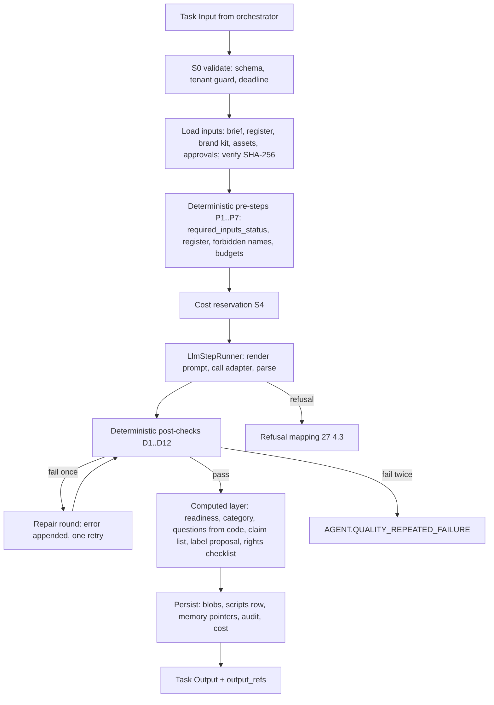
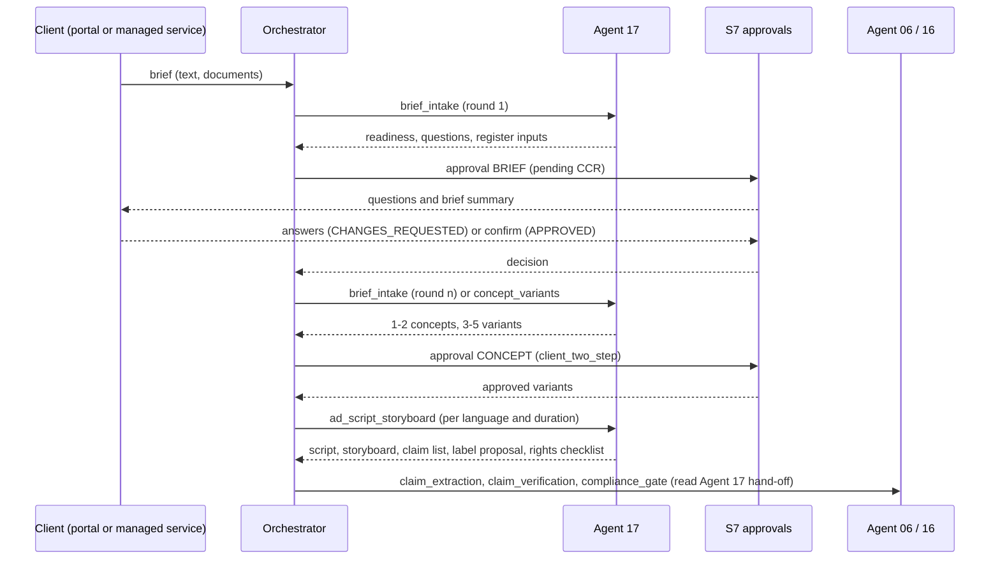

# Agent 17 — Brief & Creative Strategy (blueprint)

| Field | Value |
|---|---|
| Status | Draft — documentation. Software: **Planned** (rule 6, rule 7) |
| Owner | Agent 17 Brief & Creative Strategy; integration owner: Agent 01 (orchestrator) |
| Package | `agent_17_brief_creative_strategy` (27 §7.2); prompts `prompts/agent_17_brief_creative_strategy/`; evals `evals/agent_17_brief_creative_strategy/` |
| Directive sections covered | §3.1 row 17 (client/campaign brief intake and clarification questions, audience and objective, creative concepts and variants, ad scripts and storyboards per format, claim list to 06/16, usage-rights and talent/likeness checklist, client concept approval before production), §1D (advertising line: 1D.1 workflow, 1D.2 rules, 1D.3 blocking checks, 1D.4 ad quality and 3-5 variants), §3.3 (contracts, failures, quality, observability, AI providers, memory), §3.5 (prompt, eval, code standards), §4 (26 sections) |
| Owner decisions applied | D1 (3A production line first; **Agent 17 is not part of 3A or 3B**; spend limits at each provider; keys only through the environment's secret mechanism; render never in market hours; no upload, no Google OAuth in 3A), D2 (blueprints of non-3A agents are written in parallel and approved before their own build begins) |
| Binding contracts | GLOSSARY_AND_IDS.md (§6.15 `approval_kind`, §6.37 rule-pack keys, §6.39-6.40 claims, §6.43 `disclosure_decision`, §6.47 `tier`, §6.49-6.51), 03_COMMUNICATION_STANDARD.md, 04_DATABASE_ARCHITECTURE.md (§5.3, §5.10, §5.11, §5.12, §5.15, §5.16), 07_FAILURE_MANAGEMENT.md, 24_PRODUCTION_TYPES.md (§3.2 task types `agent_17.brief_intake`, `agent_17.concept_variants`, `agent_17.ad_script_storyboard`; §7.3-7.5), 27_ENGINEERING_STANDARDS.md |
| Shared docs referenced by name/§ only | 25_ADVERTISING_COMPLIANCE.md (§2 workflow, §3 substantiation, §4.3 rules `ADV-R1..R16`, §5 sector packs, §6 disclosure decision, §7 releases and likeness, §8 virtual presenters, §10 usage-rights), 13_COMPLIANCE_YOUTUBE_POLICY.md, 18_PRODUCTION_QUALITY_STANDARD.md, 09_COST_AND_BUDGET.md, 08_SECURITY.md §8, 22_DATA_PROTECTION.md, 20_MULTI_TENANCY_AND_ENTERPRISE.md, 3A_SLICE_SPEC.md, ADR-001, ADR-005, ADR-007, KNOWLEDGE_LIBRARY_PLAN.md (not used by this agent; client material is the client's own and is not an owner-library collection) |
| Facts cited | RESEARCH_LOG IN-04 (ASCI synthetic-content labelling; **not in force on 2026-11-18**), IN-05 (ASCI influencer rules), IN-06 (IT Rules on synthetically generated information, in force 20 Feb 2026), IN-07 (DPDP Rules), YT-06 / YT-07 / YT-09 (synthetic-media field, disclosure policy, AI personas), PR-01 / PR-02 / PR-03 (models, batch and caching, API separate from subscription), INF-11 (RLS). The ASCI Code Chapter I text is cited as read in 25 §1.3 (it has **no RESEARCH_LOG row yet: REQUIRES REVIEW (Phase 1): add a log row**) |
| Marking | Every section ends its first line with **MVP** (3A / 3B / 3C, tier 0-3 per GLOSSARY §6.47). Agent 17 is **3C, Tier 1+** (built when the first ad client is signed, 02 §registry, 24 header, plan Q17). Nothing here is part of 3A or 3B |
| Conventions | `(pending CCR)` = a contract item that does not exist in Wave A/B-1 and is listed in the structured return for the integrator. `REQUIRES REVIEW (Phase 1): <need>` = an unknown value; none is invented. All client names, brands, people and documents used in examples are fictional. No private method, book text or server detail appears in this document. |

---

## 1 Identity and mission
**MVP: 3C · Tier 1 (first managed-service ad client); portal-driven intake is Tier 2.**

### 1.1 Mission
Agent 17 is the creative front of the advertising line (directive §1D.1). It turns a client's brief into (a) a clarified, structured brief with the open questions the client must answer, (b) a small set of creative concepts with 3 to 5 test variants the client can choose from, and (c) for the approved variant, an ad script and a shot-by-shot storyboard per ordered format, together with the hand-off facts the compliance chain needs: the **claim list** (every factual, comparative, statistical or performance statement and the client document that is supposed to support it), the **label proposal** (which AI-content elements the ad contains), and the **usage-rights and talent/likeness checklist** (who or what needs a release, consent or permission). It writes creative text; it never decides truth, compliance or approval.

### 1.2 Where it sits
| Production type (24 §7) | Stages that use Agent 17 | Notes |
|---|---|---|
| `AD_SPOT` (24 §7.3) | `agent_17.brief_intake` → (approval `BRIEF`, pending CCR, see §23) → `agent_17.concept_variants` → approval `CONCEPT` (`client_two_step`) → `agent_17.ad_script_storyboard` → `agent_06.claim_extraction` | the reference flow (25 §2) |
| `ECOMMERCE_PRODUCT` (24 §7.5) | `agent_17.brief_intake`, `agent_17.ad_script_storyboard` | no concept stage unless ordered; the script step builds an implicit variant from the brief (prompt `ad_script_storyboard.v1` rule 3, input row `approved_variant`) |
| `EXPLAINER_CORPORATE_TRAINING` (24 §7.4) | `agent_17.brief_intake` only | the clarified brief is confirmed by approval `BRIEF`; scripting is Agent 05; ad-specific outputs are skipped (§8) |
| `CHANNEL_LONG_FORM`, `SHORTS`, `DUBBING_LOCALISATION` | none | owner channels use Agent 03 (17 replaces 03 for client types only, §3.1) |

All three task types run as `AI_IO` tasks on queue `ai`, capability `llm` (24 §3.1). Control flow is in the orchestrator's state machine (03 §11); Agent 17 never calls another agent and never creates tasks.

### 1.3 Authority boundaries
| Agent 17 **decides** | Agent 17 **does not decide** (owner of the decision) |
|---|---|
| how to restate the brief faithfully (no added facts) | whether the brief is approved (client, approval `BRIEF`) |
| which questions to ask the client and which are blocking | whether the product or sector may be served (owner decision on the alcohol/tobacco-surrogate sector, 25 §5.1; Agent 16 for the pack) |
| which statements in the brief are claims and which client document is tied to them by the client's own words | whether a claim is true or supported (client carries truth, 25 §1.2; Agent 06 proposes, **Agent 16 final**, Q5) |
| the creative concepts, variants, hooks, scripts and storyboards (inside the limits of §6.6) | which concept is produced (the client, approval `CONCEPT`); the script and storyboard (client, approvals `SCRIPT` / `STORYBOARD`) |
| which AI-content elements the storyboard contains (declaration) | whether an AI label is required (Agent 16, ADV-R7; Agent 17 only **proposes**, ADV-R16 compares) |
| which people, voices, brands and elements need a release or permission (the checklist) | whether a release is valid or covers the use (human check, 25 §7.2 step 3); legal drafting (lawyer, ⚖) |
| its own retries inside its caps | job routing, revision loops, approvals, budgets (orchestrator, S7, S4) |

It never writes to `approvals`, `editorial_contributions`, `compliance_verdicts` or `claims`; never raises a budget; never calls the YouTube API (zero quota units); never uploads; never fetches web pages or client links; has no tool-use for the model (the LLM returns JSON that code validates, 27 §4); and never names or imitates a real person in anything it writes.

### 1.4 Success criteria (measurable; thresholds are config and set at the first client pilot; the eval thresholds are in §26)
| ID | Criterion | Measure |
|---|---|---|
| SC-1 | Fidelity of the structured brief | 100 % of recorded quotes are exact substrings of the client's text (eval A2) |
| SC-2 | No invented claim | 0 statements in any script or concept outside the register of documented claims (eval `ad_script_storyboard` A5, `concept_variants` A3) |
| SC-3 | No unapproved person or brand | 0 shots flagged as a real person or a third-party brand without an approved reference (A7, A8) |
| SC-4 | Variants are real alternatives | all variants of a concept have distinct angles and hook overlap within `ad.variants.max_hook_overlap` (A6) |
| SC-5 | Clarification converges | share of briefs that reach `READY` within `ad.brief.max_clarification_rounds` rounds (MEASURED at the first pilot; target set then) |
| SC-6 | Plan arithmetic is exact | shot durations sum to the ordered duration in 100 % of delivered storyboards (A4) |
| SC-7 | Hand-off completeness | every delivered script has a claim list, a label proposal and a rights checklist; 0 downstream `PERMANENT.MISSING_DEPENDENCY` caused by Agent 17 |
| SC-8 | Cost discipline | cost per ordered ad stays inside the per-video budget of D1; per-task cost recorded (ESTIMATE until measured, §17) |
| SC-9 | Downstream pass rate | share of scripts that pass `agent_06.claim_extraction` and `agent_16.compliance_gate` without a revision loop caused by Agent 17 content (MEASURED; no target until the pilot) |

---

## 2 Functional requirements
**MVP: 3C · Tier 1. Each row names its tier: the brief, concept and script functions are Tier 1; client self-service answers in a portal are Tier 2.**

### 2.1 What, why, when
| ID | Function | Why | When / trigger | Inputs | Outputs | Dependants | Tier |
|---|---|---|---|---|---|---|---|
| FR-01 | Validate the task input and tenant context (S0) | rule 9; 03 §7 | every task start | Task Input, context refs | accepted input or structured rejection | orchestrator | 1 |
| FR-02 | Compute `required_inputs_status` (brand kit, client media, release documents) from the tenant's own rows | the model must not ask what the system already knows; 24 §7.3 `required_inputs` | `brief_intake` | `brand_kits`, `assets`, client documents | status map | prompt input, FR-05 | 1 |
| FR-03 | Extract the structured brief (objective, audience, product, offer, CTA, tone, mandatories, formats, languages) | §1D.1 step 1 | `brief_intake` | brief text, answers, document titles | `brief` | FR-05, 07 concept, 15 | 1 |
| FR-04 | List stated claims, named people, named third-party brands, requested AI-content classes and risk notes | claim substantiation (25 §3), rights (25 §7), label decision inputs (25 §6.2) | `brief_intake` | as FR-03 | the five lists | claim register, checklist, Agent 16 | 1 |
| FR-05 | Decide clarification questions: model asks about content ambiguity; **code** asks for missing standard inputs (brand kit, release documents, a document per claim, formats) | a clarified brief is a required input; ask once, completely | `brief_intake` | FR-02..04 | `questions[]` with `generated_by` | client (via S7 / managed service) | 1 |
| FR-06 | Compute `brief_readiness` (`READY` / `NEEDS_CLARIFICATION` / `NEEDS_HUMAN_REVIEW`, pending CCR) deterministically | the readiness gates the next stage | `brief_intake` | FR-02..05 | `readiness`, `readiness_reasons` | orchestrator routing (approval `BRIEF`) | 1 |
| FR-07 | Map the category to sector keys (code) and record `category.status` | Agent 16 loads sector packs from the brief category (25 §5.3); unknown category stops the job at validation | `brief_intake` | `category_candidates` | `category` | Agent 16, orchestrator J02 | 1 |
| FR-08 | Build the **claim register** from the approved brief: every stated claim with `register_status` `DOC_ATTACHED` / `NO_DOC` and its conditions | only documented claims may be used in creative work (ADV-R1) | `concept_variants` P3, `ad_script_storyboard` P3 | brief output, document refs | `claim_register` | concept and script steps | 1 |
| FR-09 | Build `forbidden_names` (people without a release, competitor brands) and `approved_people` / `approved_brands` | ADV-R5, ADV-R6; generation prompts must never name a real person (25 §7.2 step 4) | P4 of the two creative steps | brief output, `assets.release_ref`, `voice_consents`, client documents | lists | prompt inputs, post-checks | 1 |
| FR-10 | Propose 1-2 concepts and exactly 3-5 variants | §1D.1, §1D.4 | `concept_variants` | brief, register, constraints | concept deck | approval `CONCEPT`, script step | 1 |
| FR-11 | Write script and storyboard per ordered format; the script is written once per (language, duration) and locked for the other ratios | §1D.1, §1D.4; consistent wording across ratios | `ad_script_storyboard` | approved variant, register, media inventory | script + storyboard per format | Agents 06, 07, 09, 08, 10, 16 | 1 |
| FR-12 | Emit the **claim list** for Agents 06 and 16 | "claim list sent to 06/16 for substantiation" (§3.1) | `ad_script_storyboard` | FR-11 | `claim_list` | 06 (extraction, verification), 16 | 1 |
| FR-13 | Build the **label proposal** from the element declarations by the table of 25 §6.2 (code) | label decision input; ADV-R7, ADV-R16 | `ad_script_storyboard` | shot declarations, destinations, approved people roles | `label_proposal` | Agent 16, Agent 13 (via Agent 16's decision) | 1 |
| FR-14 | Build the **usage-rights and talent/likeness checklist** (code) | ADV-R5 inventory; `USAGE_RIGHTS` record input (25 §10.2) | `ad_script_storyboard` | FR-04, FR-11 | `rights_checklist` | Agent 16, S7 (`USAGE_RIGHTS`), Agent 08 | 1 |
| FR-15 | Handle revisions: a revision task carries `revision_feedback`; IDs of unchanged variants stay stable | 03 §3 (revision routing), `limits.max_revision_loops` | revision iteration | feedback | new iteration output | orchestrator | 1 |
| FR-16 | Persist documents (write-once blobs, SHA-256), the `scripts` row, `memory_items` pointers, cost and audit | 03 §8; 04 | end of each task | validated output | `output_refs` | all downstream | 1 |
| FR-17 | Remember concept history and client preferences per workspace, from human decisions only | avoid repeating concepts for one client | after `CONCEPT` decisions | approval decisions | `memory_items` | next campaign | 2 |

### 2.2 Out of scope (explicit)
Truth or sufficiency of any claim; recommending a price, a media plan or a budget; choosing a sector pack; selecting or generating media; voice choice (Agent 07); shot-level planning and timeline (Agent 09, which refines the storyboard); thumbnails and metadata (11, 12 are not used by ad types); rendering; client communication (S7 notifications); contract terms; reading client web links; document-to-text extraction (contract request).

---

## 3 Non-functional requirements
**MVP: 3C · Tier 1.**
| ID | Requirement | Value / rule |
|---|---|---|
| NFR-1 | Determinism of structure | the same input and the same recorded model output give the same computed fields (readiness, register, label proposal, checklist); the computed layer has no randomness and no clock dependence |
| NFR-2 | Idempotency | every external side effect carries an idempotency key (03 §9): LLM call key per (task, step, ratio, attempt-independent content hash); `scripts` insert keyed by (task, format); blob writes are write-once |
| NFR-3 | Resource class | `AI_IO`, queue `ai`, capability `llm`; no CPU-heavy work; peak memory under 256 MB (ESTIMATE); runs inside the shared `ai_worker` (10 §7) |
| NFR-4 | Latency | dominated by provider latency; **not measured**; REQUIRES REVIEW (Phase 1): measure p50/p95 in the first eval run; a client waits on `brief_intake` and `concept_variants` (interactive), so these are not batch by default (§11) |
| NFR-5 | Bounded work | hard caps: LLM calls per task `resource_budget.max_llm_calls` (brief 2, concept 2, script `2 x ratios`), clarification rounds `ad.brief.max_clarification_rounds`, revision loops `limits.max_revision_loops` (07 §9); beyond them `AGENT.LOOP_CAP_EXCEEDED` or human review |
| NFR-6 | Tenant isolation | absolute; §19 |
| NFR-7 | Confidentiality | briefs, claims, client documents and concepts are client confidential data; never in logs or metrics; never used to train or tune shared prompts (§14, §19) |
| NFR-8 | Provider independence | provider and model by config only; fake and recorded adapters for every test (27 §8) |
| NFR-9 | Cost | within the per-video and pilot budgets (D1, 09); the agent reserves before each call and stops on breach (07 `RESOURCE.BUDGET_EXHAUSTED`) |
| NFR-10 | Language | the brief may be in any language of the client; the ad language is an order parameter (English, Hindi, Marathi first); JSON field values are English except ad text and quotes (§6.3) |
| NFR-11 | Honest scope | creative output is a proposal; every output carries `proposal_only = true` semantics (it is never a verdict) |
| NFR-12 | Accessibility of questions | clarification questions are one sentence, answerable in one reply, so that a client can answer on a phone |

---

## 4 Internal architecture
**MVP: 3C · Tier 1.**

Components are defined in §9; the state of a task in §16.

---

## 5 Full system prompt
**MVP: 3C · Tier 1. The real prompt text lives in the prompt files (27 §4); this section summarises and links them.**

There are three LLM steps, one prompt file each, all written to `prompts/_TEMPLATE.v1.md` (header table, Role, Objective, Inputs, Rules with rule packs by reference, Output JSON Schema with the `refusal` property, worked examples including a refusal path, Refusal and escalation, Self-check). Model, temperature, token caps, timeout, cost budget, caching and batch eligibility are configuration (`llm.agent_17.<task>.*`), never in the file.

| Prompt ID | File | Task type | Role in one line | Rule packs (by reference) |
|---|---|---|---|---|
| `agent_17/brief_intake.v1` | [`prompts/agent_17_brief_creative_strategy/brief_intake.v1.md`](../prompts/agent_17_brief_creative_strategy/brief_intake.v1.md) | `agent_17.brief_intake` | faithful structured brief, claims, people, brands, AI-content requests, questions, risk notes | `rp.advertising_asci_in`; sector packs when known |
| `agent_17/concept_variants.v1` | [`prompts/agent_17_brief_creative_strategy/concept_variants.v1.md`](../prompts/agent_17_brief_creative_strategy/concept_variants.v1.md) | `agent_17.concept_variants` | 1-2 concepts and exactly 3-5 distinct variants, claims only from the documented register | `rp.advertising_asci_in`; sector packs; `rp.youtube_general` if YouTube |
| `agent_17/ad_script_storyboard.v1` | [`prompts/agent_17_brief_creative_strategy/ad_script_storyboard.v1.md`](../prompts/agent_17_brief_creative_strategy/ad_script_storyboard.v1.md) | `agent_17.ad_script_storyboard` | script and storyboard for one format; per-shot declarations of people, presenter kind and AI elements | same as concept step |

Design points that hold for all three prompts:
1. **The model proposes; code decides.** Readiness, category mapping, code-generated questions, claim register, claim list, label proposal and rights checklist are computed by code from the model's declarations (§6). The prompts forbid the model to state a verdict, a label or a legal conclusion.
2. **No fact without a source.** Product facts come only from the client's brief and documents; creative steps use only register claims with a document attached. A statement outside the register is a defect, repaired once, then `AGENT.QUALITY_REPEATED_FAILURE`.
3. **No real person, no imitation.** Prompts forbid naming, describing or imitating a real, identifiable person or a competitor; people appear only as generic descriptors or as `person_ref` of an approved person (25 §7.2 step 4: generation prompts later built from shot descriptions must never name a real person).
4. **Untrusted text.** Brief text, answers, document titles, feedback and names are data. Injection cases are in every eval set.
5. **Shared prefix has no tenant data.** The system prompt, rules and schema form the cacheable prefix (PR-02); tenant content is in the user part only (08 §8 layer 4).
6. **Rule packs by reference.** `{{rule_pack:rp.advertising_asci_in}}` is resolved at runtime from `rule_packs`; the version is recorded per call. Sector packs are stubs until researched (25 §5): the prompts forbid inventing sector rules.
7. **Language.** Rule and output text in English; quotes and ad text in the client's language (§6.3).
8. **Judge prompts** (`agent_17/<task>_judge.v1`) are separate files written at build time with the eval runner (planned paths in §26); the judge never decides a verdict.

Prompt changes are `v<N+1>` and trigger the eval gate (27 §5). A released prompt is immutable.
